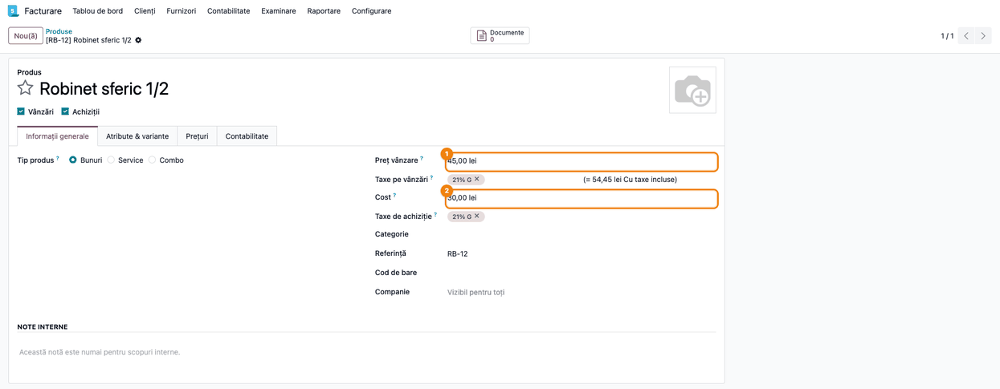
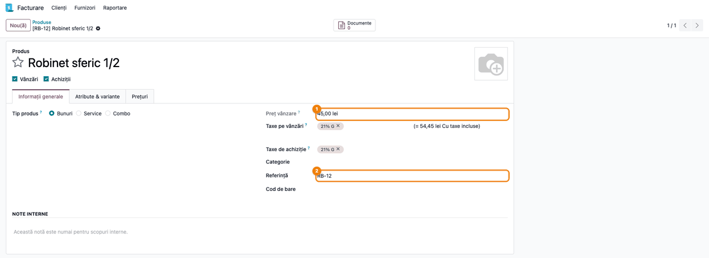
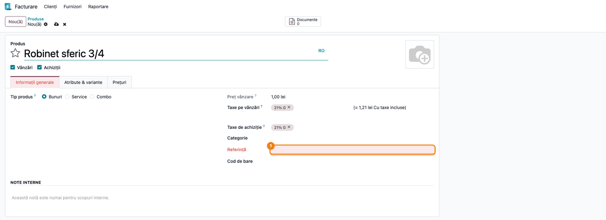

# Fișă Modul: Restricții pe câmpurile produsului, pe grup de utilizatori

**Modul:** `deltatech_access`
**Utilizator principal:** Administrator Odoo (configurează regulile); agenții de vânzări, gestionarii și ceilalți utilizatori restricționați lucrează pe formularul produsului
**Prioritate:** 🟢 Scăzută (configurare de interfață, fără efect contabil)

---

## 1. Scop business

În Odoo standard, un utilizator care are drept de modificare pe produse poate schimba orice câmp al
formularului: prețul de vânzare, costul, referința. Ca să ascunzi sau să blochezi un câmp pentru o
categorie de utilizatori, trebuie scrisă o vizualizare moștenită, deci intervine un programator. Modulul
permite administratorului să stabilească, **fără cod**, pentru un grup de utilizatori, ce câmpuri ale
formularului de produs sunt **doar citire**, **obligatorii** sau **invizibile**. Exemplul din fișă:
agenții de vânzări văd prețul de vânzare, dar nu îl pot schimba, nu văd costul și trebuie să completeze
referința internă.

## 2. Bază legală și context

Modulul nu implementează o obligație legală. Ține de controlul intern: separarea atribuțiilor (cine
stabilește prețurile, cine vede costurile de achiziție) și completarea unor date obligatorii la nivelul
firmei (de exemplu referința internă, folosită la căutare și pe documente).

Restricțiile sunt **de interfață**. Când meniul deschide produsul fără o vizualizare anume, se aplică
toate regulile produsului, de pe orice vizualizare; când meniul indică o vizualizare, se aplică doar
regulile salvate pe ea. Ele nu
înlocuiesc drepturile de acces ale Odoo (grupuri, reguli de înregistrare); vezi limitările din secțiunea 6.

## 3. Utilizatori și roluri

- **Administrare / Setări** (administratorul Odoo) — singurul care ajunge la meniul **Setări → Tehnic**,
  unde se definesc regulile, în modul dezvoltator.
- Utilizatorii restricționați — membrii grupului ales în regulă. În exemplu, grupul **Agent vânzări**
  (creat pentru demo), cu drept de creare pe produse și acces la **Facturare**.

Modulul nu adaugă grupuri proprii. Roluri recomandate la testare: administratorul (vede formularul
complet) și un utilizator din grupul restricționat (de exemplu „Mihai Ionescu”, grupul **Agent vânzări**).

## 4. Conturi și date implicate

Modulul nu creează note contabile și nu folosește conturi. Date minime pentru demo:

- un grup de utilizatori, de exemplu **Agent vânzări** (**Setări → Utilizatori & Companii → Grupuri**,
  în modul dezvoltator);
- un utilizator intern din acest grup, cu drept de creare pe produse;
- un produs, de exemplu **[RB-12] Robinet sferic 1/2**, preț de vânzare 45,00 lei, cost 30,00 lei.

## 5. Configurare inițială

1. Instalați modulul `deltatech_access` (dependențe: `base`, `product`).
2. Activați modul dezvoltator (**Setări**, linkul **Activează modul de dezvoltare** din josul paginii), ca să apară meniul **Tehnic**.
3. Creați grupul restricționat și adăugați în el utilizatorii vizați (**Setări → Utilizatori &
   Companii → Grupuri**).
4. Identificați formularul de produs pe care lucrează utilizatorii: **Setări → Tehnic → Interfață
   utilizator → Vizualizări**, căutați după **Model** = `product.template`, tipul **Formular**. În
   exemplu, `product.template.product.form`.

## 6. Flux de utilizare

### Pasul 1 — Regulile, în tabul „Câmp de acces” al vizualizării

Deschideți vizualizarea formularului de produs (**Setări → Tehnic → Interfață utilizator →
Vizualizări**, `product.template.product.form`) și treceți în tabul **Câmp de acces**, adăugat de
modul. Cu **Adaugă o linie** introduceți câte o regulă:

- **Grup** — grupul căruia i se aplică regula. Fără grup, regula se aplică **tuturor utilizatorilor**,
  inclusiv administratorului.
- **Câmp** — câmpul formularului; **Nume câmp** se completează singur cu numele tehnic.
- bifa **Numai citire**, **Necesar** sau **Invizibil**.

În exemplu, pentru grupul **Agent vânzări**: **Preț vânzare** doar citire, **Cost** invizibil,
**Referință internă** obligatorie. Salvați vizualizarea.


În **Nume câmp** se poate scrie și altceva decât un câmp:

- numele (`name`) sau identificatorul (`id`) unui **grup, bloc sau tab** al formularului: cu bifa
  **Invizibil**, blocul sau tabul întreg se ascunde (lăsați **Câmp** gol);
- o expresie XPath (orice text care conține `//`), de exemplu `//field[@name='barcode']`, pentru cazurile în care
  același câmp apare de mai multe ori.

O regulă salvată pe formular se aplică formularului de produs deschis din meniurile standard
(**Facturare → Clienți → Produse**, **Vânzări → Produse → Produse** etc.), care nu indică un formular anume. În
general, pe o vizualizare deschisă fără indicație explicită se aplică regulile de pe **toate**
vizualizările produsului. **Listele** de produse din meniurile Facturare și Vânzări sunt însă indicate
explicit: ca **Cost** să dispară și din ele, adăugați aceeași regulă pe
`product.template.list.sellable.inherit` și pe `product.template.list.purchasable.inherit` (vezi
„Limitări de cunoscut”).

### Pasul 2 — Formularul produsului, văzut de administrator

Administratorul nu face parte din grupul **Agent vânzări**, deci regulile nu i se aplică. În
**Facturare → Clienți → Produse**, produsul **Robinet sferic 1/2** are **Preț vânzare** (45,00 lei) și
**Cost** (30,00 lei) editabile, iar **Referință** e opțională.



### Pasul 3 — Același produs, văzut de agentul de vânzări

Autentificat ca „Mihai Ionescu” (grupul **Agent vânzări**), utilizatorul deschide același produs din
**Facturare → Clienți → Produse**. Verificați pe ecran:

- eticheta **Preț vânzare** e gri, iar la clic pe valoare nu se deschide editarea: agentul vede prețul,
  dar nu îl poate modifica;
- rândul **Cost** lipsește din formular;
- **Referință** e editabilă; obligativitatea ei se vede la salvare (pasul 4).

În locul rândului **Cost** rămâne un spațiu gol; este efectul normal al regulii. Tabul **Contabilitate**
și meniurile **Tablou de bord**, **Contabilitate**, **Examinare**, **Configurare** lipsesc
din cauza drepturilor de acces ale agentului (doar **Facturare**), nu din cauza regulilor modulului.



### Pasul 4 — Produs nou salvat fără referință

Agentul creează un produs cu **Nou(ă)**, completează doar numele („Robinet sferic 3/4”) și salvează.
Odoo nu salvează: eticheta **Referință** și câmpul devin roșii, iar tabul **Informații generale** e
marcat cu roșu. Agentul completează referința și salvează din nou.

Pe un produs nou, **Preț vânzare** rămâne la valoarea implicită (1,00 lei) și nu poate fi modificat de
agent: prețul îl stabilește ulterior cineva din afara grupului.



### Limitări de cunoscut

- **Doar produsele.** Regulile se aplică vizualizărilor (formulare și liste) de **produs** și de **variantă de
  produs**. O regulă salvată pe vizualizarea altui model (partener, comandă, factură) se poate
  introduce, dar **nu are niciun efect**. Variantele au formulare proprii: o regulă pusă pe formularul
  `product.template` nu se aplică formularului variantei.
- **Restricție de interfață, nu drept de acces.** Câmpul doar citire sau ascuns rămâne modificabil prin
  import, prin API sau din alte ecrane care îl afișează. Pentru o interdicție reală, folosiți drepturile
  de acces standard.
- **Vizualizare indicată explicit.** Când un meniu deschide produsul cu o vizualizare anume, se aplică
  doar regulile salvate pe acea vizualizare. Exemple: lista din **Facturare → Clienți → Produse** și
  **Vânzări → Produse → Produse** folosește `product.template.list.sellable.inherit` (coloana **Cost** e ascunsă
  implicit, dar agentul o poate afișa din selectorul de coloane), iar lista din **Facturare → Furnizori
  → Produse** și din **Achiziții → Produse → Produse** folosește `product.template.list.purchasable.inherit`,
  unde **Cost** se vede din start (meniurile se deschid în kanban; comutați pe **Listă**).
  Regula „Cost invizibil” de pe formular nu ascunde coloana în niciuna dintre ele: puneți aceeași regulă
  pe ambele liste. Invers, o regulă pusă pe o listă se aplică și formularului deschis fără indicație.
- **Fără meniu propriu.** Regulile se gestionează numai din tabul **Câmp de acces** al vizualizării.
  Lista tuturor regulilor există doar ca acțiune fără meniu.
- **Oricare utilizator intern poate modifica regulile.** Dreptul pe reguli e acordat grupului
  **Utilizator intern**, nu doar administratorului: prin acțiunea fără meniu (URL direct) sau prin API,
  agentul își poate șterge chiar regula care îl restricționează (vezi secțiunea 11).
- **Efect după reîncărcare.** Odoo păstrează vizualizările în memoria browserului. Redeschiderea
  formularului în aceeași pagină nu aduce regula nouă: utilizatorul restricționat reîncarcă pagina (F5).
  Prima afișare după F5 poate veni încă din memorie; regula nouă apare la următoarea deschidere a
  formularului.

### Note de monografie și raportare

Modulul nu generează note contabile și nu modifică rapoarte. Indirect, regulile **Numai citire** și
**Invizibil** pe **Preț vânzare** și **Cost** protejează prețurile de vânzare și costul folosit la evaluarea stocului de
modificările din interfață făcute de utilizatorii restricționați.

## 7. Legături cu alte module / declarații

| Modul / proces | Rol în flux |
|---|---|
| `product` | vizualizările (formulare și liste) de produs și de variantă, pe care se aplică regulile |
| `base` | vizualizările (tabul **Câmp de acces**) și grupurile de utilizatori |
| `account`, `sale`, `stock`, `purchase` | meniurile din care se deschid produsele; regula se aplică indiferent de meniu, cât timp meniul folosește formularul implicit |

Ce e automat: aplicarea regulilor la fiecare deschidere a unei vizualizări de produs, după
grupurile utilizatorului (inclusiv grupurile moștenite din alte grupuri).

Ce rămâne manual: crearea grupurilor și a regulilor, alegerea vizualizării, verificarea regulilor la
actualizarea modulelor care schimbă formularul de produs.

## 8. Verificări pentru consultant

- [ ] Tabul **Câmp de acces** apare pe vizualizarea `product.template.product.form`, în modul dezvoltator.
- [ ] Administratorul, fără grupul **Agent vânzări**, vede **Preț vânzare** și **Cost** editabile.
- [ ] Agentul vede **Preț vânzare** doar citire și nu vede rândul **Cost**.
- [ ] Agentul nu poate salva un produs fără **Referință**: câmpul se marchează cu roșu.
- [ ] Un utilizator care primește grupul **Agent vânzări** prin alt grup (grup moștenit) are aceleași restricții.
- [ ] O regulă fără **Grup** se aplică tuturor, inclusiv administratorului.
- [ ] O regulă cu **Invizibil** și numele unui tab sau bloc în **Nume câmp** (fără **Câmp**) ascunde tot tabul sau blocul.
- [ ] După modificarea unei reguli, efectul apare după F5 și redeschiderea formularului.
- [ ] În listele **Facturare → Clienți → Produse** și **Facturare → Furnizori → Produse**, coloana **Cost** se ascunde pentru agent doar dacă regula e pusă și pe `product.template.list.sellable.inherit`, respectiv `product.template.list.purchasable.inherit`.
- [ ] O regulă pusă pe vizualizarea altui model decât produsul nu schimbă nimic (limitare cunoscută).

## 9. Mesaje de eroare frecvente

| Mesaj | Cauză | Remediere |
|---|---|---|
| Notificarea „Câmpuri nevalide” cu câmpul Referință marcat cu roșu la salvare | Regula **Necesar** pe câmp, iar utilizatorul l-a lăsat gol | Completați câmpul și salvați |
| Regula nu are efect, fără mesaj | Utilizatorul nu e în grupul regulii, regula e pe alt model decât produsul sau meniul folosește altă vizualizare | Verificați grupul, modelul și vizualizarea folosită de meniu |
| Câmpul doar citire nu se poate completa nici la creare | **Numai citire** se aplică și pe înregistrările noi | Valoarea o completează un utilizator din afara grupului |
| Regula **Invizibil** cu numele unui bloc nu ascunde nimic | Numele nu corespunde atributului `name`/`id` al blocului; s-a completat **Câmp**, care suprascrie singur **Nume câmp** cu numele câmpului; sau numele blocului coincide cu un câmp din formular, iar regula ascunde câmpul, nu blocul; sau regula e pe o vizualizare de listă (blocurile se ascund doar pe formular) | Verificați numele în tabul **Arhitectura** al vizualizării și lăsați **Câmp** gol |

## 10. Capturi de ecran

Capturile din `static/description/` sunt **generate automat** din `tests/test_screenshots.py`
(mixinul `ScreenshotCase` din `l10n_ro_doc_screenshots`, import defensiv), în **limba română**, pe
planul de conturi RO (`setup_country("ro")`), pe compania de test „Demo Distribuție SRL”. Același test
generează și varianta EN în `static/description/en/`, folosită de `readme/USAGE.md`; pașii 3 și 4
sunt capturați cu utilizatorul „Mihai Ionescu” din grupul **Agent vânzări**:

1. `01_reguli_pe_vizualizare.png` — vizualizarea formularului de produs, tabul **Câmp de acces** cu cele trei reguli.
2. `02_produs_administrator.png` — produsul văzut de administrator, cu **Preț vânzare** și **Cost** editabile.
3. `03_produs_agent.png` — același produs văzut de agent: preț doar citire, fără **Cost**, **Referință** editabilă (obligatorie la salvare, pasul 4).
4. `04_referinta_obligatorie.png` — produs nou salvat de agent fără **Referință**, cu câmpul marcat cu roșu.

Regenerare:

```bash
./odoo/odoo-bin -c odoo.conf -d <db> \
    -i l10n_ro,deltatech_access,l10n_ro_doc_screenshots \
    --test-tags=/deltatech_access:TestAccessScreenshots --stop-after-init
```

## 11. Observații pentru manual

Păstrați ideea centrală: **regula ține de grup și de formular, nu de utilizator**. Un utilizator
primește restricțiile tuturor grupurilor din care face parte. Subliniați că restricțiile sunt de
interfață, valabile doar pe produse, și că nu înlocuiesc drepturile de acces. La implementare,
recomandați ca regulile să fie administrate doar de administrator: modulul permite oricărui utilizator
intern să le modifice, inclusiv celui restricționat, prin acțiunea fără meniu sau prin API.
