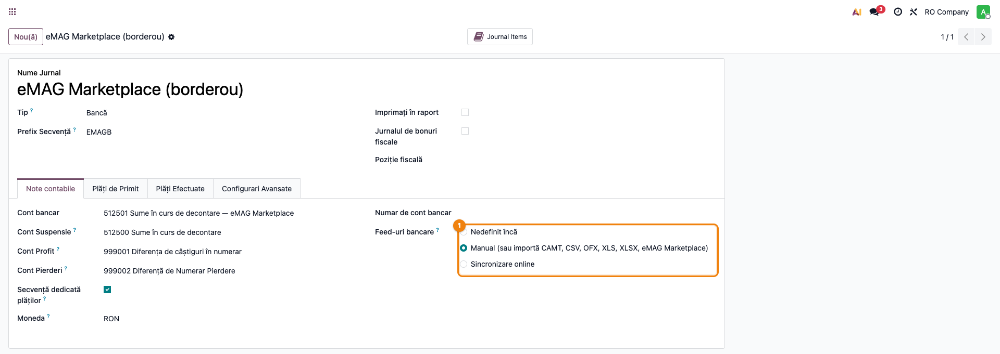
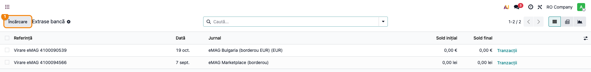
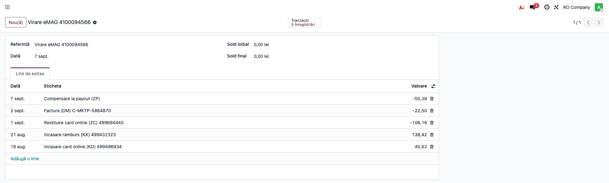
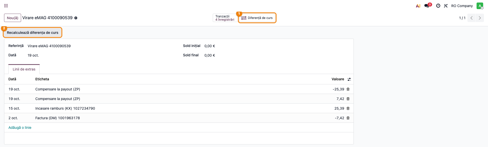
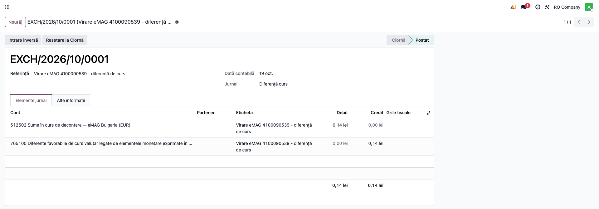

# Fișă Modul: Import borderou de plăți eMAG ca extras de cont

**Modul:** `deltatech_account_bank_statement_import_emag`
**Utilizator principal:** Contabil încasări, Operator marketplace
**Prioritate:** 🔴 Ridicată (la fiecare virare eMAG; fără el, zeci de încasări se operează manual)

---

## 1. Scop business

Comercianții care vând pe eMAG Marketplace nu încasează bani de la fiecare client în parte: eMAG
colectează încasările (card online și ramburs), își reține comisioanele și virează periodic o
**singură sumă** în contul comerciantului. Detalierea acelei virări este raportul **Account
statement details** (XLSX), descărcat din panoul de comerciant — numit uzual *borderou de plăți*.

Fără modul, borderoul ar trebui mapat coloană cu coloană în asistentul de import, iar sumele
interpretate manual: eMAG scrie valorile din perspectiva lui, deci încasările comerciantului apar
cu minus. Modulul încarcă **fișierul exact cum vine**, îl recunoaște singur, creează câte un extras
de cont pentru fiecare virare și pregătește liniile pentru reconciliere, cu clientul deja completat
acolo unde referința permite.

## 2. Bază legală și context

Nu există un temei legal specific — este un flux operațional de **reconciliere a încasărilor prin
marketplace**. Contextul contabil: banii încasați de eMAG de la clienți nu sunt încă în contul
bancar al comerciantului, deci tranzitează un cont propriu de **sume în curs de decontare** (un analitic al lui
5125, notat în fișă **5125.EMAG**, pe un jurnal dedicat eMAG), iar virarea efectivă în bancă se închide prin contul **581
„Viramente interne"** (OMFP 1802/2014, funcțiunea conturilor 512 și 581; pct. 302 alin. (2) cere
evidența distinctă a sumelor în curs de decontare în 5125).

Partenerul de decontare este **Dante International SA** (operatorul eMAG): el încasează pentru
comerciant, facturează comisioanele și face compensarea. Plătitorul din extrasul băncii poate fi
**HeyBlu Financial Services IFN SA** (instituția de plată din grupul eMAG, prin care pleacă virările);
HeyBlu nu este client sau furnizor al comerciantului și **nu primește sold** pe 4111, 401 sau 461.
Cine ține banii și cine are dreptul de compensare se verifică în contractul cu eMAG.

Creanța față de client se stinge la reconcilierea liniei de încasare, indiferent că banii au fost
încasați de eMAG în numele comerciantului.

## 3. Utilizatori și roluri

Contabilul care operează încasările și operatorul care administrează contul de marketplace.

Roluri recomandate pentru testare:
- Administrator funcțional: instalează modulul, creează jurnalul și contul de tranzit eMAG;
- Utilizator operațional: descarcă borderoul din panoul eMAG și îl încarcă în Odoo;
- Contabil/manager: reconciliază extrasul și verifică închiderea contului de tranzit.

## 4. Conturi și date implicate

> **Notație.** „5125.EMAG" și „473.EMAG" sunt nume simbolice în această fișă. În Odoo contul are un
> **cod numeric**, următorul analitic liber al sinteticului respectiv, după schema planului de conturi
> al companiei (de exemplu `512501` pentru un analitic al lui 5125, la coduri de 6 cifre), cu numele
> „Sume în curs de decontare — eMAG Marketplace". Peste tot în fișă, „5125.EMAG" înseamnă acel cont.

- **5125.EMAG „Sume în curs de decontare — eMAG Marketplace"** — cont dedicat jurnalului eMAG (banii aflați la eMAG);
- **4111 Clienți** — se închide la reconcilierea liniilor de încasare (KD, KX);
- **401 Furnizori** — facturile de comision emise de Dante International (DM), dacă sunt deja înregistrate;
- **461 Debitori diverși** (analitic Dante) — creanța față de Dante, la reclasificarea soldului din 5125.EMAG la închiderea lunii;
- **581 Viramente interne** — contrapartida liniei de virare (ZP), care se regăsește în extrasul băncii;
- **5121 Conturi la bănci** — unde intră efectiv virarea eMAG.

La borderourile în valută (eMAG HU în HUF, eMAG BG în EUR) se adaugă:

- **5125.EMAG în valută** — câte un cont pentru fiecare jurnal în valută (de ex. „Sume în curs de decontare —
  eMAG Ungaria", în HUF), separat de cel în lei, ca soldul fiecărei monede să se poată urmări distinct;
- **665 Cheltuieli din diferențe de curs valutar** / **765 Venituri din diferențe de curs valutar** — nota de
  diferență de curs a payout-ului, postată automat la import, și închiderea diferenței rămase pe 581 la virarea
  în lei.

Date minime pentru demo:
- companie românească cu localizarea contabilă instalată;
- un jurnal de tip **Bancă** dedicat eMAG, în RON, cu cont tranzitoriu (suspense) configurat;
- un fișier *Account statement details* descărcat din eMAG (sau o mostră sintetică echivalentă);
- opțional, facturi de client postate, cu numărul comenzii eMAG în referință, pentru reconciliere.

Pentru borderourile în valută, în plus:
- un jurnal de tip **Bancă** separat pentru fiecare monedă (de ex. `EMAGH` în HUF, `EMAGE` în EUR), cu
  moneda setată pe jurnal;
- cursurile BNR pentru moneda respectivă, pe fiecare zi din perioada borderoului (actualizarea automată a
  cursurilor sau introducere manuală în **Contabilitate → Configurare → Monede**);
- în **Contabilitate → Configurare → Setări**, secțiunea *Diferențe de curs*: jurnalul de diferențe de curs și
  conturile 665 / 765 completate — fără ele, importul în valută este refuzat (vezi §9).

Codurile de document care apar în borderou:

| Cod | Ce înseamnă | Semnul în fișierul eMAG |
|-----|-------------|-------------------------|
| `KD` | încasare card online | negativ |
| `KX` | încasare ramburs | negativ |
| `KM` | decont de vouchere (partea de voucher suportată de eMAG) | negativ |
| `ZC` | restituire card online (retur) | pozitiv |
| `DM` | factură eMAG (comisioane, servicii) | pozitiv |
| `C3` | notificare de închidere pre-înrolare | pozitiv |
| `ZP` | virarea efectivă către comerciant | pozitiv, egal cu suma tuturor celorlalte cu semn schimbat |

## 5. Configurare inițială

1. Instalați modulul `deltatech_account_bank_statement_import_emag`.
2. Creați contul de tranzit: **Contabilitate → Configurare → Plan de conturi**, analiticul lui 5125
   (codul numeric liber, de ex. `512501`; în fișă **5125.EMAG**) „Sume în curs de decontare — eMAG Marketplace", de tip **Bancă și numerar** (altfel
   Odoo nu îl acceptă drept cont al jurnalului de tip Bancă; la acest tip reconcilierea se dezactivează
   singură și nici nu e necesară — în extras se reconciliază contul tranzitoriu, nu contul jurnalului).
   Pentru contul tranzitoriu (pasul de mai jos) creați și un analitic al lui 473 (în fișă **473.EMAG**) de tip *Active
   circulante*.
3. Creați jurnalul eMAG, cu setările din tabelul de mai jos (**Contabilitate → Configurare →
   Jurnale → Nou**).
4. Verificați că în lista formatelor de import ale jurnalului apare **eMAG Marketplace** — semnul că
   modulul e activ pe această instanță (vezi Pasul 1).

### Definirea jurnalului eMAG

Un jurnal separat pentru fiecare cont de vânzător eMAG și pentru fiecare monedă a borderoului
(coloana *Document currency*; dacă e goală, se ia *Local company currency*).

| Câmp (fila Setări avansate / Informații) | Valoare | De ce |
|---|---|---|
| **Tip** | *Bancă* | doar jurnalele de tip Bancă au import de extrase |
| **Nume** | `eMAG Marketplace (borderou)` | numele apare pe cardul din tabloul de bord |
| **Cod scurt** | `EMAGB` (max. 5 caractere) | să nu se suprapună cu un jurnal de vânzări `EMAG` existent |
| **Monedă** | aceeași cu *Document currency* din fișier (de regulă RON) | extrasul se creează în moneda din fișier; jurnalul trebuie să fie în aceeași monedă |
| **Cont bancă / de numerar** (`default_account_id`) | **5125.EMAG** „Sume în curs de decontare — eMAG Marketplace", tip *Bancă și numerar*, fără reconciliere | aici stau banii cât timp sunt la eMAG; **nu** se pune un cont 5121 și nici un cont de bancă real |
| **Cont tranzitoriu** (`suspense_account_id`) | recomandat un cont dedicat, analiticul **473.EMAG** (tip *Active circulante*); acceptabil contul implicit al planului românesc (**5125**) | primește contrapartida fiecărei linii importate, până la reconciliere; fără el Odoo refuză crearea liniilor de extras. Cu 5125 implicit, contrapartida se anulează pe sinteticul 5125 (părintele lui 5125.EMAG), iar un sold nereconciliat nu se mai poate atribui jurnalului eMAG |
| **Cont bancar (IBAN)** | se lasă gol | jurnalul nu reprezintă un cont bancar; banii ajung în IBAN-ul real abia la virare |
| **Feed-uri bancare** | *Import* (formatul **eMAG Marketplace** apare în listă) | activează butonul de încărcare pe cardul jurnalului |

Jurnalul **nu** se folosește pentru nimic altceva (plăți furnizori, încasări directe): tot ce intră
în 5125.EMAG trebuie să vină din borderou, ca soldul lui să rămână o verificare curată.

## 6. Flux de utilizare

### Pasul 1 — Configurarea jurnalului eMAG

Accesați **Contabilitate → Configurare → Jurnale** și deschideți jurnalul „eMAG Marketplace
(borderou)", definit conform tabelului din secțiunea 5. În secțiunea **Feed-uri bancare** trebuie să
apară, printre formatele de import acceptate, și **eMAG Marketplace** — semnul că modulul este activ
pe această instanță. Verificați tot aici că *Cont bancă / de numerar* este 5125.EMAG și că jurnalul
are cont tranzitoriu.

La import, modulul verifică singur dacă suma tuturor liniilor unei virări este zero. Fișierul eMAG
se închide pe zero prin construcție — linia `ZP` este negativul tuturor celorlalte — deci o sumă
diferită înseamnă că fișierul descărcat este incomplet, iar importul se oprește. Verificarea nu se
poate dezactiva: un extras parțial s-ar reconcilia pe jumătate și ar lăsa contul de tranzit cu un
sold care seamănă cu o diferență obișnuită de reconciliere, iar reîncărcarea fișierului complet nu
l-ar repara, fiindcă liniile deja aduse sunt sărite ca duplicate.



### Pasul 2 — Încărcarea borderoului original

Descărcați din panoul de comerciant eMAG raportul **Account statement details** pentru perioada
dorită. Nu îl deschideți și nu îl resalvați — se încarcă exact cum vine.

Din **Contabilitate → Tablou de bord**, pe cardul jurnalului eMAG, deschideți meniul **⋮** și
alegeți **Extrase**, apoi apăsați **Încărcare** și selectați fișierul. Modulul recunoaște borderoul
după coloanele din antet, deci **nu se mai deschide asistentul de mapare a coloanelor**.

> Contează de unde porniți importul: fișierul e recunoscut doar când îl încărcați **de pe jurnal**,
> pe drumul descris mai sus. Un „Import înregistrări" pornit din alt ecran (de pildă din lista de
> tranzacții bancare) ocolește modulul și deschide asistentul de mapare a coloanelor, chiar dacă
> fișierul e cel corect. Dacă ajungeți acolo, nu completați maparea — închideți și reluați de pe
> jurnal; vezi secțiunea 9.



### Pasul 3 — Verificarea extrasului importat

Se creează câte un extras pentru fiecare virare din fișier (grupare după *Clearing document*),
numit **Virare eMAG &lt;număr virare&gt;** (în interfața în engleză, *eMAG payout*), cu data liniei `ZP`.

1. **Găsiți pe ecran**: fiecare linie poartă tipul documentului eMAG și referința (numărul comenzii
   pentru încasări, numărul facturii eMAG pentru comisioane). Clientul este completat automat acolo
   unde referința a putut fi identificată. Semnele sunt **inversate** față de fișier: încasările
   intră cu plus, virarea către bancă iese cu minus.
2. **Verificați**: numărul liniilor corespunde borderoului; soldul extrasului este **zero** (soldul
   inițial și cel final sunt ambele 0,00); linia `ZP` are exact valoarea încasării primite în bancă.
**Ce face importul pentru fiecare tip de linie (*Document code* / *Document type*)**

Pentru toate liniile: data = *Document date*; eticheta = *Document type* + *Reference ID*
(ex. `Incasare card online (KD) 499496934`); referința liniei = *Reference ID*; identificatorul unic
= `EMAG-<SAP document ID>`; **semnul = −*Document amount*** (încasările intră cu plus, ce iese spre
eMAG sau spre bancă intră cu minus). Rândurile *Initial balance* / *Actual balance* se sar.

| Cod | Document type | Sumă în fișier → în extras | Cum se află clientul / furnizorul | Ce face operatorul |
|---|---|---|---|---|
| `KD` | Incasare card online | negativă → **pozitivă** | comanda cu numărul din *Reference ID* (`client_order_ref`) → clientul comenzii | reconciliază cu factura clientului (sau cu avansul, dacă s-a plătit înainte de livrare) |
| `KX` | Incasare ramburs | negativă → **pozitivă** | la fel ca `KD` | reconciliază cu factura clientului |
| `KM` | Decont voucher | negativă → **pozitivă** | de regulă **fără partener**: *Reference ID* este numărul decontului (`V-MKTP-…`) sau un număr intern eMAG, nu comanda | reconciliază cu creanța de voucher deschisă pe 461.EMAG (plata pe *Jurnal vouchere* sau linia de voucher de pe factură), **nu** cu factura clientului; vezi „Vouchere eMAG" |
| `ZC` | Restituire card online | pozitivă → **negativă** | la fel ca `KD` (comanda returnată) | reconciliază cu încasarea aceleiași comenzi (se anulează reciproc) sau cu nota de credit către client |
| `DM` | Factura (comisioane, servicii) | pozitivă → **negativă** | factura de furnizor din Odoo cu `ref` = *Reference ID* (`C-MKTP-…`, `A-MKTP-…`), dacă e unică → Dante International | reconciliază cu factura de furnizor, integral sau parțial |
| `C3` | Notificare închidere pre-înrolare | pozitivă → **negativă** | ca `DM` (`E-MKTP-…`) | tratată ca `DM`: reconciliază cu factura de furnizor corespunzătoare |
| `ZP` | Compensare la payout | pozitivă → **negativă** | **fără partener** (nu are *Reference ID*) | se reconciliază cu linia unică din extrasul băncii reale, prin 581; **data ei devine data extrasului** |

Dacă *Reference ID* nu se potrivește cu nicio comandă / factură sau se potrivește cu mai multe,
partenerul rămâne gol și se completează la reconciliere; linia se importă oricum. Un cod de document
nou, necunoscut, se importă la fel, cu semnul inversat și fără partener — nu blochează importul.


3. **Treceți mai departe**: reconciliați liniile de încasare cu facturile clienților, liniile `DM`
   cu facturile de comision primite de la eMAG, iar linia `ZP` cu virarea din extrasul bancar real,
   prin contul 581.



### Note de monografie și raportare

**La import** Odoo generează automat, pentru fiecare linie de extras, o notă între jurnalul eMAG și
contul tranzitoriu: pentru o linie pozitivă **Dr 5125.EMAG = Cr tranzitoriu**, pentru una negativă
**Dr tranzitoriu = Cr 5125.EMAG**. **La reconcilierea** liniei, contul tranzitoriu este înlocuit cu
contrapartida reală. Rezultatul final, pe tip de document:

| Cod | Operațiune | Nota după reconciliere | Cu ce se reconciliază |
|---|---|---|---|
| `KD` | încasare card online | **Dr 5125.EMAG = Cr 4111 Clienți** | factura clientului; dacă încasarea precede livrarea, vezi nota de TVA de mai jos (**Cr 419**) |
| `KX` | încasare ramburs | **Dr 5125.EMAG = Cr 4111 Clienți** | factura clientului |
| `KM` | decont de vouchere eMAG | **Dr 5125.EMAG = Cr 461.EMAG** | creanța de voucher a comenzii, deschisă pe 461.EMAG |
| `ZC` | restituire card online | **Dr 4111 Clienți = Cr 5125.EMAG** (**Dr 419 = Cr 5125.EMAG** dacă încasarea inițială a mers pe avans) | de regulă se stinge cu încasarea (`KD`) a aceleiași comenzi; factura de stornare către client se emite separat |
| `DM` | factură de comision / servicii Dante | **Dr 401 Furnizori (Dante) = Cr 5125.EMAG** | factura de furnizor deja înregistrată (OMFP 1802, pct. 56 alin. (3): compensarea se face numai după contabilizarea creanțelor și datoriilor; valoarea brută se prezintă în notele explicative) |
| `C3` | notificare închidere pre-înrolare | **Dr 401 Furnizori (Dante) = Cr 5125.EMAG** | factura de furnizor cu `ref` = `E-MKTP-…`; tratament identic cu `DM` **doar dacă există factura Dante**. Fără factură, nota pe 401 nu are document justificativ (OMFP 1802, pct. 56 alin. (2)): provizoriu **Dr 473 = Cr 5125.EMAG**, apoi la primirea facturii **Dr 401 = Cr 473**, sau **Dr 6xx = Cr 473** dacă se stabilește că e o reținere fără factură. Natura documentului se verifică în contractul cu eMAG |
| `ZP` | virare către bancă | **Dr 581 Viramente interne = Cr 5125.EMAG** | linia unică din extrasul băncii reale; ambele linii se închid pe 581, deci verificarea este **sold 581 = 0** (reconcilierea pe 581 se face doar dacă contul o permite în baza voastră) |
| — | extrasul băncii reale (încasare de la Dante sau HeyBlu) | **Dr 5121 Bancă = Cr 581 Viramente interne** | linia `ZP`, prin 581 |

Verificare: pe o virare completă, suma liniilor `KD`+`KX`+`KM`−`ZC`−`DM`−`C3` este egală cu `ZP`, deci
5125.EMAG iese pe zero (exemplu: 1.000,00 + 500,00 − 100,00 − 250,00 − 50,00 = 1.100,00).

Nu se folosește **Dr 5121 = Cr 4111** cu partener HeyBlu sau Dante (clientul este clientul final) și nici
**Dr 5121 = Cr 401 Dante** direct (suma virată este netă, iar pct. 56 cere evidența brută).

După reconcilierea completă a unei virări, contul de tranzit **5125.EMAG trebuie să ajungă la sold zero**
pe acea virare, la fel și contul tranzitoriu al jurnalului eMAG. Un sold rămas înseamnă o linie nereconciliată, nu o diferență de curs sau de rotunjire.

Banii ținuți la eMAG săptămâni întregi sunt, economic, o creanță față de Dante (pct. 57, prevalența
fondului economic). Dacă la închiderea lunii rămâne sold în 5125.EMAG, se reclasifică:
**Dr 461 Debitori diverși (Dante) = Cr 5125.EMAG**, ca să nu fie umflat numerarul în bilanț. Varianta
alternativă este să se țină creanța direct în 461 (Dr 5121 = Cr 461 Dante, fără 581).

**TVA la plata cu cardul înainte de livrare:** încasarea (`KD`) înainte de livrare este avans, cu TVA
exigibil la încasare (art. 282 alin. (2) lit. b) Cod fiscal). Dacă încasarea și livrarea cad în luni
diferite, se emite factură de avans și suma se ține în 419 (Dr 5125.EMAG = Cr 419), nu în 4111.

Modulul creează doar liniile de extras; contrapartidele (4111, 401, 581) rezultă din reconcilierea
standard Odoo, făcută de operator.

> Protecție la duplicate: fiecare linie primește un identificator unic de import
> (`EMAG-<SAP document ID>`), deci reîncărcarea aceluiași fișier nu dublează operațiunile.

### Comandă anulată după încasare

Clientul plătește cu cardul, comanda se anulează (de client sau de vânzător), iar eMAG restituie
banii. În borderou apar două linii pe același *Reference ID*: `KD` (încasarea) și `ZC` (restituirea),
cu aceeași sumă. Cazul apare în practică: într-un borderou real de câteva săptămâni au existat
patru astfel de perechi (de exemplu o încasare de 100,00 din 26.08, restituită pe 01.09), toate în
aceeași virare, deci se anulează între ele în suma `ZP`.

Ce face importul: aduce ambele linii (`KD` cu plus, `ZC` cu minus) și le pune pe același client, găsit
după numărul comenzii; faptul că comanda e anulată nu oprește importul.

Ce face operatorul:

1. **Fără factură** (comanda a fost anulată înainte de livrare, deci nefacturată): reconciliază `KD` cu
   `ZC` direct între ele. Nota netă pe 4111 este zero, iar 5125.EMAG iese pe zero:
   **Dr 5125.EMAG = Cr 4111** (încasare) și **Dr 4111 = Cr 5125.EMAG** (restituire).
2. **Cu factură de avans emisă** (încasarea s-a ținut în 419): restituirea este **Dr 419 = Cr 5125.EMAG**,
   iar factura de avans se stornează, ca TVA-ul exigibil la încasare să fie regularizat.
3. **Restituirea vine într-o virare ulterioară** (anulare după ce încasarea a fost virată): `KD` rămâne
   în prima virare ca avans al clientului (credit nereconciliat în 4111 sau 419), până când `ZC` din
   virarea următoare îl stinge. Ambele extrase se închid pe zero fiecare; avansul se vede doar pe
   contul clientului.

Nu se emite factură de stornare pe o comandă care n-a fost facturată și nu se trece restituirea pe
cheltuială.

**Vouchere pe comanda anulată:** regula verificată este cea de la comenzile obișnuite — partea de
voucher suportată de eMAG nu e încasată de la client, ci este creanță la eMAG (decontul `V-MKTP`),
deci diferența dintre comandă și `KD` nu e rotunjire. Cum se restituie un voucher pe o comandă anulată
(dacă `ZC` iese pe suma plătită sau pe cea a comenzii) **nu e verificat pe un borderou real**: la
primul caz, verificați suma `ZC` față de `KD` și confirmați cu eMAG, înainte de a reconcilia diferența.

### Transportul în borderou

Borderoul **nu are linie sau cod de document pentru transport**: coloanele sunt cele ale raportului
*Account statement details*, iar codurile sunt doar `KD`, `KX`, `ZC`, `DM`, `C3` și `ZP`. Ce rezultă:

- **Transportul plătit de client** nu apare separat: este inclus în totalul liniei `KD` / `KX` a
  comenzii, iar importul o ia ca atare, fără s-o împartă pe produse și transport. Pe factura clientului
  transportul este o linie proprie, deci suma liniei de extras se compară cu **totalul facturii**, nu
  cu valoarea produselor.
- **Costul transportului sau al serviciilor facturate de eMAG** nu are linie proprie: dacă eMAG îl
  facturează, vine în facturile `DM` (`C-MKTP-…`, `A-MKTP-…`) sau `C3`, amestecat cu comisioanele. Ce
  conține fiecare factură se vede doar în factura de furnizor Dante, nu în borderou.
- **Livrare în locker, cu voucher:** partea de voucher aplicată pe transport nu intră pe factura
  clientului și scade din ramburs (comportamentul conectorului `deltatech_marketplace_emag`).

**Când suma încasată diferă de factură:** o diferență între linia `KD` / `KX` și totalul facturii poate
veni dintr-un voucher eMAG, dintr-o rotunjire (±0,01–0,06) sau dintr-un transport tratat diferit în
comandă față de factură. Borderoul nu spune care dintre ele; se stabilește pe comandă. Într-un
borderou real analizat, din 64 de potriviri, 5 diferențe erau reale (de la sub 1 leu la zeci de lei) și
**cauza lor nu a fost confirmată** — nu se presupune transport sau voucher fără să se
verifice comanda.

### Vouchere eMAG

Clientul poate plăti o parte din comandă cu un voucher. Linia `KD` / `KX` din borderou vine cu suma
**plătită efectiv de client**, adică totalul comenzii minus voucher, iar importul o aduce ca atare: modulul
nu are nicio regulă pentru vouchere. Ce se schimbă este doar factura cu care se reconciliază linia, iar
aceasta depinde de cine suportă voucherul și de configurarea backend-ului eMAG din conectorul
`deltatech_marketplace_emag` (fila *Comenzi și produse*).

**Voucherul acordat de vânzător** este o reducere comercială obișnuită: conectorul îl pune pe comandă ca
linie pe **Produs de discount**, cu TVA, și scade baza de TVA. Factura are deja totalul plătit de client, deci
linia `KD` / `KX` o închide exact. Voucherul vânzătorului nu se recuperează de la nimeni.

**Voucherul suportat de eMAG** nu scade baza de TVA (voucher cu utilizări multiple, art. 274^1 și art. 286
alin. (1) lit. f) Cod fiscal): TVA-ul rămâne pe valoarea întreagă a mărfii, iar partea voucherului este o
creanță la eMAG, închisă de **decontul de vouchere**. eMAG îl plătește **în aceeași virare** cu
borderoul, ca linie `KM` „Decont voucher" (cu o linie `ZP` de aceeași valoare). Există două
variante: voucherul **nu este pus pe factură** sau **este pus pe factură**.

| Variantă (backend eMAG) | Factura clientului | Ce închide linia `KD` / `KX` |
|---|---|---|
| **A. Voucherul nu e pe factură** (implicit): *Jurnal vouchere* completat, bifa *Import vouchers as product lines* debifată | valoarea întreagă; la postare, conectorul înregistrează partea eMAG ca plată pe *Jurnal vouchere*, cu numărul comenzii eMAG în memo | restul de plată al facturii, egal cu suma încasată |
| **B. Voucherul e pe factură:** bifa *Import vouchers as product lines* activă și *Produs voucher* completat | are o linie negativă pe *Produs voucher*, fără TVA, deci totalul facturii este suma plătită de client | totalul facturii |

În ambele variante linia din borderou se potrivește exact cu ce mai are clientul de plătit, iar 4111 se închide.
Notele contabile, pentru un voucher eMAG de 50 lei pe o comandă de 300 lei (încasat `KD` = 250 lei):

| Moment | A. Voucherul nu e pe factură | B. Voucherul e pe factură |
|---|---|---|
| Factura | `4111 = 707 + 4427` (300 lei) | `4111 (250) + 461.EMAG (50) = 707 + 4427` (300 lei) |
| Postarea facturii | `461.EMAG = 4111` (50 lei, plata pe *Jurnal vouchere*) | — |
| Linia `KD` din borderou | `5125.EMAG = 4111` (250 lei) | `5125.EMAG = 4111` (250 lei) |
| Linia `KM` din borderou (decontul de vouchere) | `5125.EMAG = 461.EMAG` (50 lei) | `5125.EMAG = 461.EMAG` (50 lei) |

„461.EMAG" este analiticul de debitori diverși pentru Dante International: în varianta A este contul
de încasări în curs al metodelor de plată de pe *Jurnal vouchere*; în varianta B este contul de
venit setat pe *Produs voucher*. Dacă pe *Produs voucher* rămâne un cont de venit, venitul apare micșorat,
iar linia `KM` din borderou nu are nicio creanță pe care s-o închidă — contul se alege
împreună cu contabilul.

Varianta A este cea recomandată: linia fără TVA din varianta B este respinsă de validarea
e-Factura (CIUS-RO cere cel puțin o taxă pe fiecare linie), iar factura apare sub valoarea mărfii. Pentru
extrasul eMAG cele două variante dau aceeași potrivire.

Cazuri speciale:

- **Backend fără *Jurnal vouchere* și fără *Produs voucher*:** voucherul rămâne doar notă pe comandă. Factura
  are valoarea întreagă, `KD` / `KX` o acoperă parțial, iar diferența egală cu voucherul rămâne pe 4111.
  Nu se trece pe diferențe de rotunjire: se înregistrează partea eMAG pe 461.EMAG (o plată pe un jurnal
  cu acest cont) sau se completează configurarea backend-ului pentru comenzile următoare.
- **Comandă facturată înainte să existe voucherul pe ea:** conectorul nu modifică o factură postată și
  postează doar un mesaj pe comandă. Diferența rămâne pe 4111, ca mai sus; dacă factura se corectează (notă
  de creditare sau nu) este o decizie a contabilului.
- **Livrare la locker:** partea de voucher aplicată pe taxa de transport nu intră pe factură și scade din
  ramburs (`KX`); suma rămâne egală cu ce are clientul de plătit pe factură.
- **Decontul de vouchere în borderou:** vine ca linie `KM` „Decont voucher" în aceeași virare, verificat pe
  borderouri reale eMAG HU și BG (octombrie 2026). *Reference ID* este numărul decontului (`V-MKTP-HU-…`)
  sau un număr intern eMAG, nu comanda, deci clientul nu se completează și potrivirea cu creanța de pe
  461.EMAG se face după sumă și dată. Dacă suma decontului nu se regăsește într-o singură creanță, verificați
  dacă acoperă voucherele mai multor comenzi și reconciliați `KM` cu toate liniile respective.
- **Comandă anulată, cu voucher:** vezi „Vouchere pe comanda anulată" mai sus (nu e verificat pe un borderou
  real).

### Când încasarea este deja înregistrată pe alt jurnal

Borderoul presupune că factura clientului este **deschisă** până la reconciliere. Dacă firma înregistrează
deja încasările prin alt flux (de exemplu plata la livrare importată din borderoul curierului, pe un
jurnal al curierului), facturile sunt plătite înainte de import și borderoul eMAG nu mai are ce să stingă.
Verificat pe o copie a bazei unui client, cu un borderou real de peste 70 de linii: aproape toate facturile
`KD`/`KX` (61 din 66) erau deja plătite pe jurnalul curierului, pe contul de clienți 4111.

Ce se întâmplă la import și la reconciliere:

- **Importul reușește la fel**: toate liniile intră, extrasul se închide pe zero. Linia `ZP` și
  liniile `DM`/`C3` nu depind de facturile clienților.
- **Odoo reconciliază singur, parțial, la import**, restul mic rămas deschis pe o factură (rotunjiri de
  0,01–0,06, dar și diferențe reale, de la sub 1 leu la zeci de lei). Verificați aceste linii, nu le luați drept
  încasări întregi.
- **Perechile `KD` + `ZC` ale comenzilor anulate** se reconciliază între ele (liniile de suspense se anulează
  reciproc) și nu depind de nicio factură.
- **Restul liniilor `KD`/`KX` nu au factură deschisă.** Ca să le legați de factură, trebuie întâi
  **desfăcută plata existentă** de pe celălalt jurnal; plata rămâne apoi pe client ca **credit nealocat**,
  deci aceeași încasare apare de două ori (o dată pe jurnalul curierului, o dată din borderou). Fără
  desfacere, liniile rămân în contul tranzitoriu, nereconciliate.

**Înainte de a pune importul în producție** stabiliți cu contabilul care flux ține evidența încasării:
borderoul eMAG (atunci plata pe celălalt jurnal nu se mai înregistrează pentru comenzile eMAG) sau fluxul
existent (atunci borderoul se folosește doar pentru `ZP`, `DM` și `C3`). Nu le rulați pe amândouă pentru
aceleași comenzi.

### Borderou în valută (eMAG HU, eMAG BG)

Borderourile eMAG Ungaria (HUF) și eMAG Bulgaria (EUR) se importă într-un jurnal în moneda borderoului.
Fiecare linie rămâne la data ei și se convertește în lei la cursul BNR din acea dată (OMFP 1802/2014
pct. 319). Payout-ul se închide pe zero în valută, dar în lei pe 5125.EMAG rămâne un sold, pentru că o
încasare (ex. ramburs KX din 28.09) și compensarea ei (ZP din 02.10) au cursuri diferite.

Imediat după import, modulul postează o notă de **diferență de curs** pentru payout (pct. 322), în jurnalul
de diferențe de curs al companiei, cu data virării:

| Sold rămas pe 5125.EMAG | Notă |
|---|---|
| debitor | `665 = 5125.EMAG` |
| creditor | `5125.EMAG = 765` |

Nota se deschide din butonul **Diferență de curs** de pe extras. Dacă extrasul se modifică după import,
butonul **Recalculează diferența de curs** stornează nota și o postează pe cea nouă.





Virarea în lei se reconciliază prin contul de transfer intern **581**: liniile ZP din jurnalul în valută
cu contrapartida 581, iar încasarea din banca în lei cu linia deschisă din 581. Diferența dintre cursul
BNR al zilei virării și leii primiți efectiv rămâne deschisă pe 581 și se închide din
**Contabilitate → Elemente de jurnal**, filtrat pe 581: se selectează linia, **Reconciliază**, cont
**665** (sau **765**).

## 7. Legături cu alte module / declarații

| Modul / proces | Rol în flux | Tip legătură |
|---|---|---|
| `account_bank_statement_import` (Enterprise) | mecanismul standard de import al extraselor | dependență (manifest) |
| `account_bank_statement_import_csv` (Enterprise) | interceptorul de wizard peste care modulul are prioritate | dependență (manifest) |
| `deltatech_account_bank_statement_import` | identificarea clientului după numărul comenzii; detecția fișierului după antet | dependență (manifest) |
| `deltatech_marketplace_emag` | importă comenzile eMAG și scrie numărul comenzii în referință — baza identificării automate a clientului | complementar (recomandat) |
| `deltatech_account_bank_statement_import_gls` / `..._euplatesc` | același tipar, pentru borderourile GLS și decontările Euplatesc | frați (opțional) |

| Diferențe de curs (setările contabile ale companiei) | jurnalul și conturile 665 / 765 pe care se postează nota de diferență de curs a payout-ului în valută | configurare (obligatorie doar pentru borderourile în valută) |
| Cursuri valutare (`res.currency.rate`) | cursul BNR al fiecărei date din borderou, la care se convertesc în lei liniile în valută | date (obligatorii doar pentru borderourile în valută) |

Ce este automat: recunoașterea fișierului, sărirea rândurilor de sold, gruparea pe virări,
inversarea semnelor, completarea clientului, verificarea închiderii pe zero și protecția la duplicate.
La borderourile în valută, tot automat: moneda extrasului din fișier, refuzul unui fișier în altă monedă
decât jurnalul sau cu mai multe monede, și nota de diferență de curs a fiecărui payout.
Ce rămâne manual: reconcilierea liniilor cu facturile, închiderea contului 581 pe extrasul bancar și, la
valută, închiderea pe 665 / 765 a diferenței rămase pe 581 după virarea în lei.

## 8. Verificări pentru consultant

- [ ] Modulul se instalează fără erori și formatul **eMAG Marketplace** apare în lista formatelor de import de pe jurnal.
- [ ] Jurnalul eMAG are cont propriu de disponibilități și cont tranzitoriu configurat.
- [ ] Formatul „eMAG Marketplace" apare în secțiunea Feed-uri bancare a jurnalului.
- [ ] Un fișier *Account statement details* original se importă fără nicio prelucrare manuală și fără asistentul de mapare.
- [ ] Un fișier care acoperă mai multe virări produce **câte un extras per virare**, fiecare cu data liniei `ZP`.
- [ ] Soldul fiecărui extras importat este zero, iar linia `ZP` este egală cu suma primită în bancă.
- [ ] Încasările apar cu plus, virarea cu minus (semnele sunt inversate față de fișierul eMAG).
- [ ] Clientul este completat pe liniile de încasare ale căror comenzi există în Odoo.
- [ ] Un borderou incomplet (fără linia `ZP`) este refuzat cu mesajul de neînchidere.
- [ ] Reîncărcarea aceluiași fișier nu dublează liniile.
- [ ] După reconcilierea completă a unei virări, contul de tranzit are sold zero.
- [ ] O comandă anulată după încasare (`KD` + `ZC` pe același *Reference ID*) se reconciliază cu ea însăși și lasă 4111 pe zero.
- [ ] S-a verificat dacă facturile din borderou sunt deja plătite pe alt jurnal (curier, POS); dacă da, s-a decis care flux ține încasarea, ca să nu apară de două ori.
- [ ] Pe backend-ul eMAG este completat *Jurnal vouchere* (cu 461.EMAG drept cont de încasări în curs) sau, în varianta B (voucherul pe factură), *Produs voucher* fără taxe și cu 461.EMAG drept cont de venit; o comandă cu voucher eMAG se reconciliază exact cu linia ei `KD` / `KX`.
- [ ] Contul tranzitoriu ales are tipul *Active circulante*: domeniul jurnalului nu acceptă alt tip, deci 473000 standard (*Datorii curente*) nu poate fi ales ca atare.

Pentru borderourile în valută (eMAG HU, eMAG BG):

- [ ] Există câte un jurnal eMAG pentru fiecare monedă, fiecare cu propriul cont 5125.EMAG; jurnalul în lei nu primește fișiere în valută.
- [ ] Jurnalul de diferențe de curs și conturile 665 / 765 sunt completate în setările contabile ale companiei.
- [ ] Cursurile BNR ale monedei există pentru toate datele din borderou (nu doar pentru data virării).
- [ ] Un fișier în HUF importat în jurnalul în EUR (sau în lei) este refuzat cu mesajul de monedă diferită; un fișier cu RON și EUR amestecate este refuzat cu mesajul de monede multiple.
- [ ] Liniile extrasului în valută păstrează fiecare data ei (nu toate data virării).
- [ ] Pe extras apare butonul **Diferență de curs**, iar nota deschisă are data virării, jurnalul de diferențe de curs și contul 665 sau 765.
- [ ] Soldul 5125.EMAG al payout-ului este zero și în valută, și în lei (filtrați elementele de jurnal pe cont și urmăriți coloanele *Sold* și *Sumă în valută*).
- [ ] După o modificare a extrasului, **Recalculează diferența de curs** stornează nota veche și postează una nouă; contul 5125.EMAG rămâne pe zero în lei.
- [ ] Pe un jurnal eMAG în lei nu apar nici butonul, nici nota de diferență de curs.

## 9. Mesaje de eroare frecvente

| Mesaj / simptom | Cauză probabilă | Remediere |
|-----------------|-----------------|-----------|
| „Borderoul eMAG pentru virarea ... nu se închide pe zero: liniile însumează ... în loc de 0." | Fișierul descărcat este incomplet (interval de date care taie o virare în două) | Descărcați din eMAG virarea întreagă, nu un interval calendaristic, și reluați importul |
| „Fișierul eMAG nu conține nicio linie de extras." | Fișierul are doar rândurile de sold, fără operațiuni | Verificați perioada aleasă la descărcare |
| Se deschide asistentul de mapare a coloanelor în locul importului | Cel mai des: importul a fost pornit din alt ecran („Import înregistrări" pe lista de tranzacții), care ocolește modulul. Mai rar: fișierul nu e XLSX-ul original (a fost resalvat/convertit) sau îi lipsesc coloane din antet | Închideți asistentul fără să completați maparea și reluați importul **de pe jurnal** (pasul 2). Dacă și de acolo se deschide asistentul, reluați descărcarea din eMAG fără a deschide fișierul; dacă eMAG a schimbat structura raportului, trimiteți mostra către Terrabit |
| „You do not have enough rights to access the field «attachment_id» … (account.edi.document)" | Apare în asistentul de mapare: maparea automată a legat o coloană de câmpul „Document EDI", iar citirea lui cere drepturi de Setări | Nu este o problemă de drepturi ale utilizatorului și nu se rezolvă acordându-i-le — borderoul nu are nicio legătură cu documentele EDI. Închideți asistentul și importați de pe jurnal |
| „You already have imported that file." | Borderoul a fost deja importat | Nu e o eroare — verificați extrasul creat anterior |
| „You can't create a new statement line without a suspense account..." | Jurnalul nu are cont tranzitoriu configurat | Setați contul tranzitoriu pe jurnal |
| Clientul nu e completat pe unele linii de încasare | Comanda eMAG nu există în Odoo sau referința nu se potrivește unic | Completați manual partenerul la reconciliere; verificați importul comenzilor din `deltatech_marketplace_emag` |
| Aceeași încasare apare de două ori pe client (plată pe alt jurnal + linie din borderou) | Factura era deja plătită pe alt jurnal (curier), iar borderoul a fost reconciliat peste ea după desfacerea plății | Alegeți un singur flux pentru încasare; vezi secțiunea „Când încasarea este deja înregistrată pe alt jurnal" |
| „Valuta extrasului bancar (HUF) nu este aceeași cu valuta jurnalului (EUR)." | Fișierul a fost încărcat în jurnalul altei monede (de ex. borderoul eMAG HU în jurnalul eMAG BG sau în cel în lei) | Importați fișierul în jurnalul eMAG al monedei lui; dacă nu există, creați-l (vezi „Definirea jurnalului eMAG") |
| „Fișierul eMAG conține sume în mai multe monede (EUR, RON). Un jurnal are o singură monedă: …" | Fișierul acoperă payout-uri în monede diferite (de ex. un payout în lei urmat de unul în EUR) | Descărcați din eMAG câte un fișier pentru fiecare monedă și importați-l în jurnalul acelei monede |
| „Setați jurnalul de diferențe de curs și conturile de venituri și cheltuieli din diferențe de curs în setările contabile ale companiei … înainte de a importa borderouri eMAG în valută." | Compania nu are jurnal de diferențe de curs sau conturile 665 / 765 în setările contabile | Completați-le în **Contabilitate → Configurare → Setări**, secțiunea *Diferențe de curs*, și reluați importul |
| „Liniile extrasului … nu se închid pe zero în EUR, deci diferența nu este doar de curs. Completați mai întâi extrasul." | La **Recalculează diferența de curs**: extrasul a fost modificat după import (linie adăugată, ștearsă sau cu altă sumă) și nu mai e un payout complet | Readuceți extrasul la liniile borderoului (sau ștergeți-l și reimportați fișierul), apoi recalculați |
| În valută, 5125.EMAG are sold zero în valută, dar nu și în lei | Nota de diferență de curs lipsește (extras importat înainte de versiunea 19.0.2.1.0) sau extrasul a fost modificat după import | Apăsați **Recalculează diferența de curs** pe extras |
| Liniile în lei ale extrasului în valută au sume greșite | Lipsesc cursurile BNR pentru unele date din borderou, iar Odoo a convertit acele linii la cel mai apropiat curs anterior | Completați cursurile lipsă, ștergeți extrasul și reimportați fișierul |
| Factura clientului rămâne cu rest de plată egal cu valoarea unui voucher, după reconcilierea liniei `KD` / `KX` | Backend-ul eMAG nu are nici *Jurnal vouchere*, nici *Produs voucher*, sau factura a fost emisă înainte ca voucherul să ajungă pe comandă | Înregistrați partea eMAG pe 461.EMAG și completați configurarea backend-ului; vezi „Vouchere eMAG" |
| Contul de tranzit rămâne cu sold după reconciliere | O linie a rămas nereconciliată (frecvent o comandă neîncasată integral sau un voucher eMAG) | Identificați linia rămasă în widgetul de reconciliere |

## 10. Capturi de ecran

Capturile (`readme/screenshots/`) sunt **generate automat** din `tests/test_screenshots.py`
(mixinul `ScreenshotCase` din `l10n_ro_doc_screenshots`, import defensiv), în **limba română**, pe
compania „RO Company" în RON (`prepare_ro_company`); capturile 04–05 folosesc un borderou eMAG BG în EUR
cu cursuri diferite pe datele liniilor:

1. `01_configurare_jurnal.png` — jurnalul eMAG: conturile și formatele de import, între care „eMAG Marketplace".
2. `02_incarcare_borderou.png` — lista Extrase bancă, de unde se încarcă fișierul original.
3. `03_extras_importat.png` — extrasul importat: liniile borderoului, semnele inversate, soldul zero.
4. `04_extras_valuta.png` — extrasul în EUR: liniile la datele lor, butonul **Diferență de curs** și
   **Recalculează diferența de curs**.
5. `05_nota_diferenta_curs.png` — nota de diferență de curs a payout-ului, pe 5125.EMAG și 765 (sau 665).

Regenerare:

```bash
./odoo/odoo-bin -c odoo.conf -d <db> -i deltatech_account_bank_statement_import_emag,l10n_ro_doc_screenshots \
    --test-tags=fise_screenshots/deltatech_account_bank_statement_import_emag --stop-after-init
```

## 11. Observații pentru manual

Păstrați accentul pe promisiunea fluxului: **fișierul de la eMAG se încarcă exact cum vine**, fără
mapări de coloane și fără corectarea semnelor. Explicați rolul contului de tranzit („banii sunt la
eMAG, nu încă în bancă") și faptul că soldul lui trebuie să ajungă la zero după fiecare virare —
este cea mai simplă verificare că borderoul a fost reconciliat complet. Menționați și că virarea
`ZP` este contrapartida liniei din extrasul bancar real, nu o reținere a eMAG.
