# Fișă Modul: Planificare avansată producție & livrări (Advanced Planner)

**Modul:** `deltatech_advanced_planner`
**Utilizator principal:** Planificator producție, Responsabil achiziții, Vânzător (la ofertare)
**Prioritate:** 🟡 Medie (modul specializat APS — important pentru producătorii cu cerere variabilă și termene ferme)

---

## 1. Scop business

Modulul `deltatech_advanced_planner` adaugă în Odoo capabilități de tip **APS (Advanced Planning &
Scheduling)** pe care planificarea nativă nu le acoperă: răspunde concret la întrebarea vânzătorului
și a logisticianului — *„Data de livrare promisă clientului este realizabilă, ținând cont de stocul
disponibil, lead time-urile furnizorilor și durata reală a producției?"*. Pornind de la data dorită
(`commitment_date`) a comenzii de vânzare, calculează **înapoi pe calendarul de lucru** (backward
scheduling) datele de lansare achiziții, recepție componente, start și final producție, verifică
**capacitatea reală a posturilor de lucru** (RCCP/CRP) și emite un verdict semaforizat: **OK /
Avertisment / Blocat**. Pentru cererile fără SO (transferuri, consum intern) și pentru regulile
min/max pe care i le predați, propune reaprovizionarea pentru stoc **eșalonat în timp**, pe un
orizont configurabil, fără să comande a doua oară ce este deja cerut furnizorului.

Consultantul folosește documentul pentru reproducerea fluxului în baza demo și pentru pregătirea
capitolului de manual dedicat planificării.

## 2. Bază legală și context

Modulul **nu are bază legală fiscală** — nu generează note contabile și nu alimentează declarații
ANAF. Este un instrument **operațional** de planificare a producției și aprovizionării.

Contextul de utilizare: producători sau distribuitori care promit clienților date ferme de livrare și
care au nevoie să valideze fezabilitatea acestor date înainte de confirmarea comenzii. Modulul
acoperă selectiv funcții APS (backward scheduling, capacitate finită, netting cronologic) **fără
integrări externe** de tip frePPLe / APS4MFG.

## 3. Utilizatori și roluri

- **Vânzător / Ofertant** — rulează planificatorul din fază de ofertă (SO ciornă) ca să comunice o
  dată realistă clientului.
- **Planificator producție** — revizuiește comenzile planificate, urmărește capacitatea (CRP) și
  nivelează supraîncărcările.
- **Responsabil achiziții** — lansează RFQ-urile din comenzile planificate de tip achiziție.
- **Manager logistică** — monitorizează tabloul Risc de livrare, rulează planificarea globală și
  gestionează escaladările.

Grupuri de acces livrate de modul:
- **Advanced Planner / User** (`group_planner_user`) — acces operațional (citire, recalculare,
  vizualizări).
- **Advanced Planner / Manager** (`group_planner_manager`) — în plus: planificare globală, nivelare
  CRP, ștergere comenzi planificate, fixare (firming).

## 4. Date implicate (nu există conturi contabile)

Modulul **nu folosește conturi contabile** — efectul contabil apare ulterior, în mod standard, când
RFQ-urile devin comenzi de achiziție recepționate și ordinele de producție se finalizează.

Date minime pentru demo:
- companie cu **calendar de lucru** definit pe posturile de lucru (atendanțe + eficiență
  `time_efficiency`);
- **liste de materiale (BOM)** pe mai multe niveluri (subansamblu → componentă → materie primă), cu
  operații pe posturi de lucru (`time_cycle_manual`, `time_start`, `time_stop`);
- **furnizori** cu lead time (`delay`) și cantitate minimă de comandă (`min_qty` / MOQ) pe
  `product.supplierinfo`;
- **stoc inițial** pe produse și componente;
- **comenzi de vânzare** cu produs cu BOM și `commitment_date` (data dorită de livrare) completată.

## 5. Configurare inițială

1. Instalați modulul `deltatech_advanced_planner` pe baza demo (depinde de `sale_management`, `mrp`,
   `purchase`, `purchase_stock`, `stock`, `resource`, `mail`, `web_gantt` și `deltatech_web_kpi_cards`).
   `web_gantt` face parte din **Odoo Enterprise**: modulul nu se instalează pe Community.
2. Deschideți **Setări → Inventar → Planificator avansat** și verificați parametrii. Bifa
   **Planificare avansată automată** (implicit activă) pornește planificarea la confirmarea comenzii
   de vânzare și afișează restul parametrilor; debifată, ascunde toți parametrii în afară de orizont
   și fereastra de lansare. Parametrii sunt: safety buffer (zile),
   lead time achiziție/producție implicit, zile expediere operator→client, adâncime maximă BOM,
   comportament la dată imposibilă (avertizare sau blocare confirmare SO), retenție log-uri,
   replanificare automată la schimbare dată, fereastră consolidare RFQ, **orizont de planificare**
   (implicit 90 de zile), **fereastră de lansare** (implicit 7 zile), detecție abateri zilnică, prag
   escaladare.
3. Asigurați-vă că posturile de lucru au **calendar de lucru** și `time_efficiency` setate (intră în
   calculul RCCP al lead time-ului de producție).
4. Verificați că furnizorii componentelor au `delay` (lead time) și, unde e cazul, `min_qty` (MOQ).
   Verificați și **unitatea de măsură a prețului de furnizor**. În Odoo, „ml” înseamnă **mililitru**
   (1 L = 1000 ml), nu metru liniar. Un cablu gestionat în „m” și cumpărat în „ml” ajunge pe cererea
   de ofertă cu o cantitate de **1000 de ori mai mare** (22,5 m → 22.500 ml). Pentru metru liniar
   folosiți „m”.
5. **Ruta „Replenish on Order (MTO)” pe componente și semifabricate.** Planificatorul acoperă el
   necesarul componentelor, cu comenzi planificate proprii. La confirmarea unui OF generat din
   planificator, componentele se iau din stoc și ruta MTO nu mai planifică încă o dată (de la
   versiunea 19.0.1.4.9). OF-urile create manual sau din reaprovizionare păstrează comportamentul
   MTO standard: generează OF-uri și cereri de ofertă pentru componente la confirmare. Dacă operatorii
   lansează producția doar din planificator, ruta MTO pe componente nu e necesară.
6. **Regulile de reaprovizionare (min/max): cine comandă.** Fiecare produs are un singur
   „proprietar” al reaprovizionării. Bifați **Planificat de Advanced Planner** pe regulă dacă vreți
   ca planificatorul să aplice minimul și maximul eșalonat; o regulă automată sau cu minim/maxim
   nebifată rămâne la Odoo standard, iar planificatorul sare produsul. Decideți asta înainte de prima
   planificare globală pe o bază cu reguli existente.
7. Verificați că utilizatorul de test are grupul **Advanced Planner / User** (și Manager pentru
   acțiunile globale).

## 6. Flux de utilizare

### Pasul 1 — Configurarea parametrilor planificatorului

În **Setări → Inventar → Planificator avansat** stabiliți marja de siguranță și lead time-urile
implicite. Acestea sunt folosite ori de câte ori datele de pe produs/furnizor lipsesc. Tot aici sunt:

- **Orizont de planificare (zile)** — reaprovizionarea pentru stoc planifică cererea până la azi + N
  zile (implicit 90); cererea de mai târziu rămâne vizibilă în Situația Material. Comenzile de vânzare
  se planifică întotdeauna până la data lor de livrare.
- **Fereastră de lansare (zile)** — cererile de ofertă și OF-urile se generează doar pentru comenzile
  planificate a căror dată de lansare cade cel mult la azi + N zile (implicit 7).

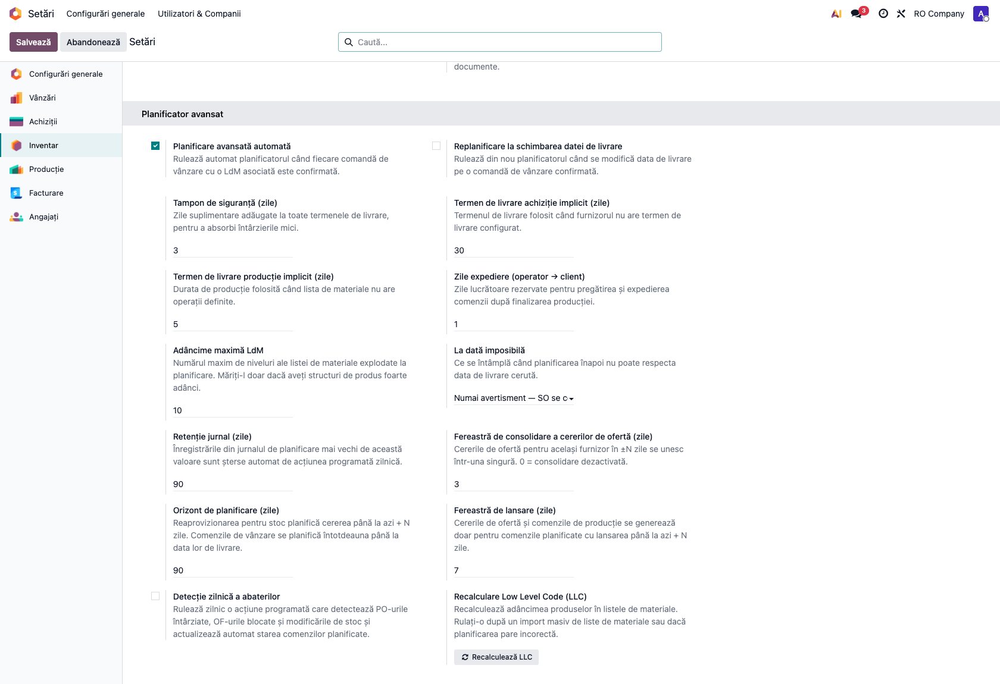

### Pasul 2 — Planificare din ofertă (simulare, SO ciornă)

Pe o comandă de vânzare în stare **Ofertă**, completați data de livrare promisă și apăsați
**Recalculează planificarea** (buton din antet). Planificatorul calculează backward/forward și afișează un **banner
semaforizat** (verde/galben/roșu) cu data efectivă realizabilă, fără să rezerve stoc sau să genereze
comenzi reale. Comenzile planificate se creează în stare **Ciornă** (simulare).

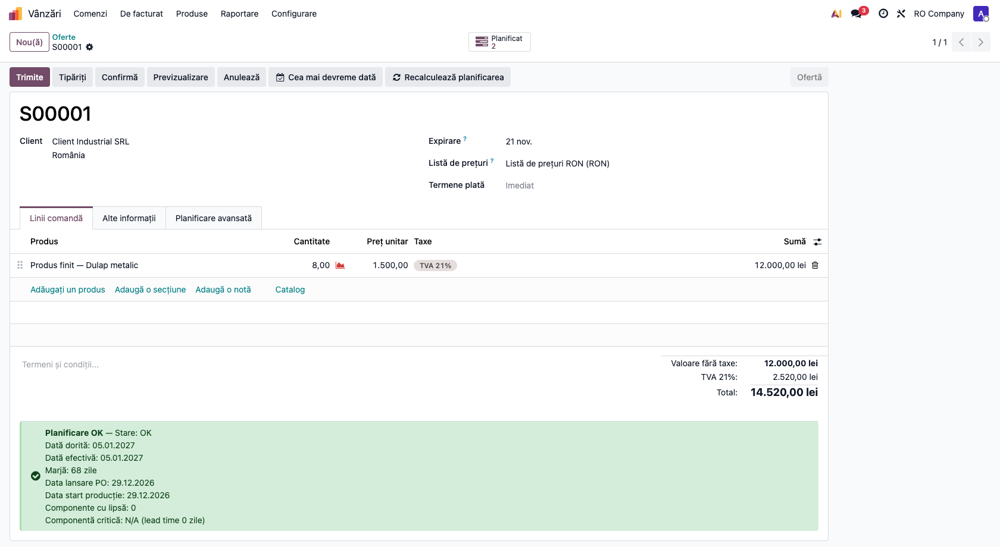

**Cea mai devreme dată.** Pentru un răspuns rapid clientului, butonul **Cea mai devreme dată** din
antetul ofertei (disponibil și vânzătorilor) deschide o fereastră cu fiecare produs al comenzii:

1. **Găsiți pe ecran** coloanele **Cea mai devreme dată**, **Din** (Stoc, Recepții planificate,
   Achiziție, Producție), **Disponibil acum** și **Motiv**; sus, **Cea mai devreme dată pentru toată
   comanda**.
2. **Verificați** că motivul are sens: componenta critică și termenul furnizorului, fereastra de
   producție, eventualele săptămâni pline pe un centru de lucru. **Disponibil acum** mai mare decât
   zero înseamnă că o livrare parțială e posibilă imediat.
3. **Treceți mai departe** cu **Setează ca dată promisă**, care pune pe comandă data pentru toată
   comanda, sau închideți fereastra fără nicio modificare.

Calculul nu creează comenzi planificate și nu rezervă nimic: două oferte simultane pot primi aceeași
dată până la confirmare. Ca la planificare, stocul de componente nu scade necesarul altor comenzi
confirmate pentru care nu s-a lansat încă comanda de producție. Spre deosebire de **Recalculează planificarea**, rezultatul e instant și nu
rămâne nimic în bază.

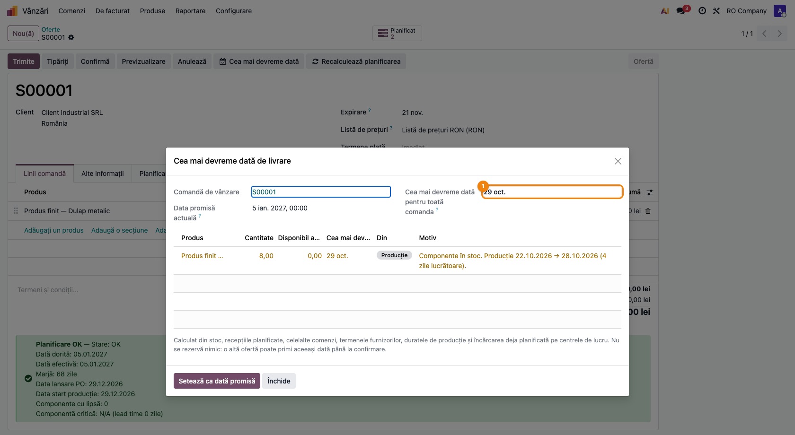

### Pasul 3 — Confirmarea comenzii și planificarea automată

La **Confirmare** comanda de vânzare, planificatorul rulează automat (dacă **Planificare avansată
automată** e bifată în Setări), iar comenzile planificate trec în starea **Planificat**. Tabul **Planificare avansată** de
pe SO arată statusul (`OK` / `Avertisment` / `Blocat`), riscul de livrare, data efectivă calculată și
zilele rămase până la termen. Sub detalii, același mesaj apare și ca banner roșu când comanda e
blocată.

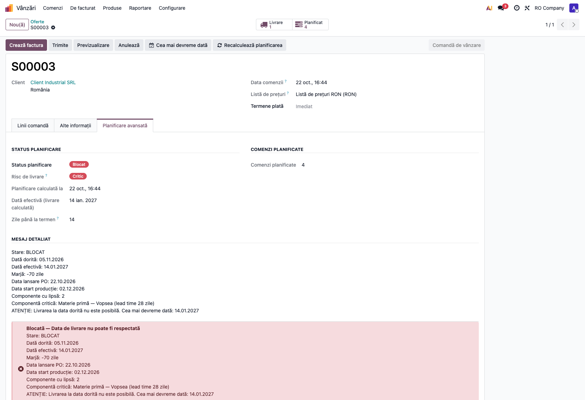

### Pasul 4 — Revizuirea comenzilor planificate

Din **Producție → Planificare avansată → Planificare → Comenzi planificate** vedeți comenzile
planificate, grupate pe produs (produs finit, semifabricat, materie primă), cu statusul colorat per
linie. Cele de tip producție au datele de start/final producție;
cele de tip achiziție au data de lansare și recepție per componentă.

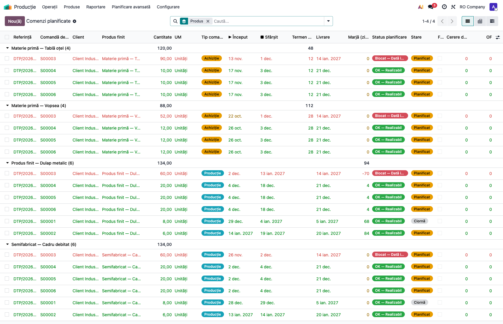

### Pasul 5 — Lansarea manuală a RFQ / OF

Pe formularul unei comenzi planificate, butonul din antet diferă după tipul comenzii: pe o comandă
de **producție** apare **Generează OF** (ordin de fabricație / MO), iar pe o comandă de
**achiziție** apare **Generează cerere de ofertă** — ambele cu verificare de duplicat. RFQ-urile
pentru același furnizor cu dată apropiată se **consolidează** automat într-un singur PO aflat încă
în ciornă (fereastra configurabilă din Setări, implicit ±3 zile; 0 dezactivează consolidarea). Pe
PO-ul consolidat, același produs cu aceeași unitate de măsură, același preț și același discount
apare pe **o singură linie**, cu cantitățile adunate — de exemplu, două variante de pe aceeași
comandă de vânzare care folosesc aceeași componentă (15 + 5 buc) dau o linie de 20 buc. Dacă prețul
diferă, liniile rămân separate. Legătura cu fiecare comandă planificată se păstrează. Din lista
comenzilor planificate, acțiunea **Generează cereri de ofertă** lansează cererile pentru comenzile
selectate de tip **Achiziție** (cele de producție sunt ignorate; pentru ele folosiți **Generează
OF-uri**) și afișează la final o notificare cu numărul de cereri de ofertă create sau completate și
comenzile planificate care au eșuat, cu motivul. Comenzile reale **nu** se creează automat — se
lansează aici, după revizuire.

Când cantitatea planificată e sub cantitatea minimă a furnizorului (de exemplu 0,6 m² dintr-o
placă vândută de la 1 m²), cererea de ofertă se generează tot la furnizorul produsului, cu cantitatea
planificată. Operatorul o ajustează la minimul furnizorului înainte de trimitere.

Un OF generat din planificator **nu** declanșează la confirmare aprovizionarea componentelor:
semifabricatele și materiile prime au deja comenzile lor planificate, cumulate pe produs. Componentele
se consumă din stocul produs sau recepționat pe acele comenzi.

Captura arată o comandă de producție blocată, cu mesajul detaliat de planificare.

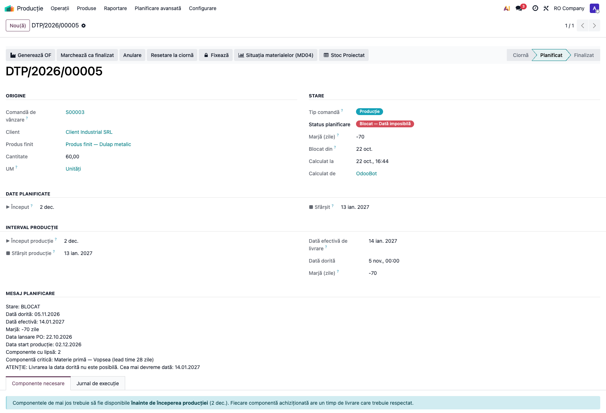

Cererea de ofertă consolidată: două comenzi planificate pentru aceeași materie primă (15 + 5 buc),
același furnizor, preț și unitate de măsură, au rezultat într-o singură linie de 20 buc.

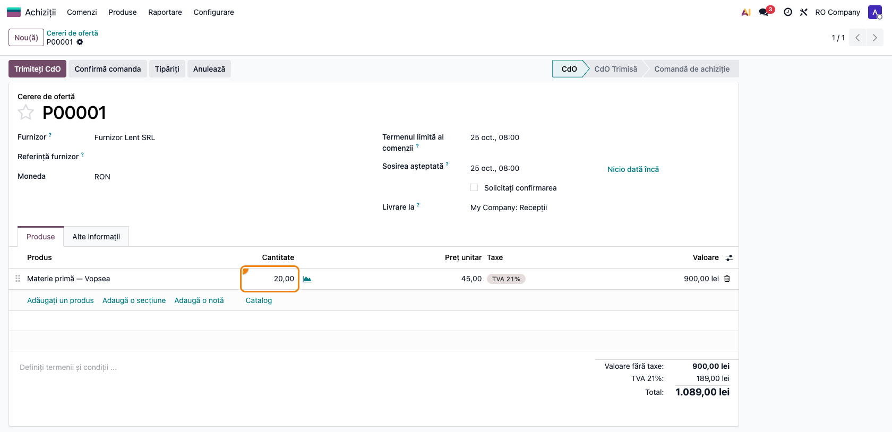

Generarea în lot din listă (selectați comenzile → **Acțiuni → Generează cereri de ofertă**):
notificarea arată câte cereri s-au generat și, pentru fiecare comandă care a eșuat, motivul — aici
un produs fără furnizor configurat.

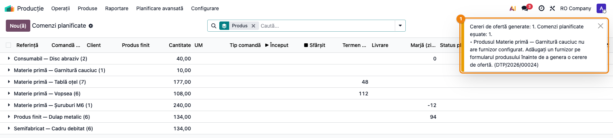

**Fereastra de lansare.** Generarea în lot (cereri de ofertă sau **Generează OF-uri**) lansează doar
comenzile planificate a căror dată de lansare este cel mult azi + fereastra de lansare. Celelalte
rămân în **Ciornă** și sunt enumerate în notificare, cu data limită. Pe formularul unei astfel de
comenzi, butonul **Generează cerere de ofertă** / **Generează OF** apare secundar și cere confirmare
înainte de lansare. Filtrul **De lansat** din lista comenzilor planificate arată comenzile deschise
care intră în fereastră — lista de lucru zilnică a responsabilului de achiziții.

În captură: două comenzi pentru tablă de oțel, una cu lansarea peste 3 zile și una peste 40 de zile.
S-a generat o singură cerere de ofertă; a doua comandă este numită în notificare ca sărită.

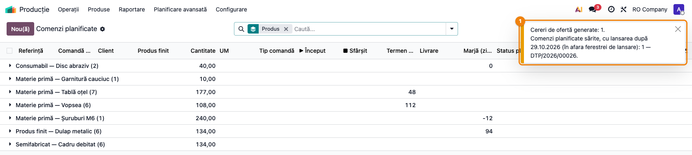

### Pasul 6 — Situație Material (proiecție cronologică per produs)

**Producție → Planificare avansată → Materiale → Situația materialelor (MD04)** afișează stocul **proiectat
cronologic** la fiecare mișcare, cu trasabilitate completă SO → AP → PO/MO → mișcare de stoc (coloana
Origine / pegging). Se poate salva ca snapshot și exporta în PDF/Excel.

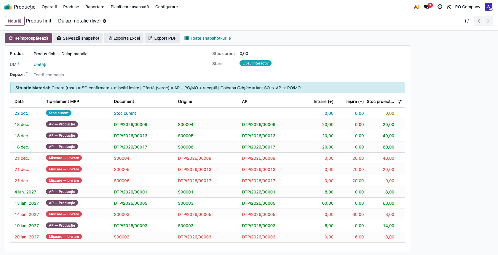

### Pasul 7 — Stoc Proiectat Agregat (tip SAP MRP)

**Materiale → Stoc Proiectat** oferă ecranul agregat cross-SO per produs: toate elementele MRP
(comenzi client, comenzi achiziție, comenzi planificate, ordine producție, intrări) sortate
cronologic, cu stoc proiectat cumulativ, **ATP** (cantitatea disponibilă pentru promisiuni noi) și
detecția lipsei: bifa **Are lipsă** și un banner roșu apar când o cerere nu e acoperită. Pegging FIFO
complet și export Excel. În captură, fiecare comandă client (roșu) e acoperită de comanda planificată
de producție (verde) dinaintea ei, deci nu există lipsă.

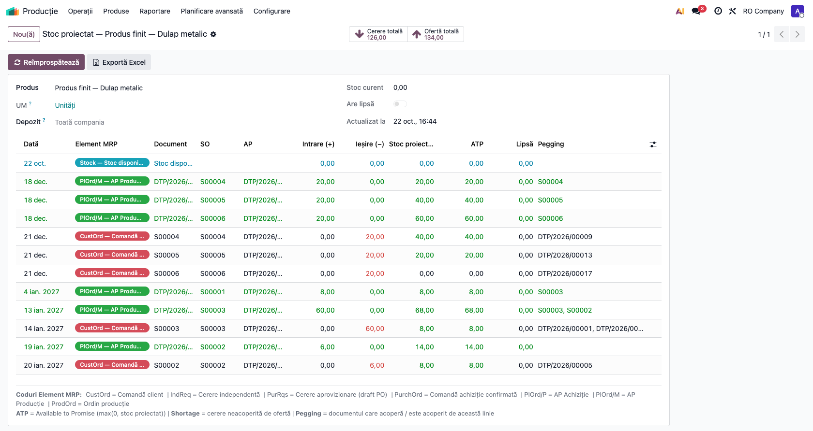

### Pasul 8 — Încărcarea centrelor de lucru

**Capacitate → Încărcare centru de lucru** arată încărcarea per (post de lucru × săptămână) în listă
colorată (roșu >100%, galben 80–100%, verde ≤80%), cu vederi pivot și grafic. Se regenerează la
fiecare planificare. Capacitatea se raportează aici la intervalul de producție al fiecărei comenzi;
pentru supraîncărcarea pe săptămână folosiți CRP (pasul 9), de aceea procentele pot diferi între cele
două ecrane.

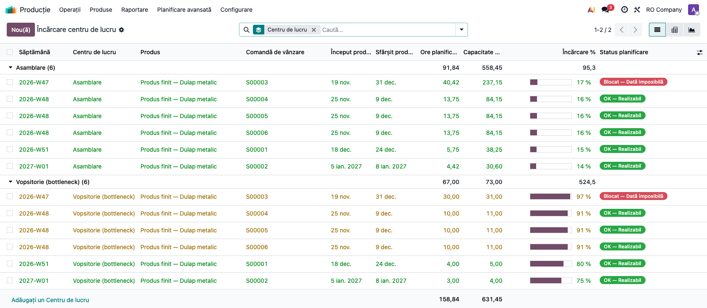

### Pasul 9 — CRP și nivelarea capacității

**Capacitate → CRP — Capacitate** agregă orele cerute vs. capacitatea nominală per (post × săptămână),
cu status `ok / warning / overloaded`. Din **Nivelare CRP** (Manager) rulați nivelarea greedy:
comenzile cu cel mai mult slack se mută cu +7 zile, cu cascadă recursivă pe comenzile copil nefixate;
opțiunea **Doar vizualizare (fără modificări)** previzualizează fără a modifica.

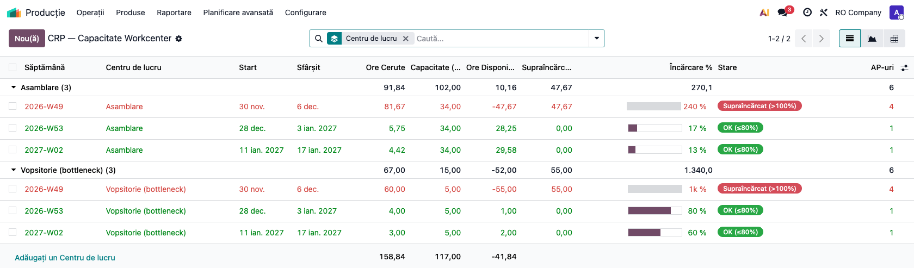

### Pasul 10 — Planificarea globală (batch)

**Planificare → Planificare globală** (Manager) rulează planificatorul pe toate comenzile active,
sortate după data de livrare promisă, ascendent (cele urgente au prioritate la stoc). Netting-ul componentelor
folosește o alocare globală partajată (fără supraplanificarea aceluiași stoc), iar un lock PostgreSQL
previne rulările concurente. Butonul **Vizualizare comenzi blocate** deschide direct comenzile blocate
după rulare.

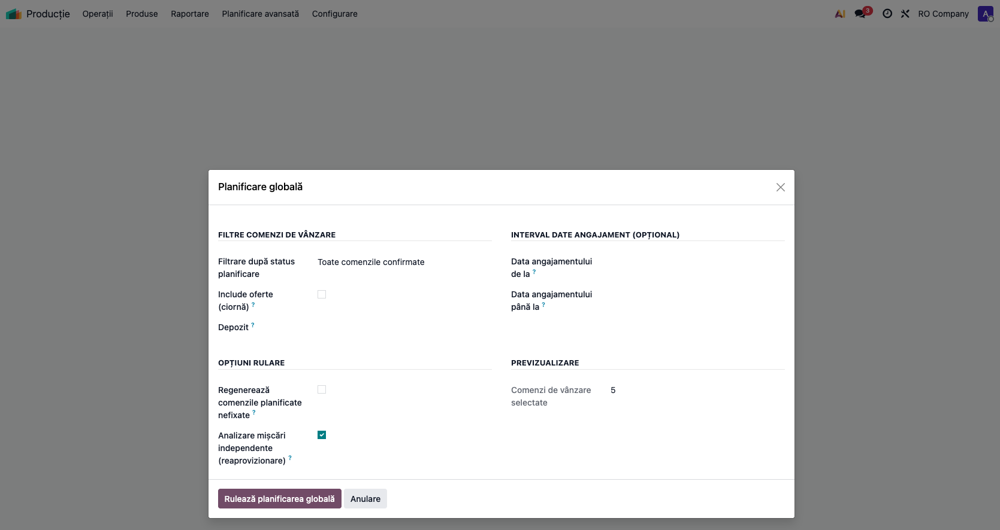

**Reaprovizionarea pentru stoc.** Cu opțiunea **Analizare mișcări independente (reaprovizionare)**
bifată, planificarea globală calculează și propunerile pentru stoc, per depozit:

- pentru **ieșirile fără comandă de vânzare** (consum, transferuri), până la orizontul de planificare;
- pentru produsele cu o regulă de reaprovizionare bifată **Planificat de Advanced Planner**: când
  stocul proiectat coboară sub **minim**, propune cantitatea care îl readuce la **maxim**, rotunjită la
  **multiplul** regulii și la cantitatea minimă a furnizorului.

Regula se bifează din **Inventar → Operații → Reaprovizionare** (coloana opțională **Planificat de
Advanced Planner**) sau din formularul regulii. O regulă bifată nu mai este lansată de Odoo: nici de
programator, nici de butonul **Comandă**, nici dintr-o cantitate pusă manual.

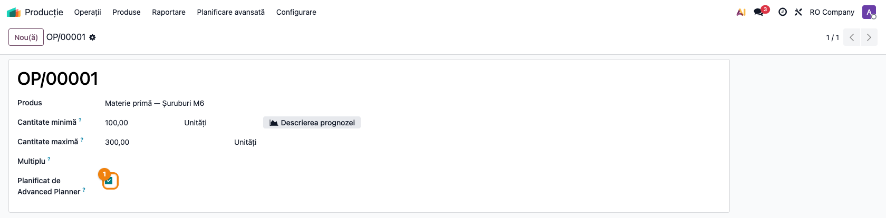

Rezultatul se vede în **Planificare → Comenzi planificate**, cu filtrul **Reaprovizionare pentru stoc**
din căutare (comenzile fără comandă de vânzare):

- **o propunere pentru fiecare deficit**, la data lui, nu o singură comandă azi pentru tot viitorul.
  În captură, discul abraziv are ieșiri la 20, 60 și 150 de zile: planificatorul propune 15 buc
  pentru prima și 25 buc pentru a doua; ieșirea de la 150 de zile e dincolo de orizontul de 90 de zile
  și nu generează încă nimic;
- șuruburile au 60 buc în stoc, sub minimul de 100: propunerea este de 240 buc (până la maximul de
  300), **Blocat** pentru că nu poate sosi azi.

Ce citiți înainte de a lansa: cantitatea și data de lansare pe fiecare rând, starea (**Blocat**
înseamnă că propunerea nu poate sosi la data necesară) și dacă există deja o cerere de ofertă ciornă
pentru același produs. Cererile de ofertă neconfirmate sunt numărate la data lor de recepție, așa că
o a doua rulare nu mai propune aceeași cantitate.

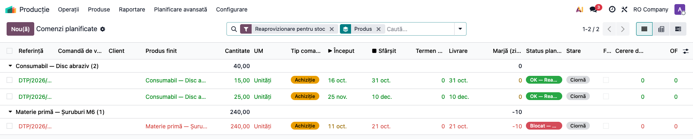

### Pasul 11 — Risc de livrare (monitorizare proactivă)

**Producție → Planificare avansată → Risc de livrare** listează comenzile de vânzare marcate **La
risc** sau **Critic**, sortate după data promisă, cu semaforizare și contoare „zile până la termen"
vs. „zile încă necesare". Butonul **Comenzi cu risc** deschide comenzile planificate cauzatoare, iar
**Escaladează** creează o activitate de tip „de făcut" pentru responsabil (comunicare proactivă cu
clientul).

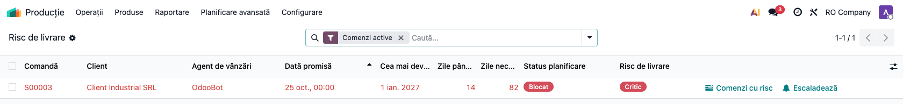

### Pasul 12 — Dashboard operațional & KPI

**Planificare avansată → Panou de control** sintetizează: contori de comenzi (blocate, avertismente,
OK, reaprovizionări fără SO, arhivă), **OTIF 30/90 zile** — ponderea comenzilor confirmate cu data promisă
începând de acum 30/90 de zile (inclusiv cele viitoare) a căror dată efectivă calculată nu depășește
data promisă (indicator previzionat, nu de livrări realizate) —, trend blocări noi/zi, posturi bottleneck și top produse cu blocări active.
În **Top produse cu blocări active** (pe rândul indicatorilor, între graficul blocărilor noi și
posturile bottleneck), bara fiecărui produs arată ponderea lui în toate blocările
active (ex. 2 blocări din 5 → bară de 40%), iar cifra din dreapta e numărul de comenzi planificate
blocate ale produsului.

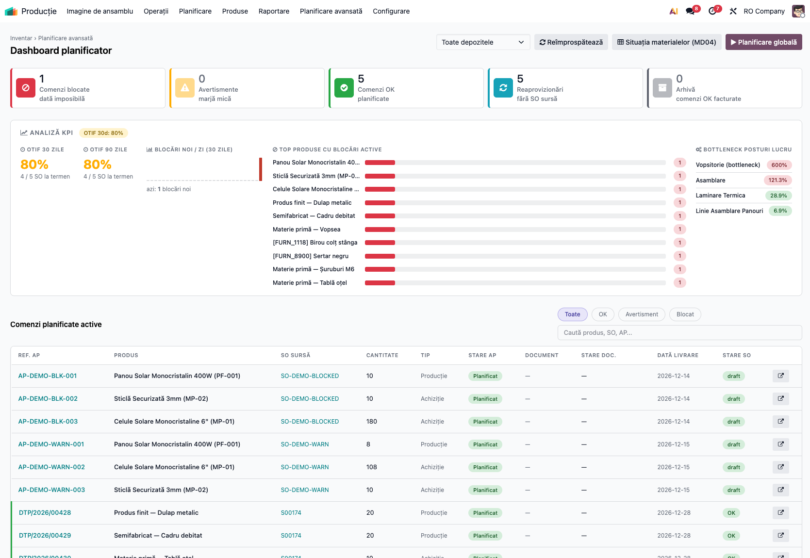

Cardul **Comenzi OK** numără comenzile de vânzare planificate fără probleme și încă nefacturate
integral. O comandă OK facturată integral trece în cardul **Arhivă** și nu mai încarcă lista de lucru.
Atenție: la produsele facturate pe cantitățile comandate (avans sau factură la confirmare), comanda
poate ajunge în **Arhivă** cu achiziția sau producția încă deschise; urmăriți-le în coloanele de mai
jos (lista din **Arhivă** le are și ea) sau în tabelul **Comenzi planificate active**.
Un clic pe oricare dintre cele două carduri deschide lista comenzilor numărate, cu două coloane
proprii planificatorului:

1. **Găsiți pe ecran** — coloana **Achiziție** arată etapa comenzilor de achiziție generate din
   comenzile planificate ale comenzii de vânzare, iar coloana **Producție** etapa comenzilor de
   producție. Când sunt mai multe, se afișează cea aflată cel mai „în urmă”. **Finalizat** apare când
   toată marfa a fost recepționată, respectiv toate produsele au fost fabricate. Coloana rămâne goală
   dacă nu s-a generat niciun document de acel tip (sau dacă documentele au fost anulate).
2. **Verificați** — etapele corespund celor din comenzile de achiziție / producție; o comandă cu
   toate documentele închise are **Finalizat** pe fiecare coloană pentru care s-au generat documente.
3. **Treceți mai departe** — după facturarea integrală, comanda dispare din **Comenzi OK** și se
   regăsește în **Arhivă**.

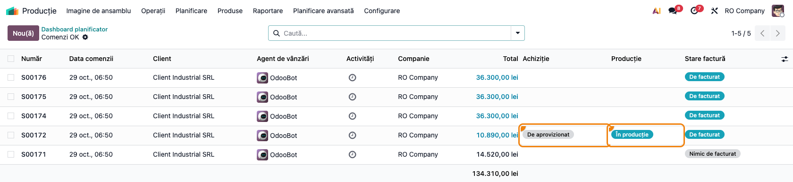

În captură, comanda cu documente generate arată **De aprovizionat** la achiziție, deși în tabelul de
mai jos (12a) comanda ei de achiziție e **De comandat**: aceeași comandă de vânzare are și o cerere de
ofertă încă în ciornă (de la Pasul 5), iar coloana arată documentul cel mai „în urmă”.

Sub indicatori, tabelul **Comenzi planificate active** urmărește fiecare comandă de la planificare
până la recepție sau producție. O comandă planificată rămâne pe listă și după ce din ea s-a generat
comanda de achiziție sau de producție:

1. **Găsiți pe ecran** — coloana **Document** arată comanda generată (ex. `P00012` pentru achiziție,
   `WH/MO/00007` pentru producție); un clic pe ea o deschide. Coloana **Stare doc.** arată etapa, cu
   denumiri diferite pe tipul documentului:
   - la achiziție: **De aprovizionat** — cerere de ofertă (trimisă sau nu), comanda către furnizor
     nu e încă confirmată; **De comandat** — comanda de achiziție este confirmată și se așteaptă
     recepția mărfii; **Recepționat parțial** — o parte din marfă a intrat în stoc;
   - la producție: **De fabricat** — comandă de producție în ciornă; **În producție** — comanda
     este confirmată, dar producția nu a început; **În lucru** — producția a început (sau toate
     operațiile sunt gata și comanda așteaptă închiderea). Un clic pe **În lucru** deschide comenzile
     de lucru ale comenzii de producție.
   O comandă lansată are starea AP **Finalizat**; comenzile planificate încă nelansate au coloanele
   goale (—) și starea AP **Ciornă** / **Planificat**.
2. **Verificați** — fiecare comandă lansată are documentul ei; starea documentului corespunde celei
   din comanda de achiziție / producție; o comandă recepționată integral sau produsă nu mai apare.
3. **Treceți mai departe** — deschideți documentul din coloana **Document** pentru confirmare,
   recepție sau lansarea producției. Căutarea de deasupra tabelului găsește și după referința
   documentului.

Linia dispare din tabel la recepția completă a mărfii, la terminarea producției sau la anularea
documentului. La o cerere de ofertă comasată (mai multe materii prime), recepția se judecă doar pe
liniile produsului comenzii planificate. Dacă din aceeași comandă planificată s-au generat mai multe
documente, se afișează cel aflat cel mai „în urmă”.

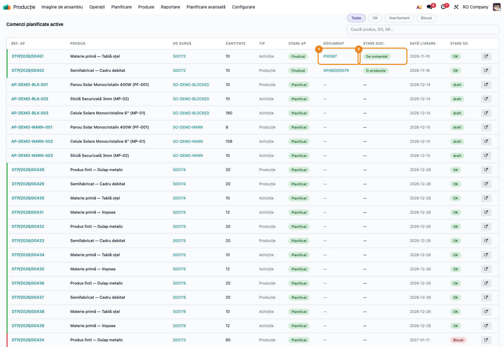

### Ce generează planificatorul (rezultate operaționale)

Modulul **nu generează note contabile** (Dr/Cr). Rezultatele unei rulări sunt:

- **Comenzi planificate** (`advanced.planned.order`) de tip producție (cu ierarhie BOM) și achiziție
  (per componentă cu shortage), în stare `draft → planned → done / cancelled`;
- **statusul de planificare** pe SO (`OK` / `Avertisment` / `Blocat`) + data efectivă și riscul de
  livrare;
- **comenzi de reaprovizionare pentru stoc** (fără SO), eșalonate pe deficit, pe orizontul de
  planificare;
- **RFQ-uri și MO-uri** doar la lansare manuală, în fereastra de lansare (cu consolidare RFQ);
- **sincronizarea livrărilor**: pe SO confirmate, mișcările de livrare primesc legătura AP și data
  efectivă (`scheduled_date` pe picking);
- **log de execuție** detaliat (`advanced.planner.log`).

Efectul **contabil** apare ulterior, standard: când evaluarea stocului este automată, recepția PO
(NIR) și finalizarea MO generează notele contabile uzuale de stoc/producție — nu prin acest modul.

### Curățarea datelor de test (modulul `terrabit_clear_data`)

Când pe baza de test se rulează opțiunea **Sterge date tranzactionale din module** a modulului
`terrabit_clear_data`, planificatorul își curăță singur datele pentru compania selectată:

- comenzile planificate, împreună cu încărcările centrelor de lucru, log-urile și comenzile planificate copil;
- sloturile CRP, proiecțiile de stoc și situațiile de material.

Comenzile de vânzare, de achiziție și de producție, transferurile și mișcările de stoc **nu se șterg**:
doar legătura lor cu comenzile planificate se golește. Log-urile fără comandă planificată și
numerotarea comenzilor planificate (revine la 1) se curăță doar când se șterg și datele fără companie
sau când compania selectată este singura din baza de date. Operația nu se folosește pe o bază de
producție.

## 7. Legături cu alte module / declarații

| Modul / proces | Rol în flux | Tip legătură |
|---|---|---|
| `sale_management` | comenzile de vânzare și data dorită (`commitment_date`) — punctul de pornire | dependență (manifest) |
| `mrp` | liste de materiale, operații, posturi de lucru, ordine de producție | dependență (manifest) |
| `purchase` | RFQ / comenzi de achiziție generate din comenzile planificate | dependență (manifest) |
| `purchase_stock` | cererile de ofertă neconfirmate numărate în stocul proiectat; regulile de reaprovizionare (min/max) | dependență (manifest) |
| `stock` | stoc disponibil, mișcări, picking-uri de livrare, reaprovizionare | dependență (manifest) |
| `resource` | calendarul de lucru folosit la backward scheduling și RCCP | dependență (manifest) |
| `mail` | chatter, activități și notificări de escaladare | dependență (manifest) |
| `web_gantt` | vederea Gantt a planului de producție (**Odoo Enterprise**) | dependență (manifest) |
| `deltatech_web_kpi_cards` | cardurile KPI din panoul de control | dependență (manifest) |
| `l10n_ro_doc_screenshots` | generarea automată a capturilor pentru fișă/manual | opțional (doar testare) |
| `terrabit_clear_data` | opțiunea **Sterge date tranzactionale din module** șterge datele planificatorului | opțional (doar baze de test) |

**Ce este automat:** netting cronologic, backward scheduling, RCCP/CRP, statusul semaforizat,
sincronizarea livrărilor, detecția zilnică a abaterilor și escaladarea (dacă sunt activate din Setări),
calculul propunerilor de reaprovizionare pentru stoc (eșalonat, pe orizont, fără dublarea cererilor de
ofertă neconfirmate).

**Ce rămâne manual:** lansarea RFQ-urilor și a ordinelor de producție din comenzile planificate (în
fereastra de lansare), revizuirea comenzilor de reaprovizionare (create în `draft`), alegerea
proprietarului fiecărei reguli de reaprovizionare (bifa **Planificat de Advanced Planner**), fixarea
(firming) comenzilor care nu trebuie recalculate și decizia de nivelare a capacității.

## 8. Verificări pentru consultant

- [ ] Modulul se instalează fără erori pe baza demo.
- [ ] Meniul **Producție → Planificare avansată** și submeniurile sunt vizibile pentru rolul potrivit.
- [ ] Recalcularea pe un SO ciornă afișează bannerul de status și o dată efectivă plauzibilă.
- [ ] La confirmarea SO se generează comenzi planificate (producție + achiziție per componentă).
- [ ] Backward scheduling produce date coerente (lansare PO < recepție < start producție < final).
- [ ] O comandă cu termen imposibil este marcată **Blocat** și propune cea mai devreme dată realizabilă.
- [ ] **Cea mai devreme dată** pe o ofertă: un produs pe stoc apare „Stoc” cu data de mâine; un produs fabricat apare „Producție”, cu componenta critică în motiv; după **Setează ca dată promisă**, data promisă a comenzii e data pentru toată comanda și nu s-a creat nicio comandă planificată.
- [ ] RFQ-ul și MO-ul se generează manual din comanda planificată, fără duplicate.
- [ ] Două comenzi planificate pentru același produs (de exemplu două variante cu aceeași componentă), cu același furnizor, aceeași UM și același preț, cu data de lansare în fereastra de consolidare și cu prima cerere încă în ciornă, produc pe cerere o singură linie, cu cantitatea totală.
- [ ] Pe un produs cu componente pe ruta MTO, confirmarea OF-ului generat din planificator nu creează OF-uri sau cereri de ofertă noi pentru componente (în lista OF nu apar ordine cu sursa = alt OF).
- [ ] Prețurile de furnizor ale produselor gestionate în metri folosesc UM „m”, nu „ml” (mililitru).
- [ ] Setările **Orizont de planificare** și **Fereastră de lansare** apar în Setări → Inventar → Planificator avansat (implicit 90 și 7 zile).
- [ ] Un produs cu ieșiri fără SO la 20, 60 și 150 de zile primește după planificarea globală două propuneri (pentru 20 și 60 de zile), nu una și nu trei.
- [ ] După generarea cererii de ofertă dintr-o propunere de reaprovizionare, o nouă planificare globală nu mai creează altă propunere pentru același deficit; propunerea deja transformată rămâne în listă, în starea **Finalizat**.
- [ ] Pe o regulă bifată **Planificat de Advanced Planner** (min 100, max 300, stoc 60), propunerea este de 240 buc; butonul **Comandă** din Reaprovizionare refuză regula, iar programatorul nu creează cerere de ofertă pentru ea.
- [ ] Un produs cu o regulă automată nebifată nu primește propuneri de la planificator.
- [ ] Generarea în lot sare comenzile cu lansarea după fereastra de lansare și le numește în notificare; filtrul **De lansat** le exclude.
- [ ] Situația Material și Stocul Proiectat afișează proiecția cronologică și ATP corect.
- [ ] Încărcare centru de lucru / CRP reflectă supraîncărcările; nivelarea cu **Doar vizualizare (fără modificări)** previzualizează mutările.
- [ ] Tabloul Risc de livrare listează comenzile la risc; butonul Escaladează creează o activitate.
- [ ] În Panoul de control, după generarea cererii de ofertă dintr-o comandă planificată, linia rămâne în tabel cu documentul în coloana **Document** și starea **De aprovizionat**; după confirmare apare **De comandat**; după recepția a 2 din 5 buc apare **Recepționat parțial**; după recepția completă linia dispare.
- [ ] O comandă de producție generată din planificator apare cu **De fabricat**, apoi **În producție** după confirmare și **În lucru** după începerea producției; după terminare sau anulare linia dispare.
- [ ] Un clic pe starea **În lucru** a unei comenzi de producție deschide comenzile ei de lucru.
- [ ] În lista deschisă din cardul **Comenzi OK**, coloanele **Achiziție** și **Producție** arată etapa documentelor generate pentru fiecare comandă de vânzare; după recepția completă, respectiv fabricarea produselor, apare **Finalizat**.
- [ ] O comandă OK facturată integral dispare din **Comenzi OK** și apare în **Arhivă**; cifrele celor două carduri se modifică în consecință.
- [ ] Un clic pe referința din coloana **Document** deschide comanda de achiziție / producție.
- [ ] O comandă planificată marcată manual **Finalizat** (comanda reală creată în afara planificatorului) nu apare în tabel.
- [ ] Exporturile PDF/Excel se descarcă și conțin datele testate.
- [ ] Pe o bază de test cu mai multe companii, **Sterge date tranzactionale din module** pe o singură companie șterge comenzile planificate, sloturile CRP, proiecțiile și situațiile de material ale acesteia, lasă intacte comenzile de vânzare, achiziție și producție (cu legătura către comanda planificată goală) și nu atinge datele celorlalte companii.

## 9. Mesaje de eroare frecvente

| Mesaj / simptom | Cauză probabilă | Remediere |
|-----------------|-----------------|-----------|
| „Comanda … nu poate fi confirmată: data de livrare solicitată nu este realizabilă." | Parametrul **La dată imposibilă** este setat pe **Blochează confirmarea SO** și data promisă nu e realizabilă | Mutați data de livrare promisă la data efectivă propusă sau setați parametrul pe **Numai avertisment — SO se confirmă normal** |
| O rulare globală este sărită / „o altă planificare globală rulează deja" | Lock PostgreSQL — o a doua rulare globală simultană (alt utilizator sau cron) | Așteptați finalizarea rulării curente și reluați |
| O comandă de vânzare a dispărut din cardul **Comenzi OK** | Comanda a fost facturată integral și a trecut în **Arhivă** | Normal; deschideți cardul **Arhivă** |
| Clic pe **În lucru** în Panoul de control → listă de comenzi de lucru goală | Comanda de producție nu are operații în lista de materiale | Normal; deschideți comanda de producție din coloana **Document** |
| SO marcat **N/A** (not_applicable) la planificare | Niciun produs de pe comandă nu are listă de materiale (BOM) | Definiți BOM pentru produsul finit sau ignorați — planificatorul se aplică doar produselor cu BOM |
| Comanda rămâne **Blocat** deși există stoc | Intrările (PO) sosesc **după** `commitment_date` — corect cronologic, nu reduc disponibilul la termen | Devansați recepția PO sau ajustați data promisă |
| Lead time de producție pare prea mic/mare | Posturile de lucru nu au calendar/eficiență, sau produsul are `ap_production_lead_time` setat manual (ignoră RCCP) | Configurați calendarul și `time_efficiency` pe posturi; goliți lead time-ul manual de pe produs dacă vreți RCCP |
| Notificarea „Cereri de ofertă generate: N. Comenzi planificate eșuate: M.” după **Generează cereri de ofertă** | Pentru unele comenzi planificate nu s-a putut genera cererea, de regulă pentru că produsul nu are furnizor configurat sau comanda planificată are deja o cerere ciornă | Adăugați furnizorul pe produs (tabul Achiziție) sau confirmați/anulați cererea ciornă existentă, apoi relansați pentru comenzile rămase |
| Semifabricat planificat de două ori: pe lângă OF-ul planificatorului (sursa = comanda de vânzare) apar OF-uri cu sursa = OF-ul produsului finit | Ruta MTO pe semifabricat, iar OF-ul părinte a fost creat manual sau înainte de versiunea 19.0.1.4.9 | Actualizați modulul. Lansați OF-urile din planificator, nu manual, și anulați OF-urile duplicate aflate încă în ciornă sau confirmate fără consum |
| Pe cererea de ofertă apar linii duble pentru aceeași materie primă, unele cu preț 0 | Linia cu preț 0 vine din ruta MTO standard, cu o cantitate sub minimul furnizorului (nu se găsește preț). Linia cu preț vine din planificator | Același remediu ca mai sus: după actualizare, OF-urile din planificator nu mai generează aceste linii. Ștergeți liniile cu preț 0 din cererile ciornă existente |
| Cantitate de 1000 de ori mai mare pe cererea de ofertă (ex. 22.500 în loc de 22,5) | Prețul furnizorului e în „ml” (mililitru), produsul în „m” | Pe furnizorul produsului (tabul Achiziție) schimbați UM-ul în „m” și regenerați cererea |
| „Aceste reguli de reaprovizionare sunt planificate de Advanced Planner…” la butonul **Comandă** din Reaprovizionare | Regula e bifată **Planificat de Advanced Planner**: o comandă planificatorul | Generați cererea de ofertă din comanda planificată de reaprovizionare sau debifați regula ca s-o comande Odoo |
| Notificarea „Comenzi planificate sărite, cu lansarea după …” la generarea în lot | Comenzile respective se lansează după fereastra de lansare | Normal: se generează când intră în fereastră. Pentru o lansare anticipată, deschideți comanda și confirmați butonul de generare |
| Un produs cu regulă min/max nu primește propuneri de la planificator | Regula e automată sau are minim/maxim și nu e bifată: o comandă Odoo standard | Bifați **Planificat de Advanced Planner** pe regulă dacă vreți propuneri eșalonate |
| O ieșire viitoare nu generează propunere de reaprovizionare | Data ei e după orizontul de planificare | Măriți **Orizont de planificare** în Setări sau așteptați să intre în orizont |
| În Panoul de control, o comandă recepționată rămâne în tabel cu **Recepționat parțial** | Recepția a fost validată fără cantitatea completă (cu backorder) pentru produsul comenzii planificate | Normal: linia dispare la recepția restului. Dacă restul nu mai vine, anulați backorder-ul și cantitatea rămasă din comanda de achiziție |
| O comandă lansată nu mai apare în tabelul din Panoul de control | Documentul generat e recepționat integral, produs sau anulat, ori comanda planificată a fost marcată manual **Finalizat**, fără document | Normal. Istoricul rămâne în **Comenzi planificate** (filtrul Finalizat) și în documentul generat |
| Capturile nu se generează | Modulul `l10n_ro_doc_screenshots` nu este instalat | Instalați-l și rulați testul de capturi (vezi secțiunea 10) |

## 10. Capturi de ecran

Capturile (`readme/screenshots/`) se **generează automat** dintr-un test Playwright
(`tests/test_screenshots.py`, mixinul `ScreenshotCase` din `l10n_ro_doc_screenshots`, import
defensiv), în **limba română**, pe planul de conturi RO. Ordinea corespunde exact pașilor din
secțiunea 6:

1. `01_setari_planificator.png` — parametrii planificatorului în Setări → Inventar (inclusiv orizontul și fereastra de lansare).
2. `02_so_recalcul_oferta.png` — comandă de vânzare în ofertă, cu banner de status după recalcul.
   - `02a_cea_mai_devreme_data.png` — fereastra **Cea mai devreme dată**: data fiecărui produs, sursa, motivul și data pentru toată comanda.
3. `03_so_banner_confirmat.png` — tabul Planificare avansată pe SO confirmat (status + dată efectivă + risc + banner de blocare).
4. `04_planned_orders.png` — lista comenzilor planificate grupate pe produs, cu status colorat.
5. `05_planned_order_form.png` — formular comandă planificată de producție cu butonul Generează OF.
   - `05a_rfq_linie_cumulata.png` — cerere de ofertă consolidată, cu aceeași materie primă cumulată pe o singură linie (15 + 5 → 20 buc).
   - `05b_generare_rfq_notificare.png` — notificarea acțiunii **Generează cereri de ofertă** din listă, cu reușite și eșecuri.
   - `05c_fereastra_lansare.png` — generarea în lot sare comanda care se lansează după fereastra de lansare.
6. `06_material_situation.png` — Situație Material: stoc proiectat cronologic cu pegging.
7. `07_stock_projection.png` — Stoc Proiectat Agregat cu elemente MRP, ATP și pegging.
8. `08_workcenter_load.png` — Încărcare centru de lucru: listă colorată per post și săptămână.
9. `09_crp.png` — CRP: ore cerute vs. capacitate pe săptămâni.
10. `10_global_planning.png` — wizardul de planificare globală.
    - `10a_regula_planificator.png` — regula de reaprovizionare bifată **Planificat de Advanced Planner** (min 100 / max 300).
    - `10b_reaprovizionare_esalonata.png` — filtrul **Reaprovizionare pentru stoc**: propunerile pentru stoc, câte una pe deficit, până la orizont.
11. `11_delivery_risk_board.png` — tabloul Risc de livrare semaforizat.
12. `12_dashboard.png` — dashboard cu contori (inclusiv cardul **Arhivă**) și KPI de planificare.
    - `12a_dashboard_documente.png` — tabelul comenzilor planificate, cu documentul generat și starea lui evidențiate pe prima linie.
    - `12b_comenzi_ok_etape.png` — lista deschisă din cardul **Comenzi OK**, cu coloanele **Achiziție** și **Producție** evidențiate.

Testul `tests/test_screenshots.py` seedează un mediu de producție determinist (posturi de lucru cu
calendar + eficiență, BOM pe 2 niveluri cu operații, furnizori cu lead time + MOQ, stoc parțial) și
confirmă comenzi de vânzare (una confortabilă → **La termen**, una cu termen strâns → **Critic**),
lasă o ofertă în simulare, apoi agregă CRP, Situația Material și Stocul Proiectat, astfel încât toate ecranele să
aibă date reale. Pentru Pasul 5 generează o cerere de ofertă din două comenzi planificate pentru
aceeași materie primă (15 + 5 buc) și rulează generarea în lot pe o comandă cu furnizor și una fără,
apoi pe o comandă de lansat acum și una care se lansează peste 40 de zile. Pentru Pasul 10 creează o
regulă min/max bifată (șuruburi, stoc 60, min 100, max 300) și un consumabil cu ieșiri fără SO la 20,
60 și 150 de zile, apoi rulează reaprovizionarea pentru stoc cu orizontul de 90 de zile. Pentru
Pasul 12 confirmă o comandă de achiziție și una de producție generate din comenzi planificate,
apoi deschide lista din cardul **Comenzi OK**.

Regenerare:

```bash
./odoo/odoo-bin -c odoo.conf -d <db> -i deltatech_advanced_planner,l10n_ro_doc_screenshots \
    --test-tags=fise_screenshots --stop-after-init --http-port=8987 --gevent-port=8988
```

## 11. Observații pentru manual

Păstrați explicația orientată pe **activitatea utilizatorului**: ce întrebare rezolvă modulul (data
promisă e realizabilă?), când se rulează (la ofertare, la confirmare, în batch nocturn), ce date
trebuie pregătite (BOM, calendar posturi, lead time furnizori, `commitment_date`) și cum se citește
verdictul (semafor OK/Avertisment/Blocat + dată efectivă). Subliniați separarea **planificare vs.
execuție**: modulul propune și verifică, dar RFQ-urile și ordinele de producție rămân la decizia
operatorului. Explicați **regula „un singur proprietar”** pentru produsele cu reguli min/max (bifa
**Planificat de Advanced Planner**) și diferența față de Odoo standard, care comandă acum tot ce cere
orizontul său, în timp ce planificatorul propune câte o comandă pe deficit, lansată la momentul
potrivit (fereastra de lansare). Menționați explicit că modulul **nu generează note contabile** — efectul contabil apare
standard, la recepția achizițiilor și finalizarea producției.
