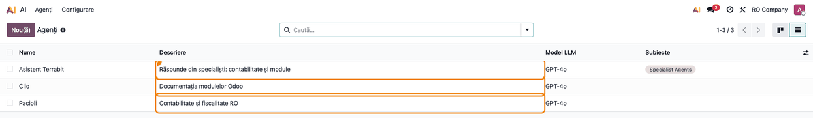
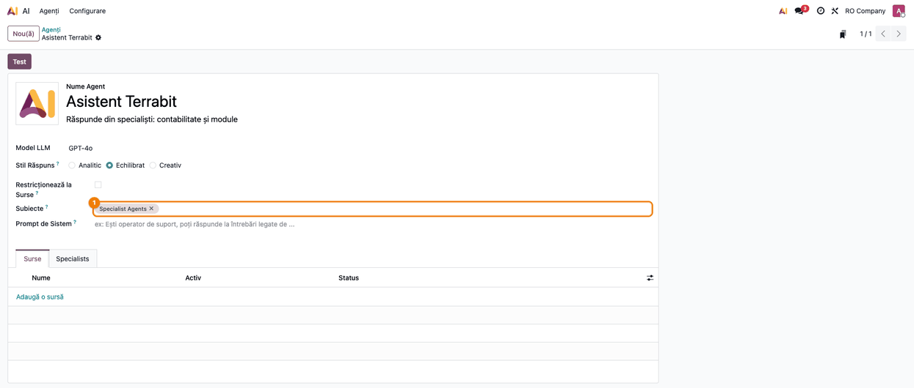
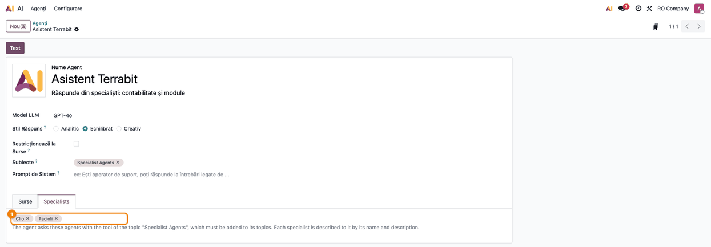
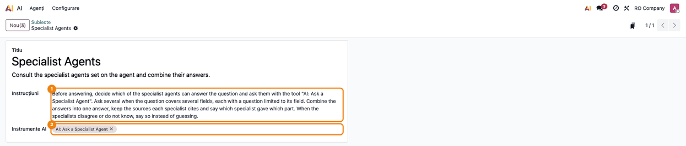

# Fișă Modul: Agent AI integrator care consultă agenți specialiști

**Modul:** `deltatech_ai_agent_delegate`
**Utilizator principal:** Administrator Odoo / consultant care configurează agenții AI
**Prioritate:** 🟢 Scăzută (modul de configurare a agenților AI; nu atinge contabilitatea sau stocurile)

---

## 1. Scop business

În Odoo 19 Enterprise fiecare agent AI răspunde din sursele, promptul și modelul lui. Când
documentația unei firme e împărțită pe mai mulți agenți (unul pentru contabilitate, unul pentru
module, unul pentru proceduri interne), utilizatorul trebuie să știe pe care să-l întrebe, iar o
întrebare care atinge două domenii („ce modul face avizele și pe ce cont se înregistrează?") nu
primește un răspuns complet de la niciunul. Modulul adaugă un **agent integrator**: el primește
întrebarea, o împarte pe domenii, întreabă **agenții specialiști** potriviți și compune un singur
răspuns, păstrând sursele citate de fiecare specialist și spunând ce parte a venit de la cine.

## 2. Bază legală și context

Modulul nu generează operațiuni contabile și nu are o bază legală proprie. Contextul operațional:

- Fiecare specialist răspunde cu **propriile surse, prompt și model**; integratorul nu le vede
  sursele, primește doar răspunsul și citările. Dacă un specialist răspunde din texte de lege,
  răspunsul rămâne o informare, nu un sfat fiscal.
- Întrebarea trimisă specialistului trebuie să fie **completă**: specialistul nu vede conversația
  integratorului, primește doar întrebarea formulată de acesta.
- **Agenții publici** (livechat, chat pe website): specialiștii agentului din chat răspund și
  vizitatorilor, citindu-și sursele cu drepturi de sistem, ca agentul din chat. De aceea, unui agent
  public i se aleg doar specialiști cu surse publice. Un agent care nu e public nu își consultă
  specialiștii pentru un vizitator.

## 3. Utilizatori și roluri

| Rol | Acțiune |
|---|---|
| Administrator Odoo (grupul **Administrare / Setări**) | creează agenții, completează fila **Specialists** și adaugă subiectul **Specialist Agents** |
| Consultant (cu dreptul **Administrare / Setări**) | alege specialiștii și scrie descrierea fiecăruia, după care integratorul decide pe cine întreabă |
| Utilizator intern / vizitator livechat | pune întrebarea agentului integrator și primește răspunsul compus |

Fila **Specialists** din formularul agentului e vizibilă doar administratorilor
(`base.group_system`). Pentru testare e nevoie de un utilizator cu acest drept și de un utilizator
intern obișnuit, care doar discută cu agentul.

## 4. Conturi și date implicate

Modulul nu postează nicio notă contabilă și nu folosește conturi contabile.

Date minime pentru demo:

- doi agenți specialiști, fiecare cu sursele lui și cu o **Descriere** clară (de exemplu
  *Pacioli — Contabilitate și fiscalitate RO*, *Clio — Documentația modulelor Odoo*);
- un agent integrator (de exemplu *Asistent Terrabit*), fără surse proprii sau cu puține surse;
- un model AI și un furnizor configurate în **AI → Configurare → Setări**, ca agenții să poată
  răspunde.

## 5. Configurare inițială

1. Instalați modulul `deltatech_ai_agent_delegate` (depinde de `ai_app`). La instalare se creează
   subiectul **Specialist Agents** și unealta **AI: Ask a Specialist Agent**.
2. Verificați că aveți dreptul de administrator: fără el nu apare fila **Specialists**.
3. Verificați în **AI → Configurare → Setări** că există un furnizor AI activ.
4. Creați sau verificați agenții specialiști și sursele lor (sursele se încarcă din fila **Surse**
   a fiecărui agent).

## 6. Flux de utilizare

### Pasul 1 — Descrierea agenților specialiști

Accesați **AI → Agenți → Agenți**. Pentru fiecare agent care va fi consultat, completați
**Descriere** (sub numele agentului): integratorul primește numele și descrierea fiecărui specialist
și alege pe cine întreabă după ele. O descriere vagă („Asistent") duce la întrebări trimise
specialistului greșit.



### Pasul 2 — Subiectul „Specialist Agents" pe agentul integrator

Deschideți agentul integrator și adăugați în câmpul **Subiecte** subiectul **Specialist Agents**.
Subiectul aduce unealta **AI: Ask a Specialist Agent** și instrucțiunile de folosire: întreabă
specialiștii potriviți, combină răspunsurile, păstrează sursele și spune ce specialist a dat fiecare
parte. Fără subiect, agentul nu are unealta și nu poate consulta pe nimeni, chiar dacă fila
**Specialists** e completată.



### Pasul 3 — Alegerea specialiștilor

În același formular, deschideți fila **Specialists** și alegeți în **Specialist Agents** agenții pe
care integratorul îi poate consulta. Textul de sub câmp amintește că subiectul **Specialist Agents**
trebuie adăugat agentului. Salvați.



### Pasul 4 — Verificarea subiectului și a uneltei

Accesați **AI → Agenți → Subiecte** și deschideți **Specialist Agents**. Verificați:

- **Instrucțiuni**: cer agentului să întrebe specialiștii înainte de a răspunde, câte unul pe domeniu,
  și să spună când specialiștii nu știu sau nu sunt de acord, în loc să ghicească;
- **Instrumente AI**: conține **AI: Ask a Specialist Agent**.

Instrucțiunile se pot adapta clientului (de exemplu limba răspunsului), dar unealta trebuie să rămână
în subiect.



### Pasul 5 — Întrebarea către integrator

Deschideți conversația cu agentul integrator: din formularul agentului, butonul **Test**, sau din
pictograma AI din bara de sus. Conversația se deschide în **Mesagerie**. Puneți o întrebare care acoperă două domenii, de exemplu: *„Ce modul înregistrează
avizele de însoțire și pe ce cont se înregistrează ieșirea din stoc?"*. Integratorul întreabă separat
specialiștii, apoi răspunde o singură dată, spunând ce parte vine de la fiecare și păstrând sursele
lor. Linkurile scrise ca text simplu în răspuns devin linkuri pe care se poate da click (cu biblioteca
Python `markdown2` instalată pe server, ca pentru formatarea standard a răspunsurilor AI).

Verificați în răspuns:

- fiecare parte numește specialistul care a dat-o;
- sursele citate sunt cele ale specialistului (document, articol, pagină), nu ale integratorului;
- dacă un specialist nu știe, răspunsul spune asta, fără să completeze cu presupuneri.


### Note de monografie și raportare

Modulul nu generează note contabile și nu alimentează rapoarte sau declarații. Conturile apar doar
în răspunsurile specialiștilor, din sursele lor.

## 7. Legături cu alte module / declarații

| Modul | Rol |
|---|---|
| `ai_app` / `ai` (Odoo Enterprise) | agenții AI, subiectele, uneltele și conversațiile |
| `ai_livechat`, `ai_website_livechat` (opțional) | agentul integrator poate fi agentul din livechat; atunci specialiștii răspund și vizitatorilor |
| `deltatech_ai_source_sync`, `deltatech_ai_knowledge_sync` (opțional) | țin la zi sursele specialiștilor (GitHub, RSS, articole Knowledge) |

**Ce e automat:** alegerea specialiștilor după întrebare, întrebările către ei, combinarea
răspunsurilor, transmiterea citărilor, transformarea URL-urilor din răspuns în linkuri, oprirea
buclelor (un specialist nu poate consulta un agent care e deja în consultare, iar lanțul se oprește
la două niveluri).

**Ce rămâne manual:** alegerea specialiștilor pe agent, descrierea fiecăruia, adăugarea subiectului,
întreținerea surselor fiecărui specialist.

## 8. Verificări pentru consultant

- [ ] Fiecare specialist are **Descriere** clară, care spune la ce întrebări răspunde.
- [ ] Agentul integrator are subiectul **Specialist Agents** în **Subiecte**.
- [ ] Fila **Specialists** a integratorului conține doar agenții pe care trebuie să-i consulte.
- [ ] Subiectul **Specialist Agents** are unealta **AI: Ask a Specialist Agent**.
- [ ] La o întrebare din două domenii, răspunsul numește ambii specialiști și citează sursele lor.
- [ ] La o întrebare din afara specialiștilor, integratorul spune că nu știe, fără să inventeze.
- [ ] Pentru un agent public (livechat), specialiștii aleși au doar surse publice; un vizitator
      primește răspunsul fără eroare de acces.
- [ ] Un specialist care are la rândul lui specialiști nu reîntreabă agentul de la care a pornit
      consultarea.

## 9. Mesaje de eroare frecvente

Mesajele de mai jos sunt răspunsurile uneltei către agent; ele apar de obicei reformulate în
răspunsul agentului.

| Mesaj | Cauză | Remediere |
|---|---|---|
| `Unknown specialist '…'. Available: …` | agentul a cerut un specialist care nu e în fila **Specialists** | adăugați agentul în **Specialists** sau clarificați descrierile, ca integratorul să aleagă dintre cei existenți |
| `… cannot be consulted from here (it is already part of this consultation).` | specialistul e deja în lanțul consultării sau lanțul a depășit două niveluri | normal, previne buclele; reduceți specialiștii specialiștilor |
| `The specialists cannot be consulted from this conversation.` | un vizitator (livechat, website) discută cu un agent care nu e public | publicați agentul în livechat/website sau folosiți alt agent pentru vizitatori |
| `This tool can only be used by an agent.` | unealta a fost rulată în afara unei conversații cu un agent | unealta se folosește doar prin subiectul **Specialist Agents** |
| Integratorul răspunde singur, fără să consulte pe nimeni | lipsește subiectul **Specialist Agents** sau fila **Specialists** e goală | completați pașii 2 și 3 |

## 10. Capturi de ecran

Capturile sunt generate automat de `tests/test_screenshots.py` (mixinul `ScreenshotCase` din
`deltatech_doc_screenshots`, import defensiv), pe „RO Company”, cu interfața Odoo în română.
Etichetele modulului (**Specialists**, **Specialist Agents**, numele uneltei) apar în engleză,
pentru că modulul nu are traducere în română. Conversația din ultima captură e simulată: întrebarea
și răspunsul sunt scrise de test, fără apel la un model AI.

| Fișier | Pas | Ce arată |
|---|---|---|
| `01_agenti_specialisti.png` | Pasul 1 | lista agenților, cu descrierea fiecăruia |
| `02_agent_integrator.png` | Pasul 2 | agentul integrator, subiectul **Specialist Agents** în **Subiecte** |
| `03_fila_specialisti.png` | Pasul 3 | fila **Specialists**, cu Pacioli și Clio |
| `04_subiect_specialisti.png` | Pasul 4 | subiectul **Specialist Agents**, instrucțiunile și unealta |
| `05_raspuns_integrator.png` | Pasul 5 | conversația cu integratorul și răspunsul compus |

Regenerare:

```bash
./odoo/odoo-bin -c odoo.conf -d <db> -i deltatech_ai_agent_delegate,deltatech_doc_screenshots \
    --test-tags=fise_screenshots --stop-after-init
```

## 11. Observații pentru manual

- Păstrați regula descrierii: integratorul alege specialistul **doar** după nume și descriere.
- Păstrați cele două condiții de funcționare: subiectul **Specialist Agents** pe integrator **și**
  specialiștii în fila **Specialists**; lipsa oricăreia face ca integratorul să răspundă singur.
- Păstrați avertismentul pentru agenții publici: specialiștii lor răspund vizitatorilor din
  sursele lor, deci aceste surse trebuie să fie publice.
- Exemplu util în manual: un asistent general (integrator) cu un specialist contabil (texte de lege,
  monografii) și unul pentru documentația modulelor (wiki de module), la o întrebare de tipul „ce modul
  și ce cont".
