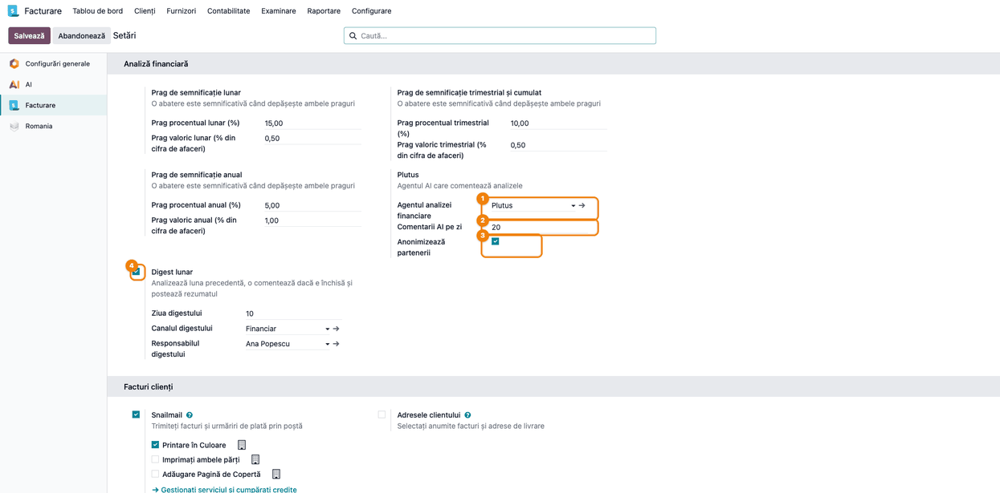
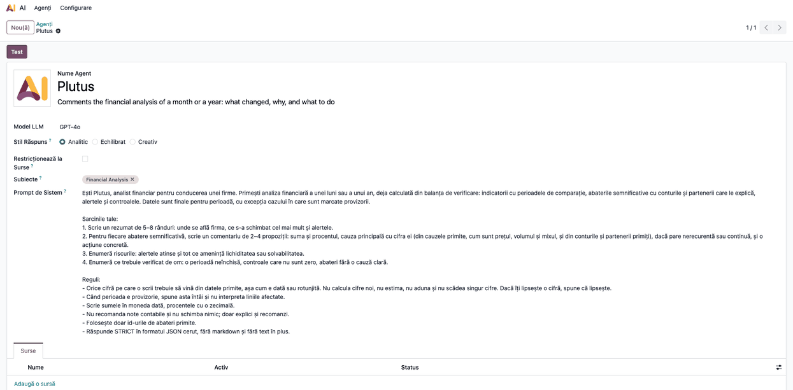
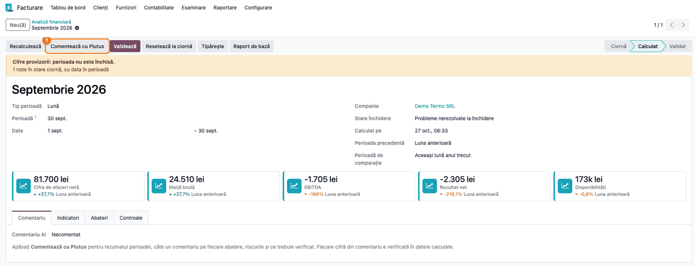
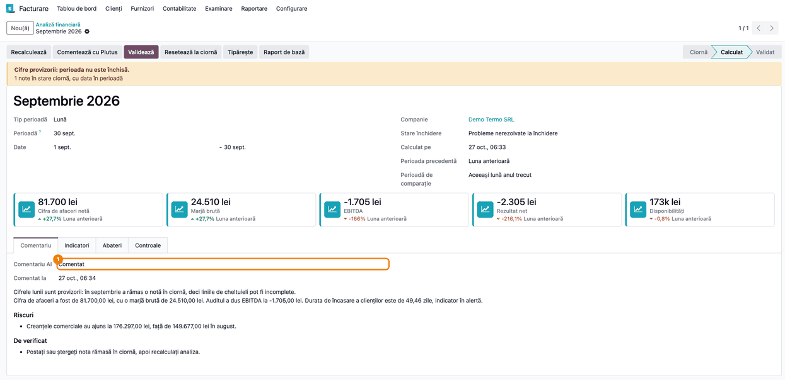
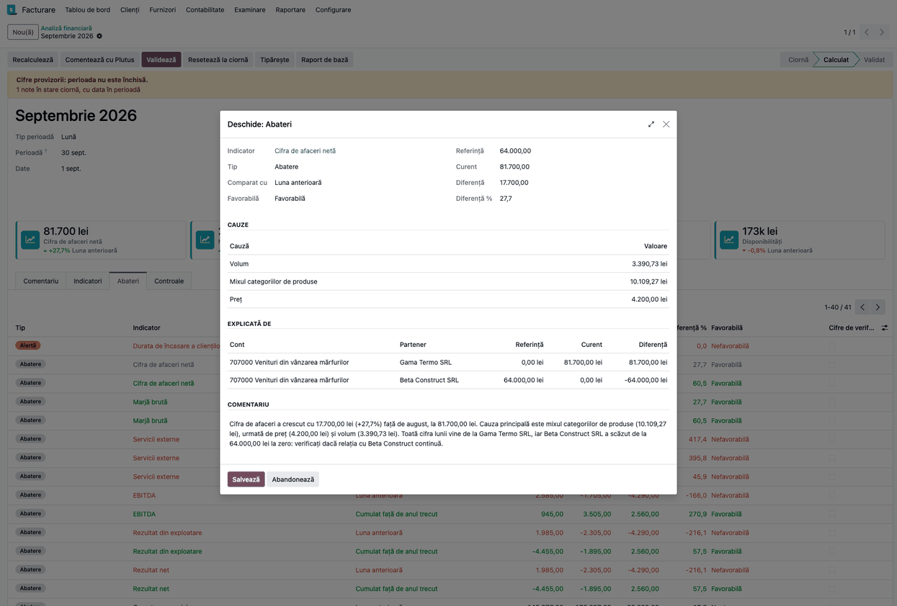
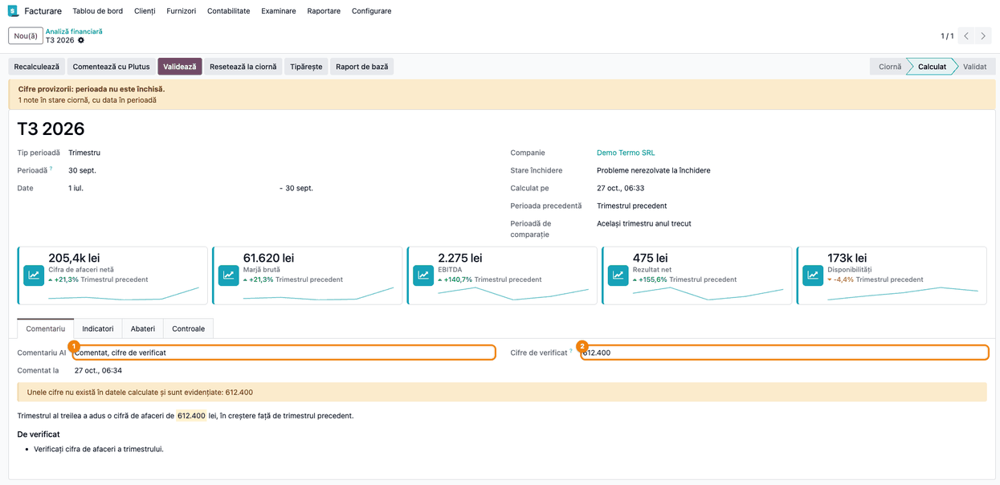
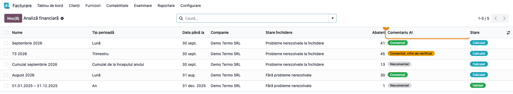
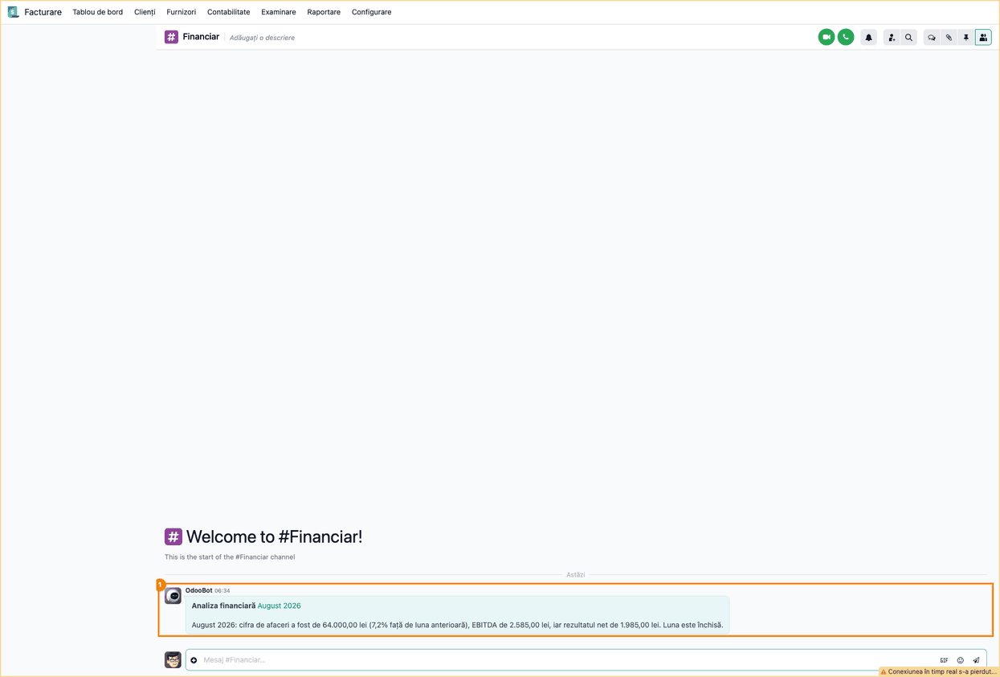
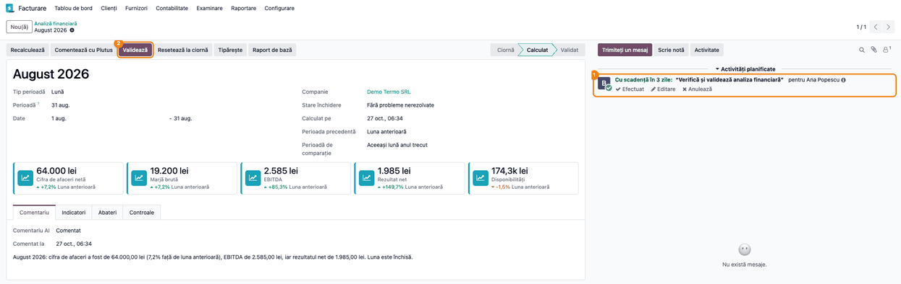

# Fișă Modul: Plutus — comentariul AI al analizei financiare

**Modul:** `deltatech_ai_financial_analysis`
**Utilizator principal:** Contabil șef, Director financiar, Controller financiar
**Prioritate:** 🟢 Scăzută (opțional peste analiza financiară: scrie textul pentru conducere, nu calculează și nu înregistrează nimic)

---

## 1. Scop business

După ce analiza financiară a lunii, a trimestrului sau a anului este calculată
(`deltatech_financial_analysis`), cineva trebuie să scrie pentru conducere ce s-a schimbat, de ce și ce
e de făcut. Modulul adaugă agentul AI **Plutus**, care scrie acest text: un rezumat al perioadei, câte un
comentariu pe fiecare abatere semnificativă, riscurile și ce trebuie verificat de om. Plutus **nu calculează
nicio cifră**: primește indicatorii, abaterile cu cauzele lor (preț, volum, mix) și conturile și partenerii
care le explică, iar codul caută cifrele din răspuns în datele trimise (cu excepțiile din Pasul 6). O cifră care nu
există în date este evidențiată, iar comentariul este marcat **Comentat, cifre de verificat**.

În plus, Plutus răspunde în chat la întrebări libere („de ce a scăzut marja în septembrie?”, „cum a evoluat
durata de încasare în ultimele 6 luni?”) cu uneltele de citire ale analizei, iar un **digest lunar** creează
automat analiza lunii precedente, o comentează dacă luna e închisă, postează rezumatul într-un canal Discuss
și îi dă contabilului o activitate de verificare și validare.

## 2. Bază legală și context

Modulul nu ține de o obligație legală: comentariul analizei este un document intern de management.

- **Date trimise furnizorului AI:** indicatorii, abaterile, conturile (cod și denumire) și numele
  partenerilor care explică abaterile. Nu se trimit notele contabile și nici codurile fiscale ale
  partenerilor. Când partenerii sunt persoane fizice, numele lor sunt date cu caracter personal
  (Regulamentul (UE) 2016/679, GDPR): bifați **Anonimizează partenerii**, ca furnizorul AI să primească doar
  „Partner A”, „Partner B”, iar numele reale să fie puse la loc în Odoo.
- **Anonimizarea se aplică doar comentariului din analiză** (**Comentează cu Plutus** și digestul). În chat,
  uneltele **Explică o abatere financiară** și **Vechimea creanțelor sau a datoriilor** trimit furnizorului
  AI numele reale ale partenerilor. Dacă printre parteneri sunt persoane fizice, stabiliți cine are voie să
  folosească chatul lui Plutus.
- **Răspunderea pentru text** rămâne a omului care validează analiza: comentariul este o propunere, se poate
  edita și nu se validează singur.

## 3. Utilizatori și roluri

| Rol | Ce face |
|---|---|
| Contabil șef | cere comentariul (**Comentează cu Plutus**), îl citește, îl corectează și validează analiza; primește activitatea din digest |
| Director financiar / Controller | citește rezumatul, riscurile și comentariile; pune întrebări lui Plutus în chat |
| Administrator / Manager contabilitate | alege agentul, limita zilnică, anonimizarea și digestul în Setări; alege modelul AI al agentului |

Roluri recomandate pentru testare:
- utilizator cu drept de **Contabil** (calculează analiza și apasă **Comentează cu Plutus**);
- utilizator **Administrator** (Setări, aplicația AI → Agenți);
- utilizator doar cu **citire în contabilitate**: vede comentariul și butonul **Comentează cu Plutus**, dar
  la apăsare cererea către furnizorul AI pleacă și apoi salvarea cade cu eroare de acces; nu poate modifica
  analiza. Nu dați acest buton utilizatorilor doar cu citire.

## 4. Conturi și date implicate

Modulul nu folosește conturi proprii și nu generează note contabile. Datele sunt cele ale analizei
financiare (vezi fișa `deltatech_financial_analysis`, secțiunea 4): liniile raportului **Bază analiză
financiară (RO)**, pe planul de conturi românesc.

Ce primește Plutus la **Comentează cu Plutus** (câmpul **Datele trimise agentului**, vizibil în modul
dezvoltator):

| Bloc | Conținut |
|---|---|
| Compania | numele companiei și moneda |
| Perioada | tipul, numele, datele, numărul de zile; perioada precedentă și cea de comparație |
| Închiderea | **Stare închidere**, dacă e provizorie și nota închiderii |
| Pragurile | pragul procentual și pragul valoric al analizei |
| Indicatorii | valoarea, perioada precedentă, perioada de comparație, variațiile, alerta; cumulatul la lună și trimestru; ponderea la an; tendința pe 5 trimestre la trimestru |
| Abaterile | indicatorul, baza, referința, valoarea curentă, diferența, caracterul, cauzele (preț, volum, mix...) și primele 5 conturi și parteneri care le explică |
| Controalele | rezultatul față de clasele 6 și 7, contul 5125, soldurile inverse pe parteneri, diferența față de F10 (la an) |

Date minime pentru demo: o analiză calculată cu cel puțin o abatere semnificativă (capturile folosesc
distribuitorul de echipamente termice din fișa motorului, septembrie 2026). Pentru capturi, răspunsul
agentului este simulat, fără cheie de furnizor AI.

## 5. Configurare inițială

1. Instalați `deltatech_ai_financial_analysis` (dependențe: `deltatech_financial_analysis` și `ai`, din
   Odoo 19 Enterprise). La instalare, agentul **Plutus** este pus pe toate companiile.
2. Configurați furnizorul AI al bazei (OpenAI, Gemini sau Claude cu `deltatech_ai_anthropic`). Cu
   `deltatech_ai_anthropic` instalat **înainte** de acest modul, Plutus primește la instalare modelul Claude
   Sonnet; altfel rămâne modelul implicit al Odoo și îl alegeți manual (Pasul 2).
3. În **Contabilitate → Configurare → Setări**, blocul **Analiză financiară**, completați **Plutus** și,
   dacă doriți, **Digest lunar** (Pasul 1).
4. Verificați limba companiei (partenerul companiei): Plutus scrie în limba ei, nu în limba utilizatorului.
5. Pentru meniul **AI → Agenți**, instalați aplicația **AI** (`ai_app`); fără ea, agentul funcționează din
   analiză, dar nu are meniu propriu.

## 6. Flux de utilizare

### Pasul 1 — Setările lui Plutus și ale digestului

Accesați **Contabilitate → Configurare → Setări** și coborâți la blocul **Analiză financiară**. Lângă
pragurile de semnificație apar două setări noi:

- **Plutus** — **Agentul analizei financiare** ① (implicit Plutus; gol = analizele rămân fără comentariu),
  **Comentarii AI pe zi** ② (limita pe companie, implicit 20; 0 = fără limită) și **Anonimizează
  partenerii** ③.
- **Digest lunar** ④ — bifat, afișează **Ziua digestului** (1–28, implicit 10), **Canalul digestului**
  (canalul Discuss în care se postează rezumatul) și **Responsabilul digestului** (contabilul care primește
  activitatea).

Apăsați **Salvează**.



### Pasul 2 — Agentul Plutus și întrebările în chat

Accesați **AI → Agenți → Agenți** și deschideți **Plutus** (cu aplicația AI instalată). Formularul arată **Model LLM** (modelul
folosit), **Stil răspuns** = **Analitic**, subiectul **Financial Analysis** și **Prompt de sistem**:
rolul lui Plutus, sarcinile (rezumat, comentariu pe abatere, riscuri, ce trebuie verificat) și regulile
(nicio cifră care nu vine din date, perioada provizorie spusă întâi, fără note contabile propuse). Promptul
este în limba utilizatorului care îl citește (română sau engleză). Schimbați modelul aici dacă e nevoie.

Butonul **Test** deschide chatul cu Plutus. Subiectul **Financial Analysis** îi dă cinci unelte de citire:

| Unealtă | Ce întoarce |
|---|---|
| AI: Indicatorii financiari ai unei perioade | indicatorii perioadei, cu comparațiile și starea închiderii |
| AI: Tendința unui indicator financiar | valorile unui indicator pe ultimele 2–24 de perioade |
| AI: Explică o abatere financiară | abaterea unui indicator, cu cauzele, conturile și partenerii |
| AI: Vechimea creanțelor sau a datoriilor | creanțele sau datoriile pe intervale de vechime și cei mai mari parteneri |
| AI: Starea închiderii perioadei | dacă perioada e închisă și ce mai e deschis |

Uneltele calculează în memorie și nu creează analize. Ele trimit furnizorului AI numele reale ale
partenerilor, chiar cu **Anonimizează partenerii** bifat (secțiunea 2). Plutus e instruit să citească fiecare cifră dintr-o
unealtă, să spună perioada și baza de comparație și să precizeze când perioada nu e închisă.



### Pasul 3 — Cererea comentariului

Accesați **Contabilitate → Raportare → Analiză financiară**, deschideți o analiză în starea **Calculat**
(în exemplu, **Septembrie 2026**) și deschideți tabul **Comentariu**: **Comentariu AI** este **Necomentat**.
Apăsați **Comentează cu Plutus** ①. Pleacă o singură cerere către furnizorul AI, cu datele analizei; după
răspuns, formularul se reîncarcă.

Butonul apare doar pe o analiză **Calculat**: o analiză în ciornă trebuie calculată întâi, iar una validată
nu mai poate fi comentată.



### Pasul 4 — Citirea comentariului

**Găsiți pe ecran**, în tabul **Comentariu**: **Comentariu AI** ① (starea), **Comentat la**, apoi rezumatul
perioadei, lista **Riscuri** și lista **De verificat**.

**Verificați:**
- starea este **Comentat** (nu **Comentat, cifre de verificat**, **Eșuat** sau **Sărit: limita zilnică
  atinsă**);
- la o perioadă provizorie, rezumatul începe prin a spune că cifrele sunt provizorii (în exemplu: nota
  rămasă în ciornă în septembrie);
- cifrele din rezumat sunt cele din tabul **Indicatori** (în exemplu: cifra de afaceri 81.700,00 lei, durata
  de încasare 49,46 zile);
- **De verificat** conține ce trebuie făcut înainte de validare.

Rezumatul nu se editează direct (comentariile abaterilor da, Pasul 5). **Recalculează** șterge rezumatul
și comentariile, pentru că cifrele lor nu mai corespund: după un calcul nou, cereți un comentariu nou.



### Pasul 5 — Comentariul fiecărei abateri

Deschideți tabul **Abateri** și apăsați pe o abatere. Câmpul **Comentariu** conține textul lui Plutus pentru
abaterea respectivă: suma și procentul, cauza principală cu cifra ei (din **Cauze** și **Explicată de**),
dacă pare punctuală sau continuă și o acțiune.

**Verificați** că cifrele din comentariu se regăsesc în **Diferență**, **Cauze** și **Explicată de** (în
exemplu: abaterea de 17.700,00 lei, mixul 10.109,27 lei, prețul 4.200,00 lei, volumul 3.390,73 lei și
scăderea Beta Construct SRL de la 64.000,00 lei la zero). Corectați textul dacă e nevoie și apăsați
**Salvează**. Coloana **Cifre de verificat** din lista abaterilor arată abaterile cu cifre negăsite în date.



### Pasul 6 — Cifre care nu există în date

Dacă Plutus scrie o cifră care nu este în datele trimise, starea devine **Comentat, cifre de verificat** ①:
câmpul **Cifre de verificat** ② le listează, sus apare avertismentul „Unele cifre nu există în datele
calculate și sunt evidențiate: …”, iar în text cifra este marcată cu galben. În exemplu, rezumatul trimestrului T3 2026
spune 612.400 lei, cifră care nu se regăsește în analiză (cifra de afaceri a trimestrului este 205,4k lei).

**Verificați** fiecare cifră evidențiată: corectați sau ștergeți textul înainte de a folosi comentariul.
Agentul nu primește automat a doua încercare (costul rămâne sub control); pentru un comentariu nou, apăsați
din nou **Comentează cu Plutus**.

Cum se citesc cifrele la verificare: numerele întregi sub 100 (zile, numărări) și cele între 1.900 și 2.100
(luate drept ani, deci și o sumă de 2.000 lei) nu se verifică; procentele se verifică întotdeauna;
o cifră cu grupuri de câte trei (62.000) este număr întreg; se acceptă rotunjirea la zecimalele scrise sau
o diferență de 0,5% din valoare; codurile de cont pot fi scrise și prescurtat (641 pentru 641000).



### Pasul 7 — Starea comentariilor în lista analizelor

În lista **Analiză financiară**, coloana **Comentariu AI** ① arată starea fiecărei analize: **Necomentat**
(gri), **Comentat** (verde), **Comentat, cifre de verificat** și **Sărit: limita zilnică atinsă** (portocaliu),
**Eșuat** (roșu). Un comentariu eșuat (răspuns invalid, furnizor indisponibil) lasă analiza neschimbată;
motivul apare în **Eroare AI**, în tabul **Comentariu**.



### Pasul 8 — Digestul lunar în Discuss

Cu **Digest lunar** bifat, acțiunea planificată **Analiză financiară: digest lunar** rulează zilnic și, în
**Ziua digestului**, pentru fiecare companie:
1. creează (sau ia) analiza lunară a lunii precedente și o calculează; o analiză deja validată rămâne
   neatinsă;
2. o comentează cu Plutus doar dacă **Stare închidere** este **Perioadă închisă** sau **Fără probleme
   nerezolvate**;
3. postează în **Canalul digestului** ① (autor: OdooBot, utilizatorul acțiunii planificate) un mesaj cu
   legătura la analiză și rezumatul lui Plutus sau, dacă nu s-a comentat, „cifre provizorii, luna nu este
   închisă; fără comentariu AI.” și nota închiderii.

> **Atenție:** o analiză a lunii precedente care e deja **Calculat** este recalculată de digest, deci
> abaterile, comentariile și corecturile manuale nevalidate se pierd. Validați analiza înainte de ziua
> digestului sau corectați-o după digest. Mesajul „luna nu este închisă” apare și când comentariul nu s-a
> făcut din alt motiv (agent nesetat, limita zilnică, eroare AI): verificați **Stare închidere** și
> **Comentariu AI** pe analiză.

**Verificați** în Discuss, pe canal, mesajul cu numele lunii (în exemplu, **August 2026**) și rezumatul.



### Pasul 9 — Activitatea de verificare și validare

Tot digestul pune **Responsabilului digestului** activitatea „Verifică și validează analiza financiară” ①,
cu scadența peste 3 zile, pe analiza lunii. Contabilul deschide analiza din activitate, citește tabul
**Comentariu** și abaterile, corectează textele și apasă **Validează** ②. Analiza validată păstrează
comentariul și nu mai poate fi comentată din nou.



### Note de monografie și raportare

Modulul **nu generează note contabile** și nu propune înregistrări: promptul îi interzice lui Plutus să
recomande note contabile. Scrie doar:

- pe analiză: **Comentariu AI** (starea), **Comentariu** (rezumatul, riscurile, ce trebuie verificat),
  **Cifre de verificat**, **Eroare AI**, **Comentat la**, **Datele trimise agentului** și **Durată AI (s)**;
- pe fiecare abatere: **Comentariu** și **Cifre de verificat**;
- în digest: mesajul din canal și activitatea.

Comentariile abaterilor sunt gândite să apară și în PDF-ul analizei (butonul **Tipărește** al modulului de
bază). **Defect cunoscut (27.10.2026):** în `deltatech_financial_analysis` 19.0.1.2.0, **Tipărește** se
oprește cu eroarea „QWeb widgets do not work correctly on 'td' elements” (vezi fișa modulului de bază,
Pasul 10); până la corectare, comentariile se citesc în Odoo.

## 7. Legături cu alte module / declarații

| Modul / proces | Rol în flux | Tip legătură |
|---|---|---|
| `deltatech_financial_analysis` | calculează analiza, abaterile, cauzele și uneltele de citire | dependență (manifest) |
| `ai` (Odoo 19 Enterprise) | agenții AI, apelul către furnizor, uneltele din chat | dependență (manifest) |
| `ai_app` | meniul **AI → Agenți**, de unde se alege modelul și se deschide chatul | opțional |
| `deltatech_ai_anthropic` | furnizorul Claude; la instalare Plutus primește Claude Sonnet | opțional |
| `deltatech_ai_agent_delegate` | adaugă lui Plutus un agent specialist (de exemplu contabil) | opțional |
| `deltatech_ai_usage` | arată costul cererilor AI | opțional |
| `l10n_ro_period_close_enhanced` | starea închiderii, de care depinde comentariul din digest | opțional (prin modulul de bază) |

**Ce e automat:** construirea datelor trimise, verificarea fiecărei cifre din răspuns, punerea la loc a
numelor partenerilor anonimizați, scrierea comentariilor pe abateri, ștergerea comentariului la un calcul
nou, digestul lunar (analiză, comentariu dacă luna e închisă, mesaj, activitate), limita zilnică.

**Ce rămâne manual:** cererea comentariului pe analizele în afara digestului, citirea și corectarea textelor,
verificarea cifrelor evidențiate, validarea analizei, alegerea modelului AI și a furnizorului.

## 8. Verificări pentru consultant

- [ ] În **Setări → Analiză financiară** apar blocurile **Plutus** și **Digest lunar**; agentul implicit este
      Plutus.
- [ ] **Comentează cu Plutus** apare doar pe o analiză **Calculat**.
- [ ] După comentariu, tabul **Comentariu** are rezumatul, **Riscuri** și **De verificat**, iar fiecare abatere
      semnificativă are comentariul ei.
- [ ] La o perioadă provizorie, rezumatul spune întâi că cifrele sunt provizorii.
- [ ] O cifră inventată este evidențiată, listată în **Cifre de verificat**, iar starea este **Comentat, cifre de
      verificat**.
- [ ] Cu **Anonimizează partenerii** bifat, **Datele trimise agentului** (mod dezvoltator) conțin „Partner A”,
      „Partner B”, iar comentariile afișează numele reale.
- [ ] Datele trimise nu conțin note contabile și nici coduri fiscale ale partenerilor.
- [ ] În chat, cu **Anonimizează partenerii** bifat, uneltele trimit totuși numele reale (comportament
      cunoscut, secțiunea 2).
- [ ] **Recalculează** șterge comentariul (starea revine la **Necomentat**).
- [ ] Peste **Comentarii AI pe zi**, starea devine **Sărit: limita zilnică atinsă** și nu pleacă nicio cerere.
- [ ] Un răspuns invalid sau un furnizor indisponibil dă **Eșuat**, cu motivul în **Eroare AI**, iar analiza
      rămâne calculată.
- [ ] Digestul postează în canal și pune activitatea; o lună neînchisă e postată fără comentariu AI.
- [ ] Comentariul este scris în limba companiei.
- [ ] În chat, Plutus răspunde cu cifre citite din unelte și spune perioada lor.

## 9. Mesaje de eroare frecvente

| Mesaj / simptom | Cauză probabilă | Remediere |
|---|---|---|
| „Calculați analiza înainte de a cere un comentariu.” | Analiza este în ciornă | Apăsați **Calculează** |
| „O analiză validată nu mai poate fi comentată.” | Analiza este validată | **Resetează la ciornă** (Manager contabilitate), calculați și comentați din nou |
| „Setați întâi agentul analizei financiare în setări.” | **Agentul analizei financiare** este gol | Alegeți Plutus în Setări |
| **Comentariu AI** = **Eșuat**, cu **Eroare AI** completat | Răspunsul nu e JSON valid, furnizorul AI nu răspunde sau nu are cheie | Verificați furnizorul și modelul agentului, apoi apăsați din nou **Comentează cu Plutus** |
| **Comentariu AI** = **Sărit: limita zilnică atinsă** | S-au comentat deja **Comentarii AI pe zi** analize azi în companie | Așteptați ziua următoare sau măriți limita |
| **Comentat, cifre de verificat** | Plutus a scris o cifră care nu e în date | Verificați și corectați cifrele evidențiate |
| Comentariul este în altă limbă decât interfața | Plutus scrie în limba partenerului companiei | Schimbați limba companiei sau corectați textul |
| Digestul spune „luna nu este închisă” deși **Stare închidere** este închisă | Comentariul nu s-a făcut din alt motiv: agent nesetat, limita zilnică atinsă sau eroare AI | Verificați **Comentariu AI** și **Eroare AI** pe analiză, apoi apăsați **Comentează cu Plutus** |
| Digestul nu postează nimic | **Digest lunar** nebifat, ziua nu e **Ziua digestului**, analiza lunii este deja validată sau **Canalul digestului** este gol | Verificați setările digestului |
| Meniul **AI → Agenți** lipsește | Aplicația AI (`ai_app`) nu este instalată | Instalați aplicația AI |

## 10. Capturi de ecran

Capturile sunt **generate automat** de `tests/test_screenshots.py` (mixinul `ScreenshotCase` din
`deltatech_doc_screenshots`, import defensiv), în limba română, pe planul de conturi RO, pe compania
„Demo Termo SRL” în RON. Testul refolosește seed-ul capturilor din `deltatech_financial_analysis` și
**simulează răspunsul agentului** (patch pe `get_direct_response`): nu se apelează niciun furnizor AI și
nu e nevoie de cheie. Ordinea urmează pașii din secțiunea 6:

1. `01_setari_plutus.png` — blocurile **Plutus** și **Digest lunar** din **Setări**.
2. `02_agent_plutus.png` — agentul **Plutus** în **AI → Agenți**, cu promptul de sistem.
3. `03_comenteaza_cu_plutus.png` — analiza calculată, tabul **Comentariu** gol și butonul **Comentează cu Plutus**.
4. `04_tab_comentariu.png` — rezumatul, **Riscuri** și **De verificat**, cu starea **Comentat**.
5. `05_comentariu_abatere.png` — comentariul lui Plutus pe abaterea cifrei de afaceri.
6. `06_cifre_de_verificat.png` — analiza trimestrială cu o cifră evidențiată și starea **Comentat, cifre de verificat**.
7. `07_lista_stare_ai.png` — coloana **Comentariu AI** în lista analizelor.
8. `08_digest_canal.png` — rezumatul lunii august 2026 în canalul Discuss **Financiar**.
9. `09_activitate_validare.png` — activitatea „Verifică și validează analiza financiară” pe analiza din digest.

Regenerare (cu aplicația AI, pentru captura 02):

```bash
./odoo/odoo-bin -c odoo.conf -d <db> -i deltatech_ai_financial_analysis,ai_app,deltatech_doc_screenshots \
    --test-tags=fise_screenshots --stop-after-init
```

## 11. Observații pentru manual

- Începeți cu regula de aur: Plutus nu calculează; fiecare cifră din text vine din analiză, iar codul
  verifică asta. Captura 06 este cel mai bun argument.
- Comentariul este o propunere: omul îl citește, îl corectează și validează analiza.
- Explicați legătura cu închiderea: pe o lună neînchisă, Plutus spune întâi că cifrele sunt provizorii, iar
  digestul nu o comentează deloc.
- Menționați costul: o cerere pe analiză, limită zilnică pe companie, fără reîncercări automate.
- Pentru chat, dați 2–3 exemple de întrebări și arătați că răspunsul spune perioada și baza de comparație.
- Păstrați exemplul din fișa motorului (septembrie 2026, distribuitorul de echipamente termice).
