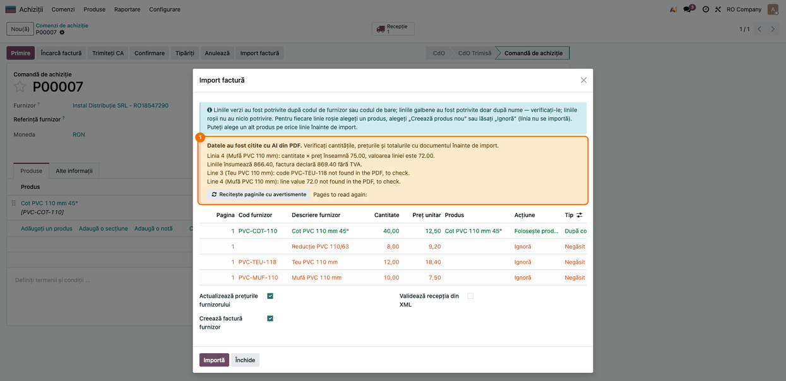
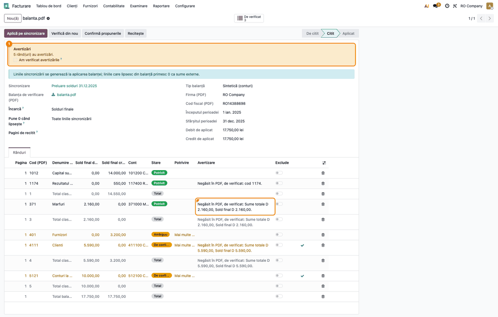

# Fișă Modul: Verificarea fără AI a datelor citite cu AI dintr-un PDF

**Modul:** `deltatech_ai_pdf_base`
**Versiune:** 19.0.1.0.3
**Suită:** bitshop_ent
**Dependențe:** `base`, `deltatech_partner_match` (biblioteca Python `python-stdnum`)
**Utilizator principal:** consultantul care pune în funcțiune importul facturilor sau al balanței din PDF; operatorul
vede doar efectul, ca avertismente în modulele care îl folosesc
**Prioritate:** 🟡 Medie (modul tehnic, fără ecrane proprii; protejează importurile din PDF de cifrele transcrise
greșit de AI)

---

## 1. Scop business

Când un agent AI citește o factură de furnizor sau o balanță de verificare dintr-un PDF, poate transcrie greșit o cifră
în așa fel încât calculele să se lege în continuare: o cantitate greșită cu valoarea liniei calculată din ea, două
sume cu cifre inversate (5.950 citit 5.590) ale căror diferențe se compensează în total. Verificările aritmetice ale modulelor de import nu prind astfel de
greșeli. Acest modul face, **în cod, fără niciun apel AI**, două verificări independente de citirea AI:

- **fiecare valoare și fiecare cod citit trebuie să fie tipărit în textul paginii lui din PDF** (cantitate, preț,
  valoare de linie, totaluri, sume din balanță, codul articolului sau al contului);
- **codul fiscal citit (CUI, CNP, cod de TVA UE) trebuie să treacă de cifra de control**.

Modulul nu are meniuri, setări sau ecrane. Îl instalează automat, ca dependență, *Purchase PDF AI Import*
(`deltatech_ai_purchase_pdf`) și *Trial Balance PDF Import with AI* (`deltatech_ai_trial_balance_import`), iar
rezultatul verificărilor apare **ca avertismente** în ecranele acestora.

## 2. Bază legală și context

Modulul nu implementează o obligație legală. Contextul operațional:

- **Codul fiscal.** Cifra de control a CUI-ului și a CNP-ului (România) și a codurilor de TVA din statele membre UE se
  verifică cu biblioteca `python-stdnum`, aceeași implementare ca în `deltatech_partner_match`. Verificarea arată doar
  că numărul e bine format; nu arată că firma există sau că e înregistrată în scopuri de TVA (pentru asta rămâne
  verificarea la ANAF / VIES din alte module).
- **Răspunderea pentru date.** Documentul justificativ rămâne PDF-ul. Avertismentele modulului semnalează ce trebuie
  comparat cu documentul; ele nu corectează și nu blochează nimic. Decizia îi rămâne operatorului.

## 3. Utilizatori și roluri

| Rol | Ce face cu modulul |
|---|---|
| Consultant / administrator | îl instalează (prin modulele care îl folosesc) și verifică, la punerea în funcțiune, că avertismentele apar |
| Responsabil achiziții | citește avertismentele din previzualizarea facturii PDF înainte de import |
| Contabil (preluare solduri) | citește avertismentele din importul balanței PDF înainte de a o aplica pe sincronizare |

Roluri recomandate la testare: un utilizator cu drepturi de **Achiziții / Administrator** pentru factura de furnizor
și unul cu drepturi de **Contabilitate / Contabil** (acces la **Sincronizare plan de conturi**) pentru balanță.
Modulul nu adaugă grupuri sau drepturi proprii.

## 4. Conturi și date implicate

Modulul nu generează și nu modifică înregistrări contabile, deci nu folosește conturi.

Date minime pentru demo (exact cele din capturi, generate de test):

- **o factură de furnizor PDF cu text** (nu scanată) cu patru linii, pe o comandă de achiziție confirmată cu o singură
  linie (rândurile 2–4 apar roșii, *Negăsit*, pentru că produsele nu sunt pe comandă, fără legătură cu acest modul);
  ultima linie e tipărită cu valoarea **75,00**, iar agentul AI a citit **72,00**; codul **PVC-TEU-110** citit
  **PVC-TEU-118**; CUI-ul furnizorului valid (**RO18547290**);
- **o balanță de verificare sintetică PDF cu text**, la 31.12.2025, pe o sincronizare de plan de conturi în ciornă:
  soldul contului **4111** tipărit **5.950,00** și citit **5.590,00**, al contului **371** tipărit **1.800,00** și citit
  **2.160,00** (diferențele se compensează, deci totalurile se închid), contul **1171** citit **1174**;
- pentru codul fiscal: un CUI cu cifra de control greșită (ex. **RO18547291**) pe furnizor sau pe balanță.

## 5. Configurare inițială

1. Instalați modulul care citește documentul: **Aplicații** → căutați *Purchase PDF AI Import* sau *Trial Balance PDF
   Import with AI* → **Activează**. `deltatech_ai_pdf_base` și `deltatech_partner_match` se instalează automat.
   Pe un server fără `python-stdnum`, instalarea se oprește cu mesajul de dependență externă lipsă.
2. Activați citirea cu AI pe companie, în setările modulului care o folosește (fișele `deltatech_ai_purchase_pdf` și
   `deltatech_ai_trial_balance_import` descriu pașii și agentul AI).
3. Pentru verificarea codului fiscal fără prefix de țară, completați **țara companiei** (**Setări → Companii**): un cod
   fără prefix se verifică drept CUI/CNP doar pentru o companie din România.
4. Folosiți la testare **PDF-uri cu strat de text** (generate dintr-un program, nu scanate): pe o pagină scanată
   valorile nu se pot căuta în text, iar modulul doar semnalează asta.

## 6. Flux de utilizare

Modulul nu are pași proprii. Mai jos sunt cele două locuri în care i se vede efectul și cum se citesc avertismentele.
Fluxul complet al fiecărui import (încărcarea PDF-ului, citirea, aplicarea) e în fișa modulului respectiv.

### Ce verifică modulul, pe scurt

| Verificare | Regula | Rezultat când nu trece |
|---|---|---|
| Valoare găsită în text | numărul citit trebuie să apară **undeva** pe pagina lui (sau pe paginile liniei), printre toate numerele tipărite acolo; semnul și zerourile de la final nu contează, iar o valoare tipărită cu mai multe zecimale se potrivește și cu rotunjirea la bani | avertisment *„… not found in the PDF, to check”* |
| Formate de număr | `1.234,56`, `1,234.56`, `1234.56`, `1 234,56` sunt aceeași valoare; `1.234` ambiguu se potrivește și cu o mie două sute treizeci și patru, și cu unu virgulă două sute treizeci și patru | — |
| Cod găsit în text | codul de articol sau de cont trebuie să apară pe pagina lui, chiar și ca parte dintr-un alt cod sau număr; se ignoră spațiile și literele mari/mici (cratima contează) | avertisment *„code … not found”* |
| Pagină fără text | o pagină cu mai puțin de 10 caractere sau fără nicio cifră e tratată ca scanată: valorile ei nu se verifică | mesaj că paginile N nu au strat de text |
| Cod fiscal | CUI și CNP (România), cod de TVA UE: cifra de control; un cod gol, din afara UE sau fără prefix la o companie din afara României nu se verifică | avertisment *„… is not valid”* |

O valoare **zero sau goală** nu se verifică. Când pagina liniei nu e cunoscută, valoarea se caută în tot documentul.

**Ce nu prinde.** Verificarea spune doar dacă valoarea citită e tipărită *pe pagină*, nu și *pe rândul ei*. Nu dau
avertisment:

- o sumă luată de pe alt rând al aceleiași pagini (două solduri schimbate între ele);
- o sumă trecută pe partea cealaltă (debit în loc de credit): valoarea e aceeași;
- o valoare mică citită greșit care apare oricum pe pagină (ex. cantitatea 10 în loc de 12, când 10 e tipărit în
  altă parte: dată, număr de linie, alt rând);
- un cod citit trunchiat, care apare ca parte din codul corect sau dintr-o sumă (411 în loc de 4111).

Aceste cazuri rămân în seama verificărilor aritmetice ale modulului de import și a comparării cu PDF-ul.

### Pasul 1 — Factura de furnizor din PDF: avertismentele din previzualizare

**Achiziții → Comenzi → Comenzi de achiziție**, deschideți comanda cu PDF-ul facturii atașat → butonul
**Import factură** → **Previzualizare**. După citirea cu AI, previzualizarea arată bannerul galben **„Datele au fost
citite cu AI din PDF.”**, cu avertismentele sub el.



**Găsiți pe ecran**, în bannerul galben, rândurile adăugate de acest modul (deocamdată afișate în engleză):

- *„Line 3 (Teu PVC 110 mm): code PVC-TEU-118 not found in the PDF, to check.”* — codul citit nu e tipărit pe pagina
  liniei;
- *„Line 4 (Mufă PVC 110 mm): line value 72.0 not found in the PDF, to check.”* — valoarea citită nu e tipărită pe
  pagina liniei;
- dacă e cazul, *„Totals: … not found in the PDF, to check.”* (total fără TVA, TVA, total de plată), *„The supplier's
  VAT number … read from the PDF is not valid.”* și *„The PDF has no text layer (scanned) …”* sau *„Page(s) N have no
  text layer …”*.

Rândurile în română de deasupra (*„Linia 4 … cantitate × preț înseamnă …”*, *„Liniile însumează …”*) sunt
verificările aritmetice ale modulului de import, nu ale acestui modul.

**Verificați**, cu PDF-ul deschis alături:

- pentru fiecare linie din avertisment, valoarea citită (din textul avertismentului) diferă de cea tipărită pe pagina
  indicată: în exemplu, valoarea liniei 4 citită 72,00, față de 75,00 tipărit (previzualizarea nu are coloană de
  valoare: pe rând se văd cantitatea 10,00 și prețul 7,50, din care rezultă 75,00); codul liniei 3 apare în coloana
  **Cod furnizor** ca PVC-TEU-118, față de PVC-TEU-110 tipărit;
- dacă valoarea din previzualizare e totuși cea tipărită (ex. un format de număr neobișnuit), avertismentul se poate
  ignora;
- la un CUI invalid, comparați-l cu cel tipărit pe factură: o cifră citită greșit face ca furnizorul să nu fie găsit
  după CUI.

**Treceți mai departe** doar după ce fiecare avertisment are o explicație: **Recitește paginile cu avertismente**
citește din nou doar paginile liniilor semnalate; altfel, corectați cifra după import, pe comandă, sau importați XML-ul.

### Pasul 2 — Balanța de verificare din PDF: avertizările pe rânduri

**Facturare → Configurare → Contabilitate → Sincronizare plan de conturi**, deschideți sincronizarea în ciornă →
**Încarcă balanța din PDF (AI)** → alegeți PDF-ul → **Citește cu AI**. După citire, importul balanței arată bannerul
galben **Avertizări** cu numărul de rânduri cu avertizări.



**Găsiți pe ecran:**

- în bannerul **Avertizări**: *„5 rând(uri) au avertizări.”* și, la un cod fiscal invalid al balanței, *„Codul
  fiscal al balanței (…) nu este valid.”*;
- în tab-ul **Rânduri**, coloana **Avertizare**: *„Negăsit în PDF, de verificat: Sume totale D 5.590,00, Sold final
  D 5.590,00.”* și *„Negăsit în PDF, de verificat: cod 1174.”*; la un partener, *„Codul fiscal … nu este valid:
  partenerul este potrivit doar după nume.”*;
- în bannerul albastru, la un PDF scanat, *„PDF-ul nu are strat de text (scanat) …”* sau *„Pagina(ile) N nu au strat
  de text …”*;
- butonul **De verificat** listează rândurile nepotrivite sau de confirmat (după stare), nu rândurile cu avertizări;
  pentru acestea, în lista deschisă de buton scoateți filtrul **De verificat** și alegeți **Cu avertizări**.

**Verificați:**

- în exemplu, bannerul roșu de erori **nu apare**: rândurile, totalurile claselor și totalul general se închid, deși
  4111 și 371 sunt citite greșit. Doar verificarea față de textul PDF-ului le prinde;
- pentru fiecare rând cu avertizare, suma sau codul de pe rând diferă de cel tipărit în PDF, pe pagina din coloana
  **Pagina**;
- un rând de cont citit cu alt cod (1174 în loc de 1171) e potrivit pe alt cont din Odoo: verificați coloana **Cont**;
- un cod fiscal invalid al unui partener nu e folosit la potrivire: partenerul e căutat doar după nume, deci
  verificați coloana **Partener**.

**Treceți mai departe:** corectați suma sau codul pe rând și apăsați **Verifică din nou** (textul PDF-ului e păstrat,
nu se mai citește cu AI), sau recitiți paginile. Abia când avertizările rămase au o explicație, bifați **Am verificat
avertizările** și apăsați **Aplică pe sincronizare**.

### Note de monografie și raportare

Modulul nu generează note contabile și nu influențează raportarea. Notele rezultă din fluxurile modulelor care îl
folosesc (detaliate în fișa `deltatech_ai_purchase_pdf`): la factura de furnizor, 371 = 408 la recepție, apoi
408 = 401 și 4426 = 401 la factură; la balanță, diferența de sold postată din sincronizarea planului de conturi. O valoare citită greșit și neprinsă ar ajunge în aceste note, de aceea
avertismentele se rezolvă înainte de import, respectiv înainte de aplicarea balanței.

## 7. Legături cu alte module / declarații

| Modul | Legătura |
|---|---|
| `deltatech_ai_purchase_pdf` | folosește verificările la previzualizarea facturii de furnizor citite din PDF (linii, totaluri, CUI furnizor) |
| `deltatech_ai_trial_balance_import` | folosește verificările la importul balanței din PDF (sume și cod de cont pe rând, cod fiscal al balanței și al partenerilor); păstrează textul paginilor pentru **Verifică din nou** |
| `deltatech_partner_match` | furnizează verificarea codului fiscal (`check_vat`); aceeași regulă la potrivirea partenerilor |
| `python-stdnum` (bibliotecă Python) | cifra de control CUI, CNP, TVA UE |

Modulul nu are legătură directă cu declarațiile fiscale.

**Ce e automat.** Extragerea textului din fiecare pagină a PDF-ului, căutarea fiecărei valori și a fiecărui cod citit pe
pagina lui, recunoașterea formatelor de număr, detectarea paginilor scanate, verificarea cifrei de control a codurilor
fiscale.
**Ce rămâne manual.** Compararea cu PDF-ul a fiecărui rând semnalat, corectarea sau recitirea, confirmarea
avertismentelor. Un avertisment nu blochează importul.

## 8. Verificări pentru consultant

- [ ] Instalarea *Purchase PDF AI Import* sau *Trial Balance PDF Import with AI* instalează și `deltatech_ai_pdf_base`
      (**Aplicații**, filtrul **Instalate**, căutare *AI PDF Reading Checks*).
- [ ] Factură PDF cu text, citită corect: bannerul nu conține niciun rând *„not found in the PDF”*.
- [ ] O valoare de linie modificată (tipărit 75,00, citit 72,00) produce *„Line N (…): line value 72.0 not found in the
      PDF, to check.”*, cu numărul liniei.
- [ ] Un cod de articol citit greșit produce *„code … not found in the PDF”*; același cod scris cu alte spații sau cu
      litere mici **nu** produce avertisment.
- [ ] Un total fără TVA, TVA sau total de plată care nu e tipărit produce *„Totals: … not found in the PDF, to check.”*
- [ ] Un CUI de furnizor cu cifra de control greșită (ex. RO18547291) produce *„The supplier's VAT number … is not
      valid.”*; un CUI corect (RO18547290) nu.
- [ ] Un PDF scanat produce *„The PDF has no text layer (scanned) …”* și niciun avertisment de valoare.
- [ ] La balanță, două sume cu cifre inversate care se compensează (5.950 citit 5.590, 1.800 citit 2.160): niciun banner roșu de erori, dar rândurile apar cu
      avertizare *„Negăsit în PDF, de verificat: …”* în coloana **Avertizare**.
- [ ] După corectarea sumei pe rând și **Verifică din nou**, avertizarea rândului dispare.
- [ ] La balanță, un cod fiscal de partener invalid produce *„Codul fiscal … nu este valid: partenerul este potrivit
      doar după nume.”*, iar partenerul e găsit doar după nume.
- [ ] Testele automate trec: `./odoo/odoo-bin -c odoo.conf -d test19 -u deltatech_ai_pdf_base
      --test-tags=/deltatech_ai_pdf_base --stop-after-init` (formatele de număr, valoarea pe pagina ei, paginile
      scanate, cifra de control).

## 9. Mesaje de eroare frecvente

| Mesaj | Cauză | Remediere |
|---|---|---|
| Factură: „Line N (…): … not found in the PDF, to check.”; balanță: „Negăsit în PDF, de verificat: …” | valoarea sau codul citit de AI nu e tipărit pe pagina liniei: cifră transcrisă greșit, cod citit greșit | comparați cu PDF-ul; recitiți pagina sau corectați valoarea |
| Același avertisment, deși valoarea e corectă | numărul e tipărit într-un format neobișnuit, despărțit de alt text, sau linia e pe altă pagină decât cea raportată de AI | comparați manual și ignorați avertismentul dacă valoarea e corectă |
| „Totals: … not found in the PDF, to check.” | totalul citit nu apare în document; la o factură cu avans dedus, totalul de plată tipărit poate diferi | verificați totalul pe ultima pagină |
| Factură: „The supplier's VAT number … is not valid.”; balanță: „Codul fiscal … nu este valid” | CUI/CNP/cod de TVA UE cu cifra de control greșită: citit greșit sau tipărit greșit | comparați cu PDF-ul; corectați codul pe partener dacă e cazul |
| „The PDF has no text layer (scanned) …” (factură) / „PDF-ul nu are strat de text (scanat) …”, „Pagina(ile) N nu au strat de text …” (balanță) | PDF scanat sau pagini imagine: valorile nu se pot căuta în text | cereți documentul generat din program sau verificați manual toate valorile acelor pagini |
| Instalarea se oprește cu dependența externă `stdnum` lipsă | biblioteca `python-stdnum` nu e instalată pe server | `pip install python-stdnum` în mediul Odoo, apoi reluați instalarea |

## 10. Capturi de ecran

Capturile, în ordinea pașilor din secțiunea 6, în `static/description/`:

| Fișier | Pasul | Ce arată |
|---|---|---|
| `01_factura_avertismente_text_pdf.png` | 1 | previzualizarea **Import factură** a unei facturi PDF, cu bannerul galben: avertismentele de cod și de valoare negăsite în textul PDF-ului |
| `02_balanta_avertizari_text_pdf.png` | 2 | importul balanței PDF citite, cu bannerul **Avertizări** și coloana **Avertizare** afișată: sumele și codul negăsite în text, fără erori de totaluri |

Capturile sunt **generate automat** din `tests/test_screenshots.py` (mixinul `ScreenshotCase` din
`l10n_ro_doc_screenshots`, import defensiv), în română, pe planul de conturi RO, pe *RO Company* în RON. Pentru că
modulul nu are ecrane proprii, testul pozează ecranele modulelor care îl folosesc și se sare dacă acestea nu sunt
instalate. PDF-urile sunt generate de test, iar răspunsul agentului AI este simulat (niciun apel real la un LLM, fără
cost), cu cifrele și codurile citite intenționat greșit. Regenerare:

```bash
./odoo/odoo-bin -c odoo.conf -d test19 -i deltatech_ai_pdf_base,deltatech_ai_purchase_pdf,deltatech_ai_trial_balance_import,ai_app,l10n_ro,l10n_ro_doc_screenshots --test-tags=/deltatech_ai_pdf_base:TestPdfCheckScreenshots --stop-after-init
```

## 11. Observații pentru manual

- **Plasă de siguranță, nu corector.** Modulul arată unde AI-ul ar fi putut transcrie greșit; nu corectează și nu
  blochează. Mesajul pentru utilizator: un rând cu avertisment se compară cu PDF-ul înainte de import.
- **Prinde ce nu prind totalurile, dar nu tot.** O valoare transcrisă cu o cifră greșită, chiar dacă totalurile se
  închid, nu e tipărită pe pagină și e semnalată. O sumă luată de pe alt rând al aceleiași pagini, o inversare
  debit/credit sau un cod trunchiat nu sunt semnalate (vezi „Ce nu prinde”, secțiunea 6): comparația cu PDF-ul rămâne
  necesară.
- **Doar PDF-uri cu text.** Pe un PDF scanat verificarea nu se face, iar ecranul spune asta. Recomandați furnizorilor și
  programului contabil anterior PDF-uri generate, nu scanate.
- **Codul fiscal valid nu înseamnă firmă activă.** Cifra de control prinde o cifră citită greșit; existența firmei și
  înregistrarea în scopuri de TVA se verifică separat.
- **Mesajele din importul facturii sunt deocamdată în engleză.** Textele avertismentelor vin din modulele care
  folosesc verificarea. Cele din `deltatech_ai_trial_balance_import` sunt traduse (19.0.1.3.0); în
  `deltatech_ai_purchase_pdf` lipsesc încă din `ro.po` traducerile pentru *„… not found in the PDF, to check”*,
  *„code …”*, denumirile valorilor din factură (*quantity*, *price*, *line value*, totaluri) și *„The supplier's VAT
  number … is not valid”*. Redactorul manualului poate cita aceste mesaje în engleză, cu explicația în română.
- În lista de aplicații, modulul apare ca *AI PDF Reading Checks*; nu se instalează singur, ci odată cu modulele de
  import din PDF.
