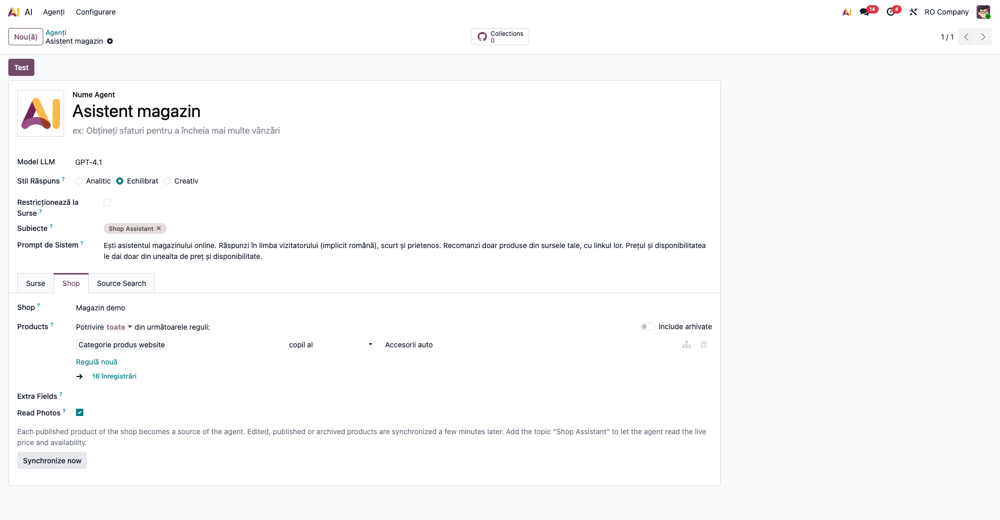
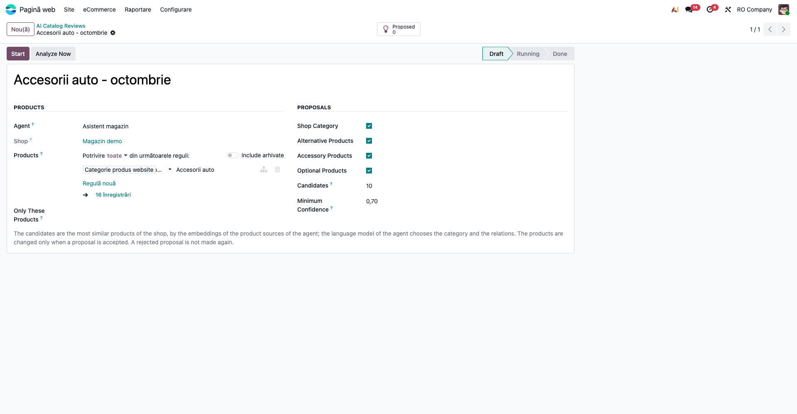
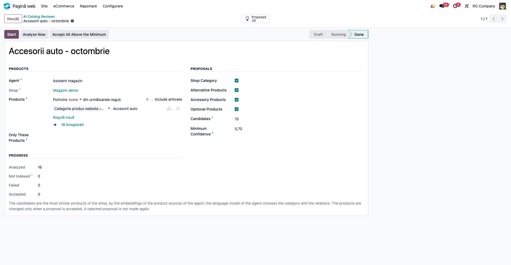
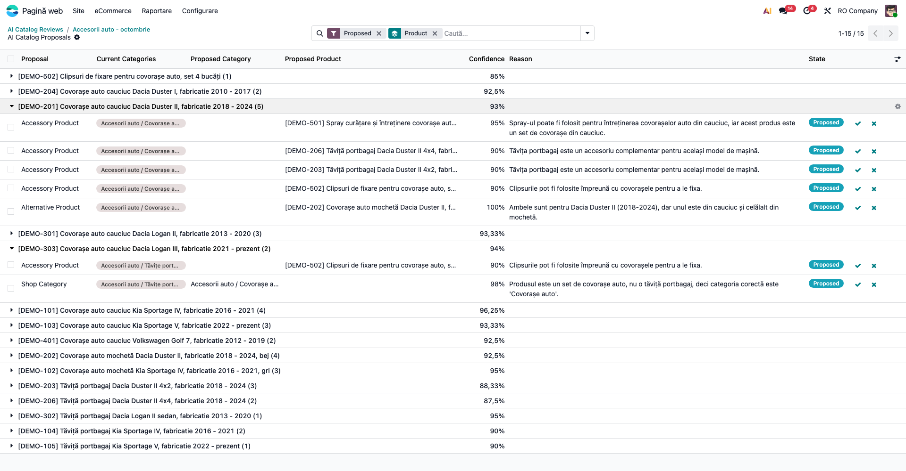
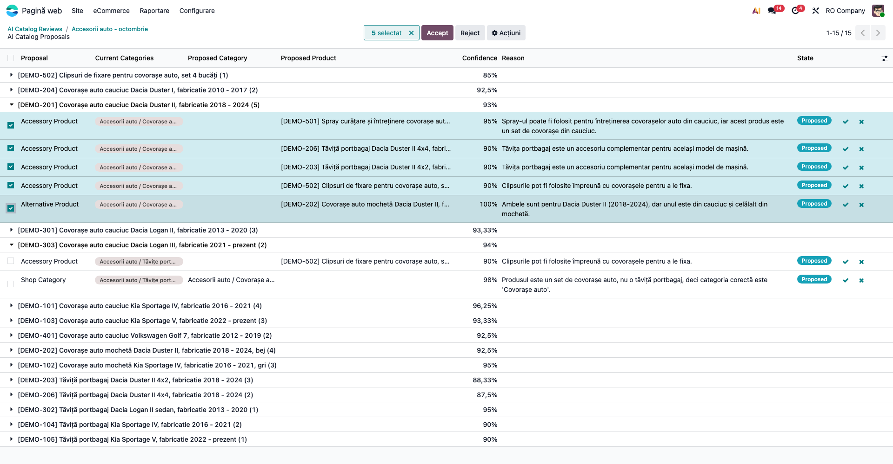
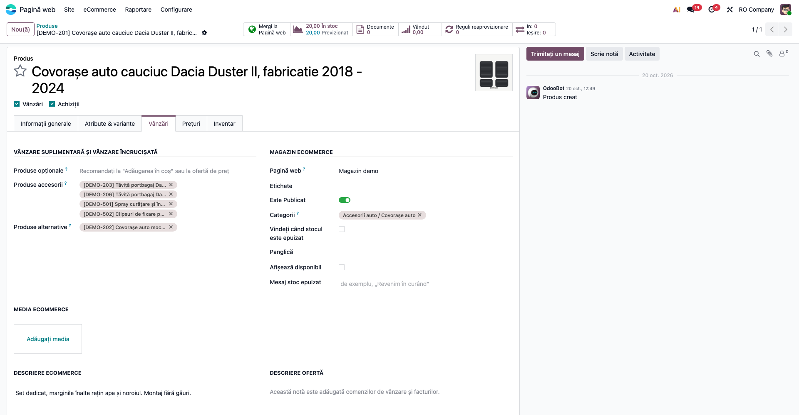
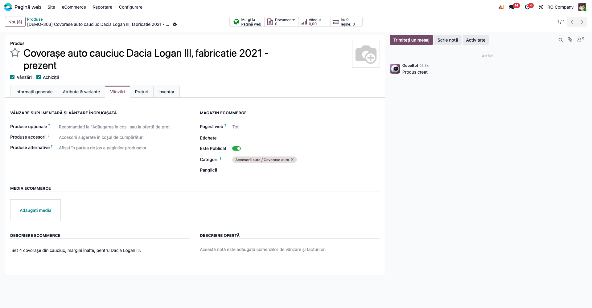
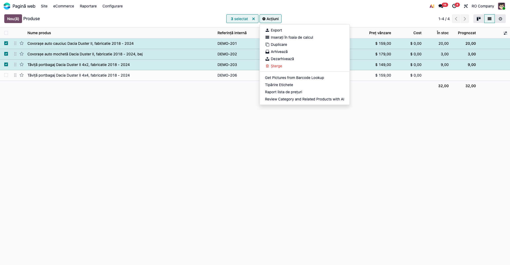

# Fișă Modul: Analiza AI a catalogului magazinului online (categorie, alternative, accesorii)

**Modul:** `deltatech_ai_product_catalog_review`
**Versiune:** 19.0.1.1.0
**Suită:** bitshop_ent (necesită Odoo Enterprise, pentru aplicația AI)
**Dependențe:** `website_sale`, `deltatech_ai_website_product`
**Utilizator principal:** responsabilul de catalog al magazinului online (manager de produse), pregătit de consultant
**Prioritate:** 🟢 Scăzută (curăță catalogul și crește coșul mediu, dar magazinul funcționează și fără el)

---

## 1. Scop business

Un catalog crescut în timp are produse puse în categoria greșită și puține legături între produse. Câmpurile
**Produse alternative**, **Produse accesorii** și **Produse opționale** de pe fișa produsului rămân de obicei goale,
pentru că completarea lor de mână, produs cu produs, durează prea mult.

Modulul pune **modelul de limbaj al agentului AI al magazinului** să citească produsele publicate și să propună,
pentru fiecare produs:

- **categoria din magazin** potrivită, când cea actuală e greșită;
- **produsele alternative** (clientul cumpără unul în locul celuilalt, de exemplu covorașe din cauciuc sau din
  mochetă pentru aceeași mașină);
- **produsele accesorii** (se cumpără împreună, de exemplu spray-ul de curățare pentru covorașe);
- **produsele opționale** (ce se propune la „Adaugă în coș”: garanție, serviciu).

Fiecare propunere are un **scor de încredere** și un **motiv** scris în limba magazinului. Nimic nu se modifică pe
produse până când omul nu acceptă propunerea.

## 2. Bază legală și context

Nicio obligație fiscală. Contextul care contează este **trimiterea datelor la furnizorul AI** (OpenAI sau Google,
după modelul ales pe agent), cu cheia și contul companiei. Pentru fiecare produs analizat pleacă:

- textul produsului: nume, cod, categoriile din magazin, atribute, descrierea de pe site, **descrierea ofertei**
  (textul care apare pe comenzi) și câmpurile alese în **Extra Fields** pe agent. Nu țineți note comerciale interne
  în descrierea ofertei;
- lista categoriilor magazinului;
- numele, codul și categoria produselor candidate.

**Nu pleacă niciodată** costul, furnizorii și categoriile altor site-uri. Nu se trimit date de clienți.

## 3. Utilizatori și roluri

| Rol | Ce face |
|---|---|
| Administrator (**Setări**) | configurează agentul magazinului (modulul *AI - Shop Assistant*): cheia furnizorului, site-ul, produsele urmărite |
| Responsabilul de catalog: **Vânzări** (cel puțin *Utilizator*) **și** **Produse: Creează** | creează analizele, citește propunerile, le acceptă sau le respinge |

Drepturile se dau din **Setări → Utilizatori →** utilizatorul **→ Drepturi de acces**: aplicația **Vânzări** (meniul
*eCommerce* cere accesul la Vânzări) și, la *Date de bază*, **Produse** = **Creează**. Administratorii Vânzări sau
Inventar **nu** primesc automat dreptul **Produse: Creează**. Fără el, meniurile **AI Catalog Review** și **AI Catalog
Proposals** și acțiunea din lista produselor nu apar.

La testare, folosiți un utilizator cu aceste două drepturi, care **nu** e administrator.

## 4. Conturi și date implicate

Modulul **nu generează note contabile** și nu folosește conturi.

Ce adaugă în bază:

- analizele (**AI Catalog Reviews**) și propunerile lor (**AI Catalog Proposals**);
- acțiunea **Review Category and Related Products with AI** în meniul *Acțiuni* al produselor;
- cron-ul **AI: review the product catalog**, orar, care continuă analizele pornite cu **Start**.

Produsele **similare** se găsesc cu vectorii (*embeddings*) pe care agentul magazinului îi are deja pentru fiecare
produs. Nu se fac apeluri noi pentru vectori; se face **un apel la modelul de limbaj pentru fiecare produs analizat**.

Date minime pentru un demo: un agent de magazin cu sursele **Indexat** și câteva zeci de produse publicate, din
categorii apropiate (aceeași familie de produse, pentru mai multe modele). Pentru o propunere de categorie, puneți
intenționat un produs în categoria greșită.

## 5. Configurare inițială

1. Configurați agentul magazinului după fișa modulului `deltatech_ai_website_product`: cheia furnizorului, agentul,
   fila **Shop** și indexarea surselor. Analiza folosește **același agent**, cu modelul lui de limbaj.
2. Instalați `deltatech_ai_product_catalog_review`.
3. Verificați **AI → Agenți →** agentul magazinului → fila **Shop**: site-ul și domeniul **Products** sunt cele pe care
   vreți să le analizați. Analiza vede **doar produsele urmărite de agent**: un produs din afara domeniului nu este
   nici analizat, nici propus drept candidat.

   

4. În fila **Surse** a agentului, toate sursele sunt **Indexat**. Un produs fără vectori este numărat la **Not
   Indexed** și sărit.

## 6. Flux de utilizare

### Pasul 1 — Creați analiza

**Pagină web → eCommerce → Produse → AI Catalog Review → Nou.** Completați:

- **Nume**: de exemplu *Accesorii auto - octombrie*;
- **Agent**: agentul magazinului (apar doar agenții cu un site ales în fila **Shop**);
- **Products**: opțional, restrânge produsele analizate (de exemplu o categorie). Numărul afișat sub domeniu
  numără toate produsele care se potrivesc; analiza le păstrează doar pe cele urmărite de agent;
- **Only These Products**: opțional, doar produsele alese;
- în dreapta, ce să propună: **Shop Category**, **Alternative Products**, **Accessory Products**, **Optional
  Products**;
- **Candidates**: câte produse similare primește modelul pentru fiecare produs (implicit 10);
- **Minimum Confidence**: propunerile cu încredere mai mică nu se păstrează (implicit 0,70).

### Pasul 2 — Porniți analiza

- **Analyze Now**: analizează pe loc, cât așteptați în browser, pentru cel mult 20 de produse. În demo, cele 16
  produse au durat aproximativ un minut (circa 4 secunde pe produs). Peste 10–15 produse, preferați **Start**.
- **Start**: pentru un catalog mare. Analiza trece în **Running**, iar cron-ul pornește imediat și o face în fundal,
  pe loturi. Când timpul unei rulări a cron-ului se termină, următoarea continuă de unde a rămas. **Stop** o oprește.

Orice nouă rulare (**Start** după **Stop**, sau o a doua rulare a aceleiași analize) o ia **de la zero**: reanalizează
toate produsele și refac propunerile încă neprelucrate, deci se plătesc din nou apelurile la model. Propunerile
acceptate sau respinse rămân.

**Găsiți pe ecran.** Starea **Done**, secțiunea **Progress** (**Analyzed**, **Not Indexed**, **Failed**,
**Accepted**) și butonul **Proposed** din dreapta sus, cu numărul de propuneri.

**Verificați.**

- **Analyzed** + **Not Indexed** + **Failed** = numărul de produse urmărite de agent din domeniul ales (în demo,
  16 + 0 + 0 = 16).
- **Failed** este 0. Altfel, vedeți secțiunea 9.
- **Not Indexed** este 0. Altfel, așteptați indexarea surselor și rulați din nou.

**Treceți mai departe** la propuneri, cu butonul **Proposed**.

### Pasul 3 — Citiți propunerile

Butonul **Proposed** deschide propunerile analizei, filtrate pe **Proposed** și grupate pe produs. Le găsiți și din
**Pagină web → eCommerce → Produse → AI Catalog Proposals**, pentru toate analizele.

**Găsiți pe ecran.** Pe fiecare rând:

- **Proposal**: tipul propunerii (*Shop Category*, *Alternative Product*, *Accessory Product*, *Optional Product*);
- **Current Categories**: categoriile actuale ale produsului;
- **Proposed Category** sau **Proposed Product**: ținta propunerii;
- **Confidence**: încrederea modelului; pe rândul grupului, media;
- **Reason**: de ce, într-o frază.

**Verificați.**

- Alternativele sunt pentru **același** obiect (aceeași marcă, model, generație, versiune și ani). În demo: covorașele
  din cauciuc și cele din mochetă pentru Dacia Duster II. Covorașele pentru Logan II **nu** sunt propuse ca
  alternativă pentru Logan III.
- Accesoriile au sens în sensul propus: spray-ul de curățare apare ca accesoriu **pe covorașe**, nu covorașele pe
  spray.
- Propunerea de categorie mută produsul din categoria greșită. În demo, setul de covorașe Logan III fusese pus la
  *Tăvițe portbagaj* și este propus pentru *Covorașe auto*.

### Pasul 4 — Acceptați sau respingeți

Pe fiecare rând: **✓** acceptă, **✗** respinge. Pentru mai multe rânduri: bifați-le, apoi **Accept** sau **Reject**
din bara de sus. În demo s-au bifat cele 5 propuneri ale covorașelor Duster II și s-a apăsat **Accept**. Apoi, pe
rândul *Shop Category* al covorașelor Logan III, s-a apăsat **✓**.

Din fișa analizei, **Accept All Above the Minimum** acceptă toate propunerile cu încrederea peste **Minimum
Confidence**. Propunerile sub minim nici nu se creează, deci, cu minimul neschimbat, butonul acceptă tot ce e în
*Proposed*. Ca să acceptați doar propunerile foarte sigure, ridicați întâi **Minimum Confidence** (de exemplu 0,90).
Nu e nevoie de o nouă rulare.

Ce se întâmplă la acceptare:

- **Shop Category**: categoria propusă **înlocuiește** categoriile produsului din acest site și pe cele comune tuturor
  site-urilor. Rămân doar categoriile legate explicit de alt site;
- **Alternative Product** și **Optional Product**: produsul propus se **adaugă** în **Produse alternative**, respectiv
  **Produse opționale**;
- **Accessory Product**: se adaugă în **Produse accesorii** prima variantă a produsului propus (câmpul cere variante).

La produsele alternative, accesorii și opționale nu se șterge nimic de pe produs. O propunere respinsă **nu se mai
face** la analizele următoare. Butonul **↺** de pe un rând respins o pune înapoi în **Proposed**.

### Pasul 5 — Verificați produsele

Deschideți produsul din **Pagină web → eCommerce → Produse**, fila **Vânzări**.

**Verificați.**

- **Produse alternative** și **Produse accesorii** conțin exact propunerile acceptate, plus ce era înainte.
- **Categorii** (secțiunea *Magazin eCommerce*) arată categoria propusă.
- Pe site, pagina produsului arată alternativele jos, iar accesoriile apar în coș.

### Pasul 6 — Analizați câteva produse direct din listă

În **Pagină web → eCommerce → Produse**, vizualizarea listă: bifați produsele, apoi **Acțiuni → Review Category and
Related Products with AI**. Acțiunea apare și în meniul *Acțiuni* al fișei unui produs. Analiza se creează și rulează
pe loc, iar la final se deschid propunerile ei.

- Se analizează doar produsele selectate care sunt **urmărite de agent** (publicate, vândabile, din domeniul
  **Products**). Celelalte sunt ignorate. Limita este de **20 de produse urmărite**.
- Acțiunea folosește **primul** agent care are un site. Dacă aveți mai mulți agenți de magazin, creați analiza din
  **AI Catalog Review**, unde alegeți agentul.

#### Note de monografie și raportare

Modulul nu generează note contabile și nu alimentează nicio declarație.

## 7. Legături cu alte module / declarații

| Modul | Legătura |
|---|---|
| `deltatech_ai_website_product` | agentul magazinului: produsele urmărite, sursele lor indexate și modelul de limbaj |
| `ai` / `ai_app` (Enterprise) | furnizorul AI, cheia, vectorii (*embeddings*) și apelul la model |
| `website_sale` | categoriile magazinului, **Produse alternative** și **Produse accesorii** |
| `sale` | **Produse opționale** |

**Ce e automat.** Găsirea candidaților după vectori, întrebarea către model pentru fiecare produs, filtrarea
propunerilor sub încrederea minimă, a celor deja puse pe produs, a celor care așteaptă în altă analiză și a celor
respinse. Pentru un catalog mare, cron-ul continuă analiza.
**Ce rămâne manual.** Alegerea produselor de analizat, citirea propunerilor, acceptarea sau respingerea lor.

## 8. Verificări pentru consultant

- [ ] Agentul magazinului are site-ul și domeniul **Products** corecte; toate sursele sunt **Indexat**.
- [ ] Meniurile **AI Catalog Review** și **AI Catalog Proposals** apar unui utilizator cu **Vânzări** și **Produse:
      Creează**, care nu e administrator.
- [ ] După rulare: **Analyzed** + **Not Indexed** + **Failed** = numărul de produse urmărite din domeniu; **Failed** = 0.
- [ ] Nicio alternativă propusă pentru alt model, altă generație sau altă versiune decât produsul.
- [ ] Accesoriile sunt propuse pe produsul principal (spray-ul pe covorașe, nu invers).
- [ ] Un produs pus intenționat în categoria greșită primește propunerea de categorie corectă.
- [ ] La acceptarea unei categorii, categoriile legate explicit de alt site rămân; cele ale acestui site și cele
      comune se înlocuiesc.
- [ ] O propunere respinsă nu reapare la o nouă rulare; o propunere deja pusă pe produs nu e propusă din nou.
- [ ] **Accept All Above the Minimum** acceptă doar propunerile cu încrederea ≥ **Minimum Confidence**.
- [ ] Acțiunea din lista produselor refuză mai mult de 20 de produse urmărite, iar mesajul trimite la **Start**; nu
      rămâne nicio analiză creată.
- [ ] Pe site, alternativele apar pe pagina produsului și accesoriile în coș.

## 9. Mesaje de eroare frecvente

| Mesaj | Ce înseamnă | Ce faceți |
|---|---|---|
| „Set the shop of an AI agent first: the review uses its products.” | niciun agent nu are un site ales în fila **Shop** | configurați agentul magazinului (secțiunea 5) |
| „None of these products is published on the shop of the agent.” | produsele alese nu sunt publicate, nu sunt vândabile sau nu sunt în domeniul **Products** al agentului | publicați produsele sau lărgiți domeniul agentului |
| „Analyze more than 20 products with 'Start', in the background.” | **Analyze Now** sau acțiunea din listă pe mai mult de 20 de produse urmărite | din acțiunea din listă nu se creează nicio analiză: creați-o din **AI Catalog Review → Nou** și apăsați **Start** |
| „Choose at least one proposal to make.” | toate bifele din **Proposals** sunt debifate | bifați cel puțin un tip de propunere |
| **Failed** > 0 | modelul nu a răspuns sau răspunsul nu s-a putut citi (cheie greșită, credit epuizat, furnizor indisponibil) | verificați cheia și contul furnizorului, apoi rulați din nou: se reanalizează toate produsele, propunerile acceptate sau respinse rămân, cele neprelucrate se refac |
| **Not Indexed** > 0 | sursele acelor produse nu au încă vectori | așteptați indexarea (fila **Surse** a agentului) și rulați din nou, cu aceeași nuanță ca mai sus |
| Analiza rămâne **Running**, iar **Analyzed** nu crește | **Start** pornește imediat cron-ul; dacă după câteva minute nu avansează, acțiunea planificată e inactivă sau blocată | în modul developer, **Setări → Tehnic → Acțiuni planificate**, *AI: review the product catalog*: verificați că e activă |
| Nicio propunere pentru un produs | modelul nu a găsit nimic peste încrederea minimă, sau totul e deja pe produs ori respins | coborâți **Minimum Confidence** sau creșteți **Candidates** |

## 10. Capturi de ecran

Capturile, în ordinea din secțiunile 5 și 6, în `readme/screenshots/`:

| Fișier | Pasul | Ce arată |
|---|---|---|
| `01_agent_shop.png` | 5 (configurare) | fila **Shop** a agentului: site-ul, domeniul de produse urmărite, modelul *GPT-4.1* |
| `02_analiza_noua.png` | 1 | analiza nouă în ciornă: agentul, domeniul (*Accesorii auto*, 16 produse), tipurile de propuneri, candidații și încrederea minimă |
| `03_analiza_rulata.png` | 2 | analiza rulată: starea **Done**, progresul și cele 38 de propuneri |
| `04_propuneri.png` | 3 | propunerile grupate pe produs: alternativa, accesoriile și propunerea de categorie |
| `05_selectie_acceptare.png` | 4 | cele 5 propuneri ale covorașelor Duster II bifate, cu butoanele **Accept** și **Reject**; dedesubt, propunerea de categorie pentru Logan III |
| `06_produs_relatii.png` | 5 | fila **Vânzări** a covorașelor Duster II, cu alternativa și cele 4 accesorii acceptate |
| `07_produs_categorie.png` | 5 | produsul mutat în categoria *Covorașe auto* |
| `08_actiune_produse.png` | 6 | lista celor 4 produse Duster II (filtrate), 3 bifate, cu acțiunea **Review Category and Related Products with AI** |

Capturile sunt făcute cu un script Playwright, nu dintr-un test automat: propunerile vin de la un model real
(*GPT-4.1*, OpenAI), iar răspunsul diferă de la o rulare la alta. Baza este copia bazei demo a fișei
`deltatech_ai_website_product` (*RO Company*, interfața în română, temă luminoasă, lățime 1920), cu cele 12 produse
auto generice și încă 4 adăugate pentru această fișă: `DEMO-206` (tăvița pentru Duster II 4x4), `DEMO-303` (covorașe
Logan III, puse intenționat la *Tăvițe portbagaj*), `DEMO-501` (spray de curățare) și `DEMO-502` (clipsuri de
fixare). Nu sunt date de client. Moneda bazei demo e dolarul; numele produselor demo vin din baza originală, fără
diacritice în „fabricatie”.

Interfața modulului este în engleză (modulul nu are încă traducere în română), de aceea fișa folosește etichetele
din ecran: **Start**, **Analyze Now**, **Proposed** etc.

## 11. Observații pentru manual

- **Modelul propune, omul decide.** Încrederea e estimarea modelului, nu o garanție. La primele analize, citiți
  motivele înainte de **Accept All Above the Minimum**.
- **Calitatea numelor contează.** Modelul compară marca, modelul, generația, versiunea și anii din textul produselor.
  Un nume fără aceste date (ex. „Covorașe cauciuc” fără mașină) dă propuneri mai slabe.
- **Candidații vin din texte asemănătoare.** Un accesoriu cu text foarte diferit de produsul principal (ex. un
  compresor pentru anvelope) poate să nu apară printre candidați. Creșteți **Candidates** sau analizați accesoriul:
  când analizează accesoriul, modelul îl propune pe produsul principal.
- **Costul.** Un apel la model pentru fiecare produs analizat; vectorii nu se recalculează. Începeți cu o categorie și
  lărgiți după ce vedeți calitatea propunerilor.
- **Limba motivelor** este limba implicită a site-ului agentului.
- Propunerile se acceptă doar pe produsele **șablon**. Accesoriile se pun pe prima variantă a produsului propus.
  Pentru o variantă anume, schimbați-o pe fișa produsului.
