# Fișă Modul: Verificarea zilnică a comenzilor și livrărilor, explicată cu AI

**Modul:** `deltatech_ai_sale_delivery_check`
**Versiune:** 19.0.1.0.1
**Suită:** bitshop_ent (necesită Odoo Enterprise, pentru aplicația AI)
**Dependențe:** `sale_stock`, `stock_delivery`, `ai`
**Utilizator principal:** administratorul vânzărilor și responsabilul de depozit care urmăresc zilnic comenzile și livrările
**Prioritate:** 🟡 Medie (nu schimbă fluxul de vânzare, dar prinde la timp livrările întârziate, facturile uitate și expedierile fără AWB)

---

## 1. Scop business

Într-o firmă cu zeci sau sute de comenzi pe zi, problemele de livrare nu se văd până nu sună clientul: o comandă
confirmată fără livrare, un transfer rămas pregătit în depozit de trei zile, o livrare făcută dar nefacturată, un
colet plecat fără AWB. Nimeni nu are timp să deschidă fiecare comandă ca să le găsească.

Modulul face această verificare în fiecare dimineață, pentru ziua anterioară (sau la cerere, pentru orice perioadă).
**Unsprezece reguli precise** găsesc anomaliile, iar un **agent AI** le citește pe toate o singură dată și le
grupează pe cauză comună (același produs fără stoc, același transportator, același client), le dă o prioritate,
o explicație și o acțiune concretă și scrie un rezumat al zilei. Rezultatul ajunge pe e-mail la administratorii
vânzărilor, iar agentul de vânzări primește o activitate pe comenzile grave.

**Regulile găsesc, AI-ul explică.** Anomaliile există pentru că o regulă le-a găsit, nu pentru că așa crede AI-ul.
AI-ul nu modifică, nu validează și nu anulează niciun document.

## 2. Bază legală și context

Modulul nu are temei fiscal propriu: semnalează situații, nu înregistrează nimic. Două verificări ating însă
obligații fiscale și merită explicate clientului:

- **Livrat, nefacturat (C05).** Factura pentru o livrare de bunuri se emite cel târziu până la data de 15 a lunii
  următoare celei în care a avut loc livrarea (Codul fiscal, art. 319 alin. (16)). Pragul implicit al verificării
  (3 zile) e mult mai strâns decât termenul legal: e un prag operațional, care ține livrarea și factura în aceeași
  lună. Livrarea fără factură se înregistrează pe 418 (vezi notele de mai jos).
- **Facturat, nelivrat (C06).** Când factura se emite înaintea livrării, TVA-ul devine exigibil la data emiterii
  facturii (Codul fiscal, art. 282 alin. (2) lit. a)); la plata în avans, exigibilitatea intervine la încasare
  (art. 282 alin. (2) lit. b)). Firmele care aplică TVA la încasare (art. 282 alin. (3)) au TVA-ul exigibil la
  încasare. Situația e legitimă, de aceea verificarea are un prag de 2 zile de la data facturii: semnalează doar
  facturile pentru care marfa întârzie să plece.

**Datele trimise furnizorului AI.** La fiecare rulare cu analiză AI pleacă la furnizorul modelului (OpenAI, Google
sau Anthropic), cu cheia companiei: numărul comenzilor și al transferurilor, numele clienților și ale agenților de
vânzări, valorile, nota transferului, ultimele trei mesaje din jurnalul comenzii și al transferului și situația
stocului pentru produsele lipsă. Bifa **Anonimizează clienții pentru AI** trimite clientul ca „Client #id” și nu
mai trimite mesajele din jurnal. Recomandare: menționați furnizorul AI ca persoană împuternicită în registrul de
prelucrări al clientului (GDPR, Regulamentul UE 2016/679).

## 3. Utilizatori și roluri

| Rol | Ce face |
|---|---|
| **Vânzări / Administrator** | configurează verificarea în setări și lista verificărilor, rulează verificarea la cerere, vede istoricul rulărilor, retrimite rezumatul |
| Administrator (**Setări**) | pune cheia furnizorului AI și alege modelul agentului (meniul **AI**) |
| **Vânzări / Utilizator: Numai documente proprii** | vede anomaliile comenzilor lui (și pe cele fără agent de vânzări), le marchează văzute, rezolvate sau ignorate; primește activitățile |
| **Vânzări / Utilizator: Toate documentele** | vede toate anomaliile |
| **Inventar / Utilizator** | vede toate anomaliile, din meniul Inventar, și le lucrează pe cele de depozit (pregătit dar neexpediat, AWB lipsă, adresă incompletă) |

La testare folosiți, pe lângă administrator, un utilizator **Vânzări / Utilizator: Numai documente proprii**:
așa verificați că fiecare agent de vânzări își vede doar comenzile lui. Meniurile **Raportare** (verificarea la
cerere și istoricul rulărilor) se văd doar cu rolul **Vânzări / Administrator**.

## 4. Conturi și date implicate

Modulul **nu generează note contabile**. Citește comenzile de vânzare, transferurile de livrare și facturile și
scrie doar anomaliile găsite.

Ce adaugă în bază:

- **lista verificărilor** (C01–C11), cu severitatea și pragul în zile, editabile din **Vânzări → Configurare →
  Verificări livrări**;
- agentul **Sale & Delivery Check AI** (meniul **AI → Agenți → Agenți**), cu instrucțiunile în engleză și în română
  (se folosește limba companiei);
- **rulările** (o rulare = o verificare a unei perioade, cu rezumatul AI) și **anomaliile** (câte una pe document și
  verificare, păstrată de la o rulare la alta);
- pe companie: setările verificării zilnice și ale analizei AI;
- două acțiuni planificate: rularea zilnică și curățarea săptămânală (rulările mai vechi de 90 de zile și anomaliile
  rezolvate de atunci).

Cele unsprezece verificări:

| Ref. | Verificare | Ce semnalează | Ce documente verifică | Severitate implicită | Prag |
|---|---|---|---|---|---|
| C01 | Comandă fără livrare | comandă confirmată cu produse și fără livrare activă (nicio livrare sau toate anulate) | comenzile confirmate în perioadă | Ridicată | — |
| C02 | Livrare întârziată | livrare deschisă trecută de data promisă clientului (sau de data planificată) | starea curentă | Medie; Ridicată de la 3 zile, Critică de la 7 zile | 0 zile |
| C03 | Comandă în așteptare veche | backorder încă deschis după prag | starea curentă | Medie | 7 zile |
| C04 | Livrat peste comandă | linie cu cantitatea livrată peste cea comandată | livrările finalizate în perioadă | Ridicată | — |
| C05 | Livrat, nefacturat | comandă livrată și încă de facturat după prag | starea curentă | Medie | 3 zile |
| C06 | Facturat, nelivrat | produse facturate (factură validată mai veche decât pragul), dar nelivrate | starea curentă | Ridicată | 2 zile |
| C07 | Comandă blocată ca nelivrată complet | toate transferurile comenzii sunt finalizate sau anulate, dar unele produse nu sunt livrate | starea curentă | Scăzută | — |
| C08 | Pregătit, dar neexpediat | livrare cu marfa rezervată de mai mult timp decât pragul | starea curentă | Medie | 2 zile |
| C09 | Livrare în risc | livrare care așteaptă stoc, cu termenul în următoarele N zile | starea curentă | Ridicată | 2 zile |
| C10 | Expediat fără referință de urmărire | livrare finalizată cu transportator, dar fără AWB | livrările finalizate în perioadă | Medie | — |
| C11 | Adresă de livrare incompletă | livrare deschisă fără stradă, oraș, țară, cod poștal (unde e obligatoriu) sau telefon | starea curentă | Medie | — |

Verificările pe **starea curentă** se uită doar la documentele din ultimele 90 de zile (**Zile de vechime** din
setări), ca o bază veche să nu umple prima rulare cu sute de comenzi istorice.

Date minime pentru demo:

- o companie RO cu un depozit, câteva produse stocabile cu stoc și unul fără stoc;
- un client cu adresa completă și unul fără stradă sau telefon;
- un transportator (**Inventar → Configurare → Metode de livrare**);
- comenzi confirmate care să atingă câteva verificări: una cu livrarea anulată (C01), una cu **Dată livrare**
  trecută de 4–8 zile (C02), una livrată acum câteva zile și nefacturată (C05), una cu produsul fără stoc și termenul
  mâine (C09), una livrată cu transportator și fără AWB (C10), una către clientul fără stradă (C11);
- o cheie OpenAI sau Google (sau Claude cu `deltatech_ai_anthropic`), pentru analiza AI.

## 5. Configurare inițială

1. Instalați `deltatech_ai_sale_delivery_check` (aduce `sale_stock`, `stock_delivery` și aplicația `ai`).
2. **AI → Configurare → Setări**: activați furnizorul și introduceți cheia API.
3. **Vânzări → Configurare → Setări**, secțiunea **Verificarea zilnică a livrărilor**:
   - bifați **Verificarea zilnică a comenzilor și livrărilor**;
   - **Perioada verificării zilnice**: *Ieri* (implicit), *Ultimele N zile* sau *De la ultima rulare* (recuperează
     zilele în care rularea nu a mers);
   - **Zile de vechime**: fereastra verificărilor pe starea curentă (implicit 90);
   - **Destinatari rezumat**: cine primește e-mailul zilnic; gol = administratorii vânzărilor din companie;
   - **Creează activități** și **Severitate minimă pentru activități** (implicit *Ridicată*);
   - în **Analiză AI**: **Agent verificare livrări** (gol = doar regulile, fără AI), **Număr maxim de anomalii
     trimise la AI** (implicit 100), **Limită zilnică de apeluri AI** (implicit 5; 0 = fără limită),
     **Anonimizează clienții pentru AI**.

   Salvați. Setările sunt pe companie: în bazele cu mai multe companii, se fac pe fiecare.

   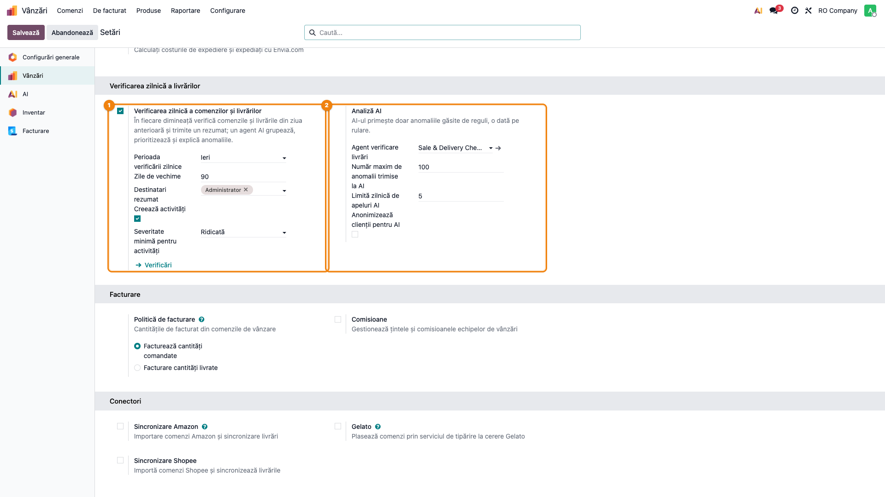

4. Butonul **Verificări** din aceeași secțiune (sau **Vânzări → Configurare → Verificări livrări**) deschide lista
   celor unsprezece verificări. Arhivați cu comutatorul **Activ** verificările care nu au sens la client (de exemplu
   C10 la o firmă care livrează cu mașinile proprii) și ajustați **Severitate** și **Prag (zile)**.

   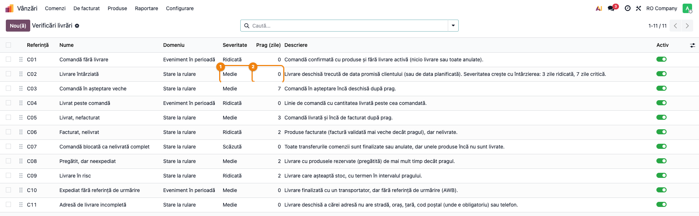

5. Opțional, **AI → Agenți → Agenți → Sale & Delivery Check AI**: alegeți **Modelul LLM**. Cu
   `deltatech_ai_anthropic` instalat, agentul folosește implicit Claude Sonnet 5.5; altfel, modelul implicit al
   aplicației AI. Nu modificați **Promptul de sistem** decât dacă știți ce faceți: forma răspunsului o cere modulul,
   dar regulile de prioritizare sunt în prompt.

   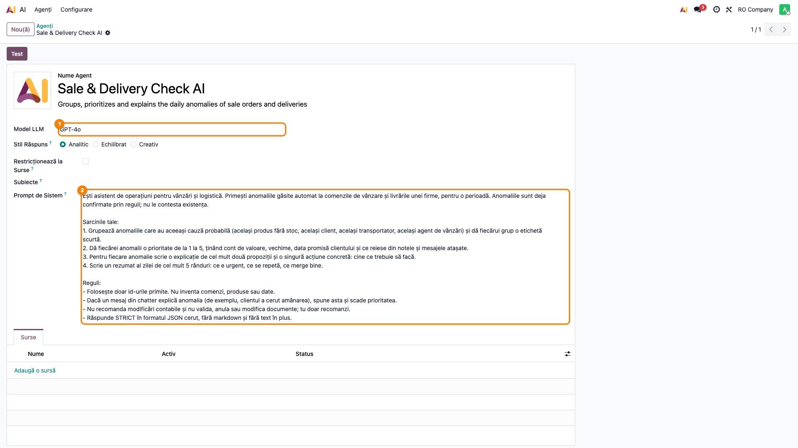

## 6. Flux de utilizare

### Pasul 1 — Verificați o perioadă la cerere

**Vânzări → Raportare → Verifică comenzile și livrările**. Alegeți **Perioadă** (implicit ieri), opțional
**Depozite** și **Verificări** (gol = toate verificările active) și bifa **Analiză AI**. Apăsați **Verificare**.

Rularea durează câteva secunde pentru reguli; analiza AI adaugă, de regulă, 10–40 de secunde, după model și
numărul de anomalii. La final se deschide rularea.

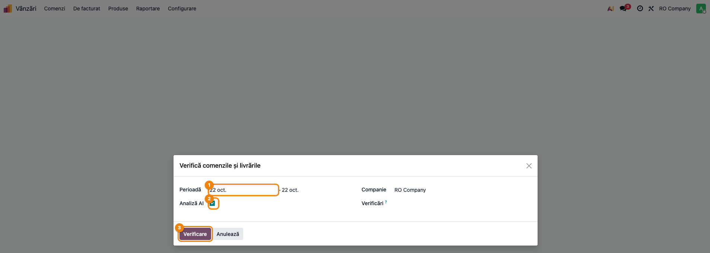

### Pasul 2 — Citiți rezumatul AI al rulării

Rularea se deschide pe fila **Rezumat AI**: rezumatul zilei, apoi lista grupurilor găsite de AI, fiecare cu numărul
de anomalii, cauza și acțiunea propusă. În dreapta, numărul de anomalii pe severitate și **Rezolvate automat**.

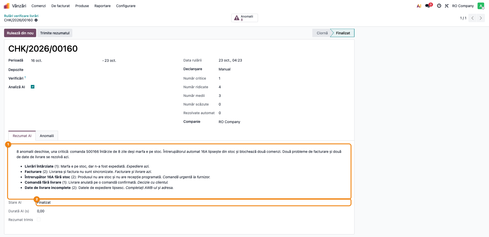

**Găsiți pe ecran.**

- **Stare AI**: *Finalizat*, *Eșuat*, *Neapelat* sau *Sărit: limita zilnică atinsă*;
- rezumatul de cel mult cinci rânduri și grupurile (de exemplu „Produs X fără stoc (3)”);
- **Critică**, **Ridicată**, **Medie**, **Scăzută** și **Rezolvate automat**.

**Verificați.**

- **Stare AI** este *Finalizat*. La *Eșuat*, câmpul **Eroare AI** spune de ce (cheie, credit, model); anomaliile
  rămân valabile, doar fără explicații.
- Numerele de comenzi și de transferuri citate în rezumat există în fila **Anomalii**. AI-ul primește doar
  anomaliile găsite; o comandă citată care nu e în listă înseamnă o explicație greșită, nu o anomalie nouă.
- Grupurile au sens: anomaliile dintr-un grup au într-adevăr cauza numită (același produs, același client).

**Treceți mai departe** la anomalii abia după ce ați înțeles ce e urgent.

### Pasul 3 — Parcurgeți anomaliile rulării

Fila **Anomalii** (sau butonul **Anomalii** din colțul formularului, care deschide lista grupată pe **Grup AI**)
arată toate anomaliile găsite de rulare.

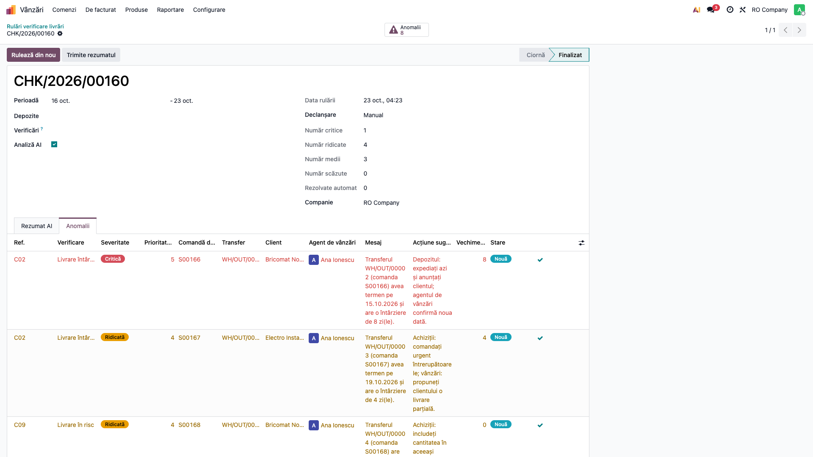

**Găsiți pe ecran**, pe fiecare rând: **Ref.** (C01…C11), **Verificare**, **Severitate** (roșu = critică,
portocaliu = ridicată), **Prioritate AI** (1–5), **Comandă de vânzare** și **Transfer**, **Client**, **Agent de
vânzări**, **Mesaj** (textul regulii, cu numerele și datele documentului), **Acțiune sugerată de AI**, **Vechime
(zile)** și **Stare**.

**Verificați** pe două-trei rânduri, deschizând documentul:

- **Mesajul** spune exact ce e pe document (data promisă, cantitățile, lipsurile din adresă);
- **Severitatea** C02 crește cu întârzierea (3 zile ridicată, 7 zile critică);
- **Acțiunea sugerată** e o acțiune pe care o poate face cineva anume (agentul de vânzări, depozitul, facturarea).

### Pasul 4 — Lucrați lista zilnică de anomalii

**Vânzări → Comenzi → Anomalii livrări** (sau **Inventar → Operații → Transferuri → Anomalii livrări**). Lista
pornește cu filtrul **Deschise** și grupată pe **Verificare**. Grupați după **Grup AI** pentru cauzele comune sau
după **Agent de vânzări** pentru împărțirea pe oameni; filtrul **Anomaliile mele** arată doar anomaliile proprii,
iar **Critice și ridicate** doar pe cele grave.

Lista e aceeași de la o zi la alta: o anomalie găsită din nou se actualizează (vechime, severitate, explicație), nu
se dublează.

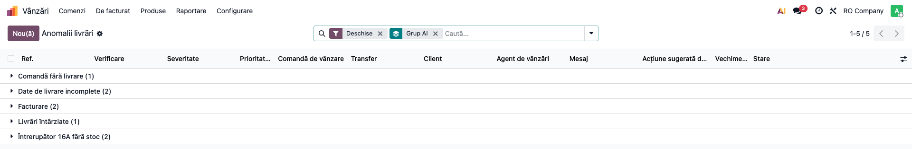

### Pasul 5 — Deschideți anomalia și rezolvați-o

Deschideți anomalia. Formularul arată documentele, clientul, agentul de vânzări, valoarea, vechimea, prima detectare
și ultima rulare care a găsit-o, mesajul regulii și, în **Analiză AI**, prioritatea, grupul, explicația și acțiunea.

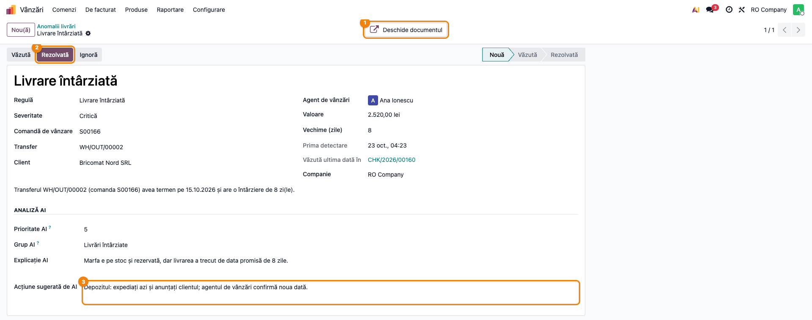

Butoanele din antet:

- **Deschide documentul** (colțul formularului) duce la transfer, sau la comandă când anomalia nu are transfer;
- **Văzută** — anomalia e preluată de cineva;
- **Rezolvată** — problema e rezolvată. Nu e obligatoriu: la rularea următoare, o anomalie care nu mai e găsită
  trece singură în *Rezolvată* (de exemplu, după ce ați facturat comanda). Invers, o anomalie marcată rezolvată de
  mână, dar încă găsită de regulă, se redeschide;
- **Ignoră** — anomalia e închisă definitiv: rulările următoare nu o mai raportează (de exemplu, o comandă pe care
  clientul a cerut-o explicit mai târziu). Completați **Motivul ignorării**;
- **Redeschide** — readuce o anomalie rezolvată sau ignorată.

### Pasul 6 — Vedeți anomaliile direct pe comandă sau pe transfer

Comenzile și transferurile cu anomalii deschise au butonul **Anomalii** în colțul formularului. Agentul de vânzări
vede problema chiar pe comanda pe care lucrează, fără să deschidă lista.

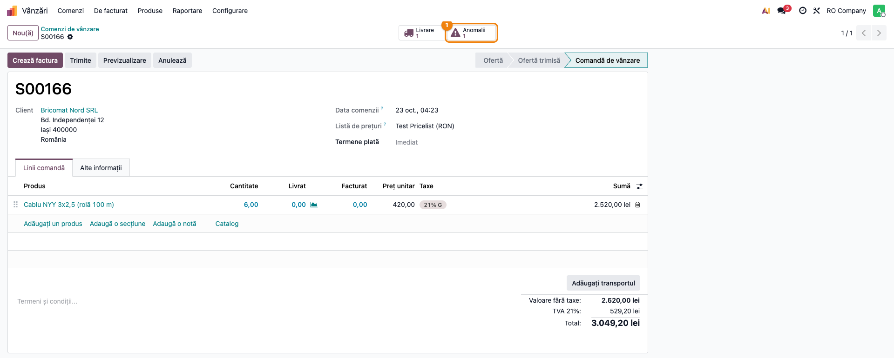

### Pasul 7 — Verificarea zilnică: rezumatul pe e-mail

Cu verificarea zilnică activată, acțiunea planificată rulează în fiecare dimineață (05:00 UTC, adică 7:00–8:00 ora
României) pentru perioada din setări. Destinatarii primesc e-mailul **verificare vânzări și livrări**: numărul de
anomalii deschise pe severitate, cele rezolvate de la ultima rulare, rezumatul AI și tabelul cu cele mai importante
20 de anomalii (verificare, document, anomalie, acțiune sugerată). Același mesaj rămâne în jurnalul rulării.

E-mailul nu pleacă în zilele fără anomalii deschise.

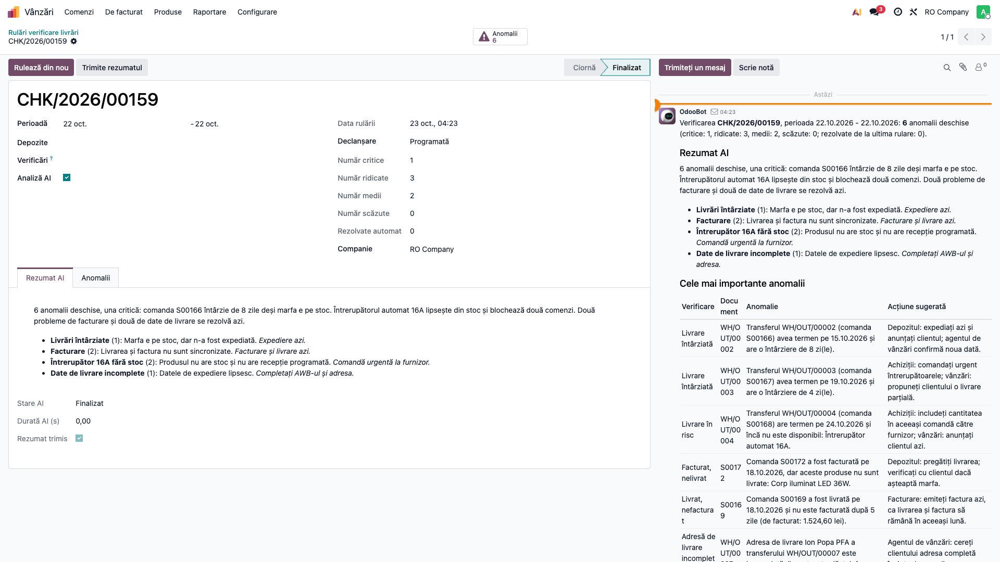

**Verificați.** Perioada din e-mail este cea așteptată (implicit ziua anterioară); numerele pe severitate sunt cele
din rulare; dacă analiza AI a eșuat, e-mailul o spune și conține doar rezultatele regulilor.

### Pasul 8 — Activitățile agentului de vânzări

Tot la rularea zilnică, pentru fiecare anomalie de la **Severitate minimă pentru activități** în sus (implicit
*Ridicată*), agentul de vânzări al comenzii primește o activitate **To-Do** cu rezumatul **Verificare livrări**,
pe comandă (sau pe transfer, când anomalia nu are comandă), cu mesajul regulii și acțiunea sugerată de AI. Pe un
document se creează o singură activitate deschisă, oricâte anomalii ar avea și oricâte rulări ar trece.

Anomaliile fără agent de vânzări pe comandă nu primesc activitate; apar doar în listă și în e-mail.

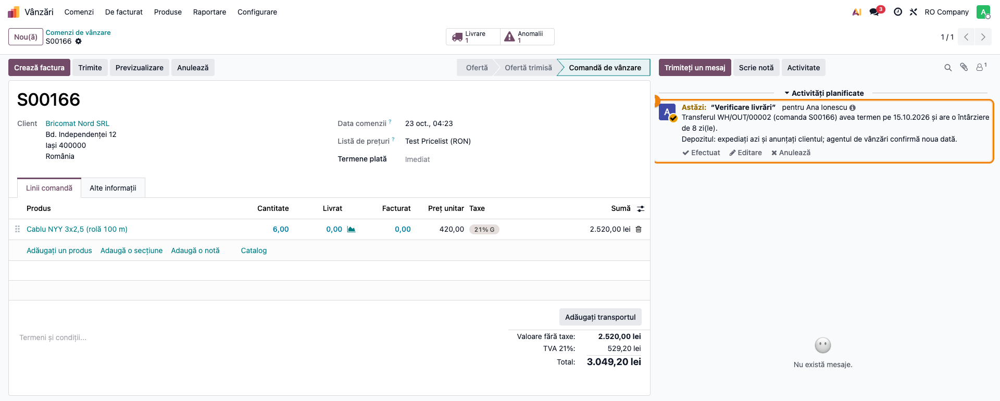

### Pasul 9 — Istoricul rulărilor

**Vânzări → Raportare → Rulări verificare livrări**: fiecare rulare, cu perioada, data rulării, declanșarea
(*Programată* sau *Manual*), numărul de anomalii, critice, ridicate, rezolvate automat și starea AI. Din formularul
unei rulări, **Rulează din nou** reface verificarea pe aceeași perioadă, iar **Trimite rezumatul** retrimite
e-mailul.

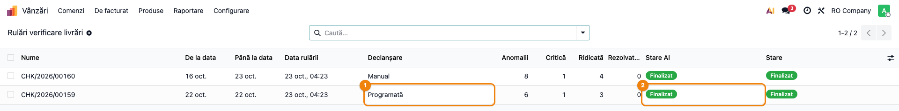

**Verificați** că există o rulare *Programată* pentru fiecare zi lucrătoare și că **Stare AI** nu e *Eșuat* sau
*Sărit: limita zilnică atinsă* mai multe zile la rând.

### Note de monografie și raportare

Modulul nu generează note contabile. Notele de mai jos explică, pentru consultant, ce rezolvă operatorul când închide
anomaliile C05 și C06 prin fluxul standard (mărfuri, TVA 21%):

| Operațiune | Debit | Credit |
|---|---|---|
| Livrarea mărfii fără factură (C05 deschisă), valoarea fără TVA | 418 Clienți - facturi de întocmit | 707 Venituri din vânzarea mărfurilor |
| Descărcarea din gestiune la livrare (inventar permanent) | 607 Cheltuieli privind mărfurile | 371 Mărfuri |
| Factura emisă ulterior, care închide C05 | 4111 Clienți | 418 Clienți - facturi de întocmit |
| TVA-ul, la factură | 4111 Clienți | 4427 TVA colectată |

În fluxul standard al localizării, avizul înregistrează 418 = 707 fără TVA, iar TVA-ul (4427) se înregistrează la
factură. Atenție: fiscal, TVA-ul devine exigibil la data livrării (Codul fiscal, art. 281 alin. (1) și art. 282
alin. (1)). Dacă livrarea și factura cad în luni diferite, consultați contabilul clientului despre luna în care se
declară TVA-ul în D300.

La C06 (factură emisă înaintea livrării), monografia uzuală este: la factură 4111 = 419 (valoarea fără TVA) + 4427
(TVA), la livrare 419 = 707 și 607 = 371 (OMFP 1802/2014, pct. 440–441 și funcțiunea contului 419): venitul se
recunoaște la livrare, nu la factură. Dacă livrarea se face în aceeași lună cu factura, mulți contabili înregistrează
direct 4111 = 707 + 4427; tratamentul se confirmă cu contabilul clientului. Modulul doar semnalează că marfa nu a
plecat.

Modulul nu schimbă jurnalul de vânzări, D300 sau D394.

## 7. Legături cu alte module / declarații

| Modul | Legătura |
|---|---|
| `sale_stock` | comenzile de vânzare și livrările lor, starea livrării comenzii |
| `stock_delivery` | transportatorul și referința de urmărire (AWB) a livrării, folosite de C10 |
| `ai` (Enterprise) | agentul, furnizorul AI și cheia lui |
| `deltatech_ai_anthropic` | opțional: modelele Claude; agentul trece pe Claude Sonnet 5.5 la instalare |
| `account` | facturile de client, folosite de C05 și C06 |
| `mail` | rezumatul pe e-mail și activitățile agenților de vânzări |

**Ce e automat.** Rularea zilnică pe perioada din setări, cele unsprezece verificări, păstrarea anomaliilor de la o zi
la alta fără duplicate, rezolvarea automată a anomaliilor care nu mai apar, analiza AI (grupuri, priorități,
explicații, acțiuni, rezumat), e-mailul zilnic, activitățile agenților de vânzări, curățarea rulărilor vechi.
**Ce rămâne manual.** Activarea și reglajul verificărilor pe companie, citirea rezumatului, rezolvarea problemei pe
document (livrare, facturare, AWB, adresă), marcarea anomaliilor văzute sau ignorate.

## 8. Verificări pentru consultant

- [ ] Secțiunea **Verificarea zilnică a livrărilor** apare în **Vânzări → Configurare → Setări** pentru un
      administrator al vânzărilor.
- [ ] **Agent verificare livrări** este completat cu *Sale & Delivery Check AI* pe compania testată.
- [ ] Lista **Verificări livrări** are cele unsprezece verificări; una arhivată nu mai produce anomalii.
- [ ] O comandă cu livrarea anulată apare la **C01 Comandă fără livrare**, cu severitatea *Ridicată*.
- [ ] O comandă cu data livrării trecută de 4 zile apare la C02 cu *Ridicată*; una trecută de 8 zile, cu *Critică*.
- [ ] O comandă livrată acum 5 zile și nefacturată apare la C05; una livrată azi, nu.
- [ ] O livrare finalizată cu transportator și fără AWB apare la C10.
- [ ] O livrare către un client fără stradă și telefon apare la C11, cu „stradă” și „telefon” în mesaj.
- [ ] Rularea cu **Analiză AI** are **Stare AI** = *Finalizat*, rezumatul și grupurile citează doar documente din
      lista de anomalii.
- [ ] A doua rulare pe aceeași perioadă nu dublează anomaliile; **Văzută ultima dată în** arată noua rulare.
- [ ] După facturarea comenzii de la C05, rularea următoare o trece în *Rezolvată* și crește **Rezolvate automat**.
- [ ] O anomalie ignorată nu mai apare la rularea următoare.
- [ ] Un utilizator **Vânzări / Utilizator: Numai documente proprii** vede doar anomaliile comenzilor lui.
- [ ] Butonul **Anomalii** apare pe comanda și pe transferul cu anomalii deschise.
- [ ] După rularea zilnică, destinatarii primesc e-mailul și agentul de vânzări are o singură activitate
      **Verificare livrări** pe comandă.
- [ ] Cu **Limită zilnică de apeluri AI** = 1, a doua rulare cu anomalii din aceeași zi are **Stare AI** =
      *Sărit: limita zilnică atinsă*, iar anomaliile apar oricum.
- [ ] Cu **Anonimizează clienții pentru AI** bifat, explicațiile AI nu citează numele clienților.

## 9. Mesaje de eroare frecvente

| Mesaj | Cauză | Remediere |
|---|---|---|
| „Data de început trebuie să fie înaintea datei de sfârșit.” | perioada din asistent e inversată | corectați datele perioadei |
| „Codul regulii trebuie să fie unic pe companie.” | s-a duplicat o verificare cu același cod pe aceeași companie | păstrați o singură verificare pe cod; o variantă proprie a companiei se face doar cu **Companie** completată |
| **Stare AI** = *Eșuat*, cu **Eroare AI** de la furnizor | cheie greșită, credit epuizat, model indisponibil | verificați cheia și contul furnizorului AI și modelul agentului; anomaliile sunt valabile, explicațiile lipsesc doar pentru această rulare |
| **Stare AI** = *Eșuat*, „The AI answer contains no JSON object” | modelul a întors text în loc de forma cerută | **Rulează din nou**; dacă se repetă, alegeți alt model pe agent sau readuceți promptul de sistem la cel livrat |
| **Stare AI** = *Sărit: limita zilnică atinsă* | s-au făcut deja atâtea apeluri AI azi câte permite limita | măriți **Limită zilnică de apeluri AI** sau așteptați ziua următoare |
| **Stare AI** = *Neapelat* | nicio anomalie deschisă, sau **Agent verificare livrări** e gol | normal fără anomalii; altfel, completați agentul în setări |
| Nu sosește e-mailul zilnic | verificarea zilnică nu e bifată, nu au fost anomalii, sau niciun destinatar (nici administratori ai vânzărilor) | verificați bifa, **Destinatari rezumat** și serverul de e-mail ieșit |
| Nu apar activități | **Creează activități** nu e bifat, severitatea e sub prag, sau comanda nu are agent de vânzări | verificați setările și agentul de vânzări de pe comandă |
| Prima rulare are foarte multe anomalii vechi | **Zile de vechime** prea mare pentru starea bazei | micșorați **Zile de vechime** sau ignorați în bloc anomaliile istorice |

## 10. Capturi de ecran

Capturile, în ordinea din secțiunile 5 și 6, în `readme/screenshots/`:

| Fișier | Pasul | Ce arată |
|---|---|---|
| `01_setari_verificare_zilnica.png` | 5 (configurare) | **Vânzări → Setări**: secțiunea **Verificarea zilnică a livrărilor**, cu analiza AI |
| `02_lista_verificari.png` | 5 (configurare) | lista celor unsprezece verificări, cu severitatea și pragul |
| `03_agent_ai.png` | 5 (configurare) | agentul *Sale & Delivery Check AI*: modelul LLM și promptul de sistem în română |
| `04_asistent_verificare.png` | 1 | asistentul **Verifică comenzile și livrările**, cu perioada și bifa **Analiză AI** |
| `05_rulare_rezumat_ai.png` | 2 | rularea pe fila **Rezumat AI**: rezumatul, grupurile, numerele pe severitate |
| `06_rulare_anomalii.png` | 3 | fila **Anomalii** a rulării, cu severitatea, mesajul și acțiunea sugerată |
| `07_lista_anomalii_grupuri.png` | 4 | **Anomalii livrări**, anomaliile deschise grupate după **Grup AI** |
| `08_anomalie_detaliu.png` | 5 | formularul unei anomalii, cu mesajul regulii, analiza AI și butoanele de stare |
| `09_comanda_buton_anomalii.png` | 6 | comanda de vânzare cu butonul **Anomalii** |
| `10_rezumat_email.png` | 7 | rezumatul zilnic în jurnalul rulării programate |
| `11_activitate_agent.png` | 8 | activitatea **Verificare livrări** pe comanda agentului de vânzări |
| `12_istoric_rulari.png` | 9 | **Rulări verificare livrări**, cu rulări programate și manuale |

Capturile sunt **generate automat** din `tests/test_screenshots.py` (mixinul `ScreenshotCase` din
`l10n_ro_doc_screenshots`, import defensiv), în română, pe planul de conturi RO, pe *RO Company* în RON. Testul
creează opt comenzi, fiecare declanșând o verificare (C01, C02 de două ori, C05, C06, C09, C10, C11), apoi o rulare
programată (ziua de ieri, cu rezumatul trimis și activitățile create) și una manuală (ultimele 7 zile). Răspunsul
agentului AI este simulat, ca rezultatul să fie același la fiecare rulare și să nu se consume credit; modelul afișat
în captura 03 (*GPT-4o*) e cel implicit fără `deltatech_ai_anthropic`. Regenerare:

```bash
./odoo/odoo-bin -c odoo.conf -d test19 -i deltatech_ai_sale_delivery_check,ai_app,l10n_ro,l10n_ro_doc_screenshots --test-tags=fise_screenshots/deltatech_ai_sale_delivery_check --stop-after-init
```

## 11. Observații pentru manual

- **Regulile găsesc, AI-ul explică.** Mesajul de bază pentru utilizator: o anomalie e un fapt verificat pe document
  (mesajul regulii), iar explicația și acțiunea AI sunt o sugestie. Când explicația AI contrazice documentul,
  documentul are dreptate.
- **Lista se lucrează zilnic, nu se golește de mână.** Anomaliile rezolvate pe document se închid singure la rularea
  următoare; **Rezolvată** de mână e doar pentru cine vrea să le vadă închise imediat. **Ignoră** e pentru
  excepțiile cunoscute, nu pentru curățenie.
- **Pragurile sunt ale clientului.** Pragurile implicite sunt un punct de plecare; la punerea în funcțiune, ajustați-le
  după ritmul real al firmei (de exemplu C05 la 1 zi la o firmă care facturează zilnic, C08 la 1 zi la un magazin
  online).
- **Prima rulare.** Pe o bază veche, prima rulare poate găsi multe anomalii istorice; **Zile de vechime** le
  limitează. Recomandați o primă rulare manuală pe ultima săptămână, înainte de activarea rulării zilnice.
- **Costul.** O rulare = un singur apel AI, oricâte anomalii ar fi (cel mult **Număr maxim de anomalii trimise la
  AI**). Fără anomalii, AI-ul nu e apelat. Limita zilnică e plasa de siguranță pentru rulările manuale repetate.
- **Confidențialitate.** Cu **Anonimizează clienții pentru AI**, clienții pleacă ca „Client #id”, iar mesajele din
  jurnal nu se mai trimit; explicațiile AI sunt atunci mai puțin precise (nu mai pot citi, de exemplu, că clientul a
  cerut amânarea).
- Numele agentului (*Sale & Delivery Check AI*) rămâne în engleză în interfață.
