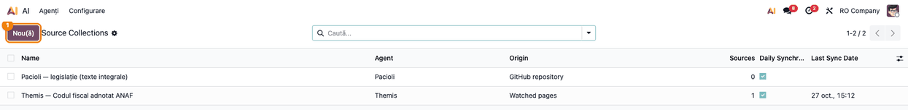
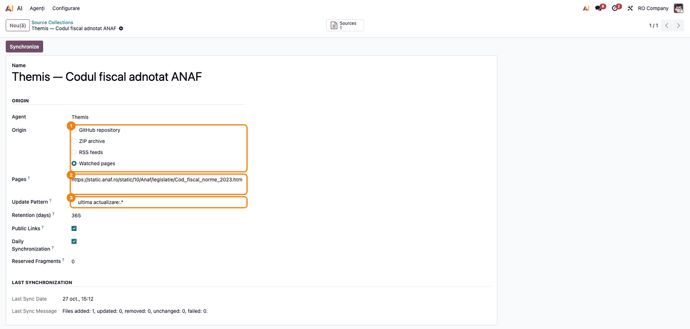
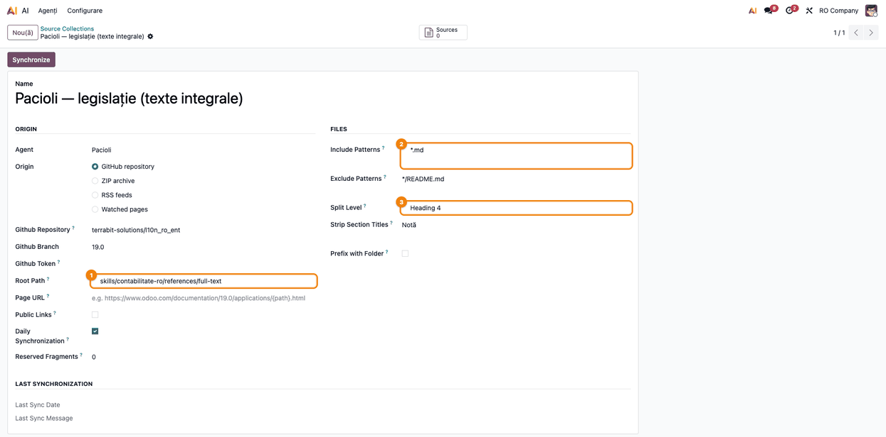
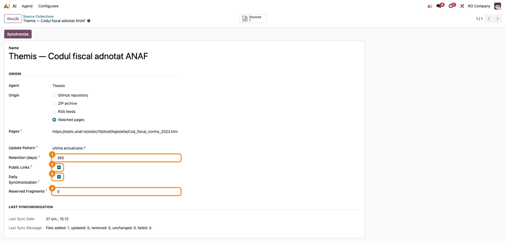
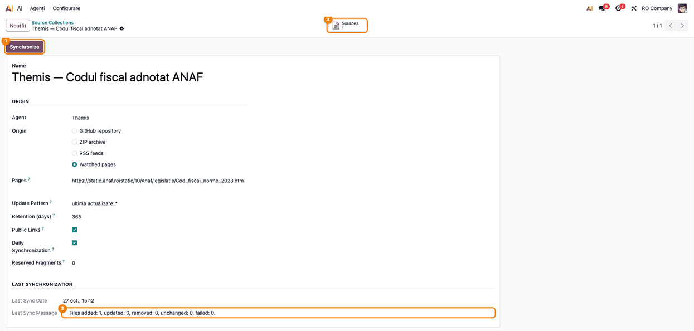
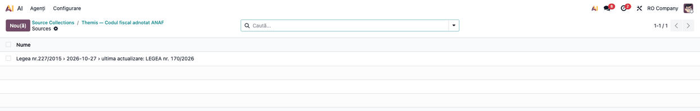
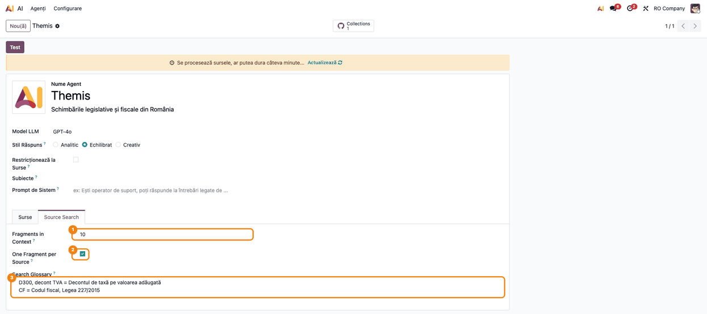

# Fișă Modul: Colecții de surse pentru agenții AI (GitHub, ZIP, RSS, pagini urmărite)

**Modul:** `deltatech_ai_source_sync`
**Utilizator principal:** Administrator Odoo / consultant care configurează agenții AI
**Prioritate:** 🟡 Medie (modul de configurare, folosit la punerea în funcțiune a agenților și la întreținerea documentației lor)

---

## 1. Scop business

Agenții AI din Odoo 19 Enterprise răspund pe baza unor surse (documente) încărcate pe agent. Încărcarea
fișierelor unul câte unul nu e practică pentru o documentație întreagă: un wiki de module, legislația
sau știrile fiscale. Modulul introduce **colecția de surse**: o colecție se leagă de un agent și îi
ține sursele la zi pornind de la un depozit **GitHub**, o arhivă **ZIP**, o listă de **fluxuri RSS**
sau o listă de **pagini urmărite** (texte oficiale republicate în același loc, de exemplu Codul fiscal
adnotat de ANAF, din care se reține doar momentul și actul ultimei actualizări).
Sincronizarea este incrementală (se reiau doar fișierele schimbate), iar documentele mari se pot
împărți pe secțiuni, ca citările agentului să trimită la secțiunea potrivită. Pe agent se pot regla și
căutarea în surse (glosar de termeni, numărul de fragmente date modelului).

## 2. Bază legală și context

Modulul nu generează operațiuni contabile și nu are o bază legală proprie. Contextul operațional:

- Colecțiile din fluxuri RSS păstrează doar ce publică fluxul pentru sindicalizare: titlul, data,
  linkul și rezumatul din flux, niciodată articolul întreg. Sursa trimite la articol, nu îl copiază.
- Colecțiile de **pagini urmărite** nu copiază textul paginii: rețin doar rândurile care spun când și
  prin ce act a fost actualizată (de exemplu „ultima actualizare: LEGEA nr. 170/2026” din antetul
  Codului fiscal adnotat de ANAF). Textul oficial al actului se confirmă în Monitorul Oficial sau pe
  legislatie.just.ro.
- Pentru legislație sau știri, sursele sunt documente de referință, nu sfat fiscal: recomandați
  păstrarea știrilor pe un agent separat de cel care folosește textele legilor.
- **Legăturile publice** se activează numai pentru pagini publice (un depozit GitHub public, un site
  public), pentru că citările devin vizibile tuturor utilizatorilor, inclusiv vizitatorilor
  site-ului care discută cu un agent livechat.

## 3. Utilizatori și roluri

| Rol | Acțiune |
|---|---|
| Administrator Odoo (grupul **Administrare / Setări**) | creează și sincronizează colecțiile, completează glosarul și setările de căutare ale agentului |
| Consultant | alege originea, filtrele și nivelul de împărțire potrivite documentației clientului |
| Utilizator al agentului AI | pune întrebări și vede citările; nu are acces la colecții |

Colecțiile, meniul lor și fila **Source Search** de pe agent sunt vizibile doar administratorilor
(`base.group_system`). Pentru testare e nevoie de un utilizator cu acest drept.

## 4. Conturi și date implicate

Modulul nu postează nicio notă contabilă și nu folosește conturi contabile.

Date minime pentru demo:

- un agent AI creat în **AI** (modulul `ai_app`);
- un depozit GitHub public cu fișiere Markdown (sau o arhivă ZIP cu fișiere `.md`);
- pentru RSS: cel puțin un flux accesibil, de exemplu `https://www.contzilla.ro/feed/`;
- pentru pagini urmărite: o pagină accesibilă care are un rând de actualizare, de exemplu
  `https://static.anaf.ro/static/10/Anaf/legislatie/Cod_fiscal_norme_2023.htm` (antetul ei conține
  „ultima actualizare: …”);
- un furnizor de embeddings configurat pe agent, pentru ca sursele să fie indexate de cronul standard AI.

## 5. Configurare inițială

1. Instalați modulul `deltatech_ai_source_sync` (depinde de `ai_app`).
2. Verificați că aveți dreptul de administrator: fără el nu apar meniul **Source Collections** și
   fila **Source Search**.
3. Verificați că agentul are un model și un furnizor AI configurate, altfel sursele nu pot fi
   transformate în embeddings.
4. Verificați în **Settings → Technical → Automation → Scheduled Actions** acțiunea **AI: synchronize
   the source collections** (rulează zilnic). Sincronizarea pornită manual folosește aceeași acțiune.

## 6. Flux de utilizare

### Pasul 1 — Crearea colecției

Accesați **AI → Configuration → Source Collections** și apăsați **New**. Alternativ, deschideți
agentul și folosiți butonul **Collections** din partea de sus a formularului. În acest caz agentul e
precompletat.

Completați **Name** (de exemplu „Wiki module”) și alegeți **Agent**. Lista arată, pentru fiecare
colecție, agentul, originea, numărul de surse, sincronizarea zilnică și data ultimei sincronizări.



### Pasul 2 — Alegerea originii

În grupul **Origin** alegeți una dintre variante; câmpurile se schimbă după alegere:

| Origine | Câmpuri |
|---|---|
| **GitHub repository** | **Github Repository** (`owner/name`, obligatoriu), **Github Branch**, **Github Token** (doar pentru depozit privat, cu drept de citire a conținutului) |
| **ZIP archive** | **ZIP Archive** (obligatoriu); un singur folder de la rădăcina arhivei este ignorat |
| **RSS feeds** | **Feeds** (un URL de flux RSS sau Atom pe linie, obligatoriu), **Pages per Feed** (pagini citite dintr-un flux paginat, WordPress `?paged=N`), **Retention (days)** (implicit 90) |
| **Watched pages** | **Pages** (un URL de pagină pe linie, obligatoriu), **Update Pattern** (expresie regulată aplicată pe fiecare rând al textului paginii, fără deosebire între litere mari și mici, obligatorie; de exemplu `ultima actualizare:.*`), **Retention (days)** (cât se păstrează stările anterioare ale paginii, numărat de la înlocuirea lor; implicit 90) |

Pentru **RSS feeds** și **Watched pages**, formularul ascunde **Root Path**, **Page URL** și grupul
**Files**: nu se aplică.



**Ce intră dintr-un flux RSS.** Fiecare articol devine o sursă cu site-ul, data, titlul, linkul și
rezumatul publicat în flux. Sunt păstrate **doar articolele cu link http sau https**: articolele fără
link, cu link relativ sau cu o schemă ca `javascript:` ori `data:` sunt sărite. Motivul: linkul vine de la un terț și devine adresa din citări și din **Open source**, vizibile
și vizitatorilor livechat când e bifat **Public Links**. Dacă un articol nu apare ca sursă, verificați
întâi linkul lui în flux.

**Ce intră dintr-o pagină urmărită.** Textul paginii **nu se copiază**. Se citesc rândurile textului
(fără scripturi și stiluri) și se reține **textul potrivit** de **Update Pattern** pe fiecare rând (de aceea
șablonul se termină cu `.*`, ca să prindă tot rândul); potrivirile identice apar o singură dată, cel
mult 20, a câte 300 de caractere. Ele dau **starea** paginii.
Fiecare stare nouă devine o sursă care conține titlul paginii, linkul, data la care starea a fost văzută
prima dată, data modificării paginii (antetul `Last-Modified`, dacă serverul îl trimite) și rândurile
potrivite. De exemplu, pentru Codul fiscal adnotat de ANAF:

```text
Legea nr.227/2015 › 2026-10-27 › ultima actualizare: LEGEA nr. 170/2026

Link: https://static.anaf.ro/static/10/Anaf/legislatie/Cod_fiscal_norme_2023.htm
First seen on: 2026-10-27
Page modified on: 2026-10-08

The page Legea nr.227/2015 shows:
- ultima actualizare: LEGEA nr. 170/2026
- ultima actualizare: Hotărârea Guvernului nr. 602/2025
```

Linkul citat deschide pagina. Cât timp textul potrivit nu se schimbă, sursa nu se rescrie (data
„First seen on” rămâne cea a primei apariții). Excepție: schimbarea opțiunii **Public Links** pe
colecție rescrie starea curentă, cu data zilei la „First seen on”. Doar adresele http și https sunt
citite; serverul Odoo trebuie să aibă acces la internet către site-ul paginii (pagina ANAF are circa
5 MB și se citește cu o așteptare de cel mult 120 de secunde).

### Pasul 3 — Selecția și prelucrarea fișierelor (GitHub și ZIP)

În grupul **Files** (și în **Origin**, pentru **Root Path**) reglați:

- **Root Path** — se citesc doar fișierele de sub acest director;
- **Include Patterns** / **Exclude Patterns** — câte un șablon pe linie, aplicat pe calea relativă;
  `*` acoperă și `/` (de exemplu `*/index.md`);
- **Split Level** — **Do not split** sau **Heading 1…4**: un fișier mare (o lege, un manual) devine o
  sursă pe secțiune, iar numele sursei păstrează titlurile de deasupra;
- **Strip Section Titles** — titluri de secțiuni eliminate cu tot conținutul (de exemplu secțiunile
  tehnice dintr-o documentație pentru clienți);
- **Prefix with Folder** — numele sursei începe cu folderul fișierului (de exemplu numele tehnic al
  modulului), ca agentul să-l numească în răspunsuri;
- **Page URL** — linkul citat în loc de pagina GitHub, cu `{path}` pentru calea fără extensie;
- fișierele `*.rst` (documentația Odoo) sunt convertite în Markdown și împărțite la fel.



### Pasul 4 — Legături publice, sincronizare zilnică, fragmente rezervate

- **Public Links** — la GitHub și ZIP, linkul fișierului se scrie sub titlul fiecărei surse; la toate
  originile care au link (la ZIP, doar cu **Page URL**), citările se arată tuturor utilizatorilor. La RSS și Watched pages rândul `Link:` este
  oricum în textul sursei, opțiunea nu adaugă un al doilea. Bifați numai pentru pagini publice.
- **Daily Synchronization** — vizibil la origine GitHub, RSS și Watched pages (nu pentru ZIP).
- **Reserved Fragments** — numărul de fragmente din contextul agentului care vin întotdeauna din
  această colecție, util când o colecție mică e acoperită de una mare. Valoarea nu poate fi negativă.



### Pasul 5 — Sincronizarea

Apăsați **Synchronize**. Apare mesajul că sincronizarea rulează în fundal; formularul nu se
actualizează imediat, rezultatul apare după rularea cronului.

**Găsește pe ecran.** După rularea cronului, redeschideți colecția și uitați-vă la grupul **Last
Synchronization**: **Last Sync Date** și **Last Sync Message** (`Files added: …, updated: …, removed:
…, unchanged: …, failed: …`; sub rezumat apar până la 20 de erori, câte una pe linie).



**Verifică:**

- data ultimei sincronizări e cea de azi, iar câmpul **Sync Requested** a dispărut;
- `failed` este 0; dacă nu, fiecare eroare indică fișierul cu problemă. La RSS și Watched pages,
  fluxurile sau paginile care nu pot fi citite **nu** se numără la `failed`: verificați să nu existe
  linii de eroare sub rezumat;
- pentru un depozit mare, mesajul **The GitHub tree is truncated: no source was removed** înseamnă că
  nu s-au șters surse; restrângeți **Root Path**;
- la a doua sincronizare, fără modificări, toate fișierele apar la `unchanged`.

**Treci mai departe.** Butonul **Sources** (în partea de sus a colecției) deschide lista surselor
create; acestea sunt transformate în embeddings de cronul standard AI. La o pagină urmărită, numele
sursei arată titlul paginii, data primei apariții și primul rând de actualizare.



Pentru sincronizări lungi, cronul se reia de unde a rămas; la rate limit-ul furnizorului, cererile
sunt reluate după așteptarea cerută, iar sursele eșuate sunt puse înapoi în coadă (de cel mult 3 ori).

**Comportament RSS la sincronizare.** Un articol care iese din flux își păstrează sursa până depășește
perioada **Retention (days)**; articolele mai vechi decât perioada nu se adaugă, iar sursele lor se
șterg.

**Comportament Watched pages la sincronizare.** Fiecare pagină se citește la fiecare sincronizare:

- aceeași stare (același text potrivit) → fișierul apare la `unchanged`, sursa rămâne neatinsă;
- stare nouă → apare o sursă nouă (`added`), iar sursa stării anterioare rămâne;
- o stare anterioară se șterge (`removed`) abia după ce trece **Retention (days)** de la data la care a
  fost **înlocuită** (data primei apariții a stării următoare), nu de la apariția ei: o stare care a
  durat mai mult decât perioada nu se pierde la prima schimbare;
- starea cea mai nouă a unei pagini nu se șterge niciodată, nici când pagina nu poate fi citită;
- dacă **Update Pattern** nu mai găsește nimic (pagina și-a schimbat aspectul), eroarea apare în
  **Last Sync Message** și sursele existente rămân;
- o pagină scoasă din **Pages** își păstrează ultima stare ca sursă; ștergeți-o manual din
  **Sources** dacă nu mai e relevantă.

### Pasul 6 — Setările de căutare pe agent

Deschideți agentul (**AI → Agents**) și fila **Source Search**:

- **Fragments in Context** — câte fragmente primește modelul la fiecare întrebare (1–30, implicit 5);
- **One Fragment per Source** — păstrează doar cel mai bun fragment al fiecărei surse; util pentru
  întrebări de tip listă („ce module avem pentru X”);
- **Search Glossary** — o intrare pe linie, `termen[, variantă...] = înțeles`; liniile care încep cu
  `#` sunt comentarii. Înțelesul termenilor găsiți în întrebare se adaugă la ea înainte de căutare;
  răspunsul se scrie tot pe baza întrebării originale.

Banda galbenă „Se procesează sursele…” din partea de sus a agentului e normală până când cronul
standard AI transformă sursele noi în embeddings.



### Note de monografie și raportare

Modulul nu generează note contabile și nu alimentează declarații sau rapoarte contabile.

## 7. Legături cu alte module / declarații

| Modul | Rol |
|---|---|
| `ai_app` (Odoo Enterprise) | agenții, sursele și meniul **AI → Configuration** pe care se montează colecțiile |
| cronul standard AI | transformă sursele create în embeddings |

**Ce e automat:** citirea fișierelor, fluxurilor sau paginilor urmărite, împărțirea pe secțiuni, curățarea textului
(imaginile rămân doar cu textul alternativ, linkurile cu textul lor), omiterea fișierelor
neschimbate, ștergerea surselor fișierelor dispărute, reluarea după rate limit, sincronizarea zilnică
la GitHub, RSS și Watched pages, sursa nouă la fiecare actualizare a unei pagini urmărite.

**Ce rămâne manual:** crearea colecției și alegerea filtrelor sau a șablonului de actualizare,
reîmprospătarea textelor oficiale folosite de alt agent când o pagină urmărită anunță un act nou, completarea glosarului, apăsarea
**Synchronize** pentru o actualizare imediată, reîncărcarea ZIP-ului când se schimbă arhiva.

Modulul corectează și extragerea textului din fișierele Markdown și text pentru **toate** atașamentele:
indexarea standard păstra doar caracterele ASCII, iar cuvintele cu diacritice se deformau înainte de
embeddings. Fișierele încărcate înainte de instalare își păstrează vechiul index până sunt încărcate
din nou.

## 8. Verificări pentru consultant

- [ ] Meniul **AI → Configuration → Source Collections** apare pentru administrator și nu apare pentru
      un utilizator fără drept de administrator.
- [ ] La origine **GitHub repository** apar câmpurile depozit, ramură și token (token-ul e mascat); la
      **ZIP archive**, câmpul arhivă; la **RSS feeds**, fluxurile, paginile și retenția; la
      **Watched pages**, **Pages**, **Update Pattern** (ambele obligatorii) și retenția.
- [ ] La **RSS feeds** și **Watched pages** dispar **Root Path**, **Page URL** și grupul **Files**; la
      **ZIP archive** dispare **Daily Synchronization**.
- [ ] După **Synchronize** și rularea cronului, **Last Sync Message** arată fișierele adăugate,
      `failed: 0` și nicio linie de eroare sub rezumat (la RSS și Watched pages, un flux sau o pagină
      care nu poate fi citită apare doar ca linie de eroare, nu la `failed`).
- [ ] A doua sincronizare, fără modificări, arată toate fișierele la `unchanged`.
- [ ] Pe un flux RSS de test care conține articole cu linkuri `javascript:`, `data:` sau relative,
      acestea nu apar printre surse; articolele cu link `https://` apar.
- [ ] Fiecare sursă RSS are în text rândul `Link:` cu adresa articolului.
- [ ] O colecție **Watched pages** pe pagina ANAF a Codului fiscal, cu șablonul `ultima actualizare:.*`,
      dă după sincronizare o singură sursă care conține „ultima actualizare: …” pentru Codul fiscal și
      pentru Norme, rândul `Link:` și „First seen on”.
- [ ] A doua sincronizare a aceleiași pagini, fără schimbări, arată `unchanged: 1` și nu adaugă surse.
- [ ] Când rândul „ultima actualizare” se schimbă, apare o sursă nouă, iar cea veche rămâne în perioada
      de retenție numărată de la înlocuire.
- [ ] Un **Update Pattern** care nu găsește nimic pe pagină produce eroarea „matches nothing on the
      page” în **Last Sync Message**, fără să șteargă sursele existente.
- [ ] La **Split Level** = **Heading 2**, un fișier cu mai multe secțiuni dă mai multe surse, cu
      numele de forma `Titlu document › Titlu secțiune`.
- [ ] Cu **Public Links** bifat, sub titlul fiecărei surse apare rândul `Link:`.
- [ ] **Reserved Fragments** cu valoare negativă este refuzat cu mesajul „The reserved fragments
      cannot be negative.”
- [ ] **Fragments in Context** în afara intervalului 1–30 este refuzat.
- [ ] Un termen din glosar, scris în întrebarea unui agent, aduce în rezultate documentul care folosește
      denumirea completă.

## 9. Mesaje de eroare frecvente

| Mesaj | Cauză | Remediere |
|---|---|---|
| `GitHub answered 404 for …` (sau 401/403) | depozit sau ramură greșite, depozit privat fără token sau token fără drept de citire | corectați depozitul și ramura; adăugați un token cu drept de citire a conținutului |
| `Set the GitHub repository of the collection …` | origine GitHub fără depozit | completați **Github Repository** |
| `Upload the ZIP archive of the collection …` | origine ZIP fără arhivă | încărcați arhiva |
| `The file of the collection … is not a ZIP archive.` | fișierul încărcat nu e un ZIP valid | încărcați o arhivă ZIP corectă |
| `Set the feeds of the collection …` | origine RSS fără fluxuri | completați **Feeds**, câte un URL pe linie |
| `No feed of the collection … could be read.` | niciun flux nu răspunde sau nu e RSS/Atom valid | verificați adresele; fiecare eroare e listată în **Last Sync Message** |
| `The feed answered … for …` | fluxul răspunde cu un cod diferit de 200 | verificați adresa fluxului sau reîncercați mai târziu |
| `Set the pages of the collection …` | origine Watched pages fără pagini | completați **Pages**, câte un URL pe linie |
| `Set the update pattern of the collection …` | origine Watched pages fără șablon | completați **Update Pattern**, de exemplu `ultima actualizare:.*` |
| `The page answered … for …` | pagina răspunde cu un cod diferit de 200 | verificați adresa paginii sau reîncercați mai târziu |
| `…: the pattern '…' matches nothing on the page` | șablonul nu găsește niciun rând (pagina și-a schimbat aspectul sau șablonul e greșit); sursele existente rămân | deschideți pagina, căutați rândul de actualizare și corectați **Update Pattern** |
| `…: empty page` / `…: not an HTML page: …` | pagina e goală sau nu e HTML (de exemplu un PDF) | verificați adresa din **Pages** |
| `…: invalid pattern …` | **Update Pattern** nu e o expresie regulată validă (de exemplu o paranteză neînchisă) | corectați expresia |
| `…: not an http or https link` | în **Pages** e o adresă care nu începe cu `http://` sau `https://` | scrieți adresa completă a paginii |
| `No page of the collection … could be read: …` | nicio pagină nu a putut fi citită; motivele sunt listate după două puncte | corectați cauzele; sursele existente rămân |
| `Synchronization failed: …` | sincronizarea a fost oprită de o eroare de rețea sau de configurare | citiți mesajul din **Last Sync Message**, corectați cauza și apăsați din nou **Synchronize** |
| `The GitHub tree is truncated: no source was removed.` | depozitul e prea mare pentru o listare completă | restrângeți **Root Path** sau folosiți șabloane de include |
| `The number of fragments in context must be between 1 and 30.` | valoare în afara intervalului pe agent | introduceți o valoare între 1 și 30 |
| `The reserved fragments cannot be negative.` | **Reserved Fragments** negativ | introduceți 0 sau o valoare pozitivă |

## 10. Capturi de ecran

Capturile sunt generate automat de `tests/test_screenshots.py` (mixinul `ScreenshotCase` din
`deltatech_doc_screenshots`, import defensiv), pe „RO Company”, cu interfața Odoo în română.
Etichetele modulului apar în engleză, pentru că modulul nu are traducere în română. Datele sunt
cele ale unui agent de știri legislative (Themis, cu pagina ANAF urmărită) și ale unui agent contabil
(Pacioli, cu textele integrale ale legilor din GitHub), ținute separat ca în secțiunea 2;
sincronizarea paginii ANAF folosește un răspuns simulat, fără acces la rețea.

| Fișier | Pas | Ce arată |
|---|---|---|
| `01_lista_colectii.png` | Pasul 1 | lista colecțiilor, butonul **Nou** |
| `02_origine_pagini.png` | Pasul 2 | originea **Watched pages**, **Pages** și **Update Pattern** |
| `03_fisiere_github.png` | Pasul 3 | colecție GitHub: **Root Path**, **Include Patterns**, **Split Level** |
| `04_optiuni_colectie.png` | Pasul 4 | **Retention (days)**, **Public Links**, **Daily Synchronization**, **Reserved Fragments** |
| `05_rezultat_sincronizare.png` | Pasul 5 | **Synchronize**, **Last Sync Message**, butonul **Sources** |
| `06_surse_pagina.png` | Pasul 5 | sursa creată din starea paginii ANAF |
| `07_cautare_agent.png` | Pasul 6 | fila **Source Search** a agentului |

Regenerare:

```bash
./odoo/odoo-bin -c odoo.conf -d <db> -i deltatech_ai_source_sync,deltatech_doc_screenshots \
    --test-tags=fise_screenshots --stop-after-init
```

## 11. Observații pentru manual

- Redactorul manualului păstrează explicația fluxului **origine → filtre → sincronizare → verificarea
  mesajului**; este singura parte pe care consultantul o repetă la fiecare client.
- Păstrați avertismentul despre **Public Links**: se bifează numai pentru pagini publice, pentru că
  citările devin vizibile vizitatorilor livechat.
- Păstrați regula pentru RSS: doar articole cu link http sau https; sursa conține rezumatul din flux,
  nu articolul întreg.
- Exemple de configurare (din `USAGE.md`) utile în manual: wiki de module cu două colecții pe același
  depozit și **Prefix with Folder**; legislație cu **Root Path** `references` și **Split Level** =
  **Heading 2**; știri legislative pe un agent separat, 5 pagini per flux, retenție 90 de zile;
  actualizările Codului fiscal adnotat de ANAF pe același agent de știri (Themis), cu **Watched
  pages**, șablonul `ultima actualizare:.*`, sincronizare zilnică și **Public Links**.
- Păstrați regula pentru paginile urmărite: nu se copiază textul paginii, ci doar rândurile de
  actualizare; o stare veche se păstrează pe durata retenției numărată de la înlocuirea ei.
