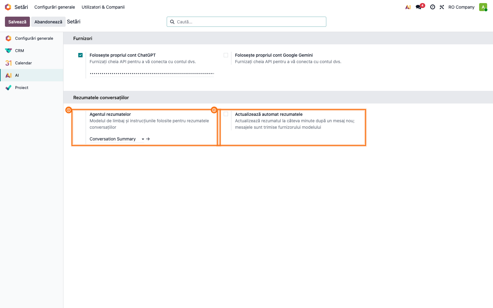
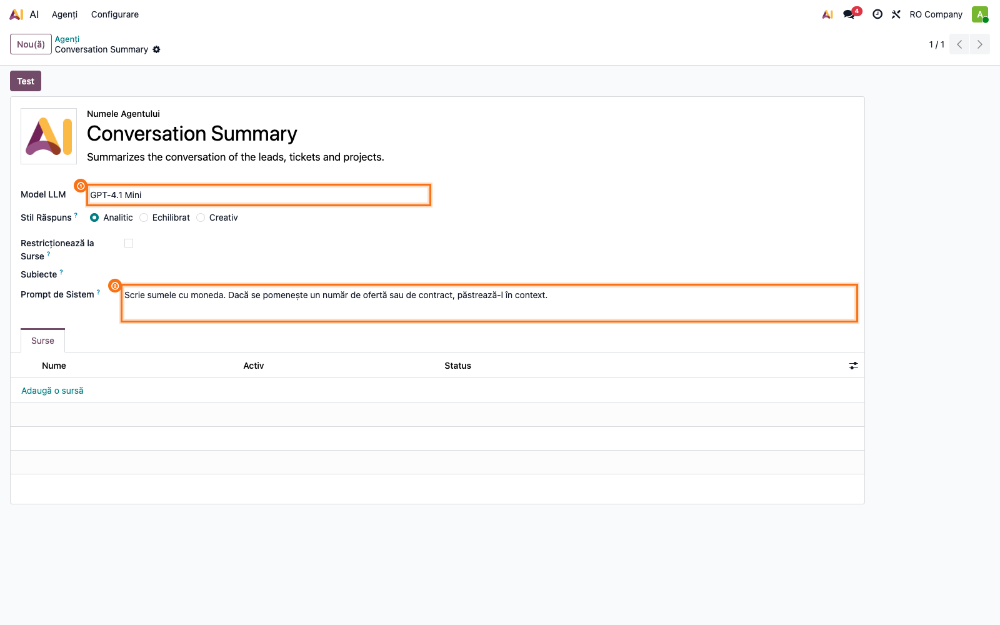
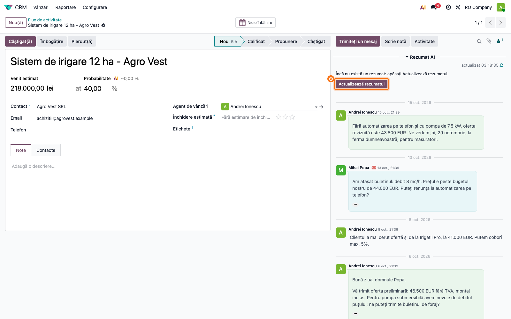
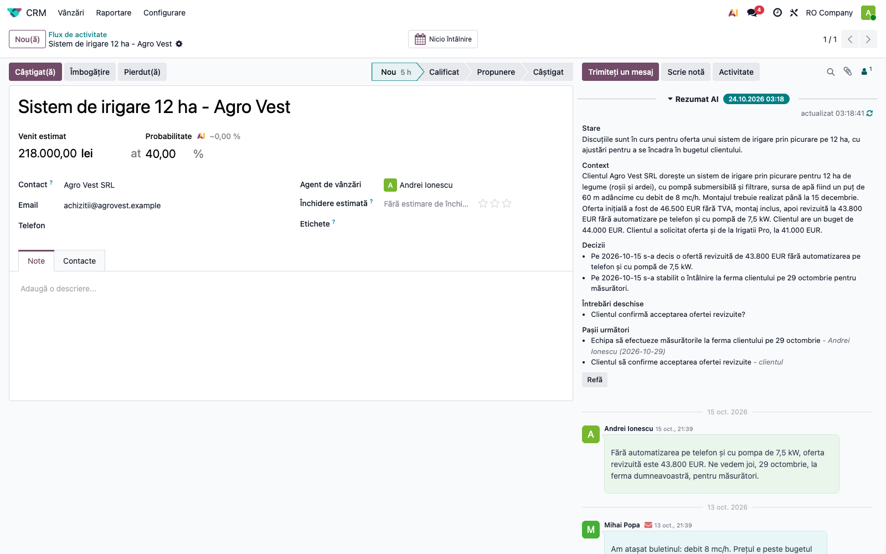
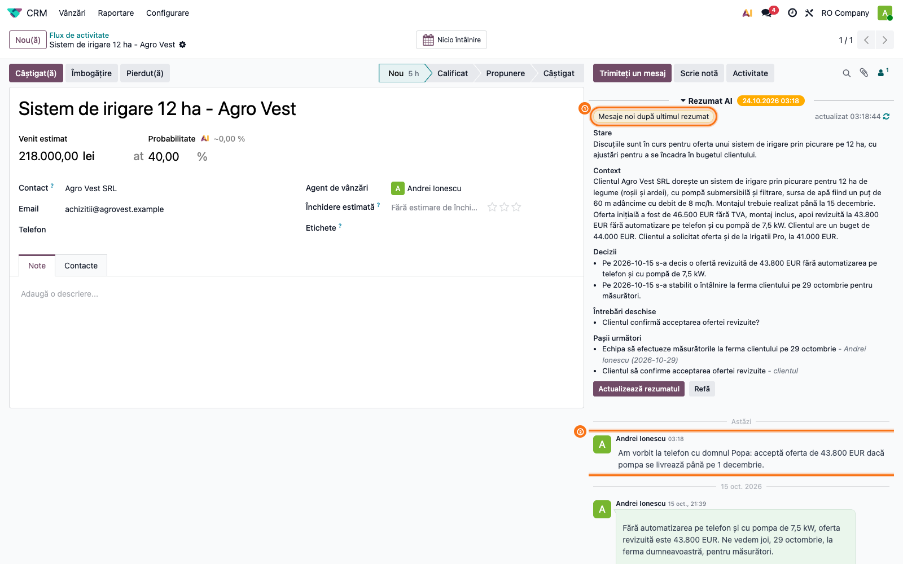
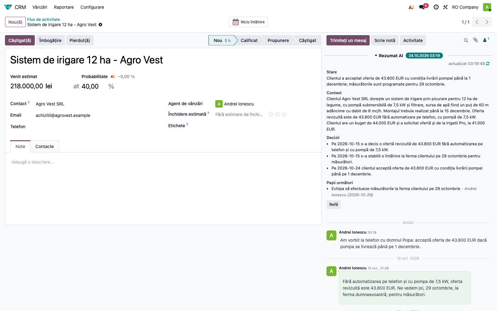
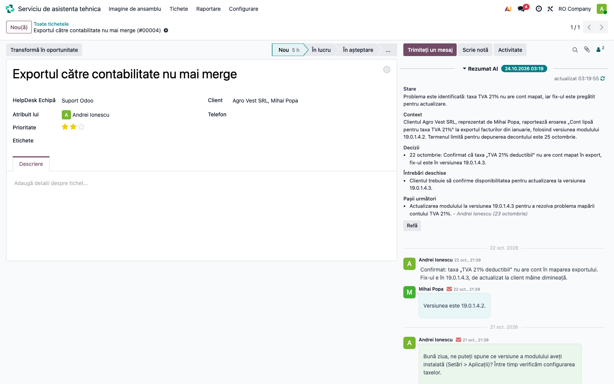
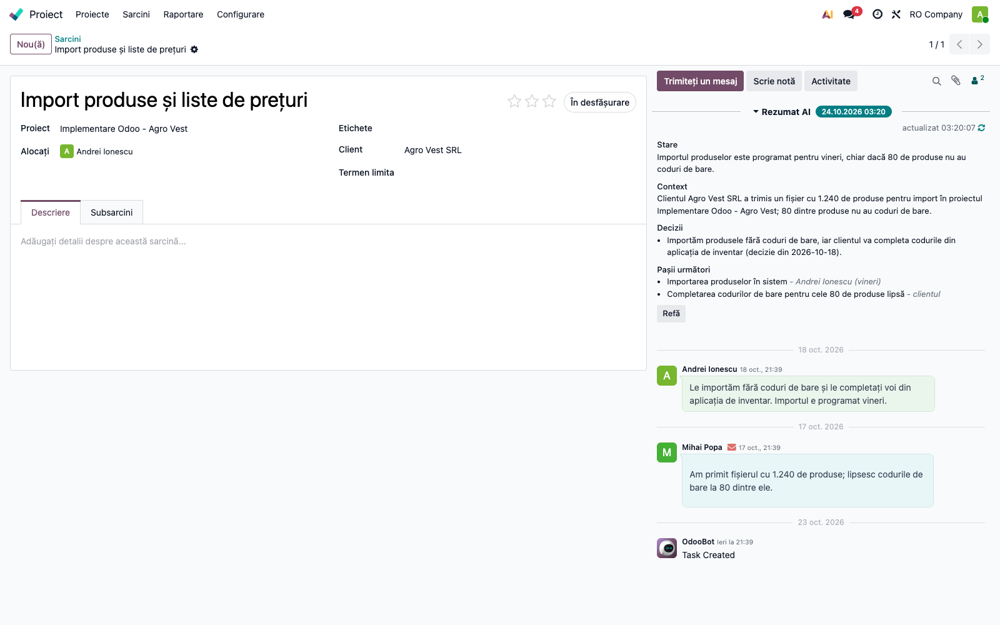
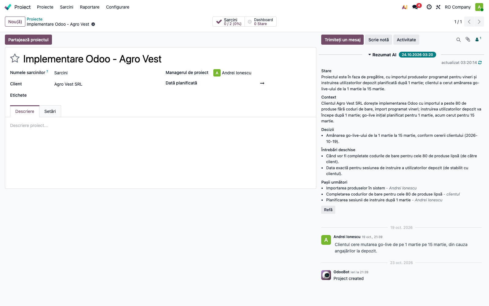

# Fișă Modul: Rezumatul AI al conversației pe oportunități, tichete și proiecte

**Modul:** `deltatech_ai_thread_summary` (cu punțile `deltatech_ai_thread_summary_crm`,
`deltatech_ai_thread_summary_helpdesk`, `deltatech_ai_thread_summary_project`)
**Versiune:** 19.0.1.1.0
**Suită:** bitshop_ent (necesită Odoo Enterprise, pentru aplicația AI)
**Dependențe:** `mail`, `ai_app`, `deltatech_chatter_quick_info`; punțile adaugă `crm`, `helpdesk`, respectiv `project`
**Utilizator principal:** agentul de vânzări, operatorul de suport și managerul de proiect care preiau sau urmăresc
o înregistrare cu multe mesaje
**Prioritate:** 🟡 Medie (scurtează preluarea unui dosar, dar fluxurile CRM, Helpdesk și Proiect merg și fără el)

---

## 1. Scop business

O oportunitate negociată câteva săptămâni, un tichet cu zece răspunsuri sau un proiect cu zeci de sarcini au istoricul
în chatter: e-mailuri cu citate lungi, note interne, schimbări de etapă. Colegul care preia dosarul (concediu,
escaladare, raport către șef) trebuie să citească totul ca să afle unde s-a ajuns.

Modulul ține pe fiecare înregistrare un **rezumat scris de un agent AI**, cu cinci părți: **starea**, **contextul**
(ce vrea clientul, produse, cantități, sume, date), **deciziile**, **întrebările deschise** și **pașii următori**, cu
cine îi face și până când. Rezumatul se actualizează **doar cu mesajele noi**: modelul primește rezumatul curent și
mesajele de după el, nu tot istoricul, așa că o conversație lungă nu costă mai mult la fiecare actualizare.

Pe proiect, rezumatul adună și **rezumatele sarcinilor**, ca managerul să vadă imaginea de ansamblu fără să deschidă
fiecare sarcină.

## 2. Bază legală și context

Nicio obligație fiscală. Contextul care contează este **protecția datelor** (GDPR, Regulamentul UE 2016/679): la
fiecare actualizare, datele de mai jos pleacă la **furnizorul AI** al modelului ales pe agent (OpenAI, Google sau,
cu `deltatech_ai_anthropic`, Anthropic), cu cheia companiei din setări (sau cea din mediul serverului, dacă e setată
acolo).

**Pleacă:**

- din fiecare mesaj nou: **numele autorului** (sau **adresa lui de e-mail**, dacă nu are nume), data și ora,
  dacă e din echipă sau de la client, tipul (e-mail, mesaj, notă internă), **subiectul**, textul și **numele**
  atașamentelor;
- schimbările câmpurilor urmărite din chatter, cu valoarea veche și cea nouă (ex. etapa, responsabilul);
- datele înregistrării: numele, clientul, responsabilul, etapa, compania, plus cele adăugate de punte:
  - oportunitate: tipul, venitul estimat, probabilitatea, data estimată de închidere, etichetele, motivul pierderii;
  - tichet: numărul, echipa, prioritatea, etichetele, termenul SLA;
  - sarcină: proiectul, **numele responsabililor**, starea, termenul, etichetele;
  - proiect: perioada, starea ultimei actualizări, numărul de sarcini și, pentru sarcinile rezumate, numele, etapa,
    responsabilii, starea și pașii următori din rezumatul lor;
- rezumatul curent al înregistrării și promptul de sistem al agentului.

**Nu pleacă:** conținutul atașamentelor, citatele din e-mailurile anterioare și semnăturile **recunoscute de Odoo**
(cele marcate la primirea e-mailului; un citat scris altfel pleacă), restul unui mesaj de peste ~4.000 de caractere.

Implicit, nimic nu pleacă singur: rezumatul se face **doar la apăsarea butonului**. Actualizarea automată, la fiecare
mesaj nou, se activează explicit în setări (pasul 1). Înainte de a o activa, compania care folosește Odoo
(operatorul de date) trebuie să-și informeze clienții și contactele că mesajele sunt procesate de un furnizor AI și
să verifice contractul de prelucrare cu furnizorul și locul unde acesta procesează datele. Încadrarea juridică exactă
o stabilește juristul companiei.

## 3. Utilizatori și roluri

| Rol | Ce face |
|---|---|
| Administrator (**Setări**) | pune cheia furnizorului AI, alege agentul rezumatelor, pornește actualizarea automată |
| Administrator AI | schimbă modelul și instrucțiunile agentului *Conversation Summary* |
| Utilizator intern cu acces la înregistrare (vânzări, suport, proiect) | citește rezumatul, apasă **Actualizează rezumatul** sau **Refă** |
| Utilizator portal (clientul) | nu vede rezumatul: câmpurile sunt doar pentru utilizatorii interni |

La testare: un administrator pentru setări și un utilizator de vânzări sau de suport pentru înregistrări.

## 4. Conturi și date implicate

Modulul **nu generează note contabile** și nu folosește conturi.

Ce adaugă în bază:

- agentul AI **Conversation Summary**, ales implicit în setări;
- pe oportunitate, tichet, sarcină și proiect: panoul **Rezumat AI** în capul chatterului, deasupra mesajelor, cu
  rezumatul, data actualizării (insigna de lângă titlu), eticheta *Mesaje noi după ultimul rezumat*, eticheta
  roșie a unei actualizări automate eșuate și butoanele **Actualizează rezumatul** și **Refă**. Panoul se pliază cu
  un click pe titlu și își ține starea pentru fiecare utilizator;
- cron-ul **AI: actualizarea rezumatelor conversațiilor**, orar și declanșat la ~10 minute după un mesaj nou, doar cu
  actualizarea automată pornită.

Date minime pentru un demo: o cheie OpenAI sau Google, o oportunitate, un tichet și un proiect cu două sarcini, fiecare
cu câteva mesaje (un e-mail al clientului, un răspuns, o notă internă). Baza din capturi conține o ofertă de irigații
de 12 ha (*Agro Vest SRL*), un tichet despre exportul TVA 21% și proiectul *Implementare Odoo - Agro Vest*.

## 5. Configurare inițială

1. Instalați `deltatech_ai_thread_summary`. Punțile se instalează singure lângă aplicațiile existente: CRM, Helpdesk,
   Proiect (dacă o aplicație se instalează mai târziu, puntea ei vine odată cu ea).
2. **Setări → AI → Furnizori**: bifați *Folosește propriul cont ChatGPT* (respectiv Google Gemini) și introduceți
   cheia API. Pentru modelele Claude, instalați `deltatech_ai_anthropic`.
3. Limba rezumatului este **limba partenerului companiei** înregistrării (**Setări → Utilizatori & Companii →
   Companii**, contactul companiei, câmpul *Limbă*). Pentru rezumate în română, partenerul companiei trebuie să fie în
   română, iar româna să fie instalată.

## 6. Flux de utilizare

### Pasul 1 — Alegeți agentul și modul de actualizare

**Setări → AI**, blocul **Rezumatele conversațiilor**:

- **Agentul rezumatelor**: agentul *Conversation Summary*, creat de modul și ales implicit;
- **Actualizează automat rezumatele**: bifat, rezumatul se actualizează singur la câteva minute după un mesaj nou;
  nebifat (implicit), doar din butonul din panou.

Salvați.

### Pasul 2 — Ajustați agentul (opțional)

**AI → Agenți**, deschideți **Conversation Summary**:

- **Model LLM**: modelul care scrie rezumatele (capturile sunt făcute cu *GPT-4.1 Mini*, rapid și ieftin pentru
  rezumate);
- **Prompt de Sistem**: instrucțiunile companiei, adăugate la regulile modulului. Exemplu: *„Scrie sumele cu
  moneda. Dacă se pomenește un număr de ofertă sau de contract, păstrează-l în context.”*

Regulile de bază (cele cinci părți, ce se păstrează și ce se scoate, fără date inventate) sunt în modul și nu trebuie
scrise aici.

### Pasul 3 — Primul rezumat al unei oportunități

**CRM → Vânzări → Oportunitățile mele**, deschideți oportunitatea. Panoul **Rezumat AI** e în capul chatterului,
deasupra mesajelor. Cât timp nu există rezumat, panoul arată *Încă nu există un rezumat* și butonul **Actualizează
rezumatul**.

Apăsați **Actualizează rezumatul**. După câteva secunde (2–5 la *GPT-4.1 Mini*), panoul arată rezumatul, iar insigna
de lângă titlu, data actualizării. Deschiderea documentului nu cheamă modelul: panoul citește rezumatul salvat.

**Găsiți pe ecran.** Cele cinci părți: *Stare*, *Context*, *Decizii*, *Întrebări deschise*, *Pașii următori*.

**Verificați**, comparând cu mesajele din chatter:

- sumele și datele din rezumat sunt cele din mesaje (în captură: oferta de 46.500 EUR, bugetul de 44.000 EUR, oferta
  revizuită de 43.800 EUR, întâlnirea din 29 octombrie);
- informația din nota internă (oferta concurentului, marja de 5%) nu apare ca ceva spus clientului;
- textul citat din e-mailuri (*„Pe 3 oct., Andrei Ionescu a scris…”*) și semnătura clientului nu apar în rezumat;
- fiecare pas următor are un responsabil (un nume, „clientul” sau „echipa”).

### Pasul 4 — Un mesaj nou și actualizarea

Scrieți în chatter un mesaj sau o notă (**Scrie notă** → textul → **Jurnal**). În panou apare imediat eticheta
*Mesaje noi după ultimul rezumat*, insigna cu data devine galbenă, iar butonul **Actualizează rezumatul** apare din
nou.

Apăsați **Actualizează rezumatul**. Modelul primește rezumatul de până acum și doar nota nouă.

**Verificați.**

- Informația din nota nouă apare în *Stare* și, dacă e o decizie, în *Decizii*.
- Ce era adevărat rămâne (contextul, deciziile anterioare); întrebările la care s-a răspuns dispar.
- Eticheta *Mesaje noi* a dispărut, iar insigna de lângă titlu arată ora actualizării.

**Refă** scrie rezumatul din nou din toate mesajele, fără rezumatul anterior. Folosiți-l după ce schimbați
instrucțiunile agentului sau dacă rezumatul a pierdut ceva.

### Pasul 5 — Tichetul de suport

**Helpdesk → Tichete**, deschideți tichetul, în panoul **Rezumat AI** din chatter apăsați **Actualizează rezumatul**. Pe lângă mesaje,
modelul primește echipa, prioritatea, etichetele și termenul SLA.

**Verificați.** *Contextul* spune ce a raportat clientul (eroarea, versiunea), *Deciziile* ce a stabilit echipa
(cauza găsită, versiunea cu remedierea), *Pașii următori* ce așteaptă fiecare parte.

### Pasul 6 — Sarcinile și proiectul

**Proiect**, deschideți o sarcină, în panoul **Rezumat AI** apăsați **Actualizează rezumatul**. Rezumatul sarcinii are și
proiectul, responsabilii, starea și termenul.

Când rezumatul unei sarcini se schimbă, proiectul ei primește eticheta *Mesaje noi după ultimul rezumat*, chiar
dacă în chatter-ul proiectului nu a apărut niciun mesaj. Deschideți
proiectul (**Proiect** → cardul proiectului → **⋮** → **Setări**) și apăsați **Actualizează rezumatul** în panoul din
chatter.

**Verificați.**

- Rezumatul proiectului conține informația din nota proiectului (în captură: mutarea go-live-ului pe 15 martie) și
  din sarcini (importul de vineri, instruirea după 1 martie).
- O sarcină fără rezumat nu este folosită: rezumați întâi sarcinile, apoi proiectul. Cu actualizarea automată,
  cron-ul face asta singur, în această ordine.

#### Note de monografie și raportare

Modulul nu generează note contabile și nu alimentează nicio declarație.

## 7. Legături cu alte module / declarații

| Modul | Legătura |
|---|---|
| `ai` / `ai_app` (Enterprise) | agentul, modelul LLM, cheia furnizorului; blocul din **Setări → AI** |
| `deltatech_ai_anthropic` | opțional: modelele Claude pentru agentul rezumatelor |
| `deltatech_chatter_quick_info` | panourile din capul chatterului: afișarea, plierea, grupurile care le văd, ordinea |
| `deltatech_ai_thread_summary_crm` | panoul pe oportunități și piste; adaugă tipul, venitul estimat, probabilitatea, data estimată de închidere, etichetele, motivul pierderii |
| `deltatech_ai_thread_summary_helpdesk` | panoul pe tichete; adaugă echipa, prioritatea, etichetele, termenul SLA |
| `deltatech_ai_thread_summary_project` | panoul pe sarcini și proiecte; proiectul adună rezumatele sarcinilor |

**Ce e automat.** Alegerea mesajelor noi, curățarea lor (citatele și semnăturile recunoscute de Odoo), marcajul *Mesaje noi*, ordinea sarcini →
proiect, iar cu bifa din setări, actualizarea la câteva minute după un mesaj.
**Ce rămâne manual.** Cheia furnizorului, alegerea modelului și a instrucțiunilor, pornirea actualizării automate,
verificarea rezumatului înainte de a-l folosi într-o decizie sau într-un mesaj către client.

## 8. Verificări pentru consultant

- [ ] **Setări → AI**: cheia furnizorului e completată; **Agentul rezumatelor** = *Conversation Summary* (sau agentul
      ales).
- [ ] Partenerul companiei are limba română: rezumatul și titlurile lui ies în română.
- [ ] Oportunitatea, tichetul, sarcina și proiectul au panoul **Rezumat AI** în capul chatterului.
- [ ] Primul rezumat are cele cinci părți, iar sumele și datele corespund mesajelor.
- [ ] Textul citat din e-mailuri și semnăturile nu apar în rezumat.
- [ ] O notă internă apare ca informație a echipei, nu ca mesaj al clientului.
- [ ] După un mesaj nou apare *Mesaje noi după ultimul rezumat*; după **Actualizează rezumatul**, marcajul dispare și
      informația nouă e în rezumat.
- [ ] Fără mesaje noi, butonul **Actualizează rezumatul** nu apare; rămâne doar **Refă**.
- [ ] Panoul pliat rămâne pliat la redeschiderea documentului (pentru același utilizator).
- [ ] **Refă** pe proiect folosește toate sarcinile rezumate (cele mai recente 30), nu doar pe cele schimbate
      recent.
- [ ] Rezumatul proiectului conține informația din sarcinile rezumate.
- [ ] Un utilizator portal (clientul) nu vede rezumatul pe tichetul lui.
- [ ] Cu **Actualizează automat rezumatele** bifat: un mesaj nou e rezumat în ~10 minute, fără buton.

## 9. Mesaje de eroare frecvente

| Mesaj | Ce înseamnă | Ce faceți |
|---|---|---|
| „Niciun API key setat pentru furnizorul 'openai'” | cheia furnizorului nu e completată | bifați furnizorul și introduceți cheia la **Setări → AI → Furnizori** |
| „Oops! Your API key seems incorrect. Update it from the Settings.” | furnizorul a respins cheia | corectați cheia la **Setări → AI → Furnizori** |
| „Modelul de limbaj nu a răspuns cu rezumatul.” | răspunsul modelului nu a fost un rezumat valid | apăsați din nou; dacă se repetă, alegeți alt model pe agent |
| „Alegeți în setări agentul AI al rezumatelor conversațiilor.” | agentul din setări și agentul modulului au fost șterse | alegeți un agent în **Setări → AI → Agentul rezumatelor** |
| Eticheta roșie *Actualizarea automată a eșuat* în panou (eroarea, în tooltip) | actualizarea automată a eșuat pe această înregistrare (cheie, credit, furnizor indisponibil) | corectați cauza; înregistrarea se reîncearcă la mesajul următor sau apăsați **Actualizează rezumatul** |
| Rezumatul e în engleză | partenerul companiei nu are limba română sau româna nu e instalată | setați limba partenerului companiei (secțiunea 5, punctul 3), apoi **Refă** |
| Rezumatul proiectului nu conține sarcinile | sarcinile nu au încă rezumat | rezumați sarcinile, apoi proiectul |
| Un rezumat nu se actualizează singur | **Actualizează automat rezumatele** nu e bifat | bifați opțiunea sau folosiți butonul |

## 10. Capturi de ecran

Capturile, în ordinea pașilor din secțiunea 6, în `static/description/`:

| Fișier | Pasul | Ce arată |
|---|---|---|
| `01_setari_rezumate.png` | 1 | blocul **Rezumatele conversațiilor** din **Setări → AI** |
| `02_agent_rezumate.png` | 2 | agentul *Conversation Summary*, cu modelul și promptul de sistem |
| `03_oportunitate_fara_rezumat.png` | 3 | panoul **Rezumat AI** gol, cu butonul **Actualizează rezumatul** |
| `04_oportunitate_rezumat.png` | 3 | primul rezumat al oportunității |
| `05_oportunitate_mesaj_nou.png` | 4 | nota nouă în chatter și eticheta *Mesaje noi după ultimul rezumat* |
| `06_oportunitate_rezumat_actualizat.png` | 4 | rezumatul actualizat cu nota nouă |
| `07_tichet_rezumat.png` | 5 | rezumatul tichetului de suport |
| `08_sarcina_rezumat.png` | 6 | rezumatul unei sarcini |
| `09_proiect_rezumat.png` | 6 | rezumatul proiectului, cu informația din sarcini |

Capturile sunt făcute cu browserul integrat, nu dintr-un test automat: rezumatele vin de la un model real
(*GPT-4.1 Mini*) și diferă puțin de la o rulare la alta. Baza e o bază demo locală (*RO Company*, în RON, interfața
și partenerul companiei în română, temă luminoasă), cu datele inventate din secțiunea 4, nu cu datele unui client.
Capturile se refac pe aceeași bază demo, apăsând butoanele din fiecare pas: fiecare apăsare face un apel real la
model. Numele și descrierea agentului *Conversation Summary* rămân în engleză (câmpuri netraductibile în Odoo); le
puteți schimba pe agent.

## 11. Observații pentru manual

- **Locul panoului.** Pe ecranele late, chatterul (deci și panoul) e în dreapta formularului; pe ecranele mai înguste,
  Odoo îl mută sub formular. Panoul poate fi pliat, iar ordinea lui față de alte panouri se schimbă în **Setări →
  Tehnic → Interfață utilizator → Chatter Quick Info** (modul developer).

- **Rezumatul ajută, nu decide.** E scris de un model AI din mesaje: înainte de a-l folosi într-un mesaj către client
  sau într-o decizie, verificați cifrele în chatter.
- **Datele parțiale.** Modelul primește data fiecărui mesaj; o dată scrisă incomplet în mesaj („până pe 25”) poate
  apărea completată cu luna sau anul pe care le presupune modelul.
- **Costul.** Fiecare actualizare trimite rezumatul curent și doar mesajele noi; un mesaj lung e trimis doar cu
  primele ~4.000 de caractere. Prima rezumare a unui istoric foarte lung se face în mai mulți pași.
- **Ce nu citește modelul.** Conținutul atașamentelor (doar numele lor), mesajele sistemului fără text, notificările
  automate fără schimbări de câmpuri.
- **Actualizarea automată** grupează mesajele venite în rafală (un e-mail și atașamentul lui) și le rezumă o dată,
  la ~10 minute după ultimul. O înregistrare la care actualizarea a eșuat nu se reîncearcă până la mesajul următor,
  ca să nu consume credit în buclă.
