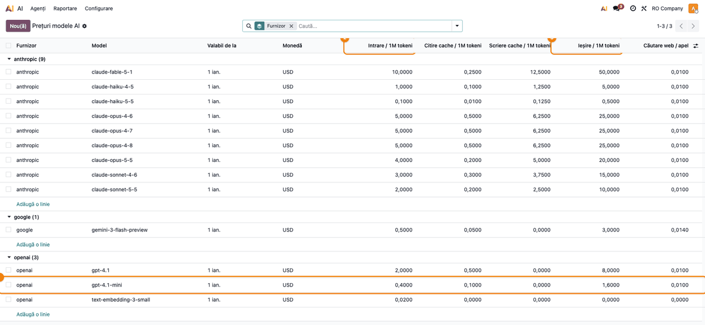
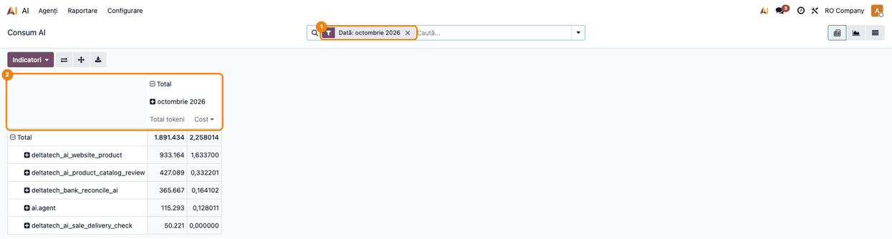
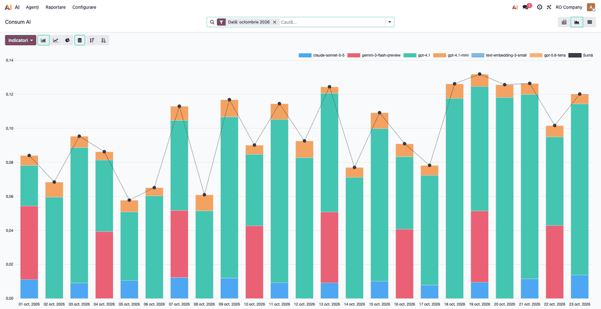
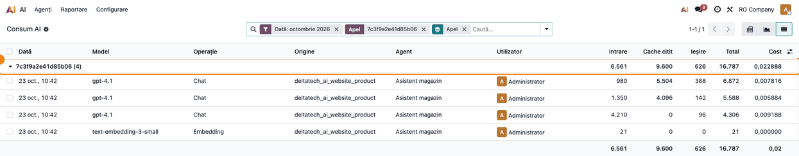
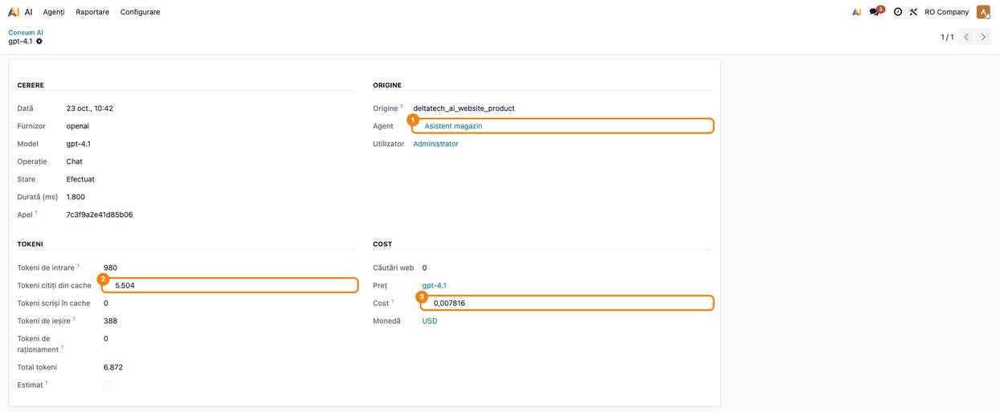
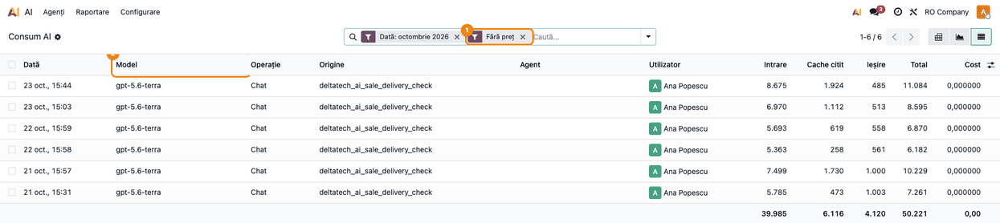
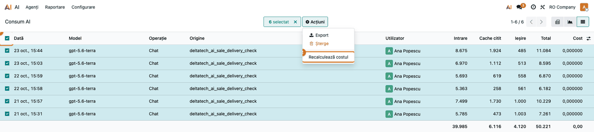
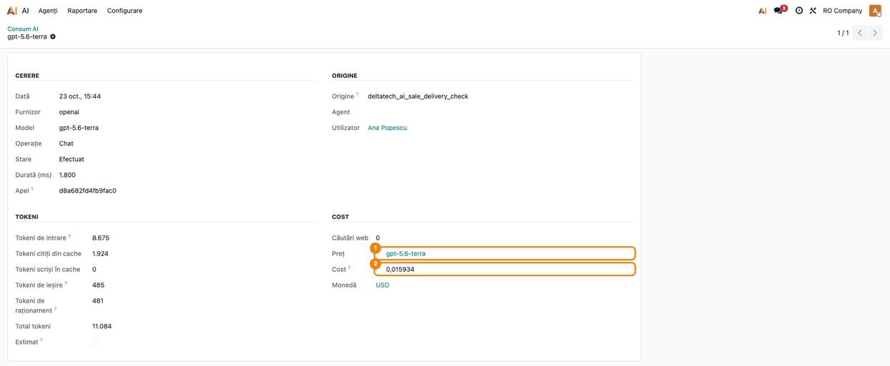

# Fișă Modul: Consumul și costul apelurilor AI

**Modul:** `deltatech_ai_usage`
**Versiune:** 19.0.1.0.1
**Suită:** bitshop_ent (necesită Odoo Enterprise, pentru aplicația AI)
**Dependențe:** `ai_app`
**Utilizator principal:** administratorul bazei (rolul **Setări**), care urmărește factura furnizorului AI; configurarea o pregătește consultantul
**Prioritate:** 🟡 Medie (nu schimbă niciun flux, dar fără el costul AI se vede abia pe factura furnizorului)

---

## 1. Scop business

Funcțiile AI din Odoo plătesc furnizorul (OpenAI, Google sau Anthropic) cu **cheia companiei**. Factura vine o dată pe
lună, pe toată cheia, fără să spună ce funcție a consumat. Odoo standard nu păstrează nimic din consum: lasă doar o
linie în jurnalul tehnic al serverului.

Modulul înregistrează **fiecare cerere** trimisă furnizorului, cu **tokenii raportați de furnizor** și **costul
estimat** din lista de prețuri, și spune **cine a cerut-o**: agentul, modulul, utilizatorul și compania. Așa se poate
răspunde la întrebări ca „cât ne-a costat asistentul magazinului luna asta?” sau „cât costă un produs analizat?”,
înainte de factură.

## 2. Bază legală și context

Modulul nu generează obligații fiscale: costul nu se înregistrează în contabilitate, e o estimare pentru control.
Factura furnizorului AI are însă obligațiile ei (taxare inversă, declarații): vezi secțiunea 6, „Note de monografie
și raportare”.

Contextul care contează:

- **Datele păstrate.** Se păstrează doar **contoare** (tokeni, cost, durată) și cine a cerut apelul. **Nu se
  păstrează** textul trimis furnizorului și nici răspunsul. Utilizatorul care a cerut apelul se reține, ca la orice
  document din Odoo.
- **Estimare, nu factură.** Costul vine din prețurile introduse în Odoo. Factura furnizorului rămâne referința:
  cursul, reducerile de volum sau creditele promoționale nu apar în jurnal.
- **Prețurile din capturi.** Prețurile Claude (Anthropic) vin cu modulul, din lista de prețuri publică. Prețurile
  OpenAI și Google din capturi sunt **exemple** pentru demo; în baza clientului se iau din paginile de prețuri ale
  furnizorilor.

## 3. Utilizatori și roluri

| Rol | Ce face |
|---|---|
| Administrator (**Setări**) | completează lista de prețuri, citește rapoartele de consum, recalculează costul |
| Ceilalți utilizatori | folosesc funcțiile AI ca înainte; cererile lor apar în jurnal, dar ei nu văd jurnalul |

Meniurile **AI → Raportare** și **AI → Configurare → Prețuri modele AI** sunt vizibile doar administratorilor. Într-o
bază cu mai multe companii, fiecare cerere aparține companiei din care s-a făcut, iar jurnalul arată doar companiile
selectate în bara de sus.

La testare, folosiți un administrator pentru rapoarte și un al doilea utilizator, obișnuit, care folosește un agent AI:
cererile lui trebuie să apară în jurnal cu numele lui.

## 4. Conturi și date implicate

Modulul **nu generează note contabile** și nu folosește conturi.

Ce adaugă în bază:

- **jurnalul de consum** (**Consum AI**): un rând pentru fiecare cerere trimisă furnizorului;
- **lista de prețuri** (**Prețuri modele AI**), cu prețurile Claude deja completate;
- acțiunea **Recalculează costul** în meniul *Acțiuni* al jurnalului.

Ce înseamnă coloanele de tokeni (un token ≈ 4 caractere de text):

| Coloană | Ce numără |
|---|---|
| **Tokeni de intrare** | textul trimis furnizorului, fără partea citită din cache |
| **Tokeni citiți din cache** | partea din intrare pe care furnizorul o avea deja în cache: costă mult mai puțin |
| **Tokeni scriși în cache** | partea pusă în cache la această cerere (doar Claude): costă puțin mai mult decât intrarea |
| **Tokeni de ieșire** | răspunsul, cu tot cu raționament |
| **Tokeni de raționament** | partea de „gândire” a modelului din tokenii de ieșire (informativ, inclusă deja în ieșire) |
| **Căutări web** | căutările pe internet făcute de model, plătite separat de tokeni |

Date minime pentru un demo: lista de prețuri și câteva zile de consum, din mai multe funcții. Testul de capturi le
creează direct în jurnal, fără apeluri reale și fără cheie (secțiunea 10).

## 5. Configurare inițială

1. Instalați `deltatech_ai_usage`. Din acel moment, orice cerere AI se înregistrează: nu există nimic de activat.
2. Dacă folosiți Claude, instalați și `deltatech_ai_anthropic` de la versiunea 19.0.1.3.0. Versiunile mai vechi nu
   trimit cererile Claude în jurnal.
3. Aflați ce modele folosește baza. Numele exacte se iau din **jurnal**, nu din agent: după câteva zile de folosire,
   **AI → Raportare → Consum AI → Listă**, grupat după **Model** (sau filtrul **Fără preț**, pasul 5). Câmpul **Model
   LLM** al agentului arată o etichetă („GPT-4.1”), nu numele tehnic, iar la variantele **ChatGPT (Auto)** și
   **Gemini (Auto)** Odoo trimite de fapt alt model, după stilul de răspuns al agentului (ex. `gpt-5.6-terra`,
   `gemini-3-flash-preview`). Câmpurile AI și acțiunile server AI nu au agent deloc.
4. Deschideți **AI → Configurare → Prețuri modele AI**. Liniile **anthropic** sunt completate. Adăugați o linie pentru
   fiecare model OpenAI sau Google din jurnal, cu prețurile din pagina furnizorului, în dolari pentru **1 milion de
   tokeni**:
   - **Furnizor**: `openai` sau `google`, scris exact așa;
   - **Model**: numele exact al modelului (ex. `gpt-4.1-mini`) sau un prefix urmat de `*` (ex. `gpt-5-mini*`
     acoperă toate variantele care încep așa; dacă se potrivesc mai multe linii, câștigă cea mai lungă);
   - **Intrare**, **Citire cache**, **Ieșire** și, dacă modelul caută pe internet, **Căutare web** (preț pe căutare).
   - Pentru căutarea în documentele agenților, adăugați și modelul de embedding (`text-embedding-3-small` la OpenAI,
     `gemini-embedding-2` la Google): are doar preț de intrare.

   

5. Când furnizorul schimbă prețul, **nu modificați linia veche**: adăugați una nouă, cu **Valabil de la** = data
   noului preț. Cererile deja înregistrate își păstrează costul.

## 6. Flux de utilizare

### Pasul 1 — Consumul lunii, pe funcții

**AI → Raportare → Consum AI.** Se deschide tabelul pivot, filtrat implicit pe **luna curentă**.



1. **Găsiți pe ecran:** filtrul **Dată: octombrie 2026** din bara de căutare ①; pe rânduri, **originea** fiecărei
   cereri, adică modulul care a cerut-o (ex. `deltatech_ai_website_product` = asistentul magazinului,
   `deltatech_bank_reconcile_ai` = reconcilierea bancară, `ai.agent` = un agent creat direct în bază, `ai.embedding` =
   indexarea documentelor agenților, `ir.actions.server` = acțiunile server AI), sortate după cost; în coloane ②,
   **Total tokeni** și **Cost** (în dolari, moneda prețurilor).
2. **Verificați:**
   - perioada din filtru e luna pe care o comparați cu factura furnizorului;
   - fiecare funcție AI folosită în companie are rândul ei; o funcție lipsă înseamnă că nu a fost folosită în
     perioadă;
   - un rând cu tokeni, dar cu **Cost 0** (aici `deltatech_ai_sale_delivery_check`) indică un model fără preț:
     vezi pasul 5;
   - totalul **Cost** e în ordinul de mărime al facturii furnizorului pentru aceeași lună (o diferență mare vine de
     obicei din prețuri lipsă sau greșite).
3. **Mai departe:** schimbați gruparea din antetul tabelului (clic pe **Total** → **Model**, **Agent**,
   **Utilizator** sau **Companie**) sau descărcați tabelul cu butonul **Descărcați xlsx** (iconița cu săgeată de lângă
   **Indicatori**).

### Pasul 2 — Evoluția pe zile și pe modele

Din același ecran, iconița **Grafic** din dreapta-sus.



1. **Găsiți pe ecran:** pe fiecare zi, o coloană a costului, împărțită pe **modele** (legenda de sus), și linia
   **Sumă** cu costul total al zilei.
2. **Verificați:** costul zilnic urmează activitatea cunoscută. Aici, partea verde (`gpt-4.1`, asistentul magazinului)
   face cea mai mare parte din cost și vârfurile din 18–21 octombrie; partea roșie (Gemini) apare doar în zilele cu
   analiza catalogului. Un model care apare brusc sau crește mult fără explicație trebuie urmărit pe origine (pasul 1).
   Un model fără preț apare în legendă, dar fără bară (aici `gpt-5.6-terra`): costul lui e 0 până la recalculare (pasul 6).
3. **Mai departe:** pentru zilele de vârf, treceți în **Listă** (iconița din dreapta) ca să vedeți cererile.

### Pasul 3 — Toate cererile unui răspuns

În **Listă**, căutați un **Apel**: scrieți codul apelului în bara de căutare și alegeți, din lista care se deschide,
opțiunea pentru **Apel**. Apoi grupați după **Apel** (săgeata din bara de căutare → **Grupează după → Apel**) și
deschideți grupul.



Un **apel** este un răspuns al unei funcții AI. Un singur răspuns poate face mai multe cereri la furnizor:

- o cerere de **Embedding**, cu care agentul caută în documentele lui;
- câte o cerere de **Chat** pentru fiecare rundă: modelul cere o informație (ex. prețul unui produs), Odoo i-o dă,
  iar modelul răspunde abia la a doua sau a treia cerere.

Pe rândul grupului se vede **costul total al răspunsului**. Lista e de la cea mai nouă cerere la cea mai veche:
embedding-ul e ultimul rând, prima rundă de chat e deasupra lui. Rundele de după prima citesc o parte tot mai mare din
cache (coloana **Cache citit**), deci costă mai puțin pe token.

### Pasul 4 — Detaliul unei cereri

Clic pe un rând al listei.



Formularul arată:

- **Cerere**: data, furnizorul, modelul, operația, starea (**Efectuat** sau **Eroare**, cu mesajul furnizorului),
  durata și codul apelului;
- **Origine**: modulul, **Agentul** ①, utilizatorul și, în bazele cu mai multe companii, compania;
- **Tokeni** pe tipuri ②, și **Estimat** bifat când furnizorul nu a raportat consumul (tokenii sunt atunci estimați
  din lungimea textului);
- **Cost** ③: căutările web, **Prețul** aplicat (linia din lista de prețuri), costul și moneda.

### Pasul 5 — Cererile fără preț

În **Listă**, săgeata din bara de căutare → filtrul **Fără preț**.



Filtrul ① arată cererile unui model care **nu are linie în lista de prețuri**: costul lor este 0. Aici e
`gpt-5.6-terra`, modelul pe care Odoo îl folosește automat pentru varianta **ChatGPT (Auto)** și care încă lipsește
din listă.

1. **Găsiți pe ecran:** coloana **Model** ②: modelele care lipsesc din lista de prețuri. Furnizorul e în coloana
   **Furnizor** (ascunsă în captură) sau în formularul cererii (pasul 4).
2. **Verificați:** în **AI → Configurare → Prețuri modele AI**, modelul chiar lipsește sau e scris altfel (furnizorul
   și numele trebuie să fie identice, ex. `openai` / `gpt-5.6-terra`).
3. **Mai departe:** adăugați linia de preț (secțiunea 5), cu **Valabil de la** cel mult data primei cereri. Fără
   linia de preț, recalcularea din pasul următor nu schimbă nimic.

### Pasul 6 — Recalcularea costului

După ce ați adăugat prețul, reveniți în **Consum AI → Listă**, filtrul **Fără preț**, bifați toate rândurile (bifa din
antet ①) și apăsați **Acțiuni → Recalculează costul** ②.



Deschideți apoi una dintre cererile recalculate.



**Prețul** ① arată linia nouă, iar **Costul** ② nu mai este 0. Cererile ies din filtrul **Fără preț**, iar costul lor
intră în totalurile din pasul 1.

### Note de monografie și raportare

Modulul **nu generează note contabile**. Factura lunară a furnizorului AI se înregistrează din modulul de
contabilitate. OpenAI și Anthropic (SUA) și Google (de regulă Google Ireland) sunt **prestatori străini**, deci
factura lor nu se tratează ca o factură internă obișnuită:

| Operațiune | Dr | Cr | Observație |
|---|---|---|---|
| Factura serviciului, în USD, la cursul BNR din data operațiunii | 628 | 401 | 628 „Alte cheltuieli cu serviciile executate de terți” |
| TVA prin taxare inversă, 21%, pe aceeași bază | 4426 | 4427 | nu modifică TVA de plată |

- Locul prestării e în România (prestare B2B, Codul fiscal art. 278 alin. (2)), iar taxa o datorează beneficiarul
  (art. 307 alin. (2)). Serviciul prestat continuu se consideră efectuat la data de plată prevăzută în contract sau, în
  lipsa ei, la data emiterii facturii (art. 281 alin. (8); Norme, pct. 24 alin. (6)): de această dată depinde luna în
  care se autolichidează TVA.
- Factura intră în **D300** (termen 25 ale lunii următoare) și, doar pentru prestatorul din UE (ex. Google Ireland),
  în **D390** (termen 25 ale lunii următoare). Rândurile din D300 și codul din D390 se confirmă pe modelul în vigoare.
- Verificați pe factură **entitatea care facturează**: OpenAI și Anthropic pot factura clienților din UE printr-o
  entitate din Irlanda, caz în care factura intră și în D390. O factură cu TVA românesc inclus apare când codul de TVA
  al companiei nu e trecut în contul de facturare la furnizor: completați-l acolo.

Jurnalul de consum servește doar la control. Între companii distincte ale grupului poate fi **cheia de repartizare**
pentru refacturare; refacturarea se înregistrează separat, ca orice factură.

## 7. Legături cu alte module / declarații

| Modul | Rol |
|---|---|
| `ai`, `ai_app` (Odoo Enterprise) | agenții, câmpurile AI, acțiunile server AI, indexarea documentelor: toate cererile lor se înregistrează |
| `deltatech_ai_anthropic` (≥ 19.0.1.3.0) | trimite în jurnal și cererile către Claude, cu tokenii scriși în cache și căutările web |
| `deltatech_ai_website_product`, `deltatech_bank_reconcile_ai`, `deltatech_ai_product_catalog_review`, `deltatech_ai_purchase_pdf` etc. | apar ca **origine** în rapoarte |
| `deltatech_bank_reconcile_ai` | are în plus o **limită zilnică de apeluri** proprie; jurnalul nu o înlocuiește, arată doar cât a costat |

**Ce e automat:** înregistrarea fiecărei cereri, tokenii, costul la data cererii, atribuirea pe agent, utilizator și
companie, gruparea cererilor unui răspuns.

**Ce rămâne manual:** prețurile OpenAI și Google și actualizarea lor; recalcularea costului după adăugarea unui preț;
compararea cu factura furnizorului.

**Limite cunoscute:** căutarea după imagine din `deltatech_ai_website_product_image` nu trece prin jurnal; câmpurile
AI și apelurile directe ale unor module apar fără origine (coloana **Origine** goală), dar cu cost.

## 8. Verificări pentru consultant

- [ ] Fiecare model din jurnal (**Consum AI → Listă**, grupat după **Model**) are linie în lista de prețuri, inclusiv
      modelele de embedding; filtrul **Fără preț** e gol.
- [ ] Un utilizator obișnuit pune o întrebare unui agent: în **Consum AI → Listă**, apar cererile lui, cu numele lui,
      agentul și compania corectă.
- [ ] Grupate după **Apel**, cererile acelui răspuns sunt împreună (embedding + una sau mai multe runde de chat).
- [ ] În pivot, pe luna curentă, fiecare funcție AI folosită are rândul ei de **Origine**.
- [ ] După adăugarea unui preț lipsă și **Recalculează costul**, rândurile filtrului **Fără preț** au cost și ies din
      filtru.
- [ ] Filtrul **Erori** arată doar erori explicabile (cheie greșită, limită de cereri depășită la furnizor).
- [ ] Costul total pe o lună încheiată e comparabil cu factura furnizorului pentru aceeași lună.
- [ ] Într-o bază cu mai multe companii, cu o singură companie selectată în bara de sus, jurnalul arată doar cererile
      ei.
- [ ] Un utilizator fără drepturi de administrator nu vede meniurile **Raportare** și **Prețuri modele AI**.

## 9. Mesaje de eroare frecvente

Modulul nu blochează nimic: dacă înregistrarea unei cereri eșuează, apelul AI merge mai departe, iar problema apare
doar în jurnalul tehnic al serverului. Situațiile de mai jos sunt cele pe care le vede administratorul.

| Situație | Cauză | Remediere |
|---|---|---|
| **Cost 0** pe cereri cu tokeni | modelul lipsește din lista de prețuri sau e scris altfel | adăugați prețul (secțiunea 5), apoi **Recalculează costul** (pasul 6) |
| Costul nu s-a schimbat după corectarea unui preț | costul se calculează la înregistrare | selectați cererile și apăsați **Recalculează costul** |
| **Estimat** bifat | furnizorul nu a raportat consumul (se poate întâmpla la embedding-urile Google) | nimic de făcut: tokenii sunt estimați din lungimea textului |
| Rânduri cu starea **Eroare** | furnizorul a refuzat cererea (cheie greșită, limită de cereri, credit epuizat); mesajul e în câmpul **Eroare** | corectați cheia sau contul furnizorului; aceste cereri nu se plătesc |
| **Origine** goală | cererea vine dintr-o funcție care nu își spune numele (câmpuri AI, apeluri directe ale unor module) | nimic de făcut; costul e numărat |
| Cererile Claude nu apar | `deltatech_ai_anthropic` mai vechi de 19.0.1.3.0 | actualizați modulul |
| Meniurile **Raportare** / **Prețuri modele AI** lipsesc | utilizatorul nu e administrator | folosiți un utilizator cu rolul **Setări** |

## 10. Capturi de ecran

Capturile, în ordinea din secțiunile 5 și 6, în `static/description/`:

| Fișier | Pasul | Ce arată |
|---|---|---|
| `01_preturi_modele.png` | 5 (configurare) | lista de prețuri grupată pe furnizor: cele 9 modele Claude incluse, modelele OpenAI și Google adăugate, cu linia `gpt-4.1-mini` și coloanele **Intrare** și **Ieșire** marcate |
| `02_consum_pivot.png` | 1 | pivotul pe luna curentă: originile pe rânduri, sortate după cost, **Total tokeni** și **Cost** |
| `03_consum_grafic.png` | 2 | costul zilnic pe modele, cu suma pe zi |
| `04_cereri_pe_apel.png` | 3 | un răspuns al asistentului magazinului: embedding-ul și cele trei runde de chat, cu costul total |
| `05_detaliu_cerere.png` | 4 | formularul unei runde: agentul, tokenii citiți din cache, costul și moneda |
| `06_fara_pret.png` | 5 | filtrul **Fără preț**: cele 6 cereri `gpt-5.6-terra` cu cost 0 |
| `07_recalculeaza_cost.png` | 6 | aceleași cereri selectate, cu **Acțiuni → Recalculează costul** |
| `08_cost_recalculat.png` | 6 | o cerere `gpt-5.6-terra` după recalculare: prețul aplicat și costul |

Capturile sunt **generate automat** de `tests/test_screenshots.py` (mixinul `ScreenshotCase` din
`l10n_ro_doc_screenshots`, import defensiv), pe *RO Company*, cu interfața în română, temă luminoasă, lățime 1920.
Consumul e creat direct în jurnal, determinist, pe luna curentă: nu se face niciun apel la un furnizor și nu e nevoie
de cheie. Agenții (*Asistent magazin*, *Reconciliere bancară AI*, *Asistent contabil*) și utilizatoarea *Ana Popescu*
sunt date demo. Regenerare:

```bash
./odoo/odoo-bin -c odoo.conf -d test19 -i deltatech_ai_usage,deltatech_ai_anthropic,l10n_ro_doc_screenshots \
    --test-tags=fise_screenshots --stop-after-init
```

## 11. Observații pentru manual

- **Costul e o estimare.** Pentru plată, factura furnizorului rămâne referința; jurnalul explică pe ce s-au dus banii.
- **Prețurile se schimbă des** și diferă pe modele de până la 100 de ori. Merită verificate la fiecare model nou apărut
  în jurnal: filtrul **Fără preț** arată imediat ce lipsește.
- **Cache-ul reduce costul.** La conversațiile lungi, o mare parte din intrare se citește din cache, la o fracțiune
  din preț; de aceea costul pe răspuns scade după primele runde.
- **Un răspuns poate face mai multe cereri.** Un agent cu instrumente (căutare de produse, prețuri, stoc) face două
  sau trei cereri pentru un singur răspuns; costul unui răspuns se citește pe **Apel**, nu pe rând.
- **Rândurile se pot șterge** de administrator (**Acțiuni → Șterge**). Pentru un control al costului, evitați
  ștergerea: rândurile vechi nu încarcă rapoartele, care sunt filtrate implicit pe luna curentă.
- **Nu se salvează conversațiile.** Jurnalul nu poate fi folosit pentru a vedea ce a întrebat cineva, doar cât a
  consumat.
