# Fișă Modul: Asistentul AI al magazinului online, în Live Chat

**Modul:** `deltatech_ai_website_product`
**Versiune:** 19.0.1.2.3
**Suită:** bitshop_ent (necesită Odoo Enterprise, pentru aplicația AI)
**Dependențe:** `website_sale`, `ai_app`, `deltatech_ai_source_sync`
**Utilizator principal:** consultantul care pune asistentul pe site-ul clientului; după punerea în funcțiune, vizitatorii magazinului
**Prioritate:** 🟡 Medie (vinde și răspunde în afara programului, dar magazinul funcționează și fără el)

---

## 1. Scop business

Vizitatorul unui magazin online știe ce mașină, ce utilaj sau ce piesă are, dar nu știe cum se numește produsul în
catalog. Caută, nu găsește și pleacă, sau scrie pe chat și așteaptă un om.

Modulul face din produsele publicate pe site **baza de cunoștințe a unui agent AI** care răspunde în **Live Chat**:
recomandă produsele potrivite, cu **prețul și disponibilitatea citite în acel moment** din magazin și cu linkul
paginii produsului. Vizitatorul poate scrie marca, modelul și anul mașinii, iar agentul păstrează doar produsele
fabricate pentru acel an. Poate trimite și **o poză** (mașina, piesa, eticheta), pe care agentul o citește.

Când agentul nu știe, spune asta și îl trimite pe vizitator la un coleg, prin butonul **Întreabă un Om**.

## 2. Bază legală și context

Nicio obligație fiscală. Contextul care contează este **protecția datelor** (GDPR, Regulamentul UE 2016/679): tot ce
scrie vizitatorul în chat, poza trimisă și fragmentele de catalog găsite pleacă la **furnizorul AI** (OpenAI sau
Google, după modelul ales pe agent), cu cheia și contul companiei.

**Nu pleacă** costul produselor, furnizorii și notele interne: modulul nu le pune în textul produselor. Prețul trimis
este prețul de vânzare de pe site.

Recomandare pentru client: o frază în politica de confidențialitate a site-ului, că mesajele din chat sunt
procesate de un asistent automat. Pozele vizitatorilor se trimit furnizorului doar cu bifa *Read Photos* activă
(vezi pasul 3).

## 3. Utilizatori și roluri

| Rol | Ce face |
|---|---|
| Administrator (**Setări**) | pune cheia furnizorului AI, creează agentul, alege magazinul și produsele (fila **Shop** e vizibilă doar administratorilor) |
| **Live Chat / Administrator** | creează regula de canal care pune agentul pe paginile site-ului |
| **Live Chat / Operator** | preia conversațiile când vizitatorul apasă **Întreabă un Om** |
| Vizitator anonim | discută cu agentul pe site, fără cont |

La testare folosiți **o fereastră privată a browserului**, fără autentificare: așa vedeți exact ce vede un vizitator.

## 4. Conturi și date implicate

Modulul **nu generează note contabile** și nu folosește conturi.

Ce adaugă în bază:

- câte o **sursă** a agentului pentru fiecare produs publicat (nume, cod, categoriile din magazin, atribute,
  descrierea de pe site, câmpurile suplimentare alese), sincronizată automat;
- unealta **AI: Shop Product Price and Availability** (preț, disponibilitate, link) și unealta **AI: Shop Product
  Search** (căutare după cuvinte și an de fabricație), grupate în subiectul **Shop Assistant**;
- cron-ul **AI: synchronize the products of the shop**, zilnic și declanșat la fiecare produs modificat.

Date minime pentru un demo: un site cu magazin, câteva zeci de produse publicate cu preț și o cheie OpenAI sau
Google. Pentru căutarea după an, numele produselor trebuie să conțină anii de fabricație (ex. „fabricatie 2016 -
prezent”, „02.2015 - 07.2020”, „din 2011”).

## 5. Configurare inițială

1. Instalați `deltatech_ai_website_product` (aduce `ai_app` și `deltatech_ai_source_sync`). Pentru Live Chat pe site
   trebuie să fie instalate și `website_livechat` și `ai_livechat` (Live Chat cu agent AI, din Enterprise).
2. **AI → Configurare → Setări**: activați furnizorul (*Folosește propriul cont ChatGPT*, respectiv Google) și
   introduceți cheia API. Alternativ, cheia se dă prin variabila de mediu a serverului `ODOO_AI_CHATGPT_TOKEN`,
   respectiv `ODOO_AI_GEMINI_TOKEN`.

   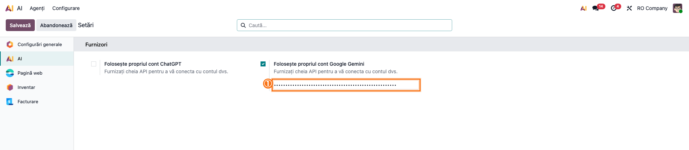

3. **Biblioteca `markdown2` pe server.** Aplicația AI din Odoo transformă răspunsurile agentului în text formatat
   (liste, linkuri) doar dacă pachetul Python `markdown2` este instalat. Fără el, vizitatorul vede în chat steluțe
   și paranteze (`**…**`, `[Vezi produsul](…)`). Pe un server propriu: `pip install markdown2` și repornire. Pe
   odoo.sh, verificați la primul test (pasul 6.2).
4. Hotărâți **ce produse primește agentul** la primul test: o categorie sau o marcă, nu tot catalogul. Fiecare
   produs se transformă în vectori (*embeddings*) la furnizor; pe un catalog de 10.000 de produse, prima
   indexare durează ore și se plătește.

## 6. Flux de utilizare

### Pasul 1 — Creați agentul

**AI → Agenți → Nou.** Completați:

- **Nume**: cum se va prezenta în chat (ex. *Asistent magazin*);
- **Model LLM**: un model care citește și imagini, dacă vreți căutarea după poză (testat cu *GPT-4o*);
- **Instrucțiuni**: rolul, pe scurt, în limba clienților. Exemplu folosit la test: *„Ești asistentul magazinului
  online. Răspunzi în limba vizitatorului (implicit română), scurt și prietenos. Recomanzi doar produse din sursele
  tale, cu linkul lor. Prețul și disponibilitatea le dai doar din unealta de preț și disponibilitate.”*
- **Subiecte**: adăugați **Shop Assistant**. Fără el, agentul nu poate citi prețul și stocul și nu poate căuta
  după an.

Nu bifați **Restricționează la Surse** pe acest agent: întrebările generale („ce înseamnă tăviță 3D?”) primesc
atunci un răspuns în engleză că nu există informații în surse.

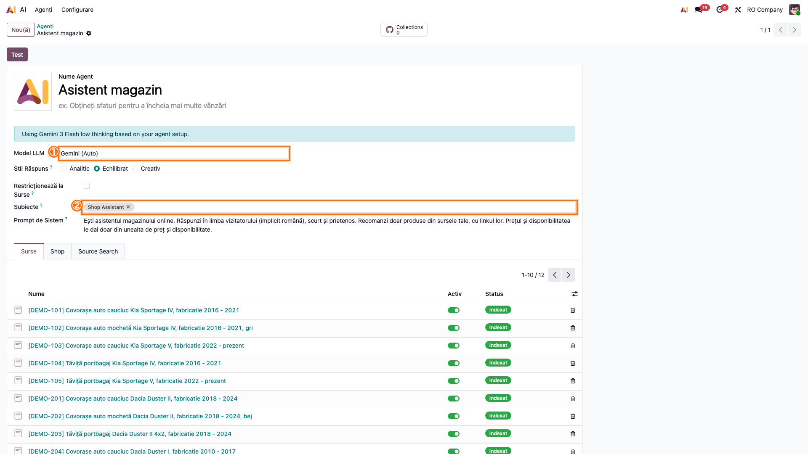

### Pasul 2 — Legați agentul de magazin (fila Shop)

În fișa agentului, fila **Shop**:

- **Shop**: site-ul ale cărui produse publicate le urmărește agentul (câte un site pe agent);
- **Products**: domeniul de produse; la primul test, o categorie sau `nume conține „Kia”` (pasul 5.4);
- **Extra Fields**: câmpuri ale produsului adăugate în textul surselor, de exemplu marca sau specificațiile;
- **Read Photos**: bifați, dacă vizitatorii pot trimite poze (pozele pleacă la furnizorul modelului, vezi
  secțiunea 2).

Salvați. Produsele se adaugă ca surse în fundal; butonul **Synchronize now** pornește sincronizarea pe loc.

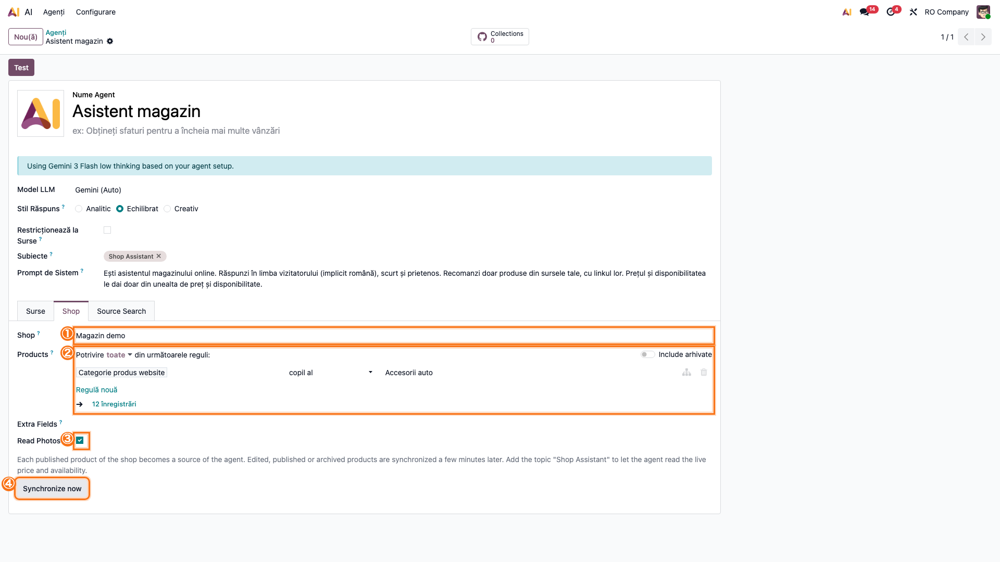

### Pasul 3 — Așteptați indexarea surselor

În fila **Surse** a agentului apare câte o sursă pentru fiecare produs. Starea lor trece din **Se Procesează** în
**Indexat** după ce cron-ul standard al aplicației AI calculează vectorii.

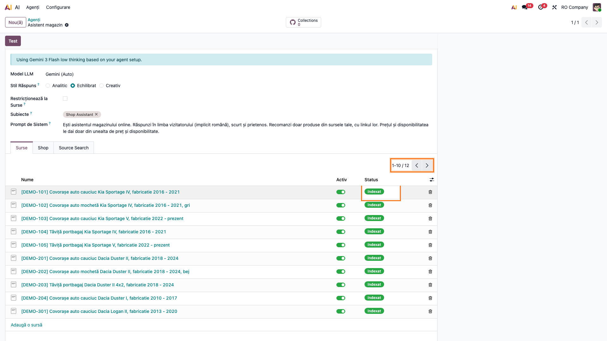

**Găsiți pe ecran.** Numărul de surse și coloana de stare.

**Verificați.**

- Numărul de surse este egal cu numărul de produse publicate și vândabile din domeniul ales (în magazin, filtrați
  la fel și comparați).
- Toate sursele sunt **Indexat**. La test, 378 de produse au avut nevoie de aproximativ 18 minute.
- O sursă deschisă arată numele, codul, categoria și descrierea produsului, **fără** cost sau furnizor.

**Treceți mai departe** abia când nu mai e nicio sursă în procesare: înainte de asta, agentul nu găsește produsele.

### Pasul 4 — Puneți agentul pe o pagină de test (regula de Live Chat)

**Live Chat → Configurare → Canale**, deschideți canalul folosit de site (cel ales în **Website → Configurare →
Setări**, secțiunea Live Chat), fila **Reguli**, **Adaugă o linie**:

- **Live Chat Button**: *Afișează*;
- **Agent AI**: agentul creat la pasul 1;
- **URL Regex**: `assistant=test`, adică regula se aplică doar paginilor care au în adresă `?assistant=test`;
- puneți regula **prima** în listă (regulile se aplică în ordine, prima care se potrivește câștigă).

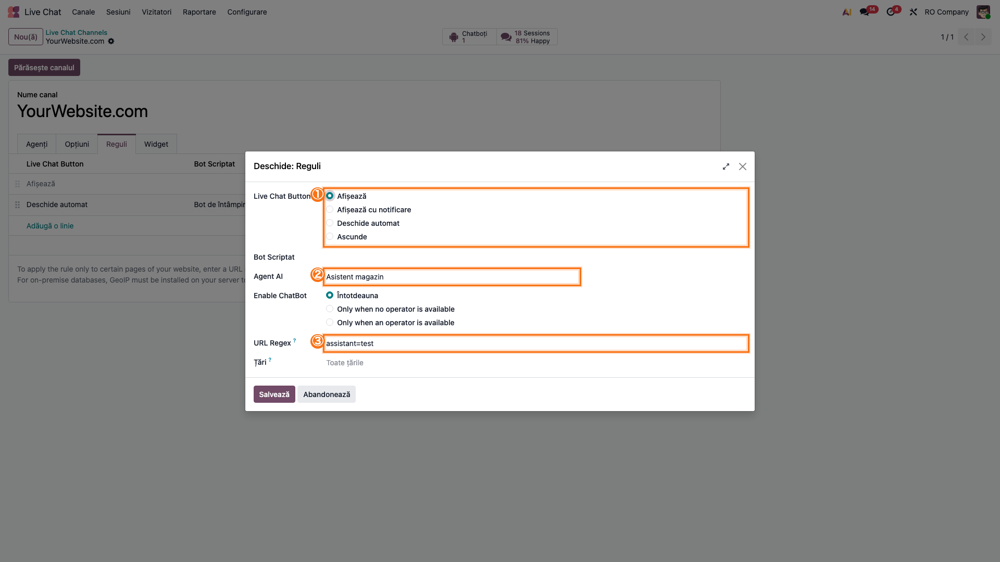

Așa testați pe site-ul real fără ca vizitatorii să vadă agentul: celelalte pagini rămân cu regulile de până acum.

### Pasul 5 — Deschideți chat-ul ca vizitator

Într-o **fereastră privată**, deschideți `https://<site>/shop?assistant=test`. Jos, în dreapta, apare butonul de
chat; un click deschide fereastra, iar agentul salută.

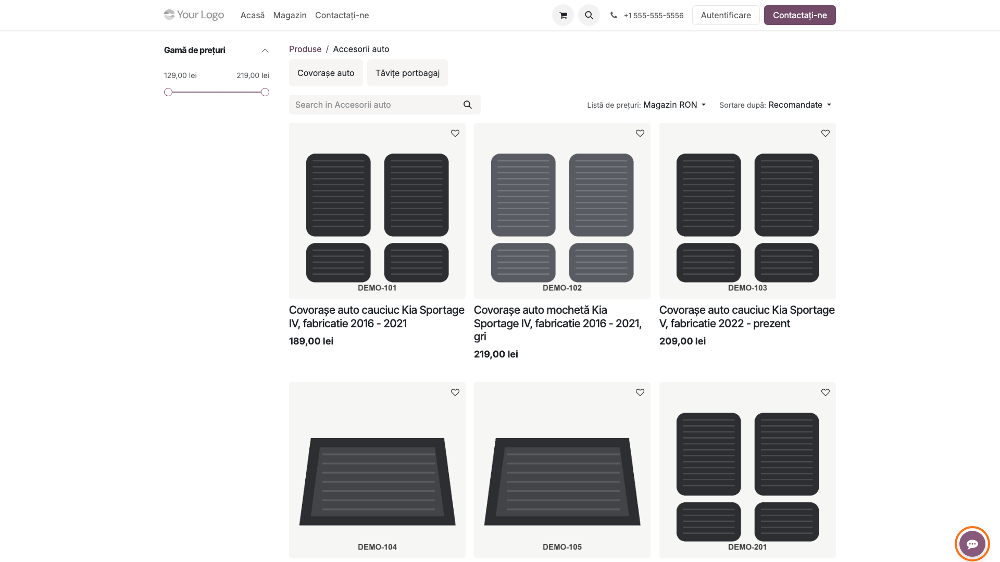

### Pasul 6 — Testați răspunsurile

**6.1 Întrebare după marcă, model și an.** Scrieți, de exemplu: *„Am un Kia Sportage din 2017. Ce covorașe din
cauciuc aveți și cât costă?”*

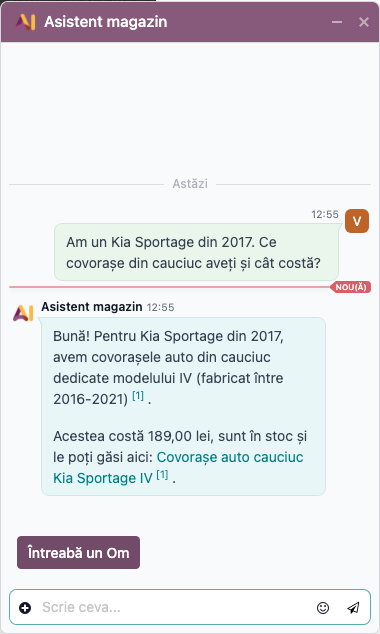

**Găsiți pe ecran.** Lista de produse recomandate, fiecare cu preț, disponibilitate (în stoc, la comandă sau
indisponibil) și link.

**Verificați.**

- Toate produsele recomandate sunt fabricate pentru anul cerut (anii din numele lor includ 2017).
- Prețul este **exact** cel de pe pagina produsului, pentru un vizitator neautentificat (lista de prețuri a site-ului,
  cu TVA dacă site-ul afișează prețuri cu TVA).
- Disponibilitatea corespunde paginii produsului.
- Un click pe link deschide pagina produsului.

**6.2 Formatarea.** Răspunsul are liste și linkuri, nu steluțe. Dacă vedeți `**` sau `[text](adresă)`, lipsește
`markdown2` pe server (secțiunea 5, punctul 3).

**6.3 Limba.** Puneți o întrebare în engleză (*„Do you have rubber mats for a Dacia Duster 2019?”*): agentul răspunde
în engleză.

**6.4 Un produs pe care magazinul nu-l are.** *„Aveți anvelope de iarnă pentru Tesla Model 3?”*: agentul spune că
nu a găsit, fără să inventeze produse, și propune un coleg.

### Pasul 7 — Testați căutarea după poză

Cu **Read Photos** bifat pe agent: în fereastra de chat, butonul **+** (Mai multe acțiuni) → **Atașează fișiere**,
alegeți o poză a mașinii (sau a piesei, a etichetei), scrieți întrebarea și trimiteți.

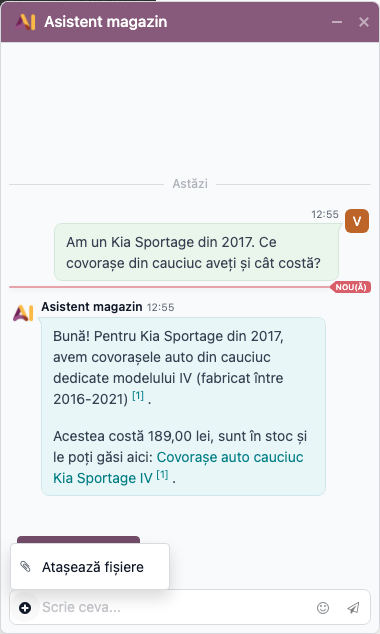

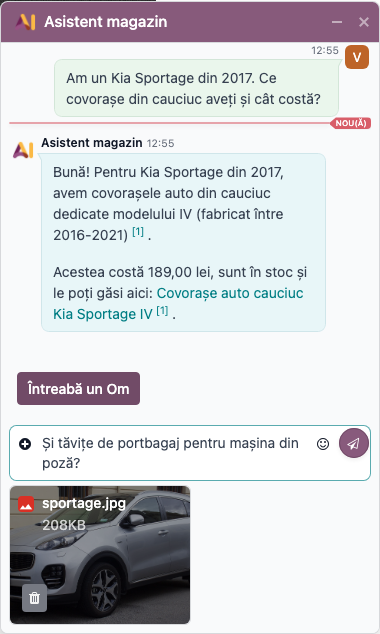

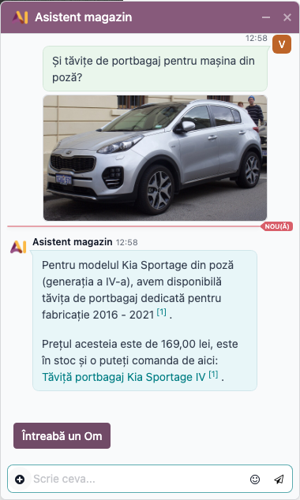

**Verificați.**

- Agentul numește ce a recunoscut (la test: *Kia Sportage generația a patra, 2016–2021*) și recomandă produse
  potrivite.
- Dacă poza nu e clară, agentul cere confirmarea modelului sau a anului, în loc să ghicească.
- Cu **Read Photos** debifat, aceeași poză este ignorată: agentul răspunde doar la text.
- La mesajul următor din aceeași conversație (*„Și tăvițe de portbagaj?”*), agentul își amintește mașina din poză.

### Pasul 8 — Testați preluarea de către un om

Apăsați **Întreabă un Om** în fereastra de chat. Conversația continuă cu un operator al canalului (trebuie să fie
cel puțin un operator conectat în Live Chat).

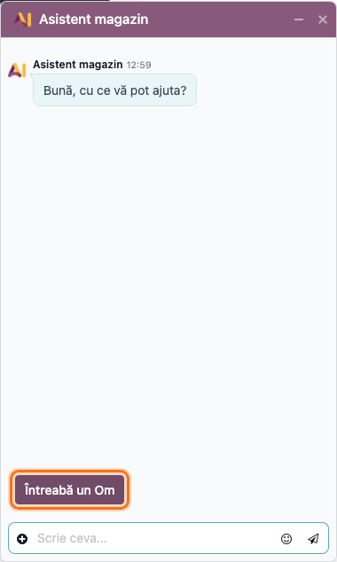

### Pasul 9 — Puneți agentul pe site

După test, deschideți din nou regula de la pasul 4 și înlocuiți **URL Regex** `assistant=test` cu paginile pe
care vreți agentul (ex. `/shop` pentru magazin, gol pentru tot site-ul). Lărgiți și domeniul **Products** din fila
**Shop** la catalogul complet; noile produse se indexează în fundal (pasul 3).

#### Note de monografie și raportare

Modulul nu generează note contabile și nu alimentează nicio declarație.

## 7. Legături cu alte module / declarații

| Modul | Legătura |
|---|---|
| `ai` / `ai_app` (Enterprise) | agentul, subiectele, uneltele, sursele și indexarea; cheia furnizorului |
| `ai_livechat` (Enterprise) | câmpul **Agent AI** din regula de canal și butonul **Întreabă un Om** |
| `website_sale` | produsele publicate, lista de prețuri și afișarea cu sau fără TVA a site-ului |
| `website_sale_stock` | disponibilitatea în stoc / la comandă / indisponibil; fără el, agentul spune doar „disponibil” |
| `deltatech_ai_source_sync` | mecanismul surselor sincronizate, refolosit pentru produse |
| `deltatech_ai_agent_delegate` | opțional: un agent integrator poate delega întrebările de produs acestui agent |

**Ce e automat.** Sursele produselor (create, modificate, retrase), indexarea, prețul și stocul la momentul
întrebării, filtrarea după anul de fabricație, citirea pozei.
**Ce rămâne manual.** Cheia furnizorului, agentul și instrucțiunile lui, alegerea produselor, regula de Live Chat,
operatorii care preiau conversațiile, verificarea răspunsurilor la punerea în funcțiune.

## 8. Verificări pentru consultant

- [ ] Cheia furnizorului e bună: o întrebare simplă în chat primește răspuns.
- [ ] Agentul are subiectul **Shop Assistant**, iar **Restricționează la Surse** nu e bifat.
- [ ] Fila **Shop**: site-ul corect și domeniul de produse ales pentru test.
- [ ] Numărul de surse = numărul de produse publicate și vândabile din domeniu; toate sunt **Indexat**.
- [ ] Nicio sursă nu conține costul sau furnizorul.
- [ ] Regula de canal cu agentul AI e **prima** și are URL Regex `assistant=test`.
- [ ] Pe `/shop?assistant=test`, în fereastră privată, apare chat-ul cu agentul; pe `/shop` fără parametru, nu.
- [ ] La întrebarea cu model și an, toate produsele recomandate au anii potriviți.
- [ ] Prețul din chat = prețul de pe pagina produsului, pentru un vizitator neautentificat.
- [ ] Disponibilitatea din chat = disponibilitatea de pe pagina produsului.
- [ ] Linkurile deschid paginile produselor.
- [ ] Răspunsul e formatat (liste, linkuri), fără `**`.
- [ ] O întrebare în engleză primește răspuns în engleză.
- [ ] Un produs inexistent primește „nu am găsit”, fără produse inventate.
- [ ] Cu **Read Photos**: poza unei mașini dă modelul și generația și produse potrivite; fără bifă, poza e ignorată.
- [ ] **Întreabă un Om** trece conversația la un operator conectat.
- [ ] După test, URL Regex e schimbat pe paginile reale.

## 9. Mesaje de eroare frecvente

| Mesaj | Ce înseamnă | Ce faceți |
|---|---|---|
| „Oops! Your API key seems incorrect. Update it from the Settings.” | furnizorul a respins cheia | corectați cheia la **AI → Configurare → Setări** sau în variabila de mediu |
| „Oops, it looks like our AI is unreachable” (în chat, la vizitator) | apelul către furnizor a eșuat (cheie lipsă, credit epuizat, furnizor indisponibil) | testați agentul din back office, unde eroarea apare completă; verificați cheia și contul furnizorului |
| Răspuns cu `**` și `[text](adresă)` | lipsește pachetul Python `markdown2` pe server | instalați `markdown2` și reporniți serverul |
| Agentul spune că nu are produse, deși ele există pe site | sursele nu sunt încă indexate, sau produsul nu e în domeniul **Products**, nu e publicat ori nu e vândabil | așteptați indexarea (pasul 3); verificați domeniul și produsul |
| Sursele rămân **Se Procesează** sau **Eșuat** | cron-ul de indexare nu a rulat sau furnizorul refuză cererile | verificați cheia; în modul developer, **Setări → Tehnic → Acțiuni planificate**, cron-urile AI |
| „No source information…” (în engleză) | **Restricționează la Surse** e bifat și întrebarea nu se potrivește cu nicio sursă | debifați opțiunea pe acest agent |
| Agentul nu ține cont de poză | **Read Photos** nu e bifat, sau poza nu e JPEG, PNG, WEBP ori GIF | bifați opțiunea; cereți o poză în alt format |
| La întrebarea „de cauciuc”, agentul propune și produse din alt material | căutarea după cuvinte citește doar numele și codul produsului; materialul scris doar în categorie nu e găsit | scrieți materialul în numele produsului sau adăugați câmpul în **Extra Fields** |
| Nu apare butonul de chat pe pagina de test | regula cu agentul nu e prima, URL Regex nu se potrivește sau canalul nu e cel al site-ului | verificați ordinea regulilor și canalul din setările site-ului |

## 10. Capturi de ecran

Capturile planificate, în ordinea din secțiunile 5 și 6, în `readme/screenshots/`:

| Fișier | Pasul | Ce arată |
|---|---|---|
| `01_setari_ai.png` | 5 (configurare) | cheia furnizorului AI în setări |
| `02_agent.png` | 1 | agentul, cu modelul LLM, instrucțiunile și subiectul *Shop Assistant* |
| `03_agent_shop.png` | 2 | fila **Shop**: site, domeniu, câmpuri suplimentare, *Read Photos*, *Synchronize now* |
| `04_surse.png` | 3 | sursele agentului, câte una pe produs, cu starea *Indexat* |
| `05_regula_livechat.png` | 4 | regula canalului: *Live Chat Button* = *Afișează*, *Agent AI*, URL Regex `assistant=test` |
| `06_buton_chat.png` | 5 | butonul de chat pe `/shop?assistant=test`, ca vizitator |
| `07_raspuns_model_an.png` | 6 | răspunsul la întrebarea cu model și an: produse, preț, disponibilitate, linkuri |
| `08_meniu_atasare.png` | 7 | meniul **+** al chat-ului, cu *Atașează fișiere* |
| `09_poza_atasata.png` | 7 | poza atașată și întrebarea, înainte de trimitere |
| `10_raspuns_poza.png` | 7 | răspunsul agentului la poză |
| `11_intreaba_un_om.png` | 8 | butonul **Întreabă un Om** |

**Capturile nu există încă:** trebuie generate cu skill-ul `fisa-screenshots`. Ca la asistentul de tablouri de bord,
pașii 6–8 depind de răspunsul unui model real, care diferă de la o rulare la alta, deci capturile lor se fac pe o
bază de demo cu o cheie reală, nu dintr-un test automat. Fluxul a fost verificat pe o copie locală a unui client,
cu GPT-4o, ca vizitator anonim (Playwright), dar acele capturi conțin datele clientului și nu se folosesc aici.

## 11. Observații pentru manual

- Agentul recomandă, vizitatorul decide: prețul și stocul din chat sunt cele de pe site în acel moment, dar
  compatibilitatea o confirmă vizitatorul (anii din numele produsului sunt singura sursă).
- **Calitatea numelor contează.** Căutarea după an citește anii din nume („2016 - prezent”, „02.2015 - 07.2020”, „din
  2011”); un produs fără ani în nume apare cu nota *compatibilitate de verificat*. Generația („Sportage IV”) nu se
  traduce în ani; dintr-o poză, însă, modelul o recunoaște.
- **Costul.** Fiecare produs se indexează o dată și din nou doar la modificare. Fiecare întrebare trimite
  furnizorului instrucțiunile, fragmentele găsite și istoricul conversației; o poză adaugă un apel separat. Începeți
  cu un domeniu restrâns și lărgiți după test.
- **Limba produselor.** Agentul citește numele produselor în limba implicită a site-ului. Dacă traducerile diferă
  (ex. alți ani în engleză decât în română), corectați traducerea, nu agentul.
- Răspunsurile agentului pot numi butonul *Ask a Human* în engleză; în fereastra de chat, butonul apare ca
  **Întreabă un Om**.
- Prima regulă de canal care se potrivește câștigă: un agent pus pe `/shop` nu mai lasă chat-ul cu operatorii pe
  acele pagini decât prin **Întreabă un Om**.
