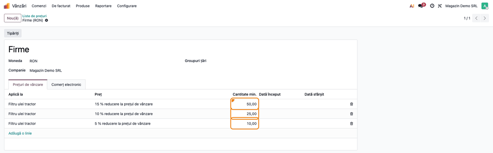
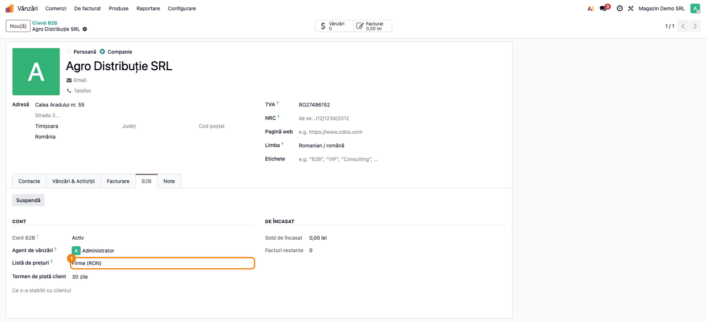
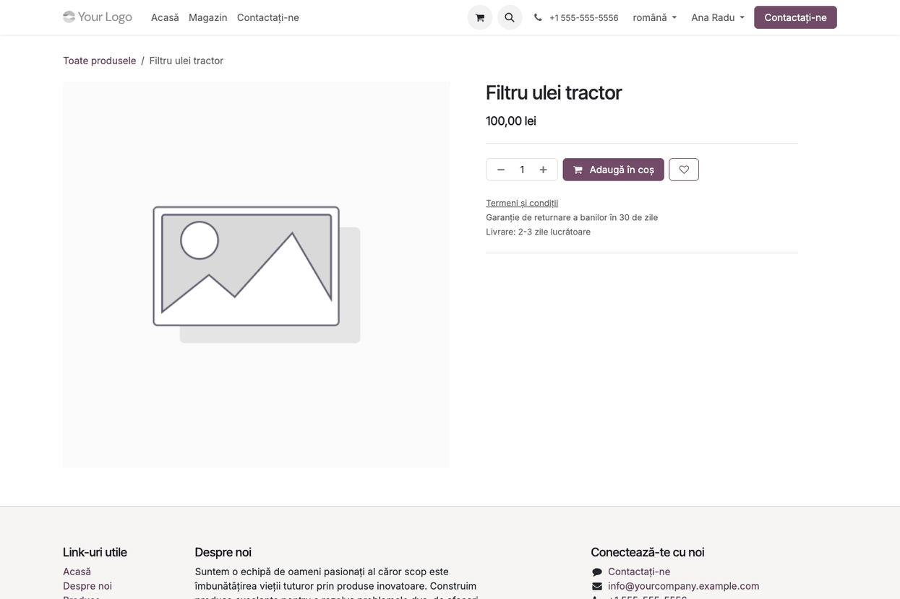

# Fișă Modul: Prețul pe cantitate pentru clienții B2B

**Modul:** `deltatech_b2b_price_tier`
**Versiune:** 19.0.1.1.0
**Suită:** bitshop
**Dependențe:** `deltatech_b2b_portal`
**Utilizator principal:** agentul de vânzări sau administratorul listelor de prețuri
**Prioritate:** 🟢 Scăzută (doar afișare pe website; prețul real îl calculează lista de prețuri standard)

---

## 1. Scop business

O firmă care cumpără en-gros vrea să știe, înainte de a pune produsul în coș, cât plătește dacă ia
mai mult: „de la 10 bucăți plătiți mai puțin”. În Odoo, reducerile pe cantitate există deja, ca
reguli cu **cantitate minimă** în lista de prețuri, dar magazinul online nu le arată: clientul vede
doar prețul pentru o bucată și descoperă reducerea abia în coș.

Modulul afișează pe pagina produsului, la finalul detaliilor (sub butonul de adăugare în coș și informațiile de
livrare), tabelul **Prețul dvs. în
funcție de cantitate**: cantitățile de la care se schimbă prețul, prețul unitar și economia față de
o bucată. Tabelul se construiește din regulile listei de prețuri a clientului, deci arată exact ce
va încasa coșul. Nu există un preț paralel de întreținut.

Tabelul apare doar persoanelor de contact ale unei firme cu cont B2B **activ** (din
`deltatech_b2b_portal`). Vizitatorii și clienții persoane fizice văd pagina produsului neschimbată.

Modulul pornește din `agroamat_b2b`, scris pentru AGROAMAT COM SRL și preluat cu acordul lor.

## 2. Bază legală și context

Modulul nu generează documente fiscale și nu atinge contabilitatea. Contextul e comercial:

- prețurile afișate sunt cele ale listei de prețuri, **fără** aplicarea alegerii website-ului de a
  arăta prețurile cu sau fără TVA (limită cunoscută a versiunii; vezi secțiunea 11). Pe un magazin
  care afișează prețurile cu TVA, tabelul poate arăta alt preț decât cel de sub numele produsului;
- tabelul este informativ: prețul care se facturează îl dă comanda de vânzare, calculată de lista de
  prețuri standard.

## 3. Utilizatori și roluri

| Rol | Ce face |
|---|---|
| **Vânzări / Administrator** (sau cine întreține listele de prețuri) | creează regulile cu cantitate minimă în lista de prețuri a firmelor |
| **Portal B2B / Utilizator** (agentul) | alege lista de prețuri a firmei în tabul B2B al clientului |
| **Persoană de contact a unei firme B2B active** (utilizator de portal) | vede tabelul pe pagina produsului; atât rolul „Poate comanda”, cât și „Doar vizualizare” |
| **Vizitator, client persoană fizică, firmă B2B solicitată / suspendată / respinsă** | nu vede tabelul |

La testare folosiți: un administrator de vânzări, o persoană de portal într-o firmă B2B activă și o
persoană de portal fără firmă B2B.

## 4. Conturi și date implicate

Modulul **nu** generează note contabile și nu folosește conturi. Datele implicate sunt:

| Ce | Unde |
|---|---|
| Regulile cu **Cantitate min.** | lista de prețuri (*Vânzări → Produse → Liste de prețuri*), tabul *Prețuri de vânzare* |
| Lista de prețuri a firmei | tabul **B2B** al clientului, câmpul **Listă de prețuri** (același câmp ca în tabul *Vânzări & Achiziții*) |
| Starea contului B2B | tabul **B2B** al clientului, câmpul **Cont B2B** = *Activ* |

Date minime pentru demo:

- un produs publicat în magazin, cu preț de vânzare 100 lei (ex. „Filtru ulei tractor”); în demo
  produsul nu are taxe, ca prețul de sub nume să fie identic cu primul rând al tabelului;
- o listă de prețuri „Firme” în RON cu trei reguli pe produs: de la 10 bucăți −5%, de la 25 −10%,
  de la 50 −15%;
- o firmă cu cont B2B activ și lista „Firme”, cu o persoană de contact cu acces în portal;
- o persoană de portal fără firmă B2B, pentru comparație.

## 5. Configurare inițială

1. Instalați modulul (aduce și `deltatech_b2b_portal`). Pe baze cu `l10n_ro_config`, instalați și
   `l10n_ro_config_fix`.
2. **Vânzări → Configurare → Setări**, secțiunea *Prețuri*: bifați **Liste de prețuri** și salvați.
   Fără această opțiune, magazinul nu folosește listele de prețuri și tabelul nu apare.
3. **Pagină web → Configurare → Setări**, la **Afișează prețurile produselor**, păstrați **Fără taxe**
   (cazul obișnuit la B2B și implicit în Odoo): tabelul arată prețurile listei fără TVA, iar așa se
   potrivesc cu prețul de sub numele produsului.
4. Configurați portalul B2B după fișa `deltatech_b2b_portal` (agenți, cereri de cont, aprobare).

## 6. Flux de utilizare

### Pasul 1 — Regulile cu cantitate minimă în lista de prețuri

**Vânzări → Produse → Liste de prețuri** → deschideți lista firmelor (ex. „Firme”). În tabul
**Prețuri de vânzare**, adăugați câte o regulă pentru fiecare treaptă: în **Aplică la**, produsul,
categoria sau toate produsele; în **Preț**, reducerea sau prețul fix; în **Cantitate min.**,
cantitatea de la care se aplică.



Fiecare regulă cu **Cantitate min.** mai mare decât 1 care atinge produsul devine un rând în tabelul
de pe website. Regulile pe o variantă anume contează doar pentru acea variantă.

### Pasul 2 — Lista de prețuri pe firma B2B

**Vânzări → Comenzi → Clienți B2B** → deschideți firma → tabul **B2B**. Verificați că **Cont B2B**
este *Activ* și alegeți în **Listă de prețuri** lista cu treptele.



Lista de prețuri e cea standard a clientului: o schimbare aici se vede și în tabul *Vânzări &
Achiziții* și pe comenzile noi.

### Pasul 3 — Ce vede persoana de contact a firmei

Persoana de contact se autentifică în magazin și deschide pagina produsului.


1. **Găsiți pe ecran** — la finalul detaliilor produsului, sub butonul **Adaugă în coș** și sub
   blocul cu termenii și livrarea, tabelul **Prețul dvs. în funcție de
   cantitate**, cu coloanele **Cantitate** („1”, apoi „de la N”), **Preț unitar** (în moneda listei de
   prețuri) și **Economie** (procentul față de prețul unei bucăți; „-” pe primul rând). Dedesubt,
   mențiunea „Coșul aplică prețul cantității pe care o comandați.”
2. **Verificați** — fiecare rând „de la N” corespunde unei reguli cu *Cantitate min.* N din lista
   firmei; prețul unitar e prețul de vânzare cu reducerea regulii (100 lei −5% = 95,00 lei);
   economia e (preț pentru 1 − preț treaptă) / preț pentru 1. Primul rând are prețul de sub numele
   produsului (pe un magazin care afișează prețurile fără TVA).
3. **Mai departe** — clientul alege cantitatea și apasă **Adaugă în coș**; în coș, prețul unitar al
   liniei e cel al treptei în care cade cantitatea (ex. 30 de bucăți → 90,00 lei).

Tabelul nu apare dacă toate cantitățile au același preț (lista nu are trepte pentru produs). Dacă
lista nu are nicio regulă cu cantitate minimă pentru produs, modulul încearcă cantitățile uzuale 1,
5, 10, 25 și 50 (util, de exemplu, la o listă calculată dintr-o altă listă care are trepte) și
afișează tabelul doar dacă prețurile diferă.

### Pasul 4 — Ce vede un client fără cont B2B

Același produs, deschis de o persoană fără firmă B2B activă (aici o clientă persoană fizică
autentificată), arată pagina standard, fără tabel. La fel pentru vizitatorii neautentificați și
pentru persoanele unei firme B2B *Solicitat*, *Suspendat* sau *Respins*.



### Note de monografie și raportare

Modulul nu generează note contabile și nu alimentează nicio declarație. Prețurile din tabel sunt
citiri ale listei de prețuri; vânzarea se înregistrează contabil prin factura standard, la prețul
calculat pe comandă.

## 7. Legături cu alte module / declarații

| Modul | Rol |
|---|---|
| `deltatech_b2b_portal` | starea contului B2B al firmei: doar firmele *Active* văd tabelul |
| `website_sale` | pagina produsului, coșul și lista de prețuri a sesiunii |
| `product` | listele de prețuri și regulile cu cantitate minimă |
| teme de website | pot afișa treptele variantei alese pe pagină (de la 19.0.1.1.0, calculul acceptă varianta) |

**Ce e automat:** construirea tabelului din regulile listei de prețuri, ascunderea lui pentru cine
nu are cont B2B activ și când prețul nu variază cu cantitatea, aplicarea prețului treptei în coș
(standard Odoo).

**Ce rămâne manual:** crearea regulilor cu cantitate minimă, alegerea listei de prețuri pe firmă,
pornirea opțiunii **Liste de prețuri**.

## 8. Verificări pentru consultant

- [ ] Opțiunea **Liste de prețuri** e bifată în *Vânzări → Configurare → Setări*.
- [ ] Firma are **Cont B2B** = *Activ* și lista cu treptele în **Listă de prețuri** (tabul B2B).
- [ ] O persoană de contact a firmei vede tabelul pe pagina produsului, cu câte un rând pentru fiecare regulă cu *Cantitate min.* > 1 a produsului.
- [ ] Prețul unitar al fiecărui rând este prețul de vânzare cu reducerea regulii respective, iar economia e procentul față de rândul „1”.
- [ ] În coș, la o cantitate dintr-o treaptă (ex. 30 de bucăți), prețul unitar al liniei e cel din tabel.
- [ ] O persoană fără firmă B2B, un vizitator și o persoană a unei firme *Suspendat* nu văd tabelul.
- [ ] Un produs fără reguli cu cantitate minimă nu are tabel.
- [ ] Dacă magazinul afișează prețurile cu TVA, clientul a fost informat că tabelul arată prețurile listei, fără ajustarea de TVA a website-ului.

## 9. Mesaje de eroare frecvente

Modulul nu ridică mesaje de eroare. Situațiile frecvente sunt cazuri în care tabelul nu apare:

| Situație | Cauză | Remediere |
|---|---|---|
| Tabelul nu apare pentru nimeni | opțiunea **Liste de prețuri** nu e bifată | bifați-o în *Vânzări → Configurare → Setări* |
| Tabelul nu apare pentru o firmă | firma nu are cont B2B *Activ* | aprobați cererea sau reactivați contul (fișa `deltatech_b2b_portal`) |
| Tabelul nu apare pe un produs | lista firmei nu are reguli cu cantitate minimă care să schimbe prețul produsului | adăugați regulile (Pasul 1) |
| Tabelul arată alte trepte decât cele așteptate | clientul are în coș o comandă cu altă listă de prețuri, sau firma are altă listă decât cea editată | verificați **Listă de prețuri** pe firmă și lista comenzii din coș |
| Un rând „de la N” are același preț ca rândul de deasupra | o regulă pe categorie sau pe toate produsele are cantitatea minimă N, dar pentru produs se aplică o regulă mai specifică | e informație corectă; dacă deranjează, aliniați treptele regulilor |
| Prețul din tabel diferă de cel de sub numele produsului | website-ul afișează prețurile cu TVA | limită cunoscută (secțiunea 11) |

## 10. Capturi de ecran

Capturile din `static/description/`, în ordinea fișei:

| Fișier | Ce arată |
|---|---|
| `01_lista_preturi_reguli.png` | lista de prețuri „Firme”, cu trei reguli cu *Cantitate min.* |
| `02_client_lista_preturi.png` | tabul B2B al firmei, cu lista de prețuri aleasă |
| `03_produs_trepte_b2b.png` | pagina produsului cu tabelul *Prețul dvs. în funcție de cantitate*, pentru persoana firmei B2B |
| `04_produs_client_fara_b2b.png` | aceeași pagină pentru o clientă fără cont B2B, fără tabel |

Se generează automat din `tests/test_screenshots.py` (mixinul `ScreenshotCase` din
`deltatech_doc_screenshots`, import defensiv), în română pe o firmă românească, și în engleză, cu
aceleași nume, în `static/description/en/` pentru `readme/USAGE.md`:

```bash
./odoo/odoo-bin -c odoo.conf -d <db> -i l10n_ro,deltatech_b2b_price_tier,deltatech_doc_screenshots \
    --test-tags=/deltatech_b2b_price_tier:TestB2BPriceTierScreenshots --stop-after-init
```

## 11. Observații pentru manual

- Insistați pe ideea că **nu există un preț B2B separat**: treptele sunt regulile listei de prețuri
  a firmei, aceleași care se aplică în coș și pe comanda introdusă de agent. Ce vede clientul în tabel
  e ce plătește.
- Tabelul folosește lista de prețuri a sesiunii de magazin, care e lista firmei; dacă website-ul
  permite clientului să aleagă altă listă, tabelul o urmează.
- **Limită cunoscută:** prețurile din tabel sunt cele brute ale listei, fără alegerea website-ului
  de a afișa prețurile cu sau fără TVA. Pe un magazin B2B care afișează prețurile fără TVA (cazul
  obișnuit), tabelul și prețul de sub numele produsului se potrivesc.
- Pagina standard arată treptele primei variante a produsului. De la versiunea 19.0.1.1.0, o temă
  de website poate cere treptele variantei alese, cu prețul opțiunilor ei (de ex. o mărime mai
  mare, cu preț suplimentar).
