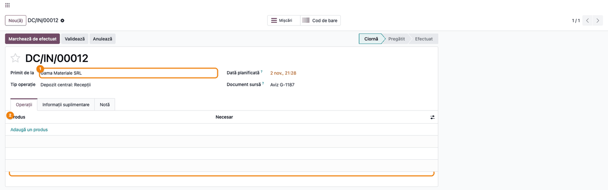
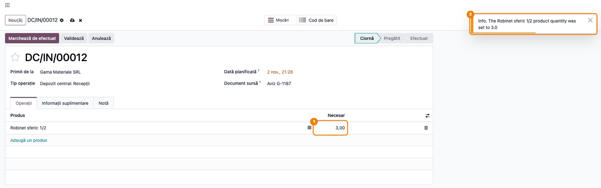
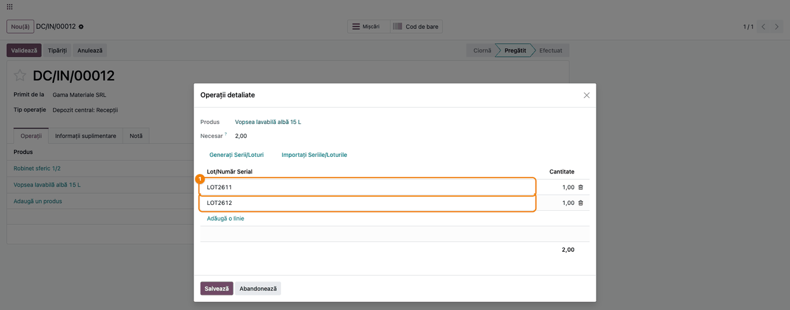
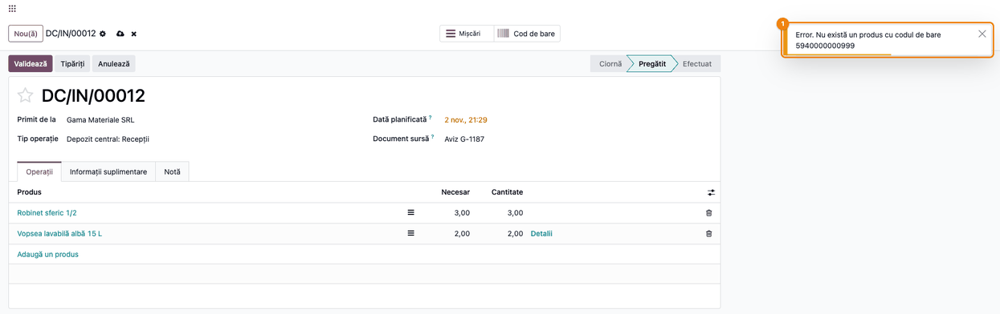
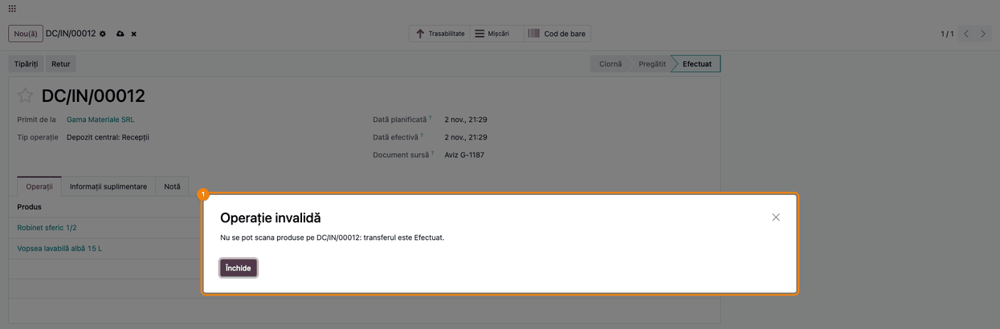
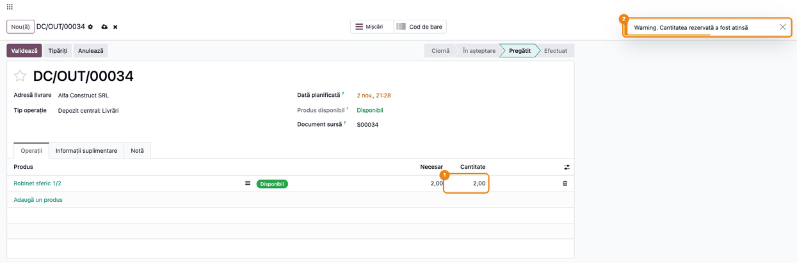
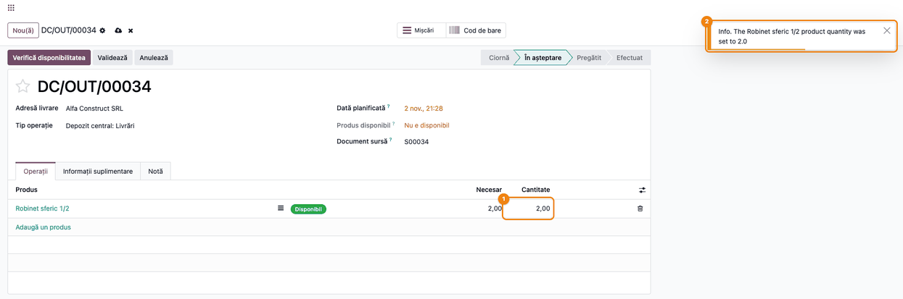

# Fișă Modul: Scanare coduri de bare în transferuri (recepții și livrări)

**Modul:** `deltatech_barcode_picking`
**Utilizator principal:** Gestionar / operator de depozit (recepție și livrare marfă)
**Prioritate:** 🟡 Medie (util la depozitele care primesc sau pregătesc marfă cu cititor de coduri, fără aplicația Cod de bare din Enterprise)

---

## 1. Scop business

Gestionarul care primește sau pregătește marfa vrea să numere produsele cu cititorul de coduri de
bare direct în formularul obișnuit al transferului, fără să caute produsul în listă și fără să
tasteze cantitățile. Modulul face formularul transferului (recepție, livrare, transfer intern)
„ascultător” la cititor: fiecare scanare a codului de bare al unui produs adaugă **o bucată** pe
linia produsului sau, dacă produsul nu e încă în transfer, adaugă linia. Pentru produsele urmărite pe
**loturi**, se poate scana numele lotului sau un **cod compus produs + lot**, de forma
`<cod de bare produs>-<lot>` sau `<cod de bare produs>/<lot>`, iar lotul ajunge pe linia de detaliu a
mișcării. Scanarea e refuzată pe transferurile **Efectuat** sau **Anulat**, iar la livrările rezervate
cantitatea nu poate depăși necesarul.

Modulul nu înlocuiește aplicația **Cod de bare** din Odoo Enterprise (butonul **Cod de bare** și tabul
**Aplicație cod de bare** din capturi țin de ea, nu de acest modul): lucrează în formularul standard
al transferului, cu orice cititor care se comportă ca o tastatură.

## 2. Bază legală și context

- Modulul nu are o bază legală proprie: schimbă doar **modul în care se completează cantitățile** pe
  transfer. Documentele de stoc rămân cele standard.
- Recepția mărfii se consemnează în **nota de recepție și constatare de diferențe (NIR)**, document
  justificativ prevăzut de **OMFP 2634/2015** privind documentele financiar-contabile. Cantitatea
  numărată prin scanare este cantitatea efectiv recepționată; diferențele față de documentul
  furnizorului (aviz, factură) se constată pe recepție, înainte de validare.
- Lotul scanat contează pentru **trasabilitate** (produse cu termen de valabilitate, vopsele,
  alimente, medicamente): pe recepție trebuie să rămână lotul de pe ambalaj, nu unul generic.

## 3. Utilizatori și roluri

Modulul nu adaugă grupuri proprii. Folosește drepturile standard:

- **Inventar / Utilizator** — scanează pe recepții, livrări și transferuri interne;
- **Inventar / Administrator** — bifează pe tipul de operație folosirea loturilor existente;
- grupul **Loturi & Numere seriale** (activat din **Inventar → Configurare → Setări**) — necesar ca
  operatorul să vadă loturile scanate în **Operații detaliate**.

Roluri recomandate pentru testare: un gestionar cu **Inventar / Utilizator** și loturi activate, care
lucrează cu un cititor de coduri conectat ca tastatură (USB sau Bluetooth, cu Enter la final).

## 4. Conturi și date implicate

Modulul nu introduce conturi și nu generează note contabile. Cantitățile scanate sunt cantitățile
transferului, iar notele de stoc, dacă există, le face localizarea contabilă RO a stocurilor
(`l10n_ro_stock_account`), nu modulul și nici `stock` standard. În Odoo 19 standard, fără această
localizare, validarea transferului nu face nicio notă: stocul se înregistrează la factură.

| Cont | Rol (cu `l10n_ro_stock_account`) |
|---|---|
| 371 „Mărfuri” | stocul de marfă |
| 408 „Furnizori - facturi nesosite” | contrapartida recepției cu bifa **Aviz** pe transfer (marfă primită fără factură) |
| 401 „Furnizori”, 4426 „TVA deductibilă” | recepția obișnuită: stocul intră în contabilitate la factura furnizorului |
| 607 „Cheltuieli privind mărfurile” | descărcarea din gestiune la livrare |

Date minime pentru demo (ca în capturi):
- compania „Demo Logistică SRL”, depozitul „Depozit central” (cod scurt **DC**);
- produsul **Robinet sferic 1/2**, cod de bare `5940000000017`, fără loturi;
- produsul **Vopsea lavabilă albă 15 L**, cod de bare `5940000000024`, urmărit pe **loturi**, cu
  loturile existente `LOT2611` și `LOT2612`;
- furnizorul **Gama Materiale SRL** și clientul **Alfa Construct SRL**, cu 50 buc. de robinet în stoc.

## 5. Configurare inițială

1. Instalați modulul `deltatech_barcode_picking` (dependențe: `stock`, `barcodes`,
   `deltatech_stock_inventory`).
2. Completați **Cod de bare** pe fiecare produs (**Inventar → Produse → Produse**, tabul
   **Informații generale**). Codul trebuie să fie unic; scanarea caută produsul exact după acest câmp.
3. Pentru produsele cu loturi: activați **Loturi & Numere seriale** în **Inventar → Configurare →
   Setări**, bifați pe produs **Urmărește stocul** și alegeți alături **Prin loturi**, apoi creați loturile
   înainte de recepție (**Inventar → Produse → Loturi / Numere seriale**). Scanarea găsește doar loturi **existente**; un
   lot nou, necreat încă, nu se poate adăuga prin scanare. Atenție: dacă eticheta are cod compus,
   dar lotul din el nu e creat, scanarea adaugă bucata **fără lot**, cu un mesaj care nu arată
   că lotul lipsește, nu cu o eroare. Linia fără lot se vede în **Operații detaliate** (pasul 5) și se
   corectează acolo, după ce creați lotul.
4. Pe tipul de operație **Recepții** (**Inventar → Configurare → Tipuri operații → Recepții**),
   bifați **Folosește cele existente** din grupul **Lot/Număr serial** (pasul 1 din flux).
5. Etichetele de pe ambalaj trebuie să conțină codul de bare al produsului sau codul compus
   `<cod produs>-<lot>` / `<cod produs>/<lot>`. Dacă numele loturilor conțin cratimă (de exemplu
   `L-7`), folosiți separatorul `/` (vezi secțiunea 9).

## 6. Flux de utilizare

Exemplul urmărește o recepție nouă de la furnizorul **Gama Materiale SRL**, completată numai prin
scanare: 3 robinete și 2 bidoane de vopsea din două loturi. Apoi o livrare rezervată de 2 robinete
către **Alfa Construct SRL**. Scanarea înseamnă: cititorul „tastează” codul și apasă Enter, cu
formularul transferului deschis și **fără cursorul într-un câmp** de text (altfel codul se scrie în
câmp).

### Pasul 1 — Tipul de operație Recepții

Deschideți **Inventar → Configurare → Tipuri operații → Recepții**. Pe tabul **General** apare bifa
**Permite adăugarea de produse prin scanare**, adăugată de modul, bifată implicit. În grupul
**Lot/Număr serial**, bifați **Folosește cele existente**: loturile scanate sunt loturi deja create,
iar fără această bifă fereastra **Operații detaliate** a recepției arată o coloană de lot nou (text),
goală pentru liniile scanate.

În versiunea curentă, bifele **Permite adăugarea de produse prin scanare** și **Request Effective
Date** (afișată în engleză) nu schimbă nimic: scanarea funcționează pe orice tip de operație, bifat
sau nu.


### Pasul 2 — Recepția nouă, înainte de scanare

Creați recepția din **Inventar → Operații → Transferuri → Recepții → Nou**, completați **Primit de
la** (furnizorul) și, opțional, **Document sursă** (de exemplu numărul avizului) și salvați. Tabul
**Operații** e gol: liniile le adaugă scanarea.



### Pasul 3 — Scanarea codului de bare al produsului

Scanați de trei ori codul `5940000000017` al robinetului. La prima scanare se adaugă linia
**Robinet sferic 1/2**, iar la fiecare scanare următoare **Necesar** crește cu o bucată. Pe recepția
în **Ciornă**, coloana **Cantitate** nu se vede; necesarul urmează scanările. În colțul din dreapta
sus apare o notificare cu cantitatea atinsă.

Notificările de confirmare apar în engleză și în interfața în română („The … product quantity was set
to …”), iar prima scanare a unui produs care nu era în transfer afișează mesajul „Lotul este deja
prezent in lista”, deși linia s-a adăugat corect. Verificați cantitatea pe linie, nu doar mesajul.



### Pasul 4 — Scanarea codului compus produs + lot

Salvați recepția: trece în starea **Pregătit**, cu **Necesar** și **Cantitate** 3,00 pe robinet.
Scanați apoi etichetele bidoanelor de vopsea, care poartă codul compus: `5940000000024-LOT2611`
(separator cratimă) și `5940000000024/LOT2612` (separator bară). Modulul desparte codul la ultimul
separator, găsește produsul după codul de bare și lotul după nume, apoi adaugă linia **Vopsea lavabilă
albă 15 L** cu câte o bucată pe fiecare lot. Același rezultat se obține scanând doar numele lotului
(`LOT2611`), dacă lotul e unic.


### Pasul 5 — Verificarea loturilor scanate

Salvați recepția, apoi apăsați butonul de detalii (≡) de pe linia de vopsea. Fereastra **Operații
detaliate** arată câte o linie pe fiecare lot scanat. Verificați aici, înainte de validare:

1. **Găsiți pe ecran** — coloana **Lot/Număr Serial** și coloana **Cantitate**, cu totalul jos.
2. **Verificați** — fiecare lot de pe ambalaj apare o dată, cu cantitatea numărată; totalul (2,00)
   este egal cu **Necesar**; nicio linie nu are lotul gol.
3. **Treceți mai departe** — închideți fereastra și apăsați **Validează** pe recepție (flux standard
   Odoo), care mută marfa în stoc pe loturile scanate.



### Pasul 6 — Cod de bare necunoscut

Dacă se scanează un cod care nu e nici cod de bare de produs, nici nume de lot, nici cod compus
valid (aici `5940000000999`), liniile recepției rămân neschimbate și apare notificarea **Nu există
un produs cu codul de bare …**. Formularul se marchează totuși ca modificat (iconițele de salvare și
× de lângă numele recepției); salvați sau apăsați × (abandonare), liniile nu se schimbă. Verificați
eticheta sau completați codul de bare pe produs, apoi scanați din nou.



### Pasul 7 — Recepția validată: scanarea e refuzată

După **Validează**, recepția e în starea **Efectuat**. O scanare pe ea (de exemplu un bidon uitat pe
rampă) este refuzată cu fereastra **Operație invalidă**: „Nu se pot scana produse pe DC/IN/00012:
transferul este Efectuat.” La fel pe un transfer **Anulat**. Marfa uitată se primește pe o recepție
nouă.



### Pasul 8 — Livrarea rezervată: cantitatea e deja completată

Deschideți livrarea din **Inventar → Operații → Transferuri → Livrări**. Pe o livrare **Pregătit**,
Odoo completează **Cantitate** cu cantitatea rezervată din stoc (aici 2,00 din necesarul de 2,00).
Pe livrări, necesarul este o limită: scanarea robinetului este refuzată cu notificarea
**Cantitatea rezervată a fost atinsă**, iar cantitatea rămâne 2,00.



### Pasul 9 — Livrarea numărată prin scanare

Ca să numărați marfa pregătită prin scanare, ștergeți întâi cantitatea de pe linie (puneți
**Cantitate** = 0 și salvați), apoi scanați fiecare bucată pusă în colet. Golirea cantității
eliberează rezervarea: livrarea trece în **În așteptare**, iar în antet **Produs disponibil** arată
**Nu e disponibil**, ceea ce e normal în acest moment. Nu apăsați **Verifică disponibilitatea**
înainte de scanare: rezervarea ar completa din nou cantitatea, iar scanarea ar fi refuzată. Nu lăsați
mult timp livrarea golită înainte de a salva cantitatea scanată: între timp, altă livrare poate
rezerva același stoc. Insigna verde **Disponibil** de pe linie arată doar că stocul există;
rezervarea s-a eliberat. După două
scanări, **Cantitate** este 2,00, egală cu necesarul. Salvați (livrarea revine la **Pregătit** dacă
stocul e disponibil) și validați-o (flux standard).



### Note de monografie și raportare

Modulul nu generează note contabile; scanarea doar completează cantitățile. Notele de mai jos sunt
de referință: le face localizarea contabilă RO a stocurilor (`l10n_ro_stock_account`), pe cantitățile
scanate, și nu apar pe baza demo din capturi (fără localizarea stocurilor și fără costuri pe produse).

| Operație | Debit | Credit | Valoare |
|---|---|---|---|
| Recepție marfă cu bifa **Aviz** pe transfer, fără factură (pasul 5, la **Validează**) | 371 „Mărfuri” | 408 „Furnizori - facturi nesosite” | cantitatea scanată × costul de achiziție |
| Recepție obișnuită: nota se face la factura furnizorului, nu la validare | 371 „Mărfuri”, 4426 „TVA deductibilă” | 401 „Furnizori” | cantitatea facturată × prețul de achiziție, plus TVA |
| Livrare marfă (pasul 9, la **Validează**) | 607 „Cheltuieli privind mărfurile” | 371 „Mărfuri” | cantitatea scanată × costul de ieșire (CMP/FIFO) |

Bifa **Aviz** e adăugată pe transfer de localizare; textul din **Document sursă** (în demo „Aviz
G-1187”) nu marchează recepția ca aviz. La sosirea facturii, 408 se închide pe 401, iar TVA-ul intră
pe 4426. Fără localizarea stocurilor (Odoo 19 standard), validarea transferului nu face notă
contabilă. Cantitățile scanate ajung pe NIR și pe aviz, dacă e instalat `l10n_ro_picking_report`,
ca orice cantitate introdusă manual.

## 7. Legături cu alte module / declarații

| Modul | Rol |
|---|---|
| `stock` | transferurile, loturile și validarea |
| `l10n_ro_picking_report` (opțional) | tipărirea NIR și a avizului din transfer |
| `l10n_ro_stock_account` (opțional) | notele contabile de stoc la validarea transferului (371 = 408 pe recepția marcată aviz, 607 = 371 la livrare) |
| `barcodes` | serviciul care recunoaște scanarea (tastare rapidă terminată cu Enter) în clientul web |
| `deltatech_stock_inventory` | dependență declarată; scanarea în documentele de inventar nu este activă în această versiune (vezi secțiunea 11) |
| `stock_barcode` (Enterprise, opțional) | aplicația separată **Cod de bare**; nu e necesară și nu e folosită de modul |

Ce e automat: găsirea produsului după cod de bare, după nume de lot sau după codul compus
produs + lot; adăugarea liniei de produs pe recepții și pe transferurile în **Ciornă**; creșterea
cantității cu o bucată la fiecare scanare; linia de lot în **Operații detaliate**; blocarea scanării
pe transferurile **Efectuat** și **Anulat**; limita necesarului pe livrările rezervate.

Ce rămâne manual: crearea loturilor înainte de recepție; golirea cantității rezervate pe livrări
înainte de numărare; salvarea și validarea transferului; corecția unei scanări în plus (cantitatea se
micșorează manual pe linie sau în **Operații detaliate**).

## 8. Verificări pentru consultant

- [ ] Pe o recepție nouă, fără linii, trei scanări ale codului `5940000000017` dau o linie de robinet cu **Necesar** 3,00.
- [ ] După salvare, recepția e **Pregătit**, cu **Cantitate** 3,00 pe robinet (nu mai mult).
- [ ] Codurile `5940000000024-LOT2611` și `5940000000024/LOT2612` adaugă linia de vopsea cu **Cantitate** 2,00.
- [ ] În **Operații detaliate**, linia de vopsea are loturile LOT2611 și LOT2612, câte 1,00, fără linii cu lot gol (plasa de siguranță pentru codurile compuse cu lot necreat).
- [ ] Un cod necunoscut dă „Nu există un produs cu codul de bare …” și nu schimbă recepția.
- [ ] Pe recepția **Efectuat**, scanarea dă „Nu se pot scana produse pe …: transferul este Efectuat.”
- [ ] Pe livrarea **Pregătit** cu cantitatea rezervată completată, scanarea dă „Cantitatea rezervată a fost atinsă”.
- [ ] Pe aceeași livrare, după **Cantitate** = 0, două scanări readuc cantitatea la 2,00.
- [ ] Pe o livrare, scanarea unui produs care nu e în transfer dă „Produsul … nu este in această listă”.

## 9. Mesaje de eroare frecvente

| Mesaj | Cauză | Remediere |
|---|---|---|
| „The … product quantity was set to …” sau, dacă produsul nu era încă pe transfer, „Lotul este deja prezent in lista”, dar linia rămâne fără lot | Cod compus cu lot necreat (de exemplu `5940000000024-LOT9999`): produsul e găsit, lotul nu, iar bucata se adaugă fără lot | Creați lotul și completați-l pe linie în **Operații detaliate**; verificați mereu loturile înainte de **Validează** (pasul 5) |
| „Nu există un produs cu codul de bare …” | Codul nu e pe niciun produs, nu e nume de lot, iar partea de produs a codului compus nu e un cod de bare | Completați **Cod de bare** pe produs sau creați lotul; verificați separatorul (vezi rândurile de mai jos) |
| „Nu există un produs cu codul de bare …” la un cod compus valid cu cratimă, al cărui lot conține `/` (de exemplu `5940000000024-LOT26/11`) | Modulul încearcă ambii separatori, iar al doilea anulează produsul găsit cu primul | Pentru loturile care conțin `/`, nu folosiți etichete compuse cu cratimă; scanați doar numele lotului |
| „Nu există un produs cu codul de bare …” la `5940000000024-L-7` | Lotul conține cratimă, iar codul se desparte la ultima cratimă | Folosiți separatorul `/`: `5940000000024/L-7` |
| „There are several serial number with this barcode …” | Același nume de lot există la mai multe produse | Scanați codul compus produs + lot, nu doar numele lotului |
| „Cantitatea rezervată a fost atinsă” | Pe livrare (sau alt transfer care nu e recepție), cantitatea a ajuns deja la necesar; pe livrările **Pregătit** cantitatea rezervată e completată din start | Puneți **Cantitate** = 0 pe linie înainte de numărare (pasul 9) sau verificați dacă bucata e în plus |
| „Produsul … nu este in această listă” | Pe o livrare sau un transfer intern care nu e în **Ciornă**, produsul scanat nu e în transfer | Produsul nu face parte din comandă; nu se adaugă prin scanare |
| „Lotul este deja prezent in lista” | Apare și la prima scanare a unui produs nou în transfer (linia se adaugă corect) sau la scanarea repetată a unui număr de serie | Verificați linia: dacă s-a adăugat, mesajul e doar informativ; la produsele cu loturi, verificați lotul în **Operații detaliate**; un număr de serie nu se scanează de două ori |
| „Nu se pot scana produse pe …: transferul este Efectuat/Anulat.” | Transferul e închis | Primiți sau livrați marfa pe un transfer nou |

## 10. Capturi de ecran

Capturile din `static/description/` sunt **generate automat** din `tests/test_screenshots.py`
(mixinul `ScreenshotCase` din `l10n_ro_doc_screenshots`, import defensiv), în **limba română**, pe
compania de test „Demo Logistică SRL”. Scanarea e simulată în browser ca la un cititor real: tastele
codului urmate de Enter. Aceleași ecrane, cu interfața în engleză, sunt în `static/description/en/`,
pentru `readme/USAGE.md`.

1. `01_tip_operatie_receptii.png` — tipul de operație **Recepții**, cu bifa de scanare și **Folosește cele existente**.
2. `02_receptie_noua.png` — recepția nouă, în **Ciornă**, fără linii.
3. `03_scanare_produs.png` — recepția după trei scanări ale robinetului (**Necesar** 3,00).
4. `04_scanare_cod_compus.png` — recepția **Pregătit** după scanarea celor două coduri compuse.
5. `05_detalii_loturi.png` — **Operații detaliate** pe linia de vopsea, cu loturile LOT2611 și LOT2612.
6. `06_cod_necunoscut.png` — notificarea pentru un cod de bare necunoscut.
7. `07_receptie_efectuata_refuz.png` — scanarea refuzată pe recepția **Efectuat**.
8. `08_livrare_rezervata.png` — livrarea rezervată, cu scanarea refuzată la necesar atins.
9. `09_livrare_scanata.png` — livrarea cu cantitatea golită și completată prin două scanări.

Regenerare:

```bash
./odoo/odoo-bin -c odoo.conf -d <db> \
    -i l10n_ro,deltatech_barcode_picking,l10n_ro_doc_screenshots \
    --test-tags=/deltatech_barcode_picking:TestBarcodePickingScreenshots --stop-after-init
```

## 11. Observații pentru manual

Păstrați ideea centrală: **o scanare = o bucată** pe linia produsului, în formularul obișnuit al
transferului, cu formularul deschis și fără cursor într-un câmp. Recomandați fluxul din fișă:
**recepția nouă, completată numai prin scanare**, salvată, verificată în **Operații detaliate** și
validată.

Limitări de comunicat clientului:

- **Inventarul nu se poate face prin scanare** în această versiune: partea de inventar din modul este
  dezactivată, deși descrierea modulului o pomenește ca plan.
- **Recepția din comandă de achiziție** ajunge **Pregătit** cu **Cantitate** = necesar, completată de
  Odoo; o scanare adaugă peste ea (de exemplu 11 din 10). Puneți întâi cantitatea pe 0, ca la livrare.
- **Recepția în Ciornă cu necesar planificat** (de exemplu 10 buc.) nu păstrează o numărătoare mai
  mică: la salvare, Odoo confirmă recepția și pune **Cantitate** = necesar (10), peste cele 3 scanate.
  Scanați pe recepții fără linii sau confirmați recepția înainte.
- O scanare în plus nu se poate anula prin scanare; cantitatea se corectează manual.
- Un cod compus cu lot necreat adaugă bucata fără lot, cu un mesaj care nu avertizează (vezi secțiunea 9).
- Orice scanare, chiar și una refuzată, marchează formularul ca modificat; dacă nu s-a schimbat
  nimic, apăsați × (abandonare).
- În interfața în română, titlurile notificărilor (Info, Warning, Error) și mesajele de confirmare
  („The … product quantity was set to …”) apar în engleză, iar cantitatea din mesaj are punct zecimal
  (3.0). Mesajul „Lotul este deja prezent in lista” apare și la adăugarea unei linii noi.
- Bifele **Permite adăugarea de produse prin scanare** și **Request Effective Date** de pe tipul de
  operație nu au efect.
