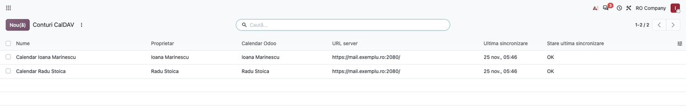
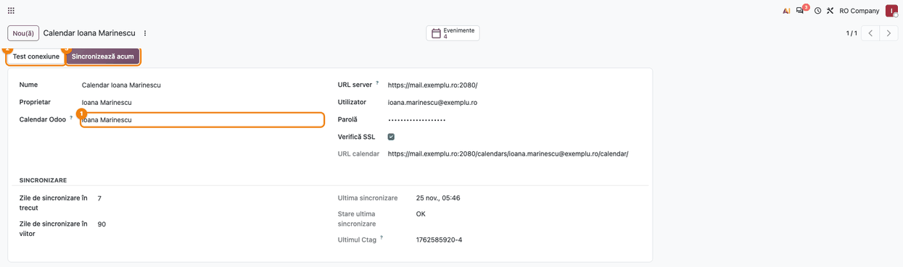
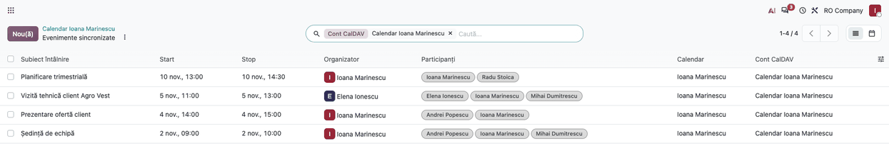
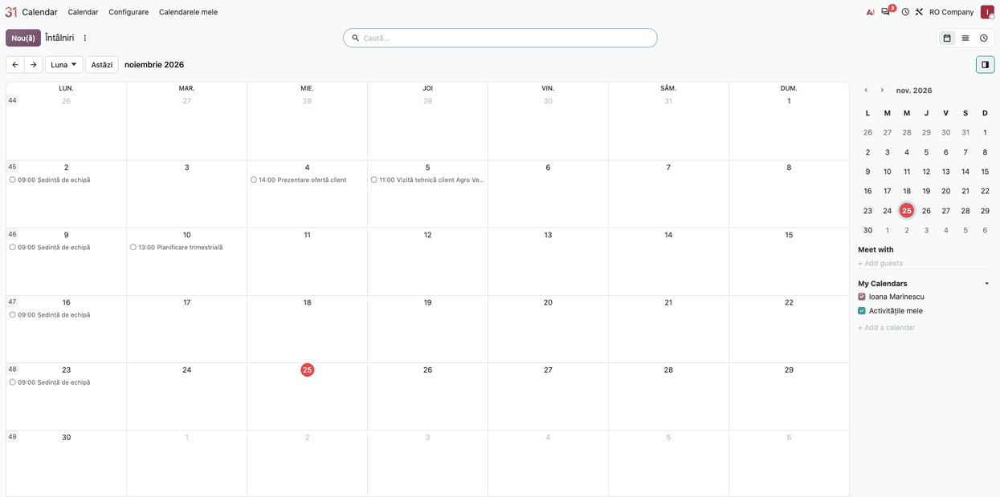
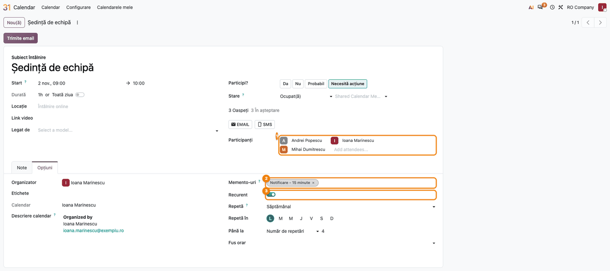
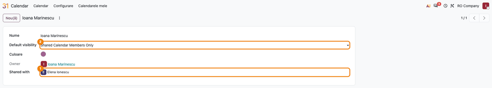
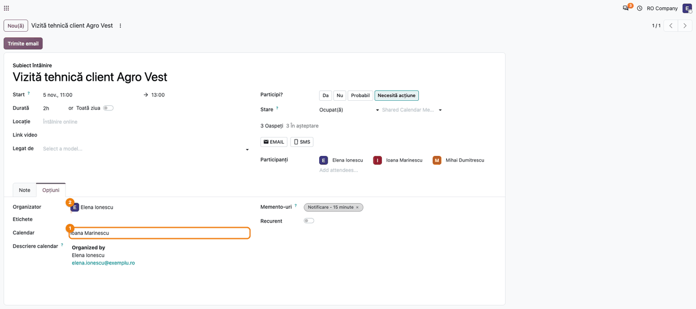
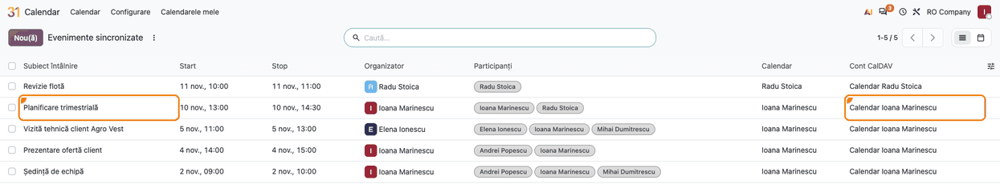

# Fișă Modul: Sincronizare Calendar CalDAV (bidirecțională)

**Modul:** `deltatech_calendar_caldav`
**Utilizator principal:** Utilizator Odoo cu calendar personal, Consultant IT client, Administrator sistem
**Prioritate:** 🟢 Opțională (activare per utilizator, la cerere; nu afectează restul fluxurilor de calendar)

---

## 1. Scop business

Modulul `deltatech_calendar_caldav` sincronizează calendarul Odoo (`calendar.event`) cu un
**server CalDAV extern** (cPanel/Horde/SOGo, Nextcloud, sau orice server care implementează
standardul CalDAV), în **ambele direcții**:

- **CalDAV → Odoo:** un cron (sau butonul „Sincronizează acum") aduce evenimentele de pe server în Odoo.
- **Odoo → CalDAV:** crearea, modificarea sau ștergerea unui eveniment din **calendarul Odoo al
  contului** (implicit calendarul principal al proprietarului) trimite imediat schimbarea pe server,
  indiferent cine a creat sau editează evenimentul. Invitațiile primite de la un coleg (evenimentul
  stă în calendarul colegului) nu se trimit pe calendarul extern al invitatului.

Ca la Google Calendar în Odoo 20, calendarul Odoo al contului se poate **partaja**: o asistentă
gestionează programările proprietarului în calendarul lui, fără cont CalDAV propriu, iar
programările ei ajung pe serverul proprietarului.

Cazul de business tipic: un client are deja un calendar în afara Odoo (căsuța de hosting cPanel,
un server Nextcloud propriu, telefonul sincronizat cu un calendar CalDAV) și vrea ca programările
din Odoo (întâlniri, task-uri cu dată) să apară automat acolo — și invers — fără muncă manuală de
copiere.

Modulul acoperă și cazuri mai avansate: **evenimente recurente** (trimise ca o singură serie CalDAV
cu regulă de recurență, nu ca evenimente separate), **reminder-e** (alarmele Odoo devin
notificări/emailuri pe celălalt calendar) și **participanți** (persoanele invitate la eveniment se
regăsesc pe ambele părți, cu potrivire automată după adresa de email).

## 2. Context tehnic

- **CalDAV** (RFC 4791) este un standard deschis pentru partajarea calendarelor prin HTTP, folosit
  de aproape orice furnizor de hosting/email (cPanel, Nextcloud, iCloud, Zimbra etc.) — spre
  deosebire de Google Calendar/Microsoft 365, pe care Odoo le sincronizează deja nativ prin module
  proprii, CalDAV **nu are** un conector nativ în Odoo 18/19/20.
- Comunicarea se face prin biblioteca Python `caldav` (peste protocolul standard iCalendar/RFC
  5545) — nu printr-un API proprietar al vreunui furnizor.
- Modulul este **generic**: orice server care vorbește CalDAV standard funcționează, fără cod
  specific per furnizor. A fost validat concret pe un server cPanel (Dovecot CalDAV).

Modulul nu este un raport sau o localizare fiscală — este un conector tehnic. Nu generează
documente și nu are implicații contabile.

## 3. Utilizatori și roluri

- **Utilizatorul cu calendar extern:** are propriul cont CalDAV configurat (o singură dată, de
  regulă de către consultant) și de atunci încolo lucrează normal în Odoo — sincronizarea e
  transparentă.
- **Consultantul / administratorul:** configurează contul CalDAV (server, user, parolă), verifică
  legătura și pornește sincronizarea. Contul îl vede și îl poate edita doar **proprietarul** lui și
  administratorii (grupul Setări); un alt utilizator nu vede contul deloc, deci nu ajunge la
  parolă. Sincronizarea funcționează oricum (rulează cu drepturi de sistem, nu ale utilizatorului
  curent).
- **Meniul proprietarului:** utilizatorul își vede propriul cont în **Calendar → Calendarele mele**
  (*My Calendars*). Acolo își introduce singur parola, alege **Calendar Odoo** dintre calendarele
  lui, rulează **Test conexiune** / **Sincronizează acum** și își poate arhiva contul; restul
  câmpurilor sunt doar pentru administrator.
- **Membrul unui calendar partajat** (de exemplu asistenta): nu are cont CalDAV. Proprietarul îi
  partajează calendarul Odoo, iar ea creează, mută și modifică programările direct în acel calendar.
- **Ce poate schimba proprietarul contului:** un utilizator obișnuit își poate schimba doar
  **Parolă** și **Calendar Odoo** (numai cu un calendar al lui) și poate arhiva contul. Restul câmpurilor (**URL server**, **Proprietar**, **Utilizator**,
  **Verifică SSL**, zilele de sincronizare etc.) le schimbă doar administratorul; altfel primește
  eroarea „Only an administrator can change these CalDAV account fields". Restricția e aplicată pe
  server, deci nu poate fi ocolită prin import sau apel RPC.
- Meniul **Conturi CalDAV** e sub *Setări → Tehnic*, vizibil doar cu modul dezvoltator activ și
  grupul Setări.

## 4. Date și câmpuri implicate

- **`caldav.account`** (model nou) — un cont = un calendar CalDAV: `url`, `username`, `password`,
  `calendar_url` (descoperit automat la Test conexiune), `user_id` (proprietarul, organizatorul
  evenimentelor de pe server), `calendar_id` (**Calendar Odoo**: calendarul Odoo, `calendar.calendar`,
  în care intră evenimentele și din care se trimit; implicit calendarul principal al proprietarului,
  trebuie să fie al proprietarului), `name` (numele contului), `company_id` (informativ), `verify_ssl`, `active`, `sync_days_past` / `sync_days_future` (fereastra de sincronizare,
  implicit -7/+90 zile), `last_sync` / `last_sync_status` / `last_sync_error` / `last_ctag`.
- **`calendar.event`** (câmpuri adăugate) — `caldav_account_id`, `caldav_uid` (identificatorul
  evenimentului pe server), `caldav_recurrence_id` (pentru o ocurență dintr-o serie recurentă),
  `caldav_etag` (versiunea cunoscută a evenimentului pe server, pentru detectarea conflictelor).
- Se folosesc și modele **native** Odoo, fără câmpuri suplimentare: `calendar.calendar` /
  `calendar.user` (calendarul și partajarea lui, cu rolurile proprietar/editor), `calendar.alarm` (reminder-e),
  `res.partner` (participanți, potriviți/creați după email), `calendar.recurrence` (regula de
  recurență).

## 5. Configurare inițială

1. Instalați modulul `deltatech_calendar_caldav` (nu are dependențe Odoo în afară de `calendar`;
   pe server trebuie instalate bibliotecile Python `caldav` și `icalendar` —
   `uv pip install "caldav>=1.3.9,<=2.0.1" icalendar`; **atenție**, `caldav` > 2.0.1 trage o
   dependență incompatibilă cu Odoo, vezi secțiunea 9).
2. Activați modul dezvoltator, mergeți la **Setări → Tehnic → Conturi CalDAV**.
3. Creați un cont nou: **Nume** (obligatoriu, o denumire liberă a contului), **Proprietar** (utilizatorul Odoo ale cărui evenimente se sincronizează),
   **URL server** (rădăcina serverului CalDAV, ex. `https://mail.exemplu.ro:2080/`), **Utilizator**
   și **Parolă** — de regulă aceleași date ca la webmail/calendarul nativ al furnizorului.
   Parola se stochează în clar în baza de date (trebuie trimisă serverului), deci folosiți o
   **parolă de aplicație** creată pe serverul de mail, nu parola principală a căsuței. Câmpul
   **Calendar Odoo** arată calendarul Odoo în care intră evenimentele contului (implicit calendarul
   principal al proprietarului); orice eveniment creat sau modificat în acest calendar se trimite pe
   server prin cont, indiferent cine îl editează. Dacă mai multe conturi active au același calendar
   Odoo, se folosește cel mai vechi (cel cu id-ul mai mic).
   **Calendar comun:** ca o asistentă să gestioneze programările proprietarului, proprietarul îi
   partajează calendarul Odoo (**Shared with**, rol de editare) și setează **Default visibility**
   pe **Shared Calendar Members Only** (sau **Public**). Asistenta
   nu are nevoie de cont CalDAV: ce programează ea ajunge pe server prin contul proprietarului,
   cu proprietarul ca organizator. Nu creați al doilea cont pe același calendar de pe server:
   același eveniment (același UID) intră o singură dată în Odoo, iar contul organizatorului îl păstrează.
   Parola e obligatorie la creare: administratorul pune una provizorie, iar proprietarul o
   înlocuiește cu parola de aplicație din **Calendar → Calendarele mele**.
   Într-o bază cu mai multe companii, formularul administratorului arată și câmpul **Companie**
   (implicit compania curentă). Câmpul e doar informativ: nu filtrează conturile și nici evenimentele,
   iar cron-ul sincronizează toate conturile active. Proprietarul nu îl vede în „Calendarele mele".
4. Apăsați **Test conexiune** — la prima rulare modulul descoperă automat calendarul contului și
   arată o notificare verde „Conexiune reușită" / „Calendar găsit: ..." (în engleză:
   „Connection successful" / „Calendar found: ..."). Pe un cont fără calendar pe server apare
   „Nu a fost găsit niciun calendar pe acest cont CalDAV." („No calendar was found on this CalDAV
   account."). **Atenție:** după ce **URL calendar** e completat, Test conexiune nu mai face nicio
   cerere către server și arată „Conexiune reușită" chiar cu parola greșită; câmpul **URL calendar**
   nu poate fi golit din formular. Credențialele se confirmă atunci prin **Sincronizează acum**
   (starea contului, **Stare ultima sincronizare**).
5. Apăsați **Sincronizează acum** pentru prima sincronizare manuală, sau activați cron-ul programat
   (**Setări → Tehnic → Automatizare → Acțiuni planificate → „CalDAV: Sincronizare conturi"**, dezactivat implicit,
   interval implicit 15 minute).

Etichetele din această fișă sunt cele din interfața în română; în engleză, aceleași elemente se
numesc: *CalDAV Accounts* (Conturi CalDAV), *Test Connection* (Test conexiune), *Sync Now*
(Sincronizează acum), *Events* (Evenimente), *Last Sync* / *Last Sync Status* / *Last Ctag* (Ultima
sincronizare / Stare ultima sincronizare / Ultimul Ctag), *Calendar Url* (URL calendar),
*Owner* / *Odoo Calendar* / *Server URL* / *Username* / *Password* (Proprietar / Calendar Odoo /
URL server / Utilizator / Parolă). În formularul calendarului (Odoo 20, încă netradus în română): *Default visibility*
(vizibilitatea implicită), *Shared Calendar Members Only* (doar membrii calendarului partajat),
*Owner* (proprietar), *Shared with* (partajat cu).

## 6. Flux de utilizare

### Pasul 1 — Conectarea și prima sincronizare

Din **Setări → Tehnic → Conturi CalDAV**, deschideți contul. Formularul contului arată starea legăturii: **Test conexiune** descoperă calendarul contului
(**URL calendar**, la prima rulare), iar **Sincronizează acum** rulează sincronizarea imediat.
Rezultatul (**Ultima sincronizare**, **Stare ultima sincronizare**, **Ultimul Ctag**) rămâne vizibil pe cont pentru
diagnostic.

**Verificați:** după *Sincronizează acum*, **Stare ultima sincronizare = OK** și butonul **Evenimente** din partea de sus a formularului arată numărul de evenimente aduse de pe server.

### Pasul 2 — Evenimentele sincronizate

Din butonul **Evenimente** de pe cont se văd evenimentele legate de acel cont CalDAV (filtrul pe cont
e pus automat; lista și butonul numără doar evenimentul de bază al seriei, ocurențele ei se văd în
Calendar; în căutarea din Calendar există și câmpul **Cont CalDAV**) — inclusiv
o serie recurentă (adusă de pe server ca o singură serie, cu regula ei de repetare, apoi
afișată în Odoo ca ocurențe săptămânale cu aceeași denumire), un eveniment simplu, cu un
participant (`Andrei Popescu`), programarea făcută de asistentă în calendarul proprietarei
(organizator `Elena Ionescu`, vezi pasul 5) și ședința „Planificare trimestrială", la care e
invitat un coleg cu propriul cont (vezi pasul 6). Lista arată pe fiecare rând și **Calendar** și
**Cont CalDAV**.

### Pasul 3 — Utilizarea normală, din Calendar

Din perspectiva utilizatorului final, sincronizarea e invizibilă: evenimentele apar în aplicația
**Calendar** ca orice altă întâlnire Odoo. Modificarea, mutarea sau ștergerea unui eveniment din
Odoo se trimite automat pe server; o schimbare făcută direct pe server (telefon, alt calendar)
ajunge în Odoo la următoarea sincronizare.

**Ștergerea:** un eveniment arhivat sau șters în Odoo este șters și de pe server. În sens invers,
un eveniment șters pe server dispare din Odoo la următoarea sincronizare (se șterg evenimentele din
fereastra sincronizată care nu mai vin de pe server).

**Verificați:** dacă trimiterea unui eveniment pe server eșuează (server indisponibil, eroare de
autorizare) sau dacă evenimentul a fost modificat între timp direct pe server (conflict ETag),
salvarea din Odoo reușește oricum, dar pe contul CalDAV apare **Stare ultima sincronizare = Error**, cu
mesajul „Event '...' was not sent to the server: ..." în **Eroare la ultima sincronizare**. Eroarea rămâne pe
cont până la următoarea sincronizare reușită (manuală sau din cron), deci verificați contul după
modificări importante.

**Verificați:** proprietarul contului este întotdeauna adăugat ca participant la evenimentele
aduse de pe server, chiar dacă serverul nu trimite ATTENDEE/ORGANIZER; astfel evenimentul apare în
calendarul lui personal, iar intervalul rămâne ocupat.

### Pasul 4 — Recurență, reminder-e, participanți (rezumat)

Din **Calendar**, faceți clic pe un eveniment și deschideți formularul lui complet din fereastra de
previzualizare, apoi tab-ul **Opțiuni**:

- O serie recurentă creată în Odoo (cu regulă de recurență) se trimite pe server **ca o singură
  resursă CalDAV** (evenimentul „master" cu regula RRULE), nu ca evenimente separate; ocurențele
  modificate pe server (excepțiile din serie) se atașează ocurenței lor din Odoo.
- Alarmele Odoo (`calendar.alarm`) se traduc în/din componente `VALARM` (notificare → `DISPLAY`,
  email → `EMAIL`). Dacă serverul trimite o alarmă pentru care Odoo nu are un memento echivalent
  (același tip și aceeași durată), modulul creează automat un memento nou
  (`calendar.alarm`, denumit „N minute înainte (din CalDAV)" / „N minutes before (from CalDAV)",
  după limba contextului: sincronizarea manuală folosește limba utilizatorului, cron-ul poate folosi
  engleza); apoi îl reutilizează.
- Participanții (`partner_ids`) se traduc în/din `ATTENDEE`/`ORGANIZER`, cu potrivire după adresa
  de email (participanții fără email nu se trimit pe server; organizatorul trimis e mereu
  **proprietarul contului**, și doar dacă are email), **fără diferență între litere mari și mici** (contactul se creează automat dacă nu
  există, dar cel mult 50 de contacte noi per eveniment).

### Pasul 5 — Calendar comun: asistenta programează în calendarul proprietarului

1. Din **Setări → Tehnic → Conturi CalDAV** (sau, pentru proprietar, **Calendar → Calendarele mele**),
   deschideți contul și verificați **Calendar Odoo**: e calendarul proprietarului în care intră
   evenimentele de pe server (implicit calendarul lui principal).
2. Proprietarul deschide în aplicația **Calendar** formularul calendarului său și o adaugă pe
   asistentă la **Shared with** (partajat cu; primește rolul de editare). Tot acolo setează
   **Default visibility** pe **Shared Calendar Members Only** (sau **Public**); cu **Private**, Odoo
   ascunde evenimentele față de membri și asistenta nu le poate edita. Etichetele formularului
   calendarului vin din Odoo 20 și nu sunt încă traduse în română.

   

3. Asistenta creează o programare în aplicația **Calendar** și alege, în tab-ul **Opțiuni**, la
   **Calendar** calendarul proprietarului. La salvare, evenimentul se trimite pe server prin contul
   proprietarului, cu proprietarul ca organizator; în Odoo, **Organizator** rămâne asistenta.

   
4. Mutarea sau modificarea unei programări din calendarul proprietarului, de către oricare dintre ei,
   se trimite la fel, prin contul proprietarului.

**Verificați:** pe server (webmail, telefonul proprietarului) apare programarea asistentei, cu
proprietarul ca organizator; după *Sincronizează acum*, în Odoo rămâne **un singur** eveniment, în
calendarul proprietarului, cu asistenta organizator.

### Pasul 6 — Același eveniment pe mai multe conturi și mutarea între calendare

- **Import unic per UID:** dacă același eveniment de pe server (același UID) ajunge la mai multe
  conturi, de exemplu la organizator și la un invitat care își sincronizează și el calendarul, în
  Odoo intră **o singură dată**. Îl păstrează contul care l-a adus primul; dacă după aceea se
  sincronizează contul **organizatorului** (potrivit după email), acesta preia evenimentul, pentru că
  numai copia organizatorului poate fi modificată pe server. Contul invitatului nu mai creează o copie
  și, la sincronizare, nu șterge evenimentul celuilalt cont.
- **Mutarea în alt calendar Odoo:** dacă un eveniment sincronizat este mutat în alt calendar Odoo
  (câmpul **Calendar** din formular sau schimbarea organizatorului), el se șterge de pe serverul
  contului vechi și se creează pe serverul contului care are noul calendar ca **Calendar Odoo**; dacă
  noul calendar nu are cont CalDAV, evenimentul rămâne doar în Odoo.

Lista **Evenimente sincronizate** fără filtru pe cont (din butonul **Evenimente**, ștergând filtrul
**Cont CalDAV** din căutare) arată toate evenimentele, cu contul care le ține. Ședința „Planificare
trimestrială", organizată de Ioana Marinescu și la care e invitat Radu Stoica (cu propriul cont
CalDAV), apare **o singură dată**, la contul organizatoarei; contul lui Radu păstrează doar
evenimentele lui („Revizie flotă").

**Verificați:** după sincronizarea ambelor conturi, căutarea în Calendar după titlul evenimentului
găsește un singur eveniment, iar butonul **Evenimente** îl numără doar la contul organizatorului.

## 7. Legături cu alte module / procese

| Modul / proces | Rol în flux | Tip legătură |
|---|---|---|
| `calendar` (Odoo core) | modelul `calendar.event`/`calendar.alarm`/`calendar.recurrence` extins | dependență (manifest) |
| Serverul CalDAV al clientului (cPanel, Nextcloud etc.) | sursa/destinația evenimentelor sincronizate | integrare externă |
| Aplicația **Calendar** (Odoo) | interfața pe care utilizatorul lucrează efectiv; sincronizarea e transparentă acolo | consumator |
| `res.partner` | participanții evenimentelor, potriviți/creați după email | date partajate |

Ce este automat: descoperirea calendarului, trimiterea/aducerea evenimentelor, importul seriei
cu regula ei de repetare, maparea alarmelor și a participanților, detectarea conflictelor (ETag) și a
schimbărilor (CTag). Ce rămâne manual: configurarea inițială a contului (server/user/parolă) și
activarea cron-ului de sincronizare periodică.

## 8. Verificări pentru consultant

- [ ] Modulul se instalează fără erori (bibliotecile `caldav`/`icalendar` sunt prezente pe server).
- [ ] Meniul **Conturi CalDAV** apare sub *Setări → Tehnic* pentru un utilizator cu grupul Setări și modul dezvoltator activ.
- [ ] **Test conexiune** pe un cont nou, cu date corecte, arată notificarea „Conexiune reușită" cu
  „Calendar găsit: ..." și completează **URL calendar**; credențialele se confirmă apoi prin
  **Sincronizează acum**, nu prin repetarea Test conexiune.
- [ ] Într-o bază multi-companie, administratorul vede câmpul **Companie** pe cont.
- [ ] **Sincronizează acum** aduce evenimentele existente pe server, cu titlu/dată/oră corecte.
- [ ] Un eveniment recurent (3-4 ocurențe) creat în Odoo apare pe server ca **o singură resursă**
  cu regulă RRULE (nu ca evenimente separate) — verificabil direct pe server sau prin re-sincronizare.
- [ ] Un eveniment creat/modificat/șters în Odoo pentru un cont configurat se reflectă pe server.
- [ ] Un eveniment arhivat în Odoo dispare de pe server, iar unul șters pe server dispare din Odoo
  la următoarea sincronizare.
- [ ] O alarmă primită de pe server fără memento Odoo echivalent creează un memento nou
  „N minutes before (from CalDAV)", reutilizat la sincronizările următoare.
- [ ] Un participant cu email nou (fără contact existent) apare corect ca `res.partner` nou creat.
- [ ] O rulare a doua a sincronizării, fără schimbări pe server, se termină rapid (scurtcircuitată
  de verificarea CTag) — vizibil în timp de execuție, nu într-un câmp anume.
- [ ] Un alt utilizator (nici proprietar, nici administrator) nu vede contul CalDAV și parola lui.
- [ ] Un utilizator obișnuit nu poate schimba **URL server** / **Proprietar** pe contul lui (eroare „Only
  an administrator can change..."), dar își poate schimba **Parolă** și **Calendar Odoo** (doar cu un
  calendar al lui; altfel eroarea „The Odoo calendar of the CalDAV account ... must belong to its owner ...").
- [ ] Un cont nou are **Calendar Odoo** completat automat cu calendarul principal al proprietarului,
  iar evenimentele aduse de pe server intră în acel calendar.
- [ ] Un membru al calendarului partajat (fără cont CalDAV) creează o programare în calendarul
  proprietarului; ea apare pe server, cu proprietarul ca organizator.
- [ ] Un eveniment creat de membru în propriul calendar (nu în cel al proprietarului) **nu** ajunge
  pe serverul proprietarului.
- [ ] Același eveniment (același UID) adus de două conturi apare în Odoo o singură dată, la contul
  organizatorului.
- [ ] Un eveniment sincronizat, mutat în alt calendar Odoo, dispare de pe serverul contului vechi.
- [ ] Un eveniment modificat pe server între două sincronizări, apoi editat în Odoo, lasă pe cont
  **Stare ultima sincronizare = Error** cu mesajul „was not sent to the server".
- [ ] Dacă serverul nu mai returnează niciun eveniment (de exemplu calendar greșit), evenimentele
  deja sincronizate **nu** se șterg din Odoo; după corectarea serverului, sincronizarea le
  reconciliază.
- [ ] Un participant cu email scris cu alte litere mari/mici decât contactul existent se potrivește
  cu acel contact, nu creează unul nou.
- [ ] Un eveniment cu mai mult de 50 de participanți necunoscuți se importă oricum, dar se creează
  cel mult 50 de contacte noi (restul participanților rămân neasociați, cu avertisment în log).

## 9. Mesaje de eroare și simptome frecvente

| Mesaj / simptom | Cauză probabilă | Remediere |
|-----------------|-----------------|-----------|
| „Biblioteca Python 'caldav' nu este instalată" („The Python 'caldav' library is not installed") | Biblioteca nu e instalată pe server | `uv pip install "caldav>=1.3.9,<=2.0.1" icalendar` |
| Instalarea bibliotecii **rupe pornirea Odoo** (`ImportError: PyOpenSSLContext`) | `caldav` > 2.0.1 trage `niquests`→`urllib3-future`, care suprascrie fișierele reale ale pachetului `urllib3` | Reinstalați `urllib3` la versiunea originală și fixați `caldav<=2.0.1` (fără această dependență) |
| „Nu a fost găsit niciun calendar pe acest cont CalDAV." („No calendar was found on this CalDAV account.") la **Test conexiune** sau la sincronizare | Contul nu are niciun calendar pe server (utilizator fără calendar creat, URL de server greșit sau drepturi insuficiente) | Creați un calendar pe server sau verificați **URL server**, **Utilizator** și drepturile, apoi rulați din nou Test conexiune |
| **Test conexiune** eșuează cu eroare de certificat SSL | URL-ul folosește o adresă IP, dar certificatul e valabil doar pe hostname | Folosiți hostname-ul (ex. `https://domeniu.ro:2080/`), nu adresa IP |
| **Stare ultima sincronizare = Error** | Credențiale greșite, server neaccesibil, sau eroare de rețea | Verificați **Eroare la ultima sincronizare** (mesajul complet) de pe cont |
| O ocurență editată **și** mutată în timp apare **duplicat** pe server, nu ca suprascriere | Odoo nu păstrează ora inițial programată a ocurenței odată mutată; limitare cunoscută (secțiunea 10) | Editare de conținut fără mutare de oră, sau ștergere manuală a duplicatului de pe server |
| Ștergerea unei **singure** ocurențe dintr-o serie nu se reflectă pe server | Ștergerea per-ocurență nu e încă suportată (limitare v1) | Se șterge doar seria întreagă; pentru o ocurență, editați conținutul în loc de a o șterge |
| Un push (creare/editare/ștergere) nu ajunge pe server; pe cont apare **Stare ultima sincronizare = Error** cu „Event '...' was not sent to the server: ..." | Conflict ETag (evenimentul a fost modificat direct pe server de la ultima sincronizare; modulul **nu suprascrie** varianta serverului) sau eroare de rețea/autorizare | Rulați o sincronizare (Sincronizează acum) ca să aduceți varianta de pe server în Odoo, apoi editați din nou |
| „Only an administrator can change these CalDAV account fields: ..." | Un utilizator obișnuit a încercat să schimbe câmpuri de server ale contului | Câmpurile de server le schimbă administratorul; proprietarul poate schimba doar parola și **Calendar Odoo** |
| „Calendarul Odoo al contului CalDAV „...” trebuie să aparțină proprietarului său, ..." („The Odoo calendar of the CalDAV account '...' must belong to its owner ...") | La **Calendar Odoo** s-a ales calendarul altui utilizator (de exemplu unul partajat cu proprietarul) | Alegeți un calendar al proprietarului; pentru calendarul altcuiva, contul trebuie să fie al acelui utilizator |
| Evenimentele șterse pe server rămân în Odoo | Serverul nu returnează niciun eveniment pentru interval (calendar greșit, URL golit); modulul nu șterge nimic în acest caz, doar scrie un avertisment în log | Verificați **URL calendar** (se completează la prima rulare a Test conexiune și nu poate fi golit din formular; dacă e greșit, cere intervenție tehnică) și serverul; la următoarea sincronizare cu răspuns normal, ștergerile se aplică |
| Un eveniment cu foarte mulți participanți nu are toți participanții asociați; în log apare „only the first 50 are created as contacts" | Plafon de 50 de contacte noi create per eveniment, ca un server să nu poată umple baza cu contacte | Evenimentul se importă normal; adăugați manual participanții lipsă sau creați contactele în prealabil |
| Evenimentele unui utilizator ajung pe alt calendar decât cel așteptat | Mai multe conturi CalDAV active au același **Calendar Odoo**; se folosește cel mai vechi | Arhivați contul în plus sau schimbați-i **Calendar Odoo** |
| Membrul unui calendar partajat nu poate edita evenimentele sincronizate | **Default visibility** a calendarului e **Private**; Odoo ascunde evenimentele față de membri | Proprietarul setează **Default visibility** pe **Shared Calendar Members Only** sau **Public** |
| Un eveniment mutat în alt calendar Odoo dispare de pe server | Mutarea îl scoate din calendarul serverului vechi; pe cel nou ajunge doar dacă noul calendar are cont CalDAV | Comportament intenționat; mutați-l înapoi sau conectați și noul calendar |

## 10. Limitări cunoscute

- Se trimit pe server doar evenimentele din **calendarul Odoo al contului**; o întâlnire organizată
  de un coleg în calendarul lui, la care utilizatorul e doar participant, nu ajunge pe calendarul
  extern al utilizatorului.
- Un cont oglindește un singur calendar Odoo, care trebuie să fie al proprietarului contului; nu se
  poate lega un cont de calendarul altui utilizator.
- **Ștergerea unei singure ocurențe** dintr-o serie recurentă (păstrând restul seriei) nu se
  propagă pe server — doar ștergerea întregii serii este sincronizată.
- O ocurență editată **și mutată în timp** în aceeași operație poate crea un eveniment duplicat pe
  server în loc de o suprapunere corectă (`RECURRENCE-ID`), pentru că Odoo nu reține ora la care
  ocurența era programată inițial, o dată mutată.
- O modificare care n-a ajuns pe server (rețea, autorizare, conflict) **nu se retrimite automat**:
  eroarea rămâne pe cont doar până la următoarea sincronizare reușită, iar modificarea se reface
  prin editarea din nou a evenimentului.
- Descrierea evenimentului se trimite ca **text simplu** (formatarea HTML din Odoo se pierde la
  trimiterea către server).
- Modulul folosește **un singur calendar per cont** (primul găsit pe server, la prima rulare
  a Test conexiune; nu poate fi schimbat din formular) — nu suportă mai multe calendare per cont în versiunea curentă.

## 11. Capturi de ecran

Toate capturile (`static/description/`; cele în engleză, pentru USAGE.md, în
`static/description/en/`) se generează din `tests/test_screenshots.py`, pe „RO Company", fără server
CalDAV real: conturile (`mail.exemplu.ro`, al Ioanei Marinescu și al colegului Radu Stoica),
calendarul proprietarei partajat cu asistenta (Elena Ionescu) și evenimentele sincronizate (o serie
săptămânală de 4 ocurențe, un eveniment cu un participant, programarea asistentei, o ședință cu
Radu și un eveniment al lui) sunt seedate de test, așa cum le-ar lăsa o sincronizare.

1. `01_lista_conturi.png` — meniul **Conturi CalDAV** (Setări → Tehnic), cu contul configurat.
2. `02_cont_configurat.png` — formularul contului: conectat, sincronizat, cu **Ultimul Ctag** vizibil.
3. `03_evenimente_sincronizate.png` — lista evenimentelor sincronizate (serie recurentă +
   eveniment cu participant).
4. `04_calendar_odoo.png` — aplicația **Calendar**, vizualizarea **Lună**, cu aceleași evenimente în
   interfața normală a utilizatorului (proprietarul e participant, deci le vede implicit).
5. `05_recurenta_alarma_participanti.png` — formularul unui eveniment din **Calendar**: participanții,
   **Memento-uri** (alarma) și **Recurent**, în tab-ul **Opțiuni**, așa cum se trimit pe server.
6. `06_partajare_calendar.png` — formularul calendarului proprietarei: **Shared with** (asistenta)
   și **Default visibility** = **Shared Calendar Members Only**.
7. `07_programare_asistenta.png` — programarea asistentei, văzută de ea, tab-ul **Opțiuni**:
   **Calendar** = calendarul proprietarei, **Organizator** = asistenta.
8. `08_eveniment_unic_per_uid.png` — lista **Evenimente sincronizate** a tuturor conturilor: ședința
   comună apare o singură dată, la contul organizatoarei, cu coloana **Cont CalDAV**.

Pagina Apps are și un GIF demo (`static/description/en/demo.gif`, doar în engleză), afișat automat
sub hero. Pentru a regenera capturile și GIF-ul:
`--test-tags=/deltatech_calendar_caldav:TestCaldavScreenshots`.

## 12. Observații pentru manual

În manualul clientului, prezentați modulul ca pe o **punte transparentă**: odată configurat contul
(un pas unic per utilizator), calendarul din Odoo și cel din afara Odoo rămân la fel, fără muncă
suplimentară — programările făcute în oricare parte apar și în cealaltă în câteva minute
(intervalul cron-ului). Atrageți atenția asupra celor două limitări practice ale versiunii curente
(secțiunea 10): ștergerea „doar a unei zile" dintr-o serie recurentă și mutarea în timp a unei
ocurențe editate — pentru aceste cazuri, recomandați editare de conținut fără mutare de oră, sau
verificare manuală pe server. Menționați și rolul reglării **Zile de sincronizare în trecut / viitor** de pe cont,
dacă clientul are nevoie de o fereastră de sincronizare mai mare sau mai mică decât implicitul
(-7/+90 zile).
