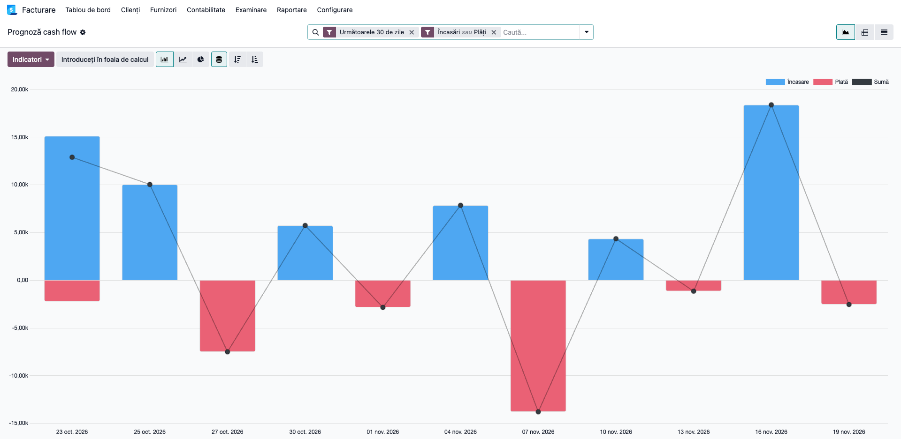
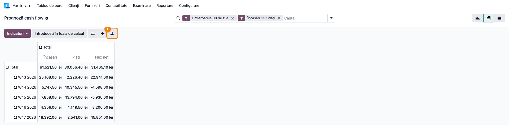
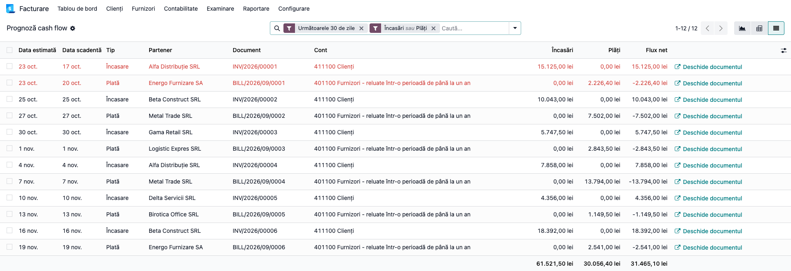
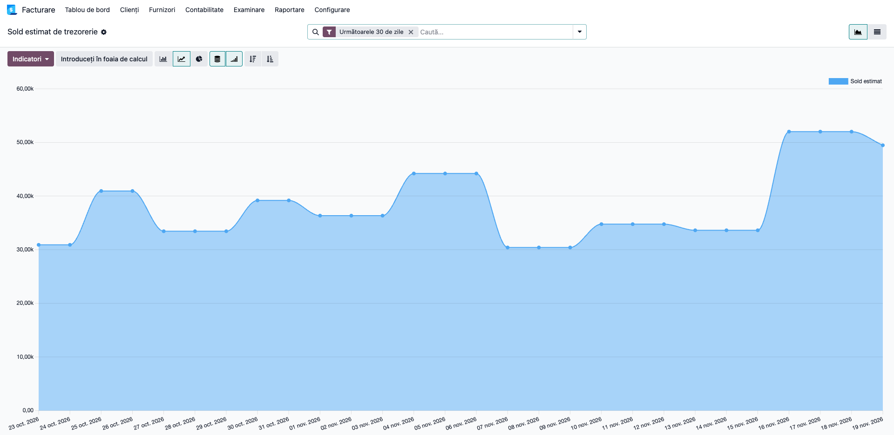

# Fișă Modul: Prognoza de trezorerie pe scadențe (cash flow)

**Modul:** `deltatech_cash_flow_forecast`
**Utilizator principal:** Contabil / Responsabil trezorerie / Director financiar
**Prioritate:** 🟡 Medie (raport de planificare; nu produce înregistrări contabile)

---

## 1. Scop business

Modulul arată, zi de zi, **ce bani urmează să intre și să iasă** din firmă, pe baza datei scadente a
facturilor neachitate: încasările de la clienți și plățile către furnizori. Pornind de la soldul de
azi din casă și bancă, calculează și **soldul estimat de trezorerie** pentru fiecare zi următoare.
Responsabilul de trezorerie vede din timp zilele în care plățile depășesc încasările și poate decide
ce plăți amână, ce încasări urmărește sau când are nevoie de finanțare.

## 2. Bază legală și context

Nu există o obligație legală pentru prognoza de trezorerie: este un instrument intern de gestiune.
Raportul nu înlocuiește **situația fluxurilor de trezorerie** din situațiile financiare anuale
(OMFP 1802/2014), care prezintă fluxurile **realizate** ale exercițiului. Prognoza lucrează pe
fluxurile **viitoare**, estimate din scadențele facturilor deja înregistrate.

## 3. Utilizatori și roluri

Contabil, responsabil de trezorerie, director financiar, administrator.

Roluri recomandate pentru testare:
- **Facturare** (`Facturare / Facturare`) — vede raportul pentru compania curentă;
- **Contabilitate: doar citire** — vede raportul fără drept de modificare a documentelor;
- utilizator cu **mai multe companii** — verifică faptul că vede doar companiile selectate.

Raportul este doar de citire: nu se pot crea, modifica sau șterge rânduri din el.

## 4. Conturi și date implicate

Raportul citește notele contabile **postate**, fără să genereze note noi:

| Rând din raport | Conturi (plan RO) | Ce se ia |
|---|---|---|
| **Încasare** | toate conturile de tip **Creanță**, de ex. **4111** Clienți, **461** Debitori diverși, **425** Avansuri acordate personalului | restul de încasat al fiecărei facturi sau note |
| **Plată** | toate conturile de tip **Datorii**, de ex. **4011/4012** Furnizori, **4041/4042** Furnizori de imobilizări, **403x** Efecte de plătit, **421x** Salarii datorate, **4551x** Asociați – conturi curente, **462x** Creditori diverși, **463** Dividende | restul de plată al fiecărei facturi sau note |
| **Sold inițial** | conturile **jurnalelor de bancă și de casă** (contul implicit al jurnalului), de ex. **5121**, **5124**, **5311**, **5314** | soldul de azi, pe fiecare cont |

Intră deci și **salariile** (421), **datoriile către asociați** (455), **dividendele** (463) și
**creditorii diverși** (462), dacă sunt înregistrate pe aceste conturi: sunt ieșiri reale de bani.

Nu intră:
- conturile marcate **non-trade**: **44231** TVA de plată și **4424** TVA de recuperat (închiderea de
  TVA nu e o plată la scadența notei);
- conturile de tip „Banca și Numerar” care nu sunt contul unui jurnal de bancă sau de casă: **519x**
  credite bancare pe termen scurt, **542** avansuri de trezorerie, **532x** timbre și tichete,
  **50x** titluri de plasament, **581** viramente interne (dacă nu are jurnal propriu);
- avansurile de la clienți pe **419** și avansurile la furnizori pe **4091/4092**;
- **4118** Clienți incerți și **418** Clienți – facturi de întocmit (tip activ circulant);
- conturile de **încasări/plăți în curs** (Outstanding Receipts / Outstanding Payments, create de
  Odoo cu prefixul 512) și **5125** Sume în curs de decontare;
- documentele nepostate (ciornă) și cele achitate integral.

Sumele sunt în **moneda companiei** (RON): facturile în valută intră cu restul de plată convertit
în lei **la cursul facturii** (sau al ultimei reevaluări postate), nu la cursul zilei.

Date minime pentru demo:
- companie românească cu planul de conturi RO;
- un jurnal de bancă cu sold (de exemplu aportul asociaților încasat: Dr 5121 = Cr 456);
- 3–4 facturi de client postate, cu TVA 21% și scadențe diferite în următoarele 30 de zile, plus
  una cu scadența trecută (restantă);
- 2 facturi de furnizor postate, cu TVA 21% și scadențe în următoarele 30 de zile;
- o factură de client achitată parțial.

## 5. Configurare inițială

1. Instalați modulul `deltatech_cash_flow_forecast` (depinde doar de `account`).
2. Verificați că facturile de client și de furnizor au completată **data scadentă** sau un
   **termen de plată**: raportul folosește scadența de pe fiecare linie de creanță/datorie (o factură
   cu termen în rate apare cu fiecare rată la scadența ei).
3. Verificați că fiecare cont bancar și fiecare casierie are **jurnalul** lui (de tip Bancă sau
   Numerar) cu contul implicit completat (5121, 5124, 5311, 5314): numai conturile acestor jurnale
   intră în soldul inițial.
4. Verificați că plățile sunt **reconciliate** cu facturile sau cu notele pe care le sting (inclusiv
   salariile pe 421): o notă nereconciliată rămâne în prognoză ca restanță, pe ziua de azi.
5. Nu există parametri de configurat: raportul se calculează la fiecare deschidere, din datele
   curente.

## 6. Flux de utilizare

### Pasul 1 — Graficul încasărilor și plăților pe zile

Accesați **Facturare → Raportare → Management → Prognoză cash flow** (în Contabilitate:
**Contabilitate → Raportare → Management → Prognoză cash flow**). Se deschide un grafic cu bare pe
zile, filtrat implicit pe **Următoarele 30 de zile**, cu **Încasări** și **Plăți**.



**Găsiți pe ecran:** pe axa orizontală, zilele; barele albastre de **Încasare** sunt deasupra axei,
cele roșii de **Plată** sub axă (cu minus), iar linia **Sumă** arată fluxul net al fiecărei zile. Prima bară este
ziua de azi: aici apar și **restantele** (facturile cu scadența trecută).

**Verificați:**
- prima zi din grafic este ziua de azi, nu o dată din trecut;
- o factură de client cu scadența peste 10 zile apare ca bară de încasare în ziua scadenței, cu
  restul de încasat (nu cu totalul facturii, dacă a fost achitată parțial);
- o factură de furnizor apare sub axă, în ziua scadenței.

Pe axă apar doar zilele în care există scadențe. Treceți cu mouse-ul peste o bară ca să vedeți suma
exactă; un clic pe bară deschide lista documentelor din ziua respectivă.

### Pasul 2 — Tabelul pe săptămâni și exportul în Excel

Din același ecran, comutați pe vizualizarea **Pivot** (pictograma tabel, dreapta-sus). Rândurile
sunt săptămânile, iar coloanele sunt **Încasări**, **Plăți** și **Flux net**. Pentru defalcarea pe
tipuri, dați clic pe antetul **Total** al coloanelor și alegeți **Tip**.



**Găsiți pe ecran:** totalul general pe **primul rând** (**Total**: în captură 61.521,50 lei
încasări, 30.056,40 lei plăți, 31.465,10 lei flux net), apoi câte un rând pe săptămână.

**Verificați:**
- **Flux net** = **Încasări** − **Plăți** pe fiecare săptămână (W43: 25.168,00 − 2.226,40 =
  22.941,60 lei);
- totalul **Încasări** din perioada filtrată corespunde soldului clienților cu scadență în perioadă,
  plus restantele. Cu Contabilitate (Enterprise): raportul **Restanțe încasări** (Aged Receivable);
  doar cu Facturare: lista **Elemente jurnal** filtrată pe contul 4111, nereconciliate.

Abia după verificare, exportați tabelul cu butonul **Descărcați xlsx** (pictograma de descărcare din
bara pivotului). Gruparea se schimbă din antetul de rând: clic pe **Total** → **Data estimată** →
**Zi** sau **Lună**.

### Pasul 3 — Lista documentelor și restantele

Comutați pe vizualizarea **Listă**. Fiecare rând este o factură (sau o rată a ei) cu: data
estimată, data scadentă, tipul, partenerul, documentul, contul și sumele. Restantele sunt marcate cu roșu.
Activați filtrul **Restante** ca să vedeți doar facturile cu scadența trecută.



**Găsiți pe ecran:** coloana **Data estimată** (ziua în care suma intră în prognoză) și coloana
**Data scadentă** (scadența originală); la restante, prima este ziua de azi, a doua e în trecut.

**Verificați:**
- o factură achitată integral nu apare în listă;
- o factură achitată parțial apare cu restul de plată (în captură, INV/2026/00004 de la Alfa
  Distribuție: 11.858,00 lei cu TVA, din care s-au încasat 4.000 lei, apare cu 7.858,00 lei);
- totalurile de la baza coloanelor corespund pivotului din pasul 2 pentru aceleași filtre.

Butonul **Deschide documentul** de la capătul rândului deschide factura sau nota. Lista se poate
exporta din **Acțiuni → Export** după selectarea rândurilor.

### Pasul 4 — Soldul estimat de trezorerie

Accesați **Facturare → Raportare → Management → Sold estimat de trezorerie**. Se deschide un
grafic cu linie **cumulată** a măsurii **Sold estimat**: pornește de la soldul de azi din casă și
bancă și adaugă, zi de zi, încasările minus plățile.



**Găsiți pe ecran:** primul punct (azi) = soldul din casă și bancă + restantele de încasat −
restantele de plată; fiecare punct următor = punctul anterior + fluxul net al zilei. În captură:
azi **30.898,60 lei** = 18.000,00 (5121) + 15.125,00 (restanța Alfa Distribuție) − 2.226,40
(restanța Energo Furnizare); la 19.11 soldul estimat ajunge la **49.465,10 lei** = 18.000,00 +
31.465,10 (fluxul net total din pasul 2).

**Verificați:**
- valoarea din ziua de azi = soldul conturilor jurnalelor de bancă și casă din **Balanța de
  verificare** (Contabilitate) sau din tabloul de bord al jurnalelor (Facturare), la data de azi,
  plus fluxul net al restantelor (filtrul **Restante** din pasul 3);
- încasarea parțială de 4.000 lei **nu** apare în sold: a fost înregistrată din factură, pe contul de
  încasări în curs, și intră în bancă abia după reconcilierea extrasului (vezi notele de mai jos);
- zilele în care linia coboară sub zero sunt zilele în care trezoreria nu acoperă plățile scadente.

Pentru detalii, comutați pe **Listă**: rândurile **Sold inițial** (scrise îngroșat) arată, în coloana
**Cont**, soldul fiecărui cont de casă și bancă.

### Note de monografie și raportare

- Modulul **nu generează note contabile**; citește notele postate existente.
- Încasarea unei facturi de client (nota Odoo, nu a modulului): **Dr 5121 = Cr 4111** când se face
  direct din extrasul bancar. După reconciliere, factura dispare din prognoză, iar suma apare în
  soldul inițial.
- Dacă încasarea e înregistrată din factură (**Înregistrare plată**), Odoo face întâi
  **Dr 512x Încasări în curs = Cr 4111**, iar la reconcilierea extrasului **Dr 5121 = Cr 512x
  Încasări în curs**. Între cele două momente, suma a ieșit din creanțe, dar nu a intrat încă în
  soldul de bancă: lipsește temporar din prognoză (cazul celor 4.000 lei din captură).
- Plata unei facturi de furnizor: **Dr 4011 = Cr 5121**. După reconciliere, factura dispare din
  prognoză și soldul inițial scade.
- Un avans încasat de la client direct pe 4111, încă nereconciliat cu o factură, intră ca încasare
  negativă la data plății (adică azi): reduce creanța de încasat, fiindcă banii au intrat deja.
- Salariile (Dr 641 = Cr 421) apar ca **Plată** la data notei; după plata din extras
  (Dr 421 = Cr 5121) și reconciliere, dispar. Închiderea de TVA (44231/4424) nu apare.

## 7. Legături cu alte module / declarații

| Modul / proces | Rol în flux | Tip legătură |
|---|---|---|
| `account` | facturi, plăți, reconciliere, planul de conturi | dependență (manifest) |
| `l10n_ro` | planul de conturi RO (4111, 4011, 5121, 5311) | recomandat |
| `account_reports` (Enterprise, aplicația Contabilitate) | **Restanțe încasări**, **Datorie restantă**, **Balanța de verificare** pentru verificarea sumelor; fără ea, verificarea se face din **Elemente jurnal** | verificare (opțional) |
| `l10n_ro_cash_bank_enhanced` | tabloul „Casă și bancă”, cu soldurile actuale ale conturilor | complementar |

Ce este automat: preluarea facturilor neachitate și a scadențelor, mutarea restantelor pe ziua de
azi, calculul soldului inițial din casă și bancă, cumularea soldului estimat, restricția pe companii.
Ce rămâne manual: completarea scadențelor pe facturi, reconcilierea plăților cu facturile
(altfel factura rămâne în prognoză), interpretarea graficului și deciziile de plată.

Declarații ANAF: niciuna.

## 8. Verificări pentru consultant

- [ ] Modulul se instalează fără erori; meniurile **Prognoză cash flow** și **Sold estimat de
      trezorerie** apar în **Raportare → Management**.
- [ ] O factură de client postată cu scadența peste 10 zile apare ca **Încasare** în ziua scadenței.
- [ ] O factură de furnizor postată apare ca **Plată**, sub axă, în ziua scadenței.
- [ ] O factură cu scadența trecută apare în ziua de azi, marcată cu roșu și prinsă de filtrul
      **Restante**.
- [ ] O factură achitată parțial apare cu restul de plată; după achitarea integrală, dispare.
- [ ] O factură în ciornă nu apare.
- [ ] În pivot, **Flux net** = **Încasări** − **Plăți** pe fiecare săptămână.
- [ ] Totalul **Încasări** (restante + următoarele 30 de zile) corespunde raportului **Restanțe
      încasări** (sau elementelor de jurnal nereconciliate pe 4111) pentru aceleași facturi.
- [ ] Soldul estimat de azi pornește de la soldul conturilor jurnalelor de casă și bancă din
      **Balanța de verificare**; un credit pe 519x sau un avans pe 542 nu îl modifică.
- [ ] O notă de salarii pe 421 apare ca **Plată**; închiderea de TVA pe 44231 nu apare.
- [ ] Butonul **Deschide documentul** din listă deschide factura.
- [ ] Un utilizator care lucrează pe o singură companie nu vede facturile și soldurile celorlalte.
- [ ] Exportul **Descărcați xlsx** din pivot conține aceleași valori ca pe ecran.

## 9. Mesaje de eroare frecvente

| Mesaj / simptom | Cauză probabilă | Remediere |
|-----------------|-----------------|-----------|
| „Nu există creanțe sau datorii neachitate” | Nu există facturi postate neachitate în perioada filtrată | Scoateți filtrul **Următoarele 30 de zile** sau verificați că facturile sunt postate |
| O factură plătită apare încă în prognoză | Plata nu a fost reconciliată cu factura | Reconciliați plata cu factura (din factură: **Adaugă** la plățile în așteptare, sau din reconcilierea bancară) |
| Soldul inițial lipsește sau e prea mic | Contul bancar sau casieria nu are jurnal propriu, ori jurnalul nu are contul implicit completat | Verificați jurnalele în **Facturare/Contabilitate → Configurare → Jurnale** (necesită drept de administrator contabil) |
| Salarii sau note vechi apar ca restanțe pe ziua de azi | Nota de pe 421 (sau 462, 455) nu a fost reconciliată cu plata din extras | Reconciliați plata cu nota; după reconciliere, rândul dispare |
| O factură apare la altă dată decât v-ați aștepta | Termenul de plată are mai multe rate, deci factura are mai multe scadențe | Normal: fiecare rată apare la scadența ei; verificați liniile de creanță ale facturii |
| Totalurile nu se potrivesc cu raportul în valută | Raportul lucrează în moneda companiei (RON), la cursul facturii | Comparați cu sumele în lei; diferența față de cursul zilei apare abia la încasare (diferență de curs) |

## 10. Capturi de ecran

Capturile din `readme/screenshots/` se generează automat din `tests/test_screenshots.py` (mixinul
`ScreenshotCase` din `l10n_ro_doc_screenshots`, import defensiv), în **limba română**, pe planul de
conturi RO, pe firma de test „Demo Trezorerie SRL” (facturi cu TVA 21%):

1. `01_grafic_incasari_plati.png` — graficul cu bare pe zile: încasări deasupra axei, plăți sub axă.
2. `02_pivot_saptamani.png` — pivotul pe săptămâni, cu încasări, plăți și flux net.
3. `03_lista_documente.png` — lista documentelor, cu restantele marcate cu roșu.
4. `04_sold_estimat.png` — linia cumulată a soldului estimat de trezorerie.

Regenerare:

```bash
./odoo/odoo-bin -c odoo.conf -d <db> -i deltatech_cash_flow_forecast,l10n_ro_doc_screenshots \
    --test-tags=fise_screenshots --stop-after-init
```

## 11. Observații pentru manual

În manual, păstrați explicația pe activitatea utilizatorului: prognoza arată **ce urmează să
încasăm și să plătim**, după scadențele facturilor deja înregistrate, iar soldul estimat arată
**dacă ne ajung banii** în fiecare zi. Subliniați două lucruri care schimbă cifrele: restantele
apar pe ziua de azi (nu în trecut), iar o plată nereconciliată cu factura lasă factura în prognoză.
Raportul include tot ce e înregistrat pe conturi de creanțe și datorii (facturi, dar și salarii pe
421, sume datorate asociaților sau creditorilor diverși), însă nu include comenzile de vânzare sau de
achiziție nefacturate, TVA-ul de plată și obligațiile încă neînregistrate contabil (contribuții,
rate de leasing viitoare): pentru acestea, prognoza trebuie completată în afara modulului.
