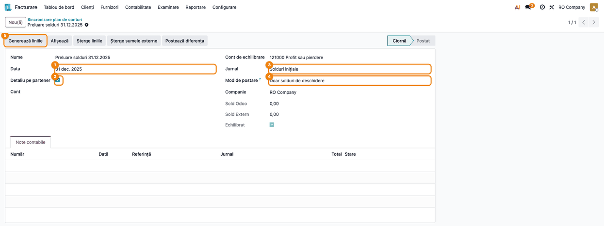
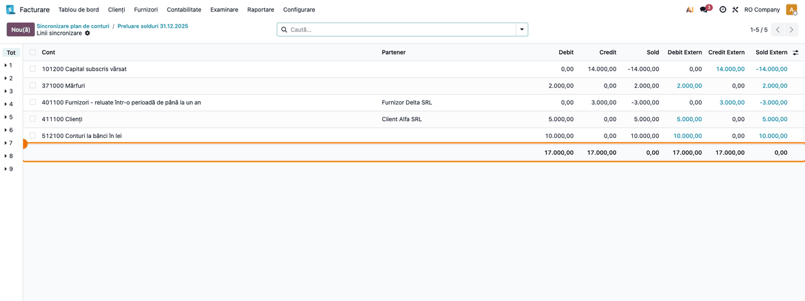
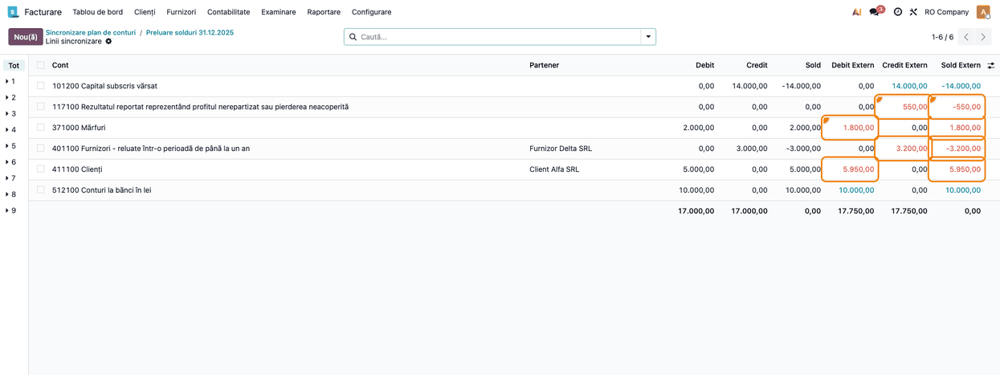
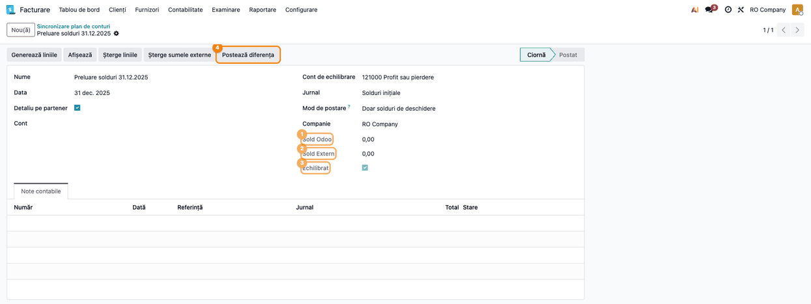
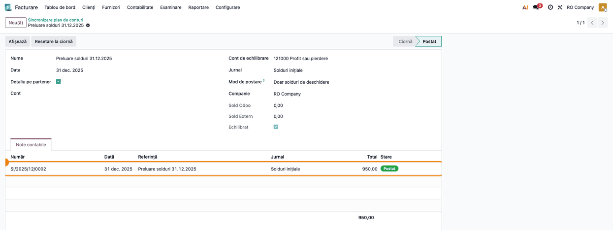
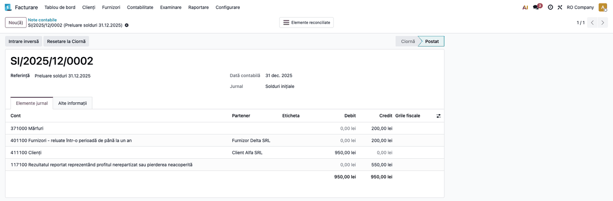
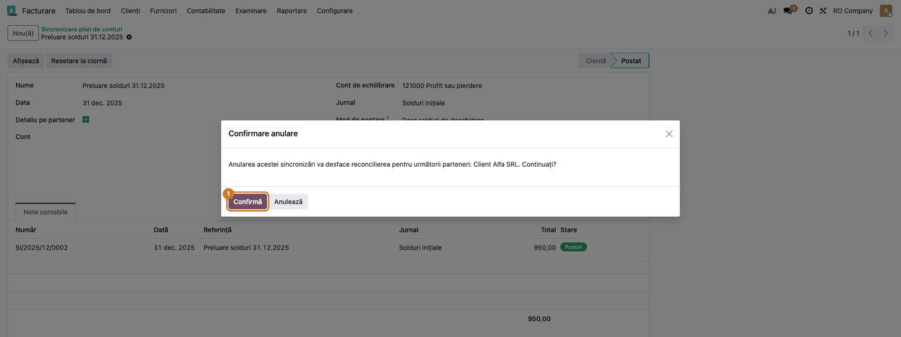

# Fișă Modul: Alinierea soldurilor din Odoo cu balanța unui alt sistem contabil

**Modul:** `deltatech_chart_of_accounts`
**Utilizator principal:** Contabil șef / consultant de implementare (preluarea soldurilor la intrarea în Odoo)
**Prioritate:** 🔴 Ridicată (la go-live: soldurile de deschidere greșite se propagă în toate raportările ulterioare)

---

## 1. Scop business

La intrarea în Odoo, soldurile conturilor trebuie să fie exact cele din balanța programului
anterior la data trecerii. De obicei, o parte din solduri ajung deja în Odoo pe alte căi: facturi
neîncasate importate, stocul inițial, extrase bancare. Restul trebuie completat, iar ce s-a
importat greșit trebuie corectat. Același lucru se întâmplă când un sistem contabil e ținut în
paralel o perioadă și balanța lui trebuie regăsită în Odoo.

Modulul calculează soldurile din Odoo la o dată și le pune lângă soldurile externe, cont cu cont
sau cont și partener. Valorile externe se introduc manual sau se importă dintr-un fișier.
Diferențele se văd pe ecran înainte de orice înregistrare. Apoi modulul generează **doar
diferența** ca notă contabilă, legată de sincronizare. Dacă o valoare a fost greșită, notele se
anulează și se reiau.

## 2. Bază legală și context

- **Legea contabilității nr. 82/1991, art. 6:** orice operațiune economico-financiară se
  consemnează într-un document justificativ. Pentru notele de ajustare generate aici, documentul
  justificativ este **balanța de verificare a sistemului anterior** la data trecerii, semnată de
  contabilul șef. Păstrați-o la dosarul de implementare, împreună cu sincronizarea.
- **OMFP 1802/2014, pct. 54 alin. (1) (principiul intangibilității):** bilanțul de deschidere al
  exercițiului corespunde bilanțului de închidere al exercițiului precedent.
  Preluarea în Odoo nu schimbă valori, ci doar le transferă, așa că balanța
  din Odoo la data trecerii trebuie să fie identică cu cea externă, cont cu cont și pe partener la
  conturile de terți.
- **Context operațional:** modulul nu încarcă planul de conturi. Conturile trebuie să existe deja
  în Odoo (planul de conturi RO). Modulul înregistrează în jurnalul ales, la data sincronizării.

## 3. Utilizatori și roluri

| Rol | Ce face | Drept recomandat la test |
|---|---|---|
| Contabil șef / consultant de implementare | creează sincronizarea, importă balanța externă, verifică diferențele și postează notele | Contabilitate: Administrator |
| Contabil | verifică notele generate și fișele de cont după postare; nu vede sincronizarea | Contabilitate: Contabil sau Citire |

Meniul și toate operațiunile cer grupul **Contabilitate: Administrator**
(`account.group_account_manager`). Un utilizator fără acest grup nu vede meniul.

## 4. Conturi și date implicate

| Cont | Rol |
|---|---|
| orice cont din planul de conturi | contul ajustat cu diferența dintre soldul extern și cel din Odoo |
| 411100 Clienți / 401100 Furnizori | ajustate pe partener, cu **Detaliu pe partener** |
| 121000 Profit sau pierdere | **Cont de echilibrare** al sincronizării, implicit; primește linia „Diferență” (vezi monografia). Nu alegeți aici 117100 Rezultatul reportat |
| 473000 Decontări din operațiuni în curs de clarificare | cont de echilibrare recomandat pentru sincronizările pe un singur cont (Pasul 1) și pentru modul **Potrivește totalurile debit/credit** |
| jurnal de tip Diverse | jurnalul notelor de ajustare (de exemplu *Solduri inițiale*) |

Date pentru demo, același exemplu în toate capturile. Firma intră în Odoo la 01.01.2026, iar
balanța programului anterior la 31.12.2025 arată astfel:

| Cont | Partener | Sold Odoo (deja preluat) | Sold extern | Diferență de înregistrat |
|---|---|---|---|---|
| 101200 Capital subscris vărsat | | 14.000,00 C | 14.000,00 C | — |
| 117100 Rezultatul reportat | | — | 550,00 C | 550,00 C |
| 371000 Mărfuri | | 2.000,00 D | 1.800,00 D | 200,00 C |
| 411100 Clienți | Client Alfa SRL | 5.000,00 D | 5.950,00 D | 950,00 D |
| 401100 Furnizori | Furnizor Delta SRL | 3.000,00 C | 3.200,00 C | 200,00 C |
| 512100 Conturi la bănci în lei | | 10.000,00 D | 10.000,00 D | — |

Planul de conturi RO din Odoo folosește coduri de 6 cifre: contul sintetic 4111 apare ca 411100,
iar 401100 este un analitic al contului 401 Furnizori.

Ambele balanțe sunt echilibrate (17.000 = 17.000 în Odoo, 17.750 = 17.750 extern), așa că suma
diferențelor e zero și nota nu are linie pe 121000.

## 5. Configurare inițială

1. Instalați `deltatech_chart_of_accounts`. Verificați că planul de conturi RO e instalat și că
   toate conturile din balanța externă există în Odoo.
2. Creați jurnalul pentru notele de ajustare: **Facturare → Configurare → Contabilitate →
   Jurnale**, tip **Diverse**, de exemplu *Solduri inițiale*. Sincronizarea propune primul jurnal
   de tip Diverse al firmei.
3. Verificați contul de tip „rezultat curent” al planului (121000 Profit sau pierdere).
   Sincronizarea îl propune ca **Cont de echilibrare**.
4. Verificați datele de blocare a contabilității (cu modulul Accountant, din meniul datelor de
   blocare; altfel, cu administratorul): notele se înregistrează la data trecerii, care nu
   trebuie să fie într-o perioadă blocată. Alegeți un jurnal fără securizarea înregistrărilor:
   notele securizate nu mai pot fi resetate la ciornă.
5. Pentru import, pregătiți câte un fișier CSV sau Excel **pe fiecare cont de terți** (411100,
   401100...), cu coloanele: partener, debit extern, credit extern. Partenerii trebuie să existe
   în Odoo cu același nume, iar două firme cu același nume trebuie deosebite înainte de import.

## 6. Flux de utilizare

Coloanele **Debit** și **Credit** ale liniilor sunt **rulajele cumulate** din Odoo până la dată
(toate debitele, respectiv toate creditele), iar **Sold** este diferența lor. Pentru go-live, cu
modul **Doar solduri de deschidere**, comparați **Sold** cu **Sold Extern** și introduceți soldul
extern pe o singură parte (debit sau credit).

### Pasul 1 — Crearea sincronizării

**Facturare → Configurare → Contabilitate → Sincronizare plan de conturi** (cu modulul
Accountant, aplicația se numește **Contabilitate**), butonul **Nou**. Completați:

- **Nume** și **Data**: data la care se compară soldurile, aici 31.12.2025. La această dată se
  vor înregistra și notele.
- **Detaliu pe partener**: bifați pentru conturile de terți (411100, 401100). Liniile se generează pe
  fiecare cont și partener.
- **Cont** (opțional): un singur cont. Gol înseamnă toate conturile firmei. Completați-l pentru
  importul pe parteneri al unui cont de terți (Pasul 3). La o asemenea sincronizare, alegeți ca
  **Cont de echilibrare** un cont tehnic, de exemplu 473000: diferența netă a contului merge acolo,
  iar sincronizarea globală de la final închide soldul lui 473000.
- **Cont de echilibrare**, **Jurnal** și **Mod de postare**: aici **Doar
  solduri de deschidere**.



### Pasul 2 — Generarea liniilor cu soldurile din Odoo

Apăsați **Generează liniile**, apoi **Afișează**. Se deschide lista **Linii sincronizare**.

1. **Găsiți pe ecran:** pe fiecare rând, contul și (cu detaliul pe partener) partenerul; coloanele
   **Debit**, **Credit** și **Sold** din Odoo la dată; coloanele **Debit Extern**, **Credit
   Extern** și **Sold Extern**. Coloanele **Referință** și **Scadență** se activează din selectorul
   de coloane al listei. La subsolul listei sunt totalurile. În stânga, panoul pe clase de conturi
   (1–9) filtrează liniile.
2. **Verificați:** coloana **Sold** se potrivește cu balanța de verificare din Odoo la
   31.12.2025, iar totalul ei este 0,00. Cu **Detaliu pe partener** apar doar conturile cu
   mișcări în Odoo; fără bifă apar toate conturile, cele fără mișcări cu 0. La prima
   generare, coloanele externe sunt completate cu valorile din Odoo, deci încă nu apare nicio
   diferență (sumele egale apar cu albastru).



### Pasul 3 — Completarea valorilor externe

Introduceți **Debit Extern** și **Credit Extern** direct în listă:

- un cont fără sold în balanța externă primește 0 în ambele coloane; altfel păstrează valorile
  din Odoo și nu se ajustează;
- un cont (sau partener) din balanța externă fără mișcări în Odoo nu are linie: apăsați
  **Nou(ă)** în listă, alegeți contul (și partenerul) și completați suma externă. În exemplu:
  117100, **Credit Extern** 550.

Pentru conturile de terți cu mulți parteneri, folosiți importul, câte o sincronizare pe fiecare
cont (cu **Cont** și **Detaliu pe partener** completate): din lista deschisă cu **Afișează**,
meniul cu roata dințată de lângă titlu, opțiunea **Importați înregistrări**. Importul se
potrivește **după partener**:

- un rând al cărui partener are deja o linie o **actualizează**, așa că un al doilea import nu
  dublează soldurile;
- un partener fără linie primește o linie nouă pe contul sincronizării;
- un fișier fără coloana de partener nu se potrivește: creează linii noi, deci dublează
  soldurile. Folosiți-l doar după **Șterge liniile**, apoi apăsați **Generează liniile**, ca să se
  completeze rulajele din Odoo pe liniile importate, și verificați coloana **Sold** înainte de
  postare. Fără regenerare, **Sold** rămâne 0, iar nota ar posta tot soldul extern peste cel deja
  existent în Odoo;
- butonul **Șterge sumele externe** de pe sincronizare pune pe 0 toate valorile externe, înainte
  de un import complet nou.

Partenerii se recunosc după nume. La două firme cu același nume, importul se oprește; folosiți
în fișier codul fiscal sau ID-ul partenerului din Odoo.



1. **Găsiți pe ecran:** valorile externe care diferă de cele din Odoo apar cu **roșu**, cele
   egale și nenule cu **albastru**. În exemplu: 117100, 371000, 401100 Furnizor Delta SRL și
   411100 Client Alfa SRL.
2. **Verificați:**
   - pe fiecare rând, **Sold Extern** este soldul din balanța externă semnată;
   - totalul coloanei **Sold Extern** este 0,00, iar totalurile **Debit Extern** și **Credit
     Extern** sunt egale (17.750,00);
   - fiecare rând roșu e o diferență explicată (aici: 950 la Client Alfa SRL, 200 la Furnizor
     Delta SRL, 200 la stoc, 550 rezultat reportat);
   - la conturile de terți, suma pe parteneri este egală cu soldul contului din balanța externă.

### Pasul 4 — Verificarea echilibrului pe sincronizare

Reveniți pe sincronizare (clic pe numele ei în calea de navigare). **Sold Odoo** și **Sold
Extern** sunt sumele soldurilor tuturor liniilor.

1. **Găsiți pe ecran:** cele două sume și, sub ele, bifa **Echilibrat**, pusă când sumele sunt
   egale.
2. **Verificați:** **Echilibrat** e bifat. Pe o sincronizare a tuturor conturilor, cu două
   balanțe echilibrate, ambele sume sunt 0,00 (pe o sincronizare pe un singur cont, ele sunt
   soldul contului). Fără bifă, valorile externe nu sunt echilibrate (un rând lipsă sau greșit):
   nota ar primi o linie pe contul de echilibrare (implicit 121000), care ascunde eroarea.
   Corectați valorile înainte de postare. Excepție: pe o sincronizare pe un singur cont, cu
   473000 cont de echilibrare, **Echilibrat** lipsește prin construcție; verificați atunci că diferența dintre
   **Sold Extern** și **Sold Odoo** este cea așteptată pentru cont.



### Pasul 5 — Postarea diferenței

Apăsați **Postează diferența** pe formularul sincronizării. (Butonul există și în lista liniilor,
dar postează **doar rândurile selectate** și trece totuși sincronizarea în **Postat**; folosiți-l
doar cu toate rândurile selectate.) Modulul:

- creează și validează nota de ajustare în jurnalul ales, la data sincronizării, cu referința
  egală cu numele sincronizării;
- pune câte o linie pe fiecare cont (și partener) cu diferență; liniile fără diferență nu apar;
- adaugă o linie **Diferență** pe contul de echilibrare doar dacă nota nu se închide;
- trece sincronizarea în **Postat** și regenerează liniile: acum **Sold** este egal cu **Sold
  Extern** pe fiecare rând. Coloanele **Debit** și **Credit** pot rămâne roșii, pentru că modul
  acesta aliniază soldul, nu rulajele (în exemplu, 371000 are rulaj creditor 200 în Odoo, față
  de 0 extern).

Nota apare în tabul **Note contabile** al sincronizării, cu număr, dată, referință, jurnal, total
și stare. Un clic pe rând o deschide.





### Pasul 6 — Corectarea unei valori după postare

Dacă după postare se descoperă o valoare externă greșită, apăsați **Resetare la ciornă**:
notele sincronizării se trec în ciornă și se **șterg**, iar liniile se regenerează. Corectați
valoarea și postați din nou.

Dacă între timp liniile notei au fost reconciliate (în exemplu, soldul inițial al lui Client Alfa
SRL a fost încasat pe 15.01.2026), apare o confirmare cu partenerii afectați. **Confirmă** anulează
notele și desface acele reconcilieri, care trebuie refăcute după repostare. **Anulează** lasă
sincronizarea neschimbată.



### Note de monografie și raportare

**Mod „Doar solduri de deschidere”** (exemplul din secțiunea 4, nota din 31.12.2025):

| Cont | Partener | Debit | Credit |
|---|---|---|---|
| 371000 Mărfuri | | | 200,00 |
| 401100 Furnizori | Furnizor Delta SRL | | 200,00 |
| 411100 Clienți | Client Alfa SRL | 950,00 | |
| 117100 Rezultatul reportat | | | 550,00 |

Regula: diferența de sold pozitivă (soldul extern mai mare spre debit) se înregistrează în debit,
cea negativă în credit, doar cu sume pozitive. Conturile de tip „rezultat curent” (121000) nu se
ajustează direct. Contul de echilibrare primește o linie **Diferență** doar dacă suma diferențelor
nu e zero:

| Cont | Debit | Credit |
|---|---|---|
| 121000 Profit sau pierdere (linia „Diferență”) | dacă debitele < creditele | dacă debitele > creditele |

**Soldul contului 121 la data trecerii.** O balanță la 31.12, înainte de repartizarea profitului,
are de obicei sold pe 121. Rândul 121000 nu se ajustează direct, deci diferența lui ajunge pe 121000
prin linia „Diferență”. În acest caz linia e corectă dacă e egală cu diferența de sold a rândului
121000 (de exemplu, profit 8.000 în balanța externă și 0 în Odoo: linia „Diferență” e Cr 121000
8.000). Orice altă valoare a liniei semnalează o eroare de introducere.

**Sincronizarea pe un singur cont** (import pe parteneri, Pasul 1), cu 473000 cont de echilibrare.
Exemplu: clienții au în balanța externă 5.950 și în Odoo 0:

| Cont | Debit | Credit |
|---|---|---|
| 411100 Clienți (pe fiecare partener) | 5.950,00 | |
| 473000 Decontări din operațiuni în curs de clarificare („Diferență”) | | 5.950,00 |

În sincronizarea globală de la final, linia 473000 pornește cu valorile din Odoo (credit 5.950)
și în coloanele externe: puneți 0 pe **Debit Extern** și **Credit Extern**, iar nota ei închide
473000.

**Mod „Potrivește totalurile debit/credit”**, folosit când trebuie aliniate și rulajele, nu doar
soldul (de exemplu un sistem ținut în paralel). Fiecare cont primește separat diferența de debit
și diferența de credit. Exemplu: în sistemul paralel s-a înregistrat o încasare de 50 de la Client
Alfa SRL care lipsește din Odoo:

| Cont | Rulaj Odoo D / C | Rulaj extern D / C |
|---|---|---|
| 411100 Clienți — Client Alfa SRL | 5.000 / 0 | 5.000 / 50 |
| 512100 Conturi la bănci în lei | 10.000 / 0 | 10.050 / 0 |

| Cont | Debit | Credit |
|---|---|---|
| 512100 Conturi la bănci în lei | 50,00 | |
| 411100 Clienți — Client Alfa SRL | | 50,00 |

Diferențele se închid între ele, deci nota nu are linie pe contul de echilibrare.

Când rulajul extern e **mai mic** decât cel din Odoo, corecția se scrie ca **notă storno
separată** (sumă negativă pe aceeași parte). La o firmă din România, contabilitatea în roșu e
activă implicit în Odoo, deci acest caz apare mereu. Fiecare dintre cele două note se echilibrează
separat: dacă o sincronizare are și diferențe pozitive, și negative, notele care nu se închid
singure primesc câte o linie „Diferență” pe contul de echilibrare, în oglindă (se anulează
reciproc, dar umflă rulajul contului). De aceea, în acest mod, alegeți 473000 ca **Cont de
echilibrare**, nu 121000.
Fără contabilitate în roșu, diferența negativă trece în nota obișnuită pe partea
opusă (un debit negativ devine credit).

**TVA:** modulul nu generează linii de TVA. Soldurile 4426, 4427 și 4428 se preiau ca orice alt
cont, la valoarea din balanța externă.

## 7. Legături cu alte module / declarații

| Modul | Rol |
|---|---|
| `account` | conturile, jurnalele și notele contabile |
| `l10n_ro` | planul de conturi RO și contul 121000 de tip rezultat curent |
| `account` (contabilitate în roșu) | notele storno ale modului **Potrivește totalurile debit/credit**; activă implicit la firmele din România |
| `base_import` | importul valorilor externe din CSV sau Excel |

**Ce e automat:** calculul soldurilor din Odoo la dată, evidențierea diferențelor, potrivirea
importului pe partener, nota de ajustare echilibrată, legarea ei de sincronizare și anularea ei
la resetare.

**Ce rămâne manual:** pregătirea balanței externe, verificarea diferențelor rând cu rând,
alegerea modului de postare și refacerea reconcilierilor după o resetare.

**Declarații:** notele de ajustare intră în balanță și în fișele de cont ca orice notă din jurnalul
ales. Datate la data trecerii, ele nu modifică declarațiile perioadelor următoare, ci doar
soldurile de deschidere ale acestora.

## 8. Verificări pentru consultant

- [ ] Toate conturile din balanța externă există în Odoo.
- [ ] Jurnalul ales e de tip Diverse și e dedicat soldurilor inițiale.
- [ ] **Data** este data trecerii (sfârșitul exercițiului anterior).
- [ ] La conturile de terți s-a folosit **Detaliu pe partener**.
- [ ] Coloana **Sold** corespunde balanței din Odoo la dată, cu total 0,00.
- [ ] Coloana **Sold Extern** corespunde balanței externe semnate, cu total 0,00.
- [ ] Fiecare rând roșu are o explicație.
- [ ] **Sold Odoo** și **Sold Extern** sunt egale și **Echilibrat** e bifat înainte de postare (cu
      excepția sincronizărilor pe un singur cont cu 473000, vezi Pasul 4).
- [ ] Nota postată nu are linie „Diferență” pe 121000 sau linia e egală cu diferența rândului
      121000 (profitul exercițiului din balanța externă).
- [ ] După postare, **Sold** este egal cu **Sold Extern** pe fiecare rând, iar balanța din Odoo la
      data trecerii este identică cu cea externă.
- [ ] Soldurile clienților și furnizorilor apar pe fișele partenerilor, gata de reconciliat cu
      încasările și plățile ulterioare.

## 9. Mesaje de eroare frecvente

| Mesaj | Cauză | Remediere |
|---|---|---|
| „Diferențele sunt deja postate. Folosiți „Resetare la ciornă” înainte de a posta din nou.” | sincronizarea e deja **Postat** | **Resetare la ciornă**, corectați și postați din nou |
| „Puteți posta diferențe pentru o singură sincronizare odată.” | în listă sunt selectate linii din mai multe sincronizări | deschideți liniile cu **Afișează** de pe o singură sincronizare |
| „Există mai mulți parteneri cu numele „…”. Deosebiți-i prin codul fiscal sau prin ID-ul din baza de date.” | la import, numele partenerului se potrivește cu mai mulți parteneri | folosiți în fișier ID-ul partenerului sau unificați partenerii duplicați |
| „Sincronizarea nu are un cont; linia nu poate fi creată.” (avertisment la import) | partener fără linie, pe o sincronizare fără **Cont** | completați **Cont** pe sincronizare, regenerați liniile și reimportați |
| eroare de firmă la salvare | contul, jurnalul sau contul de echilibrare aparține altei firme | alegeți conturi și jurnal ale firmei sincronizării |
| „Anularea acestei sincronizări va desface reconcilierea pentru următorii parteneri: …. Continuați?” | la resetare, notele au linii reconciliate | **Confirmă** și refaceți reconcilierile după repostare, sau **Anulează** |
| eroare de dată de blocare la postare sau la **Resetare la ciornă** | data sincronizării este într-o perioadă blocată (de exemplu exercițiul 2025 deja închis) sau jurnalul are înregistrări securizate | administratorul ridică temporar data de blocare (cu modulul Accountant, din meniul datelor de blocare), apoi o repune; notele dintr-un jurnal securizat nu pot fi resetate, de aceea folosiți de la început un jurnal fără securizare |

## 10. Capturi de ecran

Capturile (`static/description/`) sunt **generate automat** din `tests/test_screenshots.py`
(mixinul `ScreenshotCase` din `l10n_ro_doc_screenshots`, import defensiv), în **limba română**,
pe planul de conturi RO (`setup_country("ro")`), cu datele din secțiunea 4:

1. `01_sincronizare_formular.png` — sincronizarea nouă: data, detaliul pe partener, jurnalul,
   contul de echilibrare și modul de postare.
2. `02_linii_generate.png` — lista **Linii sincronizare** generată, cu rulajele și soldurile din
   Odoo și totalurile.
3. `03_linii_diferente.png` — liniile după completarea valorilor externe, cu diferențele în roșu
   pe **Debit Extern**, **Credit Extern** și **Sold Extern**.
4. `04_sincronizare_echilibrata.png` — sincronizarea cu **Sold Odoo** și **Sold Extern** egale și
   **Echilibrat** bifat.
5. `05_sincronizare_postata.png` — sincronizarea în **Postat**, cu nota în tabul **Note contabile**.
6. `06_nota_ajustare.png` — nota de ajustare (371000, 401100, 411100, 117100).
7. `07_confirmare_resetare.png` — confirmarea resetării când nota are linii reconciliate.

Regenerare:

```bash
./odoo/odoo-bin -c odoo.conf -d <db> -i l10n_ro,deltatech_chart_of_accounts,l10n_ro_doc_screenshots \
    --test-tags=fise_screenshots --stop-after-init
```

## 11. Observații pentru manual

- Prezentați modulul ca instrument de **go-live**: balanța externă semnată la data trecerii este
  documentul justificativ al notelor.
- Păstrați exemplul numeric unic din secțiunea 4 în toate capturile și în monografie.
- Explicați de ce la prima generare nu apare nicio diferență (valorile externe pornesc de la cele
  din Odoo) și că un cont fără sold extern trebuie pus explicit pe 0.
- Subliniați că sincronizarea echilibrată (bifa **Echilibrat**) e condiția postării. Linia
  „Diferență” pe 121000 e corectă doar când preia profitul exercițiului din balanța externă;
  altfel semnalează o balanță externă introdusă incomplet.
- Explicați diferența dintre rulaje (**Debit**, **Credit**) și sold (**Sold**): la go-live se
  verifică soldul.
- Pentru importul pe parteneri, recomandați câte o sincronizare pe fiecare cont de terți, cu
  473000 cont de echilibrare, urmată de sincronizarea globală.
- Recomandați **Doar solduri de deschidere** pentru go-live și **Potrivește totalurile
  debit/credit** doar pentru sistemele ținute în paralel, unde contează și rulajele.
- Menționați că **Resetare la ciornă** șterge notele și desface reconcilierile făcute între timp.
