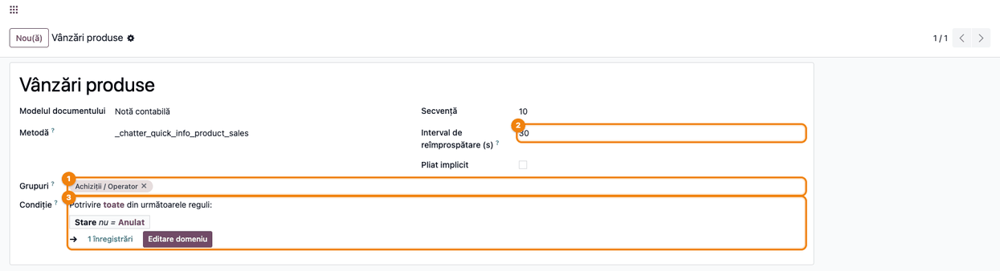
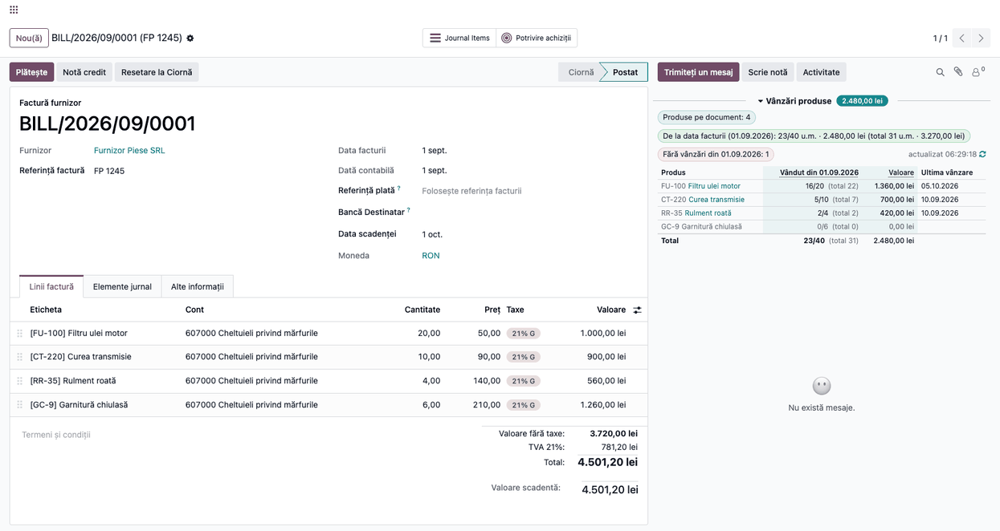
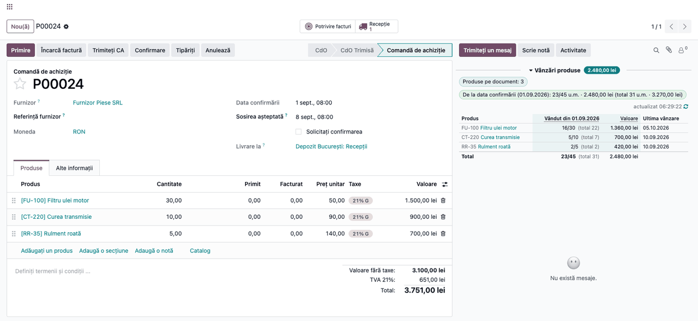

# Fișă Modul: Vânzările produselor, văzute din achiziții

**Modul:** `deltatech_chatter_quick_info_purchase`
**Utilizator principal:** Achizitor, responsabil aprovizionare
**Prioritate:** 🟡 Medie (decizia de reaprovizionare se ia cu vânzările reale în față, fără rapoarte separate)

---

## 1. Scop business

Când achizitorul se uită la o factură de furnizor sau la o comandă de achiziție, vrea să știe dacă
marfa cumpărată se vinde. Modulul adaugă în chatter-ul acestor documente panoul **Vânzări produse**:
pentru fiecare produs de pe document, cât s-a vândut de la data documentului încoace (din cantitatea
cumpărată), cât s-a vândut în total, valoarea fără TVA și data ultimei vânzări. Produsele care nu
s-au vândut deloc de la data documentului sunt numărate separat și apar cu gri, la finalul tabelului.

Achizitorul vede pe loc ce se mișcă și ce stă, înainte să comande din nou, fără să deschidă un raport
de vânzări și să filtreze pe produse.

## 2. Bază legală și context

Nu există o obligație legală. Este un instrument de decizie pentru aprovizionare: rotația mărfii se
judecă pe vânzările efective, nu pe stoc. Panoul nu modifică documentele și nu generează înregistrări
contabile; doar afișează date calculate în momentul deschiderii documentului.

## 3. Utilizatori și roluri

- **Achizitor** (grupul **Achiziții / Operator**) — vede panoul pe comenzile de achiziție și pe
  facturile de furnizor.
- **Administrator** — stabilește cine vede panoul și cât de des se reîmprospătează (meniu în modul
  dezvoltator).

Panoul afișează doar totaluri de vânzare, citite cu drepturi extinse: un achizitor fără drept de
citire pe comenzile de vânzare vede totuși cantitățile și valorile, dar nu poate deschide comenzile.

Roluri recomandate la testare:

- utilizator cu **Achiziții / Operator** — vede panoul;
- utilizator doar cu **Facturare** (fără achiziții) — nu vede panoul pe factura de furnizor.

## 4. Conturi și date implicate

Modulul **nu generează note contabile** și nu folosește conturi. Citește:

- liniile facturii de furnizor (sau ale rambursării de la furnizor) și ale comenzii de achiziție;
- liniile comenzilor de vânzare **confirmate** ale aceleiași companii (ofertele și comenzile anulate
  nu se numără).

Valorile sunt **fără TVA**, în moneda companiei: o comandă de vânzare în altă monedă se aduce la
moneda companiei la cursul comenzii.

**„Vândut" înseamnă cantitatea din comenzile de vânzare confirmate**, indiferent dacă marfa s-a
livrat sau s-a facturat. Retururile și notele de credit nu se scad, deci cifra nu este cifra de
afaceri (rulajul conturilor 70x). Cantitățile se adună în unitatea de măsură a fiecărei linii, fără
conversie (de aceea chip-ul scrie „u.m."); panoul e relevant pentru produsele cumpărate și vândute
în aceeași unitate. Ziua documentului începe la 00:00 în fusul orar al utilizatorului.

Pe o **rambursare de la furnizor** panoul arată, la fel, vânzările de la data documentului,
raportate la cantitatea returnată.

Date minime pentru demo:

- 3–4 produse;
- câteva comenzi de vânzare confirmate pe aceste produse, unele înainte de data facturii, altele după;
- o factură de furnizor cu data facturii fixată (ex. 01.09.2026) și o comandă de achiziție confirmată.

## 5. Configurare inițială

1. Instalați modulul **Chatter Quick Info: Product Sales on Purchases**. Se instalează automat
   cadrul **Chatter Quick Info** și, dacă lipsesc, aplicațiile **Vânzări**, **Achiziții** și
   **Facturare**: verificați cu clientul înainte, la o firmă care nu folosește Vânzări.
2. Atribuiți utilizatorilor grupul **Achiziții / Operator** (panoul se vede implicit acestui grup).
3. Opțional, în modul dezvoltator, schimbați cine vede panoul sau intervalul de reîmprospătare
   (vezi pasul 1 din flux).

## 6. Flux de utilizare

### Pasul 1 — Verificați cine vede panoul

Accesați **Setări → Tehnic → Interfață utilizator → Informații rapide în chatter** (modul dezvoltator) și
deschideți panoul **Vânzări produse** de pe **Notă contabilă** (există un al doilea, identic, pe
**Comandă de achiziție**). În **Grupuri** ① sunt utilizatorii care văd panoul; dacă lăsați câmpul
gol, îl văd toți cei care pot citi documentul. **Interval de reîmprospătare (s)** ② este 30: cât
timp documentul e deschis (și tab-ul browserului e vizibil), panoul se recalculează singur la 30 de
secunde. **Pliat implicit** deschide panoul pliat; câmpul **Metodă** este tehnic și nu se modifică.

**Condiție** ③ exclude documentele anulate: pe o comandă sau o factură anulată panoul nu apare. Condiția se poate schimba din același formular, fără cod.



### Pasul 2 — Citiți panoul pe factura de furnizor

Deschideți **Facturare (sau Contabilitate) → Furnizori → Facturi** și o factură de furnizor. Panoul **Vânzări
produse** apare deasupra mesajelor din chatter. Header-ele subliniate punctat au o explicație la
trecerea cu mouse-ul.

1. **Găsiți pe ecran:**
   - lângă titlul panoului, eticheta cu valoarea vândută **de la data facturii** până azi, fără TVA;
   - chip-urile: numărul de produse de pe document; chip-ul verde cu cantitatea vândută de la data
     facturii din cantitatea facturată și valoarea, iar în paranteză totalul de dintotdeauna;
     chip-ul roșu cu **numărul** produselor fără nicio vânzare de la data facturii;
   - tabelul: pe fiecare rând un produs, coloana **Vândut din <data>** (vândut/facturat și, gri,
     totalul de dintotdeauna), **Valoare** (la prețul de vânzare, fără TVA — nu e valoarea de achiziție) și **Ultima vânzare**.
2. **Verificați:**
   - data din titlul coloanei este **data facturii** de furnizor (pe o ciornă fără dată de factură,
     data contabilă);
   - produsele sunt ordonate după valoarea vândută de la data facturii, cele mai vândute primele; cele fără vânzări sunt gri, la
     final, și numărul lor este cel din chip-ul roșu;
   - totalul din chip-ul verde este suma rândurilor din tabel.
3. **Mai departe:** un clic pe numele produsului deschide fișa produsului; butonul de
   reîmprospătare din dreapta (↻) recalculează imediat.



### Pasul 3 — Același panou pe comanda de achiziție

Deschideți **Achiziții → Comenzi → Comenzi de achiziție** și o comandă. Panoul arată aceleași
informații, numărate de la **data confirmării** comenzii (dacă nu e confirmată, de la data comenzii),
de la începutul zilei.

1. **Găsiți pe ecran** chip-ul „De la data confirmării (…)" și tabelul: în coloana **Vândut din
   <data>**, cifra de după „/" este cantitatea comandată (ex. 16/30).
2. **Verificați** că data din chip și din titlul coloanei este data confirmării comenzii (câmpul
   **Data confirmării** din formular).
3. **Mai departe:** decideți pe produs dacă mai comandați; panoul nu modifică comanda.



### Note de monografie și raportare

Modulul **nu generează note contabile**. Valorile din panou sunt informative (vânzări fără TVA din
comenzile de vânzare confirmate) și nu înlocuiesc rapoartele de vânzări sau de stoc.

## 7. Legături cu alte module / declarații

| Modul | Rol | Legătură |
|-------|-----|----------|
| `deltatech_chatter_quick_info` | cadrul de panouri din chatter, meniul de configurare | dependență (manifest) |
| `purchase` | comenzile de achiziție | dependență (manifest) |
| `account` | facturile de furnizor | dependență (manifest) |
| `sale` | comenzile de vânzare din care se numără vânzările | dependență (manifest) |

Ce este automat: calculul vânzărilor la deschiderea documentului și la fiecare 30 de secunde,
ordonarea după vânzări, numărarea produselor fără vânzări.
Ce rămâne manual: decizia de achiziție; configurarea grupurilor și a intervalului.

## 8. Verificări pentru consultant

- [ ] Un utilizator cu **Achiziții / Operator** vede panoul pe factura de furnizor și pe comanda de
      achiziție; unul doar cu **Facturare** nu îl vede.
- [ ] Pe o factură de client panoul nu apare.
- [ ] Data din titlul coloanei este data facturii (la comandă: data confirmării, ca în chip-ul
      „De la data confirmării").
- [ ] O vânzare confirmată înainte de data facturii intră doar în totalul gri, nu în coloana de la data
      facturii.
- [ ] O ofertă neconfirmată nu se numără; după confirmare, panoul o include la următoarea
      reîmprospătare (30 s) sau la ↻.
- [ ] O vânzare a altei companii nu se numără.
- [ ] Pe o rambursare de la furnizor panoul apare, raportat la cantitatea returnată.
- [ ] Pentru un utilizator cu fusul orar Europe/Bucharest (Preferințe), o comandă confirmată după
      miezul nopții are în chip data zilei de confirmare.
- [ ] Produsele fără vânzări de la data documentului sunt gri și numărul lor apare în chip-ul roșu.
- [ ] Pe o comandă de achiziție anulată panoul nu apare (condiția implicită).

## 9. Mesaje de eroare frecvente

| Mesaj / simptom | Cauză probabilă | Remediere |
|-----------------|-----------------|-----------|
| Panoul nu apare | Documentul nu respectă **Condiția** panoului, utilizatorul nu e în grupul din definiția panoului, panoul e arhivat sau documentul e factură de client | Verificați **Condiție** și **Grupuri** (utilizatorul adăugat acum reîncarcă pagina, F5); dacă panoul lipsește din listă, aplicați filtrul **Arhivat** și **Acțiuni → Dezarhivează** |
| Panoul apare doar ca titlu | Panoul e pliat (bifa **Pliat implicit** sau utilizatorul l-a pliat) | Clic pe titlul panoului |
| „Panourile de informații nu au putut fi încărcate. Încearcă din nou" | Eroare de comunicare cu serverul | Apăsați **Încearcă din nou** sau reîncărcați pagina; dacă persistă, trimiteți jurnalul serverului la suport |
| Data din chip e cu o zi în urmă | Utilizatorul nu are fusul orar setat | **Preferințe → Fus orar**: Europe/Bucharest |
| Cantitățile vândut/cumpărat nu se potrivesc | Unități de măsură diferite pe achiziție și pe vânzare (bax / bucată) | Cifrele sunt în unitatea fiecărei linii; comparați pe aceeași unitate |
| „Panoul nu a putut fi calculat. Încearcă din nou" | Eroare la calcul (detaliul este în jurnalul serverului) | Apăsați **Încearcă din nou**; dacă persistă, trimiteți jurnalul serverului la suport |
| Vânzări care lipsesc | Comenzile nu sunt confirmate sau sunt pe altă companie | Confirmați comenzile; verificați compania documentului |
| „Document mare: se afișează primele 200 …" | Documentul are peste 200 de produse | Totalurile includ toate produsele; tabelul arată primele 200 |

## 10. Capturi de ecran

Capturile (`static/description/`) sunt generate automat din `tests/test_screenshots.py` (mixinul
`ScreenshotCase` din `l10n_ro_doc_screenshots`, import defensiv), în limba română, pe o companie RO:

1. `01_definitie_panou.png` — definiția panoului **Vânzări produse**: grupurile și intervalul de
   reîmprospătare.
2. `02_factura_furnizor.png` — factura de furnizor postată, cu panoul în chatter: valoarea vândută
   de la data facturii și produsul fără vânzări.
3. `03_comanda_achizitie.png` — comanda de achiziție cu tabelul de vânzări.

Regenerare:

```bash
./odoo/odoo-bin -c odoo.conf -d <db> -i l10n_ro,deltatech_chatter_quick_info_purchase \
    -u l10n_ro_doc_screenshots --test-tags=fise_screenshots --stop-after-init
```

## 11. Observații pentru manual

Păstrați în manual diferența dintre cele două cifre: **„de la data documentului"** spune dacă marfa
cumpărată acum se vinde, **„total"** spune dacă produsul s-a vândut vreodată. Un produs gri e marfă
care nu s-a mai vândut de la cumpărare — semnal de oprit reaprovizionarea. „Vândut" înseamnă comandat
în comenzi de vânzare confirmate, nu livrat sau facturat. Menționați că panoul se
recalculează singur cât timp documentul e deschis și că nu schimbă nimic pe document.
