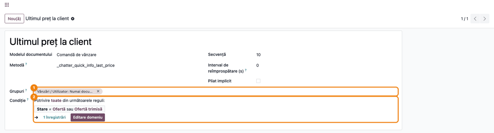
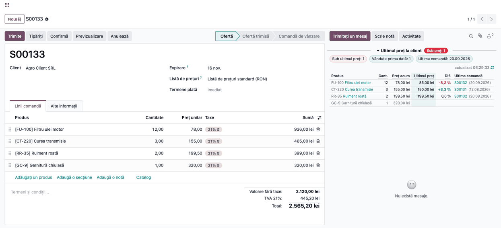

# Fișă Modul: Ultimul preț de vânzare la client

**Modul:** `deltatech_chatter_quick_info_sale`
**Utilizator principal:** Agent de vânzări, responsabil vânzări
**Prioritate:** 🟡 Medie (oferta se face cu prețul de data trecută în față, fără căutare în istoric)

---

## 1. Scop business

Când face o ofertă, agentul de vânzări vrea să știe la ce preț a vândut ultima dată același produs
aceluiași client. Modulul adaugă în chatter-ul ofertelor și al comenzilor de vânzare panoul
**Ultimul preț la client**: pentru fiecare linie, prețul de acum, ultimul preț, diferența în procente
(roșu dacă e mai mic, verde dacă e mai mare) și comanda din care vine ultimul preț.

Agentul vede pe loc o ofertă sub prețul anterior — o scăpare sau un discount neintenționat — și
produsele pe care clientul le cumpără prima dată.

## 2. Bază legală și context

Nu există o obligație legală. Este un control comercial: prețul negociat cu un client se păstrează de
la o comandă la alta, iar o abatere trebuie să fie o decizie, nu o întâmplare. Panoul nu modifică
documentul și nu generează înregistrări contabile.

## 3. Utilizatori și roluri

- **Agent de vânzări** (grupul **Vânzări / Utilizator: Numai documente proprii** sau mai mult) —
  vede panoul pe oferte și comenzi.
- **Administrator** — stabilește cine vede panoul (meniu în modul dezvoltator).

Ultimul preț se caută în **toate** comenzile clientului, inclusiv ale colegilor, chiar dacă agentul
vede doar documentele proprii: panoul arată prețul și numărul comenzii, iar deschiderea comenzii
rămâne supusă drepturilor obișnuite.

Roluri recomandate la testare:

- agent cu **Utilizator: Numai documente proprii**, pe un client cu o comandă anterioară făcută de un coleg;
- utilizator fără drepturi de vânzări — nu vede panoul.

## 4. Conturi și date implicate

Modulul **nu generează note contabile** și nu folosește conturi. Citește liniile comenzilor de
vânzare **confirmate** ale aceleiași companii, pentru **firma-mamă** a clientului: intră și comenzile
făcute pe persoanele de contact sau pe adresele de livrare ale firmei. Comanda deschisă nu se
compară cu ea însăși.

Prețul comparat este **prețul unitar după discount, fără TVA** (subtotalul liniei împărțit la
cantitate, deci fără TVA și când taxa e inclusă în preț):

- se aduce la unitatea de măsură a liniei curente (120 lei pe duzină devine 10 lei pe bucată);
- dacă ultima comandă e în altă monedă, se convertește în moneda ofertei la cursul de azi
  (tooltip-ul prețului o spune).

Date minime pentru demo:

- un client firmă cu o persoană de contact;
- două comenzi confirmate la date diferite, una pe firmă și una pe persoana de contact, cu prețuri
  diferite și, pe o linie, un discount;
- o ofertă nouă cu un preț mai mic, unul mai mare și un produs nou pentru client.

## 5. Configurare inițială

1. Instalați modulul **Chatter Quick Info: Last Price to the Customer**. Se instalează automat și
   cadrul **Chatter Quick Info**.
2. Panoul se vede implicit utilizatorilor de vânzări. Opțional, în modul dezvoltator, restrângeți
   grupurile (vezi pasul 1).

## 6. Flux de utilizare

### Pasul 1 — Verificați cine vede panoul

Accesați **Setări → Tehnic → Interfață utilizator → Informații rapide în chatter** (modul
dezvoltator) și deschideți panoul **Ultimul preț la client**. În **Grupuri** ① sunt utilizatorii
care văd panoul (implicit **Vânzări / Utilizator: Numai documente proprii**, care include și
grupurile superioare; în captură eticheta e prescurtată de interfață); un câmp gol înseamnă toți cei care pot citi documentul. Panoul nu are
reîmprospătare automată: ultimul preț se schimbă doar când se confirmă sau se anulează alte comenzi
ale clientului. Câmpul **Metodă** este tehnic și nu se modifică.

**Condiție** ② limitează panoul la oferte (Ofertă și Ofertă trimisă): după **Confirmă** panoul dispare, pentru că prețul nu se mai negociază. Condiția se poate schimba din același formular, fără cod.



### Pasul 2 — Citiți panoul pe ofertă

Deschideți **Vânzări → Comenzi → Oferte** și o ofertă. Panoul **Ultimul preț la client** apare
deasupra mesajelor din chatter.

1. **Găsiți pe ecran:**
   - eticheta roșie de lângă titlul panoului, „Sub preț: N", cu numărul de produse sub ultimul preț
     (lipsește când nu e niciunul);
   - chip-urile: **numărul** produselor sub ultimul preț, **numărul** produselor vândute prima dată
     acestui client și data ultimei comenzi a clientului;
   - tabelul: **Cant.** (cantitatea de pe ofertă), **Preț acum** (prețul de pe linie după discount), **Ultimul preț** (cu tooltip:
     comanda, cantitatea, unitatea și prețul de atunci), **Dif.** în procente și **Ultima comandă**,
     cu data în paranteză. Header-ele subliniate punctat au o explicație la trecerea cu mouse-ul.
2. **Verificați:**
   - un **Dif.** roșu înseamnă preț mai mic decât data trecută: este o decizie comercială sau o
     greșeală? Diferențele sub 0,05% (rotunjiri) rămân necolorate;
   - un rând estompat, fără ultim preț și fără ultima comandă, este un produs vândut prima dată
     clientului;
   - ultima comandă aparține clientului (sau unei persoane de contact a lui), nu altui client.
3. **Mai departe:** un clic pe numărul comenzii o deschide. Corectați prețul pe linie dacă e cazul,
   **salvați oferta**, apoi apăsați ↻ (Actualizează acum): panoul citește oferta salvată.



### Note de monografie și raportare

Modulul **nu generează note contabile**. Prețurile din panou sunt informative și nu modifică lista
de prețuri sau liniile ofertei.

## 7. Legături cu alte module / declarații

| Modul | Rol | Legătură |
|-------|-----|----------|
| `deltatech_chatter_quick_info` | cadrul de panouri din chatter, meniul de configurare | dependență (manifest) |
| `sale` | ofertele și comenzile de vânzare | dependență (manifest) |

Ce este automat: căutarea ultimei comenzi confirmate pe produs și client, conversia de unitate și
monedă, diferența procentuală și colorarea ei.
Ce rămâne manual: decizia de preț pe ofertă; configurarea grupurilor.

## 8. Verificări pentru consultant

- [ ] Pe o ofertă cu un preț mai mic decât ultima comandă confirmată, **Dif.** este roșu și eticheta
      arată „Sub preț: 1".
- [ ] O comandă anterioară făcută pe o persoană de contact a clientului este găsită ca ultim preț.
- [ ] Un discount pe linia anterioară este scăzut din ultimul preț (100 lei cu 10% = 90 lei).
- [ ] O comandă anterioară în duzini e adusă la bucată (120 lei/duzină → 10 lei/buc).
- [ ] O ofertă neconfirmată sau o comandă a altui client nu este luată ca ultim preț.
- [ ] Un agent cu doar documentele proprii vede ultimul preț dintr-o comandă a unui coleg.
- [ ] Un produs vândut prima dată clientului are rândul estompat, fără ultim preț, și e numărat în
      chip.
- [ ] Pe o linie cu taxă inclusă în preț, **Preț acum** este fără TVA.
- [ ] După corectarea prețului, salvarea ofertei și ↻, **Dif.** se actualizează.
- [ ] După **Confirmă** panoul dispare de pe comandă (condiția implicită: doar oferte).

## 9. Mesaje de eroare frecvente

| Mesaj / simptom | Cauză probabilă | Remediere |
|-----------------|-----------------|-----------|
| Panoul nu apare | Documentul nu respectă **Condiția** panoului, utilizatorul nu e în grupul din definiția panoului sau panoul e arhivat | Verificați **Condiție** și **Grupuri** (utilizatorul adăugat acum reîncarcă pagina, F5); dacă panoul lipsește din listă, aplicați filtrul **Arhivat** și **Acțiuni → Dezarhivează** |
| Panoul apare doar ca titlu | Panoul e pliat (bifa **Pliat implicit** sau utilizatorul l-a pliat) | Clic pe titlul panoului |
| „Panourile de informații nu au putut fi încărcate. Încearcă din nou" | Eroare de comunicare cu serverul | Apăsați **Încearcă din nou** sau reîncărcați pagina; dacă persistă, trimiteți jurnalul serverului la suport |
| **Dif.** nu se schimbă după corectarea prețului | Oferta nu e salvată | Salvați oferta și apăsați ↻ |
| „Panoul nu a putut fi calculat. Încearcă din nou" | Eroare la calcul (detaliul este în jurnalul serverului) | Apăsați **Încearcă din nou**; dacă persistă, trimiteți jurnalul serverului la suport |
| Lipsește ultimul preț deși clientul a mai cumpărat | Comanda anterioară nu e confirmată, e pe altă companie sau pe alt client (nu pe firma-mamă) | Verificați starea, compania și clientul comenzii anterioare |
| Ultimul preț pare greșit | Unitate de măsură sau monedă diferită | Citiți tooltip-ul **Ultimul preț**: arată prețul original și conversia |

## 10. Capturi de ecran

Capturile (`static/description/`) sunt generate automat din `tests/test_screenshots.py` (mixinul
`ScreenshotCase` din `l10n_ro_doc_screenshots`, import defensiv), în limba română, pe o companie RO:

1. `01_definitie_panou.png` — definiția panoului **Ultimul preț la client**: grupurile.
2. `02_oferta_ultimul_pret.png` — oferta cu panoul în chatter: un preț sub ultimul, unul peste, un
   discount anterior și un produs vândut prima dată.

Regenerare:

```bash
./odoo/odoo-bin -c odoo.conf -d <db> -i l10n_ro,deltatech_chatter_quick_info_sale \
    -u l10n_ro_doc_screenshots --test-tags=fise_screenshots --stop-after-init
```

## 11. Observații pentru manual

Păstrați regula simplă: **roșu în coloana Dif. înseamnă „mai ieftin decât data trecută"** — nu e o
eroare, ci o întrebare pentru agent. Explicați că ultimul preț vine din comenzi confirmate, după
discount și fără TVA, pentru toată firma clientului, și că prețul e adus la unitatea și moneda liniei
curente.
