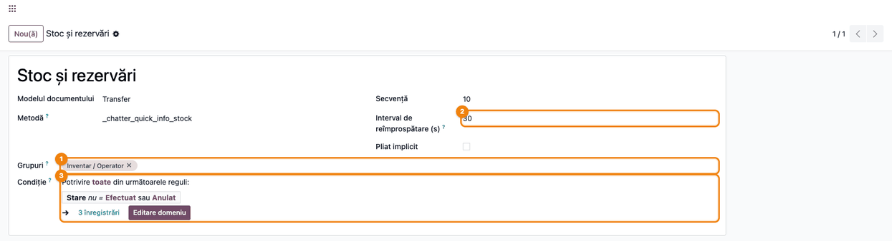
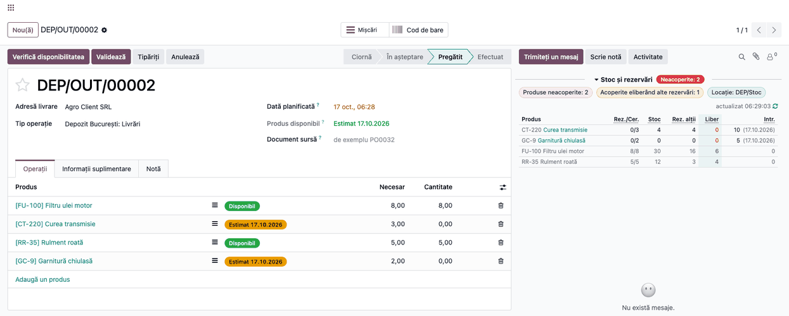
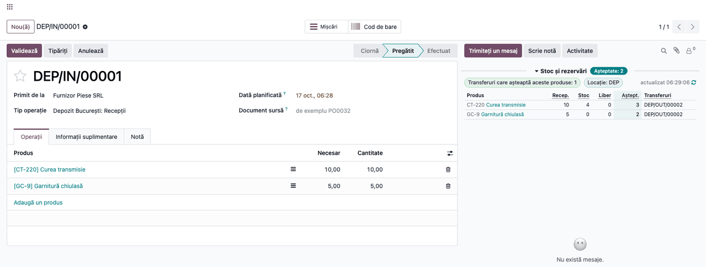

# Fișă Modul: Stoc și rezervări pe transfer

**Modul:** `deltatech_chatter_quick_info_stock`
**Utilizator principal:** Gestionar, operator depozit, responsabil livrări
**Prioritate:** 🟡 Medie (ce poate pleca și ce blochează livrarea, direct pe transfer)

---

## 1. Scop business

Pe o livrare care nu poate fi rezervată complet, gestionarul vrea să știe de ce: nu e marfă, sau
marfa e rezervată pe alte transferuri? Când vine o recepție, vrea să știe ce livrări o așteaptă.
Modulul adaugă în chatter-ul transferurilor panoul **Stoc și rezervări**:

- pe **livrări și transferuri interne**: pentru fiecare produs, cât e rezervat pe transfer din cât se
  cere, stocul din locația sursă, cât e rezervat de alte transferuri (și de care), cât e liber și ce
  intrări sunt așteptate;
- pe **recepții**: stocul din tot depozitul și transferurile deschise care așteaptă produsul.

Gestionarul vede pe loc produsele neacoperite și pe cele care s-ar acoperi dacă s-ar elibera
rezervările altor transferuri, fără să deschidă prognoza fiecărui produs.

## 2. Bază legală și context

Nu există o obligație legală. Este un instrument operațional de depozit. Panoul nu rezervă, nu
eliberează și nu validează nimic: doar afișează situația stocului în momentul deschiderii
transferului și o recalculează periodic.

## 3. Utilizatori și roluri

- **Operator depozit / gestionar** (grupul **Inventar / Operator**) — vede panoul pe transferuri.
- **Administrator** — stabilește cine vede panoul și cât de des se reîmprospătează (meniu în modul
  dezvoltator).

Rezervările și intrările se citesc pe toate transferurile, ca în raportul de prognoză al produsului.

Roluri recomandate la testare:

- utilizator cu **Inventar / Operator** — vede panoul;
- utilizator doar cu drepturi de **Vânzări** (cu aplicația Vânzări instalată), care deschide livrarea
  din comandă — citește transferul,
  dar nu vede panoul.

## 4. Conturi și date implicate

Modulul **nu generează note contabile** și nu folosește conturi. Citește, doar pentru produsele
**stocabile** de pe transfer:

- stocul fizic și rezervările din locația sursă a transferului și din sublocațiile ei (livrări și
  transferuri interne), respectiv din tot depozitul (recepții: marfa poate intra în *Intrare*, nu
  direct în *Stoc*, la recepția în 2–3 pași);
- mișcările deschise (în așteptare, confirmate, parțial disponibile, pregătite) ale acelorași produse.

Date minime pentru demo:

- un depozit cu 3–4 produse stocabile, cu stoc diferit (unul fără stoc);
- o livrare anterioară care rezervă o parte din stoc;
- o livrare nouă care nu poate fi rezervată complet;
- o recepție deschisă pentru produsele lipsă.

## 5. Configurare inițială

1. Instalați modulul **Chatter Quick Info: Stock and Reservations**. Se instalează automat și cadrul
   **Chatter Quick Info**.
2. Atribuiți utilizatorilor grupul **Inventar / Operator** (panoul se vede implicit acestui grup).
3. Opțional, în modul dezvoltator, schimbați grupurile sau intervalul de reîmprospătare (pasul 1).

## 6. Flux de utilizare

### Pasul 1 — Verificați cine vede panoul

Accesați **Setări → Tehnic → Interfață utilizator → Informații rapide în chatter** (modul
dezvoltator) și deschideți panoul **Stoc și rezervări**. În **Grupuri** ① sunt utilizatorii care văd
panoul. **Interval de reîmprospătare (s)** ② este 30: rezervările se schimbă des, așa că panoul se
recalculează singur cât timp transferul e deschis (și tab-ul browserului e vizibil). **Pliat
implicit** deschide panoul pliat (doar pentru cine nu l-a pliat sau depliat încă: alegerea fiecărui
utilizator se păstrează în browser); câmpul **Metodă** este tehnic și nu se modifică.

**Condiție** ③ limitează panoul la transferurile deschise: după **Validează** sau **Anulează** panoul dispare. Condiția se poate schimba din același formular, fără cod.



### Pasul 2 — Citiți panoul pe o livrare

Deschideți **Inventar → Operații → Livrări** și o livrare cu linii neacoperite. Starea poate fi și
**Pregătit** când politica de livrare este „cât mai curând posibil": uitați-vă la etichetele
**Estimat** de pe liniile din tab-ul **Operații**.

1. **Găsiți pe ecran:**
   - eticheta de lângă titlul panoului: „Neacoperite: N" pe roșu sau „Acoperit" pe verde;
   - chip-urile: **numărul** produselor neacoperite (roșu), **numărul** celor care se pot acoperi
     eliberând alte rezervări (galben) și locația pe care se calculează;
   - tabelul, cu header-e scurte (subliniate punctat; explicația apare la trecerea cu mouse-ul):
     **Rez./Cer.** rezervat pe acest transfer din cantitatea cerută, **Stoc** stocul fizic din
     locație, **Rez. alții** rezervat de alte transferuri (tooltip-ul celulei le numește), **Liber**
     stocul minus toate rezervările, **Intr.** intrările așteptate, cu data celei mai apropiate în
     paranteză.
2. **Verificați:**
   - produsele neacoperite sunt primele, cu **Liber** roșu: liberul nu acoperă ce mai e de rezervat;
     produsele acoperite urmează, cu gri;
   - pentru un produs neacoperit cu **Rez. alții** mare, treceți cu mouse-ul peste celulă: aflați ce
     transferuri țin marfa și dacă au prioritate;
   - pentru un produs fără stoc, coloana **Intr.** spune dacă și când vine marfa.
3. **Mai departe:** dacă livrarea curentă are prioritate, deschideți transferul numit în tooltip-ul
   **Rez. alții** și apăsați **Anulați rezervarea**; apoi, pe livrarea curentă, **Verifică
   disponibilitatea**. Panoul se actualizează la ↻ sau în 30 s.



### Pasul 3 — Citiți panoul pe o recepție

Deschideți **Inventar → Operații → Recepții** și o recepție deschisă.

1. **Găsiți pe ecran** eticheta „Așteptate: N" de lângă titlul panoului, chip-ul cu numărul de
   transferuri care așteaptă produsele și tabelul: **Recep.** cantitatea de pe recepție, **Stoc**, **Liber**, **Aștept.**
   cantitatea care încă lipsește pe transferurile deschise și **Transferuri** (numele lor; toate, în
   tooltip).
2. **Verificați** că produsele așteptate sunt primele și că transferurile listate sunt cele care
   așteaptă marfa.
3. **Mai departe:** validați recepția; Odoo rezervă de regulă automat livrările listate, altfel
   apăsați **Verifică disponibilitatea** pe livrare. La recepția în 2–3 pași, validați și transferul
   intern din *Intrare* în *Stoc*; la livrarea în 2–3 pași, transferul listat este livrarea finală,
   iar rezervarea se face pe ridicarea aferentă.



### Note de monografie și raportare

Modulul **nu generează note contabile**. Cifrele din panou sunt cantități în unitatea de măsură a
produsului și nu înlocuiesc raportul de stoc sau prognoza.

## 7. Legături cu alte module / declarații

| Modul | Rol | Legătură |
|-------|-----|----------|
| `deltatech_chatter_quick_info` | cadrul de panouri din chatter, meniul de configurare | dependență (manifest) |
| `stock` | transferurile, stocul și rezervările | dependență (manifest) |

Ce este automat: calculul stocului, al rezervărilor și al intrărilor la deschidere și la 30 de
secunde; ordonarea produselor neacoperite primele; numărarea transferurilor care așteaptă.
Ce rămâne manual: eliberarea rezervărilor și rezervarea pe livrare.

## 8. Verificări pentru consultant

- [ ] Pe o livrare acoperită complet, eticheta este „Acoperit".
- [ ] Pe o livrare blocată de rezervarea altei livrări, produsul are **Liber** roșu, chip-ul galben
      îl numără, iar tooltip-ul celulei **Rez. alții** numește livrarea care ține marfa.
- [ ] O recepție deschisă (sau, în 2–3 pași, transferul ei intern spre *Stoc*) apare la **Intr.** pe
      livrare, cu data ei în paranteză.
- [ ] Pe recepție, coloana **Aștept.** arată cât lipsește pe livrările deschise, iar **Transferuri**
      le numește.
- [ ] Un produs consumabil (nestocabil) nu apare în panou.
- [ ] Un nume lung de produs sau o listă lungă de transferuri se taie cu „…" și rândul rămâne pe o
      linie; textul complet apare în tooltip.
- [ ] După **Validează** sau **Anulează** panoul dispare de pe transfer (condiția implicită).

## 9. Mesaje de eroare frecvente

| Mesaj / simptom | Cauză probabilă | Remediere |
|-----------------|-----------------|-----------|
| Panoul nu apare | Documentul nu respectă **Condiția** panoului, utilizatorul nu e în grupul din definiția panoului sau panoul e arhivat | Verificați **Condiție** și **Grupuri** (utilizatorul adăugat acum reîncarcă pagina, F5); dacă panoul lipsește din listă, aplicați filtrul **Arhivat** și **Acțiuni → Dezarhivează** |
| Panoul apare doar ca titlu | Panoul e pliat (bifa **Pliat implicit** sau utilizatorul l-a pliat) | Clic pe titlul panoului |
| „Panourile de informații nu au putut fi încărcate. Încearcă din nou" | Eroare de comunicare cu serverul | Apăsați **Încearcă din nou** sau reîncărcați pagina; dacă persistă, trimiteți jurnalul serverului la suport |
| „Transferul nu are produse stocabile." | Pe transfer sunt doar produse consumabile sau servicii | Normal: panoul privește doar stocul |
| „Panoul nu a putut fi calculat. Încearcă din nou" | Eroare la calcul (detaliul este în jurnalul serverului) | Apăsați **Încearcă din nou**; dacă persistă, trimiteți jurnalul serverului la suport |
| Pe livrarea finală (depozit cu livrare în 2–3 pași) totul apare neacoperit | Livrarea finală pleacă din *Ieșire*, unde marfa ajunge abia după ridicare | Citiți panoul pe ridicare (transferul din *Stoc*) |
| Stocul nu corespunde cu cel din depozit | Pe livrări și transferuri interne panoul calculează pe locația sursă și sublocațiile ei; pe recepții, pe tot depozitul | Verificați chip-ul **Locație** |

## 10. Capturi de ecran

Capturile (`static/description/`) sunt generate automat din `tests/test_screenshots.py` (mixinul
`ScreenshotCase` din `l10n_ro_doc_screenshots`, import defensiv), în limba română, pe o companie RO:

1. `01_definitie_panou.png` — definiția panoului **Stoc și rezervări**: grupurile și intervalul de
   reîmprospătare.
2. `02_livrare_stoc.png` — livrarea cu produse neacoperite și unul acoperibil prin eliberarea altor
   rezervări.
3. `03_receptie_asteptata.png` — recepția cu transferurile care așteaptă produsele.

Regenerare:

```bash
./odoo/odoo-bin -c odoo.conf -d <db> -i l10n_ro,deltatech_chatter_quick_info_stock \
    -u l10n_ro_doc_screenshots --test-tags=fise_screenshots --stop-after-init
```

## 11. Observații pentru manual

Păstrați în manual citirea pe trei coloane: **Stoc** (ce e fizic), **Rez. alții** (ce e promis
altora) și **Liber** (ce poate pleca acum). Un **Liber** roșu cu **Rez. alții** mare nu înseamnă
lipsă de marfă, ci o prioritate de stabilit între livrări. Menționați că panoul se recalculează
singur la 30 de secunde (cât timp tab-ul e vizibil) și că nu rezervă sau eliberează nimic.
