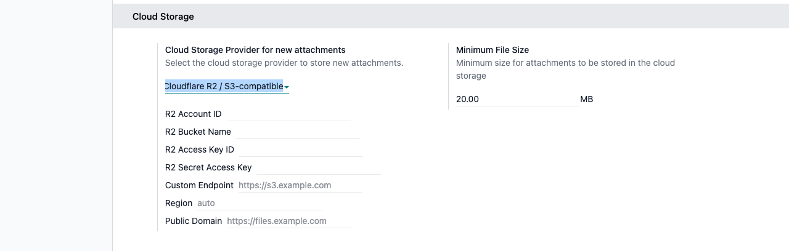
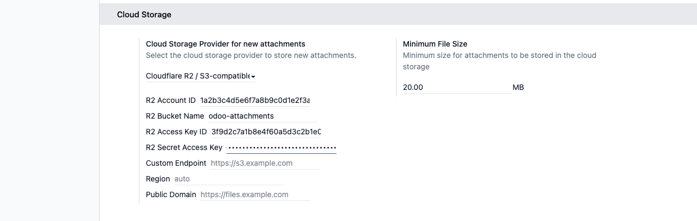
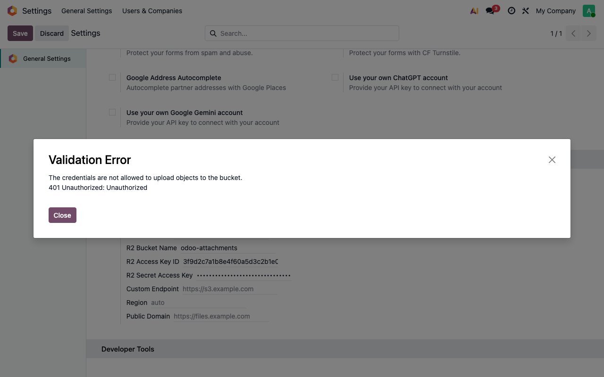
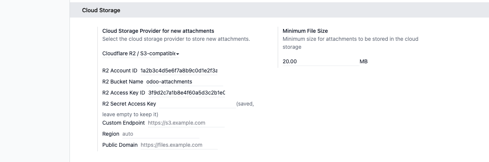
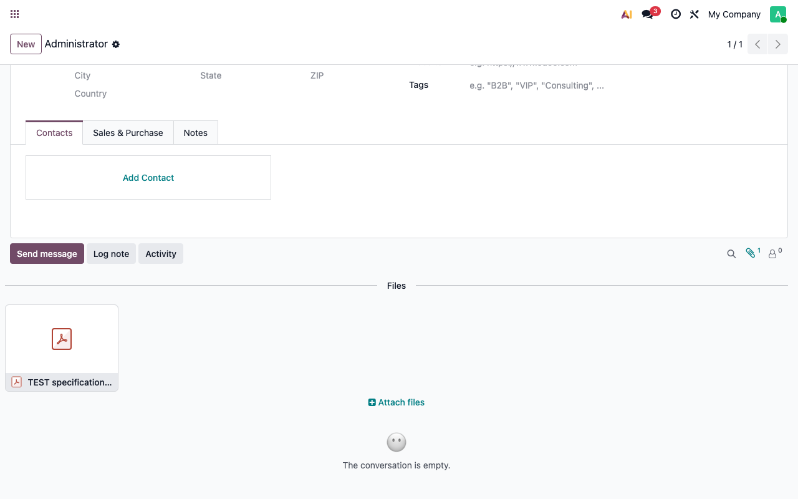
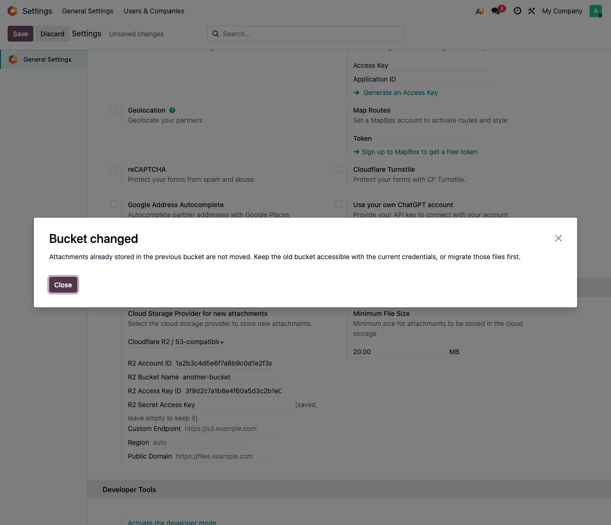

# Module Sheet: Attachment storage in Cloudflare R2

**Module:** `deltatech_cloud_storage_r2`
**Main user:** Odoo administrator / implementation consultant
**Priority:** 🟢 Low (one-time setup, then transparent for users)

## 1. Business purpose

Large files (part photos, PDFs, drawings) attached in the chatter are uploaded by the browser straight to an
object-storage bucket instead of growing the Odoo database and filestore. Cloudflare R2 has no egress fee, so
downloads cost nothing. Any S3-compatible service works too (Backblaze B2, AWS S3, Bunny).

## 2. Before you start

You need, from the storage provider:

- a **bucket** (private);
- an **access key ID** and a **secret access key** with *Object Read & Write* on that bucket
  (add admin rights if Odoo should also set the CORS rules);
- for Cloudflare R2, the **account ID**; for another S3 service, its **endpoint** and **region**.

## 3. Setup

### Step 1 — Choose the provider

**Settings → General Settings → Cloud Storage → Cloud Storage Provider for new attachments**: choose
*Cloudflare R2 / S3-compatible*. The R2 fields appear below.

### Step 2 — Fill in the account

Enter the account ID, bucket name, access key ID and secret access key. For another S3 service fill in
*Custom Endpoint* (and *Region*) instead of the account ID. Leave *Public Domain* empty unless the bucket
is public on purpose: it makes downloads unsigned, so anyone with a link can open the file.

The secret is write-only: once saved, Odoo never shows it again.

### Step 3 — Save and read the result

Click **Save**. Odoo uploads and downloads a small `TEST` object to check the credentials, deletes it, and tries
to set the bucket CORS rules. If the check fails, a message names the cause and nothing is saved.

After a successful save the secret field is empty and shows *(saved, leave empty to keep it)*.

### Step 4 — Use it

Files larger than *Minimum File Size* (20 MB by default) attached from a chatter go to the bucket; the
attachment stays in Odoo as a link and opens normally.

## 4. Changing the bucket

When the bucket name changes, Odoo warns that files already stored are not moved. Keep the old bucket
reachable with the same credentials, or migrate the files first.

## 5. Checks for the consultant

- [ ] After saving, no error is shown and the secret field says *(saved, leave empty to keep it)*.
- [ ] Attach a file larger than the minimum size in a chatter: it appears in the list and opens.
- [ ] The object is in the bucket (name `<attachment id>/<uuid>/<file name>`).
- [ ] Direct upload from the browser works (otherwise the bucket CORS rules are missing: see *CONFIGURE*).
- [ ] On staging copies the provider is disabled (neutralization removes the R2 settings): staging must not
      use the production bucket.

## 6. Common messages

| Message | Cause | Fix |
|---|---|---|
| `SignatureDoesNotMatch` | wrong secret access key (or key ID) | paste the secret again; it is shown only once by Cloudflare |
| `401 Unauthorized` | unknown access key ID | check the key ID and that the token is active |
| `AccessDenied` | token without access to the bucket or without write | give *Object Read & Write* on the bucket |
| `Could not connect to ...` | wrong account ID or endpoint | correct the account ID or the custom endpoint |
| `Please configure the Cloud Storage before enabling it` | a required field is empty | fill in account/endpoint, bucket, key ID and secret |
| Upload fails only in the browser | CORS rules missing on the bucket | add them in the provider console (see *CONFIGURE*) |

## 7. Screenshots

Taken on a test database with sample values:

- `01_settings_provider.png` — provider selected, R2 fields shown
- `02_settings_filled.png` — fields filled in (secret masked)
- `03_wrong_credentials.png` — message when the credentials are rejected
- `04_settings_saved.png` — saved configuration
- `05_bucket_changed_warning.png` — warning when the bucket changes
- `06_attachment_in_chatter.png` — file stored in R2, listed in the chatter
