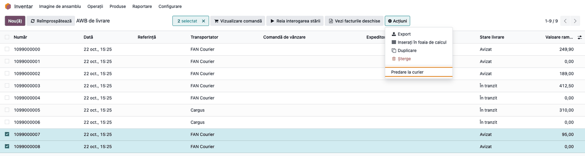
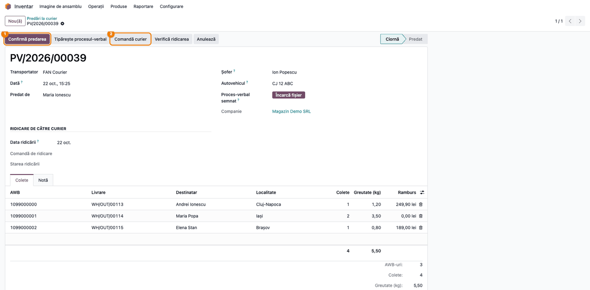
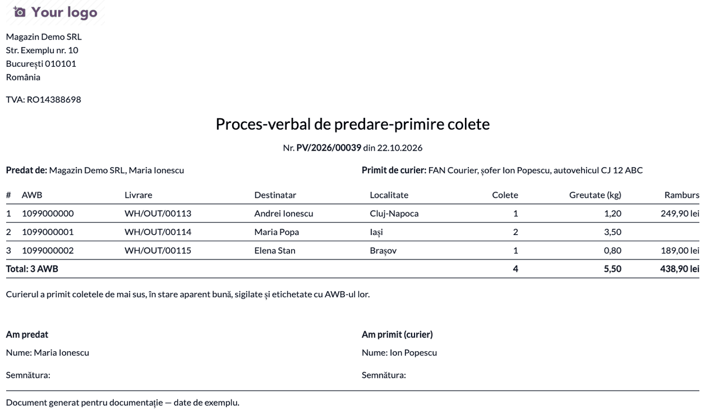
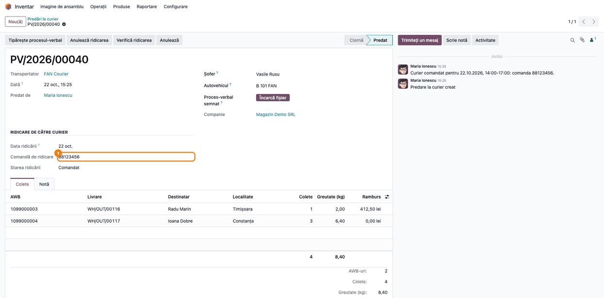
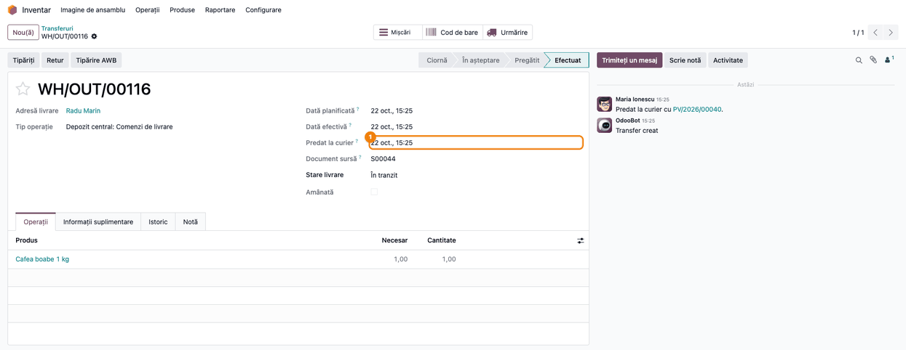
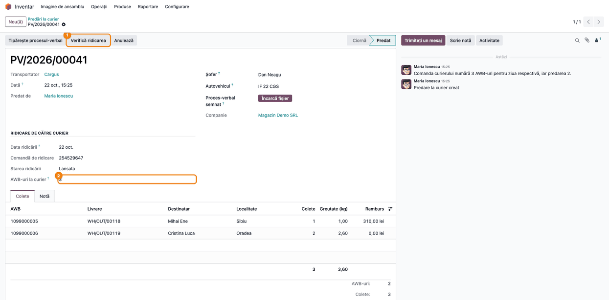
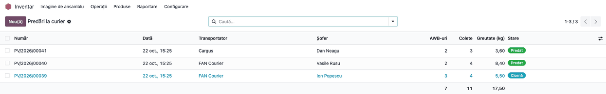

# Fișă Modul: Predarea coletelor la curier — proces-verbal de predare-primire și comanda de ridicare

**Modul:** `deltatech_delivery_handover`
**Utilizator principal:** Responsabil depozit / expediție (predă coletele șoferului), Operator expediții
**Prioritate:** 🟡 Medie (nu schimbă emiterea AWB-ului, dar dă dovada predării și pornește urmărirea din momentul în care coletele pleacă)

---

## 1. Scop business

Când șoferul curierului ia coletele, depozitul are nevoie de o dovadă: ce colete au plecat, câte, cu ce greutate și cu ce ramburs, semnată de șofer. Fără ea, un colet „pierdut" între depozit și prima scanare a curierului nu are cine să-l dovedească. Starea coletului rămâne „Avizat" până când curierul îl scanează, uneori abia a doua zi.

Modulul adaugă **predarea la curier**:

- din lista de AWB-uri sau din orice listă de livrări se selectează coletele care pleacă și se creează **o predare pe curier**;
- predarea se tipărește ca **Proces-verbal de predare-primire colete**, cu tabelul coletelor, totalurile și semnăturile;
- la **Confirmă predarea**, livrările trec **În tranzit**, iar răspunsul curierului care încă spune „Avizat" nu le mai aduce înapoi;
- din predare se poate **comanda curierul** (FAN Courier), o singură comandă pentru toate coletele, nu câte una pe AWB. La Cargus, care își face singur comanda zilei din AWB-uri, se citește doar comanda existentă.

## 2. Bază legală și context

Nu are bază legală fiscală proprie. Procesul-verbal de predare-primire este un document operațional între expeditor și curier: dovedește momentul și starea predării, util la reclamații (colet lipsă, deteriorat) și la verificarea rambursurilor. Nu înlocuiește nici AWB-ul, nici documentul care însoțește marfa (factura sau avizul), și nu este document contabil.

Despre comanda de ridicare:

- **FAN Courier** cere o comandă de ridicare („comandă curier") pentru clienții fără ridicare zilnică fixă. Comanda este **facturabilă**: o comandă în plus înseamnă o deplasare în plus a curierului.
- **Cargus** își creează singur comanda zilei, la primul AWB, și o validează automat la sfârșitul zilei, la ora setată pe punctul de ridicare. Odoo o citește doar: o comandă trimisă în plus ar aduce a doua mașină.
- **GLS** și **Sameday** ridică odată cu AWB-ul: nu e nimic de comandat.

## 3. Utilizatori și roluri

Responsabilul de depozit sau de expediție creează predarea, o tipărește, o dă spre semnare șoferului și o confirmă. Operatorul de expediții comandă curierul și verifică ridicarea.

Meniul și acțiunile sunt disponibile grupului **Inventar / Utilizator** (`stock.group_stock_user`). Anularea unei predări confirmate e permisă doar **Inventar / Administrator**.

Roluri recomandate pentru testare:
- Utilizator Inventar: parcurge fluxul din secțiunea 6.
- Administrator Inventar: anulează o predare confirmată (secțiunea 8).
- Utilizator fără drepturi de Inventar: confirmă că meniul **Predări la curier** nu apare.

## 4. Conturi și date implicate

Nu sunt implicate conturi contabile: modulul nu creează note contabile.

Date minime pentru demo:
- doi curieri, unul cu comandă de ridicare din Odoo (FAN Courier) și unul cu comandă automată (Cargus), configurați cu integrarea lor;
- câteva livrări de ieșire validate, cu AWB emis și starea **Avizat**, unele cu ramburs;
- pe livrări, numărul de colete și greutatea din detaliile expedierii (completate la emiterea AWB-ului).

Pe fiecare rând al predării: **AWB**, **Livrare**, **Destinatar**, **Localitate**, **Colete**, **Greutate (kg)** și **Ramburs**, cu moneda în care se încasează.

## 5. Configurare inițială

1. Instalați `deltatech_delivery_handover` (aduce `deltatech_delivery`). Pentru comanda și citirea ridicării instalați și modulul curierului (`deltatech_delivery_fc` pentru FAN Courier, `deltatech_delivery_uc` pentru Cargus).
2. Pentru FAN Courier, intervalul în care curierul e rugat să vină: **Inventar → Configurare → Livrare → Metode de livrare** (meniu vizibil pentru **Inventar / Administrator**), curierul, grupul **Ridicare de către curier**: **Ridicare de la** și **Ridicare până la** (format HH:MM, implicit 10:00–17:00). Grupul apare doar la curierii care pot fi comandați din Odoo.
3. Acordați utilizatorilor de depozit grupul **Inventar / Utilizator**.
4. Numerotarea predărilor (`PV/<an>/00001`) vine din secvența **Courier Handover** (**Setări → Tehnic → Secvențe și identificatori → Secvențe**, mod dezvoltator), comună tuturor companiilor.

## 6. Flux de utilizare

### Pasul 1 — Selectarea coletelor care pleacă

Din **Inventar → Operații → AWB de livrare → Listă AWB de livrare** (sau din orice listă de livrări, de exemplu tabloul **Expediere** din `deltatech_delivery_dashboard`), bifați AWB-urile pe care le ia șoferul și alegeți **Acțiuni → Predare la curier**.



**Găsește pe ecran.** Bifele din stânga, contorul „2 selectat" și, în meniul **Acțiuni**, intrarea **Predare la curier**.

**Verifică.** Intră coletele care nu au ajuns încă la curier: starea livrării **Ciornă**, **Pregătită în depozit** sau **Avizat** (de regulă Avizat: AWB emis, colet încă la noi). Cele care sunt deja **În tranzit** sau livrate nu intră în predare chiar dacă le bifați: sunt lăsate deoparte, iar istoricul **primei** predări create spune de ce. Același lucru pentru un AWB vechi al unei livrări retrimise, pentru un AWB aflat deja în altă predare și pentru o livrare fără curier.

**Treci mai departe.** Se creează **o predare pe fiecare curier**: dacă ați bifat colete FAN și Cargus, ies două predări.

### Pasul 2 — Predarea în ciornă

Predarea se deschide în **Ciornă**: curierul, data, cine predă, coletele cu totalurile.



**Găsește pe ecran.** Numărul **PV/2026/…**, **Transportator**, **Predat de**, câmpurile **Șofer** și **Autovehicul**, tabul **Colete** cu totalurile (AWB-uri, colete, greutate) și grupul **Ridicare de către curier**, cu **Data ridicării** (implicit azi): setați-o înainte de **Comandă curier**, pentru că după comandă nu se mai schimbă.

**Verifică.** Coletele de pe ecran sunt cele care pleacă acum; un colet pe care șoferul nu-l ia se șterge de pe rând (coșul de la capăt) cât predarea e în ciornă. Completați șoferul și autovehiculul: apar pe procesul-verbal.

**Treci mai departe.** Tipăriți procesul-verbal (Pasul 3) și, dacă e cazul, comandați curierul (Pasul 4).

### Pasul 3 — Procesul-verbal de predare-primire

**Tipărește procesul-verbal** produce documentul pe care îl semnează șoferul.



**Găsește pe ecran.** Numărul și data procesului-verbal, **Predat de** (firma și utilizatorul), **Primit de curier** (curierul, șoferul, autovehiculul), tabelul coletelor și rândul **Total** (AWB-uri, colete, greutate, ramburs pe monedă), apoi căsuțele **Am predat** / **Am primit (curier)** cu nume și semnătură.

**Verifică.** Numărul de colete și greutatea totală corespund cu ce încarcă șoferul; totalul de ramburs este suma rambursurilor de pe AWB-uri, pe moneda de încasare.

**Treci mai departe.** După semnare, atașați scanarea în câmpul **Proces-verbal semnat** al predării. **Data** predării se completează din nou la confirmare (Pasul 4): dacă data de pe hârtie trebuie să fie aceeași cu cea din Odoo, retipăriți procesul-verbal după confirmare.

### Pasul 4 — Confirmarea predării și comanda de ridicare

La FAN Courier, **Comandă curier** trimite o singură comandă de ridicare pentru toate coletele predării, în intervalul setat pe curier. Comanda se poate face înainte sau după confirmare. Când șoferul a luat coletele, **Confirmă predarea**.



**Găsește pe ecran.** Starea **Predat**, **Comandă de ridicare** (numărul primit de la FAN) și **Starea ridicării** (Comandat); în istoric, „Curier comandat pentru <data>, <interval>: comanda <număr>".

**Verifică.**
- **Comandă curier** cere confirmare („Curierul va fi comandat să vină după colete; comanda se facturează. Continuați?") și dispare după comandă: comanda se trimite o singură dată. **Anulează ridicarea** o anulează la curier, iar butonul **Comandă curier** reapare, pentru o altă oră sau o altă zi.
- Dacă răspunsul curierului se pierde (eroare de rețea), comanda nu se retrimite singură: **Starea ridicării** devine *Necunoscut*. Apăsați **Verifică ridicarea**: comanda e căutată după numărul predării, scris în observațiile ei. Căutarea în rapoartele FAN nu a putut fi verificată pe un cont real (niciun cont de test nu avea comenzi); dacă nu găsește comanda, verificați în portalul FAN înainte de a comanda din nou.
- **Confirmă predarea** cere confirmare („Coletele trec În tranzit. Le-a luat șoferul pe toate?") și refuză un colet care între timp a ajuns la curier sau a fost livrat.

**Treci mai departe.** Coletele confirmate sunt urmărite de acum ca plecate (Pasul 5).

### Pasul 5 — Livrarea În tranzit

Pe fiecare livrare predată, **Stare livrare** devine **În tranzit**, iar **Predat la curier** arată momentul confirmării.



**Găsește pe ecran.** **Predat la curier** (data și ora), **Stare livrare** = În tranzit și, în istoricul livrării, mesajul cu legătura la predare.

**Verifică.** Până la prima scanare a curierului, interogarea stării răspunde de obicei tot cu „Avizat" sau fără niciun eveniment: starea rămâne **În tranzit**. Un eveniment real al curierului (în depozitul curierului, în livrare, livrat) se aplică normal.

**Treci mai departe.** Cu `deltatech_delivery_dashboard` instalat, confirmarea predării pornește și termenul de livrare (SLA), iar coletul apare la cardul **Predate azi**.

### Pasul 6 — Cargus: verificarea comenzii automate

La Cargus nu există buton de comandă: curierul își face singur comanda zilei. **Verifică ridicarea** citește comanda și o leagă de predare.



**Găsește pe ecran.** **Comandă de ridicare** (numărul comenzii Cargus), **Starea ridicării** (de exemplu Lansata, Ridicata, Anulata, cum le scrie Cargus) și **AWB-uri la curier**.

**Verifică.** Comanda Cargus numără **toate AWB-urile zilei**, pe toate punctele de ridicare ale contului Cargus, nu doar pe cele din predare. Când numărul diferă de AWB-urile predării, istoricul spune „Comanda curierului numără N AWB-uri pentru ziua respectivă, iar predarea M": e normal dacă ați făcut mai multe predări în aceeași zi; altfel, verificați în portalul Cargus ce AWB lipsește. „Fără comandă" înseamnă că Cargus nu are încă o comandă pentru ziua aleasă.

**Treci mai departe.** La Cargus, comanda trece la **Ridicata** după ce șoferul scanează coletele; în Odoo starea nouă apare la un nou clic pe **Verifică ridicarea** (nu se actualizează singură).

### Pasul 7 — Lista predărilor

**Inventar → Operații → AWB de livrare → Predări la curier** arată toate predările: număr, dată, curier, șofer, AWB-uri, colete, greutate și stare.



**Găsește pe ecran.** Coloana **Stare** (Ciornă, Predat, Anulat) și totalurile din subsol; căutarea după AWB găsește predarea în care a plecat un colet.

**Verifică.** Fiecare zi de lucru are predările ei; o predare rămasă în ciornă înseamnă colete încă neplecate sau neconfirmate.

**Treci mai departe.** Grupați după **Transportator** sau după **Zi** din meniul căutării.

### Note de monografie și raportare

Modulul **nu generează note contabile**. Procesul-verbal și predarea sunt documente operaționale: dovada predării către curier. Rambursul din procesul-verbal este suma pe care curierul o are de încasat de la clienți pentru coletele predate; decontarea lui se urmărește separat, în contabilitate (de exemplu cu `deltatech_delivery_cod`).

## 7. Legături cu alte module / declarații

| Modul / proces | Rol în flux | Tip legătură |
|---|---|---|
| `deltatech_delivery` | AWB-urile, starea livrării, contractul curierilor (comanda și citirea ridicării) | dependență (manifest) |
| `deltatech_delivery_fc` | comanda de ridicare FAN Courier, anularea și citirea ei | opțional |
| `deltatech_delivery_uc` | citirea comenzii automate Cargus | opțional |
| `deltatech_delivery_dashboard` | tabloul **Expediere** (selecția livrărilor), data predării pe AWB, SLA, cardul **Predate azi** | opțional |
| `deltatech_delivery_cod` (bitshop_ent) | decontarea rambursului încasat de curier | opțional |
| `stock`, `mail` | livrările, grupurile de inventar, istoricul și activitățile | dependență indirectă |

Ce este automat: gruparea pe curier, excluderea coletelor care nu mai pot fi predate, totalurile, trecerea În tranzit la confirmare, protecția stării față de răspunsul „Avizat" al curierului, mesajele din istoric, legarea comenzii găsite după numărul predării.
Ce rămâne manual: alegerea coletelor, completarea șoferului, tipărirea și semnarea procesului-verbal, atașarea scanării, confirmarea, comanda curierului la FAN și verificarea ridicării.

## 8. Verificări pentru consultant

- [ ] Meniul **Inventar → Operații → AWB de livrare → Predări la curier** apare pentru **Inventar / Utilizator** și lipsește fără acest grup.
- [ ] Din lista de AWB-uri, **Acțiuni → Predare la curier** pe colete FAN și Cargus creează două predări, una pe curier.
- [ ] Un AWB **În tranzit**, livrat sau deja într-o predare deschisă nu intră în predare; istoricul predării spune de ce.
- [ ] Același AWB nu poate fi pus în două predări neanulate; după anularea primei, poate fi predat din nou.
- [ ] Totalurile predării (AWB-uri, colete, greutate) corespund cu procesul-verbal tipărit.
- [ ] **Confirmă predarea** trece livrările **În tranzit** și completează **Predat la curier**; o predare confirmată nu se poate șterge.
- [ ] După confirmare, o interogare a stării care întoarce „Avizat" lasă livrarea **În tranzit**; un eveniment „În depozit curier" se aplică.
- [ ] Un utilizator de inventar nu poate anula o predare confirmată; un administrator poate, iar livrările încă **În tranzit** revin la **Avizat**. Anularea predării **nu anulează comanda FAN**: anulați întâi ridicarea (**Anulează ridicarea**), apoi predarea.
- [ ] O predare anulată nu poate fi resetată la ciornă dacă AWB-urile ei sunt deja într-o altă predare.
- [ ] La FAN Courier, **Comandă curier** trimite o singură comandă (butonul dispare după comandă), cu intervalul setat pe curier; după **Anulează ridicarea**, curierul poate fi comandat din nou.
- [ ] La Cargus, butonul **Comandă curier** nu apare; **Verifică ridicarea** completează comanda zilei, starea și **AWB-uri la curier**.
- [ ] La un curier fără comandă și fără citire (GLS, Sameday), grupul **Ridicare de către curier** nu apare pe predare.

## 9. Mesaje de eroare frecvente

| Mesaj / simptom | Cauză probabilă | Remediere |
|-----------------|-----------------|-----------|
| „Niciunul dintre AWB-urile selectate nu poate fi predat: …" | Toate coletele selectate sunt deja la curier, livrate, într-o altă predare, fără curier sau nu sunt AWB-ul curent al unei livrări de ieșire | Citiți motivul de pe fiecare rând din mesaj; selectați coletele **Avizat** |
| „Livrările selectate nu au încă AWB: trimiteți-le întâi la curier." | Din lista de livrări au fost selectate livrări fără AWB | Emiteți AWB-ul (trimiterea la curier), apoi creați predarea |
| „AWB-ul … este deja în predarea …" | AWB-ul e într-o altă predare neanulată | Folosiți predarea existentă sau anulați-o întâi |
| „Aceste colete sunt deja la curier sau livrate; scoateți-le din predare: …" | Între crearea predării și confirmare, curierul a scanat coletele | Scoateți rândurile respective și confirmați restul |
| „Doar un administrator de inventar poate anula o predare confirmată." | Utilizatorul nu are **Inventar / Administrator** | Cereți anularea unui administrator |
| „Curierul este deja comandat pentru această predare (…)." | Comanda de ridicare a fost trimisă | Nimic de făcut; pentru o altă oră, **Anulează ridicarea**, apoi **Comandă curier** |
| „Comandați curierul pentru o predare cu colete." | Predarea e anulată sau nu are colete | Adăugați colete într-o predare activă |
| „Predarea … nu are niciun colet." | Confirmare pe o predare goală | Creați predarea din selecția de AWB-uri |
| „AWB-ul … este deja în predarea …" la **Resetează la ciornă** | Coletele predării anulate au fost predate între timp cu altă predare | Lăsați predarea anulată; folosiți predarea nouă |
| **Starea ridicării** = Necunoscut | Răspunsul curierului la comandă s-a pierdut | **Verifică ridicarea** înainte de a comanda din nou |
| „Nicio comandă de ridicare a curierului nu corespunde acestei predări." | Comanda nu există la curier sau a fost făcută din portal, fără numărul predării | Verificați în portalul curierului |
| „FAN Courier nu a întors numărul comenzii de ridicare: …" | FAN a refuzat comanda (date incomplete, interval invalid) | Corectați intervalul de pe curier și încercați din nou |

## 10. Capturi de ecran

Capturile (`static/description/`) sunt generate automat din `tests/test_screenshots.py` (mixinul `ScreenshotCase` din `l10n_ro_doc_screenshots`, import defensiv), în limba română, pe o companie RO („Magazin Demo SRL"). Curierii de test „FAN Courier" și „Cargus" sunt simulați, fără niciun apel la curieri reali: comanda FAN întoarce un număr de test, iar Cargus o comandă a zilei. Livrările sunt aduse în stare prin fluxul real de depozit (confirmare, rezervare, validare), cu AWB emis. În ordinea pașilor din secțiunea 6:

1. `01_selectie_awb.png` — lista AWB cu două AWB-uri bifate și meniul **Acțiuni → Predare la curier**.
2. `02_predare_ciorna.png` — predarea în ciornă, cu coletele, totalurile și butoanele **Confirmă predarea** și **Comandă curier**.
3. `03_proces_verbal.png` — procesul-verbal de predare-primire colete.
4. `04_predare_confirmata.png` — predarea confirmată, cu comanda de ridicare FAN și mesajul din istoric.
5. `05_livrare_in_tranzit.png` — livrarea predată: **În tranzit** și **Predat la curier**.
6. `06_ridicare_cargus.png` — predarea Cargus după **Verifică ridicarea**.
7. `07_lista_predari.png` — lista predărilor la curier.

Regenerare (cere `l10n_ro` pentru compania RO; baza trebuie să aibă limba română încărcată):

```bash
./odoo/odoo-bin -c odoo.conf -d <db> -i deltatech_delivery_handover,l10n_ro,l10n_ro_doc_screenshots \
    --load-language=ro_RO --test-tags=fise_screenshots --stop-after-init
```

## 11. Observații pentru manual

Păstrați trei idei. Întâi, **predarea este momentul în care coletul pleacă**: de la confirmare, coletul e **În tranzit**, chiar dacă curierul îl scanează abia mai târziu, iar procesul-verbal semnat este dovada. Apoi, **comanda de ridicare se face pentru toată predarea, nu pentru fiecare AWB**: o mașină, o adresă, un interval. În al treilea rând, **fiecare curier lucrează altfel**: FAN se comandă din predare (comanda se facturează), Cargus își face singur comanda și doar se verifică, GLS și Sameday ridică odată cu AWB-ul. Explicați și ce face **Verifică ridicarea** când răspunsul curierului se pierde: găsește comanda în loc să comande din nou.
