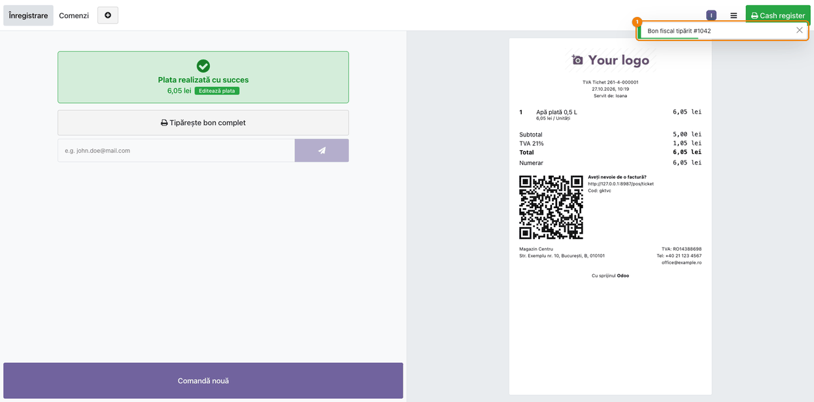
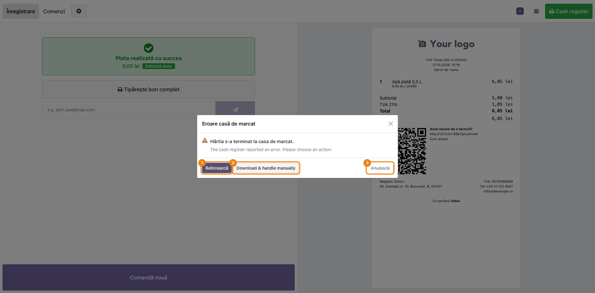
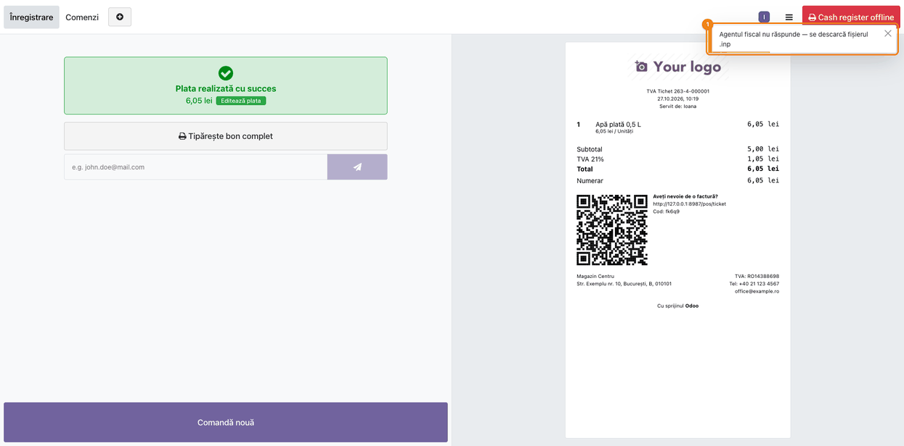

# Fișă Modul: Retail fiscal / AMEF — ECR Connect (bibliotecă comună)

**Modul:** `deltatech_ecr_connect`  
**Utilizator principal:** Consultant implementare, Responsabil magazin/POS  
**Prioritate:** Ridicată (fără el nu se tipărește bonul fiscal din `deltatech_pos` și `deltatech_sale_store`)

---

## 1. Scop business

Modulul este biblioteca comună care transformă un bon fiscal într-un set de comenzi pentru casa de
marcat și îl trimite la aplicația locală **Terrabit Connect**. Consultantul trebuie să îl prezinte ca
„motorul" din spatele bonului fiscal: nu are ecrane, meniuri sau câmpuri proprii, iar tot ce se
configurează se face în modulele care îl folosesc (`deltatech_pos`, `deltatech_pos_base`,
`deltatech_sale_store`).

Înainte de acest modul, formatele caselor erau scrise de două ori, în JavaScript în POS și în Python
la facturile din magazin. Acum biblioteca este sursa unică pentru **formatele caselor de marcat**
(comenzile și limitele fiecărui tip), **transportul** către agent, **dialogul de eroare** și
**fallback-ul pe fișier**, pentru ambele fluxuri; singura excepție este transportul **Fisco.ro** al facturilor din magazin, care are funcția lui proprie (portul 4040). Diferența dintre fluxuri: facturile din magazin
(`deltatech_sale_store`) trec prin convertorul bibliotecii (`formatEcrDocument`), în timp ce POS-ul își
construiește încă singur comenzile (`prepare_bf` / `prepare_dp` din `deltatech_pos`) și ia din
bibliotecă doar formatele, transportul, dialogul și fallback-ul. Migrarea POS-ului la convertor nu e
făcută; regulile din secțiunea 7 care depind de convertor sunt marcate mai jos.

## 2. Bază legală și context

Vânzarea cu amănuntul către populație se fiscalizează prin aparat de marcat electronic fiscal (AMEF),
obligație stabilită prin OUG 28/1999. Casele de marcat primesc comenzile într-un format propriu
fiecărui producător (driver certificat); modulul cunoaște aceste formate.

- Modulul **nu comunică direct** cu casa de marcat. Comenzile pleacă din browser către Terrabit
  Connect (agentul local), iar agentul le trimite aparatului.
- Modulul **nu stochează** nimic în baza de date: nu are modele, tabele sau drepturi de acces.
- Cotele de TVA din 2025 (21% standard, 11% redusă) sunt trimise, pe casele cu tabel de grupe
  (FiscalNet, Succes, Daisy, Optima, Incotex), pe aceleași grupe fiscale ca vechile 19% și 9%; pe casele
  Datecs se trimite direct procentul — vezi secțiunea 7.

## 3. Utilizatori și roluri

- Casier POS: nu configurează modulul, doar vede rezultatul (bon tipărit, mesaj de succes sau
  dialogul de eroare de la casa de marcat).
- Casierul alege ce face când casa raportează o eroare (reîncercare, fișier manual, anulare), după
  instrucțiunile stabilite de responsabilul de magazin.
- Consultant implementare: stabilește tipul de casă, transportul (agent sau fișier) și verifică
  fiecare scenariu fiscal pe aparatul real.

## 4. Date implicate

Modulul lucrează doar cu un **document fiscal standardizat** (JSON, construit în browser de modulul
producător), format din:

- **antet**: referința comenzii, numele clientului, codul fiscal (CIF) dacă e permis, note libere;
- **linii**: denumire, cantitate, preț cu TVA înainte de discount, cota TVA, codul de categorie de pe
  taxă (`cod_ecr`, opțional), unitate de măsură, discount procentual;
- **plăți**: codul ECR al metodei de plată, suma, dacă e numerar;
- **opțiuni**: cod de bare și tipul lui, subtotal forțat, departament fix, trunchierea numelui.

Documentul are două tipuri: **bon fiscal** (vânzare) și **dispoziție de plată** (retragere de numerar
din sertar, fără linii de produs).

## 5. Configurare inițială

Modulul nu are ecran de configurare. Pașii sunt făcuți în `deltatech_pos_base` / `deltatech_pos`.

### Pasul 1 — Instalare

1. Instalați `deltatech_pos` (care aduce `deltatech_pos_base`) sau `deltatech_sale_store`;
   `deltatech_ecr_connect` se instalează automat ca dependență. Singur, nu adaugă nimic în interfață.
2. Pe stația casei de marcat instalați **Terrabit Connect** (agentul local) și conectați aparatul.

### Pasul 2 — Tipul casei și transportul

În **Point of Sale → Configuration → Settings**, secțiunea ECR, alegeți pentru fiecare punct de lucru:

- **Type of electronic cash register**: tipul care corespunde aparatului (vezi tabelul de la
  secțiunea 7);
- **ECR transport**: **Terrabit Connect (local agent)** pentru trimitere directă, sau **File (.prn/.inp
  download)** pentru fluxul vechi cu fișier descărcat; implicit este **File**, deci după instalare nimic nu ajunge la agent
  până nu schimbați setarea;
- **Agent URL** (câmpul `ecr_connect_url`, vizibil doar cu transportul Terrabit Connect): implicit
  `http://127.0.0.1:8765` (portul fix al agentului), de schimbat doar dacă agentul rulează pe altă stație;
- **File extension**: extensia fișierului (`inp`, `txt` etc.), cerută de driver; se folosește și la
  fișierul de rezervă.

### Pasul 3 — Facturi din magazin (`deltatech_sale_store`)

Dacă folosiți și bonul fiscal pe factură, setările sunt separate de cele din POS și **nu au ecran
propriu**: se completează în **Setări → Tehnic → Parametri de sistem**. Parametrii sunt
`account_invoice.ecr_transport` (`file`, implicit, `connect` sau `fisco`), `account_invoice.ecr_connect_url`
(implicit `http://127.0.0.1:8765`), `account_invoice.ecr_fisco_url` (implicit `http://127.0.0.1:4040`, doar
pentru Fisco.ro), `account_invoice.ecr_type` (implicit `datecs18`) și `account_invoice.ecr_extension`
(implicit `inp`). Doar aici se pot folosi tipurile `datecs` și `dxprint`. **Cod ECR** al plății se ia de pe
jurnalul plății, nu de pe o metodă de plată POS, iar antetul facturii nu poartă client sau CIF; codul de
bare și trunchierea nu se aplică.

### Pasul 4 — Opțiuni care ajung în acest modul

Setările de mai jos se bifează în POS, dar efectul lor se vede în comenzile generate de bibliotecă:

- **Print order number as barcode** și **Order barcode type** (Normal / QR); selecția Normal / QR vine
  cu `deltatech_pos` 19.0.2.10.7 și cu versiunea 19.0.1.1.8 a bibliotecii;
- **Trim long product name** și lungimea maximă (**Trim to**), **Default department**;
- **Print customer VAT on receipt** (implicit oprit) și **VAT print limit** (implicit 490 lei), pentru CIF-ul
  clientului pe bon;
- **Cod ECR** pe metodele de plată și pe taxe.

## 6. Flux de utilizare

Fluxul rulează automat la validarea bonului; consultantul îl urmărește la test. Modulul nu are ecrane
proprii, iar capturile de mai jos sunt făcute în POS, cu un agent simulat care răspunde ca Terrabit
Connect.

**Ce se întâmplă înainte de ecran (intern, fără interfață).** La validarea comenzii, comenzile pentru
casa de marcat se construiesc din antet, linii, plăți și opțiuni, inclusiv codul de bare, Normal sau QR,
dacă e bifat în POS: în POS le construiește `deltatech_pos`, iar la facturile din magazin le formatează
convertorul bibliotecii (secțiunea 1). Apoi comenzile sunt trimise la agent (`POST /print`, cu un
identificator unic al bonului și conținutul), iar agentul tipărește și răspunde: **tipărit** (cu numărul
bonului), **anulat** sau **eroare**. Rezultatul acestui răspuns se vede în pașii de mai jos.

### Pasul 1 — Bonul se tipărește

Casierul validează comanda, iar agentul tipărește bonul și întoarce numărul lui. În colțul din dreapta
sus apare mesajul „Bon fiscal tipărit #<număr>" („Fiscal receipt printed #<număr>"), iar butonul
**Cash register** din bara de sus (încă în engleză) e verde. Dacă bonul a fost anulat la casă, mesajul este „Bon fiscal
anulat" („Fiscal receipt canceled").



### Pasul 2 — Eroare de la casa de marcat

Dacă aparatul raportează o eroare (de exemplu hârtie terminată), se deschide dialogul **Eroare casă
de marcat**, cu mesajul aparatului și trei variante, numerotate pe captură:

| Nr. | Variantă | Efect |
|---|---|---|
| 1 | **Reîncearcă** (Retry) | retrimite aceleași comenzi, cu același identificator al bonului; agentul trebuie să-l folosească pentru a nu tipări de două ori (de confirmat în versiunea de Terrabit Connect instalată) |
| 2 | **Download & handle manually** | descarcă fișierul de comenzi, pentru procesare manuală |
| 3 | **Anulează** (Cancel) | oprește operațiunea fiscală. În POS, vânzarea este deja validată când apare dialogul: **Anulează** nu o anulează, iar comanda primește starea fiscală „eroare" |

Butonul 2 și textul explicativ de sub mesaj apar momentan în engleză, chiar în interfața în română.



### Pasul 3 — Agentul nu răspunde: fallback la fișier

Dacă agentul nu răspunde în **40 de secunde** (timpul include și citirea răspunsului, nu doar
conectarea) sau nu e pornit, apare avertismentul „Agentul fiscal nu răspunde — se descarcă fișierul
.inp" („Fiscal agent unreachable — downloading .<ext> instead") și se descarcă fișierul de comenzi,
cu extensia setată în POS. Butonul **Cash register offline** din bara de sus e roșu. Astfel, magazinele
cu case fără agent funcționează în continuare.



## 7. Reguli funcționale

### Tipuri de casă acceptate

| Tip (`ecrType`) | Etichetă în POS | Format | Lungime denumire | Cod de bare | QR |
|---|---|---|---|---|---|
| `datecs` | nu se alege în POS; doar la factura de magazin, prin parametrul `account_invoice.ecr_type` | Datecs / FiscalWire clasic, fără unitate de măsură | 18 | da (tip 3) | da (tip 4) |
| `datecs18` | FiscalWire | Datecs / FiscalWire extins, cu unitate de măsură | 72 | da (tip 3) | da (tip 4) |
| `dxprint` | nu se alege în POS; doar la factura de magazin | la fel ca `datecs18`, dar cota TVA se ia din tabel | 72 | da (tip 3) | da (tip 4) |
| `fiscalnet` | FiscalNet | FiscalNet, sume în bani (×100) | 72 | da (`CB^…^3`) | nu |
| `incotex` | Incotex | Incotex (`R_TRP`) | 28 | nu | nu |
| `succes` | Succes | Succes (`R_TRP`) | 28 | nu | nu |
| `daisy` | Daisy | Daisy, comanda de vânzare `E` | 30 | da (tip 3) | da (tip 4) |
| `optima` | Optima | Optima, câmpuri separate prin `;`, sume ×100 | 18 | nu | nu |

Pe casele fără QR, opțiunea QR păstrează codul de bare normal; pe cele fără comandă de cod de bare
nu se tipărește nimic.

### Reguli de comportament

| Situație | Comportament |
|---|---|
| Denumire mai lungă decât limita casei, trunchierea oprită | continuă pe linii suplimentare de text |
| Denumire mai lungă decât limita casei, trunchierea activă | se taie la lungimea din **Trim to** (implicit 30), care înlocuiește limita casei. Valoarea trebuie să fie cel mult limita tipului de casă (18 pe Optima, 28 pe Incotex și Succes), altfel casa primește denumiri prea lungi |
| Diacritice | înlocuite cu litere simple, casele nu acceptă UTF-8 cu semne diacritice |
| Text liber cu `;`, `,`, `^`, ghilimele sau rânduri noi | **doar la facturile din magazin** (convertorul bibliotecii): caracterele sunt înlocuite cu spațiu sau apostrof, ca un nume de client să nu poată genera o comandă fiscală în plus. În POS, doar denumirea produsului pierde `,` și `;`, iar notele se împart pe rânduri; numele clientului și referința nu sunt curățate |
| Cotă TVA | pe `datecs` și `datecs18` codul vine direct din cotă (`21%`); pe `dxprint` tabelul trimite tot `21%` și `11%`, iar 0% și cotele necunoscute merg pe poziția 6; pe FiscalNet, Succes, Daisy, Optima și Incotex, dintr-un tabel de grupe, iar 21 → grupa lui 19, 11 → grupa lui 9 |
| Cote ieșite din uz (19, 18, 9, 5) | scoase din tabelele de grupe; pe casele bazate pe grupe cad pe grupa scutită; pe `datecs` și `datecs18` se trimit direct, de exemplu `19%`, iar casa le poate refuza |
| Cota 0% | pe `datecs` și `datecs18` se trimite `0%`; pe `dxprint`, poziția 6; pe Incotex are mapare explicită pe **grupa 3, aceeași cu cota redusă de 11%**, deci o taxă de 0% fără **Cod ECR** poate fi fiscalizată cu TVA dacă grupa 3 e programată la 11% |
| Două taxe diferite cu aceeași cotă (de exemplu două cote de 0%) | se separă prin **Cod ECR** de pe taxă, care are prioritate față de maparea pe procent |
| Linie cu preț pozitiv și cantitate negativă | `datecs18`, `dxprint` și `incotex` o tipăresc ca linie normală de vânzare; celelalte tipuri folosesc subtotal + discount, dar `daisy` și `optima` nu au comandă de subtotal definită, deci acolo cazul nu funcționează (vezi secțiunea 11) |
| Discount procentual pe linie | trimis ca discount după linie, doar la preț pozitiv |
| Dispoziție de plată | în convertor, retragere de numerar (`I,` pe Datecs), fără linii de produs; casa refuză un bon fiscal cu valori negative. În POS (`prepare_dp`), plățile pozitive se trimit ca „in" și cele negative ca „out", cu antet și rânduri de semnătură „Am primit / Semnătura", cu excepția FiscalNet. Doar pe Datecs (`I,`) și FiscalNet (`I^` / `O^`) este o operațiune de numerar; pe Incotex, Succes, Daisy și Optima este doar text tipărit, iar sertarul casei nu se mișcă |
| CIF client | se tipărește imediat după numele clientului, doar dacă modulul producător îl permite: în POS, cu **Print customer VAT on receipt** bifat, sub **VAT print limit** și la o comandă nefacturată |

## 8. Scenarii de test pentru consultant

| ID | Scenariu | Rezultat așteptat |
|---|---|---|
| ECR-01 | Bon cu numerar pe casa reală, transport Terrabit Connect | bonul se tipărește, apare „Bon fiscal tipărit #<număr>" („Fiscal receipt printed") |
| ECR-02 | Același bon cu agentul oprit | avertisment „Agentul fiscal nu răspunde — se descarcă fișierul .inp" („Fiscal agent unreachable"), se descarcă fișierul cu extensia setată |
| ECR-03 | Eroare provocată la casă (de exemplu hârtie lipsă) | dialogul cu Reîncearcă / Download & handle manually / Anulează |
| ECR-04 | Retry după remedierea erorii | bonul se tipărește o singură dată, fără dublură (depinde de agent, de confirmat) |
| ECR-05 | Produs cu denumire peste limita casei, trunchiere oprită | denumirea continuă pe linii suplimentare |
| ECR-06 | Produs cu diacritice, virgulă și punct și virgulă în nume | ieșire fără diacritice, separatorii înlocuiți cu spațiu (în POS, la denumirea produsului) |
| ECR-07 | Produs cu TVA 21% și produs cu TVA 11% | cotele ajung pe grupele programate în casă pentru 19% și 9% |
| ECR-08 | Două taxe de 0% (de exemplu SGR și taxare inversă) cu **Cod ECR** diferit | fiecare linie ajunge pe categoria ei |
| ECR-09 | **Print order number as barcode**, tip Normal | pe bon apare codul de bare cu numărul comenzii |
| ECR-10 | Același test cu tipul QR (Datecs, Daisy) | pe bon apare QR-ul cu numărul comenzii |
| ECR-11 | Linie cu cantitate negativă pe o comandă cu total pozitiv (nu pe Daisy sau Optima, fără comandă de subtotal) | tipărit conform tipului de casă (linie normală sau subtotal + discount) |
| ECR-13 | Retur plătit în numerar | în POS se trimite o dispoziție de plată, nu un bon cu valori negative |
| ECR-14 | Retur plătit cu cardul | nu se trimite niciun document la casă |
| ECR-12 | Client cu CIF, **Print customer VAT on receipt** bifat, sub **VAT print limit**, comandă nefacturată | CIF-ul apare imediat după numele clientului |

## 9. Legături cu alte module

| Modul | Rol |
|---|---|
| `deltatech_pos` | construiește comenzile casei din comanda POS (`prepare_bf` / `prepare_dp`) și folosește din bibliotecă formatele, transportul, dialogul și fallback-ul; salvează pe comandă numărul bonului, numărul documentului și raportul Z întoarse de agent |
| `deltatech_pos_base` | setările ECR din POS: tip casă, transport, URL agent, extensie fișier, **Cod ECR** |
| `deltatech_sale_store` | construiește documentul din factura de magazin (bon fiscal pe factură) și îl formatează cu convertorul bibliotecii |
| Terrabit Connect (aplicația locală) | agentul de pe stația casei, care primește comenzile și le trimite la casa de marcat; `deltatech_tc` este modulul de server Odoo al Terrabit Connect (registru de stații, coadă de lucrări) și nu e necesar acestei biblioteci |
| `l10n_ro_pos_fiscal_compliance` / `_ecr` | urmărirea bonurilor AMEF și reconcilierea raportului Z |

## 10. Verificări pentru consultant

- [ ] Tipul de casă ales în POS corespunde modelului real, inclusiv limita de lungime a denumirii.
- [ ] Dacă trunchierea e activă, **Trim to** este cel mult limita tipului de casă (18 pe Optima, 28 pe
      Incotex și Succes); implicit este 30.
- [ ] Pentru facturile din magazin, parametrii de sistem `account_invoice.ecr_transport`,
      `account_invoice.ecr_connect_url` (sau `ecr_fisco_url`), `ecr_type` și `ecr_extension` sunt setați;
      transportul Fisco.ro are funcția lui proprie.
- [ ] **ECR transport** este setat conform instalării: agent sau fișier.
- [ ] Terrabit Connect rulează pe stația casei, pe portul din **Agent URL**.
- [ ] Extensia fișierului corespunde cerinței driverului, pentru cazul fallback-ului.
- [ ] Cotele 21% și 11% ajung pe grupele programate în casă; programarea reală a casei a fost
      verificată, nu doar tabelul din modul.
- [ ] Taxele cu aceeași cotă dar categorii diferite au **Cod ECR** completat; pe Incotex, taxele de 0%
      au **Cod ECR** explicit, ca să nu ajungă pe grupa cotei de 11%.
- [ ] Un bon de probă iese complet, cu denumirile lungi și diacriticele așteptate.
- [ ] Dialogul de eroare funcționează: Retry nu dublează bonul, fișierul manual se descarcă.
- [ ] Dacă se folosește codul de bare sau QR, aparatul îl tipărește (Normal pe toate tipurile cu
      comandă; QR doar pe Datecs și Daisy).
- [ ] Pentru clienții fără agent, fluxul cu fișier a fost testat cap-coadă.

## 11. Limitări și gap-uri cunoscute

| Limitare | Impact |
|---|---|
| Modulul generează comenzi și le trimite la agent, nu comunică direct cu aparatul | depinde de Terrabit Connect și de driverul casei |
| Biblioteca nu stochează răspunsul fiscal; numărul bonului apare în mesajul de succes | în POS, `deltatech_pos` salvează pe comandă numărul bonului, numărul documentului și raportul Z; pe factură, `deltatech_sale_store` salvează aceleași câmpuri (număr bon, număr document, Z, stare sau eroare) și bifează `receipt_print` doar la bon fiscal, nu la dispoziție de plată |
| Tabelele de grupe de TVA presupun că grupa casei corespunde pozițional cotei înlocuite | maparea 21 → grupa lui 19 și 11 → grupa lui 9 trebuie verificată față de programarea reală a casei |
| Codul de bare și QR depind de modelul casei | `incotex`, `succes` și `optima` nu au comandă de cod de bare; `fiscalnet` are doar cod normal |
| POS-ul își construiește singur comenzile, nu prin convertorul bibliotecii | curățarea textului liber se aplică doar la facturile din magazin; în POS, numele clientului, referința și nota nu sunt curățate de caractere de control |
| `daisy` și `optima` nu au comandă de subtotal | o linie cu cantitate negativă care ar cere subtotal + discount nu produce o comandă validă pe aceste case |
| La facturile din magazin cu transport **File**, factura se marchează tipărită imediat la descărcare | factura apare ca tipărită chiar dacă fișierul nu a ajuns la casă, iar numărul bonului și raportul Z nu se salvează |
| Pe Incotex, Succes și Optima, șablonul de cod de bare este gol | în fișier rămâne totuși un rând gol; de verificat pe aparat dacă driverul îl acceptă |
| Fără răspuns de la agent în 40 de secunde se trece pe fișier | bonul poate fi totuși tipărit de aparat dacă agentul a întârziat; verificați înainte de a retipări manual |
| Modulul nu are ecrane proprii | capturile sunt făcute în POS, cu un agent simulat; primii pași (documentul și comenzile) sunt interni și nu au captură |

## 12. Teste automate

Modulul are teste JavaScript (hoot) pentru: conversia documentului în comenzi Datecs și FiscalNet,
înlocuirea diacriticelor, maparea **Cod ECR** și a cotelor, liniile cu cantitate negativă, CIF-ul
clientului, dispoziția de plată, curățarea textului liber, tipul de cod de bare (Normal / QR) și
comportamentul transportului când agentul se blochează după antete. Rulare:

```bash
./odoo/odoo-bin -c odoo.conf -d <db> -i deltatech_ecr_connect \
    --test-tags=/deltatech_ecr_connect --stop-after-init
```

## 13. Capturi de ecran

Capturile (`static/description/`) sunt generate din `deltatech_pos/tests/test_screenshots_ecr_connect.py`
(mixinul `ScreenshotCase` din `deltatech_doc_screenshots`), în limba română, pe planul de conturi RO. Testul
stă în `deltatech_pos`, pentru că are nevoie de POS, și pornește un server local care joacă agentul
Terrabit Connect:

1. `01_bon_tiparit.png` — mesajul „Bon fiscal tipărit #1042" după validarea comenzii.
2. `02_eroare_casa.png` — dialogul de eroare de la casa de marcat, cu cele trei variante.
3. `03_agent_indisponibil.png` — avertismentul de agent indisponibil.

Regenerare:

```bash
./odoo/odoo-bin -c odoo.conf -d <db> -i deltatech_pos,deltatech_doc_screenshots,l10n_ro \
    --test-tags=/deltatech_pos:TestEcrConnectScreenshots --stop-after-init
```

Cere `playwright` și Chrome de sistem; fără ele testul se sare.
