# Fișă Modul: Retail fiscal / AMEF — ECR Connect (bibliotecă comună)

**Modul:** `deltatech_ecr_connect`  
**Utilizator principal:** Consultant implementare, Responsabil magazin/POS  
**Prioritate:** Ridicată (fără el nu se tipărește bonul fiscal din `deltatech_pos` și `deltatech_sale_store`)

---

## 1. Scop business

Modulul este biblioteca comună care transformă un bon fiscal într-un set de comenzi pentru casa de
marcat și îl trimite la aplicația locală **Terrabit Connect** sau, pe casele Datecs și Daisy, la driverul
fiscal **DxPrint** (www.dxprint.ro). Consultantul trebuie să îl prezinte ca
„motorul" din spatele bonului fiscal: nu are meniuri sau câmpuri proprii, iar tot ce se
configurează se face în modulele care îl folosesc (`deltatech_pos`, `deltatech_pos_base`,
`deltatech_sale_store`). Singurul lui ecran este panoul **Dispozitive virtuale** al casei de marcat
simulate (mai jos).

Tot aici trăiește **casa de marcat simulată**: când un punct de vânzare are simularea pornită
(`deltatech_pos_base`), comenzile nu mai ajung la un aparat, ci sunt citite și verificate ca de o casă
Datecs FiscalWire reală — plăți, grupe de TVA, lungimea denumirii, prețuri pozitive — cu zi fiscală
proprie, rapoarte X și Z și o rolă de hârtie afișată în panoul **Dispozitive virtuale**. Simularea
servește la teste, demonstrații, instruirea casierilor și suport; nimic din ce se tipărește acolo nu
este bon fiscal.

Înainte de acest modul, formatele caselor erau scrise de două ori, în JavaScript în POS și în Python
la facturile din magazin. Acum biblioteca este sursa unică pentru **formatele caselor de marcat**
(comenzile și limitele fiecărui tip), **transportul** către agent, **dialogul de eroare** și
**fallback-ul pe fișier**, pentru ambele fluxuri; singura excepție este transportul **Fisco.ro** al facturilor din magazin, care are funcția lui proprie (portul 4040). Diferența dintre fluxuri: facturile din magazin
(`deltatech_sale_store`) trec prin convertorul bibliotecii (`formatEcrDocument`), în timp ce POS-ul își
construiește încă singur comenzile (`prepare_bf` / `prepare_dp` din `deltatech_pos`) și ia din
bibliotecă doar formatele, transportul, dialogul și fallback-ul. Migrarea POS-ului la convertor nu e
făcută; regulile din secțiunea 7 care depind de convertor sunt marcate mai jos.

## 2. Bază legală și context

Vânzarea cu amănuntul către populație se fiscalizează prin aparat de marcat electronic fiscal (AMEF),
obligație stabilită prin OUG 28/1999. Casele de marcat primesc comenzile într-un format propriu
fiecărui producător (driver certificat); modulul cunoaște aceste formate.

- Modulul **nu comunică direct** cu casa de marcat. Comenzile pleacă din browser către Terrabit
  Connect (agentul local), iar agentul le trimite aparatului. Cu transportul DxPrint, bonul pleacă din
  browser ca JSON către API-ul local al driverului DxPrint (modul embedded), iar driverul îl trimite
  aparatului.
- Modulul **nu stochează** nimic în baza de date: nu are modele, tabele sau drepturi de acces. Ziua
  fiscală a casei simulate se păstrează în browser (memoria locală a browserului, câte una pentru
  fiecare punct de vânzare), nu în Odoo.
- Casa simulată **nu emite bonuri fiscale**: orice document de pe rola ei poartă antetul
  `*** SIMULARE ***`. Un punct de vânzare al unui magazin în funcțiune nu se lasă niciodată în simulare.
- Cotele de TVA din 2025 (21% standard, 11% redusă) sunt trimise, pe casele cu tabel de grupe
  (FiscalNet, Succes, Daisy, Optima, Incotex), pe aceleași grupe fiscale ca vechile 19% și 9%; pe casele
  Datecs se trimite direct procentul — vezi secțiunea 7.

## 3. Utilizatori și roluri

- Casier POS: nu configurează modulul, doar vede rezultatul (bon tipărit, mesaj de succes sau
  dialogul de eroare de la casa de marcat).
- Casierul alege ce face când casa raportează o eroare (reîncercare, fișier manual, anulare), după
  instrucțiunile stabilite de responsabilul de magazin.
- Consultant implementare: stabilește tipul de casă, transportul (agent, driver DxPrint sau fișier) și verifică
  fiecare scenariu fiscal pe aparatul real.

## 4. Date implicate

Modulul lucrează doar cu un **document fiscal standardizat** (JSON, construit în browser de modulul
producător), format din:

- **antet**: referința comenzii, numele clientului, codul fiscal (CIF) dacă e permis, note libere;
- **linii**: denumire, cantitate, preț cu TVA înainte de discount, cota TVA, codul de categorie de pe
  taxă (`cod_ecr`, opțional), unitate de măsură, discount procentual;
- **plăți**: codul ECR al metodei de plată, suma, dacă e numerar;
- **opțiuni**: cod de bare și tipul lui, subtotal forțat, departament fix, trunchierea numelui.

Documentul are două tipuri: **bon fiscal** (vânzare) și **dispoziție de plată** (retragere de numerar
din sertar, fără linii de produs).

## 5. Configurare inițială

Modulul nu are ecran de configurare. Pașii sunt făcuți în `deltatech_pos_base` / `deltatech_pos`.

### Pasul 1 — Instalare

1. Instalați `deltatech_pos` (care aduce `deltatech_pos_base`) sau `deltatech_sale_store`;
   `deltatech_ecr_connect` se instalează automat ca dependență. Singur, nu adaugă nimic în interfață.
2. Pe stația casei de marcat instalați **Terrabit Connect** (agentul local) și conectați aparatul; pentru
   transportul DxPrint, instalați în locul lui driverul **DxPrint**, pornit în modul embedded, cu API-ul
   JSON local activ (implicit pe portul 8080).

### Pasul 2 — Tipul casei și transportul

În **Punct de vânzare → Configurare → Setări**, secțiunea **Casa de marcat** (în interfața în engleză:
*Point of Sale → Configuration → Settings*, secțiunea *ECR*), alegeți pentru fiecare punct de lucru:

- **Tip casa marcat**: tipul care corespunde aparatului (vezi tabelul de la
  secțiunea 7);
- **Transport ECR**: **Terrabit Connect (agent local)** pentru trimitere directă, **DxPrint (driver local)**
  pentru trimitere la driverul DxPrint (doar case Datecs și Daisy), sau **Fișier (descărcare
  .prn/.inp)** pentru fluxul vechi cu fișier descărcat; implicit este **Fișier**, deci după instalare nimic nu ajunge la agent
  sau la driver până nu schimbați setarea;
- **URL agent** (câmpul `ecr_connect_url`, vizibil doar cu transportul Terrabit Connect): implicit
  `http://127.0.0.1:8765` (portul fix al agentului), de schimbat doar dacă agentul rulează pe altă stație;
- **URL driver**, **Utilizator** și **Parolă** (vizibile doar cu transportul DxPrint): adresa API-ului
  driverului, implicit `http://127.0.0.1:8080` (portul din opțiunea `httpPort` a driverului), și,
  doar dacă driverul cere autentificare, utilizatorul și parola HTTP setate în driver (`httpUtilizator`,
  `httpParola`); goale, cererile pleacă fără autentificare. Parola se trimite din browserul punctului de
  vânzare, deci se încarcă în sesiunea POS. Cu DxPrint, **Tip casa marcat** rămâne cel al aparatului
  (**FiscalWire** pe Datecs, **Daisy** pe Daisy): bonul pleacă la driver ca JSON, iar tipul se folosește
  doar pentru fișierul de rezervă;
- **Extensie fișier**: extensia fișierului (`inp`, `txt` etc.), cerută de driver; se folosește și la
  fișierul de rezervă.

### Pasul 3 — Facturi din magazin (`deltatech_sale_store`)

Dacă folosiți și bonul fiscal pe factură, setările sunt separate de cele din POS și **nu au ecran
propriu**: se completează în **Setări → Tehnic → Parametri de sistem**. Parametrii sunt
`account_invoice.ecr_transport` (`file`, implicit, `connect` sau `fisco`), `account_invoice.ecr_connect_url`
(implicit `http://127.0.0.1:8765`), `account_invoice.ecr_fisco_url` (implicit `http://127.0.0.1:4040`, doar
pentru Fisco.ro), `account_invoice.ecr_type` (implicit `datecs18`) și `account_invoice.ecr_extension`
(implicit `inp`). Doar aici se pot folosi tipurile `datecs` și `dxprint`. **Cod ECR** al plății se ia de pe
jurnalul plății, nu de pe o metodă de plată POS, iar antetul facturii nu poartă client sau CIF; codul de
bare și trunchierea nu se aplică.

### Pasul 4 — Casa de marcat simulată (teste, demonstrații, instruire)

Simularea se pornește pe punctul de vânzare, în **Punct de vânzare → Configurare → Setări**, secțiunea
**Casa de marcat** (detalii și captură în fișa `deltatech_pos_base`):

1. **Transport ECR**: **Terrabit Connect (agent local)** — simularea apare doar la acest transport;
2. **Simulare**: **Simulată în Odoo (fără agent)** — browserul joacă rolul casei, nu e nevoie de nimic
   pe stație; sau **Simulată prin agent** — comanda pleacă la agentul Terrabit Connect, care trebuie
   pornit în mod simulat, cu variabila de mediu `TERRABIT_FISCAL_DRIVER=simulated` (de exemplu
   `TERRABIT_FISCAL_DRIVER=simulated` în configurarea serviciului agentului, apoi repornirea lui). Înainte
   de fiecare bon, Odoo întreabă agentul dacă e în mod simulat și **refuză trimiterea** dacă nu e;
3. **Întârziere (ms)**: cât așteaptă casa simulată înainte să răspundă (implicit 800; 0 pentru teste).

Casa simulată citește doar formatul **Datecs FiscalWire** (tipul **FiscalWire** din POS; la factura din
magazin și `datecs`, `dxprint`). Pe celelalte tipuri răspunde cu eroarea „Format nesuportat de simulator”.

Cu simularea pornită, butonul **Simulare** apare în bara de sus a Odoo (lângă iconițele din dreapta) și,
prin `deltatech_pos`, în bara POS. Butonul deschide panoul **Dispozitive virtuale** (pașii 5–10 din secțiunea 6, Flux de utilizare).

### Pasul 5 — Opțiuni care ajung în acest modul

Setările de mai jos se bifează în POS, dar efectul lor se vede în comenzile generate de bibliotecă:

- **Print order number as barcode** și **Order barcode type** (Normal / QR); selecția Normal / QR vine
  cu `deltatech_pos` 19.0.2.10.7 și cu versiunea 19.0.1.1.8 a bibliotecii;
- **Trim long product name** și lungimea maximă (**Trim to**), **Default department**;
- **Print customer VAT on receipt** (implicit oprit) și **VAT print limit** (implicit 490 lei), pentru CIF-ul
  clientului pe bon;
- **Cod ECR** pe metodele de plată și pe taxe.

## 6. Flux de utilizare

Fluxul rulează automat la validarea bonului; consultantul îl urmărește la test. Pașii 1–3 arată ce vede
casierul cu o casă reală (în capturi, un agent jucat de test răspunde ca Terrabit Connect); pașii 4–10
arată casa de marcat simulată și panoul **Dispozitive virtuale**, singurul ecran al modulului; pasul 11
descrie transportul DxPrint (fără captură).

**Ce se întâmplă înainte de ecran (intern, fără interfață).** La validarea comenzii, comenzile pentru
casa de marcat se construiesc din antet, linii, plăți și opțiuni, inclusiv codul de bare, Normal sau QR,
dacă e bifat în POS: în POS le construiește `deltatech_pos`, iar la facturile din magazin le formatează
convertorul bibliotecii (secțiunea 1). Apoi comenzile sunt trimise la agent (`POST /print`, cu un
identificator unic al bonului și conținutul), iar agentul tipărește și răspunde: **tipărit** (cu numărul
bonului), **anulat** sau **eroare**. Rezultatul acestui răspuns se vede în pașii de mai jos. Cu
transportul DxPrint, în locul agentului răspunde driverul DxPrint (Pasul 11).

### Pasul 1 — Bonul se tipărește

Casierul validează comanda, iar agentul tipărește bonul și întoarce numărul lui. În colțul din dreapta
sus apare mesajul „Bon fiscal tipărit #<număr>" („Fiscal receipt printed #<număr>"), iar butonul
**Cash register** din bara de sus (încă în engleză) e verde. Dacă bonul a fost anulat la casă, mesajul este „Bon fiscal
anulat" („Fiscal receipt canceled").

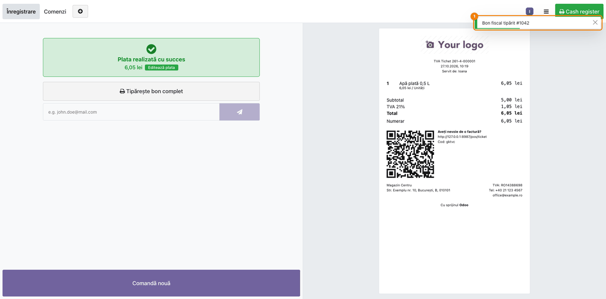

### Pasul 2 — Eroare de la casa de marcat

Dacă aparatul raportează o eroare (de exemplu hârtie terminată), se deschide dialogul **Eroare casă
de marcat**, cu mesajul aparatului și trei variante, numerotate pe captură:

| Nr. | Variantă | Efect |
|---|---|---|
| 1 | **Reîncercați** (Retry) | retrimite aceleași comenzi, cu același identificator al bonului; agentul trebuie să-l folosească pentru a nu tipări de două ori (de confirmat în versiunea de Terrabit Connect instalată). Cu DxPrint, se reia de la cererea care a eșuat: cererile deja reușite (de exemplu depunerea de numerar dinaintea chitanței) nu se mai trimit |
| 2 | **Download & handle manually** | descarcă fișierul de comenzi, pentru procesare manuală. Cu DxPrint, doar cât timp nimic n-a ajuns la casă: după o cerere reușită (de exemplu depunerea de numerar dinaintea chitanței) sau după un timeout, nu se mai descarcă nimic, ca operațiunea să nu se repete |
| 3 | **Anulează** (Cancel) | oprește operațiunea fiscală. În POS, vânzarea este deja validată când apare dialogul: **Anulează** nu o anulează, iar comanda primește starea fiscală „eroare" |

Butonul 2 și textul explicativ de sub mesaj apar momentan în engleză, chiar în interfața în română.

Cu transportul DxPrint, același dialog arată eroarea întoarsă de driver (codul și mesajul casei, din
`errorMessages`) și se deschide și când nu se știe dacă bonul a ajuns la casă (Pasul 11); atunci
mesajul se încheie cu avertismentul „Bonul poate fi deja tipărit: verificați casa de marcat înainte
să reîncercați.”

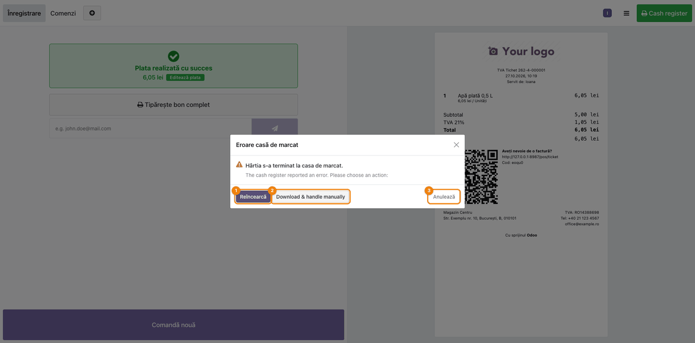

### Pasul 3 — Agentul nu răspunde: fallback la fișier

Dacă agentul nu răspunde în **40 de secunde** (timpul include și citirea răspunsului, nu doar
conectarea) sau nu e pornit, apare avertismentul „Agentul fiscal nu răspunde — se descarcă fișierul
.inp" („Fiscal agent unreachable — downloading .<ext> instead") și se descarcă fișierul de comenzi,
cu extensia setată în POS. Butonul **Cash register offline** din bara de sus e roșu. Astfel, magazinele
cu case fără agent funcționează în continuare. Cu transportul DxPrint regula e mai strictă: fișierul se
descarcă doar dacă driverul nu poate fi contactat deloc (Pasul 11).

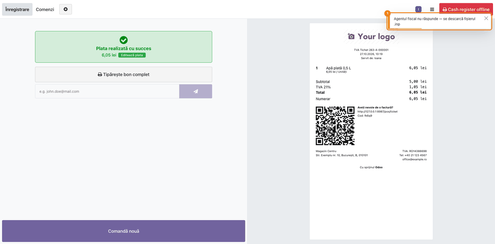

### Pasul 4 — Bonul pe casa simulată

Pe un punct de vânzare cu **Simulare** = **Simulată în Odoo (fără agent)**, casierul vinde ca de obicei
(produs, **Plată**, **Numerar**, **Validează**). Bonul nu ajunge la niciun aparat: îl citește casa
simulată, care răspunde ca o casă reală. Pe ecran apar, numerotate pe captură:

1. mesajul „Bon fiscal tipărit #1”, cu numărul bonului dat de casa simulată (numerotarea începe de la 1
   în fiecare zi fiscală);
2. butonul **Simulare**, galben, care deschide panoul **Dispozitive virtuale**;
3. butonul casei de marcat, galben, cu textul **Casă de marcat simulată** (pe o casă reală e verde,
   **Casă de marcat**).

În backend, cât timp există cel puțin un dispozitiv în simulare (o casă de marcat simulată sau un
terminal de card simulat din `deltatech_payment_terminal`), pe orice ecran apare în colțul din
stânga-jos o panglică roșie, înclinată, cu textul **SIMULARE**. Panglica nu se poate închide și nu
blochează clicurile de sub ea: rolul ei e ca un bon sau o plată cu cardul simulate să nu fie luate drept
reale, nici pe o captură de ecran. Ea dispare după ce simularea e oprită pe toate dispozitivele și pagina
e reîncărcată.

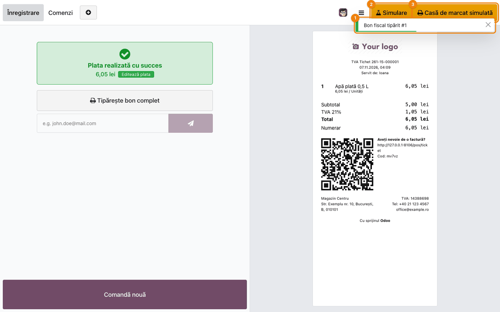

### Pasul 5 — Rola casei simulate în panoul Dispozitive virtuale

Apăsați **Simulare** în bara POS. Se deschide, în dreapta, panoul **Dispozitive virtuale**:

1. avertismentul „Dispozitive simulate: nimic din ce se tipărește sau se încasează aici nu e real.”;
2. **rola** casei: ultimele documente tipărite, fiecare cu antetul `*** SIMULARE ***`, referința
   comenzii, liniile (denumire fără diacritice, cantitate × preț, suma și litera grupei de TVA),
   **TOTAL**, TVA-ul pe grupe, plățile și, pe ultimul rând, numerele **BF** (bon fiscal), **NR**
   (document) și **Z** (ziua).

Pe captură sunt evidențiate avertismentul și rola. Deasupra rolei, rândul **Ziua fiscală** arată pe scurt aceleași numere și numerarul din sertar. Verificați
pe rolă că fiecare linie are grupa de TVA așteptată (A = 21%, B = 11%, C/D/E = 0%) și că plata e pe
tipul corect. Butonul ↻ reîncarcă panoul, iar ✕ îl închide.


### Pasul 6 — Alegerea răspunsului următor

Sub rolă, panoul are trei controale pentru documentul următor, evidențiate pe captură:

1. **Următorul răspuns** — implicit **După sumă (automat)**: răspunsul se alege după zecimalele totalului
   (tabelul din secțiunea 7). Alegeți **Succes**, **Lipsă hârtie**, **Casă de marcat deconectată**,
   **Răspuns întârziat (după timeout)**, **Niciun răspuns** sau **Bon anulat la casă**;
2. **Până la oprire** — nebifat, răspunsul ales se folosește o singură dată, apoi revine la **După
   sumă (automat)**; bifat, rămâne până îl schimbați;
3. **Întârziere** — în milisecunde, aceeași valoare cu **Întârziere (ms)** din setări.

Alegerea se salvează imediat pe punctul de vânzare și o poate face și un casier, dar doar pe o casă aflată
în simulare. În testele automate același răspuns se fixează prin ORM, cu
`config._simulator_set_next("no_paper")` (sau `sticky=True` pentru **Până la oprire**).

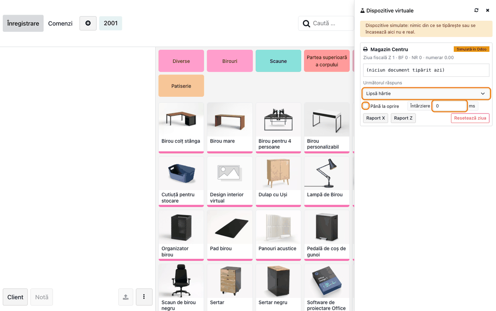

### Pasul 7 — Eroare simulată la casă

Cu **Lipsă hârtie** ales la Pasul 6, următoarea vânzare se validează în Odoo, dar casa simulată răspunde
cu eroare: se deschide dialogul **Eroare casă de marcat**, cu mesajul „Lipsă hârtie” și aceleași trei
variante ca la o casă reală (Pasul 2): **Reîncercați**, **Download & handle manually** și **Anulează**.
Pentru că răspunsul a fost „o singură dată”, **Reîncercați** retrimite bonul și de data asta casa îl
tipărește; așa se exersează cu casierii procedura de la o eroare reală.

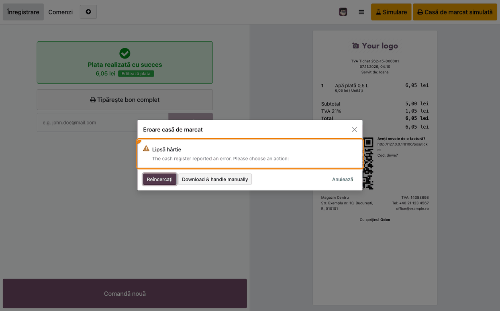

### Pasul 8 — Rapoartele X și Z și resetarea zilei

În panou, sub rolă:

1. **Raport X** — tipărește pe rolă raportul X al zilei: totalurile pe grupe de TVA, pe tipuri de plată,
   numărul de bonuri fiscale, introducerile și scoaterile de numerar și numerarul din sertar; ziua nu se
   închide;
2. **Raport Z** — tipărește raportul Z cu aceleași totaluri și **închide ziua**: numărul Z crește cu 1,
   iar numărul de bonuri (BF), totalurile și numerarul din sertar pornesc de la zero;
3. **Resetează ziua** — după confirmarea „Resetați ziua fiscală a casei de marcat simulate?”, șterge rola
   și pornește ziua de la Z 1, ca la o casă nouă.

Verificați pe raportul Z că **TOTAL** este suma bonurilor de pe rolă și că **NUMERAR IN SERTAR** este
numerarul încasat (plus introduceri, minus scoateri). Rapoartele X și Z cerute din POS (închiderea
sesiunii, `deltatech_pos`) ajung tot pe această rolă.

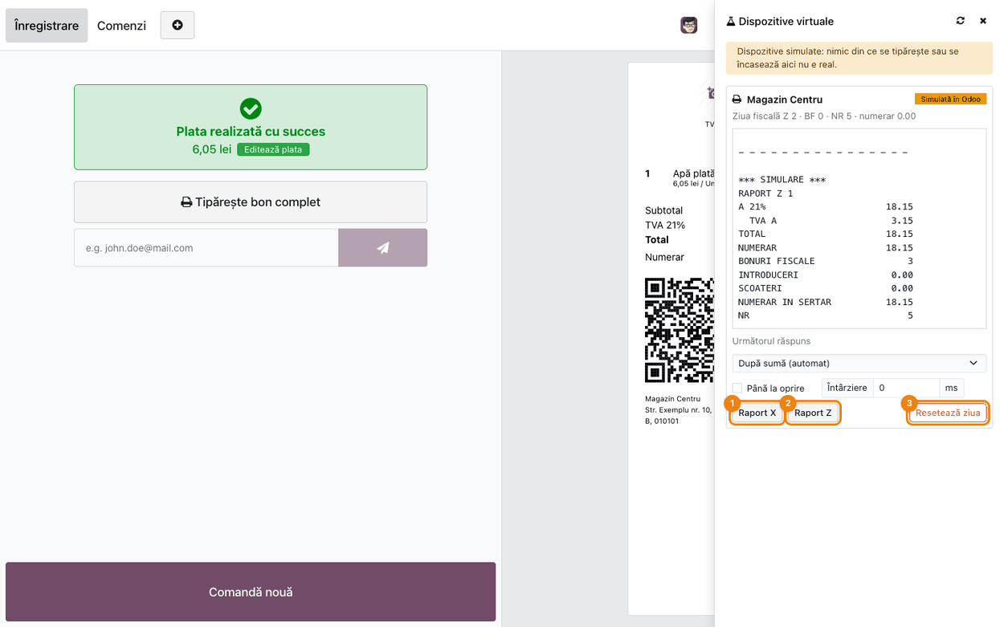

### Pasul 9 — Simulare prin agent, cu un agent care nu e în mod simulat

Pe **Simulare** = **Simulată prin agent**, înainte de fiecare document Odoo întreabă agentul dacă rulează
în mod simulat. Dacă agentul de pe stație folosește driverul real (sau o versiune veche, care nu știe de
simulare), bonul **nu se trimite**, ca să nu iasă un bon fiscal real în locul unuia simulat: apare
dialogul **Eroare casă de marcat** cu mesajul „Agentul Terrabit Connect nu e în mod simulat
(TERRABIT_FISCAL_DRIVER=simulated): bonul nu a fost trimis.” Butonul casei din bara POS e verde, cu
textul **Casă de marcat (simulată)**, pentru că agentul răspunde. Remediere: reporniți agentul cu
`TERRABIT_FISCAL_DRIVER=simulated` și apăsați **Reîncercați**, sau treceți punctul de vânzare pe
**Simulată în Odoo (fără agent)**.

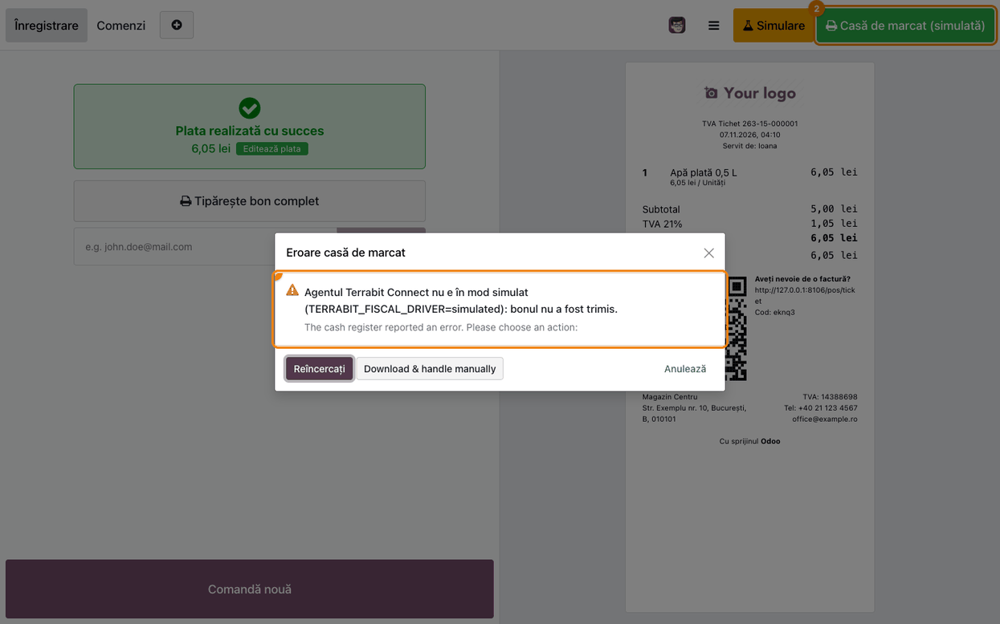

### Pasul 10 — Panoul din backend

Butonul **Simulare** apare și în bara de sus a Odoo (în dreapta, lângă iconițele de mesaje și activități;
pe captură e acoperit de panoul deschis, iar butonul se vede pe capturile fișei `deltatech_pos_base`)
cât timp există cel puțin un punct de vânzare în simulare în companiile selectate. Panoul deschis de aici
arată **toate** casele simulate, fiecare cu rola ei, răspunsul următor, întârzierea și butoanele X / Z,
fără să deschideți POS-ul. Rola și ziua fiscală sunt cele din **browserul curent**: pe alt calculator sau
în alt browser, aceeași casă are altă zi fiscală.

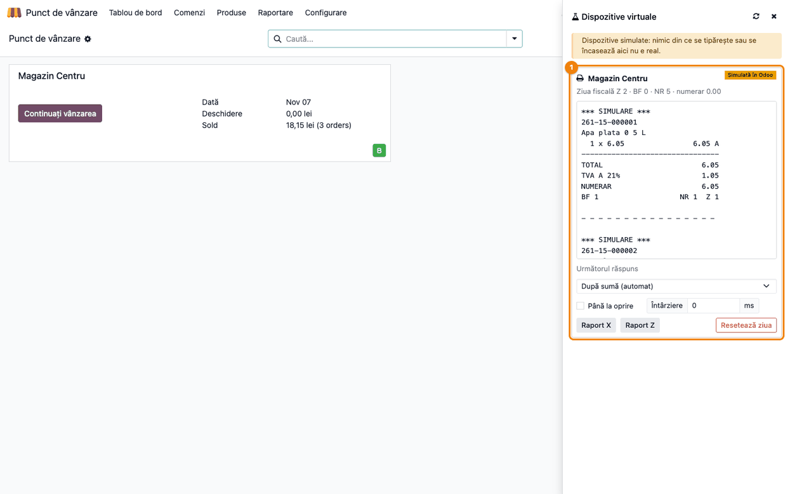

### Pasul 11 — Bonul prin driverul DxPrint

Pe un punct de vânzare cu **Transport ECR** = **DxPrint (driver local)** (secțiunea 5, Pasul 2), casierul
vinde ca de obicei. La validare, bonul nu mai pleacă ca fișier de comenzi, ci ca JSON, la API-ul local al
driverului (`POST /receipts` la adresa din **URL driver**, cu autentificare Basic dacă **Utilizator** e
completat). Driverul tipărește și răspunde pe loc cu numărul bonului și al raportului Z; în dreapta sus
apare același mesaj ca la Pasul 1, „Bon fiscal tipărit #<număr>”, cu numărul întors de driver.

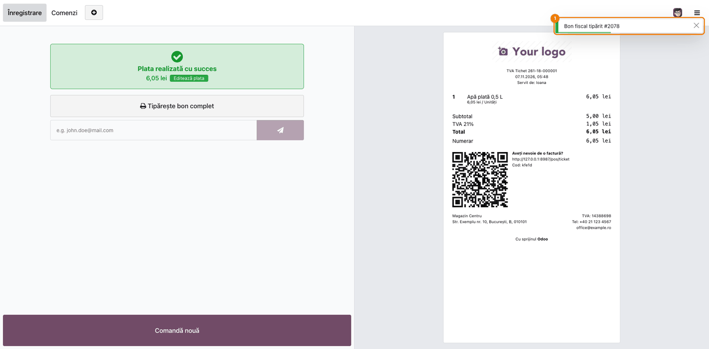

Conținutul bonului:

- produsele, cu cantitatea, prețul, cota TVA (sau **Cod ECR** al taxei, dacă e completat), unitatea de
  măsură și discountul procentual pe linie; denumirea se taie la 72 de caractere sau la **Trim to**,
  iar fără trunchiere restul denumirii se tipărește ca text sub produs;
- o linie cu total negativ (discount global, produs returnat într-un schimb) devine **discount valoric
  pe bon**, aplicat subtotalului, nu pe ultimul produs, pentru că driverul primește doar cantități
  pozitive;
- plățile, pe tipul dat de **Cod ECR** al metodei de plată: 0 numerar, 1 card, 2 credit, 3 tichete de
  masă, 4 tichete valorice, 5 voucher, 6 plată modernă, 7 card cu avans numerar, 8 alte metode; un
  cod necompletat sau în afara listei trece pe numerar la metodele de numerar și pe „alte metode” la
  celelalte;
- CIF-ul clientului (cu aceleași condiții ca pe celelalte transporturi), numele clientului, referința
  și notele ca texte la începutul bonului, codul de bare sau QR al comenzii.

Celelalte operațiuni au cereri proprii către driver: rapoartele X și Z (`/reports/x`, `/reports/z`),
introducerea de numerar (`/money/deposit`) și scoaterea de numerar (`/money/withdraw`); dispoziția de
plată devine o scoatere de numerar. Când o operațiune are mai multe cereri (de exemplu depunerea de
numerar urmată de chitanța pentru client), ele pleacă în ordine și se opresc la prima care eșuează.

**Ce se întâmplă la o eroare.**

| Situație | Rezultat |
|---|---|
| Driverul nu poate fi contactat la prima cerere (oprit, adresă greșită) | nimic nu a ajuns la casă: apare avertismentul „Driverul DxPrint nu răspunde — se descarcă fișierul .<ext>” și se descarcă fișierul de comenzi, ca la Pasul 3 |
| Casa sau driverul întoarce o eroare (de exemplu hârtie terminată) | dialogul **Eroare casă de marcat** (Pasul 2), cu codul și mesajul casei din `errorMessages` |
| Driverul răspunde cu altceva decât JSON (de exemplu o pagină de eroare HTML) | eroare obișnuită a driverului: dialogul **Eroare casă de marcat** cu „Eroare driver DxPrint (HTTP <cod>)”, fără avertisment; **Download & handle manually** descarcă fișierul dacă era prima cerere |
| Driverul nu răspunde în 40 de secunde, sau conexiunea se pierde după prima cerere | **nu** se descarcă fișierul, pentru că bonul ar putea ieși de două ori: se deschide dialogul **Eroare casă de marcat**, cu avertismentul că bonul poate fi deja tipărit, iar **Download & handle manually** nu mai descarcă nimic |
| **Reîncercați** în dialog | se reia de la cererea care a eșuat; cererile deja reușite (de exemplu depunerea de numerar) nu se repetă |

Când casa refuză bonul, dialogul arată codul și mesajul casei, de exemplu „-1011 VALOARE_INCORECTA”:


Când driverul nu răspunde în 40 de secunde, mesajul spune că bonul poate fi deja tipărit:

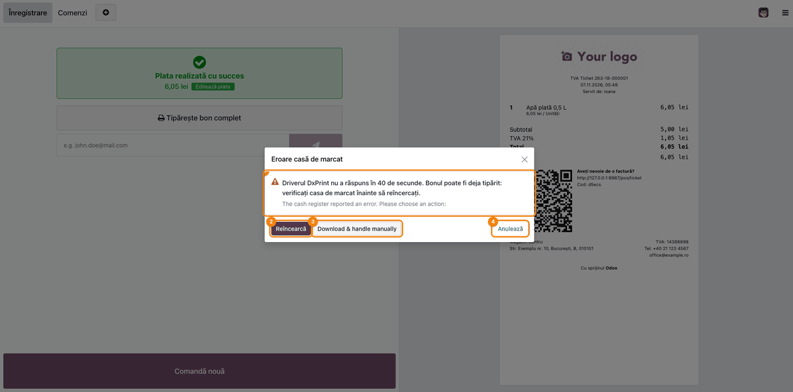

Înainte de **Reîncercați** sau de **Download & handle manually** după un timeout, casierul verifică pe
casă dacă bonul a ieșit; dacă da, alege **Anulează**.

## 7. Reguli funcționale

### Tipuri de casă acceptate

| Tip (`ecrType`) | Etichetă în POS | Format | Lungime denumire | Cod de bare | QR |
|---|---|---|---|---|---|
| `datecs` | nu se alege în POS; doar la factura de magazin, prin parametrul `account_invoice.ecr_type` | Datecs / FiscalWire clasic, fără unitate de măsură | 18 | da (tip 3) | da (tip 4) |
| `datecs18` | FiscalWire | Datecs / FiscalWire extins, cu unitate de măsură | 72 | da (tip 3) | da (tip 4) |
| `dxprint` | nu se alege în POS; doar la factura de magazin | la fel ca `datecs18`, dar cota TVA se ia din tabel | 72 | da (tip 3) | da (tip 4) |
| `fiscalnet` | FiscalNet | FiscalNet, sume în bani (×100) | 72 | da (`CB^…^3`) | nu |
| `incotex` | Incotex | Incotex (`R_TRP`) | 28 | nu | nu |
| `succes` | Succes | Succes (`R_TRP`) | 28 | nu | nu |
| `daisy` | Daisy | Daisy, comanda de vânzare `E` | 30 | da (tip 3) | da (tip 4) |
| `optima` | Optima | Optima, câmpuri separate prin `;`, sume ×100 | 18 | nu | nu |

Pe casele fără QR, opțiunea QR păstrează codul de bare normal; pe cele fără comandă de cod de bare
nu se tipărește nimic.

### Reguli de comportament

| Situație | Comportament |
|---|---|
| Denumire mai lungă decât limita casei, trunchierea oprită | continuă pe linii suplimentare de text |
| Denumire mai lungă decât limita casei, trunchierea activă | se taie la lungimea din **Trim to** (implicit 30), care înlocuiește limita casei. Valoarea trebuie să fie cel mult limita tipului de casă (18 pe Optima, 28 pe Incotex și Succes), altfel casa primește denumiri prea lungi |
| Diacritice | înlocuite cu litere simple, casele nu acceptă UTF-8 cu semne diacritice |
| Text liber cu `;`, `,`, `^`, ghilimele sau rânduri noi | **doar la facturile din magazin** (convertorul bibliotecii): caracterele sunt înlocuite cu spațiu sau apostrof, ca un nume de client să nu poată genera o comandă fiscală în plus. În POS, doar denumirea produsului pierde `,` și `;`, iar notele se împart pe rânduri; numele clientului și referința nu sunt curățate |
| Cotă TVA | pe `datecs` și `datecs18` codul vine direct din cotă (`21%`); pe `dxprint` tabelul trimite tot `21%` și `11%`, iar 0% și cotele necunoscute merg pe poziția 6; pe FiscalNet, Succes, Daisy, Optima și Incotex, dintr-un tabel de grupe, iar 21 → grupa lui 19, 11 → grupa lui 9 |
| Cote ieșite din uz (19, 18, 9, 5) | scoase din tabelele de grupe; pe casele bazate pe grupe cad pe grupa scutită; pe `datecs` și `datecs18` se trimit direct, de exemplu `19%`, iar casa le poate refuza |
| Cota 0% | pe `datecs` și `datecs18` se trimite `0%`; pe `dxprint`, poziția 6; pe Incotex are mapare explicită pe **grupa 3, aceeași cu cota redusă de 11%**, deci o taxă de 0% fără **Cod ECR** poate fi fiscalizată cu TVA dacă grupa 3 e programată la 11% |
| Două taxe diferite cu aceeași cotă (de exemplu două cote de 0%) | se separă prin **Cod ECR** de pe taxă, care are prioritate față de maparea pe procent |
| Linie cu preț pozitiv și cantitate negativă | `datecs18`, `dxprint` și `incotex` o tipăresc ca linie normală de vânzare; celelalte tipuri folosesc subtotal + discount, dar `daisy` și `optima` nu au comandă de subtotal definită, deci acolo cazul nu funcționează (vezi secțiunea 11) |
| Discount procentual pe linie | trimis ca discount după linie, doar la preț pozitiv |
| Dispoziție de plată | în convertor, retragere de numerar (`I,` pe Datecs), fără linii de produs; casa refuză un bon fiscal cu valori negative. În POS (`prepare_dp`), plățile pozitive se trimit ca „in" și cele negative ca „out", cu antet și rânduri de semnătură „Am primit / Semnătura", cu excepția FiscalNet. Doar pe Datecs (`I,`) și FiscalNet (`I^` / `O^`) este o operațiune de numerar; pe Incotex, Succes, Daisy și Optima este doar text tipărit, iar sertarul casei nu se mișcă |
| CIF client | se tipărește imediat după numele clientului, doar dacă modulul producător îl permite: în POS, cu **Print customer VAT on receipt** bifat, sub **VAT print limit** și la o comandă nefacturată |
| Transport DxPrint, linie cu total negativ | devine discount valoric pe bon (pe subtotal), nu linie de vânzare și nu discount pe ultimul produs |
| Transport DxPrint, fișier de rezervă | se descarcă doar când driverul nu poate fi contactat la prima cerere; după un timeout de 40 de secunde sau o conexiune pierdută după prima cerere se deschide dialogul de eroare, cu avertismentul că bonul poate fi deja tipărit; un răspuns care nu e JSON e o eroare obișnuită a driverului („HTTP <cod>”), fără avertisment |

### Casa de marcat simulată

| Situație | Comportament |
|---|---|
| Ordinea alegerii răspunsului | întâi **Următorul răspuns** din panou (sau fixat de un test prin ORM), apoi zecimalele totalului bonului, apoi succes |
| Totalul se termină în `,91` | Lipsă hârtie (dialog de eroare) |
| Totalul se termină în `,92` | casa de marcat e deconectată (dialog de eroare) |
| Totalul se termină în `,93` | răspuns întârziat: bonul **se tipărește**, dar POS-ul primește „Încă niciun răspuns de la casa de marcat”; **Reîncercați** citește bonul deja tipărit, fără să-l tipărească a doua oară |
| Totalul se termină în `,94` | niciun răspuns, bonul nu se tipărește |
| Totalul se termină în `,95` | bon anulat la casă: mesajul „Bon fiscal anulat”, pe rolă „BON ANULAT” |
| Zecimalele `,01`–`,05` | rezervate terminalului de card simulat (`deltatech_payment_terminal`), ca o vânzare cu cardul să nu declanșeze ambele dispozitive; casa răspunde cu succes |
| Același document trimis din nou (același identificator) | casa nu tipărește a doua oară, întoarce răspunsul dat prima dată |
| Grupe de TVA programate | A 21%, B 11%, C, D și E 0%; o cotă sau o literă neprogramată dă eroare |
| Tipuri de plată programate | 0 NUMERAR, 1 TICHETE, 2 CARD, 3 CREDIT, 4 TICHETE VALORICE, 5 VOUCHER, 6 PLATA MODERNA, 7 ALTE METODE; doar numerarul dă rest |
| Verificări ale bonului | plățile acoperă totalul; denumirea încape în limita tipului (72 pe FiscalWire, 18 pe `datecs`); prețul pozitiv; cantitatea nenulă (negativă doar pe FiscalWire, ca storno); discountul nu depășește linia; nicio grupă de TVA nu iese negativă; introducerile/scoaterile de numerar nu se amestecă cu un bon fiscal |
| Scoatere de numerar mai mare decât numerarul din sertar | eroare „Numerar insuficient în sertar” |
| Ziua fiscală | în browser, câte una pentru fiecare punct de vânzare: numerele Z, NR, BF, totalurile pe grupe și plăți, numerarul, rola (ultimele 30 de documente; panoul arată ultimele 10) |
| **Simulată prin agent** | Odoo alege răspunsul (aceleași reguli), îl trimite agentului împreună cu bonul, iar agentul simulat scrie fișierele de răspuns; dacă agentul nu raportează modul simulat, bonul nu se trimite |

### Mesajele casei simulate

Mesajele apar în dialogul **Eroare casă de marcat** (cu **Reîncercați**, **Download & handle manually**,
**Anulează**), cu excepția celor marcate ca notificare.

| Mesaj | Cauză | Remediere |
|---|---|---|
| Agentul Terrabit Connect nu e în mod simulat (TERRABIT_FISCAL_DRIVER=simulated): bonul nu a fost trimis. | **Simulată prin agent**, iar agentul rulează cu driverul real sau e o versiune fără simulare | reporniți agentul cu `TERRABIT_FISCAL_DRIVER=simulated` sau treceți pe **Simulată în Odoo (fără agent)** |
| Format nesuportat de simulator: … | tipul casei nu este FiscalWire (`datecs18`), `datecs` sau `dxprint` | pentru simulare alegeți **FiscalWire** ca **Tip casa marcat** |
| Lipsă hârtie / Casa de marcat e deconectată / Niciun răspuns de la casa de marcat | răspunsul ales în panou sau zecimalele `,91`, `,92`, `,94` | e scenariul cerut; **Reîncercați** după ce schimbați răspunsul, sau lăsați un răspuns „o singură dată” |
| Încă niciun răspuns de la casa de marcat | răspuns întârziat (`,93` sau ales în panou); bonul e deja pe rolă | **Reîncercați**: se citește bonul tipărit, fără dublură |
| Bon fiscal anulat (notificare) | răspunsul **Bon anulat la casă** sau zecimalele `,95` | vânzarea rămâne validată în Odoo, fără bon; refaceți bonul dacă e cazul |
| Plățile (…) nu acoperă totalul (…) | suma plăților trimise e mai mică decât totalul bonului | verificați plățile și codurile ECR ale metodelor de plată |
| Restul se poate da doar dintr-o plată în numerar | plata depășește totalul pe o metodă care nu e numerar | verificați **Cod ECR** al metodelor: numerarul trebuie să fie `0` pe casa simulată |
| Grupa de TVA … nu e programată pe casa de marcat | cota taxei sau **Cod ECR** al taxei nu corespunde grupelor A–E | folosiți cotele 21%, 11%, 0% sau un **Cod ECR** de taxă între 1 și 5 |
| Tipul de plată … nu e programat pe casa de marcat | **Cod ECR** al metodei de plată nu e între 0 și 7 | corectați **Cod ECR** pe metoda de plată |
| Denumirea produsului depășește … caractere / Prețul trebuie să fie pozitiv / Cantitatea trebuie să fie pozitivă / Discountul e mai mare decât suma la care se aplică / Totalul grupei de TVA … nu poate fi negativ | bonul ar fi refuzat și de o casă reală | corectați produsul, comanda sau setarea de trunchiere |
| O linie de vânzare nu are denumirea produsului | produs fără nume (după curățarea caracterelor nepermise) | completați denumirea produsului |
| Comandă de discount invalidă | discount fără linie înainte, cu valoare zero sau negativă, sau de tip necunoscut | verificați discountul pe linie sau pe comandă |
| Un discount valoric trebuie precedat de subtotal | discount valoric pe bon fără linia de subtotal înaintea lui | e o problemă de generare a bonului; trimiteți comanda la suport |
| O plată nu poate fi negativă | linie de plată cu sumă negativă (de exemplu un retur plătit pe același bon) | returul cu numerar se face ca dispoziție de plată, nu pe bonul de vânzare |
| Totalul bonului nu poate fi negativ | bon cu mai multe storno-uri decât vânzări | faceți returul separat de vânzare |
| Comandă necunoscută pentru casa de marcat / Comandă ilizibilă | o linie din fișier nu e o comandă FiscalWire validă | e o problemă de generare a bonului; trimiteți fișierul la suport |
| Introducerile / scoaterile de numerar nu se pot amesteca cu un bon fiscal | același fișier conține un bon de vânzare și o mișcare de numerar | trimiteți separat bonul și introducerea / scoaterea de numerar |
| Numerar insuficient în sertar (…) | scoatere de numerar mai mare decât numerarul zilei simulate | introduceți numerar sau resetați ziua din panou |
| Casa de marcat a … nu e în simulare. | răspunsul următor s-a cerut pentru o casă fără simulare | porniți **Simulare** pe punctul de vânzare (`deltatech_pos_base`) |

## 8. Scenarii de test pentru consultant

| ID | Scenariu | Rezultat așteptat |
|---|---|---|
| ECR-01 | Bon cu numerar pe casa reală, transport Terrabit Connect | bonul se tipărește, apare „Bon fiscal tipărit #<număr>" („Fiscal receipt printed") |
| ECR-02 | Același bon cu agentul oprit | avertisment „Agentul fiscal nu răspunde — se descarcă fișierul .inp" („Fiscal agent unreachable"), se descarcă fișierul cu extensia setată |
| ECR-03 | Eroare provocată la casă (de exemplu hârtie lipsă) | dialogul cu Reîncercați / Download & handle manually / Anulează |
| ECR-04 | Retry după remedierea erorii | bonul se tipărește o singură dată, fără dublură (depinde de agent, de confirmat) |
| ECR-05 | Produs cu denumire peste limita casei, trunchiere oprită | denumirea continuă pe linii suplimentare |
| ECR-06 | Produs cu diacritice, virgulă și punct și virgulă în nume | ieșire fără diacritice, separatorii înlocuiți cu spațiu (în POS, la denumirea produsului) |
| ECR-07 | Produs cu TVA 21% și produs cu TVA 11% | cotele ajung pe grupele programate în casă pentru 19% și 9% |
| ECR-08 | Două taxe de 0% (de exemplu SGR și taxare inversă) cu **Cod ECR** diferit | fiecare linie ajunge pe categoria ei |
| ECR-09 | **Print order number as barcode**, tip Normal | pe bon apare codul de bare cu numărul comenzii |
| ECR-10 | Același test cu tipul QR (Datecs, Daisy) | pe bon apare QR-ul cu numărul comenzii |
| ECR-11 | Linie cu cantitate negativă pe o comandă cu total pozitiv (nu pe Daisy sau Optima, fără comandă de subtotal) | tipărit conform tipului de casă (linie normală sau subtotal + discount) |
| ECR-13 | Retur plătit în numerar | în POS se trimite o dispoziție de plată, nu un bon cu valori negative |
| ECR-14 | Retur plătit cu cardul | nu se trimite niciun document la casă |
| ECR-12 | Client cu CIF, **Print customer VAT on receipt** bifat, sub **VAT print limit**, comandă nefacturată | CIF-ul apare imediat după numele clientului |
| ECR-15 | Bon cu numerar, transport **DxPrint (driver local)**, driverul pornit | bonul se tipărește, apare „Bon fiscal tipărit #<număr>”; pe comandă se salvează numărul bonului și raportul Z |
| ECR-16 | Același bon cu driverul DxPrint oprit | avertisment „Driverul DxPrint nu răspunde — se descarcă fișierul .<ext>”, se descarcă fișierul |
| ECR-17 | Transport DxPrint, eroare provocată la casă (de exemplu hârtie lipsă), apoi **Reîncercați** după remediere | dialogul de eroare cu mesajul casei; la reîncercare bonul se tipărește o singură dată |
| SIM-01 | Punct de vânzare de test, **Simulată în Odoo (fără agent)**, bon cu numerar de 6,05 lei | „Bon fiscal tipărit #1”; în panou, rola arată bonul cu `*** SIMULARE ***`, grupa A și NUMERAR 6.05 |
| SIM-02 | **Următorul răspuns** = **Lipsă hârtie**, **Până la oprire** nebifat, apoi un bon | dialogul cu „Lipsă hârtie”; **Reîncercați** tipărește bonul, iar panoul revine la **După sumă (automat)** |
| SIM-03 | Bon cu totalul terminat în `,93` | „Încă niciun răspuns de la casa de marcat”, bonul e pe rolă; **Reîncercați** nu adaugă un al doilea bon pe rolă |
| SIM-04 | Bon cu totalul terminat în `,95` | „Bon fiscal anulat”, pe rolă „BON ANULAT”, BF nu crește |
| SIM-05 | Trei bonuri, apoi **Raport X** și **Raport Z** | X arată totalurile fără să închidă ziua; Z are TOTAL = suma bonurilor, apoi Ziua fiscală trece la Z 2, BF 0 |
| SIM-06 | **Resetează ziua** și confirmare | rola goală, „(niciun document tipărit azi)”, Z 1 |
| SIM-07 | **Simulată prin agent**, agent pornit fără `TERRABIT_FISCAL_DRIVER=simulated` | dialogul „Agentul Terrabit Connect nu e în mod simulat…”; agentul nu primește bonul |
| SIM-08 | Același scenariu, agent pornit cu `TERRABIT_FISCAL_DRIVER=simulated` | bonul se „tipărește” prin agent, apare pe rola panoului |
| SIM-09 | **Tip casa marcat** = Optima, cu simularea pornită | eroarea „Format nesuportat de simulator: optima” |
| SIM-10 | Butonul **Simulare** din bara Odoo, cu o casă în simulare; apoi simularea oprită pe toate punctele de vânzare și pagina reîncărcată | panoul arată casa simulată, iar în colțul stânga-jos al fiecărui ecran din backend apare panglica roșie **SIMULARE**; după oprire, butonul și panglica dispar |

## 9. Legături cu alte module

| Modul | Rol |
|---|---|
| `deltatech_pos` | construiește comenzile casei din comanda POS (`prepare_bf` / `prepare_dp`) și folosește din bibliotecă formatele, transportul, dialogul și fallback-ul; salvează pe comandă numărul bonului, numărul documentului și raportul Z întoarse de agent sau, cu transportul DxPrint, numărul bonului și raportul Z întoarse de driver |
| `deltatech_pos_base` | setările ECR din POS: tip casă, transport, URL agent, URL driver, utilizatorul și parola driverului DxPrint, extensie fișier, **Cod ECR**; pornirea simulării, întârzierea și răspunsul următor al casei simulate |
| `deltatech_payment_terminal` | terminalul de card simulat, a doua secțiune a panoului **Dispozitive virtuale** |
| `deltatech_sale_store` | construiește documentul din factura de magazin (bon fiscal pe factură) și îl formatează cu convertorul bibliotecii |
| Terrabit Connect (aplicația locală) | agentul de pe stația casei, care primește comenzile și le trimite la casa de marcat; `deltatech_tc` este modulul de server Odoo al Terrabit Connect (registru de stații, coadă de lucrări) și nu e necesar acestei biblioteci |
| Driverul DxPrint (aplicația locală, www.dxprint.ro) | alternativa la agent pentru casele Datecs și Daisy, în modul embedded: primește bonul ca JSON și răspunde pe loc; dacă nu poate fi contactat la prima cerere se descarcă fișierul, iar după un timeout sau o conexiune pierdută se deschide dialogul de eroare (secțiunea 6, Pasul 11) |
| `l10n_ro_pos_fiscal_compliance` / `_ecr` | urmărirea bonurilor AMEF și reconcilierea raportului Z |

## 10. Verificări pentru consultant

- [ ] Tipul de casă ales în POS corespunde modelului real, inclusiv limita de lungime a denumirii.
- [ ] Dacă trunchierea e activă, **Trim to** este cel mult limita tipului de casă (18 pe Optima, 28 pe
      Incotex și Succes); implicit este 30.
- [ ] Pentru facturile din magazin, parametrii de sistem `account_invoice.ecr_transport`,
      `account_invoice.ecr_connect_url` (sau `ecr_fisco_url`), `ecr_type` și `ecr_extension` sunt setați;
      transportul Fisco.ro are funcția lui proprie.
- [ ] **Transport ECR** este setat conform instalării: agent, driver DxPrint sau fișier.
- [ ] Terrabit Connect rulează pe stația casei, pe portul din **URL agent**.
- [ ] Cu DxPrint: driverul rulează în modul embedded, cu API-ul JSON pe adresa din **URL driver**;
      **Utilizator** și **Parolă** sunt cele din driver, sau goale dacă driverul nu cere autentificare;
      un bon de probă se tipărește, iar cu driverul oprit se descarcă fișierul (ECR-15, ECR-16).
- [ ] Extensia fișierului corespunde cerinței driverului, pentru cazul fallback-ului.
- [ ] Cotele 21% și 11% ajung pe grupele programate în casă; programarea reală a casei a fost
      verificată, nu doar tabelul din modul.
- [ ] Taxele cu aceeași cotă dar categorii diferite au **Cod ECR** completat; pe Incotex, taxele de 0%
      au **Cod ECR** explicit, ca să nu ajungă pe grupa cotei de 11%.
- [ ] Un bon de probă iese complet, cu denumirile lungi și diacriticele așteptate.
- [ ] Dialogul de eroare funcționează: Retry nu dublează bonul, fișierul manual se descarcă.
- [ ] Dacă se folosește codul de bare sau QR, aparatul îl tipărește (Normal pe toate tipurile cu
      comandă; QR doar pe Datecs și Daisy).
- [ ] Pentru clienții fără agent, fluxul cu fișier a fost testat cap-coadă.
- [ ] Casa simulată e pornită doar pe un punct de vânzare de test sau de instruire, cu **Tip casa
      marcat** = **FiscalWire**; scenariile SIM-01…SIM-06 dau rezultatele din secțiunea 8.
- [ ] Pe **Simulată prin agent**, agentul raportează modul simulat; cu agentul pornit pe driverul real,
      POS-ul refuză trimiterea (SIM-07), nu tipărește un bon real.
- [ ] Rola panoului arată grupele de TVA și tipurile de plată așteptate pentru produsele și metodele de
      plată ale clientului (acolo se verifică codurile ECR fără hârtie fiscală).
- [ ] Înainte de punerea în funcțiune, niciun punct de vânzare al magazinelor nu mai are **Simulare**:
      butonul **Simulare** nu mai apare în bara Odoo, iar panglica roșie **SIMULARE** din colțul
      stânga-jos al ecranelor din backend a dispărut (după reîncărcarea paginii).

## 11. Limitări și gap-uri cunoscute

| Limitare | Impact |
|---|---|
| Modulul generează comenzi și le trimite la agent sau la driverul DxPrint, nu comunică direct cu aparatul | depinde de Terrabit Connect (sau de driverul DxPrint) și de driverul casei |
| Biblioteca nu stochează răspunsul fiscal; numărul bonului apare în mesajul de succes | în POS, `deltatech_pos` salvează pe comandă numărul bonului, numărul documentului și raportul Z; pe factură, `deltatech_sale_store` salvează aceleași câmpuri (număr bon, număr document, Z, stare sau eroare) și bifează `receipt_print` doar la bon fiscal, nu la dispoziție de plată |
| Tabelele de grupe de TVA presupun că grupa casei corespunde pozițional cotei înlocuite | maparea 21 → grupa lui 19 și 11 → grupa lui 9 trebuie verificată față de programarea reală a casei |
| Codul de bare și QR depind de modelul casei | `incotex`, `succes` și `optima` nu au comandă de cod de bare; `fiscalnet` are doar cod normal |
| POS-ul își construiește singur comenzile, nu prin convertorul bibliotecii | curățarea textului liber se aplică doar la facturile din magazin; în POS, numele clientului, referința și nota nu sunt curățate de caractere de control |
| `daisy` și `optima` nu au comandă de subtotal | o linie cu cantitate negativă care ar cere subtotal + discount nu produce o comandă validă pe aceste case |
| La facturile din magazin cu transport **File**, factura se marchează tipărită imediat la descărcare | factura apare ca tipărită chiar dacă fișierul nu a ajuns la casă, iar numărul bonului și raportul Z nu se salvează |
| Casa simulată citește doar formatul Datecs FiscalWire (`datecs`, `datecs18`, `dxprint`) | FiscalNet, Optima, Daisy, Succes și Incotex nu se pot simula; formatele lor se verifică pe aparat |
| Ziua fiscală a casei simulate stă în browser | alt browser, alt calculator sau ștergerea datelor browserului dau altă zi fiscală pentru aceeași casă; nu e o evidență de păstrat |
| Grupele de TVA și tipurile de plată ale casei simulate sunt fixe (A–E, 0–7) | programarea reală a aparatului clientului se verifică separat, pe aparat |
| O vânzare pe casa simulată se înregistrează contabil ca orice vânzare POS | simularea se face pe o bază sau pe un punct de vânzare de test, niciodată pe casa unui magazin în funcțiune |
| Pe Incotex, Succes și Optima, șablonul de cod de bare este gol | în fișier rămâne totuși un rând gol; de verificat pe aparat dacă driverul îl acceptă |
| Fără răspuns de la agent în 40 de secunde se trece pe fișier | bonul poate fi totuși tipărit de aparat dacă agentul a întârziat; verificați înainte de a retipări manual. Cu DxPrint, un timeout nu descarcă fișierul, ci deschide dialogul de eroare |
| Modulul nu are ecrane proprii, în afară de panoul **Dispozitive virtuale** | capturile sunt făcute în POS și în backend, cu un agent jucat de test sau cu casa simulată; primii pași (documentul și comenzile) sunt interni și nu au captură |

## 12. Teste automate

Modulul are teste JavaScript (hoot) pentru: conversia documentului în comenzi Datecs și FiscalNet,
înlocuirea diacriticelor, maparea **Cod ECR** și a cotelor, liniile cu cantitate negativă, CIF-ul
clientului, dispoziția de plată, curățarea textului liber, tipul de cod de bare (Normal / QR),
comportamentul transportului când agentul se blochează după antete și, pentru casa simulată, citirea
comenzilor, validările, răspunsurile după zecimale, ziua fiscală și ambele moduri (în Odoo și prin agent).
Rulare:

```bash
./odoo/odoo-bin -c odoo.conf -d <db> -i deltatech_ecr_connect \
    --test-tags=/deltatech_ecr_connect --stop-after-init
```

## 13. Capturi de ecran

Capturile din `static/description/` sunt generate automat, în română, pe planul de conturi RO, de
testele din `deltatech_pos` (biblioteca nu are ecrane proprii; mixinul `ScreenshotCase` din
`deltatech_doc_screenshots`, import defensiv):

1. `01_bon_tiparit.png` — mesajul de bon fiscal tipărit, cu un agent jucat de test (`TestEcrConnectScreenshots`).
2. `02_eroare_casa.png` — dialogul de eroare de la casa de marcat, cu cele trei variante.
3. `03_agent_indisponibil.png` — agentul nu răspunde, se descarcă fișierul.
4. `04_bon_simulat_tiparit.png` — bonul pe casa simulată, butoanele **Simulare** și **Casă de marcat simulată** (`TestEcrSimulatorScreenshots`).
5. `05_panou_rola.png` — panoul **Dispozitive virtuale**, rola cu `*** SIMULARE ***`.
6. `06_raspuns_urmator.png` — **Următorul răspuns** pe **Lipsă hârtie**, **Până la oprire**, **Întârziere**.
7. `07_eroare_simulata.png` — dialogul de eroare cu „Lipsă hârtie” de la casa simulată.
8. `08_raport_x_z.png` — rola cu raportul Z, butoanele **Raport X**, **Raport Z**, **Resetează ziua**.
9. `09_agent_nesimulat.png` — refuzul trimiterii către un agent care nu e în mod simulat.
10. `10_panou_backend.png` — panoul deschis din bara de sus a backend-ului.
11. `11_dxprint_bon_tiparit.png` — bonul tipărit prin driverul DxPrint, mesajul cu numărul bonului (`TestEcrConnectDxPrintScreenshots`, driver jucat de test).
12. `12_dxprint_eroare_casa.png` — dialogul de eroare cu codul și mesajul casei întoarse de driver.
13. `13_dxprint_fara_raspuns.png` — dialogul după 40 de secunde fără răspuns, cu avertismentul că bonul poate fi deja tipărit.

Aceleași capturi, cu interfața în engleză, sunt în `static/description/en/`, pentru `readme/USAGE.md`.

Regenerare (câte o clasă, niciodată tag-ul general):

```bash
./odoo/odoo-bin -c odoo.conf -d <db> -i deltatech_pos,deltatech_doc_screenshots,l10n_ro \
    --test-tags=/deltatech_pos:TestEcrConnectScreenshots --stop-after-init
./odoo/odoo-bin -c odoo.conf -d <db> -i deltatech_pos,deltatech_doc_screenshots,l10n_ro \
    --test-tags=/deltatech_pos:TestEcrSimulatorScreenshots --stop-after-init
./odoo/odoo-bin -c odoo.conf -d <db> -i deltatech_pos,deltatech_doc_screenshots,l10n_ro \
    --test-tags=/deltatech_pos:TestEcrConnectDxPrintScreenshots --stop-after-init
```

Cer `playwright` și Chrome de sistem; fără ele testele se sar.
