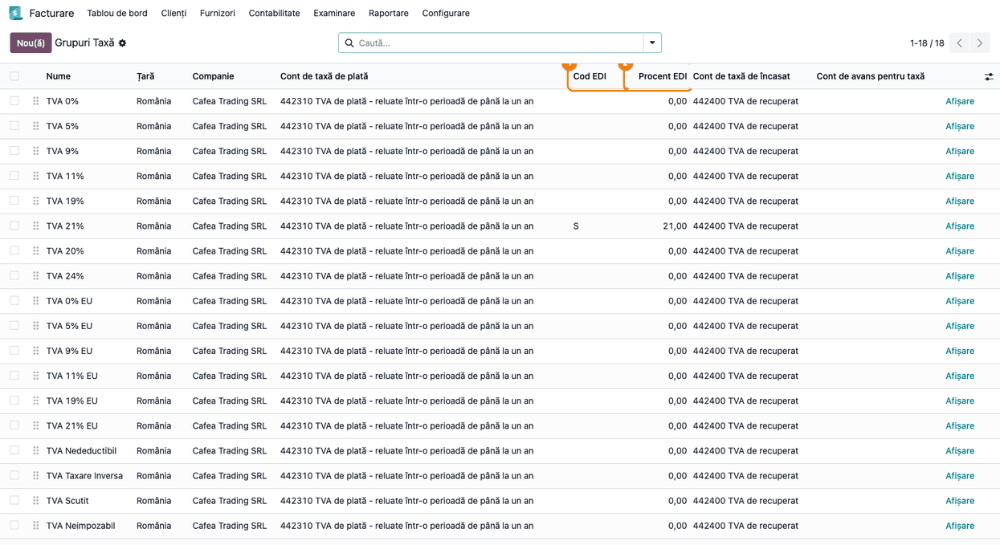
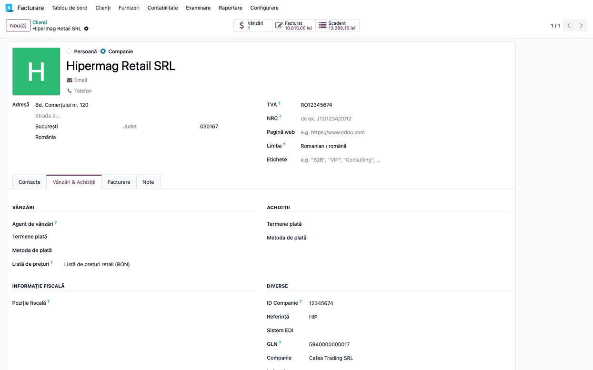
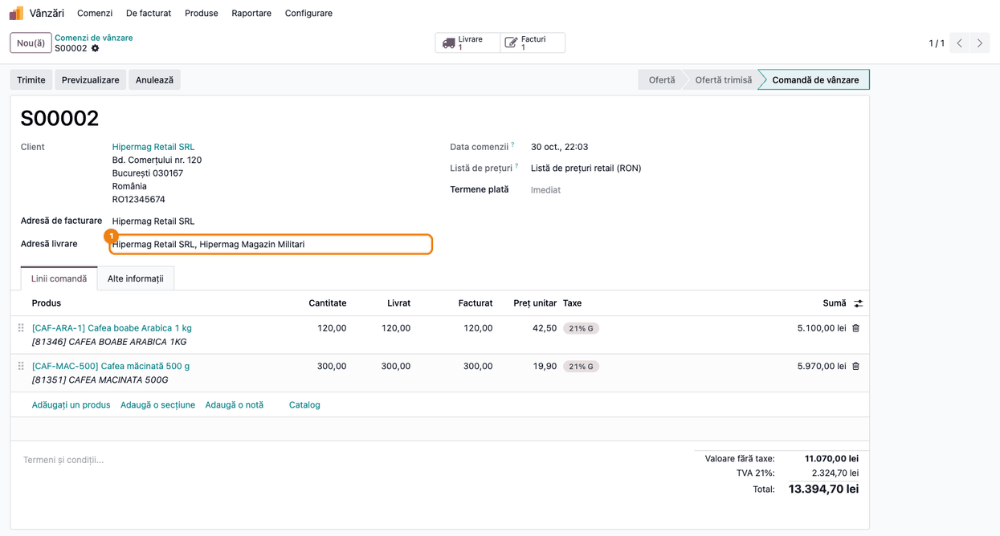
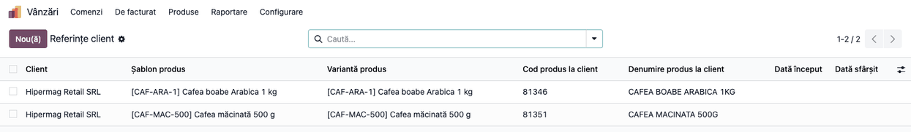
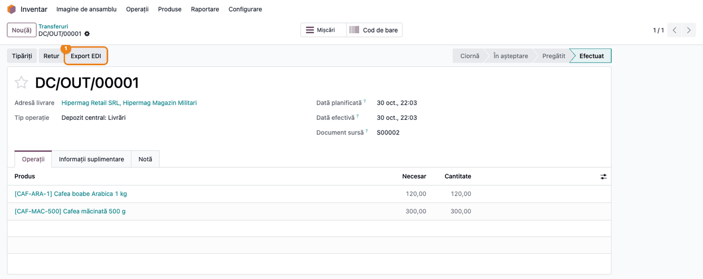
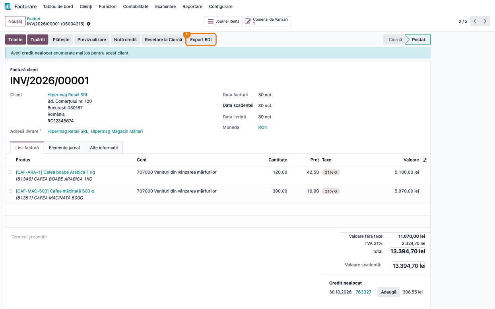
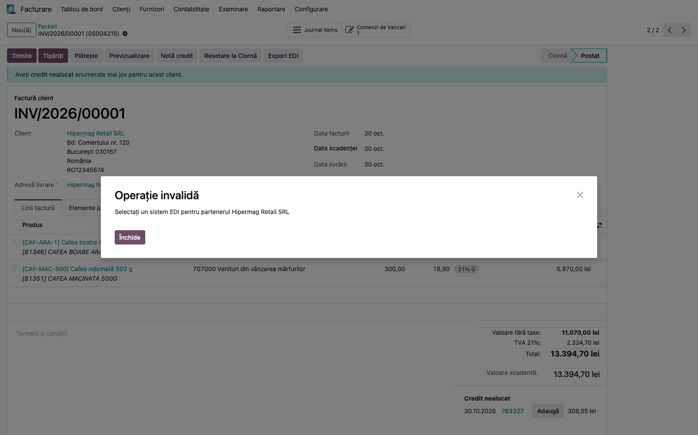

# Fișă Modul: Schimbul de documente EDI cu lanțurile de retail (bază)

**Modul:** `deltatech_edi`
**Utilizator principal:** Operator vânzări / facturare pentru clienții-cheie din retail; consultantul care pune în funcțiune conectorul EDI
**Prioritate:** 🔴 Ridicată (un document EDI respins sau blocat la retailer oprește recepția mărfii și plata facturii)

---

## 1. Scop business

Lanțurile de retail nu primesc comenzi, avize și facturi pe e-mail: le schimbă electronic, prin
**EDI**, în formatele furnizorului lor de EDI. Comanda vine ca mesaj, recepția mărfii se face pe
**avizul de expediție (DESADV)**, iar factura se confruntă automat cu comanda și cu recepția. Un
document care nu respectă formatul nu ajunge la contabilitatea retailerului: rămâne blocat, iar plata
întârzie.

Modulul este **baza comună** a conectorilor EDI din Odoo. El:

- creează **comanda de vânzare** din mesajul de comandă primit (client, adresă de livrare, produse,
  cantități, prețuri) și ține la zi **codurile de articol ale retailerului**;
- generează **XML-ul avizului de expediție** (DESADV) din livrare și **XML-ul facturii** (INVOICE)
  din factură sau din nota de credit, validate fiecare pe schema XSD a formatului;
- adaugă câmpurile de identificare EDI pe parteneri și codurile EDI pe grupurile de taxe.

Transmiterea efectivă către platforma retailerului (preluarea comenzilor, trimiterea fișierelor) o
face **conectorul** instalat peste acest modul: `deltatech_edinet` (EDINET) sau `deltatech_ediconnect`
(EDI Connect). Fără conector, modulul pregătește datele, dar nu are unde trimite documentele (vezi
Pasul 7).

## 2. Bază legală și context

Modulul **nu** generează documente fiscale noi și nu schimbă sumele facturii. Contextul de reținut:

- **Factura rămâne factura din Odoo.** XML-ul EDI preia numărul, datele, părțile, liniile și totalurile
  facturii, pentru sistemul retailerului; el nu înlocuiește e-Factura transmisă în SPV, care merge pe
  drumul ei. Câteva valori sunt **fixe în șablon**, nu luate din factură: termenul de plată (30 de
  zile), metoda de plată (transfer bancar) și moneda declarată, care este moneda companiei. Facturile
  în valută și cele cu alt termen de plată nu se trimit corect prin EDI fără o adaptare a șablonului.
- **Unitatea de măsură diferă între documente:** avizul de expediție trimite mereu `PCE`, factura
  trimite codul unității produsului (`BUC`, `KGM`, `L`). Verificați cu retailerul că acceptă perechea.
- **Formatul îl dictează furnizorul EDI**, nu legea: structura documentelor urmează schemele XSD ale
  formatului folosit (în modul: `schemas/invoice.xsd`, `schemas/desadv.xsd`), iar regulile de
  completare vin din contractul cu retailerul și din specificația platformei EDI.
- **Codurile din XML sunt coduri, nu texte.** `RETURN`, `O`, `R`, `C`, `PCE` și celelalte valori fixe
  din documente sunt citite de sistemul retailerului ca atare și **nu se traduc** în limba
  utilizatorului. O traducere (ex. `RETURN` → „RETURNARE") face ca retailerul să nu mai recunoască
  tipul documentului (vezi secțiunea 9).

## 3. Utilizatori și roluri

Consultantul configurează o singură dată partenerii, produsele și grupurile de taxe; operatorii lucrează
apoi pe comenzi, livrări și facturi ca de obicei, cu un pas în plus: exportul EDI.

Roluri necesare la testare:

- **Vânzări: Administrator** — vede comenzile importate și **Referințe client** (meniul
  **Vânzări → Produse → Referințe client**, din `deltatech_sale_product_reference`);
- **Inventar: Utilizator** — validează livrarea și exportă avizul de expediție;
- **Contabilitate: Facturare** — înregistrează factura sau nota de credit și exportă factura EDI;
- **Contabilitate: Administrator** — completează **Cod EDI** și **Procent EDI** pe grupurile de taxe.

## 4. Conturi și date implicate

**Modulul nu generează note contabile.** Factura și nota de credit se contabilizează exact ca orice
factură de client (4111 = 707 + 4427 la mărfuri, respectiv stornarea lor pe nota de credit); modulul
doar le descrie în XML-ul EDI.

Datele pe care se sprijină documentele EDI:

| Dată | Unde se completează | Ce devine în XML |
|---|---|---|
| **GLN** al retailerului, al magazinelor lui și al companiei noastre | fișa partenerului (`deltatech_gln`) | identificarea părților (`ILN`) |
| **Cod EDI** și **Procent EDI** | grupul de taxe | categoria și cota TVA pe linie și în total (`TaxCategoryCoded`, `TaxPercent`) |
| **Codul de bare** (EAN) și **Referința internă** a produsului | fișa produsului | `EAN`, `SellerItemID` |
| **Codul articolului la retailer** | **Referințe client** (scris automat la import) | `BuyerItemID` |
| **Referința comenzii client** | comanda de vânzare (din mesajul EDI) | numărul comenzii retailerului |
| **Tip factură EDI**, **Număr comandă EDI**, **Referință** | factura / nota de credit (câmpurile apar cu conectorul EDINET) | tipul documentului, comanda și avizul de retur |

Date minime pentru demo:

- compania cu **GLN** completat;
- un retailer-firmă cu **GLN** (ex. „Hipermag Retail SRL") și un magazin al lui, adresă de livrare
  copil, cu propriul **GLN** (ex. „Hipermag Magazin Militari");
- două produse cu **cod de bare** și **referință internă** (ex. „Cafea boabe Arabica 1 kg",
  `CAF-ARA-1`);
- grupul de taxe al cotei de 21% cu **Cod EDI** `S` și **Procent EDI** `21`.

## 5. Configurare inițială

1. **Instalați conectorul** potrivit retailerului (`deltatech_edinet` sau `deltatech_ediconnect`);
   `deltatech_edi` se instalează odată cu el. Modulul cere **Inventar** și **Contabilitate**; pentru
   meniurile **Vânzări** din pașii de mai jos instalați și aplicația **Vânzări** (`sale_management`).
   Mai cere plus `deltatech_gln` (câmpul GLN) și `deltatech_sale_product_reference`
   (Referințe client).
2. **GLN-ul companiei**: deschideți partenerul companiei din **Contacte** (căutați numele companiei),
   tabul **Vânzări & Achiziții**, și completați **GLN**.
3. **Grupurile de taxe** (Pasul 1): completați **Cod EDI** și **Procent EDI** pentru fiecare cotă
   folosită pe facturile către retaileri.
4. **Retailerul și magazinele lui** (Pasul 2): completați **GLN** pe firmă și pe fiecare adresă de
   livrare, apoi **Sistem EDI** pe firmă.
5. **Produsele**: fiecare produs vândut prin EDI are **cod de bare** sau **referință internă**, ca
   importul comenzilor să-l găsească.
6. **Opțional — produse necunoscute la import.** Implicit, o comandă cu un articol care nu se găsește
   în Odoo este refuzată. Cu parametrul de sistem `deltatech_edi.create_product` = `True`
   (**Setări → Tehnic → Parametri de sistem**, în modul dezvoltator), importul creează produsul din
   datele mesajului. Folosiți-l doar dacă nomenclatorul retailerului e sigur.

## 6. Flux de utilizare

### Pasul 1 — Codurile EDI ale grupurilor de taxe

Deschideți **Facturare → Configurare → Contabilitate → Grupuri Taxă** (meniul apare doar în modul
dezvoltator; cu Contabilitatea completă, aplicația se numește **Contabilitate**). Lista are două
coloane noi, **Cod EDI** și **Procent EDI**. Completați-le pentru fiecare grup folosit pe facturile
către retaileri: codul îl dă specificația platformei EDI (ex. `S` pentru cota standard), procentul
este cota grupului.

Pe factura EDI, fiecare linie și fiecare total de TVA poartă codul și procentul grupului de taxe al
liniei. Un grup lăsat necompletat iese cu cod gol, iar retailerul poate respinge factura.



### Pasul 2 — Retailerul: GLN și sistemul EDI

Deschideți retailerul din **Facturare → Clienți → Clienți** (**Contabilitate → Clienți → Clienți** cu
Contabilitatea completă) și treceți în tabul **Vânzări & Achiziții**. În grupul **Diverse**, sub
**Referință**, apar:

- **Sistem EDI** — platforma prin care se schimbă documentele cu acest client. Lista de valori vine
  de la conectorul instalat („EDI Net", „EDI Connect"); fără conector, lista e goală;
- **GLN** — codul global de localizare al firmei; fiecare magazin (adresă de livrare) are propriul
  GLN, completat pe adresa lui;
- **EDI Cumpărător** și **EDI Vânzător** — identificatorii cumpărătorului și ai noștru în sistemul
  retailerului. Apar doar după ce alegeți **Sistem EDI**. **EDI Vânzător** e obligatoriu pentru
  avizul de expediție: fără el, DESADV-ul nu trece validarea pe schemă (vezi secțiunea 9).

Importul comenzilor recunoaște retailerul și magazinul **după GLN**, căutând **doar printre partenerii
companiei curente**. Verificați și câmpul **Companie** din același grup: un partener partajat (fără
companie) nu e găsit, chiar cu GLN-ul corect. Alegerea **Sistem EDI** completează compania automat. Un
GLN lipsă sau greșit face ca importul să creeze un partener nou, în loc să-l folosească pe cel existent;
un magazin creat astfel nu e legat de firmă și trebuie atașat manual ca adresă de livrare.



### Pasul 3 — Comanda primită prin EDI

Conectorul preia mesajele de comandă și le transformă în **comenzi de vânzare**, în starea **Ofertă**.
Deschideți comanda din **Vânzări → Comenzi → Comenzi**.

**Ce trebuie să găsiți pe ecran:**

1. **Găsiți** **Clientul** (firma, recunoscută după GLN) și **Adresa de livrare** (magazinul,
   recunoscut după GLN-ul lui). Numărul comenzii retailerului (ex. `05004215`) e în **Referința
   clientului**, în tabul **Alte informații**.
   Pe linii, produsele noastre, cu denumirea din mesajul retailerului, cantitățile și prețurile din
   mesaj.
2. **Verificați** că adresa de livrare este magazinul din comandă, nu sediul firmei, și că prețurile
   corespund listingului. Dacă mesajul nu are prețuri (unii retaileri nu le trimit), prețul se ia din
   **Referințe client**, apoi din lista de prețuri a clientului. Comentariul retailerului din mesaj,
   dacă există, se scrie în chatter-ul comenzii.
3. Abia apoi **confirmați** comanda.

Același număr de comandă de la același retailer nu creează o a doua comandă: un mesaj primit din nou
este ignorat dacă există deja o comandă cu linii. Dacă există doar antetul (comandă fără linii), liniile
din mesaj se adaugă pe ea.

Captura arată comanda demo după confirmare, livrare și facturare (de aici butoanele **Livrare** și
**Facturi**); antetul și liniile sunt cele create de import. **Referința clientului** `05004215` este în
tabul **Alte informații**, neafișat în captură.



### Pasul 4 — Codurile articolelor la retailer

La fiecare comandă importată, modulul scrie sau actualizează, pentru fiecare articol, **codul și
denumirea lui la retailer** în **Vânzări → Produse → Referințe client**. De aici se iau codurile
retailerului pe avizul de expediție și pe factură (`BuyerItemID`).

1. **Găsiți** câte un rând per articol al retailerului: **Client** (firma), produsul nostru, **Cod
   produs la client** (ex. `81346`) și **Denumire produs la client**.
2. **Verificați** că fiecare cod al retailerului e legat de produsul corect. Importul recunoaște
   produsul după **codul de bare**, apoi după **referința internă**, apoi după **codul retailerului**.
   Un cod al retailerului pus pe două produse e semnalat în jurnalul serverului, iar importul îl alege
   pe primul după ordinea referințelor.

Un rând introdus manual are prioritate la recunoașterea produsului după codul retailerului: dacă legați
manual un cod de alt produs, legătura voastră câștigă. **Denumirea** și **prețul** de pe rândul existent
pentru același cod și produs se actualizează însă la fiecare comandă primită.



### Pasul 5 — Livrarea și avizul de expediție (DESADV)

Confirmarea comenzii creează livrarea. După ce o validați, deschideți-o din **Inventar → Operațiuni →
Transferuri → Livrări** și apăsați **Export EDI**. Cu **EDINET**, conectorul generează XML-ul avizului
de expediție, validat pe schema DESADV, îl atașează livrării și îl trimite retailerului. **EDI Connect
nu trimite avize de expediție**: pe livrarea unui retailer EDI Connect, **Export EDI** nu face nimic.

**Exportul nu se oprește la o eroare de validare:** documentul pleacă și dacă XML-ul nu respectă schema,
iar eroarea se scrie în chatter („Eroare validare: …"). Citiți chatter-ul imediat după export; dacă
apare eroarea, corectați datele și reexportați.

Pe aviz pleacă numărul livrării, comanda retailerului, magazinul de livrare și, pe fiecare linie,
codul de bare, codul retailerului, codul nostru și cantitatea livrată:

```xml
<DesadvHeader>
    <DesadvNumber>DC/OUT/00001</DesadvNumber>
    <DesadvDate>2026-10-30</DesadvDate>
    <PlannedDeliveryDate>2026-10-30</PlannedDeliveryDate>
    ...
    <ReferenceDocs>
        <OrderAtBuyer>
            <DocID>05004215</DocID>
            <DocDate>2026-10-30</DocDate>
        </OrderAtBuyer>
    </ReferenceDocs>
</DesadvHeader>
<DesadvParty>
    <BuyerParty><ILN>5940000000017</ILN> <Name>Hipermag Retail SRL</Name> ...</BuyerParty>
    <ShipToParty><ILN>5940000000024</ILN> <Name>Hipermag Magazin Militari</Name> ...</ShipToParty>
    <SellerParty><ILN>5940000000109</ILN> <IDInBuyerSys>40012</IDInBuyerSys> ...</SellerParty>
</DesadvParty>
...
<Item>
    <ItemNum>1</ItemNum>
    <EAN>5940000001007</EAN>
    <BuyerItemID>81346</BuyerItemID>
    <SellerItemID>CAF-ARA-1</SellerItemID>
    ...
    <QuantityValue>120.0</QuantityValue>
    <UnitOfMeasure>PCE</UnitOfMeasure>
    ...
    <OrderedQuantity>120.0</OrderedQuantity>
</Item>
```



### Pasul 6 — Factura și nota de credit

Înregistrați factura din comandă. **Înainte de export**, completați pe factură **Număr comandă EDI**
(tabul **Alte informații**, cu conectorul EDINET) cu numărul comenzii retailerului, ex. `05004215`:
nu se completează singur, iar fără el `BuyerOrderNumber` din antetul facturii pleacă gol. Apoi
apăsați **Export EDI**. Cu EDI Connect câmpul nu există: antetul facturii pleacă fără numărul
comenzii, iar liniile îl au din **Referința clientului** de pe comandă. XML-ul facturii este validat pe
schema INVOICE; ca la livrare, o eroare de
validare nu oprește exportul, ci se scrie în chatter-ul facturii („Eroare validare: …").

În captură, blocul **Credit nealocat** din dreapta jos este nota de credit pentru retur din aceleași
date demo (Pasul 6, mai jos); nu ține de export.



Pe factura obișnuită (tip **Original**) pleacă numărul și data facturii, comanda retailerului, părțile
identificate prin GLN, liniile cu codurile articolelor și totalurile pe cote de TVA:

```xml
<InvoiceHeader>
    <InvoiceNumber>INV/2026/00001</InvoiceNumber>
    <Date>2026-10-30</Date>
    <InvoiceDueDate>2026-10-30</InvoiceDueDate>
    <PaymentTerms>30</PaymentTerms>
    <PaymentTermsQualifier>3</PaymentTermsQualifier>
    <PaymentMethod>
        <Code>42</Code>
        <Description>Transfer bancar</Description>
    </PaymentMethod>
    <InvoiceCurrencyCoded>RON</InvoiceCurrencyCoded>
    <InvoicePurposeCoded>O</InvoicePurposeCoded>
    <DocumentRole>O</DocumentRole>
</InvoiceHeader>
<InvoiceParty>
    <OrderParty>
        <BuyerOrderNumber>05004215</BuyerOrderNumber>
        <BuyerOrderDate>2026-10-30T12:00:00</BuyerOrderDate>
    </OrderParty>
    <BuyerParty><ILN>5940000000017</ILN> <TaxID>RO12345674</TaxID> ...</BuyerParty>
    ...
</InvoiceParty>
<Item>
    <ItemNum>1</ItemNum>
    <EAN>5940000001007</EAN>
    <BuyerItemID>81346</BuyerItemID>
    <SellerItemID>CAF-ARA-1</SellerItemID>
    ...
    <QuantityValue>120.0</QuantityValue>
    <TaxCategoryCoded>S</TaxCategoryCoded>
    <TaxPercent>21.0</TaxPercent>
    ...
    <MonetaryNetValue>5100.0</MonetaryNetValue>
    ...
    <DeliveryDetail>
        <DeliveryDocumentNumber>DC/OUT/00001</DeliveryDocumentNumber>
    </DeliveryDetail>
</Item>
...
<InvoiceSummary>
    <NumberOfLines>2</NumberOfLines>
    <NetValue>11070.0</NetValue>
    <TaxValue>2324.7</TaxValue>
    ...
    <GrossValue>13394.7</GrossValue>
    ...
</InvoiceSummary>
```

`PaymentTerms` 30 și `PaymentMethod` 42 sunt valorile fixe din șablon (secțiunea 2), chiar dacă factura
demo are scadența în aceeași zi.

**Nota de credit** are în plus câmpul **Tip factură EDI**, care spune retailerului ce fel de document
primește. Câmpul îl afișează **conectorul EDINET**; cu EDI Connect nu apare, iar notele de credit pleacă
drept **Original**, cu sume negative.

| Tip factură EDI | Când se folosește | Ce se completează |
|---|---|---|
| **Original** | factura obișnuită (implicit) | — |
| **Retur** | marfă returnată de retailer | **Referință** = numărul **avizului de retur** primit de la retailer; **Număr comandă EDI** (obligatoriu) |
| **Storno** | anularea unei facturi | **Referință** = `număr factură|dată` a facturii stornate (obligatoriu, altfel exportul se oprește cu eroare); **Număr comandă EDI** (obligatoriu) |
| **Corecție** | diferență de preț sau cantitate | **Referință** = `număr factură|dată` a facturii corectate; **Număr comandă EDI** (obligatoriu) |

La **Retur**, XML-ul poartă codul `RETURN` și numărul avizului de retur pe fiecare linie. Retailerul
confruntă factura de retur cu avizul lui: dacă **Referința** e goală sau conține altceva (de exemplu
numărul comenzii), factura rămâne blocată la el.

```xml
<InvoiceHeader>
    <InvoiceNumber>RINV/2026/00001</InvoiceNumber>
    ...
    <InvoicePurposeCoded>O</InvoicePurposeCoded>
    <DocumentRole>R</DocumentRole>
    <InvType>RETURN</InvType>
</InvoiceHeader>
...
<Item>
    ...
    <BuyerItemID>81346</BuyerItemID>
    ...
    <QuantityValue>-6.0</QuantityValue>
    ...
    <ReturnsAnnouncement>
        <RetAnnDate>2026-10-30T12:00:00</RetAnnDate>
        <RetAnnNumber>763327</RetAnnNumber>
    </ReturnsAnnouncement>
    <Order>
        <BuyerOrderNumber>05004215</BuyerOrderNumber>
    </Order>
</Item>
...
<InvoiceSummary>
    ...
    <NetValue>-255.0</NetValue>
    ...
    <GrossValue>-308.55</GrossValue>
    ...
</InvoiceSummary>
```

### Pasul 7 — Exportul fără conector

Dacă retailerul nu are **Sistem EDI** completat (sau niciun conector nu e instalat), **Export EDI**
oprește operația cu mesajul „Selectați un sistem EDI pentru partenerul …". Completați **Sistem EDI**
pe fișa retailerului (Pasul 2) și reluați exportul.



### Note de monografie și raportare

**Modulul nu generează note contabile.** Factura și nota de credit se înregistrează prin fluxul standard
de facturare; XML-ul EDI le descrie fără să le modifice.

| Document | Notă contabilă (fluxul standard), pe datele demo | Ce face modulul |
|---|---|---|
| Factură către retailer | 4111 13.394,70 = 707 11.070,00 + 4427 2.324,70 (707 la mărfuri, 701 la produse finite) | XML INVOICE, tip Original |
| Notă de credit pentru retur | 4111 −308,55 = 707 −255,00 + 4427 −53,55 (stornare în roșu) | XML INVOICE, tip Retur, cu avizul de retur |
| Notă de credit storno | stornarea în roșu a facturii inițiale, pe aceleași conturi | XML INVOICE, tip Storno |
| Livrare | 607 = 371 (sau 711 = 345 la produse finite), din evaluarea stocului, nu din acest modul | XML DESADV |
| Retur de marfă (recepție) | 607 = 371 în roșu (sau 711 = 345 în roșu la produse finite), din evaluarea stocului | — |

Pentru **Corecție**, contul depinde de natura diferenței (reducere de preț acordată după facturare sau
corectarea unei erori); stabiliți-l cu contabilul clientului.

## 7. Legături cu alte module / declarații

| Modul / proces | Rol în flux | Tip legătură |
|---|---|---|
| `deltatech_edinet` | conectorul EDINET: preia comenzile, trimite **avizele (DESADV)** și **facturile**, afișează **Tip factură EDI** și **Număr comandă EDI** pe factură | extinde acest modul |
| `deltatech_ediconnect` | conectorul EDI Connect: preia comenzile și trimite **facturile**; **nu** trimite avize și **nu** afișează **Tip factură EDI** și **Număr comandă EDI** | extinde acest modul |
| `deltatech_gln` | câmpul **GLN** pe parteneri | dependență |
| `deltatech_sale_product_reference` | **Referințe client**: codurile articolelor la retailer | dependență |
| `sale_stock`, `account` | comanda, livrarea, factura pe care se generează documentele | dependență |
| e-Factura (SPV) | merge separat; XML-ul EDI nu o înlocuiește | fără legătură |

**Ce e automat:** crearea comenzii din mesaj, recunoașterea retailerului și a magazinului după GLN,
găsirea produselor, actualizarea codurilor retailerului, prețul de rezervă când mesajul nu are prețuri,
generarea și validarea XML-urilor DESADV și INVOICE.

**Ce rămâne manual:** GLN-urile, **Sistem EDI** pe retailer, **Cod EDI** pe grupurile de taxe,
apăsarea **Export EDI** pe livrare și pe factură (dacă conectorul nu o face automat), completarea
**Număr comandă EDI** pe facturi, alegerea **Tip factură EDI** și completarea **Referinței** pe notele
de credit, citirea chatter-ului după export.

## 8. Verificări pentru consultant

- [ ] Compania, retailerul și fiecare magazin al lui au **GLN** completat; adresele au cod poștal.
- [ ] Opțiunea **Adresele clientului** (**Facturare → Configurare → Setări**) e activă, ca adresa de
      livrare să apară pe comandă.
- [ ] Retailerul și magazinele lui au **Companie** completată (aceeași cu compania care primește
      comenzile).
- [ ] Grupurile de taxe folosite pe facturile către retaileri au **Cod EDI** și **Procent EDI**.
- [ ] Retailerul are **Sistem EDI** ales; după alegere apar **EDI Cumpărător** și **EDI Vânzător**.
- [ ] O comandă primită are **Referința clientului** egală cu numărul comenzii retailerului, clientul
      firma și adresa de livrare magazinul din mesaj.
- [ ] Al doilea import al aceluiași mesaj **nu** creează o comandă nouă.
- [ ] Un articol necunoscut oprește importul cu „Produsul … nu a fost găsit!" (fără
      `deltatech_edi.create_product`).
- [ ] După import, **Referințe client** conține codul retailerului pentru fiecare articol; un cod legat
      manual de alt produs rămâne legat după următorul import.
- [ ] (EDINET) **Export EDI** pe livrare atașează `<livrare>_desadv.xml`, fără mesaj de validare în
      chatter.
- [ ] Cu **Număr comandă EDI** completat, **Export EDI** pe factură atașează `<factură>_edi_invoice.xml`,
      fără mesaj de validare în chatter; `BuyerOrderNumber` e completat, iar liniile au
      `TaxCategoryCoded` și `TaxPercent`.
- [ ] Pe o notă de credit de tip **Retur**, XML-ul conține `<InvType>RETURN</InvType>` (exact așa, și
      cu utilizatorul în limba română) și numărul avizului de retur în `RetAnnNumber`.
- [ ] Un retailer fără **Sistem EDI** primește la export mesajul „Selectați un sistem EDI pentru
      partenerul …".

## 9. Mesaje de eroare frecvente

| Mesaj / simptom | Cauză probabilă | Remediere |
|-----------------|-----------------|-----------|
| „Selectați un sistem EDI pentru partenerul …" | Retailerul nu are **Sistem EDI** | Completați câmpul pe fișa retailerului (Pasul 2) |
| „Produsul … nu a fost găsit!" la import | Articolul nu are în Odoo codul de bare, referința internă sau codul retailerului din mesaj | Completați codul de bare sau referința internă pe produs, ori adăugați codul în **Referințe client**; reimportați |
| Importul creează un partener nou pentru un retailer existent | GLN lipsă sau diferit pe partener; sau partenerul nu are completată **Compania** (căutarea se face doar în compania curentă) | Corectați GLN-ul sau compania pe firmă și pe magazin; uniți partenerii duplicați |
| „Eroare validare: …" în chatter-ul facturii sau al livrării | XML-ul nu respectă schema (dată, câmp obligatoriu gol). Documentul a plecat oricum | Citiți elementul numit în mesaj, completați data lipsă și reexportați |
| Eroare la **Export EDI** pe o notă de credit **Storno** | **Referința** e goală | Completați **Referința** ca `număr factură|dată` și reexportați |
| `BuyerOrderNumber` gol în antetul facturii | **Număr comandă EDI** necompletat pe factură | Completați-l și reexportați |
| **Export EDI** pe livrare nu produce niciun fișier | Retailerul e pe **EDI Connect**, care nu trimite avize | Comportament așteptat: Odoo nu generează avizul pentru EDI Connect; transmiterea lui se stabilește cu retailerul, în afara Odoo |
| Factura de retur e blocată la retailer: „Această factură nu conține aviz de recepție" | **Referința** e goală sau conține numărul comenzii, nu al avizului de retur; sau tipul documentului nu e recunoscut | Puneți în **Referință** numărul avizului de retur și reexportați. Pe versiuni anterioare lui 19.0.1.0.4, `RETURN` putea pleca tradus („RETURNARE") la utilizatorii în română: actualizați modulul și reexportați retururile |
| „Eroare validare: … Expected is ( IDInBuyerSys )" pe livrare | Retailerul nu are **EDI Vânzător** | Completați **EDI Vânzător** pe fișa retailerului (Pasul 2) și reexportați avizul |
| „Eroare validare: … 'PostalCode': '' is not a valid value" | O adresă din document (firmă, magazin, compania noastră) nu are cod poștal | Completați codul poștal și reexportați |
| TVA-ul liniilor iese fără cod în XML | Grupul de taxe nu are **Cod EDI** | Completați-l (Pasul 1) și reexportați |
| Pe factură apare codul nostru în loc de codul retailerului | Produsul nu are rând în **Referințe client** pentru retailer | Adăugați rândul sau așteptați următoarea comandă importată |

## 10. Capturi de ecran

Capturile (`static/description/`) sunt **generate automat** din `tests/test_screenshots.py` (mixinul
`ScreenshotCase` din `deltatech_doc_screenshots`, import defensiv), în **limba română**, pe planul de
conturi RO, cu date de demonstrație inventate (retailer „Hipermag Retail SRL", produse de cafea):

1. `01_grupuri_taxe_cod_edi.png` — lista grupurilor de taxe, cu **Cod EDI** și **Procent EDI**.
2. `02_partener_gln_sistem_edi.png` — fișa retailerului, tabul **Vânzări & Achiziții**: **GLN** și
   **Sistem EDI**.
3. `03_comanda_importata_edi.png` — comanda de vânzare creată din mesajul EDI.
4. `04_referinte_client_edi.png` — **Referințe client** scrise de import.
5. `05_livrare_export_edi.png` — livrarea validată, cu butonul **Export EDI**.
6. `06_factura_export_edi.png` — factura înregistrată, cu butonul **Export EDI**.
7. `07_export_fara_sistem_edi.png` — mesajul de eroare la exportul fără **Sistem EDI**.

Extrasele XML din Pașii 5 și 6 provin din aceeași rulare: testul scrie în jurnal XML-urile DESADV,
INVOICE și RETURN generate pe datele demo (cu **Număr comandă EDI** completat de test pe factură și pe
nota de credit, ca în Pasul 6).

Regenerare:

```bash
./odoo/odoo-bin -c odoo.conf -d <db> \
    -i deltatech_edi,sale_management,l10n_ro,deltatech_doc_screenshots --without-demo=all \
    --test-tags=/deltatech_edi:TestEdiScreenshots --stop-after-init
```

> Restrângeți `--test-tags` la clasa de mai sus: tag-ul generic al capturilor rulează testele de
> capturi ale **tuturor** modulelor din `addons_path` și le rescrie imaginile.

## 11. Observații pentru manual

Ideea-cheie pentru operator: **EDI înseamnă aceleași documente din Odoo, trimise într-un format pe care
retailerul îl citește automat.** Comanda, livrarea și factura se lucrează ca de obicei; diferența este
că datele de identificare (GLN, codurile articolelor, avizul de retur) trebuie să fie exacte, pentru că
nu le mai citește un om.

De insistat în manual pe:

1. **GLN-ul identifică firma și fiecare magazin** — fără el, comenzile ajung pe parteneri duplicați;
2. **Codurile retailerului se învață din comenzi** — un cod legat manual de alt produs în **Referințe
   client** are prioritate; denumirea și prețul se actualizează la fiecare comandă;
3. **Nota de credit pentru retur cere numărul avizului de retur** în **Referință** — e documentul cu
   care retailerul confruntă factura;
4. **Erorile de validare apar în chatter și nu opresc exportul** — chatter-ul se citește după fiecare
   export, iar documentul se reexportă după corectură;
5. **Factura cere Număr comandă EDI** — nu se completează singur;
6. **Codurile din XML nu se traduc** — o valoare tradusă e o valoare pe care retailerul nu o mai
   recunoaște.
