# Fișă Modul: Analiză financiară pe perioadă (lună, trimestru, cumulat, an)

**Modul:** `deltatech_financial_analysis`
**Utilizator principal:** Contabil șef, Director financiar, Controller financiar
**Prioritate:** 🟡 Medie (nu înregistrează operațiuni, dar este documentul prin care se citește și se explică închiderea de lună, de trimestru și de an)

---

## 1. Scop business

După închiderea lunii, a trimestrului sau a anului fiscal, conducerea vrea să vadă pe o singură pagină cum
a mers firma și ce s-a schimbat. Modulul citește din balanța de verificare indicatorii perioadei (cifra de
afaceri, marja brută, EBITDA, rezultatul din exploatare, financiar și net, disponibilități, creanțe, stocuri,
datorii, capitaluri proprii, fond de rulment) și rapoartele de marje, lichiditate, solvabilitate și rotație
(durata de încasare a clienților, de rotație a stocurilor, de plată a furnizorilor, ciclul de conversie a
numerarului). Îi compară cu perioadele anterioare și listează doar abaterile semnificative, cu conturile și
partenerii care le explică. Abaterile cifrei de afaceri și ale marjei brute sunt descompuse în **volum,
preț și mix** pe categoriile de produse. La analiza trimestrială, cardurile arată și **tendința pe ultimele
5 trimestre**. Analiza mai spune dacă perioada este într-adevăr închisă, ca nimeni să nu citească cifre
provizorii drept definitive.

Analiza nu postează nicio notă contabilă: doar citește înregistrările existente. Aceleași calcule sunt
disponibile și ca **unelte de citire** pentru agentul AI (Plutus, modulul `deltatech_ai_financial_analysis`)
și pentru serverul MCP (`deltatech_mcp_server`).

## 2. Bază legală și context

- **OMFP 1802/2014** — definițiile liniilor din contul de profit și pierdere și din bilanț stau la baza
  liniilor raportului de bază și a indicatorului **Cifra de afaceri netă** (conturile 70x și 7411).
- **Legea societăților nr. 31/1990, art. 153^24** — activul net sub jumătate din capitalul social subscris,
  constatat din situațiile financiare anuale. Indicatorul **Capitaluri proprii / capital subscris %**
  aproximează activul net prin capitalurile proprii și are alertă implicită sub 50%, doar în analiza anuală;
  pragul se poate modifica în formularul indicatorului. Semnalul nu înlocuiește constatarea din situațiile
  anuale aprobate.

Restul este context operațional: analiza nu este o declarație și nu are formă impusă de lege. Pragurile
de semnificație și formulele indicatorilor sunt alese de companie.

## 3. Utilizatori și roluri

| Rol | Ce face |
|---|---|
| Contabil șef | creează, calculează, comentează și validează analiza |
| Manager contabilitate | ține la zi pragurile și formulele indicatorilor; resetează o analiză validată la ciornă |
| Director financiar / Controller | citește indicatorii, abaterile și controalele; tipărește raportul |

Roluri recomandate pentru testare:
- utilizator cu drept de **Contabil** (creează și calculează analize);
- utilizator cu drept de **Manager contabilitate** (vede meniul **Indicatori analiză financiară**, modifică
  indicatorii și resetează o analiză validată);
- utilizator cu drept doar de **citire în contabilitate**: vede analizele, dar nu le poate crea sau
  modifica.

## 4. Conturi și date implicate

Analiza citește liniile raportului **Bază analiză financiară (RO)**, construit pe planul de conturi
românesc. Principalele corespondențe (formulele se pot modifica în raport):

| Linie / indicator | Conturi |
|---|---|
| Cifra de afaceri netă | 70 și 7411 (credit) |
| Variația stocurilor, producția imobilizată | 711, 712; 721, 722, 725 |
| Costul mărfurilor vândute, materiale și energie | 607, 609, 6815x (conturile Odoo de cost al vânzărilor, dacă sunt folosite); 601–606, 608 |
| Servicii externe | 61, 62 |
| Cheltuieli cu personalul | 64 |
| Impozite și taxe | 63, 6586 |
| Amortizări (amortizări și ajustări de valoare privind imobilizările) | 6811, 6813, 6817 (minus 7813) |
| Provizioane și ajustări de valoare | 6812, 6814, 6818 (minus 7812, 7814, 7818) |
| Alte cheltuieli și venituri din exploatare | 65 fără 6586; 75 fără 7584; 741 fără 7411 și 7418; 7815 |
| Venituri din subvenții pentru investiții | 7584 |
| Rezultat financiar | 666/766 și 7418 (dobânzi), 665/765 (diferențe de curs), 663, 664, 667, 686/761–764, 767, 786 (altele). **Limitare a raportului livrat (19.0.1.2.0):** conturile 668 și 768 (alte cheltuieli/venituri financiare) sunt puse pe linia **Diferențe de curs nete**, deși nu sunt diferențe de curs. Totalul rezultatului financiar este corect; subtotalul de curs nu. Până la corectarea în modul, mutați-le pe linia **Alte cheltuieli și venituri financiare** din **Raport de bază** (Pasul 9) |
| Impozit pe profit | 691, 694, 695, 697, 698 (minus 794) |
| Stocuri | clasa 3 |
| Creanțe comerciale | 411, 413, 418, 491 |
| Datorii comerciale | 401, 403, 408 |
| Disponibilități | 5112, 512 (fără 5125), 531, 532, 541, 542, 581 |
| Datorii financiare | 161, 162, 166–169, 519, 5186 |
| Capitaluri proprii | 10, 11, 12, 14, plus rezultatul din clasele 6 și 7 |
| Capital social subscris | 1011, 1012, 1015, 1018 |

Conturile **5125** (sume în curs de decontare), **473**, **531** și **581** apar la controale. Descompunerea
preț/volum/mix citește liniile cu produs de pe conturile **70x**, grupate pe categoria produsului.
Compania trebuie să aibă planul de conturi românesc.

Date minime pentru demo (capturile din secțiunea 10 folosesc un distribuitor de echipamente termice cu
21 de luni de activitate, ianuarie 2025 – septembrie 2026):
- companie românească, cu planul de conturi RO;
- înregistrări postate în perioada analizată și în cele de comparație (luna precedentă, aceeași perioadă
  a anului trecut);
- facturi de vânzare cu produse din cel puțin două categorii (pentru preț/volum/mix) și facturi de
  achiziție (pentru durata de plată a furnizorilor);
- pentru tendința trimestrială, date în ultimele 5 trimestre.

## 5. Configurare inițială

1. Instalați modulul `deltatech_financial_analysis` (dependențe: `account_reports` și
   `deltatech_web_kpi_cards`).
2. În **Contabilitate → Configurare → Setări**, blocul **Analiză financiară**, verificați pragurile de
   semnificație lunar, trimestrial și cumulat, anual (Pasul 1).
3. În **Contabilitate → Configurare → Indicatori analiză financiară**, verificați indicatorii livrați și,
   dacă e cazul, formulele, alertele și cardurile (Pasul 2).
4. Dacă folosiți lista de verificare a închiderii lunare din `l10n_ro_period_close_enhanced`, instalați
   modulul înainte de analiză: analiza îi citește starea. Fără el, caută singură probleme deschise
   (Pasul 6).
5. Pentru controlul față de bilanț (doar la analiza anuală), trebuie să existe raportul de bilanț
   din `l10n_ro_reports` (F10).
6. Opțional, pentru agentul AI și pentru MCP: vezi secțiunea 7, **Unelte de citire pentru AI și MCP**.

> Pe o bază doar cu aplicația **Facturare** (fără Contabilitate Enterprise), aplicația se numește
> **Facturare** și meniurile sunt aceleași: **Facturare → Raportare → Analiză financiară** și
> **Facturare → Configurare → Setări**. Capturile din această fișă sunt făcute pe o astfel de bază.

## 6. Flux de utilizare

### Pasul 1 — Praguri de semnificație

Accesați **Contabilitate → Configurare → Setări** și coborâți la blocul **Analiză financiară**. Setările
sunt pe companie, pe trei profiluri:

| Bloc | Câmp | Implicit |
|---|---|---|
| Prag de semnificație lunar | Prag procentual lunar (%) ① | 15 |
| | Prag valoric lunar (% din cifra de afaceri) | 0,5 |
| Prag de semnificație trimestrial și cumulat | Prag procentual trimestrial (%) ② | 10 |
| | Prag valoric trimestrial (% din cifra de afaceri) | 0,5 |
| Prag de semnificație anual | Prag procentual anual (%) ③ | 5 |
| | Prag valoric anual (% din cifra de afaceri) | 1 |

Pragurile trimestriale se aplică și analizei cumulate de la începutul anului. O abatere este semnificativă
doar dacă depășește **ambele** praguri: procentul și suma (procentul din cifra de afaceri a perioadei).
Raporturile, procentele și zilele au nevoie doar de pragul procentual. Apăsați **Salvează**.

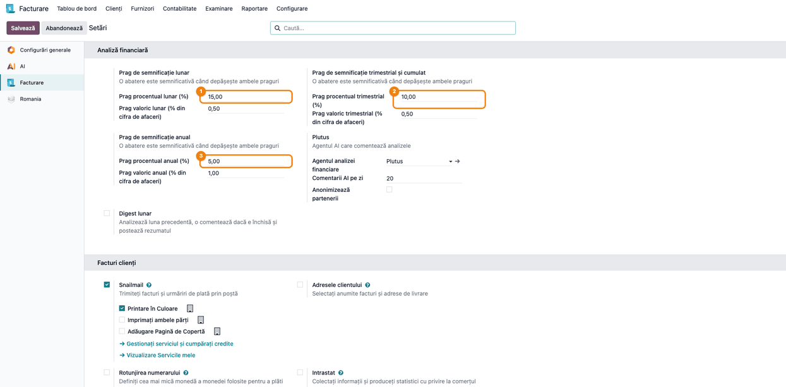

### Pasul 2 — Indicatorii (opțional)

Accesați **Contabilitate → Configurare → Indicatori analiză financiară** (meniul e vizibil doar pentru
Managerul contabilității). Lista arată codul, numele, familia (cont de profit și pierdere, bilanț,
rentabilitate, lichiditate, solvabilitate, activitate), unitatea, sensul favorabil și profilurile în care
apare indicatorul: **Analiză lunară**, **Analiză trimestrială**, **Analiză cumulată**, **Analiză anuală**,
plus **Card KPI**.

Indicatorii de an (rentabilitatea activelor și a capitalurilor proprii, lichiditatea imediată, rata
autonomiei financiare, datorii financiare / capitaluri proprii, gradul de acoperire a dobânzilor,
capitaluri proprii / capital subscris) apar doar în analiza anuală.

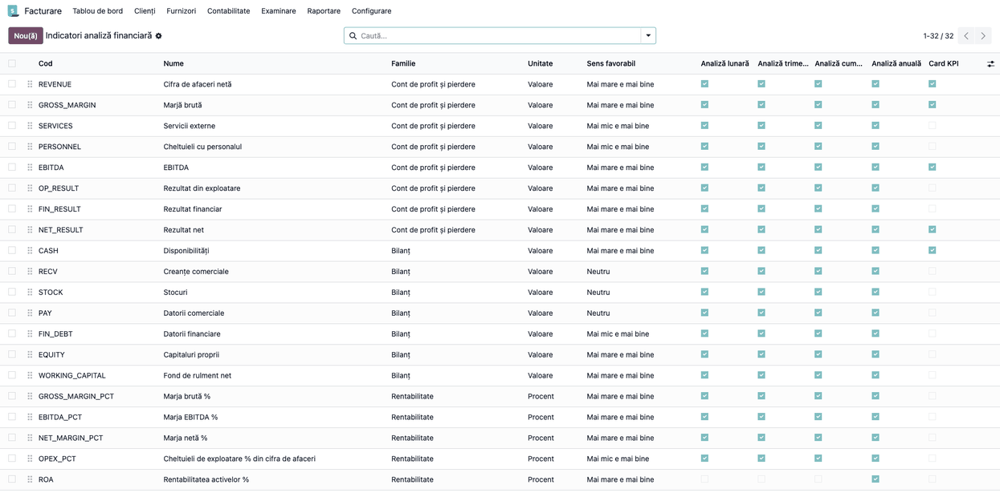

Deschideți un indicator pentru a-i schimba formula ①, sensul (**Mai mare e mai bine**, **Mai mic e mai
bine**, **Neutru**), profilurile, cardul și pragurile de alertă (**Folosește alerta sub** / **Alertă
sub**, **Folosește alerta peste** / **Alertă peste** ②). În captură, **Durata de încasare a clienților
(zile)** are o alertă peste 45 de zile.

Formulele folosesc codurile liniilor raportului de bază (de exemplu `FA_REVENUE`), `avg('FA_RECV')`
pentru soldul mediu, `days` pentru numărul de zile al perioadei, `SALES_INVOICED` și
`PURCHASES_INVOICED` (facturat cu TVA, cu notele de credit scăzute) și `div(a, b)`. Când `b` este zero,
`div` dă o valoare nedefinită: indicatorul se afișează 0 și nu declanșează alertă. O formulă cu sintaxă
greșită este refuzată la salvare.

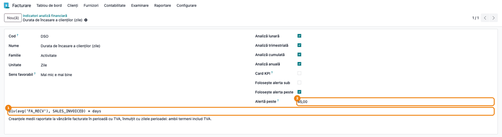

### Pasul 3 — Crearea analizei

Accesați **Contabilitate → Raportare → Analiză financiară**. Lista arată analizele existente, cu tipul
perioadei, starea închiderii, numărul de abateri și starea (**Ciornă**, **Calculat**, **Validat**).
Filtrele **Lunar**, **Trimestrial**, **Cumulat de la începutul anului**, **Anual** și **De validat** ajută la
căutare.

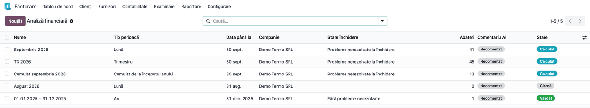

Apăsați **Nou** și alegeți:

- **Tip perioadă** ① — **Lună**, **Trimestru**, **Cumulat de la începutul anului** sau **An** (anul fiscal
  al companiei);
- **Perioadă** ② — orice zi din luna, trimestrul sau anul fiscal analizat; pentru cumulat, o zi din
  ultima lună a cumulului. Implicit este ultima zi a lunii precedente.

Câmpurile **Date** (de la – până la) și titlul se completează singure (de exemplu „Septembrie 2026”,
„T3 2026”, „Cumulat septembrie 2026”). Verificați pe ecran că datele corespund perioadei dorite, apoi
apăsați **Calculează** ③.

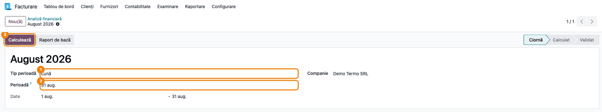

### Pasul 4 — Citirea cardurilor și a indicatorilor

După calcul, analiza trece în starea **Calculat**. Sus apar cardurile KPI ① (implicit: cifra de afaceri
netă, marja brută, EBITDA, rezultatul net, disponibilitățile), cu variația față de perioada precedentă.

**Găsiți pe ecran:** câmpurile **Perioada precedentă** și **Perioadă de comparație** din dreapta spun cu
ce se compară analiza. Tabul **Indicatori** arată, pentru fiecare indicator, valoarea curentă, perioada
precedentă, perioada de comparație și variațiile procentuale (**Δ %**); la lună și la trimestru urmează
cumulatul de la începutul anului, cumulatul anului trecut și **Δ % cumulat**.

| Tip perioadă | Perioada precedentă | Perioada de comparație | Coloane în plus |
|---|---|---|---|
| Lună | Luna anterioară | Aceeași lună anul trecut | cumulat față de anul trecut |
| Trimestru | Trimestrul precedent | Același trimestru anul trecut | cumulat față de anul trecut; tendința pe 5 trimestre în carduri |
| Cumulat de la începutul anului | Aceeași perioadă anul trecut | Aceeași perioadă acum doi ani | — |
| An | Anul precedent | Acum doi ani | **Pondere %** (în cifra de afaceri sau în total active) |

**Verificați pe ecran:**
- cifra de afaceri a lunii corespunde vânzărilor facturate (în exemplu: 81.700 lei în septembrie 2026,
  față de 64.000 lei în august, +27,7%);
- valorile perioadei sunt nenule; dacă o perioadă de comparație nu are nicio înregistrare (înainte de
  introducerea în Odoo), ea nu generează abateri;
- rândurile cu text portocaliu sunt indicatorii cu alertă și corespund pragurilor așteptate (în exemplu,
  durata de încasare de 49,46 zile, peste pragul de 45).

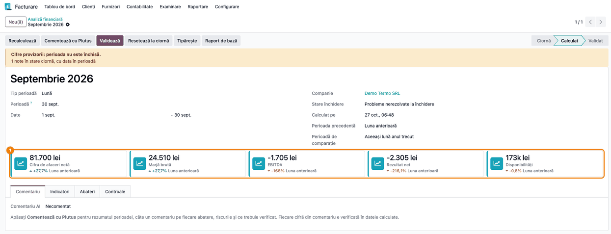

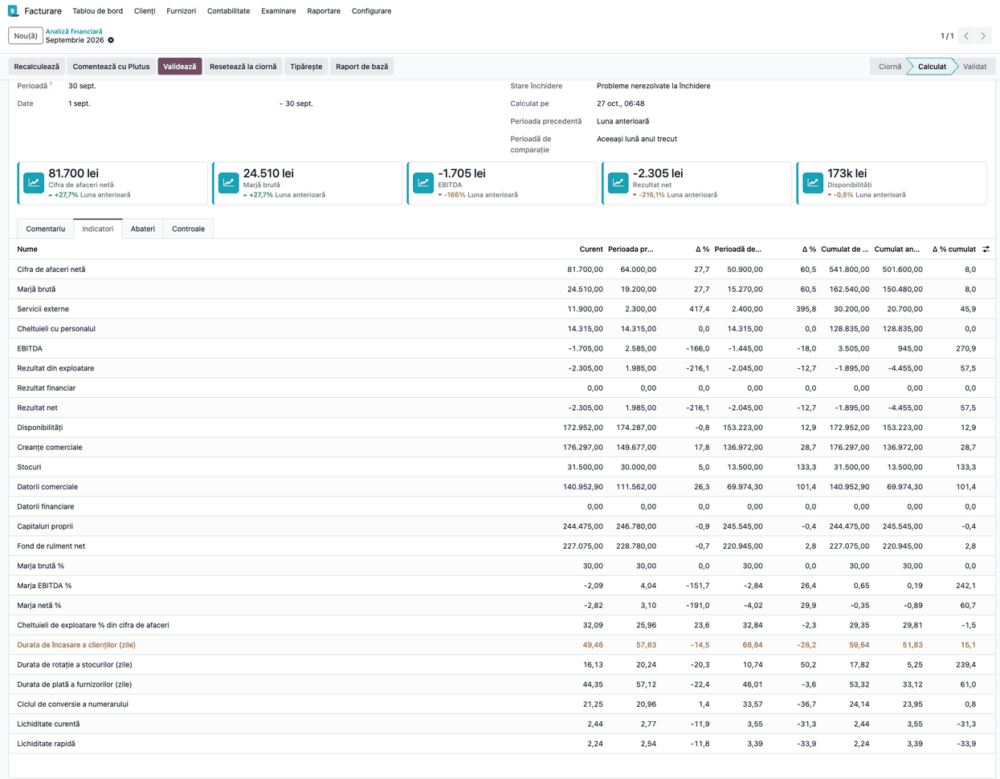

### Pasul 5 — Analiza trimestrială și cumulată

Creați o analiză cu **Tip perioadă** = **Trimestru** (în exemplu, „T3 2026”, 1 iulie – 30 septembrie) și
apăsați **Calculează**. Cardurile ① arată, sub valoare, **tendința pe ultimele 5 trimestre** (de la
același trimestru al anului trecut până la trimestrul curent), ca grafic mic. Tabul **Indicatori** compară
trimestrul cu trimestrul precedent, cu același trimestru al anului trecut și cumulatul cu cel al anului
trecut.

**Verificați pe ecran:** datele sunt cele ale trimestrului calendaristic; graficul fiecărui card urcă sau
coboară în sensul variației afișate; indicatorii de an (rentabilitatea activelor etc.) nu apar.

Analiza **Cumulat de la începutul anului** compară perioada de la începutul anului fiscal până la sfârșitul
lunii alese cu aceeași perioadă din ultimii doi ani; folosește pragurile trimestriale.

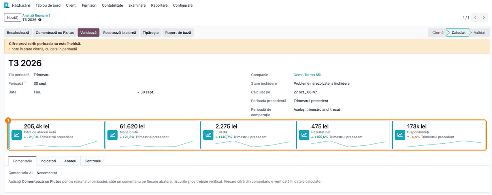

### Pasul 6 — Starea închiderii perioadei

Dacă bannerul galben ① **Cifre provizorii: perioada nu este închisă.** este afișat, analiza nu poate fi
citită ca definitivă. Sub banner apare motivul (în exemplu: „1 note în stare ciornă, cu data în
perioadă”). Câmpul **Stare închidere** ② poate fi:

| Stare | Sens |
|---|---|
| Perioadă închisă | toate checklist-urile lunare ale perioadei din `l10n_ro_period_close_enhanced` sunt finalizate |
| Închidere în verificare | există un checklist nefinalizat; nota arată anomaliile sau „încă netrimis” |
| Lipsește checklist-ul de închidere | pentru una sau mai multe luni nu există checklist |
| Probleme nerezolvate la închidere | (fără checklist) există note în ciornă, extrase bancare nereconciliate, sold pe 473 sau 581, sau sold creditor pe un cont de casă 531 |
| Fără probleme nerezolvate | (fără checklist) nu s-a găsit nimic |

Stările **Închidere în verificare**, **Lipsește checklist-ul de închidere** și **Probleme nerezolvate la
închidere** marchează analiza ca provizorie. Terminați închiderea, apoi apăsați **Recalculează**.

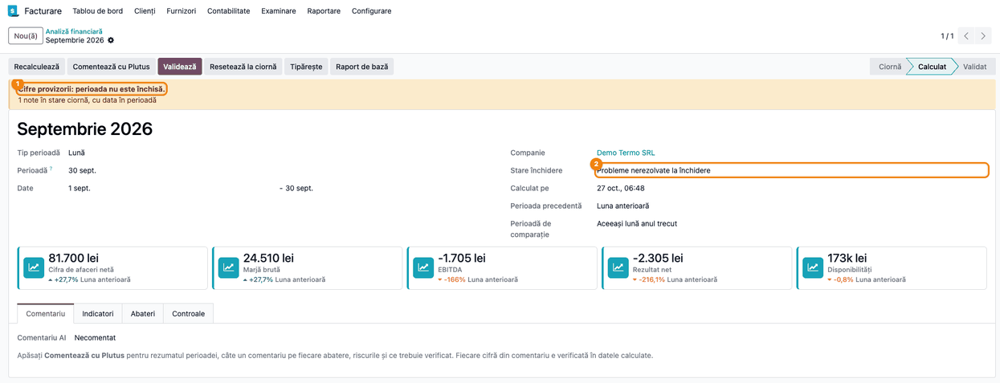

### Pasul 7 — Abaterile semnificative

Deschideți tabul **Abateri**.

**Găsiți pe ecran:** fiecare rând este o abatere (badge **Abatere**, depășește ambele praguri) sau o alertă
(badge **Alertă**, comparată cu **Prag de alertă**), cu: indicatorul, **Comparat cu** (baza de comparație),
**Referință**, **Curent**, **Diferență**, **Diferență %** și **Favorabilă** (Favorabilă / Nefavorabilă /
Neutru, colorat verde, roșu sau negru). La un rând de alertă, referința este pragul depășit, **Curent** este
valoarea indicatorului, iar **Diferență** și **Diferență %** rămân 0 (nu se calculează); caracterul este
mereu **Nefavorabilă**.

Toate bazele de comparație ale unei analize folosesc pragurile profilului ei: într-o analiză lunară, și
rândurile **Cumulat față de anul trecut** se filtrează cu pragurile lunare, iar pragul valoric se calculează
din cifra de afaceri a lunii.

**Verificați pe ecran:** abaterile așteptate sunt prezente (în exemplu: cifra de afaceri +17.700 lei față
de luna anterioară, servicii externe +9.600 lei, alerta pe durata de încasare); fiecare rând **Abatere**
depășește pragul procentual și, la sume, pragul valoric.

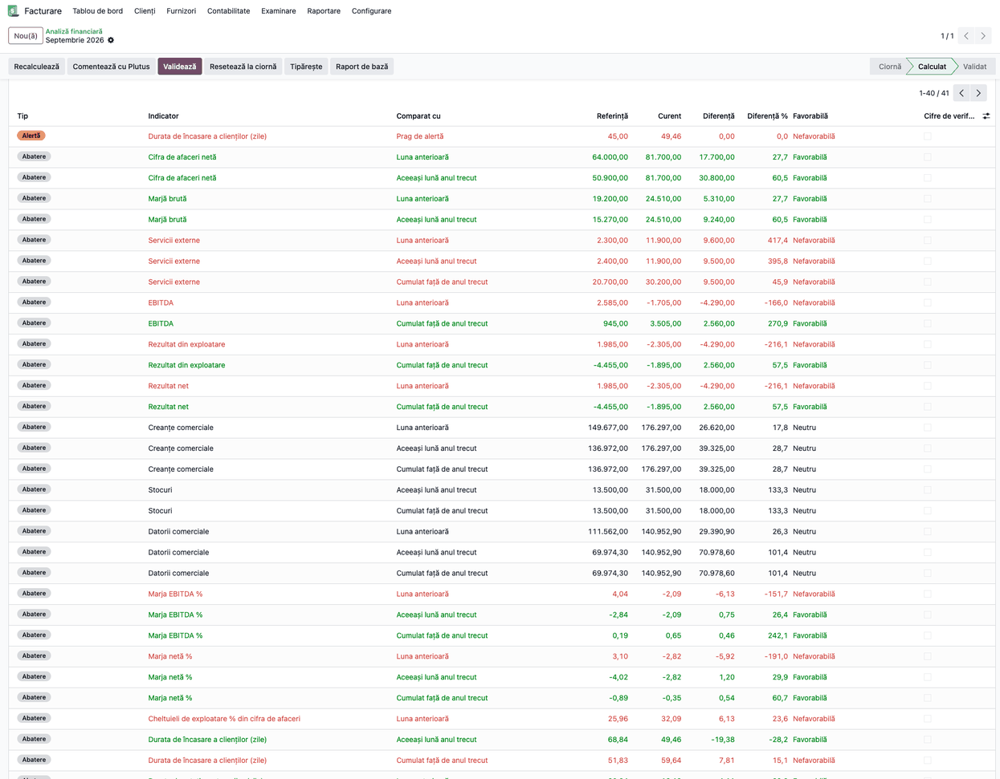

Apăsați pe un rând: se deschide detaliul abaterii.

- La un indicator care este o singură linie de bază (de exemplu **Servicii externe**, **Cifra de afaceri
  netă**, **Cheltuieli cu personalul**, nu și la indicatorii calculați din mai multe linii: marja brută,
  EBITDA, rezultatele, raporturile), tabelul **Explicată de** arată conturile și partenerii care fac cea mai
  mare parte a diferenței (cei mai mari, până la 80% din ea, cel mult 8 rânduri). În exemplu, creșterea
  serviciilor externe vine din contul 628, partenerul Consult Audit SRL, 9.500 lei.

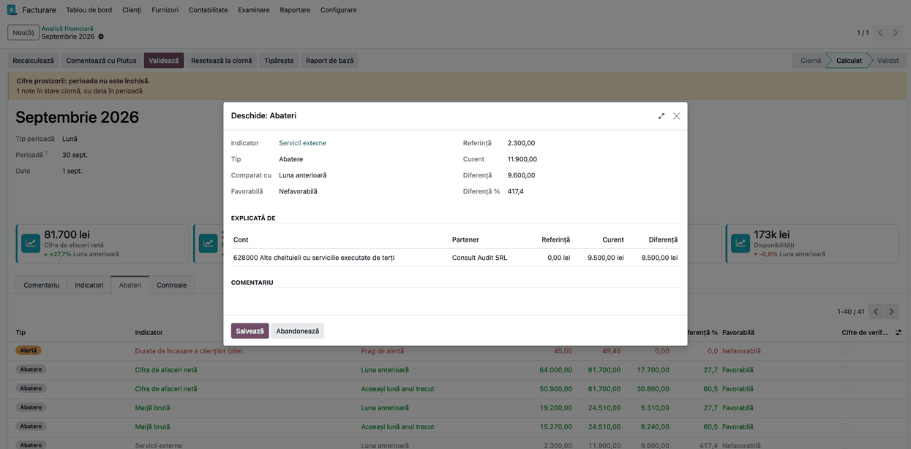

- La **Cifra de afaceri netă** și **Marjă brută**, tabelul **Cauze** descompune abaterea în **Volum**,
  **Preț**, **Mixul categoriilor de produse**, **Categorii noi și întrerupte**, **Cifră de afaceri fără
  produse** (servicii fără produs, reduceri, subvenții) și, la marjă, **Costul mărfurilor, materialelor și
  variația stocurilor**. La marjă, volumul, prețul și mixul sunt efectele pe vânzări; toată variația
  costului apare separat, pe rândul de cost. **Verificați** că suma cauzelor este egală cu **Diferență** (în exemplu:
  3.390,73 + 10.109,27 + 4.200,00 = 17.700,00 lei).

Scrieți explicația în **Comentariu** și apăsați **Salvează**. Atenție: **Recalculează** refă lista
abaterilor și șterge comentariile scrise; comentați după ce închiderea e terminată și cifrele sunt finale.

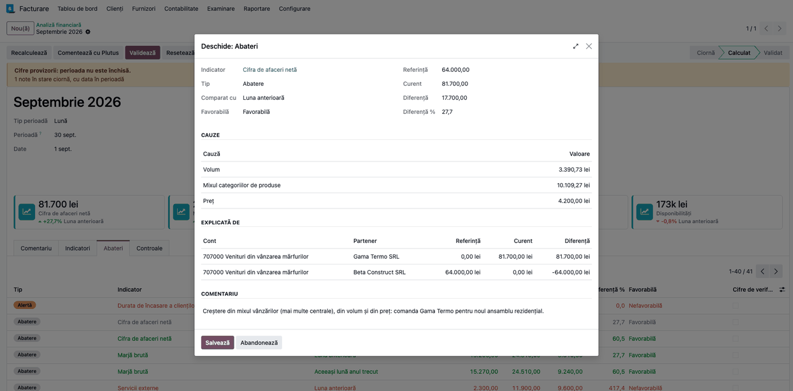

### Pasul 8 — Controalele

Deschideți tabul **Controale**. Blocul **Închiderea perioadei** repetă starea și nota închiderii. Blocul
**Verificări** conține:

- **Rezultat față de clasele 6 și 7** — rezultatul net al analizei plus soldul claselor 6 și 7; trebuie
  să fie **zero**. O valoare nenulă arată un cont de venituri sau cheltuieli care nu este pe nicio linie a
  raportului;
- **Sume în curs de decontare (5125)** — plăți bancare încă nepotrivite;
- **Solduri inverse pe parteneri** — clienții cu sold creditor pe 411 și furnizorii cu sold debitor pe 401:
  analiza le compensează, bilanțul le arată separat;
- **Total active față de bilanț (F10)** — doar la analiza anuală, când raportul F10 există: totalul
  activelor din analiză minus totalul activelor din bilanțul statutar. O diferență arată conturi cu solduri
  pe ambele părți sau un cont lipsă.

**Verificați** că **Rezultat față de clasele 6 și 7** este zero înainte de validare.

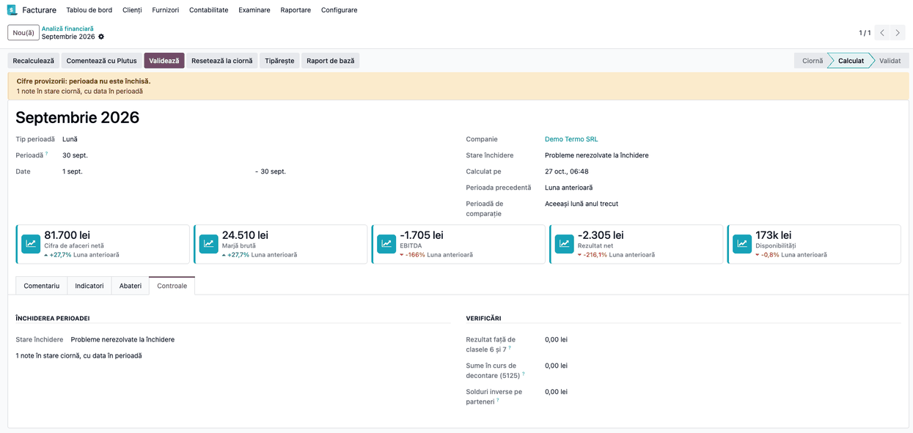

### Pasul 9 — Raportul de bază (verificare și corectură de conturi)

Apăsați **Raport de bază**. Se deschide raportul **Bază analiză financiară (RO)** pe aceleași date ca
analiza, cu trei secțiuni: **Cont de profit și pierdere (perioada)**, **Bilanț (la sfârșitul
perioadei)** și **Controale**.

**Găsiți pe ecran** linia indicatorului discutabil (de exemplu **Servicii externe**), desfaceți-o pentru a
vedea conturile și deschideți un cont pentru a ajunge la înregistrări. **Verificați** că toate conturile
așteptate sunt pe linie și că, la **Controale**, **Soldul claselor 6 și 7** compensează **Rezultat net**
(în exemplu: 2.305,00 față de −2.305,00). Pentru a muta un cont pe altă linie, editați formula liniei și
**păstrați codul liniei** (indicatorii îl citesc). Apoi reveniți la analiză și apăsați **Recalculează**.

> **Atenție la actualizarea modulului:** liniile raportului de bază sunt date ale modulului care se
> reîncarcă la fiecare actualizare (`-u`); o formulă schimbată manual revine atunci la cea livrată. Notați
> modificările făcute și verificați-le după fiecare actualizare a modulului.
Butoanele **PDF** și **XLSX** ale raportului exportă raportul de bază.

Nota de închidere 6/7 → 121 a declarației de închidere lunară este lăsată deoparte, ca o lună închisă
pe 121 să-și arate totuși cifra de afaceri. Închiderea TVA rămâne în solduri: fără ea, 4426 și 4427 ar
crește de la implementare încoace.

> **Atenție:** nota de închidere se recunoaște după contul 121, care trebuie să păstreze tipul
> „Current Year Earnings” (rezultatul exercițiului curent). Dacă închiderea lunară se face pe un cont
> creat manual cu alt tip sau printr-o notă manuală, fără declarația de închidere, luna închisă apare fără
> rulaj, iar controlul „Rezultat față de clasele 6 și 7” nu o semnalează.

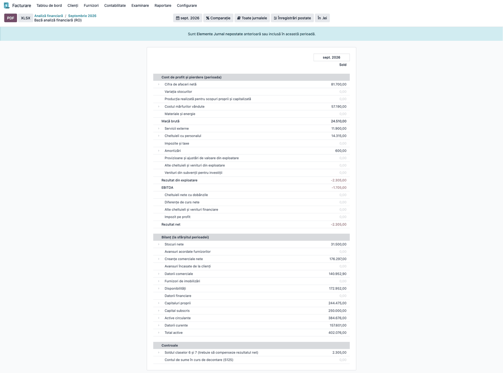

### Pasul 10 — Validare și tipărire

Când indicatorii, abaterile și controalele sunt corecte, apăsați **Validează**: analiza trece în starea
**Validat** și este blocată (nu se mai modifică, nu se recalculează, nu se șterge, iar comentariile
abaterilor nu se mai editează). Pentru corecții, **Managerul contabilității** apasă **Resetează la ciornă**
①. **Tipărește** ② este gândit să producă PDF-ul cu indicatorii, abaterile (cu cauze, explicații și comentarii) și
controalele; analiza nevalidată este marcată „(Ciornă)”. Captura arată o analiză anuală validată, cu
coloana **Pondere %** (completată doar la indicatorii în valoare).

> **Atenție (defect cunoscut, 27.10.2026):** în versiunea 19.0.1.2.0, **Tipărește** se oprește cu eroarea
> „QWeb widgets do not work correctly on 'td' elements”: șablonul raportului PDF folosește câmpuri direct pe
> celulele tabelului. Până la corectare, PDF-ul analizei nu se poate genera; de aceea fișa nu are încă o
> captură a lui. Soluția de avarie: butoanele **PDF** și **XLSX** din **Raport de bază** (Pasul 9) exportă
> liniile de bază, fără indicatori și abateri. Restul fluxului nu este afectat.

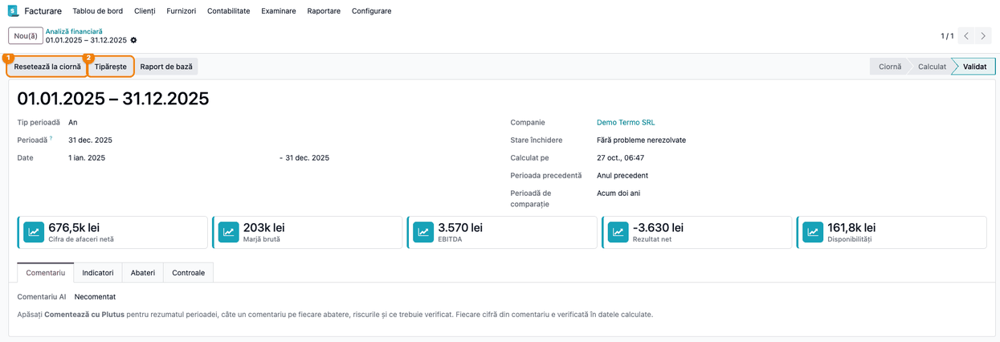

### Note de monografie și raportare

Modulul **nu generează note contabile**. Citește înregistrările postate (în moneda companiei) și le
grupează pe liniile raportului de bază:

```
Rezultat net           = Cifra de afaceri + variația stocurilor + producția imobilizată
                         − mărfuri − materiale − servicii − personal − taxe − amortizări
                         − provizioane − alte cheltuieli operaționale (+ venituri din subvenții)
                         − dobânzi − diferențe de curs − alte cheltuieli financiare − impozit pe profit
EBITDA                 = Rezultat din exploatare + amortizări − subvenții virate la venituri
Fond de rulment net    = Active circulante − Datorii curente
Lichiditate curentă    = Active circulante / Datorii curente
Durata de încasare     = sold mediu creanțe / vânzări facturate cu TVA × zile
Durata de plată        = sold mediu datorii comerciale / achiziții facturate cu TVA × zile
Volum + Preț + Mix + Categorii noi și întrerupte + Cifră de afaceri fără produse (+ Cost, la marjă)
                       = Diferența abaterii
```

- Soldurile bilanțiere sunt la sfârșitul perioadei; fluxurile de profit și pierdere sunt pe perioadă.
- Rotațiile folosesc numărul real de zile al perioadei și soldul mediu (începutul perioadei și fiecare
  sfârșit de lună).
- La preț/volum/mix, cantitățile unei categorii se adună indiferent de unitatea de măsură: țineți categorii
  cu unități comparabile.
- Analiza nu este o declarație și nu alimentează D300, D394 sau alte declarații.

## 7. Legături cu alte module / declarații

| Modul / proces | Rol în flux | Tip legătură |
|---|---|---|
| `account_reports` | motorul raportului de bază și al drill-down-ului | dependență (manifest) |
| `deltatech_web_kpi_cards` | cardurile KPI și graficul tendinței | dependență (manifest) |
| `l10n_ro_period_close_enhanced` | checklist-ul lunar de închidere, citit pentru starea perioadei | opțional (automat, dacă e instalat) |
| `l10n_ro_account_return_pl_closing` | închiderea 6/7 → 121; analiza o ignoră | automat |
| `l10n_ro_reports` | bilanțul F10, folosit la controlul totalului de active | opțional (doar analiza anuală) |
| `deltatech_ai_financial_analysis` | agentul Plutus: comentariul analizei și chatul cu uneltele de mai jos | opțional (modul separat) |
| `deltatech_mcp_server` | expune uneltele de citire unui client MCP | opțional (configurare manuală) |

### Unelte de citire pentru AI și MCP

Modulul are cinci unelte care calculează în memorie, **fără să creeze sau să modifice vreo analiză**, și
întorc text compact, un element pe linie:

| Metodă MCP | Ce întoarce | Parametri |
|---|---|---|
| `mcp_fa_indicators` | indicatorii unei perioade, cu perioadele de comparație și starea închiderii | `period_type`, `period_date` |
| `mcp_fa_trend` | valorile unui indicator pe ultimele perioade (2–24) | `indicator_code`, `period_type`, `count`, `period_date` |
| `mcp_fa_variance_drilldown` | abaterea unui indicator față de o bază (`cmp1`, `cmp2`, `ytd`), cu cauzele și conturile | `indicator_code`, `period_type`, `period_date`, `basis` |
| `mcp_fa_aging` | creanțele sau datoriile deschise pe vechimea scadenței și cei mai mari parteneri | `kind` (`receivable` / `payable`), `date`, `top` (vezi nota de mai jos) |
| `mcp_fa_close_status` | starea închiderii perioadei și ce mai e deschis | `period_type`, `period_date` |

Pentru MCP, în `deltatech_mcp_server` se adaugă câte o unealtă cu **Kind** = **Model method** pe modelul
**Analiză financiară**, cu **Needs records** debifat și **Read only** bifat, cu metoda (**Method**) și
parametrii de mai sus în schema JSON.

> **Vechimea creanțelor și datoriilor (`mcp_fa_aging`)** folosește soldurile rămase **de azi** ale
> documentelor nelettrate; `date` limitează doar documentele (emise până la acea dată) și este data față
> de care se calculează vechimea. Pentru o dată din trecut, facturile încasate între timp lipsesc, iar la
> cele încasate parțial apare restul de azi: folosiți unealta pentru situația curentă. Uneltele respectă drepturile utilizatorului conectat și lucrează pe compania lui curentă. Agentul
Plutus le folosește în chat prin modulul `deltatech_ai_financial_analysis`.

Exemplu de răspuns al uneltei de explicare a abaterii (datele din capturi):

```
Septembrie 2026 (2026-09-01 to 2026-09-30), Demo Termo SRL, RON
REVENUE Cifra de afaceri netă: 81,700.00 vs 64,000.00 (Luna anterioară), difference 17,700.00 (27.66%)
cause Volum: 3,390.73
cause Mixul categoriilor de produse: 10,109.27
cause Preț: 4,200.00
account 707000 Venituri din vânzarea mărfurilor, Gama Termo SRL: 0.00 -> 81,700.00 (81,700.00)
account 707000 Venituri din vânzarea mărfurilor, Beta Construct SRL: 64,000.00 -> 0.00 (-64,000.00)
```

Textul uneltelor este destinat agentului AI: cuvintele de legătură sunt în engleză și numerele în format
englezesc; etichetele indicatorilor și ale perioadelor sunt în limba utilizatorului.

**Ce e automat:** calculul indicatorilor și al comparațiilor pe cele patru profiluri, tendința pe 5
trimestre, filtrarea abaterilor după praguri, explicarea lor prin conturi, parteneri și cauze
(preț/volum/mix), starea închiderii, controalele, blocarea analizei validate.

**Ce rămâne manual:** crearea analizei pentru fiecare perioadă, comentariile pe abateri, corectarea
conturilor care nu sunt pe nicio linie, finalizarea închiderii, validarea, configurarea uneltelor MCP.

## 8. Verificări pentru consultant

- [ ] Meniul **Contabilitate → Raportare → Analiză financiară** este vizibil pentru utilizatorul cu drept
      de citire, iar **Indicatori analiză financiară** doar pentru Managerul contabilității.
- [ ] Setările au trei blocuri de praguri (lunar, trimestrial și cumulat, anual), cu valorile implicite
      15/0,5, 10/0,5 și 5/1.
- [ ] Datele **de la / până la** corespund lunii, trimestrului, cumulului sau anului fiscal ales.
- [ ] După **Calculează**, analiza este în starea **Calculat**, iar cardurile KPI și tabul **Indicatori**
      sunt completate.
- [ ] Cifra de afaceri a lunii este corectă și într-o lună închisă pe 121.
- [ ] Analiza lunară și cea trimestrială arată coloanele de cumulat; cea anuală arată **Pondere %**.
- [ ] La analiza trimestrială, cardurile au graficul tendinței pe 5 trimestre; indicatorii de an nu apar.
- [ ] Bannerul **Cifre provizorii** apare când perioada nu e închisă și dispare după închidere și
      **Recalculează**.
- [ ] Abaterile afișate depășesc ambele praguri (procent și sumă); o perioadă de comparație fără înregistrări
      nu generează abateri.
- [ ] Pentru un indicator care e o singură linie de bază, detaliul abaterii arată conturile și partenerii.
- [ ] La cifra de afaceri și la marja brută, suma cauzelor din **Cauze** este egală cu **Diferență**.
- [ ] **Rezultat față de clasele 6 și 7** este zero.
- [ ] Alertele (capitaluri negative, lichiditate curentă sub 1, pragurile setate pe indicatori) apar ca
      rânduri **Alertă** în **Abateri**.
- [ ] La analiza anuală cu F10 instalat, diferența **Total active față de bilanț (F10)** este explicată.
- [ ] **Validează** blochează analiza (modificarea, recalcularea și ștergerea sunt refuzate); **Resetează la
      ciornă** o deblochează.
- [ ] **Tipărește** produce PDF-ul cu indicatorii, abaterile cu comentarii și controalele (după corectarea
      defectului din Pasul 10).
- [ ] Schimbarea pragurilor în Setări și **Recalculează** schimbă lista abaterilor.
- [ ] Uneltele de citire (din chatul Plutus sau prin MCP) nu creează analize noi.
- [ ] Vechimea creanțelor (`mcp_fa_aging`) la data de azi corespunde soldurilor nelettrate ale clienților.

## 9. Mesaje de eroare frecvente

| Mesaj / simptom | Cauză probabilă | Remediere |
|---|---|---|
| „O analiză validată nu poate fi modificată. Readu-o întâi în ciornă.” | Modificarea unei analize validate sau a unei abateri a ei | Managerul contabilității apasă **Resetează la ciornă** |
| „O analiză validată nu poate fi recalculată.” | **Recalculează** pe o analiză validată | Resetați la ciornă, apoi recalculați |
| „O analiză validată nu poate fi ștearsă.” | Ștergerea unei analize validate | Resetați la ciornă, apoi ștergeți |
| „Doar o analiză calculată poate fi validată.” | **Validează** pe o analiză necalculată | Apăsați întâi **Calculează** |
| „Formula indicatorului … nu este validă: …” | Formulă cu sintaxă greșită | Corectați formula indicatorului |
| „Codul unui indicator trebuie să fie unic.” | Cod de indicator duplicat | Alegeți alt cod |
| „QWeb widgets do not work correctly on 'td' elements” la **Tipărește** | Defect în șablonul PDF al versiunii 19.0.1.2.0 | Nu are remediere din interfață; se corectează în modul. Între timp, exportați **PDF** / **XLSX** din **Raport de bază** |
| Cifre provizorii în analiză | Perioada nu este închisă (checklist lipsă sau nefinalizat; note în ciornă, extrase nereconciliate, sold pe 473 sau 581, casă cu sold creditor) | Finalizați închiderea și apăsați **Recalculează** |
| **Rezultat față de clasele 6 și 7** diferit de zero | Un cont de clasa 6 sau 7 nu e pe nicio linie a raportului | Adăugați contul pe linia potrivită în **Raport de bază** |
| Eroare la **Calculează** după modificarea unei linii | Codul liniei a fost schimbat, iar formula unui indicator nu-l mai găsește | Reveniți la codul `FA_…` original |
| Cauze de preț/volum/mix ciudate | Categorii cu produse în unități de măsură diferite (bucăți și kilograme) | Separați produsele pe categorii cu unități comparabile |
| „Tip de perioadă necunoscut …” / „Indicator necunoscut …” (în chat sau MCP) | Unealta a primit un tip de perioadă sau un cod greșit | Folosiți `month`, `quarter`, `ytd`, `year` și codurile din lista indicatorilor |

## 10. Capturi de ecran

Capturile sunt **generate automat** de `tests/test_screenshots.py` (mixinul `ScreenshotCase` din
`deltatech_doc_screenshots`, import defensiv), în limba română, pe planul de conturi RO, pe compania
„Demo Termo SRL” în RON, cu 21 de luni de activitate seedate determinist (ianuarie 2025 – septembrie
2026). Ordinea urmează pașii din secțiunea 6:

1. `01_setari_praguri.png` — blocul **Analiză financiară** din **Setări**, cu cele trei praguri procentuale.
2. `02_lista_indicatori.png` — lista **Indicatori analiză financiară**.
3. `03_formular_indicator.png` — formularul indicatorului **Durata de încasare a clienților (zile)**, cu alerta peste 45.
4. `04_lista_analize.png` — lista analizelor (lună, trimestru, cumulat, an).
5. `05_analiza_noua.png` — analiza nouă, în ciornă, cu **Tip perioadă**, **Perioadă** și **Calculează**.
6. `06_analiza_calculata.png` — analiza lunară calculată, cu cardurile KPI.
7. `07_tab_indicatori.png` — tabul **Indicatori**, cu coloanele de cumulat.
8. `08_analiza_trimestriala.png` — analiza „T3 2026”, cu tendința pe 5 trimestre în carduri.
9. `09_banner_provizoriu.png` — bannerul **Cifre provizorii** și **Stare închidere**.
10. `10_tab_abateri.png` — tabul **Abateri**.
11. `11_detaliu_abatere_conturi.png` — detaliul abaterii pe servicii externe, cu **Explicată de**.
12. `12_detaliu_abatere_cauze.png` — detaliul abaterii cifrei de afaceri, cu **Cauze** (volum, preț, mix).
13. `13_tab_controale.png` — tabul **Controale**.
14. `14_raport_baza.png` — raportul **Bază analiză financiară (RO)**.
15. `15_analiza_validata.png` — analiza anuală 2025, validată, cu **Resetează la ciornă** și **Tipărește**.

Captura PDF-ului analizei lipsește până la corectarea defectului din Pasul 10; după corectare se adaugă
un shot `report_shot` pe `deltatech_financial_analysis.report_financial_analysis`.

Regenerare:

```bash
./odoo/odoo-bin -c odoo.conf -d <db> -i deltatech_financial_analysis,deltatech_doc_screenshots \
    --test-tags=fise_screenshots --stop-after-init
```

## 11. Observații pentru manual

- Începeți cu ideea: analiza se face **după** închidere; bannerul de cifre provizorii este semnalul că
  nu e încă momentul.
- Explicați regula dublului prag (procent și sumă) și faptul că trimestrul și cumulatul au pragurile lor,
  ca cititorul să înțeleagă de ce nu toate variațiile apar în **Abateri**.
- Arătați un exemplu de preț/volum/mix cu suma cauzelor egală cu abaterea: este argumentul cel mai clar
  pentru conducere.
- Subliniați că analiza nu postează nimic și nu înlocuiește bilanțul: **Rezultat față de clasele 6 și 7**
  și **Total active față de bilanț (F10)** servesc la încrederea în cifre.
- Păstrați același exemplu în toate capturile (septembrie 2026, distribuitorul de echipamente termice).
- Uneltele pentru AI și MCP se documentează aici doar ca referință; folosirea lor în chat este descrisă în
  fișa modulului `deltatech_ai_financial_analysis`.
