# Fișă Modul: Transparență salarială (Directiva UE 2023/970)

**Modul:** `deltatech_hr_pay_transparency` (+ `deltatech_hr_pay_transparency_payroll` când e instalat Payroll)
**Utilizator principal:** Responsabil HR / salarizare, Conducerea firmei (aprobarea raportului)
**Prioritate:** 🔴 Ridicată (primul raport se depune până la 7 iunie 2027, pe datele anului 2026, pentru angajatorii cu cel puțin 150 de lucrători)

---

## 1. Scop business

Directiva (UE) 2023/970 obligă angajatorii să arate cum își plătesc lucrătoarele față de lucrători
pentru aceeași muncă sau pentru o muncă de aceeași valoare. Modulul ține în Odoo tot ce cere directiva
și se poate calcula din datele de HR: categoriile de lucrători și criteriile lor de evaluare, criteriile
de stabilire și de progresie a remunerației, raportul anual sau trienal privind diferențele de
remunerare, evaluarea comună a remunerațiilor și cererile de informații ale lucrătorilor, cu termenul
legal de răspuns. Cifrele vin din contractele angajaților (Odoo Community), din liniile de remunerare
importate dintr-o salarizare externă sau, cu modulul punte, din fluturașii de salariu validați.

## 2. Bază legală și context

- **Directiva (UE) 2023/970** din 10 mai 2023, termen de transpunere 7 iunie 2026.
  - art. 3 alin. (1) lit. (a): remunerația cuprinde salariul de bază și orice alt avantaj, în bani sau
    în natură (componente complementare sau variabile);
  - art. 4: categorii de lucrători evaluate după criterii obiective și neutre din punctul de vedere al
    genului: competențe, efort, responsabilitate, condiții de muncă;
  - art. 5: candidatul primește remunerația inițială sau intervalul ei;
  - art. 6: criteriile de stabilire și de progresie a remunerației sunt accesibile lucrătorilor;
  - art. 7: lucrătorul cere și primește în scris nivelul propriu de remunerare și nivelurile medii, pe
    sexe, ale categoriei sale, în cel mult **două luni**; art. 7 alin. (3): toți lucrătorii sunt informați
    anual despre acest drept și despre pașii de urmat;
  - art. 9: raportul privind diferențele de remunerare, indicatorii (a)-(g); 250+ lucrători anual din
    7.06.2027, 150-249 din 7.06.2027 apoi la trei ani, 100-149 din 7.06.2031 apoi la trei ani; raportul
    privește anul calendaristic dinaintea termenului (cel din 2027, anul 2026);
  - art. 10: evaluarea comună când diferența medie dintr-o categorie este de **cel puțin 5%**,
    nejustificată obiectiv și neremediată în **6 luni** de la depunerea raportului;
  - art. 12: protecția datelor; alin. (3) permite statelor ca, atunci când dezvăluirea ar identifica un
    lucrător, cifrele să meargă doar la reprezentanții lucrătorilor, la inspecția muncii sau la organismul
    de promovare a egalității.
- **România:** legea de transpunere nu era adoptată la 11.10.2026 (proiectul L445/2026, în Senat).
  Profilul „România” urmează directiva și proiectul: aceleași praguri și termene, raportul către ANES.
  Termenul de răspuns la cereri rămâne de confirmat la publicarea legii (două luni sau 30 de zile
  lucrătoare) și se modifică din profil, fără cod.
- Directiva nu fixează un număr minim de lucrători sub care cifrele se ascund. Pragul de 3 din profil
  e o alegere de protecție a datelor, modificabilă (0 = fără mascare). Mascarea se aplică doar
  documentelor pentru lucrători: răspunsurile la cererile venite prin reprezentanți sau prin organismul
  de promovare a egalității și exportul pentru autoritate conțin cifrele complete.
- Numărul de lucrători din raport (pe care se stabilește obligația) cuprinde toți angajații cu contract
  în anul de referință, inclusiv cei plecați sau veniți în cursul anului. Metoda de numărare o stabilește
  legea națională; dacă legea română cere alt mod (de exemplu, efectivul mediu), verificați obligația.

## 3. Utilizatori și roluri

| Rol | Grup Odoo | Ce face |
|---|---|---|
| Responsabil cereri | *Transparență salarială / Responsabil: cereri și cifre agregate* | Înregistrează și răspunde cererilor, vede cifrele agregate pe categorii |
| Responsabil raport | *Transparență salarială / Administrator* | Configurează categoriile și profilul, calculează, aprobă și exportă raportul, vede cifrele individuale |
| Lucrător | *Utilizator intern* | Își face singur cererea din **Angajați → Transparență salarială → Cererile mele** și își vede doar cererile proprii |

Niciun grup din Angajați nu dă aceste drepturi: datele de remunerare pe sexe sunt sensibile și se
acordă explicit, din **Setări → Utilizatori**. Meniul **Angajați → Configurare** (categorii, criterii,
profiluri) e vizibil doar cu dreptul *Angajați / Administrator*: responsabilul care configurează
categoriile are nevoie și de acesta.

## 4. Conturi și date implicate

Modulul nu generează note contabile. Datele folosite:

- pe angajat (versiunea de contract): sexul legal, funcția, categoria de lucrători, salariul, programul
  de lucru (pentru ore), datele de început și de sfârșit ale contractului;
- pe categorie: punctajul pe criterii, intervalul de remunerare, criteriile de remunerare;
- sursa sumelor, în ordinea priorității: fluturașii validați (modulul punte), liniile de remunerare
  importate, salariul din contract proporțional cu zilele lucrate.

Date pentru demo (cele din capturi), cu contracte din 1.01.2024 și program de 40 de ore pe săptămână:

| Categorie | Femei | Bărbați |
|---|---|---|
| Specialiști vânzări | 3 × 4.000 lei/lună (una cu primă anuală de 2.400 lei) | 3 × 5.000 lei/lună (unul cu primă anuală de 6.000 lei) |
| Operatori depozit | 1 × 3.000 lei/lună | 2 × 3.000 lei/lună |

Primele sunt importate ca linii de remunerație pe 2025, împreună cu salariul de bază pe an și orele
plătite (2.088). Pentru cereri mai există Cristina Vasile (Specialiști vânzări, 4.200 lei/lună, contract
din 1.03.2026), care nu intră în raportul pe 2025.

## 5. Configurare inițială

1. **Setări → Utilizatori**: dați grupul *Transparență salarială / Administrator* responsabilului de
   raport și *Responsabil: cereri și cifre agregate* responsabilului de cereri.
2. **Angajați → Configurare → Setări**, secțiunea *Transparență salarială*: verificați profilul de țară
   (propus după țara companiei), alegeți responsabilul și, dacă doriți, bifați trimiterea automată a
   notificării anuale.
3. **Angajați → Configurare → Transparență salarială → Profiluri de țară**: verificați termenul de
   răspuns, pragurile și datele de raportare, pragul evaluării comune, perioada de remediere,
   dimensiunea minimă a grupului și organismul de monitorizare.

   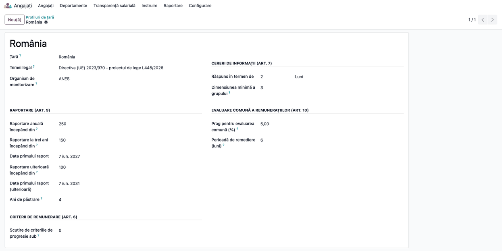

4. **Angajați → Configurare → Transparență salarială → Categorii de lucrători**: creați categoriile de
   muncă de aceeași valoare. Pe tabul *Evaluare (art. 4)* dați punctaj de la 1 la 5 pe fiecare
   criteriu; sus completați intervalul lunar de remunerare al categoriei.

   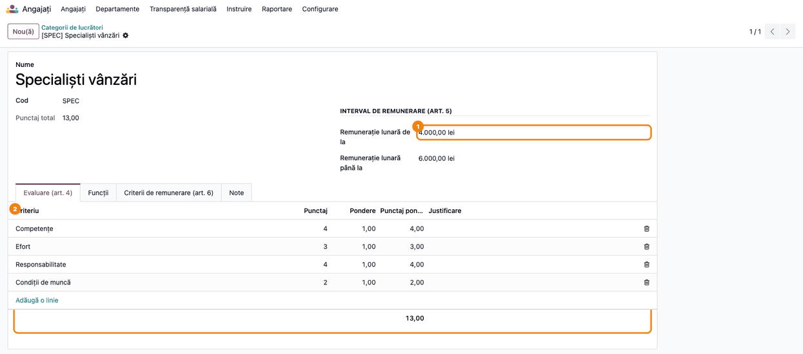

5. Pe tabul *Criterii de remunerare (art. 6)* scrieți cum se stabilește salariul și cum crește. Acest
   text este informația pe care lucrătorii trebuie să o poată consulta.

   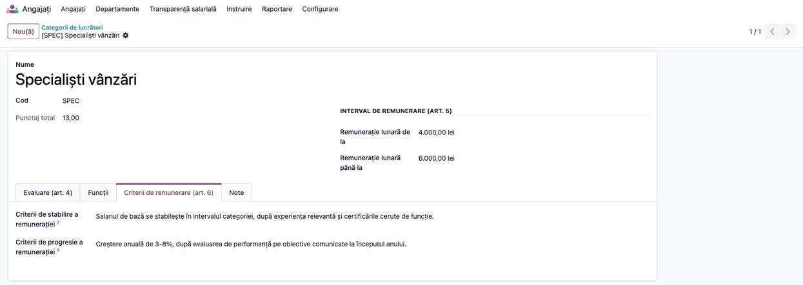

6. **Angajați → Configurare → Recrutare → Poziții funcție**: pe fiecare funcție completați *Categorie de lucrători*.
   Contractul curent al angajaților o preia automat, și când categoria se completează după ce angajații
   există deja (versiunile mai vechi ale contractului își păstrează categoria, ca rapoartele anilor
   trecuți să nu se schimbe); pe un contract anume se poate pune altă categorie, care rămâne neschimbată la
   modificarea funcției.

   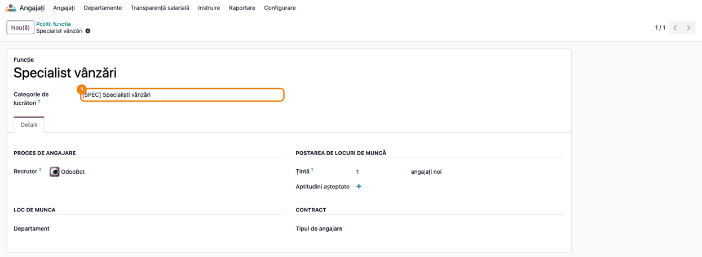

7. Verificați că fiecare angajat are completat **Sexul** (fișa angajatului, tabul de informații
   private). Raportul refuză calculul cât timp lipsește.
8. Fără Payroll în Odoo: în **Angajați → Transparență salarială → Linii de remunerație** importați, pe
   fiecare angajat și perioadă, remunerația brută de bază, componentele variabile, avantajele în natură
   și orele plătite. Recomandat: **linii lunare**. O linie care acoperă doar o parte din perioada calculată
   (de exemplu o linie pe tot anul, la o cerere pe ultimele 12 luni) se ia proporțional cu zilele din
   perioadă, iar zilele fără nicio linie se completează din salariul din contract. La fel, cu Payroll,
   lunile fără fluturași validați (de exemplu înainte de introducerea salarizării în Odoo) se iau din
   salariul din contract. Cu Payroll: în **Stat de plată → Configurare → Salariu → Categorii de reguli**, coloana
   *Transparență salarială* arată dacă o categorie e remunerație de bază, variabilă, în natură sau nu e
   remunerație. La instalare: *De bază* = de bază, *Indemnizație* = variabilă, *Salariu impozabil*,
   *Deducere*, *Net* și *Contributie companie* = nu e remunerație. Categoriile localizării (sporuri,
   prime, tichete de masă, avantaje în natură) le mapați dumneavoastră; o regulă salarială poate avea o
   valoare proprie, care o înlocuiește pe cea a categoriei.

## 6. Flux de utilizare

### Pasul 1 — Crearea și calculul raportului

**Angajați → Transparență salarială → Rapoarte privind diferențele de remunerare → Nou.** Anul de
referință propus este anul trecut. Apăsați **Calculare**.

### Pasul 2 — Citirea indicatorilor

**Găsiți pe ecran:** sus, *Număr de lucrători* (cu femei și bărbați) și *Obligație* (anual, la trei ani
sau voluntar, după numărul de lucrători și profil). Pe tabul *Indicatori*, rândurile (a)-(d) sunt
diferențele medie și mediană, pe total și pe componentele complementare sau variabile, fiecare pe
remunerația anuală și pe cea orară; rândul (e) este procentul de femei și de bărbați care primesc
componente variabile.

**Verificați:** numărul de lucrători corespunde angajaților cu contract în anul de referință (fără
colaboratori și freelanceri); nu apare *Exclus din diferențe* sau, dacă apare, știți care
angajați nu au sexul completat; o diferență pozitivă înseamnă că bărbații câștigă mai mult.

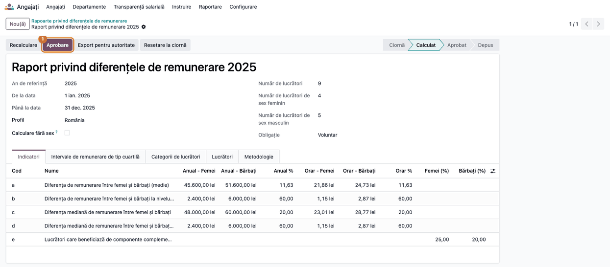

Tabul *Intervale de remunerare de tip cuartilă* arată, pe fiecare sfert al lucrătorilor ordonați după
remunerația orară, câte femei și câți bărbați sunt și între ce valori orare. Verificați că cele patru
cuartile au același număr de lucrători (diferă cu cel mult unu).

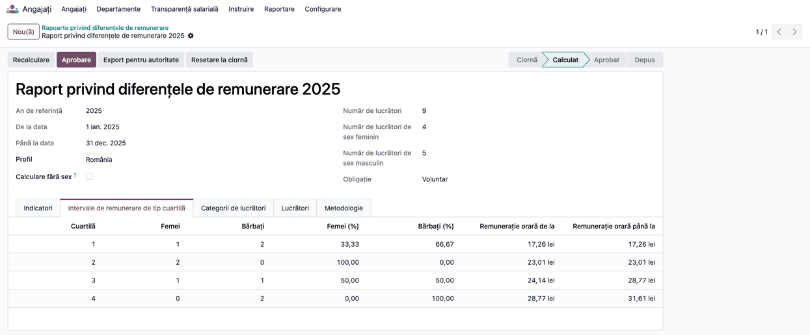

### Pasul 3 — Categoriile de lucrători peste prag

Tabul *Categorii de lucrători* arată indicatorul (g): pe fiecare categorie, numărul de femei și de
bărbați, remunerația orară medie pe sexe și diferența pe total, pe bază și pe componentele variabile.
**Rândurile roșii** au o diferență de cel puțin 5% (pragul din profil, coloana *Peste prag*) și nu sunt
încă nici justificate, nici remediate.
*Ascuns* este bifat la categoriile cu prea puțini lucrători de un sex: cifrele lor nu apar în documentul
pentru lucrători.

**Verificați** fiecare rând roșu: dacă există o justificare obiectivă (vechime, grilă, certificare),
bifați *Justificat* și scrieți motivul în *Justificare*; dacă diferența a fost corectată în perioada de
remediere, bifați *Remediat*. În ambele cazuri rândul nu mai e roșu și categoria nu mai intră în
evaluarea comună.

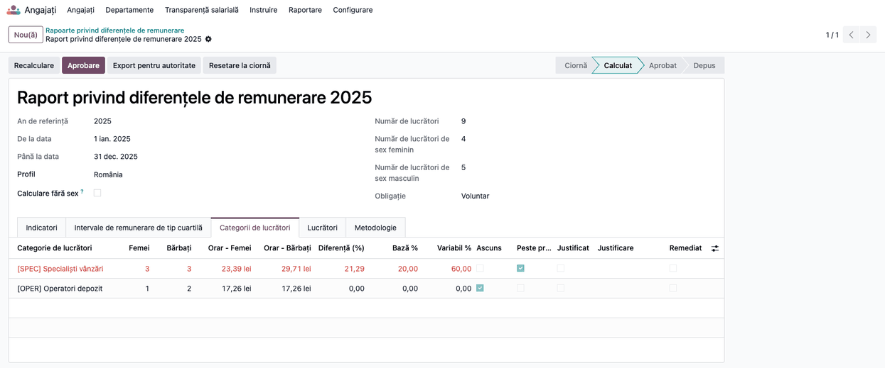

### Pasul 4 — Datele individuale (doar administratorii)

Tabul *Lucrători* arată, pe fiecare angajat, sursa cifrelor (*Fluturași de salariu*, *Linii de remunerație* sau
*Salariul din contract*), remunerația de bază, variabilă și în natură, orele, remunerația orară și cuartila.
**Verificați** sursa: un angajat cu *Salariul din contract* într-o firmă cu Payroll înseamnă că nu are
fluturași validați în anul de referință.

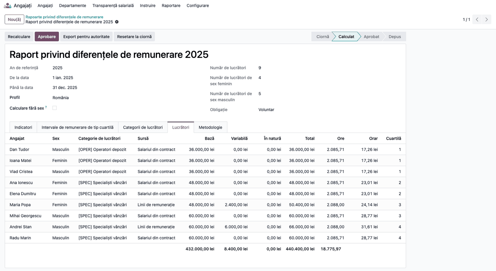

### Pasul 5 — Aprobarea și exportul pentru autoritate

După verificări, apăsați **Aprobare**: conducerea confirmă corectitudinea datelor (art. 9 alin. (6)).
**Export pentru autoritate** descarcă fișierul Excel cu indicatorii (a)-(g), **nemascați**, pentru
organismul de monitorizare (ANES, în profilul România). Fișierul rămâne atașat raportului, în chatter.

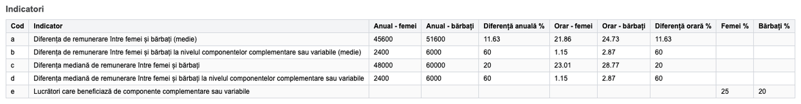

### Pasul 6 — Documentul pentru lucrători

**Tipărire → Diferența de remunerare pe categorii (pentru lucrători)** produce documentul care se
comunică tuturor lucrătorilor și reprezentanților lor (art. 9 alin. (9)). Categoriile mici apar cu
mențiunea *Nedivulgat*, ca să nu se poată deduce remunerația unei persoane.

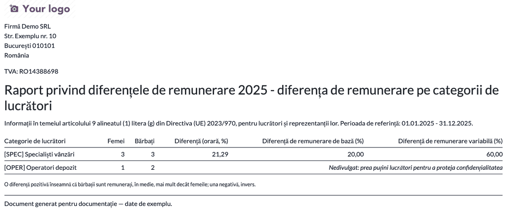

După trimiterea raportului apăsați **Marcare ca depus**. Termenul de remediere (6 luni) se calculează
automat; dacă raportul este obligatoriu și există categorii peste prag nejustificate, responsabilul
primește o activitate cu acest termen.

### Pasul 7 — Evaluarea comună a remunerațiilor

Dacă la termenul de remediere o categorie are încă diferența nejustificată și neremediată, Odoo deschide
automat evaluarea comună, pentru rapoartele obligatorii (nu și pentru cele voluntare). O puteți deschide
și manual, cu butonul **Evaluare comună a remunerațiilor** de pe raportul depus; butonul apare doar cât
timp există categorii peste prag nejustificate, neremediate și neincluse încă într-o evaluare. Se găsește
în **Angajați → Transparență salarială → Evaluări comune ale remunerațiilor**. Tabul *Categorii (a-c)* aduce categoriile
în cauză; completați, împreună cu reprezentanții lucrătorilor, *Motive (d)*, *Creșteri de remunerație
după concediu (e)*, *Măsuri (f)* și *Eficacitate (g)*, apoi **Marcare ca efectuat**.

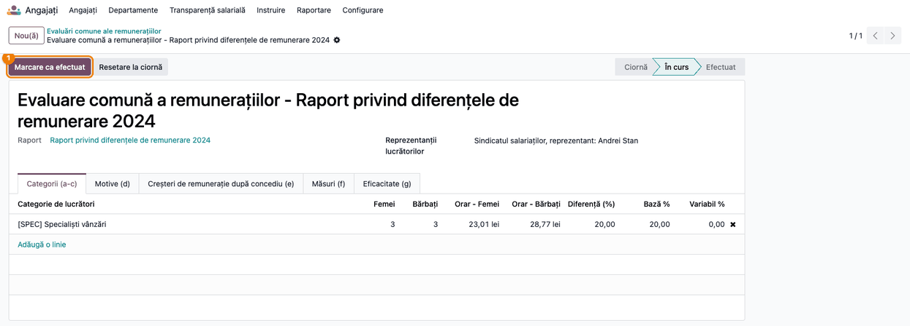

### Pasul 8 — Cererile de informații

Lucrătorul face cererea din **Angajați → Transparență salarială → Cererile mele → Nou**. Responsabilul
vede toate cererile în **Cereri de informații**, cu termenul limită calculat din profil; cererile
depășite apar cu roșu. Cererile venite prin e-mail, prin reprezentanți sau prin organismul de egalitate
se înregistrează tot aici, cu canalul potrivit. La o cerere a reprezentanților sau a organismului de
promovare a egalității completați și *Răspuns către*: răspunsul lor conține cifrele nemascate, așa că
nu pleacă la lucrător, iar lucrătorul nu vede această cerere în *Cererile mele*.

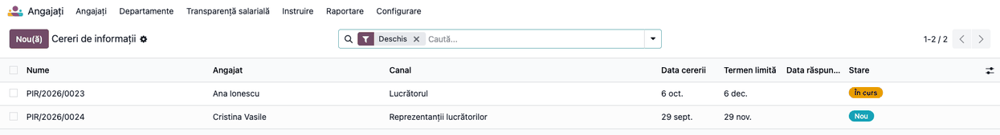

### Pasul 9 — Calculul răspunsului

Deschideți cererea și apăsați **Calculare răspuns**. **Găsiți pe ecran:** perioada (ultimele 12 luni
întregi dinaintea cererii, alegere a modulului; o puteți modifica înainte de calcul), categoria lucrătorului, remunerația lui anuală și orară și, în dreapta,
numărul de femei și de bărbați din categorie cu remunerația medie a fiecărui sex. **Verificați** că
categoria e cea corectă și că remunerația proprie corespunde contractului sau fluturașilor. Dacă cererea vine de la lucrător
și un sex are prea puțini lucrători, media lui nu se afișează; cererile venite prin reprezentanți sau
prin organismul de promovare a egalității primesc cifrele complete. Adăugați explicații, apoi **Trimitere răspuns**.

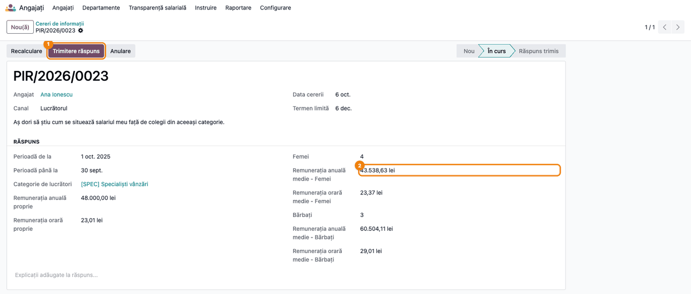

### Pasul 10 — Răspunsul în scris

Răspunsul pleacă pe e-mail, cu PDF-ul atașat (formulat către lucrător sau, pe celelalte canale, către
solicitant, „pentru” lucrătorul în cauză), către lucrător (canalul *Lucrătorul*) sau către
destinatarul din *Răspuns către* (reprezentanți, organismul de egalitate), iar cererea trece în
*Răspuns trimis*.

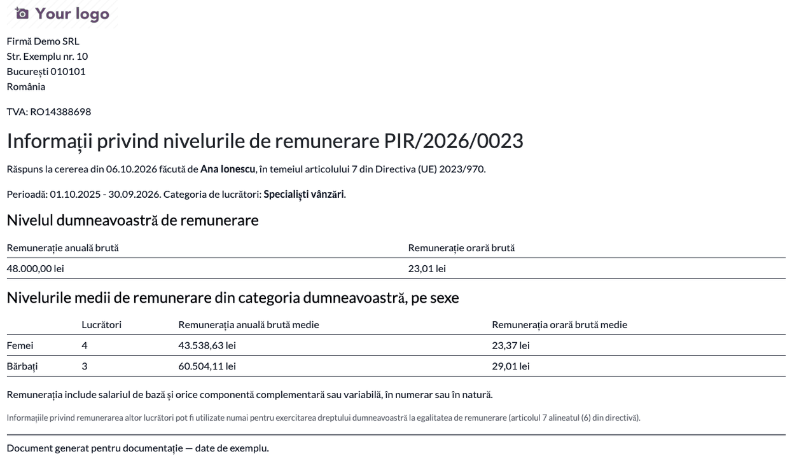

### Note de monografie și raportare

Modulul **nu generează note contabile**: lucrează doar cu datele de salarizare deja înregistrate.
Raportul se depune la organismul de monitorizare (ANES în proiectul legii românești), nu la ANAF.

## 7. Legături cu alte module / declarații

| Modul | Rol |
|---|---|
| `hr` (Angajați) | Angajați, versiuni de contract, funcții, sexul legal |
| `deltatech_hr_pay_transparency_payroll` | Sumele și orele plătite din fluturașii validați (se instalează automat cu Payroll) |
| `hr_payroll` (Enterprise) | Fluturașii de salariu și regulile salariale |
| Salarizare externă (alt program) | Liniile de remunerare importate în modul |

**Ce e automat:** categoria pe contract din funcție, termenul de răspuns, activitățile pentru
responsabil, calculul indicatorilor, mascarea grupurilor mici, deschiderea evaluării comune la
termen, notificarea anuală (dacă e bifată).
**Ce rămâne manual:** evaluarea posturilor, justificarea diferențelor, aprobarea, depunerea raportului
la autoritate și conținutul evaluării comune.

## 8. Verificări pentru consultant

- [ ] Toți angajații cu contract în anul de referință au sexul completat.
- [ ] Fiecare funcție are o categorie de lucrători; categoriile au punctaj pe cele patru criterii.
- [ ] Numărul de lucrători din raport = angajații cu contract în anul de referință, fără colaboratori.
- [ ] Indicatorul (a) pe datele demo: femei 45.600, bărbați 51.600 lei pe an, diferență 11,63%.
- [ ] Indicatorul (e) pe datele demo: 25% dintre femei și 20% dintre bărbați primesc componente variabile.
- [ ] Cuartilele au același număr de lucrători (cu diferență de cel mult unu).
- [ ] Categoria cu diferență de cel puțin 5% e roșie până se bifează *Justificat* sau *Remediat*.
- [ ] Documentul pentru lucrători ascunde categoriile cu prea puțini lucrători de un sex; exportul Excel nu le ascunde.
- [ ] După **Marcare ca depus**, termenul de remediere este data depunerii + 6 luni.
- [ ] Termenul unei cereri = data cererii + termenul din profil.
- [ ] La cererea Anei Ionescu din datele demo (perioada 1.10.2025-30.09.2026): 4 femei și 3 bărbați;
      media orară 23,37 lei la femei și 29,01 lei la bărbați; media anuală 43.538,63 lei la femei (Cristina
      Vasile are doar 7 luni de contract în perioadă) și 60.504,11 lei la bărbați (primele din 2025 contează
      proporțional cu lunile din perioadă).
- [ ] O cerere pe canalul *Reprezentanții lucrătorilor* nu ascunde mediile, chiar și la grupuri mici, pleacă
      la destinatarul din *Răspuns către* și nu apare la lucrător în *Cererile mele*.
- [ ] Niciun angajat din tabul *Lucrători* nu are categoria goală.
- [ ] Un lucrător fără drepturi pe Transparență salarială își vede doar propriile cereri.
- [ ] Cu Payroll: sursa angajaților cu fluturași validați este *Fluturași de salariu*.
- [ ] Un raport voluntar depus nu deschide automat evaluarea comună.

## 9. Mesaje de eroare frecvente

| Mesaj | Cauză | Remediere |
|---|---|---|
| Sexul legal nu este înregistrat pentru: ... | Angajați fără sex completat | Completați sexul sau bifați *Calculare fără sex* |
| Există deja un raport privind diferențele de remunerare pentru această companie și acest an. | Al doilea raport pe același an | Deschideți raportul existent |
| Poate fi aprobat doar un raport calculat. | Aprobare înainte de calcul | Apăsați întâi **Calculare** |
| Un raport depus nu poate fi resetat; creați unul nou, dacă este nevoie. | Raportul a fost marcat ca depus | Creați un raport nou dacă trebuie refăcut |
| ... nu are nicio categorie de lucrători ... | Funcția sau contractul fără categorie | Completați categoria pe funcție (Poziții funcție) sau pe fișa angajatului |
| ... nu a avut contract în perioada cererii. | Angajat fără contract în ultimele 12 luni | Verificați datele contractului |
| Nicio categorie de lucrători nu are o diferență nejustificată... | Toate categoriile peste prag sunt justificate, remediate sau deja evaluate | Nu e nevoie de o evaluare nouă |
| Stabiliți cine primește răspunsul: ... | Cerere a reprezentanților fără *Răspuns către* | Completați destinatarul |
| Utilizatorul dumneavoastră nu este asociat unui angajat. | Cerere făcută de un utilizator fără fișă de angajat | Legați utilizatorul de fișa angajatului |

## 10. Capturi de ecran

Capturile sunt **generate automat** din `tests/test_screenshots.py` (mixinul `ScreenshotCase` din
`l10n_ro_doc_screenshots`, import defensiv), în limba română, și se scriu în `static/description/`:

| Fișier | Ce arată |
|---|---|
| `01_categorie_evaluare.png` | Categoria de lucrători: intervalul de remunerare și evaluarea pe criterii |
| `02_categorie_criterii.png` | Criteriile de stabilire și de progresie a remunerației |
| `03_functie_categorie.png` | Funcția cu categoria de lucrători |
| `04_profil_tara.png` | Profilul de țară România |
| `05_raport_indicatori.png` | Raportul calculat, indicatorii (a)-(e) |
| `06_raport_cuartile.png` | Cuartilele de remunerare |
| `07_raport_categorii.png` | Diferențele pe categorii, categoria peste prag |
| `08_raport_lucratori.png` | Cifrele individuale |
| `09_export_xlsx.png` | Foaia „Indicatori” din exportul Excel |
| `10_pdf_lucratori.png` | Documentul pentru lucrători |
| `11_evaluare_comuna.png` | Evaluarea comună a remunerațiilor |
| `12_cereri_lista.png` | Lista cererilor de informații |
| `13_cerere_raspuns.png` | Cererea cu răspunsul calculat |
| `14_pdf_raspuns.png` | Răspunsul PDF |

Regenerare:

```bash
./odoo/odoo-bin -c odoo.conf -d <db> -i deltatech_hr_pay_transparency,l10n_ro_doc_screenshots --test-tags=fise_screenshots/deltatech_hr_pay_transparency --stop-after-init
```

## 11. Observații pentru manual

- Insistați pe faptul că raportul din 2027 se face pe datele din **2026**: datele (sexul, categoriile,
  fluturașii) trebuie să fie corecte de acum.
- Explicați diferența dintre exportul pentru autoritate (complet) și documentul pentru lucrători
  (cu categoriile mici ascunse).
- Termenul de răspuns la cereri și autoritatea destinatară se schimbă din profil când apare legea
  română; nu e nevoie de o versiune nouă a modulului.
- Răspunsul la o cerere (ultimele 12 luni) poate diferi de raportul anual (anul calendaristic): perioadele
  sunt diferite.
- Remunerația anuală e cea primită efectiv în an; pentru angajații veniți în cursul anului comparația
  corectă e cea pe remunerația orară.
