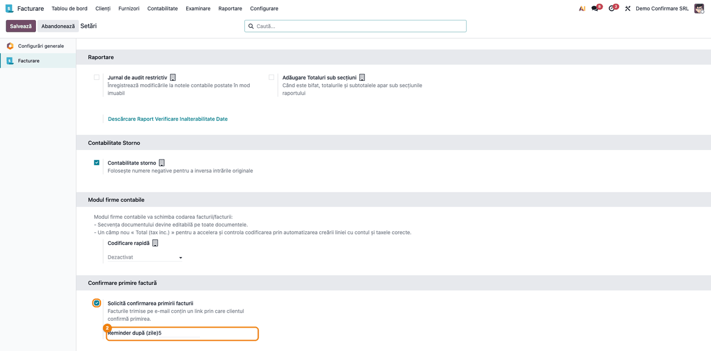
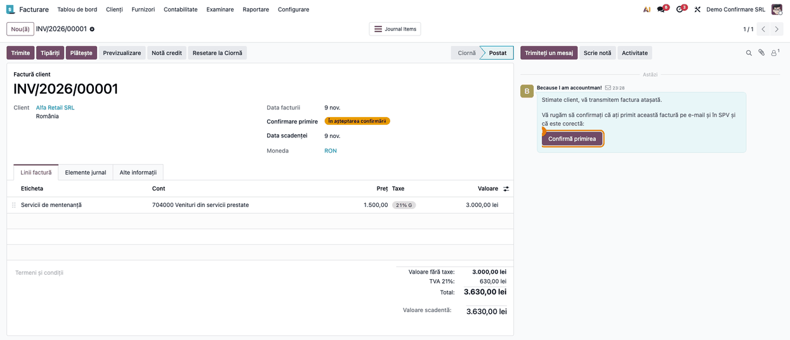
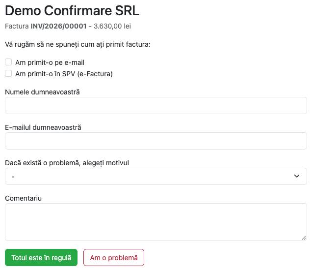
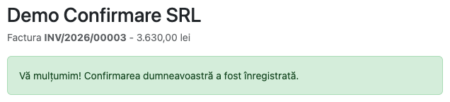
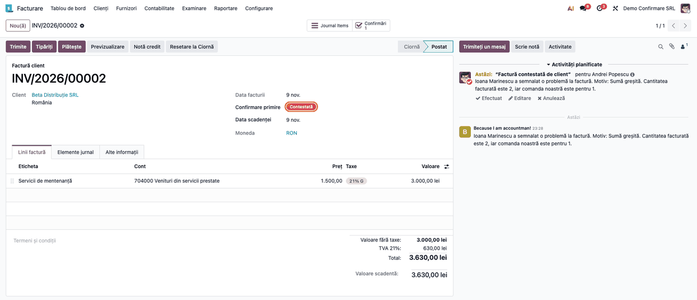
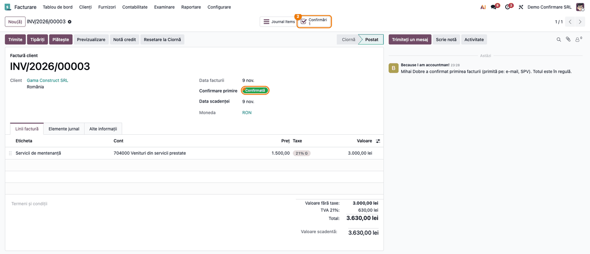
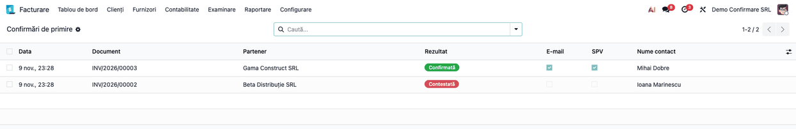
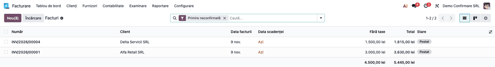
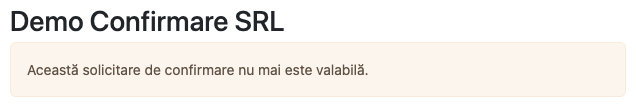

# Fișă Modul: Confirmarea primirii facturii de către client

**Modul:** `deltatech_invoice_receipt_confirmation`
**Utilizator principal:** Contabil / operator facturare care urmărește încasările; consultantul care pune în funcțiune modulul
**Prioritate:** 🟡 Medie (o factură despre care clientul nu confirmă primirea sau o contestă târziu întârzie plata, dar modulul nu schimbă nicio sumă și nicio notă contabilă)

---

## 1. Scop business

O factură trimisă pe e-mail și în SPV poate să nu ajungă la persoana potrivită din firma clientului: e-mailul
nimerește în spam, factura din SPV nu e descărcată, iar clientul „o descoperă" abia la scadență sau după
somație. Contestațiile (sumă greșită, produse greșite, date de client greșite) vin tot târziu, când termenul de
plată a trecut deja.

Modulul cere clientului, **în chiar e-mailul cu factura**, să confirme două lucruri:

- **cum a primit factura** — pe e-mail și/sau în SPV (e-Factura);
- **dacă totul este în regulă** sau dacă are o problemă, cu motiv și comentariu.

Pentru firma emitentă, factura primește o **stare vizibilă** (în așteptarea confirmării, confirmată,
contestată), fiecare răspuns se păstrează într-un jurnal, o contestare ajunge imediat la agentul de vânzări, iar
facturile rămase neconfirmate sunt reamintite automat după un număr de zile.

## 2. Bază legală și context

Modulul **nu** generează documente fiscale, **nu** modifică factura și **nu** face nicio înregistrare contabilă.
Contextul de reținut:

- **Confirmarea este declarativă.** ANAF nu comunică emitentului dacă destinatarul a deschis sau a descărcat
  factura din SPV; emitentul vede doar starea transmiterii și a validării. „Am primit-o în SPV" este deci ce
  declară clientul, nu o informație verificată de Odoo.
- **Confirmarea nu înlocuiește comunicarea facturii.** Factura rămâne cea transmisă prin canalele ei obișnuite
  (e-mail, SPV); linkul de confirmare este doar un mijloc de a obține răspunsul clientului.
- **Datele personale ale celui care răspunde** (nume, e-mail, adresă IP) sunt păstrate în jurnal ca dovadă a
  răspunsului. Nume și e-mail sunt opționale pentru client; adresa IP se înregistrează automat.

## 3. Utilizatori și roluri

- **Contabilitate: Administrator** — activează funcția în setări, vede și administrează jurnalul de confirmări;
- **Contabilitate: Facturare** — trimite facturile, vede starea de pe factură și jurnalul (doar citire);
- **Agent de vânzări (utilizatorul facturii)** — primește activitățile create la contestare și la reminder;
- **Clientul** — nu are cont în Odoo: răspunde de pe pagina publică deschisă din linkul din e-mail.

## 4. Conturi și date implicate

Modulul nu folosește conturi contabile. Datele minime pentru demo:

- o **factură către client**, postată, pe un client cu adresă de e-mail;
- un **utilizator de vânzări** pe factură (câmpul *Agent de vânzări*), ca să primească activitățile; dacă lipsește,
  activitatea merge la cel care a creat factura;
- serverul de e-mail al instanței configurat, ca mesajul cu factura să plece efectiv (pe demo, mesajul apare în
  chatter chiar dacă nu pleacă).

## 5. Configurare inițială

1. Mergeți la **Facturare / Contabilitate → Configurare → Setări** (numele aplicației depinde de ediție), secțiunea *Confirmare primire factură*.
2. Bifați **Solicită confirmarea primirii facturii**.
3. Setați **Reminder după (zile)**: după câte zile fără confirmare se creează activitatea de reamintire (implicit
   5; zero dezactivează reminderul).
4. Salvați. Setarea este pe **companie**: într-o instanță multi-companie se activează separat pe fiecare.



## 6. Flux de utilizare

### Pasul 1 — Trimiterea facturii cu link de confirmare

**Meniu:** Facturare / Contabilitate → Clienți → Facturi → deschideți o factură postată → butonul **Trimite** → **Trimite**.

Mesajul trimis clientului conține, după textul obișnuit, un paragraf și butonul **Confirmă primirea**. Linkul
are un token unic pe factură; fără token corect pagina nu se deschide. În momentul trimiterii factura trece în
starea **În așteptarea confirmării**.

Funcția se aplică doar facturilor și notelor de credit către clienți, postate, pe companiile cu setarea activă.



### Pasul 2 — Clientul confirmă pe pagina publică

Clientul apasă butonul din e-mail și ajunge pe o pagină simplă, fără autentificare, cu numele firmei emitente,
numărul facturii și suma. El:

1. bifează **Am primit-o pe e-mail** și/sau **Am primit-o în SPV (e-Factura)**;
2. poate completa numele și e-mailul său;
3. apasă **Totul este în regulă**.



După trimitere, clientul vede un mesaj de mulțumire și pagina nu mai afișează formularul.



### Pasul 3 — Clientul semnalează o problemă

Pe aceeași pagină clientul alege un **motiv** (date greșite ale clientului sau ale facturii, sumă greșită, produse
sau cantități greșite, altele), poate scrie un **comentariu** și apasă **Am o problemă**. Factura trece în starea
**Contestată** și se creează imediat o activitate **Factură contestată de client** pentru agentul de vânzări, cu
motivul și comentariul în notă.



### Pasul 4 — Urmărirea stării pe factură

**Meniu:** Facturare / Contabilitate → Clienți → Facturi → deschideți factura.

- sub **Data facturii**, în câmpul **Confirmare primire**, apare eticheta stării: verde pentru **Confirmată**,
  portocalie pentru **În așteptarea confirmării**, roșie pentru **Contestată**;
- butonul **Confirmări** (apare după primul răspuns) deschide jurnalul răspunsurilor pe factură;
- în chatter se înscrie o notă internă pentru fiecare răspuns, cu canalele bifate sau motivul contestării.

**Linkul primește un singur răspuns.** După primul, pagina arată doar că factura a primit deja un răspuns și nu se
mai creează înregistrări, mesaje sau activități, nici dacă linkul e folosit din nou.



### Pasul 5 — Jurnalul de confirmări

**Meniu:** Facturare / Contabilitate → Clienți → **Confirmări de primire**.

Lista arată, pentru toate facturile, data, factura, clientul, rezultatul (verde / roșu), canalele bifate și
persoana care a răspuns. Deschiderea unui rând arată și motivul, comentariul, e-mailul și **adresa IP** de pe care
a răspuns clientul. Rândurile sunt doar pentru citire; le poate șterge doar **Contabilitate: Administrator**. Jurnalul respectă
compania: un utilizator vede doar confirmările companiilor la care are acces.



### Pasul 6 — Facturile neconfirmate și reminderul

**Meniu:** Facturare / Contabilitate → Clienți → Facturi → filtrele **Primire neconfirmată**, **Primire confirmată**,
**Primire contestată**; gruparea **Confirmare primire**.

Filtrul **Primire neconfirmată** arată facturile rămase în așteptare. O acțiune programată zilnică
(**Confirmare primire factură: reminder**) creează, pentru facturile în așteptare mai vechi decât numărul de
zile din setări, o activitate **Primirea facturii nu a fost confirmată** pentru agentul de vânzări. Cât timp
factura rămâne neconfirmată, agentul are **o singură activitate de reamintire deschisă**; dacă o închide fără
ca clientul să răspundă, a doua zi se creează una nouă. Retrimiterea facturii în așteptare repornește numărătoarea
zilelor.

Reminderul este intern: modulul **nu retrimite** emailul către client. Retrimiterea o faceți manual, din
**Trimite**; mesajul nou conține același link.



### Pasul 7 — Linkul care nu mai este valabil

Linkul primește un răspuns doar cât timp factura este postată și setarea **Solicită confirmarea primirii
facturii** este activă pe compania ei. Dacă, după trimitere, factura a fost anulată sau readusă în ciornă,
ori setarea a fost dezactivată, clientul care deschide linkul vede doar numele firmei și mesajul **Această
solicitare de confirmare nu mai este valabilă.**:

- pagina nu mai arată numărul și suma facturii și nu mai are formular;
- niciun răspuns nu se înregistrează: starea facturii nu se schimbă, nu apare rând în jurnal și nu se
  creează activitate.

Dacă factura este postată din nou sau setarea este reactivată, același link redevine valabil.



### Note de monografie și raportare

Modulul **nu generează note contabile** și nu afectează nicio declarație sau raport fiscal. Factura, sumele,
TVA-ul și e-Factura rămân neschimbate.

## 7. Legături cu alte module / declarații

| Modul | Rol |
| --- | --- |
| `account` | Facturile, trimiterea lor prin **Trimite** și chatterul în care se înscriu răspunsurile |
| `portal` | Pagina publică de confirmare și protecția ei cu token |
| `mail` | Mesajul cu linkul și activitățile create la contestare și la reminder |

**Ce e automat:** adăugarea linkului în mesajul cu factura, trecerea facturii în *În așteptarea confirmării*,
actualizarea stării la fiecare răspuns, nota din chatter, activitatea la contestare, reminderul zilnic.

**Ce rămâne manual:** activarea setării pe fiecare companie, retrimiterea facturii dacă e cazul, soluționarea
contestației cu clientul (modulul o semnalează, nu o rezolvă) și verificarea reală a primirii în SPV.

## 8. Verificări pentru consultant

- [ ] Setarea **Solicită confirmarea primirii facturii** este bifată pe compania corectă.
- [ ] Mesajul unei facturi trimise către un client conține butonul **Confirmă primirea** și factura trece în
      **În așteptarea confirmării**.
- [ ] Linkul se deschide într-o fereastră fără autentificare; cu un token modificat se obține „pagină
      negăsită".
- [ ] Confirmarea cu bifele de e-mail și SPV dă starea **Confirmată** și o notă în chatter.
- [ ] Contestarea dă starea **Contestată**, iar agentul de vânzări are activitatea **Factură contestată de
      client**.
- [ ] O factură neconfirmată mai veche decât numărul de zile din setări primește activitatea de reminder, iar
      rularea repetată a acțiunii programate nu o dublează (rulați-o manual pentru test).
- [ ] După readucerea în ciornă sau anularea unei facturi trimise, ori după dezactivarea setării, linkul ei
      arată **Această solicitare de confirmare nu mai este valabilă.**, fără număr, sumă și formular, iar
      starea facturii și jurnalul rămân neschimbate.
- [ ] O factură cu setarea dezactivată sau neîntocmită către client (de exemplu o factură de furnizor) nu
      primește link.

## 9. Mesaje de eroare frecvente

| Mesaj / simptom | Cauză | Remediere |
| --- | --- | --- |
| Mesajul facturii nu conține butonul | Setarea nu este activă pe compania facturii, factura nu e postată sau nu e către client; ori opțiunea de e-mail nu e bifată în asistentul **Trimite** (un mesaj trimis manual din chatter nu primește link) | Activați setarea pe compania facturii, bifați e-mail în asistentul **Trimite** și retrimiteți factura |
| Pagina de confirmare arată „pagină negăsită" | Token greșit sau modificat, ori factura a fost ștearsă | Folosiți linkul din mesajul original; retrimiteți factura dacă e necesar |
| Clientul vede „Această solicitare de confirmare nu mai este valabilă." | Factura a fost anulată sau readusă în ciornă după trimitere, ori setarea a fost dezactivată pe compania facturii | Postați din nou factura sau reactivați setarea (același link redevine valabil); pentru o factură anulată, trimiteți clientului factura corectă |
| Linkul din e-mail duce la o adresă internă sau greșită | Parametrul de sistem `web.base.url` nu este adresa publică a instanței | Corectați `web.base.url` în **Setări → Tehnic → Parametri de sistem** |
| Contestarea nu a creat activitate | Factura nu are agent de vânzări și nici utilizator creator activ | Completați agentul de vânzări pe factură |
| Factura rămâne în „În așteptarea confirmării" | Clientul nu a răspuns încă; reminderul creează doar o activitate, nu schimbă starea | Urmăriți activitatea de reamintire, contactați clientul sau retrimiteți factura din **Trimite** (același link) |

## 10. Capturi de ecran

Capturile sunt **generate automat** (în română) din `tests/test_screenshots.py`, folosind mixinul
`ScreenshotCase` din `deltatech_doc_screenshots`, importat defensiv. Ordinea este cea a pașilor din secțiunea 6.

| Fișier | Conținut |
| --- | --- |
| `01_setare_confirmare.png` | Setările contabilității: secțiunea cu bifa de activare și reminderul |
| `02_email_cu_link.png` | Mesajul cu factura și butonul Confirmă primirea |
| `03_pagina_client.png` | Pagina publică de confirmare |
| `04_pagina_multumire.png` | Pagina după confirmare |
| `05_factura_contestata.png` | Factura în starea Contestată, cu nota din chatter |
| `06_factura_confirmata.png` | Factura în starea Confirmată, cu butonul Confirmări |
| `07_jurnal_confirmari.png` | Lista Confirmări de primire |
| `08_lista_neconfirmate.png` | Facturile cu filtrul Primire neconfirmată |
| `09_pagina_link_expirat.png` | Pagina publică pentru un link care nu mai este valabil |

Regenerare (din rădăcina monorepo-ului):

```bash
./odoo/odoo-bin -c odoo.conf -d test19 \
  -i deltatech_invoice_receipt_confirmation,deltatech_doc_screenshots,l10n_ro \
  --test-tags=/deltatech_invoice_receipt_confirmation:TestReceiptConfirmationScreenshots --stop-after-init
```

## 11. Observații pentru manual

- Insistați că **confirmarea este declarativă**: modulul nu poate afla din SPV dacă factura a fost văzută.
- Un link primește **un singur răspuns**, iar acesta dă starea facturii; jurnalul îl păstrează, cu IP.
- Jurnalul de confirmări respectă compania: fiecare utilizator vede doar companiile lui.
- Reminderul este intern (activitate), nu un e-mail către client; retrimiterea facturii este manuală.
- Funcția se activează **per companie** și se aplică doar facturilor și notelor de credit către clienți, postate.
- Linkul funcționează doar dacă `web.base.url` este adresa publică corectă a instanței.
