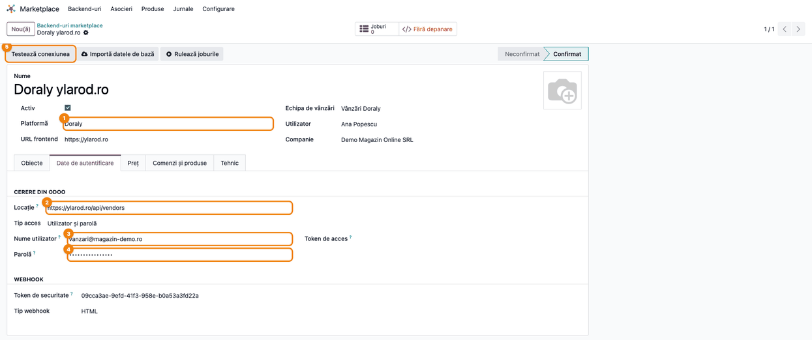
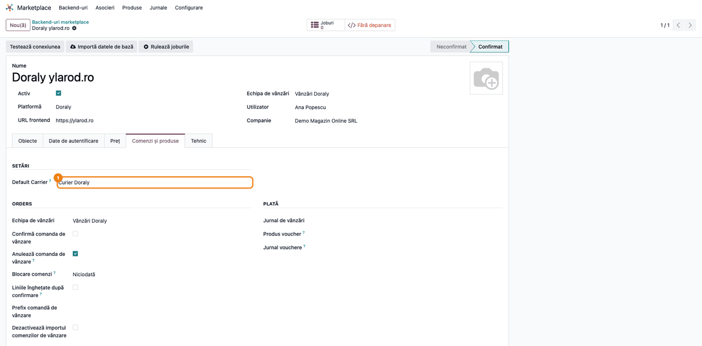
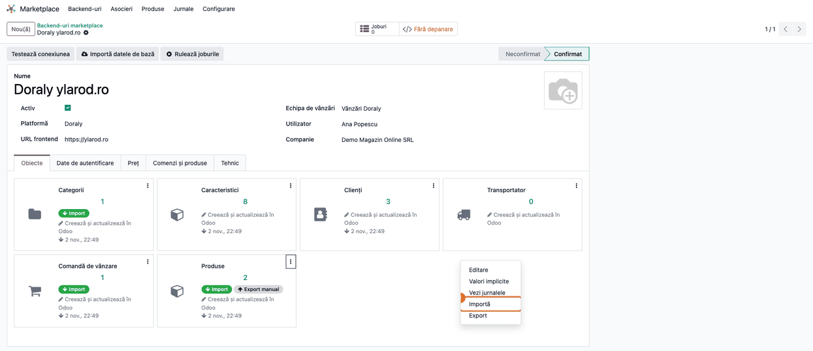
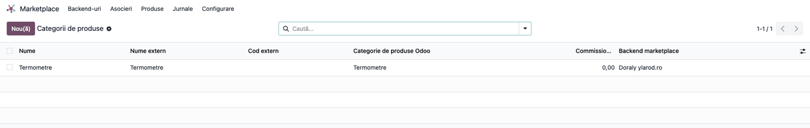
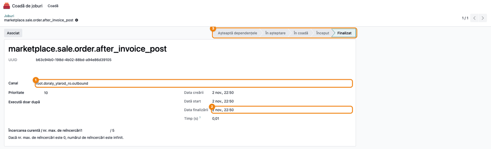

# Fișă Modul: Conector marketplace Doraly (ylarod.ro)

**Modul:** `deltatech_marketplace_doraly`
**Utilizator principal:** Operator marketplace / administrator vânzări online
**Prioritate:** 🟡 Medie (conector în uz activ, dar cu limitări cunoscute — vezi secțiunile 8 și 9;
în versiunea curentă un backend Doraly nou **nu se poate salva**, vezi secțiunea 2)

---

## 1. Scop business

Modulul conectează Odoo la platforma de marketplace **Doraly** (ylarod.ro), prin API-ul
`/api/vendors`. Este un conector „subțire" peste framework-ul generic
`deltatech_marketplace`: adaugă platforma „Doraly" în lista de backend-uri, autentificarea
proprie (email/parolă → token Bearer) și maparea câmpurilor specifice Doraly pentru import
produse, import categorii, import comenzi și trimiterea facturii PDF către marketplace.
Este util pentru un comerciant care vinde pe Doraly și vrea comenzile, clienții și produsele
sincronizate automat în Odoo, fără introducere manuală.

## 2. Bază legală și context

Nu există bază legală specifică — este o integrare tehnică comercială (API marketplace),
nu un flux fiscal. Contextul operațional: comenzile importate din Doraly devin comenzi de
vânzare Odoo normale, facturate și raportate ca orice altă vânzare a companiei (TVA, RO
e-Factura etc. se aplică prin modulele de contabilitate/localizare instalate separat, nu prin
acest conector).

> Conform `readme/ROADMAP.md` din modul, conectorul are mai multe **defecte de corectitudine
> confirmate în cod** (import categorii cu date fictive, brand fix la export produse, marcaj
> retryable pierdut la erori temporare de rețea etc.) — vezi secțiunea 8. Consultantul trebuie
> să cunoască aceste limitări înainte de a promite clientului un flux „complet automat".

> **Blocaj la configurare (versiunea curentă):** la salvarea unui backend cu platforma
> **Doraly**, modulul cere un obiect de tipul `product`, care nu există în lista de obiecte a
> framework-ului (tipul corect este `products`). Salvarea cade cu eroarea
> „Wrong value for marketplace.backend.item.item_type: 'product'", deci un backend Doraly nou
> nu poate fi creat, iar unul existent nu mai poate fi modificat, până la corectarea codului.
> Capturile din această fișă sunt făcute pe un backend creat prin test, cu acest defect ocolit.

> **Prețul liniilor (versiunea curentă):** prețul unitar al liniei se calculează din
> `totalClient` (valoarea **cu TVA** din Doraly), iar Odoo aplică apoi TVA-ul produsului peste
> el. Comanda din Odoo iese deci cu o valoare mai mare decât cea plătită de client în Doraly
> (în exemplul din pasul 6: 308,19 lei în Odoo față de 257,85 lei în Doraly). Diferența de
> 50,34 lei vine din TVA-ul Doraly de 41,60 lei, intrat în baza de impozitare (venitul pe 707
> iese umflat), plus TVA-ul de 8,74 lei calculat de Odoo peste el. Linia de transport e corectă: ia suma
> fără TVA (`totalNoTva`). Până la corectarea codului, prețurile produselor se corectează
> manual înainte de facturare (pasul 7).

## 3. Utilizatori și roluri

- Operator marketplace — configurează backend-ul, urmărește importurile de comenzi.
- Administrator vânzări — verifică maparea client/produs/categorie și corectitudinea comenzilor
  importate.

Roluri recomandate pentru testare:
- Administrator funcțional: instalează modulul, configurează backend-ul Doraly și meniurile.
- Utilizator operațional: rulează importul de produse/categorii/comenzi și verifică rezultatul.
- Contabil/manager: validează factura trimisă către Doraly și comanda de vânzare rezultată.

## 4. Conturi și date implicate

Modulul nu generează el însuși note contabile — comenzile importate devin `sale.order`
Odoo standard, care urmează fluxul contabil obișnuit de facturare al companiei (conturile de
venituri, TVA colectată etc. se determină prin produsele/taxele configurate, nu prin acest
conector).

Date minime pentru demo:
- un backend de marketplace cu platforma **Doraly**, cu credențiale (email/parolă) valide pe
  `https://ylarod.ro/api/vendors` sau un mediu de test echivalent;
- o categorie de produse mapată (`marketplace.product.category`) sau o categorie implicită
  setată pe backend (**Categorie implicită în marketplace**), altfel exportul de produse eșuează;
- un transportator implicit (**Default Carrier**) setat pe backend, pentru linia de transport a
  comenzilor importate (Doraly nu transmite metoda de livrare, doar suma);
- cel puțin un produs cu `default_code` completat (Doraly identifică produsele după cod);
- parametrul de sistem `web.base.url` setat la adresa publică a Odoo: link-ul facturii trimis
  către Doraly se construiește din el, iar cu o adresă internă Doraly nu poate descărca PDF-ul,
  deși jobul de trimitere ajunge în starea **Finalizat**.

## 5. Configurare inițială

1. Instalați modulul `deltatech_marketplace_doraly` (instalează automat dependențele:
   `deltatech_marketplace`, `deltatech_marketplace_delivery`, `deltatech_marketplace_sale`,
   `deltatech_marketplace_sale_stage`, `deltatech_website_short_description`, `delivery`).
2. Deschideți **Marketplace → Backend-uri** și creați un backend nou cu **Platformă** = **Doraly**.
   La selectarea platformei, câmpul **Locație** (tabul **Date de autentificare**) se
   precompletează automat cu `https://ylarod.ro/api/vendors` (poate fi suprascris pentru un
   mediu de test).
3. În tabul **Date de autentificare**, cu **Tip acces** = **Utilizator și parolă**, completați
   **Nume utilizator** (email-ul) și **Parolă** cu credențialele contului de comerciant Doraly.
4. În tabul **Comenzi și produse**, grupul **Setări**, setați transportatorul implicit — câmpul
   apare în interfață cu eticheta netradusă **Default Carrier** și este vizibil doar pe
   backend-urile Doraly; e folosit pentru linia de transport a comenzilor importate.
5. Apăsați **Testează conexiunea** în antetul backend-ului, pentru a confirma autentificarea.
   La reușită, backend-ul trece din **Neconfirmat** în **Confirmat**.
6. În tabul **Obiecte**, backend-ul Doraly are cardurile **Produse**, **Clienți**, **Comandă de
   vânzare** și **Transportator**. Cardul **Categorii** nu se creează singur: adăugați-l din
   tabul **Obiecte** dacă vreți să importați categoriile. După importul de categorii apare și
   cardul **Caracteristici**.
7. Mapați cel puțin o categorie de produse Odoo pe o categorie Doraly (sau setați
   **Categorie implicită în marketplace** pe backend), altfel exportul de produse va da eroare de
   mapare lipsă.

> Atenție: în versiunea curentă, pașii 2–4 se opresc la salvare cu eroarea descrisă în
> secțiunea 2. Până la corectarea codului, backend-ul nu poate fi configurat din interfață.

## 6. Flux de utilizare

### Pasul 1 — Configurarea backend-ului Doraly

Accesați **Marketplace → Backend-uri** și deschideți backend-ul cu platforma **Doraly**. În
tabul **Date de autentificare** se văd adresa API (**Locație**), email-ul (**Nume utilizator**)
și parola (mascată). Butonul **Testează conexiunea** face autentificarea la Doraly.



### Pasul 2 — Transportatorul implicit

În tabul **Comenzi și produse**, grupul **Setări**, alegeți transportatorul folosit pe linia de
transport a comenzilor importate (câmpul **Default Carrier**). Doraly trimite doar suma
transportului, nu și curierul.



### Pasul 3 — Rularea importurilor din tabul Obiecte

Importurile se pornesc din tabul **Obiecte**: pe cardul obiectului dorit (**Categorii**,
**Produse**, **Comandă de vânzare**) deschideți meniul **⋮** și alegeți **Importă**. Importul
rulează în fundal, ca job; rezultatul apare în contorul cardului și în listele din meniul
**Asocieri**. Ordinea recomandată: categorii, produse, apoi comenzi.



### Pasul 4 — Import categorii de produse

Importul de categorii apelează `/categories` și creează înregistrări
`marketplace.product.category`, cu caracteristicile aferente. Le vedeți în
**Marketplace → Asocieri → Categorii**.

> Atenție consultant: la data acestei fișe, metoda de import categorii **ignoră răspunsul real
> al API-ului** și creează mereu aceeași categorie de test („Termometre"), cu 8 caracteristici
> fixe — defect cunoscut, documentat în `readme/ROADMAP.md` (punctul P0.1). Nu folosiți acest
> pas ca dovadă a mapării reale de categorii până la corectare.



### Pasul 5 — Import produse

Importul de produse (`/products`, GET) creează pentru fiecare produs Doraly o legătură
`marketplace.product`, cu codul intern (`productCode`, devine **Referința internă** a
produsului Odoo), codul Doraly (`doralyCode`, coloana **Cod extern**) și numele. Le vedeți în
**Marketplace → Asocieri → Variante de produs**. Importul aduce doar codul și numele, fără preț,
stoc sau descriere.

![Lista produselor marketplace: [TRM-IR01] Termometru digital cu infraroșu și [TRM-BB02] Termometru pentru baie bebeluși, cu ID-ul extern Doraly și codul extern DRL-100231 / DRL-100232 (1)](screenshots/05_import_produse.png)

### Pasul 6 — Comanda importată

Importul de comenzi (`/orders`, GET) creează sau actualizează, pentru fiecare comandă:
clientul (identificat după telefon sau email), adresa de facturare (cu CIF, dacă există),
adresa de livrare, comanda de vânzare cu numărul Doraly și faza mapată din statusul Doraly,
linia de transport (pe transportatorul implicit al backend-ului, cu suma fără TVA din Doraly) și
liniile de produs. Comanda se deschide din **Marketplace → Asocieri → Comenzi de vânzare** sau
direct din **Vânzări**.


Verificați totalul: prețurile de 89,90 și 59,90 lei sunt valorile **cu TVA** din Doraly, iar
Odoo adaugă TVA 21% peste ele (vezi secțiunea 2). **Data comenzii** devine data confirmării în
Odoo, nu data plasării comenzii în Doraly.

### Pasul 7 — Corectarea prețurilor și confirmarea facturii

1. Pe comandă, în tabul **Linii comandă**, corectați **Preț unitar** al fiecărui produs la
   valoarea **fără TVA** din Doraly (`clientTotalNoTVA` / cantitate). În exemplu: 74,30 lei în
   loc de 89,90 lei la termometrul cu infraroșu și 49,50 lei în loc de 59,90 lei la cel de baie.
   Linia de transport rămâne neschimbată.
2. Apăsați **Creează factura**, păstrați **Factură normală** în fereastra care se deschide și
   creați factura; verificați că totalul ei este egal cu totalul comenzii din Doraly
   (257,85 lei). Prețul se poate modifica pe comanda confirmată doar dacă bifa **Liniile
   înghețate după confirmare** din tabul **Comenzi și produse** al backend-ului e debifată.
3. Apăsați **Confirmă** pe factură. La confirmare, conectorul programează trimiterea facturii
   către Doraly.


### Pasul 8 — Trimiterea facturii către Doraly

După confirmare, jobul `marketplace.sale.order.after_invoice_post` (canalul de ieșire al
backend-ului) trimite către Doraly link-ul portalului facturii (PDF), pentru fiecare factură
postată a comenzii. Pentru a-l vedea: butonul **Joburi** al backend-ului deschide lista
joburilor, cu filtre implicite care ascund joburile finalizate; scoateți filtrele din căutare
(sau adăugați filtrul **Finalizat**) și deschideți jobul `…after_invoice_post`. Starea
**Finalizat** înseamnă că apelul către Doraly a reușit.



### Note de monografie și raportare

Acest modul **nu generează note contabile proprii** — comanda și factura rezultate urmează
monografia standard de vânzare a companiei, determinată de produsele, taxele și jurnalele
configurate în Odoo, nu de conector. Pentru factura din pasul 7 (mărfuri plus transport
refacturat clientului, cu contul de venit 704 setat pe produsul de transport):

| Debit | Credit | Sumă (lei) | Explicație |
|---|---|---|---|
| 4111 | 707 | 198,10 | Venituri din vânzarea mărfurilor (148,60 + 49,50) |
| 4111 | 704 | 15,00 | Venituri din servicii prestate (transportul) |
| 4111 | 4427 | 44,75 | TVA colectată 21% |

Contul de venit al transportului vine din produsul folosit de **Default Carrier**; fără un cont
propriu pe produs, transportul ajunge pe contul implicit de venit al categoriei (de regulă 707).

## 7. Legături cu alte module / declarații

| Modul / proces | Rol în flux | Tip legătură |
|---|---|---|
| `deltatech_marketplace` | framework generic de backend-uri, joburi asincrone, jurnal de sincronizare | dependență (manifest) |
| `deltatech_marketplace_delivery` | integrare transportatori de marketplace | dependență (manifest) |
| `deltatech_marketplace_sale` | comenzi de vânzare de marketplace (`marketplace.sale.order`) | dependență (manifest) |
| `deltatech_marketplace_sale_stage` | mapare stadii/status comandă | dependență (manifest) |
| `deltatech_website_short_description` | descrierea scurtă trimisă la exportul de produs | dependență (manifest) |
| `delivery` | transportator implicit + tip livrare „Doraly" pe `delivery.carrier` | dependență (manifest) |
| `queue_job` | cozile de joburi ale importurilor și ale trimiterii facturii; reîncercarea la erori HTTP 429/5xx **nu** funcționează încă pentru Doraly (P0.3, secțiunea 9) | dependență tehnică (framework marketplace) |

Ce este automat: autentificarea, importul de produse/categorii/comenzi, crearea clientului și
adreselor, trimiterea facturii PDF către Doraly după postare.
Ce rămâne manual: maparea categoriilor Doraly (până la corectarea defectului P0.1), maparea
brandului real la exportul de produse (în prezent brandul trimis este fix „Philips"), generarea
AWB-ului de curierat (integrarea de livrare este momentan un stub fără preț/etichetă reale) și
exportul de comenzi/stoc către Doraly (nu sunt implementate).

## 8. Verificări pentru consultant

- [ ] Modulul se instalează fără erori, cu toate dependențele.
- [ ] Backend-ul Doraly se salvează (în versiunea curentă **nu** se salvează — secțiunea 2) și
      **Testează conexiunea** îl trece în **Confirmat**.
- [ ] Transportatorul implicit (**Default Carrier**) este setat pe backend înainte de primul
      import de comenzi.
- [ ] Importul de produse creează legăturile `marketplace.product` cu codul corect.
- [ ] Importul de comenzi creează comanda, clientul și adresele de livrare/facturare corect.
- [ ] Linia de transport apare pe comanda importată, cu suma fără TVA din payload-ul Doraly.
- [ ] Prețurile produselor au fost corectate la valoarea fără TVA înainte de facturare, iar
      totalul facturii este egal cu totalul comenzii din Doraly (secțiunea 2, pasul 7).
- [ ] Produsul transportatorului implicit are contul de venit potrivit (704 pentru transportul
      refacturat).
- [ ] La confirmarea facturii, jobul de trimitere către Doraly ajunge în starea **Finalizat**
      (butonul **Joburi** al backend-ului, fără filtrele implicite).
- [ ] `web.base.url` este adresa publică a Odoo, accesibilă din internet (link-ul facturii).
- [ ] Clientul a fost avertizat explicit că importul de categorii este momentan simulat
      (P0.1 din `ROADMAP.md`) și nu reflectă categoriile reale Doraly.
- [ ] Clientul a fost avertizat că brandul exportat pe produse este fix „Philips" (P0.5), dacă
      exportul de produse este folosit în producție.
- [ ] Nu s-a promis clientului generare AWB sau export de stoc/comenzi — nu sunt implementate.

## 9. Mesaje de eroare frecvente

| Mesaj / simptom | Cauză probabilă | Remediere |
|-----------------|-----------------|-----------|
| „Wrong value for marketplace.backend.item.item_type: 'product'" la salvarea backend-ului | Defect de cod: conectorul cere obiectul `product` în loc de `products` | Nu se poate ocoli din interfață; necesită corectarea codului |
| Eroare de autentificare la **Testează conexiunea** | Email/parolă greșite sau adresă API incorectă | Verificați credențialele și câmpul **Locație** pe backend |
| „Fără mapare pentru categoria Doraly" | Produsul exportat nu are o categorie mapată și backend-ul nu are categorie implicită | Mapați categoria produsului la o `marketplace.product.category` sau setați **Categorie implicită în marketplace** pe backend |
| Comanda importată fără linie de transport | Backend-ul nu are **Default Carrier** setat: linia de transport se sare fără mesaj | Setați **Default Carrier** pe backend și reimportați comanda |
| Totalul comenzii din Odoo mai mare decât cel din Doraly | Prețul liniei e luat cu TVA (`totalClient`), iar Odoo adaugă TVA-ul produsului peste el | Înainte de facturare, puneți pe fiecare linie de produs prețul fără TVA din Doraly (`clientTotalNoTVA` / cantitate), până la corectarea codului (ROADMAP P1.9) |
| Job blocat definitiv la erori HTTP 429/5xx | Eroarea temporară de rețea nu este reîncercată automat (limitare cunoscută, P0.3) | Reporniți manual jobul din butonul **Joburi** al backend-ului (**Repune jobul în coadă**), sau reîncercați importul |
| Produsele importate nu au descriere/preț | Importul Doraly mapează doar cod și nume produs; celelalte câmpuri nu sunt sincronizate din API | Completați manual sau prin alt flux datele lipsă (preț, descriere) |
| Toate categoriile importate ies identice („Termometre") | Defect cunoscut — importul de categorii ignoră răspunsul real al API-ului (P0.1) | Nu folosiți acest flux în producție până la corectarea în cod |

## 10. Capturi de ecran

Capturile din `static/description/` sunt **generate automat** din `tests/test_screenshots.py`
(mixinul `ScreenshotCase` din `l10n_ro_doc_screenshots`, import defensiv), în **limba română**,
pe planul de conturi RO (`setup_country("ro")`), pe compania de test „Demo Magazin Online SRL”.
API-ul Doraly nu se apelează: răspunsurile lui sunt simulate în test, iar importurile rulează
codul real al conectorului. Defectul de la salvarea backend-ului (secțiunea 2) e ocolit doar în
seed-ul testului. Prețurile produselor se corectează în test între capturile 06 și 07, ca în
pasul 7.

1. `01_backend_doraly.png` — backend-ul Doraly, tabul **Date de autentificare**, cu **Testează conexiunea**.
2. `02_transportator_implicit.png` — tabul **Comenzi și produse**, câmpul **Default Carrier**.
3. `03_obiecte_import.png` — tabul **Obiecte**, cu meniul **⋮** al cardului **Produse** deschis pe **Importă**.
4. `04_import_categorii.png` — lista categoriilor de marketplace importate.
5. `05_import_produse.png` — lista produselor de marketplace legate la produsele Odoo.
6. `06_comanda_importata.png` — comanda de vânzare importată din Doraly.
7. `07_factura_de_confirmat.png` — factura comenzii în ciornă, cu prețurile corectate și butonul **Confirmă**.
8. `08_trimitere_factura.png` — jobul de trimitere a facturii către Doraly, în starea **Finalizat**.

Regenerare:

```bash
./odoo/odoo-bin -c odoo.conf -d <db> \
    -i l10n_ro,deltatech_marketplace_doraly,l10n_ro_doc_screenshots \
    --test-tags=/deltatech_marketplace_doraly:TestDoralyScreenshots --stop-after-init
```

Comanda generează capturile RO (`test_capture_fise`) și pe cele EN pentru `readme/USAGE.md`
(`test_capture_usage`, în `static/description/en/`).

## 11. Observații pentru manual

În manualul final, precizați clar că acest conector este **funcțional pentru fluxul de bază**
(autentificare, import produse/comenzi, trimitere factură), dar are **limitări cunoscute și
documentate** (backend-ul nu se poate salva în versiunea curentă, prețul liniilor luat cu TVA,
import categorii simulat, brand fix la export, livrare nefuncțională, fără export de
stoc/comenzi) — listate integral în `readme/ROADMAP.md` al modulului și în secțiunea 2 a
acestei fișe. Redactorul manualului trebuie să evite formulări care promit un flux „complet
automat" până la corectarea acestor puncte.
