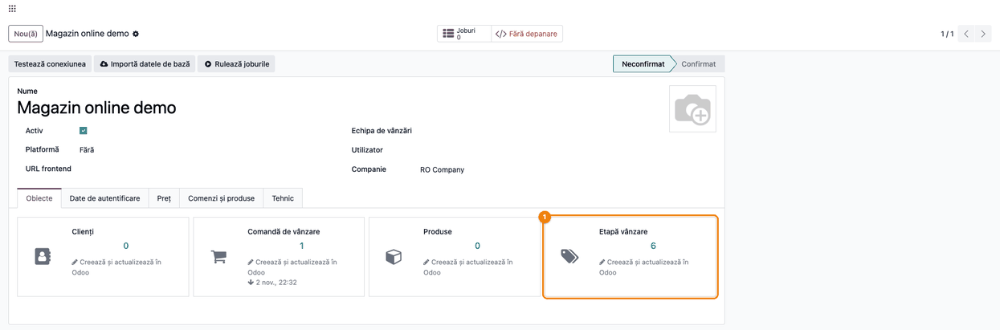
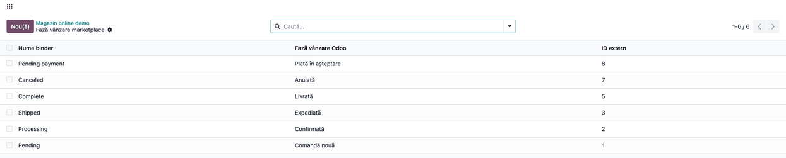
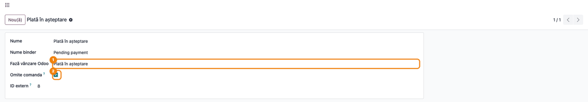
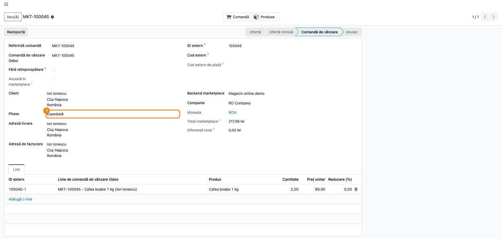
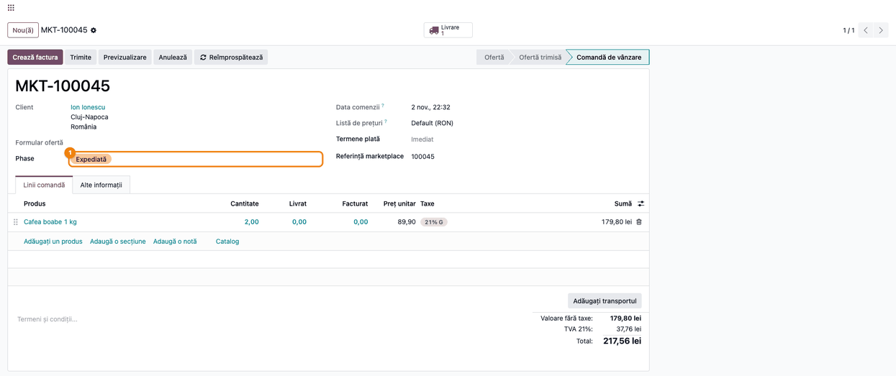

# Fișă Modul: Etape de vânzare pe comenzile din marketplace

**Modul:** `deltatech_marketplace_sale_stage`
**Utilizator principal:** Operator marketplace, Responsabil vânzări online
**Prioritate:** 🟡 Medie (util pentru companiile cu volum mare de comenzi din canale externe)

---

## 1. Scop business

Modulul leagă statusurile de comandă ale unui magazin online sau marketplace conectat (prin suita
`deltatech_marketplace`) de fazele de vânzare interne din modulul `deltatech_sale_stage` (modelul
`sale.order.phase`, câmpul „Phase" de pe comanda de vânzare). Pentru fiecare backend se ține o
listă de corespondențe: status din magazin → fază Odoo. Conectorii care folosesc lista (de exemplu
Doraly și Marketplace Extended) pun faza corespunzătoare pe comenzile pe care le importă, așa că
echipa de vânzări vede în lista de comenzi Odoo în ce fază e fiecare comandă, indiferent dacă a fost
creată manual sau a venit din magazin.

Modulul face doar maparea și opțiunea **Omite comanda**. Fazele, culorile și acțiunile lor vin din
`deltatech_sale_stage`, iar aplicarea fazei la import o face conectorul. Modulul nu calculează
durate pe etape și nu are raport propriu.

## 2. Bază legală și context

Nu există temei legal specific; este un modul pur operațional/tehnic de integrare, fără implicații
contabile sau fiscale directe. Contextul este operațional: sincronizarea stărilor comenzii între
un marketplace extern și fluxul intern de procesare a comenzilor din Odoo.

## 3. Utilizatori și roluri

Operator marketplace, Responsabil vânzări/operare comenzi.

Roluri recomandate pentru testare:
- **Administrator marketplace** (grupurile `deltatech_marketplace.group_marketplace_manager` **și**
  Vânzări / Administrator): vede meniul **Marketplace**, configurează backend-ul și creează, modifică
  sau șterge corespondențele de etape. Dreptul de Vânzări / Administrator e necesar pentru că fiecare
  corespondență scrie în faza Odoo (`sale.order.phase`), pe care doar acest grup o poate crea sau
  modifica: fără el nu merg nici redenumirea unei faze, nici importul unui status care creează o fază
  nouă.
- **Vânzător** (Vânzări / Utilizator): nu vede meniul **Marketplace** și nu poate modifica
  corespondențele; faza o vede pe comanda de vânzare Odoo, în câmpul **Phase**.

## 4. Conturi și date implicate

Nu sunt implicate conturi contabile — modulul nu generează note contabile. Datele implicate sunt
strict operaționale:
- un backend de marketplace (`marketplace.backend`);
- fazele de vânzare Odoo (`sale.order.phase`, din `deltatech_sale_stage`: nume, secvență, culoare
  și marcajele `confirmed`/`shipped`/`delivered`/`invoiced`/`paid`/`canceled` etc.);
- corespondențele status magazin → fază Odoo (`marketplace.sale.phase`): ID extern, nume binder,
  fază Odoo, Omite comanda;
- comenzile importate din magazin (`marketplace.sale.order`), legate de comanda de vânzare Odoo.

Date folosite în capturi (compania demo „RO Company", în RON):
- backend-ul „Magazin online demo";
- șase faze Odoo: Plată în așteptare, Comandă nouă, Confirmată, Expediată, Livrată, Anulată;
- șase statusuri din magazin (Pending payment, Pending, Processing, Shipped, Complete, Canceled),
  fiecare mapat pe o fază; statusul „Pending payment" are **Omite comanda** bifat;
- comanda MKT-100045 a clientului Ion Ionescu, 2 × „Cafea boabe 1 kg", importată în statusul
  „Shipped", deci cu faza **Expediată**.

## 5. Configurare inițială

1. Instalați modulul `deltatech_marketplace_sale_stage` (instalează automat dependențele
   `deltatech_marketplace_sale` și `deltatech_sale_stage`, dacă nu sunt deja instalate).
2. Instalați și configurați conectorul magazinului (**Marketplace → Backend-uri**). Conectorii care
   folosesc etapele adaugă singuri cardul **Etapă vânzare** în tabul **Obiecte** al backend-ului.
   Excepție: la Doraly cardul nu apare singur; adăugați-l din tabul **Obiecte** (creare rapidă,
   tip **Etapă vânzare**). Corespondențele se creează oricum la importul comenzilor.
3. Definiți fazele Odoo în **Vânzări → Configurare → Sale Order phase** (meniul vine din
   `deltatech_sale_stage`, cu eticheta netradusă). Dacă o fază are exact numele statusului din
   magazin, importul o leagă singur de ea.
4. Atribuiți grupurile `deltatech_marketplace.group_marketplace_manager` și Vânzări / Administrator
   utilizatorilor care administrează corespondențele.
5. Verificați marcajele (bifele) fazelor Odoo mapate: o fază cu marcajul **Confirmat** bifat
   confirmă comanda în ciornă, iar una cu marcajul **Canceled** (netradus în interfață) o anulează când faza e scrisă pe comandă. La majoritatea
   conectorilor asta se întâmplă chiar de la primul import (vezi Pasul 5).

## 6. Flux de utilizare

### Pasul 1 — Cardul „Etapă vânzare" pe backend

Deschideți **Marketplace → Backend-uri**, selectați backend-ul și rămâneți în tabul **Obiecte**.
Cardul **Etapă vânzare** (iconiță etichetă, adăugat de acest modul) arată câte corespondențe de
etape are backend-ul (în exemplu, 6).

Meniul cardului (⋮) are **Editare** (setările cardului), **Valori implicite** și **Vezi jurnalele**.
**Importă** (aduce toate statusurile din magazin) apare doar la conectorii care pot citi lista
statusurilor (Marketplace Extended, PrestaShop, Magento). La ceilalți conectori, un status nou se
adaugă singur în listă la importul primei comenzi care îl are. Pe backend-ul din capturi, fără
conector (platforma „Fără"), opțiunea lipsește.

> Notă tehnică: tipul de obiect este identificat intern ca `sale_stage`; modelul de corespondență
> (binding) este `marketplace.sale.phase`, iar modelul Odoo țintă este `sale.order.phase`
> (cel din `deltatech_sale_stage`).

### Pasul 2 — Lista corespondențelor status magazin ↔ fază Odoo

Faceți clic pe numărul de pe cardul **Etapă vânzare**. Se deschide lista **Fază vânzare
marketplace** a backend-ului:

Fiecare rând are:
- **Nume binder** — numele statusului așa cum vine din magazin (de exemplu „Shipped");
- **Fază vânzare Odoo** — faza pusă pe comandă (de exemplu „Expediată");
- **ID extern** — codul statusului în magazin.

Un rând apare cu roșu când faza lui Odoo e folosită și de alt status al aceluiași backend. Contează
pentru conectorii care, la schimbarea fazei în Odoo, trimit statusul înapoi în magazin
(Marketplace Extended, PrestaShop, OpenCart, Shopify și WooCommerce): toți aleg corespondența
creată ultima. Atenție: la acești conectori, orice schimbare a fazei în Odoo (manuală sau automată,
vezi Pasul 5) schimbă și statusul comenzii în magazin, iar magazinul poate trimite e-mail clientului.

### Pasul 3 — Corectarea unei corespondențe și „Omite comanda"

Deschideți un rând din listă:

Pe formular puteți:
1. alege altă **Fază vânzare Odoo**, dacă importul a legat statusul de o fază greșită sau a creat o
   fază nouă cu numele din magazin;
2. bifa **Omite comanda** pentru statusurile ale căror comenzi nu trebuie aduse în Odoo (de exemplu
   „Pending payment"). Bifa e respectată doar de conectorii care o citesc: în suita actuală, de
   conectorul OpenCart, care nu importă comenzile aflate în acel status. La ceilalți conectori bifa
   nu are efect; la Magento și PrestaShop, comenzile se filtrează în schimb din lista de statusuri
   de import de pe backend.

Câmpul **Nume** de pe formular este numele fazei Odoo, nu al statusului: modificarea lui redenumește
faza Odoo, pentru toate backend-urile și comenzile care o folosesc.

> La importul unui status nou, modulul caută o fază Odoo cu **exact același nume** (în limba
> utilizatorului care rulează importul); dacă nu găsește, creează o fază nouă cu numele din magazin.
> Un status fără nume, pentru care nu există încă o corespondență, oprește importul cu eroarea
> „Numele etapei de vânzare este obligatoriu" (în engleză, „Sale stage name is required").

### Pasul 4 — Faza pe comanda din marketplace

Deschideți comanda importată din **Marketplace → Asocieri → Comenzi de vânzare**. Câmpul **Phase**,
adăugat de acest modul sub **Client**, arată faza pusă de conector la import (în exemplu,
**Expediată**, pentru statusul „Shipped"):

Eticheta câmpului apare „Phase" și în interfața în română, pentru că traducerea lipsește din
`deltatech_sale_stage`.

### Pasul 5 — Faza pe comanda de vânzare Odoo

Butonul **Comandă** din antet deschide comanda de vânzare Odoo legată. Faza este aceeași, afișată ca
etichetă colorată în câmpul **Phase** (câmpul vine din `deltatech_sale_stage`, care ține și
istoricul schimbărilor în chatter):

Faza se schimbă la următorul import al comenzii, dacă statusul din magazin s-a schimbat și
conectorul o actualizează. În lista comenzilor de vânzare, faza apare ca etichetă colorată și se
poate grupa după ea.

> **Atenție:** când faza e scrisă pe o comandă, `deltatech_sale_stage` aplică marcajele fazei: o
> fază cu marcajul **Confirmat** bifat confirmă comanda în ciornă, una cu marcajul **Canceled** o anulează, iar o
> acțiune server legată de fază rulează. Conectorii Magento, OpenCart, PrestaShop, Shopify și
> WooCommerce scriu faza după ce creează comanda, deci efectele pornesc chiar de la primul import;
> doar Doraly și Marketplace Extended pun faza la crearea comenzii, fără aceste efecte la primul
> import (le aplică la schimbările ulterioare). Mapați deci cu grijă statusurile din magazin pe
> fazele cu aceste marcaje.

Faza o pune conectorul la import, dar `deltatech_sale_stage` o poate schimba și din Odoo: la
confirmarea, trimiterea și anularea comenzii, la validarea livrării (dacă tipul de operație are o
fază), la schimbarea stării curierului și la facturarea completă — pe fazele care au marcajul
potrivit (**Confirmat**, **Trimite email**, **Livrat**, **Facturat** etc.). La conectorii care
trimit statusul înapoi, aceste schimbări ajung și în magazin.

### Note de monografie și raportare

Modulul nu generează note contabile — nu produce înregistrări Dr/Cr și nu afectează planul de
conturi. Impactul este exclusiv operațional: câmpul `phase_id` de pe comanda de vânzare reflectă
etapa curentă de procesare, utilă pentru filtrarea și gruparea comenzilor pe faze sau pentru
declanșarea automată a acțiunilor asociate fazei (dacă faza are o acțiune server configurată în
`deltatech_sale_stage`).

## 7. Legături cu alte module / declarații

| Modul / proces | Rol în flux | Tip legătură |
|---|---|---|
| `deltatech_marketplace_sale` | comanda de marketplace (`marketplace.sale.order`) pe care se afișează câmpul Phase | dependență (manifest) |
| `deltatech_sale_stage` | definește fazele Odoo (`sale.order.phase`) și câmpul `phase_id` pe comanda de vânzare | dependență (manifest) |
| `deltatech_marketplace` | infrastructura de backend, cardurile din tabul Obiecte și corespondențele | dependență indirectă (prin `deltatech_marketplace_sale`) |
| conectorii (`deltatech_marketplace_doraly`, `_extended`, `_prestashop`, `_magento`, `_opencart`, `_shopify`, `_woocommerce`) | importă statusurile și pun faza pe comandă la import; Extended, PrestaShop, OpenCart, Shopify și WooCommerce trimit înapoi statusul la schimbarea fazei în Odoo; OpenCart respectă Omite comanda | modulele care folosesc maparea |

Ce este automat (prin conector): crearea corespondențelor pentru statusurile noi, cu potrivire după
nume pe fazele Odoo, și punerea fazei pe comanda importată.
Ce rămâne manual: corectarea corespondențelor greșite (faze cu nume diferit între magazin și Odoo),
bifarea **Omite comanda**, definirea fazelor Odoo și a acțiunilor lor.

## 8. Verificări pentru consultant

- [ ] Modulul se instalează fără erori peste `deltatech_marketplace_sale` și `deltatech_sale_stage`.
- [ ] Pe backend-ul unui conector care folosește etapele, tabul **Obiecte** are cardul **Etapă vânzare**
      (la Doraly, după ce l-ați adăugat manual).
- [ ] Clicul pe numărul de pe card deschide lista corespondențelor backend-ului.
- [ ] La conectorii cu import de statusuri, **Importă** creează corespondențe fără erori, legate de fazele
      Odoo cu același nume.
- [ ] O comandă importată primește în câmpul **Phase** faza mapată pe statusul ei din magazin.
- [ ] Pe un backend OpenCart, comenzile cu un status bifat **Omite comanda** nu se importă.
- [ ] Un utilizator fără grupul Administrator marketplace nu poate crea, modifica sau șterge corespondențe.
- [ ] O fază cu marcajul Confirmat, pusă pe o comandă în ciornă deja importată, confirmă comanda.

## 9. Mesaje de eroare frecvente

| Mesaj / simptom | Cauză probabilă | Remediere |
|-----------------|-----------------|-----------|
| „Numele etapei de vânzare este obligatoriu" („Sale stage name is required") | Statusul primit din magazin nu are nume și nu există încă o corespondență pentru el | Verificați statusul în magazin sau creați manual corespondența, cu faza Odoo dorită |
| Apare o fază Odoo nouă, cu numele statusului din magazin | Nu exista o fază Odoo cu exact același nume (potrivirea ține cont de limbă și de diacritice) | Alegeți pe corespondență faza Odoo corectă, apoi ștergeți faza creată în plus (fazele nu se pot arhiva). Ștergerea unei faze șterge și corespondențele legate de ea |
| O fază Odoo și-a schimbat singură numele (la PrestaShop și marcajele Trimite email / Livrat / Facturat / Plătit) | La reimportul statusurilor, numele din magazin se scrie pe faza Odoo legată; PrestaShop rescrie și marcajele | Păstrați în Odoo aceleași nume ca în magazin sau nu reimportați statusurile după redenumire |
| Câmpul Phase nu se schimbă pe comandă | Conectorul nu actualizează faza pentru acest status sau comanda nu a mai fost importată | Reimportați comanda (butonul **Reimportă**) și verificați corespondența statusului |
| Rânduri roșii în lista corespondențelor | Aceeași fază Odoo e mapată pe mai multe statusuri ale backend-ului | Dacă statusul trimis înapoi în magazin contează, lăsați câte o fază pe un singur status |
| Statusul din magazin s-a schimbat după o confirmare, o livrare sau o factură în Odoo | `deltatech_sale_stage` a mutat comanda pe faza cu marcajul potrivit, iar conectorul a trimis statusul corespunzător în magazin | Verificați marcajele fazelor și fazele de pe tipurile de operație; scoateți marcajul dacă schimbarea nu trebuie să ajungă în magazin |
| Utilizatorul nu poate modifica o corespondență | Grupul `base.group_user` are doar drept de citire (`ir.model.access.csv`) | Modificările le face un utilizator cu grupurile Administrator marketplace (`deltatech_marketplace.group_marketplace_manager`) și Vânzări / Administrator |

## 10. Capturi de ecran

Capturile sunt generate de testul `tests/test_screenshots.py` (Playwright, compania demo
„RO Company", RON), în `static/description/` (română) și `static/description/en/` (engleză):

1. `01_backend_objects_sale_stage.png` — tabul Obiecte al backend-ului, cu cardul Etapă vânzare.
2. `02_lista_binding_etape.png` — lista corespondențelor status magazin ↔ fază Odoo.
3. `03_formular_binding_etapa.png` — corespondența „Pending payment", cu faza Odoo și Omite comanda bifat.
4. `04_comanda_marketplace_faza.png` — comanda din marketplace, cu câmpul Phase.
5. `05_comanda_vanzare_faza.png` — comanda de vânzare Odoo legată, cu aceeași fază.

## 11. Observații pentru manual

În manualul final, subliniați că acest modul nu introduce funcționalitate nouă de business, ci
doar leagă două module existente (`deltatech_marketplace_sale` și `deltatech_sale_stage`): scopul
practic este ca echipa de operare comenzi să vadă faza de procesare la fel, indiferent dacă comanda
vine dintr-un magazin sau a fost creată manual în Odoo. Menționați explicit că:
- potrivirea automată a fazelor se face după numele identic, iar corectarea corespondențelor este o
  operație de configurare, nu de utilizare zilnică;
- faza o pune conectorul; ce face fiecare conector cu ea (import, trimitere înapoi, Omite comanda)
  diferă de la un conector la altul;
- numele unei faze Odoo legate se suprascrie la reimportul statusurilor (la PrestaShop și marcajele
  ei), deci redenumirea fazelor se face în magazin, nu în Odoo;
- faza se poate schimba și din Odoo (confirmare, livrare, curier, facturare), iar la conectorii cu
  trimitere înapoi schimbarea ajunge în magazin;
- fazele cu marcajul Confirmat sau Canceled confirmă, respectiv anulează comanda când faza e scrisă
  pe ea; la majoritatea conectorilor, chiar de la primul import.
