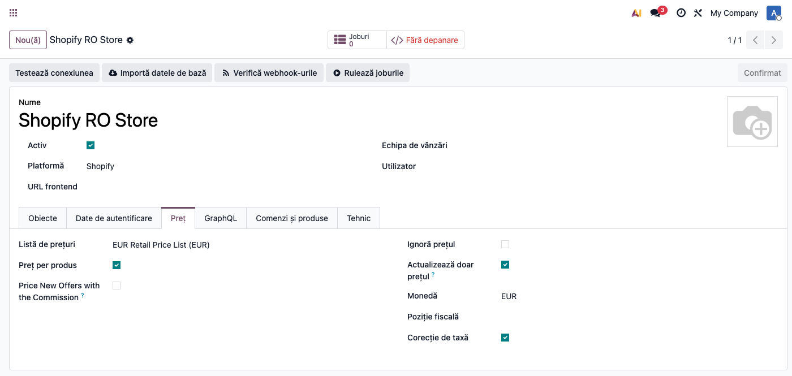
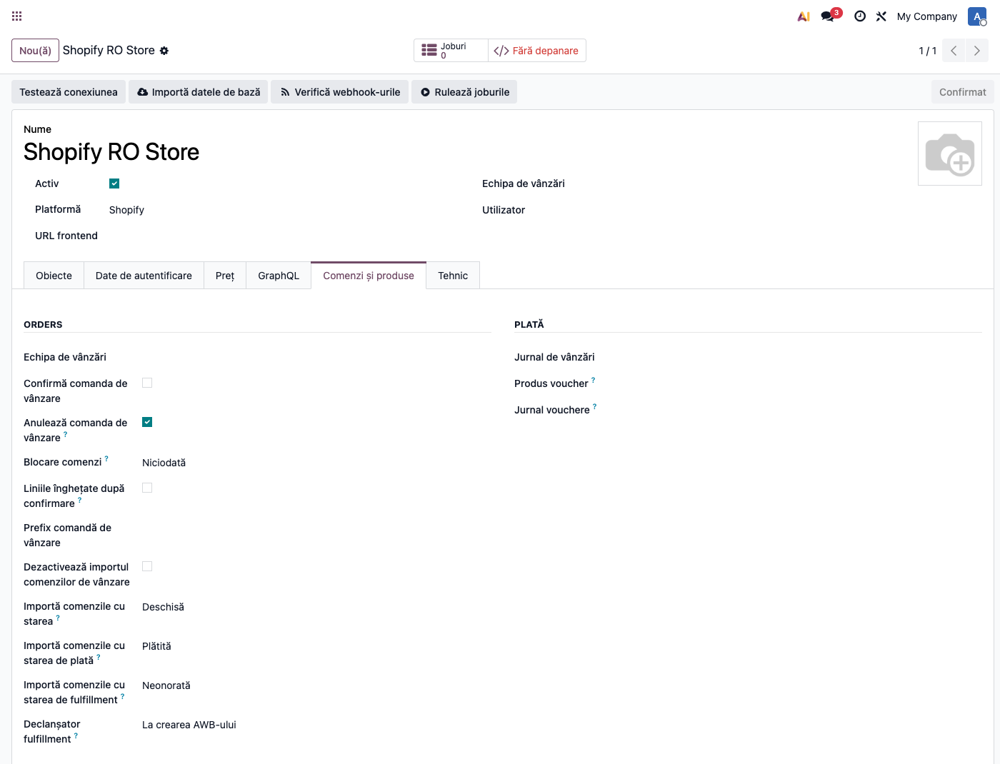
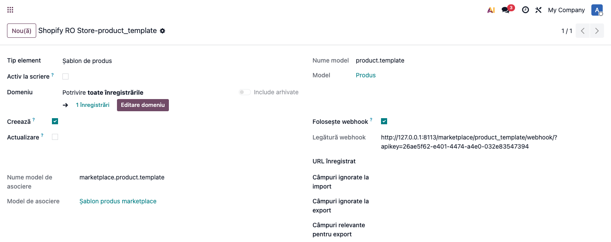
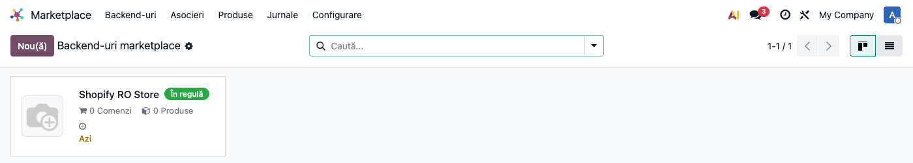
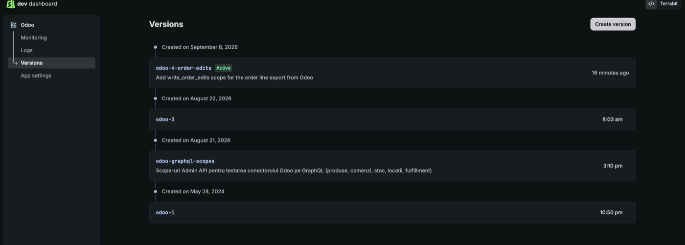
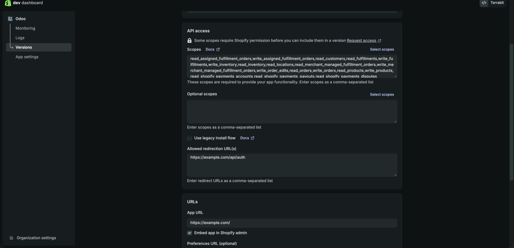

# Fișă Modul: Conector Shopify — sincronizare produse, comenzi și stoc

**Modul:** `deltatech_marketplace_shopify`
**Utilizator principal:** Consultant Odoo / administrator funcțional (configurare inițială), operator e-commerce (utilizare curentă)
**Prioritate:** 🔴 Ridicată (conector vandabil pe Odoo Apps Store, folosit de clienți cu magazine Shopify reale)

---

## 1. Scop business

Modulul conectează un magazin Shopify la Odoo prin framework-ul comun `deltatech_marketplace`:
produse, clienți, comenzi, stoc și numere de tracking (AWB) circulă automat între cele două
sisteme, dintr-un singur backend Odoo. Fără el, un magazin care rulează Shopify lângă Odoo ar
ține catalogul și comenzile manual în ambele locuri — cu riscul de preț nesincronizat, comandă
introdusă de două ori sau stoc care nu se mai potrivește.

## 2. Arhitectură tehnică și context

Modulul rulează integral pe **API-ul modern GraphQL Admin** al Shopify (nu pe REST-ul vechi,
pe care Shopify îl închide progresiv). Fiecare subsistem (produse, stoc, expediere, clienți,
comenzi, webhook-uri) are propriul comutator GraphQL/REST pe backend, implicit oprit — un magazin
trece pe GraphQL treptat, subsistem cu subsistem, și poate reveni la REST dintr-un singur
comutator dacă apare o problemă.

Autentificarea acceptă două moduri: **Private App clasică** (token permanent, **Token de acces**
completat manual) și **Dev Dashboard App** (OAuth `client_credentials`, token cu expirare la 24h,
reînnoit automat). Modul îl decide perechea **ID client** + **Secret client / Cheie API**: când
amândouă sunt completate, conectorul cere singur tokenul; altfel folosește **Token de acces**.
Câmpul **Tip acces** doar arată sau ascunde câmpurile: **ID client**, **Secret client / Cheie API**
și **Token site web** apar doar cu **Tip acces** = `Client_id și client_secret`, iar **Token de
acces** e mereu vizibil.

**Secret client / Cheie API** are și un rol de securitate: fără el, semnătura HMAC a
webhook-urilor primite nu se mai verifică (doar un avertisment în log), deci recomandăm
completarea lui și pe backend-urile cu token permanent. Pentru o Private App: **Tip acces** =
`Client_id și client_secret`, completați doar **Secret client / Cheie API** (cheia secretă a
aplicației) și **Token de acces**, iar **ID client** rămâne gol — fără el, conectorul rămâne pe
tokenul permanent.

Filtrele de import comandă (status/plată/livrare) sunt traduse separat pentru fiecare transport
(REST și GraphQL folosesc cuvinte diferite pentru aceeași stare) — o alegere netradusă ar fi
ignorată tăcut de Shopify, nu ar da eroare.

## 3. Utilizatori și roluri

- **Consultant/administrator funcțional**: configurează backend-ul, mapează depozitele și lista
  de prețuri, activează comutatoarele necesare, rulează prima sincronizare.
- **Operator e-commerce**: urmărește starea de sănătate a sincronizării, rezolvă job-urile eșuate,
  verifică periodic webhook-urile.

Roluri recomandate la testare:
- Administrator funcțional: instalează modulul, configurează backend-ul, verifică meniurile.
- Utilizator operațional: rulează prima sincronizare și cea curentă.
- Manager/consultant: validează rezultatul (comenzi importate, stoc exportat, health badge).

## 4. Date și mapări implicate

Nu există note contabile Dr/Cr generate direct de acest modul (asta ține de `sale`/`account`,
declanșate normal de comanda de vânzare creată). Datele-cheie de mapat înainte de prima
sincronizare:

- **Depozite** — fiecare Shopify Location trebuie să aibă un `stock.warehouse` Odoo deja creat
  *înainte* de import (potrivirea e după nume/cod; o Location nemapată creează un depozit gol,
  fals, în Odoo).
- **Lista de prețuri** (`pricelist_id`) — pentru exportul de preț către Shopify.
- **Taxa implicită** (`tax_id`) — aplicată produselor importate.
- **Categoria/atributele** — opționale (**Folosește categoriile**, **Tipul de produs ca categorie
  internă**, **Opțiuni ca atribute**); dacă **Opțiuni ca atribute** rămâne oprit, **produsul tot se importă**, dar **variantele lui** Shopify
  sunt sărite (nu fuzionate tăcut într-o singură variantă) — avertismentul apare doar în log-ul
  serverului, nu vizibil pentru operator în interfață.

Date minime pentru demo: un magazin Shopify de test (sau Shopify Dev Store), cel puțin un produs
cu variante, un client și o comandă existentă în magazin.

## 5. Configurare inițială

1. Instalați modulul `deltatech_marketplace_shopify` (cere biblioteca Python `ShopifyAPI` — nu
   funcționează pe Odoo Online/SaaS, doar On-Premise sau Odoo.sh).
2. Creați depozitele Odoo care corespund Location-urilor din Shopify, *înainte* de a importa
   depozitele din Shopify.
3. Creați un backend nou: **Marketplace → Backend-uri → Nou(ă)**, **Platformă** = `Shopify`.
4. În tab-ul **Date de autentificare**, alegeți **Tip acces** = `Client_id și client_secret` (apar
   câmpurile **ID client** și **Secret client / Cheie API**). Pentru o Dev Dashboard App completați
   amândouă; pentru o Private App clasică completați **Token de acces** și doar **Secret client /
   Cheie API**, cu **ID client** gol (vezi secțiunea 2).
5. Setați tab-ul **Preț** (**Listă de prețuri**, **Actualizează doar prețul**/**Ignoră prețul** după
   caz) și filtrele de comandă din tab-ul **Comenzi și produse** (status, plată, livrare).
6. Opțional, în tab-ul **Comenzi și produse**, bifați **Tipul de produs ca categorie internă**:
   la importul unui produs, tipul de produs din Shopify (*Product type*) devine categoria internă
   Odoo cu același nume, creată dacă lipsește. Shopify trimite doar numele categoriei, fără
   părinte, iar la export Odoo trimite tot numele simplu. De aceea un produs deja legat își
   păstrează categoria când numele ei coincide cu tipul de produs, chiar dacă există și alte
   categorii cu același nume. Categoria se schimbă doar când se schimbă tipul de produs în
   Shopify. Atunci produsul trece în prima categorie cu noul nume, de aceea e bine ca numele
   categoriilor folosite pentru Shopify să fie unice.
7. Opțional, activați comutatoarele GraphQL dorite din tab-ul **GraphQL** (toate pornesc oprite).
8. Apăsați **Testează conexiunea** din antet — validează credențialele printr-un query GraphQL `shop`.
9. Apăsați **Importă datele de bază** — înregistrează webhook-urile Shopify necesare.
10. Verificați câmpul **Granted Access Scopes** din tab-ul **GraphQL** (apare după **Testează
    conexiunea**; eticheta nu e tradusă): e lista pe care
    Shopify o raportează pentru instalarea curentă. Dacă **Missing Scopes** e completat, o opțiune
    pornită pe backend nu are dreptul de care are nevoie — vezi Pasul 8 de mai jos. Excepție:
    `read_all_orders` apare mereu cât lipsește. Fără el, Shopify arată aplicației doar comenzile
    din ultimele 60 de zile, iar conectorul nu mai trimite nimic pe comenzile mai vechi (fază,
    anulare, AWB). Dreptul îl aprobă Shopify, la cererea din contul magazinului.

## 6. Flux de utilizare

### Pasul 1 — Configurarea backend-ului (Date de autentificare)

Deschideți **Marketplace → Backend-uri → Nou(ă)**, alegeți **Platformă** = `Shopify` și completați
tab-ul **Date de autentificare**: adresa magazinului (**Locație**), apoi **Tip acces** =
`Client_id și client_secret`, ca să apară **ID client** și **Secret client / Cheie API**. Dev
Dashboard App: completați **ID client** și **Secret client / Cheie API**. Private App clasică:
completați **Token de acces** (mereu vizibil) și **Secret client / Cheie API**, cu **ID client**
gol.


### Pasul 2 — Prețul și filtrele de comandă

Tab-ul **Preț** stabilește lista de prețuri de export și politica **Actualizează doar prețul**/
**Ignoră prețul** (utilă când Shopify decide prețul, dar Odoo rămâne proprietarul datelor de
produs). Tab-ul **Comenzi și produse** (grupul **Orders**, titlu netradus) conține cele trei filtre de
import comandă — **Importă comenzile cu starea**, **Importă comenzile cu starea de plată** și
**Importă comenzile cu starea de fulfillment** — configurabile per magazin, urmate de
**Declanșator fulfillment**.

> Atenție la combinația cu fereastra de import (**Zile pentru comenzile de vânzare**, în tab-ul
> **Tehnic** → **Limite**): o comandă care atinge starea cerută de filtru **după** ce a ieșit din
> această fereastră nu mai e importată niciodată. Un filtru mai restrictiv decât **Oricare** cere o
> fereastră suficient de largă.





### Pasul 3 — Comutatoarele GraphQL

Tab-ul **GraphQL** are câte un comutator pentru fiecare subsistem (produse, stoc, expediere,
clienți, comenzi, webhook-uri), toate oprite implicit. Un magazin trece pe GraphQL treptat, un
subsistem odată, și poate reveni la REST dintr-un singur comutator dacă ceva nu merge.


### Pasul 4 — Prima sincronizare (tab Obiecte)

Tab-ul **Obiecte** arată câte un card kanban pentru fiecare tip de date — 14 în total (inclusiv
**Transportator**, **Furnizor de plată**, **Imagine produs**, **Listă de prețuri**, populate automat
la import de comenzi sau la **Importă datele de bază**, și **Cerere de retur**, adus de modulul
`deltatech_marketplace_sale`) — fiecare cu butoanele care i se aplică (**Import**, **Import +preț**,
**Import +preț +stoc**, **Export manual +preț**). Rulați cardurile relevante o singură dată, în
ordinea asta, pentru prima sincronizare: **Depozite** → **Categorie publică** (dacă e activată) →
**Caracteristici**/**Valori ale caracteristicilor** (dacă e activată) → **Produse**/**Șablon de
produs** → **Clienți** → **Etapă vânzare** (configurare manuală, nu import) → **Comandă de
vânzare**, ultimul, ca liniile de comandă să găsească deja produsele și clienții importați.


### Pasul 5 — Ce rulează automat după prima sincronizare

Comenzile și produsele se actualizează prin webhook-urile Shopify (`orders/create`,
`orders/updated`, `orders/paid`, `orders/cancelled`, `products/update`, `products/create`), fără cron de așteptat.
Exportul de stoc și de preț rulează pe acțiunile programate ale framework-ului comun
(dezactivate implicit — vizibile în **Marketplace → Configurare → Acțiuni programate**, se
activează de acolo), iar reînnoirea tokenului OAuth (**„Shopify: Reînnoiește token-urile de
acces”**, la fiecare 23h, pentru backend-urile Dev Dashboard App) e o acțiune programată
obișnuită, vizibilă doar în **Setări → Tehnic → Acțiuni planificate** (necesită modul dezvoltator) —
nu apare în meniul Marketplace → Configurare → Acțiuni programate, care filtrează doar acțiunile
numite „Marketplace: …”.

Ce aduce `products/update` dintr-un produs modificat în Shopify depinde de comutatorul
**Actualizare** de pe două item-uri din tab-ul Obiecte și de **Actualizează doar prețul** (tab
Preț). Webhook-ul importă întâi șablonul, apoi fiecare variantă, printr-un job separat:

- **Șablon de produs** aduce numele (titlul produsului din Shopify, unul pentru toate variantele)
  și, doar la produsele cu o singură variantă, codul intern, codul de bare și greutatea;
- **Produse** aduce, pe fiecare variantă, prețul, codul intern, codul de bare și greutatea.

Combinațiile, cu **Actualizare** setat la fel pe ambele item-uri:

- **Actualizare** oprit, cu **Actualizează doar prețul**: doar prețul — prețul de vânzare din
  Odoo și, cu **Listă de prețuri** și **Preț per produs**, prețul fix al fiecărei variante în lista
  de prețuri. Numele, codul intern, codul de bare și greutatea rămân cele din Odoo. **Ignoră
  prețul** are prioritate.
- **Actualizare** oprit, fără **Actualizează doar prețul**: nimic, produsul din Odoo rămâne neatins.
- **Actualizare** pornit: produsul urmează Shopify — numele pe șablon, plus codul intern, codul de
  bare, greutatea și prețul, peste valorile din Odoo.

Prețul de vânzare din Odoo e unul singur pe șablon: la un produs cu variante cu prețuri diferite
rămâne prețul ultimei variante importate. Prețul diferit pe fiecare variantă se păstrează doar în
**Listă de prețuri**, cu **Preț per produs** bifat.

Numele împreună doar cu prețul: **Actualizare** pornit pe **Șablon de produs**, oprit pe
**Produse**, și **Actualizează doar prețul** bifat. Merge curat doar la produsele cu mai multe
variante; la cele cu o singură variantă, șablonul aduce odată cu numele și codul intern, codul de
bare și greutatea.

Atenție: **Actualizare** e bifat implicit pe item-urile noi. Pentru varianta „doar prețul”,
debifați **Actualizare** pe **ambele** item-uri, **Produse** și **Șablon de produs**: din tab-ul
Obiecte, meniul ⋮ al cardului → **Editare** (un clic pe card nu deschide formularul).
**Folosește webhook** rămâne bifat pe **Șablon de produs**, care primește `products/update`.



Tot automat pleacă spre Shopify și **expedierea (fulfillment-ul) cu AWB-ul**: la generarea AWB-ului
sau la validarea livrării, după setarea **Declanșator fulfillment** de pe backend, printr-un job în
fundal. Dacă Shopify a repartizat comanda pe **mai multe locații** (de exemplu, două depozite din
Shopify), conectorul creează **câte un fulfillment pe fiecare locație**, toate cu același AWB — în
Shopify comanda apare cu atâtea expedieri câte locații are, nu cu una singură. Dacă Shopify refuză
expedierea, jobul eșuează imediat, fără reîncercări, și rămâne în lista de job-uri eșuate ale
backend-ului; problemele de rețea sau limitele de apeluri se reîncearcă singure.

### Pasul 6 — Citirea stării de sănătate

Cardul kanban al backend-ului din **Marketplace → Backend-uri** arată un indicator de sănătate
(verde/portocaliu/roșu/gri), ora ultimei sincronizări, și — doar când există probleme — linkuri
către log-urile din ultimele 24h și către job-urile eșuate.

Indicatorul are patru stări: **gri** („Neconfirmat” — backend-ul încă nu e confirmat),
**portocaliu** („Avertismente”), **roșu** („Erori”) și **verde** („În regulă”). Devine **verde** doar
când toate acestea sunt adevărate simultan: backend-ul e confirmat, tokenul nu a expirat, zero
erori în ultimele 24h, zero job-uri eșuate, și **cel puțin un tip de date are deja o sincronizare
înregistrată**. Un backend confirmat dar neimportat încă rămâne **portocaliu** („Avertismente”, cu
detaliul „Niciodată sincronizat” în tooltip), nu verde și nu gri.



### Pasul 7 — Verificarea webhook-urilor

Butonul de antet **Verifică webhook-urile** deschide un wizard care compară webhook-urile efectiv
înregistrate în Shopify cu ce așteaptă Odoo: **Potrivit** (înregistrat corect), **Lipsă** (Odoo
așteaptă un webhook pe care Shopify nu-l are) și **Orfan** (opusul — Shopify are un webhook pe
care Odoo nu-l mai așteaptă). Butoanele din antet: **Reîmprospătează** reia comparația,
**Selectează toate cele lipsă**/**Selectează toate orfanele** bifează grupul respectiv,
**Înregistrează selecția** înregistrează în Shopify liniile **Lipsă** bifate, iar **Șterge orfanele
selectate**/**Șterge selecția (orice stare)** șterg din Shopify liniile bifate — inclusiv una
**Potrivit**, dacă e bifată cu ultimul buton. Atenție: dacă ștergeți o linie **Potrivit** fără să
opriți întâi **Folosește webhook** pe tipul de date corespunzător, **Importă datele de bază** o
reînregistrează la următoarea rulare.


### Pasul 8 — Acordarea unui scope lipsă în Shopify (ex. exportul liniilor)

Se face **o singură dată per magazin**, și doar dacă activați o opțiune care cere un drept
suplimentar. Cazul concret de azi: **Export Order Lines** (tab-ul **GraphQL**; opțiunea apare doar
după ce bifați **Comenzi prin GraphQL**) are nevoie de `write_order_edits`, care e un scope de sine
stătător — `write_orders` **nu** îl acoperă.

Semnul că lipsește: câmpul **Missing Scopes** din tab-ul **GraphQL** îl arată (captura de la Pasul 3
arată exact acest caz: `read_all_orders, write_order_edits`), iar dacă cineva modifică
totuși liniile unei comenzi, în chatterul comenzii apare mesajul „*The order lines were NOT sent
to Shopify: the Shopify app has no `write_order_edits` access scope...*". Jobul **nu** eșuează și
nu apare nicio eroare — mesajul din comandă e singurul semnal.

Pașii, pentru o aplicație Dev Dashboard (Mode B):

1. Deschideți **[Shopify Dev Dashboard](https://dev.shopify.com/dashboard)** → organizația →
   aplicația (ex. „Odoo") → meniul din stânga **Versions**.
   Vedeți lista de versiuni, cea curentă marcată `Active`.

   

2. Apăsați **Create version** (sau **New version** din pagina Overview). Se deschide un formular
   „Create version", pornit de la versiunea activă.
3. În secțiunea **API access**, câmpul **Scopes** conține lista actuală, separată prin virgulă.
   Adăugați scope-ul lipsă în listă (ex. `...,write_orders,write_order_edits,read_products,...`).
   Ordinea nu contează. Butonul **Select scopes** de lângă câmp deschide un selector, dacă
   preferați să nu editați textul direct.

   

4. Apăsați **Release** (dreapta sus) → în dialogul „Release this new version?" puteți da un nume
   și un mesaj versiunii → **Release**. Versiunea nouă devine `Active`.
5. **Atenție — aici e pasul care se uită ușor: publicarea versiunii NU acordă scope-ul.**
   Instalarea existentă pe magazin păstrează drepturile vechi. Din pagina **Overview** a
   aplicației, secțiunea **Installs**, apăsați **Install app** și alegeți magazinul.
6. Se deschide în admin-ul magazinului ecranul **„Update data access"**, cu lista a ce cere
   aplicația în plus — pentru cazul nostru: *View and edit store data → Edit orders, Order
   edits*. Apăsați **Update**.
7. Înapoi în Odoo, apăsați **Testează conexiunea** pe backend. Câmpul **Granted Access Scopes** se
   reîmprospătează, din **Missing Scopes** dispare `write_order_edits` (rămâne doar
   `read_all_orders`, dacă Shopify nu l-a aprobat încă), iar exportul funcționează de la următorul job.
   (Tokenul se reînnoiește oricum singur; scope-ul nou intră în vigoare la primul token nou.)

> Verificare rapidă că a mers, fără să deschideți Shopify: pe backend, **Missing Scopes** nu mai
> conține scope-ul adăugat, iar **Granted Access Scopes** îl conține.

## 7. Legături cu alte module / declarații

| Modul / proces | Rol în flux | Tip legătură |
|---|---|---|
| `deltatech_marketplace` | framework comun: backend, health badge, job-uri, item-uri sincronizate | dependență (manifest) |
| `deltatech_marketplace_sale` | comanda de vânzare Odoo generată din comanda Shopify | dependență (manifest) |
| `deltatech_marketplace_payment` | mapare metodă de plată Shopify → payment acquirer Odoo | dependență (manifest) |
| `deltatech_marketplace_delivery` | mapare transportator, linie de livrare pe comandă | dependență (manifest) |
| `deltatech_marketplace_website` | integrare website (opțională) | dependență (manifest) |
| `deltatech_marketplace_sale_stage` | cardul **Etapă vânzare** — mapare tag Shopify ↔ fază de vânzare | dependență (manifest) |
| `sale` / `stock` / `account` | comanda de vânzare, mișcarea de stoc, factura rezultată — flux Odoo standard, neatins direct de acest modul | flux standard Odoo |

Ce este automat: sincronizarea comenzilor/produselor prin webhook, exportul de stoc/preț pe
cron-urile comune, reînnoirea tokenului OAuth.
Ce rămâne manual: maparea inițială a depozitelor și listei de prețuri, configurarea fazelor de
vânzare (tag-uri Shopify), verificarea periodică a webhook-urilor.

## 8. Verificări pentru consultant

- [ ] Modulul se instalează fără erori (necesită biblioteca Python `ShopifyAPI`).
- [ ] **Testează conexiunea** confirmă credențialele înainte de orice import.
- [ ] Depozitele Odoo există *înainte* de a importa Location-urile Shopify.
- [ ] Prima sincronizare respectă ordinea din Pasul 4 (depozite → categorii/atribute → produse →
      clienți → comenzi, ultimul).
- [ ] **Importă datele de bază** a înregistrat webhook-urile — verificați cu **Verifică
      webhook-urile** că nu apar linii **Lipsă**.
- [ ] Dacă filtrele de comandă (status/plată/livrare) sunt mai restrictive decât **Oricare**,
      **Zile pentru comenzile de vânzare** acoperă o fereastră suficient de largă pentru starea așteptată.
- [ ] Indicatorul de sănătate de pe cardul kanban e verde (**Confirmat**, zero erori/job-uri
      eșuate, cel puțin o sincronizare înregistrată) după prima sincronizare reușită.
- [ ] Un produs cu mai multe variante Shopify, fără **Opțiuni ca atribute** activat, tot se
      importă — dar variantele lui sunt sărite (verificați log-ul serverului, nu interfața).
- [ ] **Secret client / Cheie API** e completat chiar și pe un backend cu token permanent, ca semnătura HMAC a
      webhook-urilor primite să se verifice.
- [ ] Exportul de stoc/preț (dacă activat manual din **Marketplace → Configurare → Acțiuni programate**)
      reflectă corect mapările de depozit/listă de prețuri.
- [ ] O comandă repartizată în Shopify pe două locații primește, după expediere, câte un
      fulfillment pe fiecare locație, cu același AWB, iar comanda apare ca expediată în Shopify.

### Ce NU pleacă spre Shopify: prețul liniei

Shopify **nu poate** schimba prețul unitar al unei linii deja existente pe comandă — API-ul de
editare oferă doar o reducere peste prețul inițial, ceea ce e altceva (apare ca discount, nu ca
preț nou). Nu e o limitare a conectorului, ci a platformei.

Ce face conectorul: **nu blochează** modificarea în Odoo (operatorul are adesea motive bune să
corecteze prețul doar la el, pentru facturare) și **nu oprește restul exportului** — cantitățile,
liniile adăugate și cele scoase pleacă normal în aceeași rulare. În schimb, pune pe comandă un
mesaj care spune că prețul nu a fost trimis și că cele două părți diferă acum.

> De spus clientului **înainte** de a porni exportul de linii: dacă se așteaptă ca modificarea
> prețului în Odoo să se vadă în Shopify, nu se poate. Singura alternativă ar fi aplicarea unui
> discount pe linie, care schimbă felul în care arată comanda în magazin — e o decizie de
> business, nu ceva ce conectorul face din oficiu.

## 9. Mesaje de eroare frecvente

| Mesaj / simptom | Cauză probabilă | Remediere |
|---|---|---|
| Comandă importată fără depozit corect (rutată pe depozitul implicit) | Location-ul Shopify al comenzii nu are un `marketplace.warehouse` mapat | Importați/verificați maparea de depozite înainte de a reimporta comanda |
| Produsul se importă, dar variantele lui nu (avertisment doar în log-ul serverului) | **Opțiuni ca atribute** e oprit, iar produsul are mai multe variante reale | Activați **Opțiuni ca atribute** pe backend și reimportați produsul |
| O comandă nouă nu ajunge deloc în Odoo | Webhook `orders/create` lipsă sau expirat (Shopify a revocat/nu a găsit endpoint-ul) | **Verifică webhook-urile**, înregistrați ce apare ca **Lipsă**; între timp, rulați **Importă** manual pe cardul **Comandă de vânzare** |
| Prețul exportat către Shopify nu se schimbă | Job în eroare (rate limit `429`/GraphQL `THROTTLED`) sau varianta nu are diferență de preț față de ultima exportare | Verificați job-urile eșuate din cardul kanban al backend-ului; exportul pornește doar pentru variante cu preț schimbat |
| Token expirat brusc pe un backend Dev Dashboard App | Acțiunea programată „Shopify: Reînnoiește token-urile de acces” nu a rulat (dezactivată) | Verificați că acțiunea programată e activă; fiecare apel API reîmprospătează oricum tokenul dacă expiră în < 30 min |
| Job eșuat „*Shopify rejected the fulfillment of order … (location …): …*” | Shopify a refuzat expedierea pe acea locație (de exemplu, cantitatea a fost deja marcată ca expediată manual în Shopify, sau comanda e închisă) | Citiți motivul din mesaj, corectați în Shopify sau în Odoo, apoi reporniți jobul (**Repune în coadă**); cantitățile deja expediate nu se trimit a doua oară |
| Comandă anulată în Odoo, dar rămâne activă în Shopify | Anularea nu a ajuns la Shopify (job eșuat) | Verificați job-urile eșuate ale backend-ului; reîncercați anularea |

## 10. Capturi de ecran

Modulul și framework-ul `deltatech_marketplace` au traducere în română (`i18n/ro.po`), deci
capturile de mai jos arată interfața în română, cu etichetele pe care le vede operatorul. Câteva
etichete nu au încă traducere și apar în engleză și în interfața română (titlul de grup
**Orders**, **Export Order Lines**, **Skip Location Lookup On Orders**, **Granted Access Scopes**,
**Missing Scopes**, **Price New Offers with the Commission**) — fișa le citează așa cum apar.

Capturile (`readme/screenshots/`) ilustrează fluxul din secțiunea 6 și sunt generate automat cu
`ScreenshotCase`/Playwright (`tests/test_screenshots.py`, import defensiv din
`l10n_ro_doc_screenshots`), în română. Aceleași ecrane se generează și în engleză, în
`static/description/en/`, pentru `readme/USAGE.md` (Odoo Apps).

1. `01_credentials.png` — backend Shopify, tab Date de autentificare completat (Pasul 1).
2. `02_price.png` — tab Preț: listă de prețuri, Actualizează doar prețul, Ignoră prețul (Pasul 2).
3. `03_order_filters.png` — filtrele de import comandă (stare, plată, fulfillment) (Pasul 2).
4. `04_graphql.png` — comutatoarele GraphQL, unul per subsistem, cu Missing Scopes și Granted
   Access Scopes (Pasul 3, citată și la Pasul 8).
5. `05_objects.png` — tab Obiecte: cardurile kanban cu acțiunile de import (Pasul 4).
6. `10_product_template_update.png` — item-ul Șablon de produs cu Actualizare debifat și
   Folosește webhook bifat (Pasul 5).
7. `06_health_badge.png` — indicatorul de sănătate pe cardul kanban al backend-ului (Pasul 6).
8. `07_webhook_checker.png` — wizardul de verificare a webhook-urilor (Potrivit/Lipsă/Orfan) (Pasul 7).
9. `08_shopify_app_versions.png` — Shopify Dev Dashboard, lista de versiuni a aplicației (Pasul 8).
10. `09_shopify_scopes_field.png` — formularul Create version, câmpul Scopes (Pasul 8).

Numerotarea fișierelor nu urmează strict ordinea pașilor: captura 10 a fost adăugată ulterior la
Pasul 5 și și-a păstrat numele, ca să nu se schimbe referințele existente.

Regenerare (RO pentru fișă și EN pentru USAGE.md, în aceeași rulare):

```bash
./odoo/odoo-bin -c odoo.conf -d <db> -i deltatech_marketplace_shopify,l10n_ro_doc_screenshots \
    --test-tags=/deltatech_marketplace_shopify:TestShopifyFisaConsultantScreenshots --stop-after-init
```

**Capturile 08 și 09 sunt din Shopify, nu din Odoo**, deci nu se regenerează cu comanda de mai
sus — sunt făcute manual din Dev Dashboard și se actualizează doar dacă Shopify schimbă
interfața. Al treilea ecran al Pasului 8, dialogul **Update data access** din admin-ul
magazinului, nu are captură: apare **doar** atunci când există într-adevăr o schimbare de
drepturi de aprobat, deci nu poate fi reprodus la cerere fără a modifica scope-urile aplicației.
Textul lui e citat integral în Pasul 8.

## 11. Observații pentru manual

În manualul final, păstrați accentul pe **ordinea** primei sincronizări (depozite înainte de
comenzi) și pe distincția GraphQL/REST (comutatoare per subsistem, nu o schimbare globală) — sunt
cele două puncte unde un consultant nou greșește cel mai ușor. Evitați detaliile de implementare
(nume de câmpuri interne, endpoint-uri) în corpul explicației către utilizatorul final.
