# Fișă Modul: Acces AI în Odoo prin MCP (MCP Server)

**Modul:** `deltatech_mcp_server`
**Versiune:** 19.0.1.16.0
**Suită:** bitshop_ent (merge pe Community și pe Enterprise; nu depinde de modulul Odoo AI)
**Dependențe:** `base_setup`
**Utilizator principal:** consultantul care configurează accesul AI pentru un client; administratorul clientului
**Prioritate:** 🟡 Medie (nu blochează nicio operațiune, dar clienții cer tot mai des acces AI în Odoo)

---

## 1. Scop business

Un manager vrea să întrebe, din Claude, ChatGPT sau Cursor, „câte comenzi am luat luna asta?” și să
primească răspunsul din Odoo. Varianta cea mai simplă, o cheie API de administrator, dă acces la tot:
nu are limite, nu lasă evidență și nu ține cont de datele personale.

Modulul face din Odoo un server MCP (Model Context Protocol, standard deschis pentru aplicațiile AI).
Clientul AI se conectează la adresa `/mcp` a instanței și poate citi, iar dacă se permite explicit și
modifica, datele — dar numai în limitele unei **politici** stabilite de consultant, peste drepturile
normale ale utilizatorului cu care se conectează.

Pe lângă citire și scriere de câmpuri, consultantul poate da AI-ului **acțiuni**: butoanele pe care le-ar
apăsa un om (de exemplu *Confirm* pe o ofertă) sau acțiuni de server. AI-ul primește doar butoanele
alese, nu dreptul de a modifica orice câmp. Așa, cererea „confirmă ofertele lui X de săptămâna asta”
se poate face fără să deschidem `write` pe comenzi. Tot ca unealtă, consultantul poate defini un **indicator**
(tipul *Agregare*, de exemplu „ofertele deschise pe client”), calculat la fel la fiecare întrebare.

Consultantul poate pregăti și **prompturi**: întrebări gata făcute (de exemplu „analiza unui client”), pe care
utilizatorul le alege din lista de comenzi a clientului AI, completează un nume sau o perioadă și le trimite fără
să le mai scrie. În **glosar** scrie ce înseamnă în firma clientului termenii pe care AI-ul i-ar ghici altfel
(„ofertă deschisă”, „client cheie”).

Când politica nu acoperă o nevoie nouă (de exemplu AI-ul trebuie să citească listele de prețuri), politica nu
trebuie schimbată pentru toți. Utilizatorul sau chiar clientul AI **cere accesul**, cu un motiv, iar administratorul
îl aprobă **doar pentru acel utilizator și doar până la o dată**. După această dată accesul se oprește singur.

Nu înlocuiește integrările custom și nu rulează un model AI în Odoo: Odoo doar răspunde clientului AI.

## 2. Bază legală și context

Nicio obligație legală nouă; modulul nu produce documente contabile și nu trimite nimic către ANAF.

Contextul care contează este protecția datelor (GDPR): un asistent AI extern poate primi date
personale. De aceea modulul maschează implicit CUI/VAT, IBAN, CNP, salarii și data nașterii, iar
consultantul decide, pe fiecare model, ce câmpuri se ascund complet. Mascarea automată se face după **numele tehnic al câmpului**: numele persoanei, e-mailul, telefonul și
adresa **nu** sunt mascate implicit, iar un câmp custom cu alt nume scapă de regulă. Ce este dată
personală se adaugă manual la *Câmpuri ascunse* sau *Câmpuri mascate*.

Atenție: un **raport PDF** tipărit de AI (unealta `print_report`, cu bifa *Atașamente*) arată câmpurile așa cum
sunt pe document, **fără măștile politicii**. Bifați *Atașamente* doar pe modelele ale căror documente pot ieși din
Odoo.

Clientul rămâne responsabil pentru alegerea furnizorului AI, pentru informarea persoanelor vizate și
pentru verificarea acordului de prelucrare cu furnizorul AI și a transferului datelor în afara UE.

## 3. Utilizatori și roluri

| Rol | Ce poate |
|---|---|
| **Administrator (grupul Setări)** | creează politici (și din șabloane), șabloane de politici, unelte (acțiuni și indicatori), prompturi și termenii glosarului, aprobă aplicațiile OAuth, aprobă sau refuză cererile de acces și revocă accesul personal, vede jurnalul și consumul, schimbă setările serverului |
| **Aprobatorul cererilor** (opțional, ales în Setări) | primește notificarea fiecărei cereri noi; pentru a o aproba trebuie să fie și administrator |
| **Server MCP / Utilizator** | se poate conecta la `/mcp` și își poate genera o cheie API cu scope MCP; vede doar meniul „Accesul meu”, cu „Conexiuni OAuth” (aplicația se deschide aici), „Cereri de acces” și „Generare cheie API” (doar cererile și conexiunile proprii; poate anula o cerere în așteptare și revoca o conexiune) |

Recomandare: un **utilizator dedicat** pentru clientul AI (nu utilizatorul unui om), cu drepturile
minime necesare pe modelele expuse. Politica se atribuie lui, pe formularul utilizatorului.

## 4. Conturi și date implicate

Modulul **nu generează note contabile**. Datele pe care le păstrează:

- **politici** și modelele lor (ce se vede, ce se maschează, ce limite, ce drepturi: citire, creare, modificare,
  note și activități, atașamente, trimitere e-mailuri, ștergere);
- **șabloane de politici**: profiluri de acces gata făcute, cu modelele scrise ca text (8 livrate cu modulul,
  plus cele salvate de administrator);
- **unelte**: metoda, acțiunea de server sau indicatorul (domeniu, grupare, agregări), descrierea pentru AI,
  parametrii și politicile în care sunt active;
- **prompturi**: textul, argumentele (obligatorii sau cu valoare implicită) și politicile care le văd;
- **glosarul**: termenii afacerii, cu sinonime, definiția pentru AI și, opțional, modelul și un domeniu exemplu;
- **cererile de acces**: utilizatorul, modelul, operația (citire, creare, modificare, note și activități, atașamente,
  ștergere, trimitere e-mailuri), motivul, zilele cerute, sursa (din Odoo sau de la clientul AI), starea, cine a decis
  și când;
- **accesul personal**: linii ale politicii valabile doar pentru un utilizator, cu data de final; se șterg automat
  după ce expiră;
- **jurnalul apelurilor**: cine, ce metodă și unealtă, argumentele (trunchiate), durata, rezultatul, modificările
  (inclusiv numele înregistrărilor șterse și e-mailurile trimise); se șterge automat după 90 de zile (configurabil);
- **consumul zilnic** pe utilizator: apeluri, înregistrări, octeți;
- **aplicațiile OAuth** (adăugate manual, auto-înregistrate sau descrise de un document de metadate) și, pe scurt, codurile de autorizare (2 minute, doar hash);
- **conexiunile OAuth**: aplicația, utilizatorul, scope-ul aprobat (`mcp:read` sau `mcp:read mcp:write`), ultima folosire; tokenii se păstrează doar ca hash;
- cheile API ale utilizatorilor (mecanismul standard Odoo, cu scope `mcp`).

Unealta `print_report` nu salvează PDF-ul pe document, iar `attach_file` adaugă un atașament obișnuit pe înregistrare.

Date minime pentru demo: câțiva parteneri, câteva comenzi de vânzare, un utilizator AI cu drepturi de
vânzări și unul sau doi termeni în glosar.

## 5. Configurare inițială

1. Creați utilizatorul AI (*Setări → Utilizatori*), cu drepturile minime necesare (ex. Vânzări / Utilizator) și **cu
   o parolă**: cu contul lui se generează cheia API (Pasul 6) sau se aprobă conexiunea OAuth (Pasul 7).
2. Pe același formular, tabul *Drepturi de acces*, secțiunea **Server MCP**, alegeți rolul **Utilizator**.
3. În *Server MCP → Configurare → Politici* creați politica (Pasul 1 de mai jos), cel mai repede cu **Creare din șablon**, și
   atribuiți-o utilizatorului.
4. În *Setări → Configurări generale → Integrare → Server MCP* (scurtătura: *Server MCP → Configurare →
   Setări*) verificați limitele. Lăsați
   **Permite clienților AI să scrie** debifat până la teste.
5. Opțional, în *Server MCP → Configurare → Unelte* adăugați acțiunile și indicatorii pe care AI-ul îi poate folosi
   (Pasul 4 de mai jos) și activați-i în politică.
6. Opțional, în *Server MCP → Configurare → Prompturi* pregătiți întrebările gata făcute pentru echipă (Pasul 5 de mai jos).
7. Opțional, în aceleași setări bifați **Cereri de acces MCP** și alegeți **Aprobator acces MCP**, dacă utilizatorii
   pot cere acces la modele pe care politica nu le dă (Pasul 9 de mai jos).
8. Opțional, în *Server MCP → Configurare → Glosar* scrieți termenii afacerii pe care AI-ul trebuie să-i înțeleagă la
   fel de fiecare dată (Pasul 10 de mai jos).
9. Pentru clienți web (Claude.ai, ChatGPT) și pentru Claude Code prin OAuth: `web.base.url` trebuie să fie adresa
   publică HTTPS a instanței, iar *Documente de metadate client OAuth MCP* și *Autoînregistrare OAuth MCP* se bifează
   (Pasul 7).

## 6. Flux de utilizare

Capturile sunt din interfața în română. Numele uneltelor (`search`, `write` etc.) sunt cele pe care le vede clientul AI
și nu se traduc.

### Pasul 1 — Politica de acces

**Server MCP → Configurare → Politici → Nou(ă).** Numiți politica și completați limitele: număr maxim de înregistrări
per apel, plafon zilnic de înregistrări și de date, apeluri pe minut, IP-uri permise. Lăsați **Mascare date personale**
bifat. Pe tabul *Modele* adăugați modelele pe care AI-ul le poate folosi și bifați doar operațiile
necesare: **Permite citire**, **Permite creare**, **Permite modificare**, **Note și activități**, **Atașamente**,
**Trimitere e-mailuri** și **Ștergere**. Ultimele două sunt debifate implicit și rămân așa pe majoritatea modelelor.
Pentru fiecare model puteți ascunde câmpuri (**Câmpuri ascunse**), le puteți afișa mascat
(**Câmpuri mascate**) sau puteți lăsa vizibile doar câteva (**Doar aceste câmpuri**; coloana se afișează din iconița de coloane a listei).
Coloana **Câmpuri doar pentru citire** (tot din iconița de coloane) ține câmpuri vizibile pe care AI-ul nu le poate scrie,
**Doar acestea modificabile** face invers: când e completată, creările și modificările pot pune doar câmpurile din listă.

Ce dă fiecare bifă (uneltele de scriere apar doar cu **Permite clienților AI să scrie** bifat în Setări, Pasul 3):

- **Permite creare**: `create` (o înregistrare sau o listă de înregistrări într-un apel, până la numărul maxim per apel),
  `find_or_create` (întoarce înregistrarea găsită după un filtru sau o creează) și `copy` (acțiunea *Duplicare*);
- **Note și activități**: note interne și activități planificate pe înregistrările modelului (`post_message`,
  `schedule_activity`). Se bifează pe linia modelului documentului (de exemplu *Tichet helpdesk*), nu pe *Mesaj* sau
  *Activitate*: un `create` pe `mail.activity` rămâne refuzat;
- **Atașamente**: listarea și citirea fișierelor atașate și tipărirea rapoartelor PDF ale modelului (`print_report`),
  chiar și cu serverul doar-citire; cu scrierea permisă, și atașarea unui fișier (`attach_file`). Raportul tipărit
  **nu aplică măștile politicii**;
- **Trimitere e-mailuri**: `send_email`, trimiterea unui e-mail dintr-un șablon de e-mail al modelului, ca butonul
  *Trimite* al documentului. **E-mailul pleacă efectiv** la client, iar mesajul apare în chatter;
- **Ștergere**: `unlink`, ștergerea înregistrărilor modelului. Ștergerea nu se poate anula; unde modelul se poate
  arhiva, **Permite modificare** ajunge de regulă.

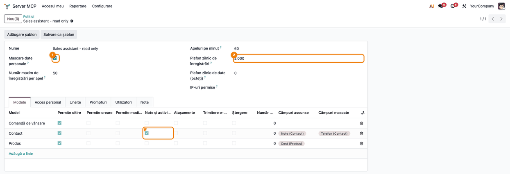

#### Politica dintr-un șablon

În loc să adăugați modelele unul câte unul, pe lista **Server MCP → Configurare → Politici** apăsați **Creare din șablon**,
alegeți unul sau mai multe șabloane și confirmați. Modulul livrează:

| Șablon | Ce poate AI-ul |
|---|---|
| **Suport** | creează și modifică tichete helpdesk (doar titlu, descriere, client, echipă, etapă, responsabil, prioritate), note, atașamente; contactele și taskurile doar le citește |
| **Vânzări** | oportunități, oferte și clienți: creează, modifică, câștigă oportunitatea (`action_set_won`), confirmă oferta (`action_confirm`); marja și costul produsului rămân ascunse, facturile doar citire |
| **Achiziții** | cereri de ofertă și comenzi de achiziție, cu confirmarea lor (`button_confirm`), și prețurile furnizorilor; furnizorii, produsele și recepțiile doar citire |
| **Catalog produse** | creează și completează produse (nume, descrieri, categorii, coduri de bare); costul rămâne ascuns |
| **Prețuri produs** | schimbă doar prețul de vânzare al produsului, regulile listelor de preț și prețurile furnizorilor (preț, discount, cantitate minimă, date) |
| **Stoc (doar citire)** | stocuri, transferuri și mișcări; nu modifică nimic |
| **Contabilitate (doar citire)** | facturi, note contabile, plăți, plan de conturi; nu modifică nimic |
| **Raportare (doar citire)** | totaluri pe vânzări, achiziții și facturi, cu un plafon de 5.000 de înregistrări pe zi; nu modifică nimic |

Niciun șablon livrat nu bifează **Trimitere e-mailuri** sau **Ștergere**. Liniile unui șablon (*Server MCP → Configurare →
Șabloane de politici*) au aceleași coloane ca politica, deci un șablon salvat de administrator le poate avea bifate.

Ce face asistentul:

- modelele, câmpurile și metodele modulelor care nu sunt instalate (de exemplu Helpdesk) se sar și se afișează
  într-o notificare **Neinstalat în această bază de date, omis**; politica se creează cu restul;
- pentru fiecare metodă de buton se folosește unealta existentă sau se creează una nouă (Pasul 4), legată de politică;
- mai multe șabloane alese împreună dau o singură politică: drepturile se adună, câmpurile ascunse și cele doar pentru
  citire se păstrează din toate, iar dintre limite câștigă cea mai strictă.

Pe o politică existentă, **Adăugare șablon** adaugă modelele unui șablon; modelele deja prezente primesc drepturile
șablonului. **Salvare ca șablon** păstrează politica drept șablon nou în **Server MCP → Configurare → Șabloane de politici**, de unde
se poate refolosi la alt utilizator sau la alt client. Șablonul **nu dă drepturi în Odoo**: utilizatorul AI are în
continuare nevoie de grupurile aplicațiilor (Vânzări / Utilizator, Achiziții / Utilizator etc.).

### Pasul 2 — Politica se atribuie utilizatorului AI

**Setări → Utilizatori → utilizatorul AI → Drepturi de acces → Server MCP.** Câmpul **Politică MCP** leagă
utilizatorul de politică. Un utilizator fără politică se poate conecta, dar nu poate folosi nicio
unealtă.

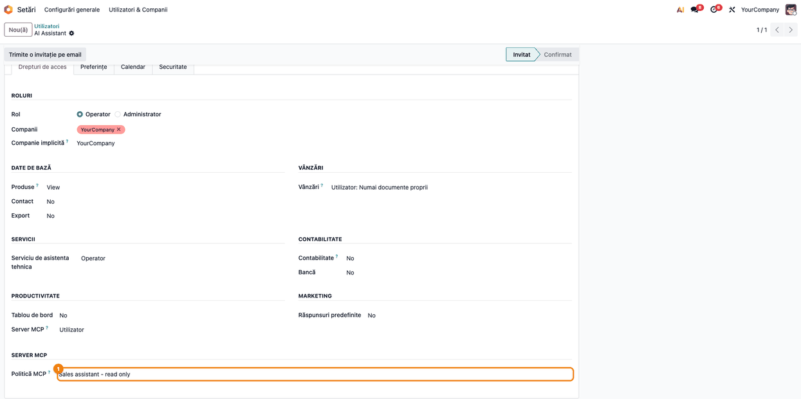

### Pasul 3 — Setările serverului

**Setări → Configurări generale → Integrare → Server MCP.** Aici sunt valorile globale: **Permite clienților AI să scrie** (implicit debifat: serverul e doar-citire și
uneltele de scriere nici nu apar clientului), **Cereri de acces MCP** și **Aprobator acces MCP** (Pasul 9), numărul maxim de înregistrări pe apel, cât se păstrează
jurnalul, auto-înregistrarea OAuth, documentele de metadate ale clienților OAuth, dimensiunea maximă a unui atașament,
gazdele permise pentru OAuth, valabilitatea tokenului de acces (minute) și a conexiunii (zile) și originile
de browser acceptate (clienții AI fără antet `Origin` sunt acceptați oricum).

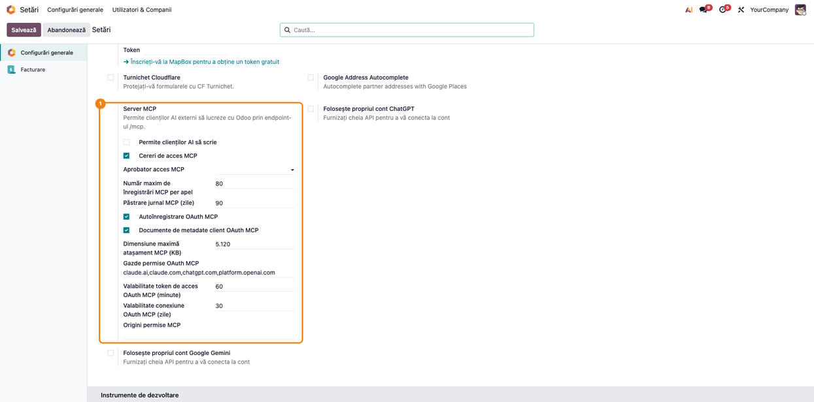

### Pasul 4 — Acțiunile și indicatorii pe care AI-ul îi poate folosi (unelte)

**Server MCP → Configurare → Unelte → Nou(ă).** O unealtă este un buton, o acțiune de server sau un indicator pe care
AI-ul îl poate folosi, la fel cum ar apăsa un om butonul sau ar deschide un raport:

- **Nume unealtă**: numele văzut de AI, cu litere mici, cifre și `_` (ex. `confirm_sale_order`); nu poate fi numele unei
  unelte de bază (`search`, `write` etc.).
- **Tip**: **Metodă de model** (metoda unui buton, ex. `action_confirm` pe *Comandă de vânzare*), **Acțiune server**
  (o acțiune de server existentă; modelul se ia din ea) sau **Agregare** (un indicator, vezi mai jos).
- **Metodă**: se acceptă doar metodele care încep cu `action_` sau `button_` (butoanele din formulare) ori cele
  declarate de model în `_mcp_methods`. Metodele interne, `write`, `unlink` și cele marcate private sunt refuzate.
  Numele metodei se vede în modul developer, trecând cu mouse-ul peste buton.
- **Descriere pentru AI**: ce face unealta și când se folosește, în engleză. De ea depinde dacă AI-ul o alege
  corect.
- **Necesită înregistrări**: AI-ul trebuie să dea id-urile înregistrărilor (aproape întotdeauna bifat).
- **Doar citire**: bifați doar dacă unealta nu modifică nimic. Uneltele care modifică date nu apar cât timp
  serverul e doar-citire (*Permite clienților AI să scrie* debifat).
- **Parametri**: opțional, o schemă JSON pentru valori suplimentare (ex. o notă). Ajung la acțiunea de server
  în `env.context["mcp_arguments"]`; codul poate întoarce date punând un dicționar în variabila `action`.
- **Politici**: politicile în care unealta e activă. Modelul uneltei trebuie să fie și el în politică (cu
  *Permite citire*), dar **nu** e nevoie de *Permite modificare*: AI-ul poate confirma o comandă fără să poată
  modifica liber câmpurile ei.

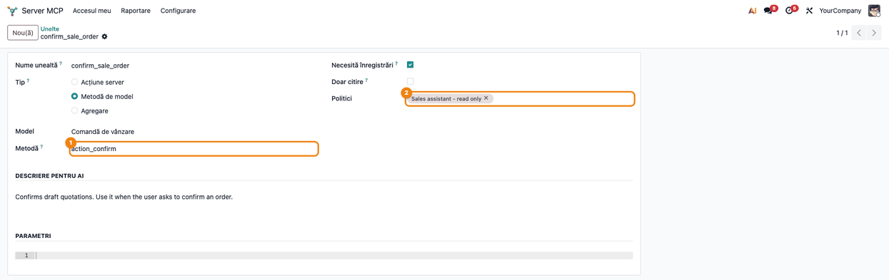

Unealta rulează cu drepturile utilizatorului AI (drepturi pe model, reguli de înregistrare, grupurile acțiunii
de server) și respectă limita de înregistrări pe apel. Dacă butonul deschide o fereastră de dialog (wizard),
apelul este refuzat și ce s-a modificat se anulează; operația se termină în Odoo de un om. Uneltele active
apar și pe tabul *Unelte* al politicii.

#### Indicatori: unelte de tip Agregare

Un indicator dă același răspuns la aceeași întrebare, oricum ar formula-o utilizatorul. Pe formularul uneltei alegeți
**Tip: Agregare**; formularul arată atunci:

- **Model**: modelul numărat (ex. *Comandă de vânzare*);
- **Înregistrări** (domeniul): ce înregistrări intră în indicator, de exemplu ofertele încă neconfirmate (stările
  `draft` și `sent`). Domeniul poate folosi `context_today()`, `relativedelta`, `uid`, `user` și `company_ids` (ex. facturile
  scadente înainte de azi);
- **Grupare după**: câmpurile de grupare, separate prin virgulă (ex. `partner_id`, `invoice_date:month`); gol = un
  singur total;
- **Agregări**: totalurile, separate prin virgulă (ex. `amount_total:sum, __count`).

**Necesită înregistrări**, **Doar citire** și **Parametri** dispar: indicatorul doar citește (apare și cu serverul
doar-citire), iar AI-ul nu primește parametri proprii, ci poate doar **restrânge** indicatorul cu un filtru al lui și
poate limita numărul de grupe. Politica se aplică la fel ca la `aggregate`: un câmp ascuns sau mascat folosit în
indicator este refuzat. Un domeniu, o grupare sau o agregare greșită se refuză la salvare.

Exemplu: `open_quotations_by_customer` pe *Comandă de vânzare*, domeniul `[('state', 'in', ('draft', 'sent'))]`,
**Grupare după** `partner_id`, **Agregări** `amount_total:sum, __count`.

### Pasul 5 — Prompturi: întrebări gata făcute

**Server MCP → Configurare → Prompturi → Nou(ă).** Un prompt este un text pe care utilizatorul îl alege din clientul AI în loc să
îl scrie de fiecare dată:

- **Nume prompt**: numele tehnic, cu litere mici, cifre și `_` (ex. `customer_review`); clientul AI îl arată ca
  și comandă.
- **Titlu**: eticheta afișată în lista de comenzi a clientului (ex. *Customer review*).
- **Politici**: politicile ai căror utilizatori văd promptul. **Lăsat gol, promptul e oferit tuturor utilizatorilor
  cu o politică activă.**
- descrierea, sub titlu: ce face promptul; apare lângă comandă în client.
- tabul **Prompt**: textul trimis AI-ului. `{{customer}}` sau `{{months}}` se înlocuiesc cu valorile completate de
  utilizator.
- tabul **Argumente**: fiecare `{{nume}}` din text trebuie declarat aici (numele începe cu o literă mică), cu o
  descriere pentru utilizator. Bifați **Obligatoriu** dacă e obligatoriu; altfel puteți da o valoare **Implicit** (fără ea,
  un argument lăsat gol devine text gol). Un prompt care folosește un argument nedeclarat nu se poate salva.

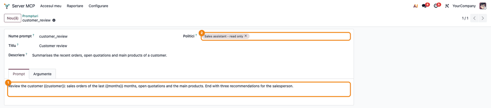

Promptul nu dă AI-ului niciun drept în plus: textul ajunge în conversație ca mesaj al utilizatorului, iar AI-ul
răspunde tot prin uneltele și politica lui. Pe tabul *Prompturi* al politicii apar prompturile legate de ea; cele
fără politică nu apar acolo, deși sunt oferite tuturor.

Cum îl folosește utilizatorul: în **Claude Code** tastează `/` și alege `/mcp__odoo__customer_review` (numele
serverului, apoi al promptului); în **Claude Desktop** și **Claude.ai** promptul e în meniul **+** al conversației,
sub numele conectorului. Clientul cere argumentele și trimite textul completat. Un client conectat înainte de
adăugarea promptului îl vede după reconectare.

### Pasul 6 — Cheia API pentru clientul AI

**Server MCP → Accesul meu → Generare cheie API**, autentificat **ca utilizatorul AI**. Cheia se generează întotdeauna
pentru utilizatorul conectat: dacă o generați din contul dumneavoastră de administrator, AI-ul va lucra
cu drepturile dumneavoastră. Dați un nume cheii, alegeți durata și apăsați **Generare cheie**; Odoo cere
parola utilizatorului. Cheia se arată o singură dată. Cheia este valabilă doar pe `/mcp`, nu și pe XML-RPC.

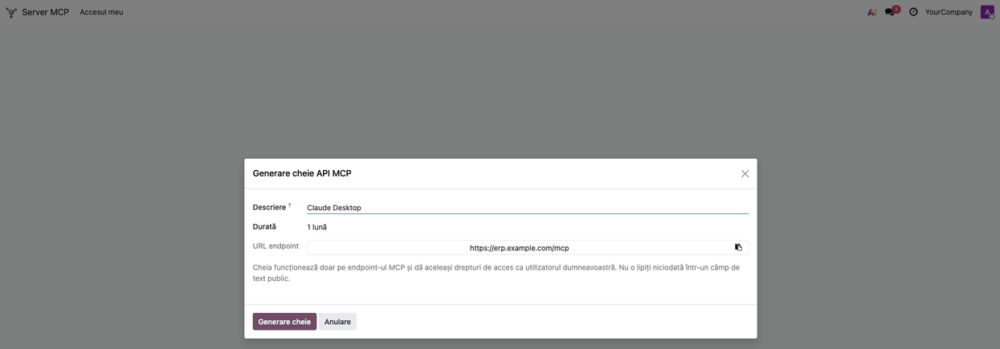

**Cheia în clientul AI.** Clientul primește adresa `https://<odoo-ul-clientului>/mcp` și cheia în antetul
`Authorization: Bearer <cheie>`:

- **Claude Code:**
  `claude mcp add --transport http odoo https://<odoo>/mcp --header "Authorization: Bearer <cheie>"`
- **Cursor**, în `mcp.json`:
  `{"mcpServers": {"odoo": {"url": "https://<odoo>/mcp", "headers": {"Authorization": "Bearer <cheie>"}}}}`

Denumirile din clienții AI se schimbă des; dacă o etichetă diferă, verificați documentația clientului.

### Pasul 7 — Clienți web: aprobarea conexiunii (OAuth)

Claude.ai și ChatGPT nu primesc o cheie lipită de mână. Clientul deschide o pagină Odoo; **utilizatorul AI**
se autentifică și apasă **Permitere**. Dacă aplicația cere și scriere, iar serverul o permite, pagina oferă și
**Doar citire**: aplicația vede atunci doar uneltele de citire. Odoo deschide o conexiune OAuth, vizibilă în
**Server MCP → Accesul meu → Conexiuni OAuth** și revocabilă oricând. Tokenul de acces expiră după o oră și clientul îl
reînnoiește singur; o conexiune nefolosită 30 de zile cere din nou aprobarea. Utilizatorul trebuie să fie în
rolul **Server MCP / Utilizator** și să aibă o politică.

Pregătirea, de făcut o singură dată, de un administrator:

1. `web.base.url` (*Setări → Tehnic → Parametri → Parametri sistem*, în mod developer) trebuie să fie adresa publică HTTPS a
   instanței: documentele OAuth se construiesc din ea, iar clientul merge la acea adresă.
2. În *Setări → Configurări generale → Integrare → Server MCP*, bifați:
   - **Documente de metadate client OAuth MCP**: metoda preferată de specificația MCP, folosită de Claude Code și de
     clienții noi. ID-ul clientului este adresa HTTPS a unei descrieri (nume, adrese de revenire) pe care Odoo o
     citește singur;
   - **Autoînregistrare OAuth MCP**: pentru clienții mai vechi, care se înregistrează singuri.

   În ambele cazuri contează lista *Gazde permise OAuth MCP* (implicit `claude.ai`, `claude.com`, `chatgpt.com`,
   `platform.openai.com`): Odoo citește descrieri și acceptă adrese de revenire HTTPS numai de la aceste gazde.
   Descrierea nu se citește niciodată de la o adresă din rețeaua internă.

Conectarea, de făcut de utilizator în clientul AI:

1. Adăugați un conector personalizat (server MCP) cu adresa `https://<odoo>/mcp`. Lăsați goale ID-ul de client
   și secretul: clientul se înregistrează singur sau se identifică prin documentul lui de metadate.
   - **Claude Code:** `claude mcp add --transport http odoo https://<odoo>/mcp`, fără cheie; la prima folosire
     (comanda `/mcp`) se deschide pagina Odoo de aprobare.
   - **Claude.ai:** *Settings → Connectors → Add custom connector*. Pe planurile Team sau Enterprise, adăugarea
     unui conector poate cere un owner.
   - **ChatGPT:** serverele MCP personalizate funcționează în *Developer mode*. Se activează din *Settings →
     Security and login*; într-un workspace Business, Enterprise sau Edu, un administrator trebuie să permită
     întâi conectorii MCP personalizați. Creați o aplicație sau un conector din serverul MCP, cu numele și adresa de
     mai sus și autentificare **OAuth**, apoi alegeți-l într-o conversație din meniul **+**. ChatGPT cere
     confirmare înainte de o unealtă care modifică date; uneltele de citire (`readOnlyHint`) rulează fără ea.
   - **Aplicația Codex a OpenAI (desktop):** *Plugins → MCPs → Add*, server MCP personalizat, cu un nume și adresa
     de mai sus. Lăsați goale *Bearer token env var* și antetele, salvați și autentificați-vă ca utilizatorul AI pe
     pagina Odoo pe care o deschide aplicația. Pentru o cheie API în loc de OAuth, păstrați cheia într-o variabilă de
     mediu și scrieți numele variabilei în *Bearer token env var*.
2. Clientul deschide pagina Odoo de mai jos. Autentificați-vă **ca utilizatorul AI**, nu ca administrator,
   verificați numele aplicației și adresa la care se revine, apoi apăsați **Permitere**. **Respingere** anulează conexiunea.
3. În client, conectorul e gata de folosit. Conexiunea apare în **Server MCP → Accesul meu → Conexiuni OAuth**, de unde se
   poate revoca. Tokenul de acces expiră după o oră și clientul îl reînnoiește singur; o conexiune nefolosită
   numărul de zile din Setări (30 implicit) expiră, iar clientul cere din nou aprobarea.

Cât timp serverul e doar-citire, pagina spune că aplicația poate doar citi.

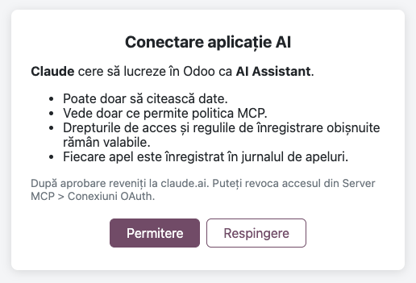

Dacă **Permite clienților AI să scrie** e bifat și aplicația cere și scriere, pagina oferă al treilea buton,
**Doar citire**: aplicația primește doar scope-ul `mcp:read`, nu vede uneltele de scriere, iar o
încercare de scriere apare în jurnal ca *Refuzat*.

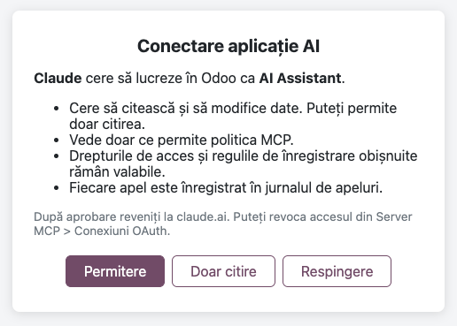

Când clientul folosește un document de metadate (Claude Code), pagina arată și gazda care descrie aplicația.

Dacă o aplicație auto-înregistrată sau descrisă de un document de metadate revine la un program de pe același
calculator (`localhost`, de exemplu Claude Code sau Cursor), pagina afișează un avertisment: orice program de pe
acel calculator ar putea asculta pe o astfel de adresă, deci se apasă **Permitere** doar dacă utilizatorul tocmai a
pornit el conectarea.

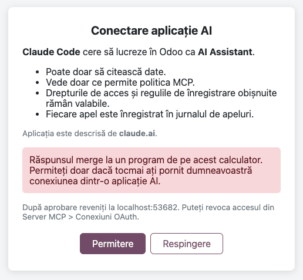

Aplicațiile care se pot conecta sunt cele din **Server MCP → Configurare → Aplicații OAuth**. Cele care se
înregistrează singure apar acolo cu sursa „Autoînregistrat”, iar cele descrise de un document de metadate cu
sursa „Document de metadate” (descrierea se recitește după cel mult o zi). Ambele mecanisme sunt oprite implicit
și acceptă doar gazdele din listă. **Arhivarea** unei aplicații o blochează: Odoo nu o mai acceptă și nu îi mai
citește descrierea.

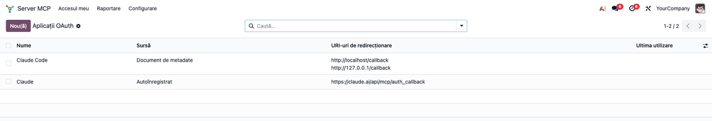

**Server MCP → Accesul meu → Conexiuni OAuth** arată aprobările date: aplicația, utilizatorul, scope-ul (`mcp:read` sau
`mcp:read mcp:write`), când s-a conectat, ultima folosire și până când e valabilă. Fiecare utilizator își vede
și își revocă propriile conexiuni; administratorul le vede pe toate. Conexiunile revocate se văd cu filtrul
**Revocat**, cu motivul: de utilizator, de administrator, de aplicație sau „Refresh token folosit de două ori”, când
același token de reînnoire a fost folosit de două ori (semn că a fost furat).

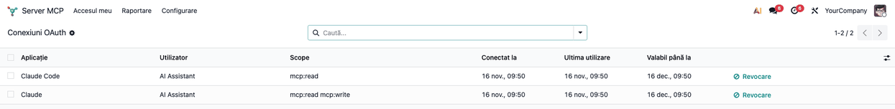

### Pasul 8 — Ce a făcut AI-ul: jurnal și consum

**Server MCP → Raportare → Jurnal apeluri** arată fiecare apel: data, utilizatorul, metoda, unealta, rezultatul și durata
(în secunde). Numele clientului apare pe rândul `initialize` la clienții mai vechi și pe fiecare apel la clienții
care folosesc protocolul MCP 2026-07-28. Deschiderea unui prompt apare ca metodă `prompts/get`, cu numele
promptului. Erorile apar cu roșu (de exemplu o căutare
pe un câmp mascat sau pe un model care nu e în politică); deschideți rândul ca să vedeți mesajul erorii.
Rândurile uneltelor care modifică date au completat câmpul **Modificări**: pentru fiecare
înregistrare, câmpurile modificate cu valoarea veche și cea nouă (la creare, valorile puse; la buton, doar starea
înainte și după; la `unlink`, numele înregistrării șterse; la `send_email`, șablonul și destinatarii). Filtrul
**Cu modificări** le arată doar pe acestea. Jurnalul poate susține obligațiile de
evidență și supraveghere ale celor care folosesc AI (Regulamentul UE 2024/1689, art. 12 și 26), dar nu face
singur un sistem conform.

Apelurile făcute printr-o conexiune OAuth au completată coloana **Aplicație OAuth**, iar o scriere refuzată
pentru că serverul sau conexiunea e doar-citire apare cu galben, cu starea *Refuzat*.
Autentificările refuzate (token greșit sau expirat, utilizator fără rolul *Server MCP / Utilizator*, adresă IP care nu
e în politică) apar în jurnal cu metoda `authentication`, starea *Refuzat*, motivul, adresa și programul care a
apelat (filtrul **Autentificări refuzate**). Un apel fără niciun token nu se jurnalizează: așa pornește orice client
OAuth.

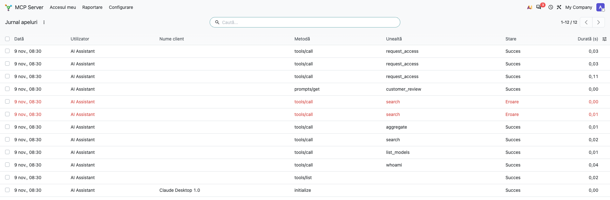

**Server MCP → Raportare → Utilizare zilnică** arată, pe zi și pe utilizator, câte apeluri **reușite** de unelte, înregistrări
și octeți s-au consumat; comparați cu plafonul din politică. Cifra diferă de Jurnal apeluri, care numără toate
apelurile, inclusiv erorile și cele de protocol.

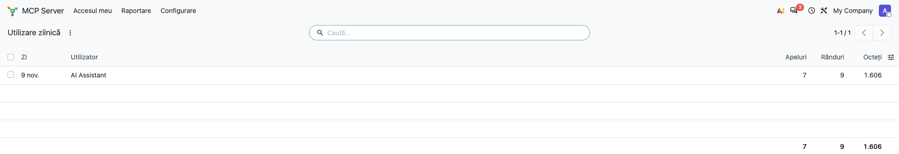

### Pasul 9 — Cereri de acces: acces personal, limitat în timp

Funcția e oprită implicit. Se pornește din *Setări → Configurări generale → Integrare → Server MCP*, cu
**Cereri de acces MCP**. **Aprobator acces MCP** alege cine primește notificarea fiecărei cereri; lăsat gol, o
primesc toți administratorii. Notificarea apare în inbox-ul Discuss, dacă modulul e instalat; altfel cererile se
văd doar în meniu.

**Cererea.** Când AI-ul încearcă un model sau o operație pe care politica nu o dă, răspunsul de refuz îi spune că poate
cere acces cu unealta `request_access`. Excepție: un refuz la creare sau modificare pe `mail.activity`, `mail.message` sau
`mail.followers` (citirea primește refuzul obișnuit) îl trimite la `post_message` / `schedule_activity` pe document
și îi recomandă `request_access` cu operația `chatter` pe modelul documentului (de exemplu `helpdesk.ticket`), nu pe
modelul refuzat. AI-ul trimite modelul, operația, motivul și numărul de zile (7 dacă nu spune altfel). Operațiile sunt:

| Operația în cerere | Ce trimite AI-ul | Ce primește după aprobare |
|---|---|---|
| **Citire** | `read` | citirea modelului |
| **Creare** | `create` | citire și creare |
| **Modificare** | `write` | citire și modificare |
| **Note și activități** | `chatter` | citire și *Note și activități* (doar pe un model cu chatter) |
| **Atașamente** | `attachments` | citire și *Atașamente* (inclusiv tipărirea rapoartelor PDF) |
| **Ștergere** | `delete` | citire și *Ștergere* |
| **Trimitere e-mailuri** | `email` | citire și *Trimitere e-mailuri* (doar pe un model cu chatter) |

Refuzul uneltei `send_email` pe un model fără bifă îi spune AI-ului să ceară operația `email`. Utilizatorul poate face
aceeași cerere din **Server MCP → Accesul meu → Cereri de acces → Nou(ă)**.
Până la aprobare nu se schimbă nimic. Utilizatorul își vede cererile în același meniu, cu sursa (**Client AI** sau
**Odoo**) și starea, și poate anula o cerere cât timp e în așteptare (**Anulare cerere**).

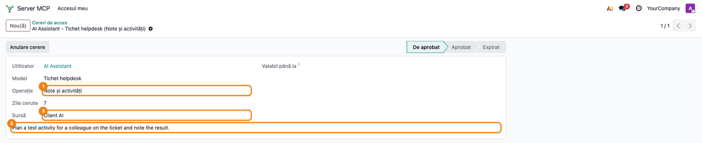

**Lista de aprobat.** Administratorul deschide **Server MCP → Accesul meu → Cereri de acces**. Lista pornește cu filtrul
**De aprobat**. Pe fiecare rând verifică utilizatorul, modelul, operația cerută, câte zile și motivul. Cererile
venite de la AI se găsesc cu filtrul **De la clienții AI**.

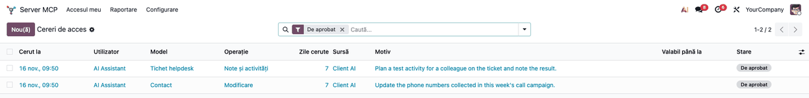

**Aprobarea.** Pe formularul cererii, administratorul poate schimba **Valabil până la** înainte de aprobare. Lăsat gol,
accesul ține numărul de zile cerut, socotit de la aprobare. Apoi apasă **Aprobare** sau **Refuzare**. Câmpul **Politică**
arată politica în care intră accesul.

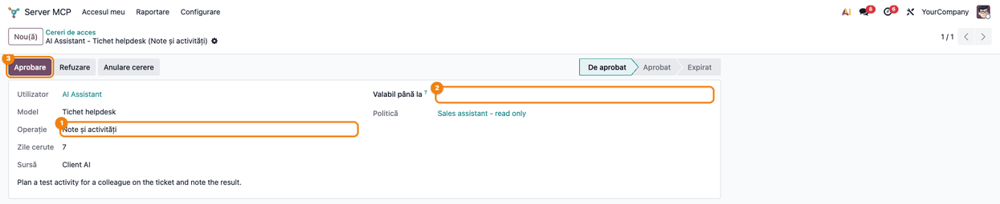

**Accesul aprobat** apare pe politică, în tabul **Acces personal**, ca o linie cu **Doar pentru utilizatorul** și **Valabil până la**,
cu aceleași coloane de drepturi ca tabul *Modele*, inclusiv **Trimitere e-mailuri** și **Ștergere**:

- se aplică doar acelui utilizator; ceilalți utilizatori ai politicii nu primesc nimic;
- pentru acel utilizator înlocuiește linia politicii pentru modelul respectiv. Dacă modelul era deja în politică
  (de exemplu doar citire), linia personală preia câmpurile ascunse, mascate și doar pentru citire de acolo și adaugă doar
  dreptul cerut;
- o a doua cerere aprobată pe același model completează aceeași linie: drepturile se adună, iar data de final
  rămâne cea mai târzie;
- la **Valabil până la** accesul se oprește singur, chiar dacă linia mai e vizibilă până la curățarea zilnică;
- **Revocare** pe cerere oprește accesul imediat și șterge linia.

Din clientul AI, `list_models` arată modelul cu `valid_until` și, pe fiecare model, drepturile efective (`delete`,
`email` etc.).

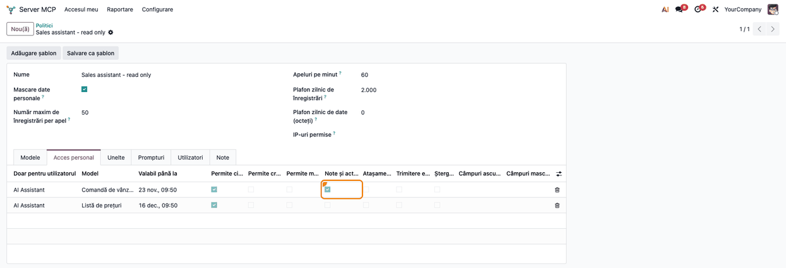

Drepturile Odoo ale utilizatorului rămân limita:

- nu se poate cere un model pe care utilizatorul nu îl poate deschide în Odoo;
- nu se pot cere modelele de sistem (`ir.*`, cheile API, grupurile);
- cât timp serverul e doar-citire, clientul AI (`request_access`) poate cere doar **Citire** și **Atașamente**;
  celelalte operații (creare, modificare, note și activități, ștergere, trimitere e-mailuri) îi sunt refuzate. O cerere
  făcută de utilizator din meniu nu are această verificare, deci administratorul o judecă la aprobare;
- **Note și activități** și **Trimitere e-mailuri** se pot cere doar pe un model cu chatter; altfel răspunsul e
  „The model … has no chatter.”;
- același acces nu poate aștepta de două ori, iar un utilizator are cel mult cinci cereri în așteptare.

Dacă utilizatorul trece pe altă politică, accesul personal rămâne pe politica veche și nu i se mai aplică.

### Pasul 10 — Glosarul: termenii afacerii

AI-ul deduce singur ce înseamnă „ofertă deschisă” sau „client activ” și poate răspunde diferit de la o întrebare la
alta. **Server MCP → Configurare → Glosar → Nou(ă)** păstrează sensul stabilit în firmă:

- **Termen**: cuvântul folosit în firmă (ex. *Open quotation*);
- **Sinonime**: alte cuvinte pentru același lucru, separate prin virgulă;
- **Model**: opțional, modelul la care se referă termenul;
- **Definiția pentru AI**: ce înseamnă termenul și cum se găsește în Odoo, scris pentru AI;
- **Domeniu exemplu**: apare doar cu un model ales; filtrul care găsește înregistrările termenului, dat AI-ului ca
  exemplu. **Nu lărgește** ce poate citi AI-ul.

AI-ul citește termenii cu unealta `glossary`, care apare **doar când glosarul are cel puțin un termen activ**. Un termen
legat de un model se arată doar conexiunilor care pot citi acel model (în politică și în drepturile Odoo); un termen
fără model se arată tuturor. Termenii se pot arhiva, ordona prin tragere și grupa pe model.

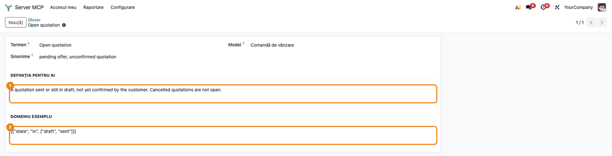

### Primele întrebări în clientul AI

Ecranul de aici e al clientului AI, nu al Odoo, deci nu are captură. Ca test, întrebați: „Cine sunt eu în Odoo și
ce modele poți folosi?” (`whoami`, `list_models`), „Arată-mi zece contacte cu numele și țara” (`search`),
„Câte comenzi de vânzare avem pe stări?” (`aggregate` sau `count`) și „Găsește clientul Northwind” (`name_search`). Cu
unealta din Pasul 4: „Confirmă ofertele lui Northwind din săptămâna asta” (AI-ul caută ofertele, apoi apelează
`confirm_sale_order` cu id-urile lor). Cu promptul din Pasul 5: alegeți `customer_review` din lista de comenzi și
completați numele clientului. Cu glosarul din Pasul 10: „Câte oferte deschise avem?” (AI-ul citește întâi termenul).
Câmpurile mascate vin ca `***`, iar un filtru sau un total pe ele este refuzat.

### Uneltele pe care le vede clientul AI

Citire, mereu: `whoami`, `list_models`, `describe_model`, `search`, `count`, `name_search`, `read`, `aggregate`.
`name_search` caută o înregistrare după nume, ca autocompletarea unui câmp, dar doar pe câmpurile de nume pe care
politica le arată: un CUI mascat sau un e-mail ascuns nu răspund. `glossary` apare când glosarul are termeni (Pasul 10),
iar `request_access` când cererile de acces sunt pornite (Pasul 9).

Scriere, doar când este activată în Setări: cu **Permite creare**, `create` (și cu o listă de înregistrări),
`find_or_create` și `copy`; cu **Permite modificare**, `write`; cu **Ștergere**, `unlink`; cu **Trimitere e-mailuri**,
`send_email`. `unlink` și `send_email` lipsesc din listă cât timp niciun model al politicii nu are bifa lor, iar
`send_email` cere și modulul Discuss (`mail`). Ștergerea nu se poate anula: descrierea uneltei îi cere AI-ului să
obțină confirmarea utilizatorului și să prefere arhivarea.

Câmpurile de tip linii (one2many, many2many), câmpul de stare (`state`) și câmpurile calculate de Odoo nu se pot scrie
prin MCP: o ofertă se confirmă doar prin unealta de tip buton (Pasul 4), ca o comandă să treacă prin aceleași
verificări ca atunci când apasă un om butonul. Alte câmpuri pe care AI-ul le vede, dar nu are voie să le schimbe, se
pun în coloana **Câmpuri doar pentru citire** a liniei din politică (de exemplu `active`, ca AI-ul să nu poată arhiva).
Refuzul apare în *Jurnal apeluri* cu starea *Refuzat*, iar `describe_model` arată pentru fiecare câmp dacă se poate
scrie (`writable`).

Pe modelele unde linia din politică are bifat **Note și activități** (și scrierea e permisă din Setări),
AI-ul mai vede două unelte:

- `post_message`: o notă internă în chatter, text simplu, care nu se trimite urmăritorilor sau clientului;
- `schedule_activity`: o activitate (To-Do, apel, întâlnire), cu termen și utilizator responsabil (implicit
  utilizatorul AI).

Ambele rulează cu drepturile utilizatorului conectat: Odoo cere același drept ca atunci când un om scrie pe
înregistrare (de regulă dreptul de modificare). Uneltele cer modulul Discuss (`mail`). Fără bifă, cele două unelte
lipsesc, iar `list_models` arată `notes_and_activities: false` pe model; refuzurile îi spun AI-ului ce bifă lipsește
și, cu cererile de acces pornite, să ceară operația `chatter` (Pasul 9).

Pe modelele cu **Trimitere e-mailuri** bifat, `send_email` trimite un e-mail dintr-un **șablon de e-mail al modelului**
(*Setări → Tehnic → Șabloane e-mail*), ca butonul *Trimite* al documentului: e-mailul pleacă efectiv la destinatari, iar
mesajul apare în chatter. Fără numele șablonului, AI-ul primește lista șabloanelor modelului și alege unul. Se cere
același drept ca atunci când un om trimite de pe document.

Pe modelele cu **Atașamente** bifat, AI-ul mai vede, chiar dacă serverul e doar-citire:

- `list_attachments`: fișierele atașate unei înregistrări (nume, tip, mărime, dacă se poate citi);
- `read_attachment`: conținutul unui fișier: text ca text, imaginile ca imagini, PDF-urile și restul ca fișier
  inclus în răspuns;
- `print_report`: un raport PDF al modelului (ofertă, factură, aviz), primit ca fișier; fără numele raportului, AI-ul
  primește lista rapoartelor PDF pe care utilizatorul le poate tipări. Raportul **arată câmpurile așa cum sunt, fără
  măștile politicii**, și **nu se salvează** pe document;

iar cu scrierea permisă și `attach_file`, care atașează pe o înregistrare un fișier trimis de AI.

Se servesc doar fișierele atașate înregistrărilor și rapoartele, niciodată conținutul câmpurilor binare (de exemplu
poza produsului). Se aplică drepturile utilizatorului pe înregistrare și pe fișier. Fișierele și rapoartele mai mari
decât *Dimensiune maximă atașament MCP (KB)* din Setări (implicit 5 MB) nu se trimit; octeții citiți intră în plafonul
zilnic de date al politicii.

În plus, AI-ul vede uneltele din *Server MCP → Configurare → Unelte* active în politica lui (Pasul 4), cu descrierea și
parametrii lor, iar utilizatorul vede prompturile din *Server MCP → Configurare → Prompturi* (Pasul 5). Când e posibil,
preferați o unealtă (un buton anume) în locul lui `write` pe tot modelul.

### Mai multe companii

Dacă utilizatorul AI are mai multe companii, `whoami` le listează, cu moneda fiecăreia. AI-ul trimite atunci
`company_id` la `search`, `count`, `name_search`, `read`, `aggregate`, `create`, `find_or_create`, `write` și
`list_attachments` ca să lucreze într-o singură companie, la fel ca la alegerea companiei din bara web. Fără
`company_id`, citirea acoperă toate companiile utilizatorului (totalurile amestecă firme și monede), iar
înregistrările noi ajung în compania principală a utilizatorului. O companie care nu e a utilizatorului este refuzată.

### Monitorizare

`GET https://<instanța>/mcp/health` răspunde `{"status": "ok", ...}` când Odoo și baza de date funcționează. Nu
cere cheie și nu întoarce date, deci poate fi apelat de un monitor de disponibilitate (Uptime Kuma, Better Stack
etc.).

## 7. Legături cu alte module / declarații

| Element | Rol |
|---|---|
| Drepturile și regulile de acces Odoo | se aplică mereu peste politică |
| Acțiunile de server (*Setări → Tehnic → Acțiuni server*) | pot fi expuse ca unelte |
| Rapoartele PDF ale modelelor (*Setări → Tehnic → Rapoarte*) | pot fi tipărite de AI cu `print_report`, pe modelele cu *Atașamente* |
| Discuss (`mail`) | dacă e instalat, aprobatorul primește notificarea cererilor în inbox; necesar pentru note, activități și `send_email`; nu e o dependență |
| Șabloanele de e-mail (`mail.template`) | `send_email` trimite doar din șabloanele modelului |
| Modulul Odoo AI (Enterprise) | nu e necesar; în Odoo 20 Enterprise există un server MCP propriu, pe aceeași adresă `/mcp` |

**Ce e automat:** mascarea datelor personale, limitele, jurnalul, curățarea jurnalului, expirarea cheilor, citirea și
reîmprospătarea descrierii aplicațiilor OAuth cu document de metadate, notificarea cererilor de acces, oprirea și
ștergerea accesului personal expirat, verificarea indicatorilor la salvare, afișarea uneltei `glossary` cât timp
glosarul are termeni.
**Ce rămâne manual:** alegerea modelelor, câmpurilor, drepturilor (mai ales *Ștergere* și *Trimitere e-mailuri*),
uneltelor, indicatorilor și prompturilor, scrierea termenilor din glosar, atribuirea politicii, aprobarea sau refuzul
fiecărei cereri de acces, configurarea clientului AI.

## 8. Verificări pentru consultant

- [ ] Utilizatorul AI are rolul **Server MCP / Utilizator** și o politică activă.
- [ ] Politica conține doar modelele necesare; câmpurile sensibile sunt ascunse sau mascate.
- [ ] Politica făcută din șablon: notificarea arată ce s-a sărit; utilizatorul AI are grupurile aplicațiilor
  din șablon; uneltele create pentru butoane apar pe tabul *Unelte* al politicii.
- [ ] Cu *Doar acestea modificabile* (ex. șablonul *Prețuri produs*): `write` pe `list_price` merge, pe `name` e refuzat
  (*Refuzat* în Jurnal apeluri), iar `describe_model` arată doar câmpurile din listă ca `writable`.
- [ ] **Permite clienților AI să scrie** este debifat în Setări pe durata testelor.
- [ ] Cheia a fost generată din contul **utilizatorului AI**, nu din cel de administrator.
- [ ] Din clientul AI, `whoami` arată utilizatorul AI, nu un administrator.
- [ ] O căutare pe un model din politică întoarce înregistrări; pe un model din afara politicii întoarce eroare.
- [ ] CUI/VAT apare ca `***`, iar o căutare filtrată pe VAT este refuzată.
- [ ] `count` pe un model din politică întoarce același număr ca lista din Odoo filtrată la fel.
- [ ] `name_search` găsește un client după nume; pe un model al cărui nume e ascuns sau mascat în politică e refuzat.
- [ ] Cu scrierea permisă și *Permite creare*: `create` cu o listă de două înregistrări le creează pe amândouă; o listă
  mai lungă decât numărul maxim per apel e refuzată; `find_or_create` cu un filtru care găsește un client nu creează
  altul; `copy` creează un duplicat.
- [ ] **Ștergere** și **Trimitere e-mailuri** sunt debifate pe toate liniile, mai puțin unde clientul le-a cerut explicit;
  fără ele, `unlink` și `send_email` nu apar în lista uneltelor.
- [ ] Cu *Ștergere* bifat pe un model de test: `unlink` șterge înregistrarea, iar în Jurnal apeluri rândul are
  numele înregistrării șterse în *Modificări*.
- [ ] Cu *Trimitere e-mailuri* bifat (testat pe o ofertă cu destinatar de test, nu pe un client real): `send_email` fără
  șablon întoarce lista șabloanelor; cu șablon, e-mailul apare în chatter și în coada de e-mailuri.
- [ ] Cu *Atașamente* bifat: `print_report` pe o ofertă întoarce PDF-ul; PDF-ul nu apare ca atașament pe ofertă; un câmp
  mascat în politică apare necenzurat în PDF (deci *Atașamente* rămâne doar pe modelele potrivite).
- [ ] Cu *Atașamente* și scrierea permisă: `attach_file` pune fișierul pe înregistrare; cu serverul doar-citire unealta
  lipsește, dar `print_report` rămâne.
- [ ] Uneltele active în politică au modelul în politică și o descriere clară; doar cele care nu modifică nimic sunt
  bifate *Doar citire*.
- [ ] Din clientul AI, o unealtă de tip buton (ex. `confirm_sale_order`) schimbă starea înregistrării; o unealtă
  care nu e în politică nu apare în lista clientului.
- [ ] Un indicator (*Tip: Agregare*) activ în politică întoarce aceleași totaluri ca lista din Odoo grupată la fel;
  apare și cu serverul doar-citire; un câmp ascuns sau mascat în agregări sau grupare e refuzat.
- [ ] Un buton care deschide un wizard este refuzat și înregistrarea rămâne neschimbată.
- [ ] `write` cu `state` (ex. `{"state": "sale"}` pe o ofertă) e refuzat și apare *Refuzat* în Jurnal apeluri; oferta rămâne neconfirmată.
- [ ] Cu *Note și activități* bifat: „pune o notă pe client” apare ca notă internă în chatter, autor utilizatorul AI; o
  activitate planificată apare la utilizatorul ales, cu termenul cerut.
- [ ] Un prompt fără politici apare la toți utilizatorii MCP care au o politică activă; unul legat de o politică apare
  doar utilizatorilor ei.
- [ ] Din Claude Code, `/mcp__odoo__<prompt>` cere argumentele declarate și trimite textul completat; în Jurnal apeluri
  apare rândul `prompts/get`.
- [ ] Fără termeni în glosar, `glossary` lipsește din lista uneltelor; după primul termen apare.
- [ ] Un termen legat de un model din afara politicii nu apare în răspunsul `glossary`; un termen fără model apare.
- [ ] Cu *Cereri de acces MCP* bifat: un model din afara politicii întoarce un refuz care pomenește `request_access`;
  după `request_access` cererea apare în *Cereri de acces* cu sursa *Client AI*, iar aprobatorul (sau administratorii)
  are o notificare în inbox.
- [ ] Înainte de aprobare modelul cerut rămâne refuzat; după **Aprobare** utilizatorul îl poate folosi, iar un alt
  utilizator al aceleiași politici nu.
- [ ] Accesul personal pe un model deja în politică păstrează câmpurile ascunse și mascate ale politicii.
- [ ] După **Revocare** (sau după *Valabil până la*) modelul e refuzat din nou.
- [ ] Cu serverul doar-citire, o cerere `request_access` din clientul AI pentru *Modificare*, *Note și activități*,
  *Ștergere* sau *Trimitere e-mailuri* e refuzată; una de *Citire* sau *Atașamente* trece.
- [ ] O cerere aprobată cu operația *Note și activități* dă o linie personală cu citire și *Note și activități*:
  `post_message` și `schedule_activity` apar abia după aprobare. Cu *Atașamente*, la fel pentru `list_attachments` și
  `print_report`; cu *Ștergere*, pentru `unlink`; cu *Trimitere e-mailuri*, pentru `send_email`.
- [ ] Un `send_email` refuzat pentru lipsa bifei, cu cererile de acces pornite, îi recomandă AI-ului operația `email`.
- [ ] Un `create` pe `mail.activity` e refuzat cu îndrumarea spre `post_message` / `schedule_activity` și spre bifa
  *Note și activități* din politică; cu *Cereri de acces MCP* bifat, refuzul recomandă `request_access` cu
  operația `chatter` pe modelul documentului.
- [ ] Apelurile apar în **Jurnal apeluri**; consumul apare în **Utilizare zilnică**.
- [ ] La Codex (OpenAI): conectorul se adaugă din *Plugins → MCPs*; după conectare, „Codex” apare în *Conexiuni OAuth*.
- [ ] La ChatGPT: *Developer mode* este activat (și permis de administratorul workspace-ului, dacă e cazul), iar conectorul
  folosește autentificare **OAuth**.
- [ ] La OAuth: `web.base.url` este adresa publică HTTPS și *Autoînregistrare OAuth MCP* este bifat.
- [ ] La OAuth: după **Revocare** în *Conexiuni OAuth*, clientul primește 401 și cere din nou aprobarea.
- [ ] La OAuth: pagina de consimțământ arată numele aplicației și adresa la care se revine; după **Permitere** conexiunea apare în *Conexiuni OAuth*, cu scope-ul aprobat.
- [ ] La OAuth cu scriere permisă: după **Doar citire**, clientul nu vede uneltele de scriere, iar o încercare de scriere apare în *Jurnal apeluri* cu starea *Refuzat*.
- [ ] La OAuth: după o oră clientul continuă să lucreze fără o nouă aprobare (tokenul se reînnoiește singur).
- [ ] La Claude Code prin OAuth: *Documente de metadate client OAuth MCP* e bifat; după conectare, *Aplicații OAuth*
  conține „Claude Code” cu sursa „Document de metadate”, iar pagina de consimțământ a afișat avertismentul localhost.
- [ ] O aplicație arhivată în *Aplicații OAuth* nu mai poate cere acces.

## 9. Mesaje de eroare frecvente

Mesajele către clientul AI ajung în limba utilizatorului AI; mai jos sunt în engleză, ca în jurnal la un utilizator cu
interfața în engleză.

| Mesaj | Cauză | Remediere |
|---|---|---|
| No MCP policy is assigned to your user | Utilizatorul nu are politică | Atribuiți politica pe formularul utilizatorului |
| The model … is not available for read/create/write/unlink | Modelul nu e în politică sau operația nu e bifată (`unlink` = *Ștergere*) | Adăugați modelul în politică sau, pentru un singur utilizator, aprobați o cerere de acces (Pasul 9) |
| … has no access to this model in Odoo: MCP cannot give more than that. | Cererea e pentru un model pe care utilizatorul nu îl poate deschide în Odoo | Dați întâi utilizatorului grupul aplicației, apoi refaceți cererea |
| The same access is already waiting for approval. | Aceeași cerere (utilizator, model, operație) e deja în așteptare | Aprobați sau refuzați cererea existentă |
| Too many requests are waiting for approval. Wait for the answer. | Utilizatorul are cinci cereri în așteptare | Decideți asupra cererilor existente |
| operation must be read, create, write, chatter, attachments, delete or email. | `request_access` a primit o operație necunoscută | AI-ul refă cererea cu una dintre operațiile listate (`chatter` pentru *Note și activități*, `delete` pentru *Ștergere*, `email` pentru *Trimitere e-mailuri*) |
| company_id must be a company id (see whoami). / The company … is not one of your companies (see whoami). | AI-ul a trimis un id greșit sau o companie care nu e a utilizatorului | AI-ul ia id-ul companiei din `whoami`; dați utilizatorului compania, dacă e cazul |
| This model cannot be asked for. | Model de sistem sau inexistent | Nu se poate expune prin MCP |
| No MCP policy is assigned to the user. Ask an administrator for one first. | Cererea vine de la un utilizator fără politică | Atribuiți întâi o politică |
| Only an administrator can decide on MCP access requests. | Aprobarea a fost încercată de un ne-administrator | Aprobarea o face un administrator |
| The end of the access must be in the future. | *Valabil până la* e în trecut | Corectați data sau lăsați câmpul gol |
| The field … is not available / cannot be used in filters | Câmpul e ascuns sau mascat | Scoateți-l din lista de câmpuri ascunse/mascate, dacă e legitim |
| The name of … cannot be searched through MCP. | `name_search` pe un model al cărui câmp de nume e ascuns sau mascat în politică | Folosiți `search` pe alt câmp sau faceți vizibil câmpul de nume, dacă e legitim |
| Create at most … records in one call. | `create` cu o listă mai lungă decât numărul maxim de înregistrări per apel | AI-ul împarte lista sau măriți limita din politică |
| domain must say which record to find. | `find_or_create` fără filtru | AI-ul trimite un filtru (ex. după nume sau CUI) |
| Sending emails is not allowed on … | Linia modelului nu are bifat *Trimitere e-mailuri* | Bifați-l pe linia modelului sau, cu *Cereri de acces MCP* bifat, aprobați cererea cu operația `email` |
| The model … has no email template. | Modelul nu are niciun șablon de e-mail | Creați un șablon pentru model în *Setări → Tehnic → Șabloane e-mail* |
| The model … cannot send emails. | Discuss nu e instalat sau modelul nu are chatter | Instalați Discuss sau nu bifați opțiunea pe acest model |
| Choose the email template. Available: … | `send_email` fără șablon sau cu un nume greșit | Normal: AI-ul alege un șablon din listă |
| Attachments and reports are not allowed on … | Linia modelului nu are bifat *Atașamente* | Bifați-l pe linia modelului sau aprobați o cerere `attachments` |
| The model … has no PDF report. | Modelul nu are rapoarte PDF pe care utilizatorul să le poată tipări | Normal; verificați grupurile raportului |
| Choose the report. Available: … | `print_report` fără raport sau cu un nume greșit | Normal: AI-ul alege un raport din listă |
| content must be the file encoded in base64. | `attach_file` cu un conținut care nu e base64 | Problema e la clientul AI; refaceți cererea |
| The domain of the tool is not valid: … (la salvarea uneltei) | Domeniul indicatorului are o greșeală sau un câmp inexistent | Corectați domeniul |
| Unknown field … in Group by. (la salvarea uneltei) | Un câmp din *Grupare după* nu există pe model | Corectați numele tehnic al câmpului |
| Invalid aggregate …: write field:function, e.g. amount_total:sum. / Give at least one aggregate, e.g. __count. | *Agregări* greșite sau goale | Scrieți `câmp:funcție` (sum, avg, min, max, count...) sau `__count` |
| An aggregate tool has no parameters: the AI narrows it with a domain. | S-au completat *Parametri* pe un indicator | Goliți *Parametri* |
| The model … cannot be used through MCP. (la salvarea uneltei sau a termenului de glosar) | Model de sistem | Alegeți un model de business |
| The daily data budget of this connection is used up | S-a atins plafonul zilnic | Măriți plafonul politicii sau așteptați ziua următoare |
| Rate limit exceeded, retry in a minute | Prea multe apeluri pe minut | Măriți limita din politică |
| The server is in read-only mode | Scrierea e oprită global | Bifați *Permite clienților AI să scrie* în Setări, doar dacă e nevoie |
| The field … is set by Odoo or by the workflow | AI-ul a încercat să scrie starea, un câmp calculat sau unul din *Câmpuri doar pentru citire* | Expuneți butonul potrivit ca unealtă (Pasul 4) sau scoateți câmpul din *Câmpuri doar pentru citire* |
| Neinstalat în această bază de date, omis (notificare la *Creare din șablon*) | Șablonul conține modele, câmpuri sau metode ale unor module neinstalate | Normal; dacă e nevoie de ele, instalați modulul și aplicați din nou șablonul cu *Adăugare șablon* |
| Notes and activities are not allowed on … | Linia modelului din politică nu are bifat *Note și activități*; mesajul numește politica și linia | Bifați-l pe linia modelului sau, cu *Cereri de acces MCP* bifat, aprobați cererea `request_access` cu operația `chatter` |
| The model mail.activity (mail.message, mail.followers) is not available for create/write | AI-ul a încercat să creeze direct activitatea sau mesajul | Normal: mesajul îl trimite la `post_message` / `schedule_activity` pe document; bifați *Note și activități* pe linia modelului documentului |
| The model … has no chatter. | Cerere *Note și activități* sau *Trimitere e-mailuri* (ori notă/activitate) pe un model fără chatter | Cereți opțiunea pe modelul documentului care are chatter |
| The user is not allowed to use the MCP server (HTTP 403) | Utilizatorul nu are rolul Server MCP / Utilizator | Atribuiți rolul **Utilizator** |
| The field … cannot be written through MCP | Câmpul e mascat, ascuns sau de tip linii | Scrieți alt câmp; câmpurile de tip linii nu se pot scrie |
| Only methods starting with action_ or button_ … can be used as tools | Metoda nu e un buton sau nu e declarată în `_mcp_methods` | Alegeți metoda butonului (`action_…`/`button_…`) sau o acțiune de server |
| The method … cannot be called on … | Metoda nu există pe model sau e privată | Verificați numele metodei în modul developer |
| The name … is used by a built-in tool | Numele uneltei e rezervat | Alegeți alt nume |
| The action opens a dialog (…) that needs a person | Butonul deschide un wizard | Operația se face în Odoo; modificarea a fost anulată |
| Unknown tool: … (eroare de protocol) | Unealta nu e în politică, e arhivată sau modelul ei lipsește din politică | Activați unealta în politică și adăugați modelul |
| Missing arguments / Unknown arguments | Parametrii trimiși nu corespund schemei uneltei | Corectați *Parametri* sau descrierea pentru AI |
| Unknown model. | Numele modelului nu există | Verificați numele tehnic cu `list_models` |
| This address is not allowed by the MCP policy | IP în afara listei politicii | Adăugați adresa în *IP-uri permise* |
| 401 pe `/mcp` | Cheie greșită, ștearsă sau expirată | Generați o cheie nouă (sau reconectați clientul OAuth) |
| Dynamic client registration is disabled. (HTTP 403) | Auto-înregistrarea OAuth e oprită | Bifați *Autoînregistrare OAuth MCP* în Setări |
| The host … is not in the list of allowed OAuth hosts | Clientul se înregistrează de la o gazdă nelistată | Adăugați gazda în *Gazde permise OAuth MCP* |
| Your user is not enabled for MCP (pagina OAuth) | Lipsește rolul sau politica | Atribuiți rolul **Utilizator** și o politică |
| The redirect address is not registered for this application | Adresa de revenire nu e a aplicației | Verificați aplicația în *Aplicații OAuth* |
| Unknown application. (pagina OAuth) | La Claude Code: *Documente de metadate client OAuth MCP* nu e bifat. Altfel: aplicația adăugată manual sau auto-înregistrată a fost arhivată ori ștearsă (cele auto-înregistrate și nefolosite niciodată se șterg automat după 30 de zile) | Bifați opțiunea, dezarhivați aplicația sau reconectați clientul AI |
| The metadata document of the application is not available / answered with HTTP … | Odoo nu poate citi descrierea aplicației (rețea, firewall) | Verificați că serverul Odoo poate face cereri HTTPS spre gazda aplicației |
| The metadata document does not describe this client id / has no redirect_uris | Descrierea publicată de aplicație e greșită | Problema e la furnizorul clientului AI; folosiți între timp cheia API |
| The host … is not a public address / cannot be resolved | Gazda aplicației duce la o adresă din rețeaua internă sau nu există | Nu se acceptă; verificați lista *Gazde permise OAuth MCP* |
| The client id is not a valid metadata document URL / The metadata document is too large / is not valid JSON / has no client_name | Descrierea aplicației nu poate fi folosită | Problema e la furnizorul clientului AI; folosiți între timp cheia API |
| A prompt with this name already exists. | Numele promptului e deja folosit | Alegeți alt nume sau modificați promptul existent |
| This application is blocked. | Aplicația cu sursa „Document de metadate” e arhivată în *Aplicații OAuth* | Dezarhivați-o, dacă e de încredere |
| The prompt uses undeclared arguments: … | Textul are un `{{nume}}` care nu e pe tabul *Argumente* | Declarați argumentul sau scoateți-l din text |
| The prompt name / argument name may contain only lowercase letters… | Nume cu majuscule, spații sau diacritice | Folosiți litere mici, cifre și `_` |
| Unknown prompt / Missing argument (în clientul AI) | Promptul nu e oferit politicii utilizatorului sau un argument obligatoriu e gol | Adăugați politica pe prompt; completați argumentul |

## 10. Capturi de ecran

Capturile sunt **generate automat** din `tests/test_screenshots.py` (mixinul `ScreenshotCase` din
`deltatech_doc_screenshots`, prin puntea `l10n_ro_doc_screenshots`, import defensiv), cu date de demo. Cele în
**română**, folosite de fișă, stau în `static/description/`; aceleași ecrane în engleză, pentru `USAGE.md`, stau în
`static/description/en/`, cu aceleași nume.

| Fișier | Ce arată |
|---|---|
| `01_policy_form.png` | politica: limite, tabul *Modele* cu *Note și activități* bifat pe *Contact*, *Trimitere e-mailuri* și *Ștergere* debifate, câmpuri ascunse și mascate |
| `02_user_policy.png` | politica atribuită pe formularul utilizatorului |
| `03_settings.png` | setările Server MCP |
| `04_key_wizard.png` | generarea cheii API |
| `05_oauth_consent.png` | pagina de consimțământ OAuth |
| `06_oauth_applications.png` | aplicațiile OAuth |
| `07_call_log.png` | jurnalul apelurilor |
| `08_daily_usage.png` | consumul zilnic |
| `09_tool_form.png` | o unealtă: butonul *Confirm* de pe ofertă, activ în politică |
| `10_prompt_form.png` | un prompt: textul cu `{{customer}}` și `{{months}}`, oferit politicii de vânzări (argumentele sunt pe tabul *Argumente*) |
| `11_oauth_consent_metadata.png` | consimțământ pentru Claude Code: gazda care descrie aplicația și avertismentul localhost |
| `12_oauth_consent_write.png` | consimțământ cu alegerea „Doar citire”, când aplicația cere și scriere |
| `13_oauth_connections.png` | conexiunile OAuth: aplicația, utilizatorul, scope-ul, ultima folosire, butonul Revocare |
| `14_access_request_user.png` | cererea făcută de clientul AI, văzută de utilizator: operația *Note și activități* pe tichetele helpdesk, motivul și sursa *Client AI* |
| `15_access_requests_to_approve.png` | cererile care așteaptă aprobarea (filtrul *De aprobat*): *Note și activități* și *Modificare* |
| `16_access_request_approve.png` | cererea deschisă de administrator: operația *Note și activități*, *Valabil până la* și butonul *Aprobare* |
| `17_policy_personal_access.png` | tabul *Acces personal* al politicii: accesul aprobat doar pentru utilizatorul AI (*Note și activități* pe oferte, citire pe liste de prețuri), cu data de final și coloanele *Trimitere e-mailuri* și *Ștergere* |
| `18_glossary_form.png` | un termen de glosar: *Open quotation*, cu sinonime, model, definiția pentru AI și domeniul exemplu |

Formularul unei unelte de tip *Agregare* (Pasul 4) nu are încă o captură.

Regenerare (ambele limbi):

```bash
./odoo/odoo-bin -c odoo.conf -d <db> -i deltatech_mcp_server,l10n_ro_doc_screenshots,sale,helpdesk \
    --test-tags=/deltatech_mcp_server:TestMcpScreenshots --stop-after-init
```

## 11. Observații pentru manual

- Insistați pe ideea că AI-ul vede **numai ce permite politica** și numai ce ar vedea și utilizatorul respectiv.
- Șabloanele sunt un punct de plecare: după *Creare din șablon* verificați politica (câmpuri ascunse, limite)
  pentru clientul respectiv.
- Serverul este **doar-citire** implicit; scrierea se activează separat din Setări și nu are încă previzualizare sau anulare.
- **Ștergere** și **Trimitere e-mailuri** sunt drepturile cu cel mai mare risc: o înregistrare ștearsă nu se recuperează,
  iar un e-mail trimis ajunge la client. Bifați-le doar la cererea explicită a clientului, pe modele anume, și testați
  întâi cu destinatari de test.
- **Atașamente** dă și tipărirea rapoartelor PDF, care nu aplică măștile politicii: tratați bifa ca pe o ieșire a
  documentelor din Odoo.
- Uneltele (acțiunile) sunt varianta controlată de a lăsa AI-ul să lucreze: îi dați un buton anume, nu dreptul de a
  scrie pe tot modelul. Nici ele nu au încă previzualizare sau anulare, deci activați-le pe un utilizator AI dedicat
  și începeți cu puține.
- Indicatorii (*Agregare*) și glosarul fac răspunsurile repetabile: definiți în ele cifrele și termenii pe care
  conducerea îi urmărește lunar, ca AI-ul să nu-i reinventeze.
- Cheile OAuth expiră (30 de zile implicit); clientul cere din nou aprobarea.
- Cererile de acces sunt soluția pentru „îmi trebuie doar mie, doar luna asta”: nu modificați politica comună pentru o
  nevoie a unui singur utilizator. Explicați că AI-ul doar **cere**; nimic nu se schimbă fără un administrator.
- Prompturile sunt doar text: nu dau drepturi și nu ocolesc politica. Scrieți-le în limba în care lucrează echipa.
- Serverul vorbește protocolul MCP 2026-07-28 și, în paralel, versiunile mai vechi (2025-11-25 și anterioare), deci
  clienții existenți nu trebuie reconfigurați.
- Conectarea a fost verificată cu Claude.ai (conversație) și cu aplicația Codex a OpenAI, ambele prin OAuth. ChatGPT în
  browser (Developer mode) nu a fost încă verificat: pașii se bazează pe documentația OpenAI și pot diferi ca denumiri.
- OAuth a fost verificat cu teste automate; conectarea cu Claude.ai și ChatGPT reale cere o instanță cu HTTPS public.
- Documentele de metadate (Claude Code) au fost verificate cu teste automate și cu descrierea reală publicată de
  Claude Code; conectarea cap-coadă din Claude Code prin OAuth nu a fost încă făcută pe o instanță publică.
