# Fișă Modul: Acces AI în Odoo prin MCP (MCP Server)

**Modul:** `deltatech_mcp_server`
**Versiune:** 19.0.1.14.0
**Suită:** bitshop_ent (merge pe Community și pe Enterprise; nu depinde de modulul Odoo AI)
**Dependențe:** `base_setup`
**Utilizator principal:** consultantul care configurează accesul AI pentru un client; administratorul clientului
**Prioritate:** 🟡 Medie (nu blochează nicio operațiune, dar clienții cer tot mai des acces AI în Odoo)

---

## 1. Scop business

Un manager vrea să întrebe, din Claude, ChatGPT sau Cursor, „câte comenzi am luat luna asta?” și să
primească răspunsul din Odoo. Varianta cea mai simplă, o cheie API de administrator, dă acces la tot:
nu are limite, nu lasă evidență și nu ține cont de datele personale.

Modulul face din Odoo un server MCP (Model Context Protocol, standard deschis pentru aplicațiile AI).
Clientul AI se conectează la adresa `/mcp` a instanței și poate citi, iar dacă se permite explicit și
modifica, datele — dar numai în limitele unei **politici** stabilite de consultant, peste drepturile
normale ale utilizatorului cu care se conectează.

Pe lângă citire și scriere de câmpuri, consultantul poate da AI-ului **acțiuni**: butoanele pe care le-ar
apăsa un om (de exemplu *Confirm* pe o ofertă) sau acțiuni de server. AI-ul primește doar butoanele
alese, nu dreptul de a modifica orice câmp. Așa, cererea „confirmă ofertele lui X de săptămâna asta”
se poate face fără să deschidem `write` pe comenzi.

Consultantul poate pregăti și **prompturi**: întrebări gata făcute (de exemplu „analiza unui client”), pe care
utilizatorul le alege din lista de comenzi a clientului AI, completează un nume sau o perioadă și le trimite fără
să le mai scrie.

Când politica nu acoperă o nevoie nouă (de exemplu AI-ul trebuie să citească listele de prețuri), politica nu
trebuie schimbată pentru toți. Utilizatorul sau chiar clientul AI **cere accesul**, cu un motiv, iar administratorul
îl aprobă **doar pentru acel utilizator și doar până la o dată**. După această dată accesul se oprește singur.

Nu înlocuiește integrările custom și nu rulează un model AI în Odoo: Odoo doar răspunde clientului AI.

## 2. Bază legală și context

Nicio obligație legală nouă; modulul nu produce documente și nu trimite nimic către ANAF.

Contextul care contează este protecția datelor (GDPR): un asistent AI extern poate primi date
personale. De aceea modulul maschează implicit CUI/VAT, IBAN, CNP, salarii și data nașterii, iar
consultantul decide, pe fiecare model, ce câmpuri se ascund complet. Mascarea automată se face după **numele tehnic al câmpului**: numele persoanei, e-mailul, telefonul și
adresa **nu** sunt mascate implicit, iar un câmp custom cu alt nume scapă de regulă. Ce este dată
personală se adaugă manual la *Hidden fields* sau *Masked fields*.

Clientul rămâne responsabil pentru alegerea furnizorului AI, pentru informarea persoanelor vizate și
pentru verificarea acordului de prelucrare cu furnizorul AI și a transferului datelor în afara UE.

## 3. Utilizatori și roluri

| Rol | Ce poate |
|---|---|
| **Administrator (grupul Settings)** | creează politici (și din șabloane), șabloane de politici, unelte (acțiuni) și prompturi, aprobă aplicațiile OAuth, aprobă sau refuză cererile de acces și revocă accesul personal, vede jurnalul și consumul, schimbă setările serverului |
| **Aprobatorul cererilor** (opțional, ales în Settings) | primește notificarea fiecărei cereri noi; pentru a o aproba trebuie să fie și administrator |
| **MCP Server / User** | se poate conecta la `/mcp` și își poate genera o cheie API cu scope MCP; vede doar meniul „My Access”, cu „OAuth Connections” (aplicația se deschide aici), „Access Requests” și „Generate API Key” (doar cererile și conexiunile proprii; poate anula o cerere în așteptare și revoca o conexiune) |

Recomandare: un **utilizator dedicat** pentru clientul AI (nu utilizatorul unui om), cu drepturile
minime necesare pe modelele expuse. Politica se atribuie lui, pe formularul utilizatorului.

## 4. Conturi și date implicate

Modulul **nu generează note contabile**. Datele pe care le păstrează:

- **politici** și modelele lor (ce se vede, ce se mascheză, ce limite);
- **șabloane de politici**: profiluri de acces gata făcute, cu modelele scrise ca text (8 livrate cu modulul,
  plus cele salvate de administrator);
- **unelte (acțiuni)**: metoda sau acțiunea de server, descrierea pentru AI, parametrii și politicile în care sunt active;
- **prompturi**: textul, argumentele (obligatorii sau cu valoare implicită) și politicile care le văd;
- **cererile de acces**: utilizatorul, modelul, operația (citire, creare, modificare, note și activități, atașamente),
  motivul, zilele cerute, sursa
  (din Odoo sau de la clientul AI), starea, cine a decis și când;
- **accesul personal**: linii ale politicii valabile doar pentru un utilizator, cu data de final; se șterg automat
  după ce expiră;
- **jurnalul apelurilor**: cine, ce metodă și unealtă, argumentele (trunchiate), durata, rezultatul; se
  șterge automat după 90 de zile (configurabil);
- **consumul zilnic** pe utilizator: apeluri, înregistrări, octeți;
- **aplicațiile OAuth** (adăugate manual, auto-înregistrate sau descrise de un document de metadate) și, pe scurt, codurile de autorizare (2 minute, doar hash);
- **conexiunile OAuth**: aplicația, utilizatorul, scope-ul aprobat (`mcp:read` sau `mcp:read mcp:write`), ultima folosire; tokenii se păstrează doar ca hash;
- cheile API ale utilizatorilor (mecanismul standard Odoo, cu scope `mcp`).

Date minime pentru demo: câțiva parteneri, câteva comenzi de vânzare și un utilizator AI cu drepturi de
vânzări.

## 5. Configurare inițială

1. Creați utilizatorul AI (*Settings → Users*), cu drepturile minime necesare (ex. Sales / User) și **cu
   o parolă**: cu contul lui se generează cheia API (Pasul 6) sau se aprobă conexiunea OAuth (Pasul 7).
2. Pe același formular, tabul *Access Rights*, secțiunea **MCP Server**, alegeți rolul **User**.
3. În *MCP Server → Configuration → Policies* creați politica (Pasul 1 de mai jos), cel mai repede cu **Create from Template**, și
   atribuiți-o utilizatorului.
4. În *Settings → General Settings → Integrations → MCP Server* (scurtătura: *MCP Server → Configuration →
   Settings*) verificați limitele. Lăsați
   **Allow AI clients to write** debifat până la teste.
5. Opțional, în *MCP Server → Configuration → Tools* adăugați acțiunile pe care AI-ul le poate rula (Pasul 4 de mai jos) și
   activați-le în politică.
6. Opțional, în *MCP Server → Configuration → Prompts* pregătiți întrebările gata făcute pentru echipă (Pasul 5 de mai jos).
7. Opțional, în aceleași setări bifați **MCP access requests** și alegeți **MCP access approver**, dacă utilizatorii
   pot cere acces la modele pe care politica nu le dă (Pasul 9 de mai jos).
8. Pentru clienți web (Claude.ai, ChatGPT) și pentru Claude Code prin OAuth: `web.base.url` trebuie să fie adresa
   publică HTTPS a instanței, iar *MCP OAuth client metadata documents* și *MCP OAuth self-registration* se bifează
   (Pasul 7).

## 6. Flux de utilizare

### Pasul 1 — Politica de acces

**MCP Server → Configuration → Policies → New.** Numiți politica și completați limitele: înregistrări pe apel, buget
zilnic de înregistrări și de date, apeluri pe minut, IP-uri permise. Lăsați **Mask personal data**
bifat. Pe tabul *Models* adăugați modelele pe care AI-ul le poate folosi și bifați doar operațiile
necesare. Pentru fiecare model puteți ascunde câmpuri (**Hidden fields**), le puteți afișa mascat
(**Masked fields**) sau puteți lăsa vizibile doar câteva (**Only these fields**; coloana se afișează din iconița de coloane a listei).
Coloana **Read-only fields** (tot din iconița de coloane) ține câmpuri vizibile pe care AI-ul nu le poate scrie,
**Only these writable** face invers: când e completată, `create` și `write` pot pune doar câmpurile din listă.
**Notes and activities** îi permite să scrie note interne și să planifice activități pe înregistrările modelului,
iar **Attachments** să listeze și să citească fișierele atașate înregistrărilor. **Notes and activities** se bifează
pe linia modelului documentului (de exemplu *Helpdesk Ticket*), nu pe *Message* sau *Activity*: AI-ul primește
uneltele `post_message` și `schedule_activity` (doar cu **Allow AI clients to write** bifat în Settings, Pasul 3),
iar un `create` pe `mail.activity` rămâne refuzat.

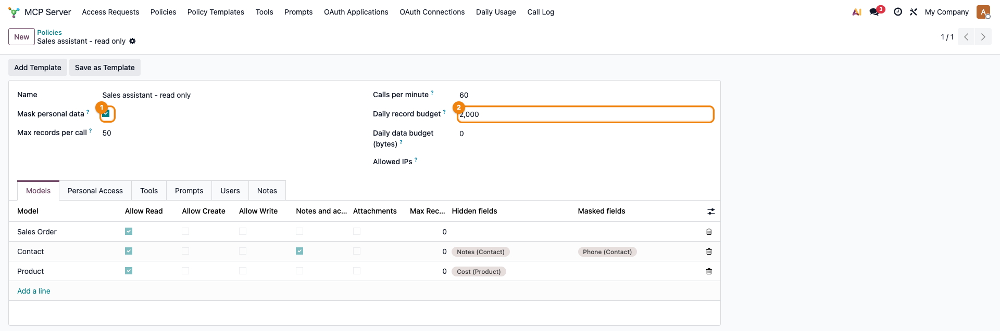

#### Politica dintr-un șablon

În loc să adăugați modelele unul câte unul, pe lista **MCP Server → Configuration → Policies** apăsați **Create from Template**,
alegeți unul sau mai multe șabloane și confirmați. Modulul livrează:

| Șablon | Ce poate AI-ul |
|---|---|
| **Support** | creează și modifică tichete helpdesk (doar titlu, descriere, client, echipă, etapă, responsabil, prioritate), note, atașamente; contactele și taskurile doar le citește |
| **Sales** | oportunități, oferte și clienți: creează, modifică, câștigă oportunitatea (`action_set_won`), confirmă oferta (`action_confirm`); marja și costul produsului rămân ascunse, facturile doar citire |
| **Purchase** | cereri de ofertă și comenzi de achiziție, cu confirmarea lor (`button_confirm`), și prețurile furnizorilor; furnizorii, produsele și recepțiile doar citire |
| **Product Catalog** | creează și completează produse (nume, descrieri, categorii, coduri de bare); costul rămâne ascuns |
| **Product Prices** | schimbă doar prețul de vânzare al produsului, regulile listelor de preț și prețurile furnizorilor (preț, discount, cantitate minimă, date) |
| **Stock (read only)** | stocuri, transferuri și mișcări; nu modifică nimic |
| **Accounting (read only)** | facturi, note contabile, plăți, plan de conturi; nu modifică nimic |
| **Reporting (read only)** | totaluri pe vânzări, achiziții și facturi, cu un buget de 5.000 de înregistrări pe zi; nu modifică nimic |

Ce face asistentul:

- modelele, câmpurile și metodele modulelor care nu sunt instalate (de exemplu Helpdesk) se sar și se afișează
  într-o notificare **Not installed in this database, skipped**; politica se creează cu restul;
- pentru fiecare metodă de buton se folosește unealta existentă sau se creează una nouă (Pasul 4), legată de politică;
- mai multe șabloane alese împreună dau o singură politică: drepturile se adună, câmpurile ascunse și cele read-only
  se păstrează din toate, iar dintre limite câștigă cea mai strictă.

Pe o politică existentă, **Add Template** adaugă modelele unui șablon; modelele deja prezente primesc drepturile
șablonului. **Save as Template** păstrează politica drept șablon nou în **MCP Server → Configuration → Policy Templates**, de unde
se poate refolosi la alt utilizator sau la alt client. Șablonul **nu dă drepturi în Odoo**: utilizatorul AI are în
continuare nevoie de grupurile aplicațiilor (Sales / User, Purchase / User etc.).

### Pasul 2 — Politica se atribuie utilizatorului AI

**Settings → Users → utilizatorul AI → Access Rights → MCP Server.** Câmpul **MCP Policy** leagă
utilizatorul de politică. Un utilizator fără politică se poate conecta, dar nu poate folosi nicio
unealtă.

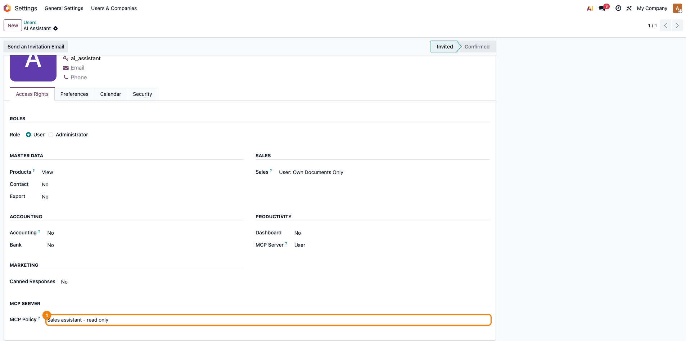

### Pasul 3 — Setările serverului

**Settings → General Settings → Integrations → MCP Server.** Aici sunt valorile globale: **Allow AI clients to write** (implicit debifat: serverul e doar-citire și
uneltele de scriere nici nu apar clientului), **MCP access requests** și **MCP access approver** (Pasul 9), numărul maxim de înregistrări pe apel, cât se păstrează
jurnalul, auto-înregistrarea OAuth, documentele de metadate ale clienților OAuth, gazdele permise pentru OAuth, valabilitatea tokenului de acces (minute) și a conexiunii (zile) și originile
de browser acceptate (clienții AI fără antet `Origin` sunt acceptați oricum).

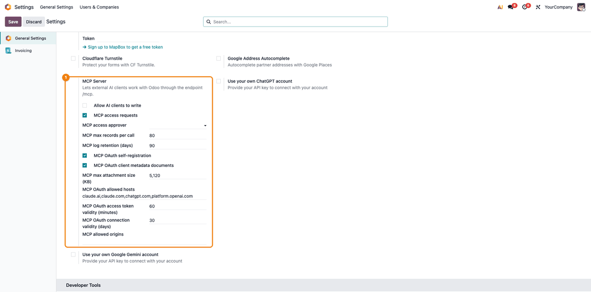

### Pasul 4 — Acțiunile pe care AI-ul le poate rula (unelte)

**MCP Server → Configuration → Tools → New.** O unealtă este un buton sau o acțiune de server pe care AI-ul o poate rula pe
înregistrări, la fel cum ar apăsa-o un om:

- **Name**: numele văzut de AI, cu litere mici, cifre și `_` (ex. `confirm_sale_order`); nu poate fi numele unei
  unelte de bază (`search`, `write` etc.).
- **Kind**: **Model method** (metoda unui buton, ex. `action_confirm` pe *Sales Order*) sau **Server action**
  (o acțiune de server existentă; modelul se ia din ea).
- **Method**: se acceptă doar metodele care încep cu `action_` sau `button_` (butoanele din formulare) ori cele
  declarate de model în `_mcp_methods`. Metodele interne, `write`, `unlink` și cele marcate private sunt refuzate.
  Numele metodei se vede în modul developer, trecând cu mouse-ul peste buton.
- **Description for the AI**: ce face unealta și când se folosește, în engleză. De ea depinde dacă AI-ul o alege
  corect.
- **Needs records**: AI-ul trebuie să dea id-urile înregistrărilor (aproape întotdeauna bifat).
- **Read only**: bifați doar dacă unealta nu modifică nimic. Uneltele care modifică date nu apar cât timp
  serverul e doar-citire (*Allow AI clients to write* debifat).
- **Parameters**: opțional, o schemă JSON pentru valori suplimentare (ex. o notă). Ajung la acțiunea de server
  în `env.context["mcp_arguments"]`; codul poate întoarce date punând un dicționar în variabila `action`.
- **Policies**: politicile în care unealta e activă. Modelul uneltei trebuie să fie și el în politică (cu
  *Allow Read*), dar **nu** e nevoie de *Allow Write*: AI-ul poate confirma o comandă fără să poată
  modifica liber câmpurile ei.

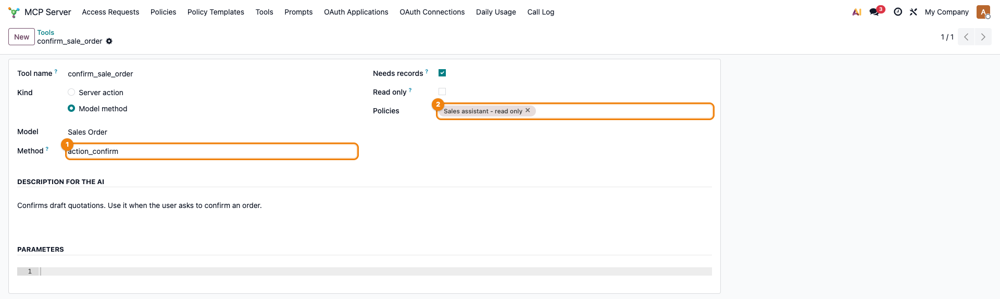

Unealta rulează cu drepturile utilizatorului AI (drepturi pe model, reguli de înregistrare, grupurile acțiunii
de server) și respectă limita de înregistrări pe apel. Dacă butonul deschide o fereastră de dialog (wizard),
apelul este refuzat și ce s-a modificat se anulează; operația se termină în Odoo de un om. Uneltele active
apar și pe tabul *Tools* al politicii.

### Pasul 5 — Prompturi: întrebări gata făcute

**MCP Server → Configuration → Prompts → New.** Un prompt este un text pe care utilizatorul îl alege din clientul AI în loc să
îl scrie de fiecare dată:

- **Prompt name**: numele tehnic, cu litere mici, cifre și `_` (ex. `customer_review`); clientul AI îl arată ca
  și comandă.
- **Title**: eticheta afișată în lista de comenzi a clientului (ex. *Customer review*).
- **Policies**: politicile ai căror utilizatori văd promptul. **Lăsat gol, promptul e oferit tuturor utilizatorilor
  cu o politică activă.**
- descrierea, sub titlu: ce face promptul; apare lângă comandă în client.
- tabul **Prompt**: textul trimis AI-ului. `{{customer}}` sau `{{months}}` se înlocuiesc cu valorile completate de
  utilizator.
- tabul **Arguments**: fiecare `{{nume}}` din text trebuie declarat aici (numele începe cu o literă mică), cu o
  descriere pentru utilizator. Bifați **Required** dacă e obligatoriu; altfel puteți da o valoare **Default** (fără ea,
  un argument lăsat gol devine text gol). Un prompt care folosește un argument nedeclarat nu se poate salva.

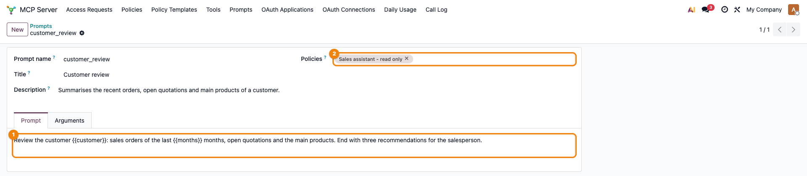

Promptul nu dă AI-ului niciun drept în plus: textul ajunge în conversație ca mesaj al utilizatorului, iar AI-ul
răspunde tot prin uneltele și politica lui. Pe tabul *Prompts* al politicii apar prompturile legate de ea; cele
fără politică nu apar acolo, deși sunt oferite tuturor.

Cum îl folosește utilizatorul: în **Claude Code** tastează `/` și alege `/mcp__odoo__customer_review` (numele
serverului, apoi al promptului); în **Claude Desktop** și **Claude.ai** promptul e în meniul **+** al conversației,
sub numele conectorului. Clientul cere argumentele și trimite textul completat. Un client conectat înainte de
adăugarea promptului îl vede după reconectare.

### Pasul 6 — Cheia API pentru clientul AI

**MCP Server → My Access → Generate API Key**, autentificat **ca utilizatorul AI**. Cheia se generează întotdeauna
pentru utilizatorul conectat: dacă o generați din contul dumneavoastră de administrator, AI-ul va lucra
cu drepturile dumneavoastră. Dați un nume cheii, alegeți durata și apăsați **Generate key**; Odoo cere
parola utilizatorului. Cheia se arată o singură dată. Cheia este valabilă doar pe `/mcp`, nu și pe XML-RPC.

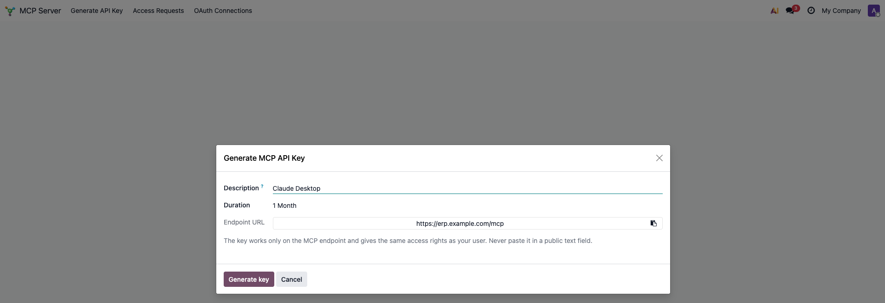

**Cheia în clientul AI.** Clientul primește adresa `https://<odoo-ul-clientului>/mcp` și cheia în antetul
`Authorization: Bearer <cheie>`:

- **Claude Code:**
  `claude mcp add --transport http odoo https://<odoo>/mcp --header "Authorization: Bearer <cheie>"`
- **Cursor**, în `mcp.json`:
  `{"mcpServers": {"odoo": {"url": "https://<odoo>/mcp", "headers": {"Authorization": "Bearer <cheie>"}}}}`

Denumirile din clienții AI se schimbă des; dacă o etichetă diferă, verificați documentația clientului.

### Pasul 7 — Clienți web: aprobarea conexiunii (OAuth)

Claude.ai și ChatGPT nu primesc o cheie lipită de mână. Clientul deschide o pagină Odoo; **utilizatorul AI**
se autentifică și apasă **Allow**. Dacă aplicația cere și scriere, iar serverul o permite, pagina oferă și
**Read only**: aplicația vede atunci doar uneltele de citire. Odoo deschide o conexiune OAuth, vizibilă în
**MCP Server → My Access → OAuth Connections** și revocabilă oricând. Tokenul de acces expiră după o oră și clientul îl
reînnoiește singur; o conexiune nefolosită 30 de zile cere din nou aprobarea. Utilizatorul trebuie să fie în
rolul **MCP Server / User** și să aibă o politică.

Pregătirea, de făcut o singură dată, de un administrator:

1. `web.base.url` (*Settings → Technical → Parameters → System Parameters*, în mod developer) trebuie să fie adresa publică HTTPS a
   instanței: documentele OAuth se construiesc din ea, iar clientul merge la acea adresă.
2. În *Settings → General Settings → Integrations → MCP Server*, bifați:
   - **MCP OAuth client metadata documents**: metoda preferată de specificația MCP, folosită de Claude Code și de
     clienții noi. ID-ul clientului este adresa HTTPS a unei descrieri (nume, adrese de revenire) pe care Odoo o
     citește singur;
   - **MCP OAuth self-registration**: pentru clienții mai vechi, care se înregistrează singuri.

   În ambele cazuri contează lista *MCP OAuth allowed hosts* (implicit `claude.ai`, `claude.com`, `chatgpt.com`,
   `platform.openai.com`): Odoo citește descrieri și acceptă adrese de revenire HTTPS numai de la aceste gazde.
   Descrierea nu se citește niciodată de la o adresă din rețeaua internă.

Conectarea, de făcut de utilizator în clientul AI:

1. Adăugați un conector personalizat (server MCP) cu adresa `https://<odoo>/mcp`. Lăsați goale ID-ul de client
   și secretul: clientul se înregistrează singur sau se identifică prin documentul lui de metadate.
   - **Claude Code:** `claude mcp add --transport http odoo https://<odoo>/mcp`, fără cheie; la prima folosire
     (comanda `/mcp`) se deschide pagina Odoo de aprobare.
   - **Claude.ai:** *Settings → Connectors → Add custom connector*. Pe planurile Team sau Enterprise, adăugarea
     unui conector poate cere un owner.
   - **ChatGPT:** serverele MCP personalizate funcționează în *Developer mode*. Se activează din *Settings →
     Security and login*; într-un workspace Business, Enterprise sau Edu, un administrator trebuie să permită
     întâi conectorii MCP personalizați. Creați o aplicație sau un conector din serverul MCP, cu numele și adresa de
     mai sus și autentificare **OAuth**, apoi alegeți-l într-o conversație din meniul **+**. ChatGPT cere
     confirmare înainte de o unealtă care modifică date; uneltele de citire (`readOnlyHint`) rulează fără ea.
   - **Aplicația Codex a OpenAI (desktop):** *Plugins → MCPs → Add*, server MCP personalizat, cu un nume și adresa
     de mai sus. Lăsați goale *Bearer token env var* și antetele, salvați și autentificați-vă ca utilizatorul AI pe
     pagina Odoo pe care o deschide aplicația. Pentru o cheie API în loc de OAuth, păstrați cheia într-o variabilă de
     mediu și scrieți numele variabilei în *Bearer token env var*.
2. Clientul deschide pagina Odoo de mai jos. Autentificați-vă **ca utilizatorul AI**, nu ca administrator,
   verificați numele aplicației și adresa la care se revine, apoi apăsați **Allow**. **Deny** anulează conexiunea.
3. În client, conectorul e gata de folosit. Conexiunea apare în **MCP Server → My Access → OAuth Connections**, de unde se
   poate revoca. Tokenul de acces expiră după o oră și clientul îl reînnoiește singur; o conexiune nefolosită
   numărul de zile din Settings (30 implicit) expiră, iar clientul cere din nou aprobarea.

Cât timp serverul e doar-citire, pagina spune că aplicația poate doar citi.

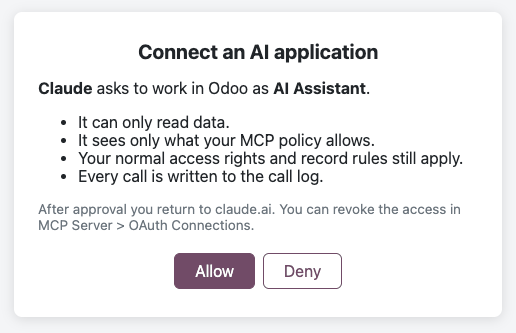

Dacă **Allow AI clients to write** e bifat și aplicația cere și scriere, pagina oferă al treilea buton,
**Read only**: aplicația primește doar scope-ul `mcp:read`, nu vede uneltele `create` și `write`, iar o
încercare de scriere apare în jurnal ca *Denied*.

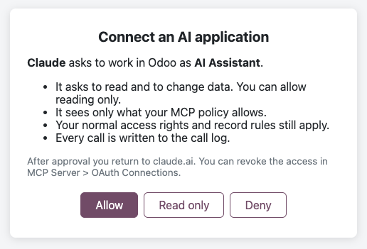

Când clientul folosește un document de metadate (Claude Code), pagina arată și gazda care descrie aplicația.

Dacă o aplicație auto-înregistrată sau descrisă de un document de metadate revine la un program de pe același
calculator (`localhost`, de exemplu Claude Code sau Cursor), pagina afișează un avertisment: orice program de pe
acel calculator ar putea asculta pe o astfel de adresă, deci se apasă **Allow** doar dacă utilizatorul tocmai a
pornit el conectarea.

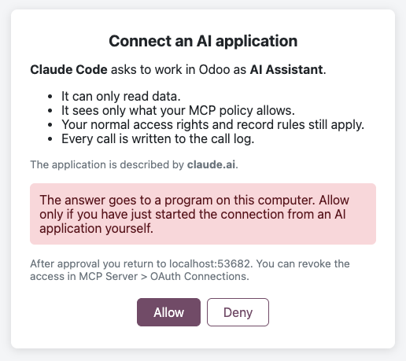

Aplicațiile care se pot conecta sunt cele din **MCP Server → Configuration → OAuth Applications**. Cele care se
înregistrează singure apar acolo cu sursa „Self-registered”, iar cele descrise de un document de metadate cu
sursa „Metadata document” (descrierea se recitește după cel mult o zi). Ambele mecanisme sunt oprite implicit
și acceptă doar gazdele din listă. **Arhivarea** unei aplicații o blochează: Odoo nu o mai acceptă și nu îi mai
citește descrierea.

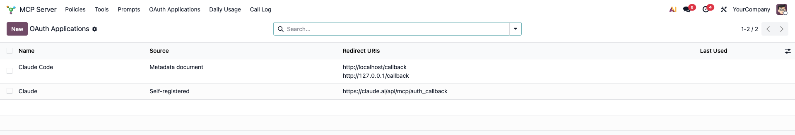

**MCP Server → My Access → OAuth Connections** arată aprobările date: aplicația, utilizatorul, scope-ul (`mcp:read` sau
`mcp:read mcp:write`), când s-a conectat, ultima folosire și până când e valabilă. Fiecare utilizator își vede
și își revocă propriile conexiuni; administratorul le vede pe toate. Conexiunile revocate se văd cu filtrul
**Revoked**, cu motivul: de utilizator, de administrator, de aplicație sau „Refresh token used twice”, când
același token de reînnoire a fost folosit de două ori (semn că a fost furat).

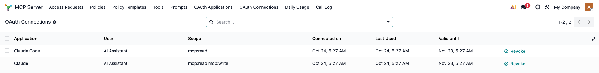

### Pasul 8 — Ce a făcut AI-ul: jurnal și consum

**MCP Server → Reporting → Call Log** arată fiecare apel: data, utilizatorul, metoda, unealta, rezultatul și durata
(în secunde). Numele clientului apare pe rândul `initialize` la clienții mai vechi și pe fiecare apel la clienții
care folosesc protocolul MCP 2026-07-28. Deschiderea unui prompt apare ca metodă `prompts/get`, cu numele
promptului. Erorile apar cu roșu (de exemplu o căutare
pe un câmp mascat sau pe un model care nu e în politică); deschideți rândul ca să vedeți mesajul erorii.
Rândurile `write`, `create` și cele ale uneltelor de tip buton au completat câmpul **Changes**: pentru fiecare
înregistrare, câmpurile modificate cu valoarea veche și cea nouă (la `create`, valorile puse; la buton, doar starea
înainte și după). Filtrul **With changes** le arată doar pe acestea. Jurnalul poate susține obligațiile de
evidență și supraveghere ale celor care folosesc AI (Regulamentul UE 2024/1689, art. 12 și 26), dar nu face
singur un sistem conform.

Apelurile făcute printr-o conexiune OAuth au completată coloana **OAuth Application**, iar o scriere refuzată
pentru că serverul sau conexiunea e doar-citire apare cu galben, cu starea *Denied*.
Autentificările refuzate (token greșit sau expirat, utilizator fără rolul *MCP Server / User*, adresă IP care nu
e în politică) apar în jurnal cu metoda `authentication`, starea *Denied*, motivul, adresa și programul care a
apelat (filtrul **Refused sign-ins**). Un apel fără niciun token nu se jurnalizează: așa pornește orice client
OAuth.

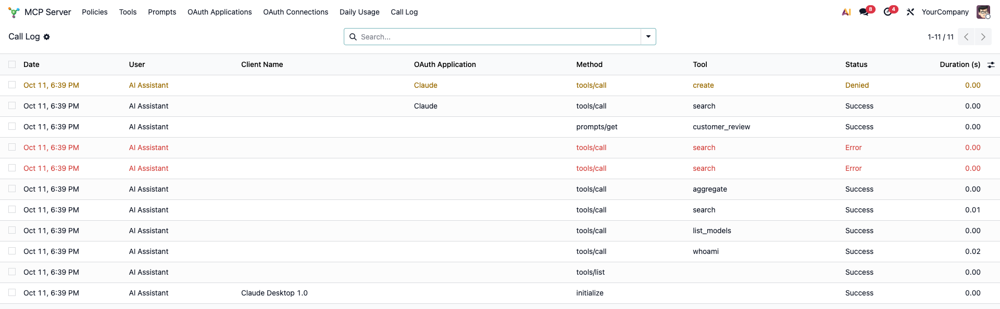

**MCP Server → Reporting → Daily Usage** arată, pe zi și pe utilizator, câte apeluri **reușite** de unelte, înregistrări
și octeți s-au consumat; comparați cu bugetul din politică. Cifra diferă de Call Log, care numără toate
apelurile, inclusiv erorile și cele de protocol.

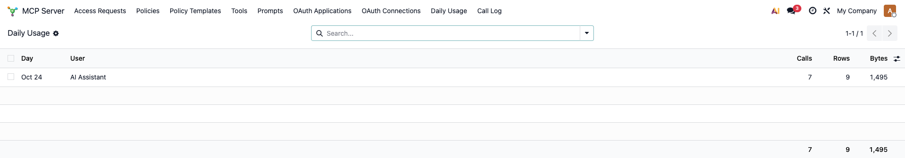

### Pasul 9 — Cereri de acces: acces personal, limitat în timp

Funcția e oprită implicit. Se pornește din *Settings → General Settings → Integrations → MCP Server*, cu
**MCP access requests**. **MCP access approver** alege cine primește notificarea fiecărei cereri; lăsat gol, o
primesc toți administratorii. Notificarea apare în inbox-ul Discuss, dacă modulul e instalat; altfel cererile se
văd doar în meniu.

**Cererea.** Când AI-ul încearcă un model pe care politica nu îl dă, răspunsul de refuz îi spune că poate cere acces
cu unealta `request_access`. Excepție: un refuz la creare sau modificare pe `mail.activity`, `mail.message` sau
`mail.followers` (citirea primește refuzul obișnuit) îl trimite la `post_message` / `schedule_activity` pe document
și îi recomandă `request_access` cu operația `chatter` pe modelul documentului (de exemplu `helpdesk.ticket`), nu pe
modelul refuzat. AI-ul trimite modelul, operația (**Read**, **Create**, **Write**, **Notes and activities** sau
**Attachments**), motivul și numărul de zile (7 dacă nu spune altfel). Utilizatorul poate face aceeași cerere din **MCP Server → My Access → Access Requests → New**.
Până la aprobare nu se schimbă nimic. Utilizatorul își vede cererile în același meniu, cu sursa (**AI client** sau
**Odoo**) și starea, și poate anula o cerere cât timp e în așteptare (**Cancel Request**).

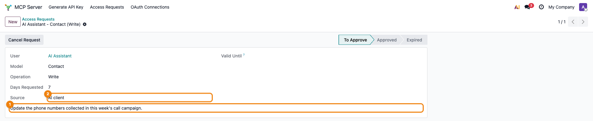

**Lista de aprobat.** Administratorul deschide **MCP Server → My Access → Access Requests**. Lista pornește cu filtrul
**To Approve**. Pe fiecare rând verifică utilizatorul, modelul, operația cerută, câte zile și motivul. Cererile
venite de la AI se găsesc cu filtrul **From AI clients**.

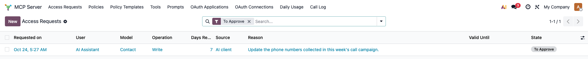

**Aprobarea.** Pe formularul cererii, administratorul poate schimba **Valid Until** înainte de aprobare. Lăsat gol,
accesul ține numărul de zile cerut, socotit de la aprobare. Apoi apasă **Approve** sau **Refuse**. Câmpul **Policy**
arată politica în care intră accesul.

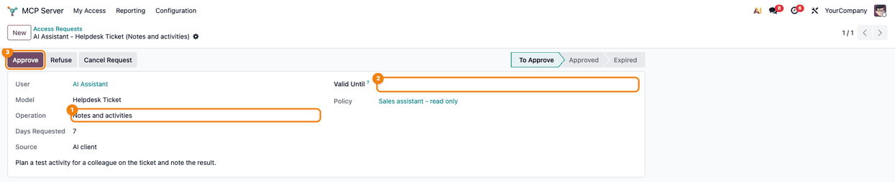

**Accesul aprobat** apare pe politică, în tabul **Personal Access**, ca o linie cu **Only for User** și **Valid Until**:

- se aplică doar acelui utilizator; ceilalți utilizatori ai politicii nu primesc nimic;
- pentru acel utilizator înlocuiește linia politicii pentru modelul respectiv. Dacă modelul era deja în politică
  (de exemplu doar citire), linia personală preia câmpurile ascunse, mascate și read-only de acolo și adaugă doar
  dreptul cerut;
- o a doua cerere aprobată pe același model completează aceeași linie: drepturile se adună, iar data de final
  rămâne cea mai târzie;
- la **Valid Until** accesul se oprește singur, chiar dacă linia mai e vizibilă până la curățarea zilnică;
- **Revoke** pe cerere oprește accesul imediat și șterge linia.

Din clientul AI, `list_models` arată modelul cu `valid_until`.

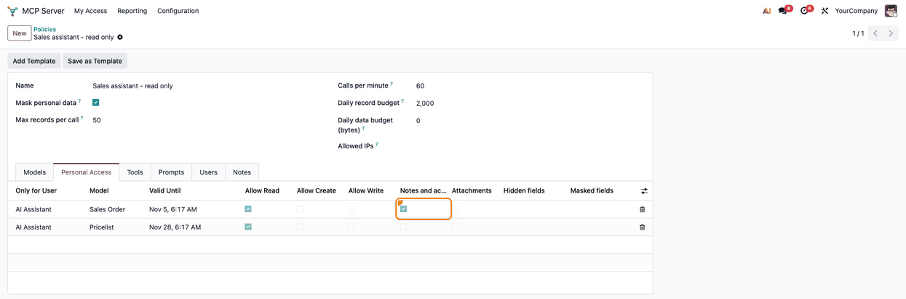

Drepturile Odoo ale utilizatorului rămân limita:

- nu se poate cere un model pe care utilizatorul nu îl poate deschide în Odoo;
- nu se pot cere modelele de sistem (`ir.*`, cheile API, grupurile);
- cât timp serverul e doar-citire, se pot cere doar citire și **Attachments**; **Notes and activities**, creare și
  modificare sunt refuzate;
- **Notes and activities** se poate cere doar pe un model cu chatter; altfel răspunsul e „The model … has no chatter.”;
- același acces nu poate aștepta de două ori, iar un utilizator are cel mult cinci cereri în așteptare.

Dacă utilizatorul trece pe altă politică, accesul personal rămâne pe politica veche și nu i se mai aplică.

### Primele întrebări în clientul AI

Ecranul de aici e al clientului AI, nu al Odoo, deci nu are captură. Ca test, întrebați: „Cine sunt eu în Odoo și
ce modele poți folosi?” (`whoami`, `list_models`), „Arată-mi zece contacte cu numele și țara” (`search`) și
„Câte comenzi de vânzare avem pe stări?” (`aggregate`). Cu unealta din Pasul 4: „Confirmă ofertele lui
Northwind din săptămâna asta” (AI-ul caută ofertele, apoi apelează `confirm_sale_order` cu id-urile lor). Cu
promptul din Pasul 5: alegeți `customer_review` din lista de comenzi și completați numele clientului. Câmpurile mascate vin ca `***`, iar un filtru sau un total
pe ele este refuzat.

### Uneltele pe care le vede clientul AI

`whoami`, `list_models`, `describe_model`, `search`, `read`, `aggregate` (citire), `request_access` când cererile de
acces sunt pornite (Pasul 9) și, doar când scrierea este activată, `create` și `write`. Nu există o unealtă de ștergere. Câmpurile de tip linii
(one2many, many2many), câmpul de stare (`state`) și câmpurile calculate de Odoo nu se pot scrie prin MCP: o
ofertă se confirmă doar prin unealta de tip buton (Pasul 4), ca o comandă să treacă prin aceleași verificări ca
atunci când apasă un om butonul. Alte câmpuri pe care AI-ul le vede, dar nu are voie să le schimbe, se pun în
coloana **Read-only fields** a liniei din politică (de exemplu `active`, ca AI-ul să nu poată arhiva). Refuzul
apare în *Call Log* cu starea *Denied*, iar `describe_model` arată pentru fiecare câmp dacă se poate scrie
(`writable`).

Pe modelele unde linia din politică are bifat **Notes and activities** (și scrierea e permisă din Settings),
AI-ul mai vede două unelte:

- `post_message`: o notă internă în chatter, text simplu, care nu se trimite urmăritorilor sau clientului;
- `schedule_activity`: o activitate (To-Do, apel, întâlnire), cu termen și utilizator responsabil (implicit
  utilizatorul AI).

Ambele rulează cu drepturile utilizatorului conectat: Odoo cere același drept ca atunci când un om scrie pe
înregistrare (de regulă dreptul de modificare). Uneltele cer modulul Discuss (`mail`). Fără bifă, cele două unelte
lipsesc, iar `list_models` arată `notes_and_activities: false` pe model; refuzurile îi spun AI-ului ce bifă lipsește
și, cu cererile de acces pornite, să ceară operația `chatter` (Pasul 9).

Pe modelele cu **Attachments** bifat, AI-ul mai vede, chiar dacă serverul e doar-citire:

- `list_attachments`: fișierele atașate unei înregistrări (nume, tip, mărime, dacă se poate citi);
- `read_attachment`: conținutul unui fișier: text ca text, imaginile ca imagini, PDF-urile și restul ca fișier
  inclus în răspuns.

Se servesc doar fișierele atașate înregistrărilor, niciodată conținutul câmpurilor binare (de exemplu poza
produsului). Se aplică drepturile utilizatorului pe înregistrare și pe fișier. Fișierele mai mari decât
*MCP max attachment size (KB)* din Settings (implicit 5 MB) apar în listă, dar nu se trimit; octeții citiți intră
în bugetul zilnic de date al politicii.

În plus, AI-ul vede uneltele din *MCP Server → Configuration → Tools* active în politica lui (Pasul 4), cu descrierea și
parametrii lor, iar utilizatorul vede prompturile din *MCP Server → Configuration → Prompts* (Pasul 5). Când e posibil, preferați o unealtă (un buton anume) în locul lui `write` pe tot modelul.

### Mai multe companii

Dacă utilizatorul AI are mai multe companii, `whoami` le listează, cu moneda fiecăreia. AI-ul trimite atunci
`company_id` la `search`, `read`, `aggregate`, `create`, `write` și `list_attachments` ca să lucreze într-o singură
companie, la fel ca la alegerea companiei din bara web. Fără `company_id`, citirea acoperă toate companiile
utilizatorului (totalurile amestecă firme și monede), iar înregistrările noi ajung în compania principală a
utilizatorului. O companie care nu e a utilizatorului este refuzată.

### Monitorizare

`GET https://<instanța>/mcp/health` răspunde `{"status": "ok", ...}` când Odoo și baza de date funcționează. Nu
cere cheie și nu întoarce date, deci poate fi apelat de un monitor de disponibilitate (Uptime Kuma, Better Stack
etc.).

## 7. Legături cu alte module / declarații

| Element | Rol |
|---|---|
| Drepturile și regulile de acces Odoo | se aplică mereu peste politică |
| Acțiunile de server (*Settings → Technical → Server Actions*) | pot fi expuse ca unelte |
| Discuss (`mail`) | dacă e instalat, aprobatorul primește notificarea cererilor în inbox; nu e o dependență |
| Modulul Odoo AI (Enterprise) | nu e necesar; în Odoo 20 Enterprise există un server MCP propriu, pe aceeași adresă `/mcp` |

**Ce e automat:** mascarea datelor personale, limitele, jurnalul, curățarea jurnalului, expirarea cheilor, citirea și
reîmprospătarea descrierii aplicațiilor OAuth cu document de metadate, notificarea cererilor de acces, oprirea și
ștergerea accesului personal expirat.
**Ce rămâne manual:** alegerea modelelor, câmpurilor, uneltelor și prompturilor, atribuirea politicii, aprobarea sau
refuzul fiecărei cereri de acces, configurarea clientului AI.

## 8. Verificări pentru consultant

- [ ] Utilizatorul AI are rolul **MCP Server / User** și o politică activă.
- [ ] Politica conține doar modelele necesare; câmpurile sensibile sunt ascunse sau mascate.
- [ ] Politica făcută din șablon: notificarea arată ce s-a sărit; utilizatorul AI are grupurile aplicațiilor
  din șablon; uneltele create pentru butoane apar pe tabul *Tools* al politicii.
- [ ] Cu *Only these writable* (ex. șablonul *Product Prices*): `write` pe `list_price` merge, pe `name` e refuzat
  (*Denied* în Call Log), iar `describe_model` arată doar câmpurile din listă ca `writable`.
- [ ] **Allow AI clients to write** este debifat în Settings pe durata testelor.
- [ ] Cheia a fost generată din contul **utilizatorului AI**, nu din cel de administrator.
- [ ] Din clientul AI, `whoami` arată utilizatorul AI, nu un administrator.
- [ ] O căutare pe un model din politică întoarce înregistrări; pe un model din afara politicii întoarce eroare.
- [ ] CUI/VAT apare ca `***`, iar o căutare filtrată pe VAT este refuzată.
- [ ] Uneltele active în politică au modelul în politică și o descriere clară; doar cele care nu modifică nimic sunt
  bifate *Read only*.
- [ ] Din clientul AI, o unealtă de tip buton (ex. `confirm_sale_order`) schimbă starea înregistrării; o unealtă
  care nu e în politică nu apare în lista clientului.
- [ ] Un buton care deschide un wizard este refuzat și înregistrarea rămâne neschimbată.
- [ ] `write` cu `state` (ex. `{"state": "sale"}` pe o ofertă) e refuzat și apare *Denied* în Call Log; oferta rămâne neconfirmată.
- [ ] Cu *Notes and activities* bifat: „pune o notă pe client” apare ca notă internă în chatter, autor utilizatorul AI; o
  activitate planificată apare la utilizatorul ales, cu termenul cerut.
- [ ] Un prompt fără politici apare la toți utilizatorii MCP care au o politică activă; unul legat de o politică apare
  doar utilizatorilor ei.
- [ ] Din Claude Code, `/mcp__odoo__<prompt>` cere argumentele declarate și trimite textul completat; în Call Log
  apare rândul `prompts/get`.
- [ ] Cu *MCP access requests* bifat: un model din afara politicii întoarce un refuz care pomenește `request_access`;
  după `request_access` cererea apare în *Access Requests* cu sursa *AI client*, iar aprobatorul (sau administratorii)
  are o notificare în inbox.
- [ ] Înainte de aprobare modelul cerut rămâne refuzat; după **Approve** utilizatorul îl poate folosi, iar un alt
  utilizator al aceleiași politici nu.
- [ ] Accesul personal pe un model deja în politică păstrează câmpurile ascunse și mascate ale politicii.
- [ ] După **Revoke** (sau după *Valid Until*) modelul e refuzat din nou.
- [ ] Cu serverul doar-citire, o cerere de *Write* sau *Notes and activities* e refuzată; una de *Read* sau
  *Attachments* trece.
- [ ] O cerere aprobată cu operația *Notes and activities* dă o linie personală cu citire și *Notes and activities*:
  `post_message` și `schedule_activity` apar abia după aprobare. Cu *Attachments*, la fel pentru `list_attachments`.
- [ ] Un `create` pe `mail.activity` e refuzat cu îndrumarea spre `post_message` / `schedule_activity` și spre bifa
  *Notes and activities* din politică; cu *MCP access requests* bifat, refuzul recomandă `request_access` cu
  operația `chatter` pe modelul documentului.
- [ ] Apelurile apar în **Call Log**; consumul apare în **Daily Usage**.
- [ ] La Codex (OpenAI): conectorul se adaugă din *Plugins → MCPs*; după conectare, „Codex” apare în *OAuth Connections*.
- [ ] La ChatGPT: *Developer mode* este activat (și permis de administratorul workspace-ului, dacă e cazul), iar conectorul
  folosește autentificare **OAuth**.
- [ ] La OAuth: `web.base.url` este adresa publică HTTPS și *MCP OAuth self-registration* este bifat.
- [ ] La OAuth: după **Revoke** în *OAuth Connections*, clientul primește 401 și cere din nou aprobarea.
- [ ] La OAuth: pagina de consimțământ arată numele aplicației și adresa la care se revine; după **Allow** conexiunea apare în *OAuth Connections*, cu scope-ul aprobat.
- [ ] La OAuth cu scriere permisă: după **Read only**, clientul nu vede `create`/`write`, iar o încercare de scriere apare în *Call Log* cu starea *Denied*.
- [ ] La OAuth: după o oră clientul continuă să lucreze fără o nouă aprobare (tokenul se reînnoiește singur).
- [ ] La Claude Code prin OAuth: *MCP OAuth client metadata documents* e bifat; după conectare, *OAuth Applications*
  conține „Claude Code” cu sursa „Metadata document”, iar pagina de consimțământ a afișat avertismentul localhost.
- [ ] O aplicație arhivată în *OAuth Applications* nu mai poate cere acces.

## 9. Mesaje de eroare frecvente

| Mesaj | Cauză | Remediere |
|---|---|---|
| No MCP policy is assigned to your user | Utilizatorul nu are politică | Atribuiți politica pe formularul utilizatorului |
| The model … is not available for read/create/write | Modelul nu e în politică sau operația nu e bifată | Adăugați modelul în politică sau, pentru un singur utilizator, aprobați o cerere de acces (Pasul 9) |
| … has no access to this model in Odoo: MCP cannot give more than that. | Cererea e pentru un model pe care utilizatorul nu îl poate deschide în Odoo | Dați întâi utilizatorului grupul aplicației, apoi refaceți cererea |
| The same access is already waiting for approval. | Aceeași cerere (utilizator, model, operație) e deja în așteptare | Aprobați sau refuzați cererea existentă |
| Too many requests are waiting for approval. | Utilizatorul are cinci cereri în așteptare | Decideți asupra cererilor existente |
| operation must be read, create, write, chatter or attachments. | `request_access` a primit o operație necunoscută | AI-ul refă cererea cu una dintre operațiile listate (`chatter` pentru *Notes and activities*) |
| This model cannot be asked for. | Model de sistem sau inexistent | Nu se poate expune prin MCP |
| No MCP policy is assigned to the user. Ask an administrator for one first. | Cererea vine de la un utilizator fără politică | Atribuiți întâi o politică |
| Only an administrator can decide on MCP access requests. | Aprobarea a fost încercată de un ne-administrator | Aprobarea o face un administrator |
| The end of the access must be in the future. | *Valid Until* e în trecut | Corectați data sau lăsați câmpul gol |
| The field … is not available / cannot be used in filters | Câmpul e ascuns sau mascat | Scoateți-l din lista de câmpuri ascunse/mascate, dacă e legitim |
| The daily data budget of this connection is used up | S-a atins bugetul zilnic | Măriți bugetul politicii sau așteptați ziua următoare |
| Rate limit exceeded, retry in a minute | Prea multe apeluri pe minut | Măriți limita din politică |
| The server is in read-only mode | Scrierea e oprită global | Bifați *Allow AI clients to write* în Settings, doar dacă e nevoie |
| The field … is set by Odoo or by the workflow | AI-ul a încercat să scrie starea, un câmp calculat sau unul din *Read-only fields* | Expuneți butonul potrivit ca unealtă (Pasul 4) sau scoateți câmpul din *Read-only fields* |
| Not installed in this database, skipped (notificare la *Create from Template*) | Șablonul conține modele, câmpuri sau metode ale unor module neinstalate | Normal; dacă e nevoie de ele, instalați modulul și aplicați din nou șablonul cu *Add Template* |
| Notes and activities are not allowed on … | Linia modelului din politică nu are bifat *Notes and activities*; mesajul numește politica și linia | Bifați-l pe linia modelului sau, cu *MCP access requests* bifat, aprobați cererea `request_access` cu operația `chatter` |
| The model mail.activity (mail.message, mail.followers) is not available for create/write | AI-ul a încercat să creeze direct activitatea sau mesajul | Normal: mesajul îl trimite la `post_message` / `schedule_activity` pe document; bifați *Notes and activities* pe linia modelului documentului |
| The model … has no chatter. | Cerere *Notes and activities* (sau notă/activitate) pe un model fără chatter | Cereți opțiunea pe modelul documentului care are chatter |
| The user is not allowed to use the MCP server (HTTP 403) | Utilizatorul nu are rolul MCP Server / User | Atribuiți rolul **User** |
| The field … cannot be written through MCP | Câmpul e mascat, ascuns sau de tip linii | Scrieți alt câmp; câmpurile de tip linii nu se pot scrie |
| Only methods starting with action_ or button_ … can be used as tools | Metoda nu e un buton sau nu e declarată în `_mcp_methods` | Alegeți metoda butonului (`action_…`/`button_…`) sau o acțiune de server |
| The method … cannot be called on … | Metoda nu există pe model sau e privată | Verificați numele metodei în modul developer |
| The name … is used by a built-in tool | Numele uneltei e rezervat | Alegeți alt nume |
| The action opens a dialog (…) that needs a person | Butonul deschide un wizard | Operația se face în Odoo; modificarea a fost anulată |
| Unknown tool: … (eroare de protocol) | Unealta nu e în politică, e arhivată sau modelul ei lipsește din politică | Activați unealta în politică și adăugați modelul |
| Missing arguments / Unknown arguments | Parametrii trimiși nu corespund schemei uneltei | Corectați *Parameters* sau descrierea pentru AI |
| Unknown model. | Numele modelului nu există | Verificați numele tehnic cu `list_models` |
| This address is not allowed by the MCP policy | IP în afara listei politicii | Adăugați adresa în *Allowed IPs* |
| 401 pe `/mcp` | Cheie greșită, ștearsă sau expirată | Generați o cheie nouă (sau reconectați clientul OAuth) |
| Dynamic client registration is disabled. (HTTP 403) | Auto-înregistrarea OAuth e oprită | Bifați *MCP OAuth self-registration* în Settings |
| The host … is not in the list of allowed OAuth hosts | Clientul se înregistrează de la o gazdă nelistată | Adăugați gazda în *MCP OAuth allowed hosts* |
| Your user is not enabled for MCP (pagina OAuth) | Lipsește rolul sau politica | Atribuiți rolul **User** și o politică |
| The redirect address is not registered for this application | Adresa de revenire nu e a aplicației | Verificați aplicația în *OAuth Applications* |
| Unknown application. (pagina OAuth) | La Claude Code: *MCP OAuth client metadata documents* nu e bifat. Altfel: aplicația adăugată manual sau auto-înregistrată a fost arhivată ori ștearsă (cele auto-înregistrate și nefolosite niciodată se șterg automat după 30 de zile) | Bifați opțiunea, dezarhivați aplicația sau reconectați clientul AI |
| The metadata document of the application is not available / answered with HTTP … | Odoo nu poate citi descrierea aplicației (rețea, firewall) | Verificați că serverul Odoo poate face cereri HTTPS spre gazda aplicației |
| The metadata document does not describe this client id / has no redirect_uris | Descrierea publicată de aplicație e greșită | Problema e la furnizorul clientului AI; folosiți între timp cheia API |
| The host … is not a public address / cannot be resolved | Gazda aplicației duce la o adresă din rețeaua internă sau nu există | Nu se acceptă; verificați lista *MCP OAuth allowed hosts* |
| The client id is not a valid metadata document URL / The metadata document is too large / is not valid JSON / has no client_name | Descrierea aplicației nu poate fi folosită | Problema e la furnizorul clientului AI; folosiți între timp cheia API |
| A prompt with this name already exists. | Numele promptului e deja folosit | Alegeți alt nume sau modificați promptul existent |
| This application is blocked. | Aplicația cu sursa „Metadata document” e arhivată în *OAuth Applications* | Dezarhivați-o, dacă e de încredere |
| The prompt uses undeclared arguments: … | Textul are un `{{nume}}` care nu e pe tabul *Arguments* | Declarați argumentul sau scoateți-l din text |
| The prompt name / argument name may contain only lowercase letters… | Nume cu majuscule, spații sau diacritice | Folosiți litere mici, cifre și `_` |
| Unknown prompt / Missing argument (în clientul AI) | Promptul nu e oferit politicii utilizatorului sau un argument obligatoriu e gol | Adăugați politica pe prompt; completați argumentul |

## 10. Capturi de ecran

Capturile sunt **generate automat** din `tests/test_screenshots.py` (mixinul `ScreenshotCase` din
`deltatech_doc_screenshots`, prin puntea `l10n_ro_doc_screenshots`), în engleză, cu date de demo, și stau în
`static/description/`, de unde le folosesc și fișa, și `USAGE.md`.

| Fișier | Ce arată |
|---|---|
| `01_policy_form.png` | politica: limite, modele, *Notes and activities* bifat pe *Contact*, câmpuri ascunse și mascate |
| `02_user_policy.png` | politica atribuită pe formularul utilizatorului |
| `03_settings.png` | setările MCP Server |
| `04_key_wizard.png` | generarea cheii API |
| `05_oauth_consent.png` | pagina de consimțământ OAuth |
| `06_oauth_applications.png` | aplicațiile OAuth |
| `07_call_log.png` | jurnalul apelurilor |
| `08_daily_usage.png` | consumul zilnic |
| `09_tool_form.png` | o unealtă: butonul *Confirm* de pe ofertă, activ în politică |
| `10_prompt_form.png` | un prompt: textul cu `{{customer}}` și `{{months}}`, oferit politicii de vânzări (argumentele sunt pe tabul *Arguments*) |
| `11_oauth_consent_metadata.png` | consimțământ pentru Claude Code: gazda care descrie aplicația și avertismentul localhost |
| `12_oauth_consent_write.png` | consimțământ cu alegerea „Read only”, când aplicația cere și scriere |
| `13_oauth_connections.png` | conexiunile OAuth: aplicația, utilizatorul, scope-ul, ultima folosire, butonul Revoke |
| `14_access_request_user.png` | cererea făcută de clientul AI, văzută de utilizator: operația *Notes and activities* pe tichetele helpdesk, motivul și sursa *AI client* |
| `15_access_requests_to_approve.png` | cererile care așteaptă aprobarea (filtrul *To Approve*): *Notes and activities* și *Write* |
| `16_access_request_approve.png` | cererea deschisă de administrator: operația *Notes and activities*, *Valid Until* și butonul *Approve* |
| `17_policy_personal_access.png` | tabul *Personal Access* al politicii: accesul aprobat doar pentru utilizatorul AI (*Notes and activities* pe oferte, citire pe liste de prețuri), cu data de final |

Regenerare:

```bash
./odoo/odoo-bin -c odoo.conf -d <db> -i deltatech_mcp_server,l10n_ro_doc_screenshots,sale \
    --test-tags=/deltatech_mcp_server:TestMcpScreenshots --stop-after-init
```

## 11. Observații pentru manual

- Insistați pe ideea că AI-ul vede **numai ce permite politica** și numai ce ar vedea și utilizatorul respectiv.
- Șabloanele sunt un punct de plecare: după *Create from Template* verificați politica (câmpuri ascunse, limite)
  pentru clientul respectiv.
- Serverul este **doar-citire** implicit; scrierea (`create`, `write`) se activează separat din Settings și nu are încă previzualizare sau anulare.
- Uneltele (acțiunile) sunt varianta controlată de a lăsa AI-ul să lucreze: îi dați un buton anume, nu dreptul de a
  scrie pe tot modelul. Nici ele nu au încă previzualizare sau anulare, deci activați-le pe un utilizator AI dedicat
  și începeți cu puține.
- Cheile OAuth expiră (30 de zile implicit); clientul cere din nou aprobarea.
- Cererile de acces sunt soluția pentru „îmi trebuie doar mie, doar luna asta”: nu modificați politica comună pentru o
  nevoie a unui singur utilizator. Explicați că AI-ul doar **cere**; nimic nu se schimbă fără un administrator.
- Prompturile sunt doar text: nu dau drepturi și nu ocolesc politica. Scrieți-le în limba în care lucrează echipa.
- Serverul vorbește protocolul MCP 2026-07-28 și, în paralel, versiunile mai vechi (2025-11-25 și anterioare), deci
  clienții existenți nu trebuie reconfigurați.
- Conectarea a fost verificată cu Claude.ai (conversație) și cu aplicația Codex a OpenAI, ambele prin OAuth. ChatGPT în
  browser (Developer mode) nu a fost încă verificat: pașii se bazează pe documentația OpenAI și pot diferi ca denumiri.
- OAuth a fost verificat cu teste automate; conectarea cu Claude.ai și ChatGPT reale cere o instanță cu HTTPS public.
- Documentele de metadate (Claude Code) au fost verificate cu teste automate și cu descrierea reală publicată de
  Claude Code; conectarea cap-coadă din Claude Code prin OAuth nu a fost încă făcută pe o instanță publică.
