# Fișă Modul: Plata ramburs (Cash On Delivery) în magazinul online

**Modul:** `deltatech_payment_on_delivery`
**Utilizator principal:** Operator comenzi e-commerce, Contabil (încasări și decontări curier), Consultant de implementare
**Prioritate:** 🟡 Medie (flux operațional și de încasare; nu obligație legală)

---

## 1. Scop business

Această fișă descrie utilizarea modulului `deltatech_payment_on_delivery` pentru scenariul **plata
ramburs în magazinul online**: clientul alege la checkout să plătească la primirea coletului, iar
curierul încasează suma și o virează ulterior firmei pe baza unui decont.

Odoo 19 standard are un ramburs de bază (modulul `delivery`): un furnizor de plată **Numerar la
livrare**, bifa *Cash on Delivery* pe metoda de livrare și **confirmarea automată** a comenzii imediat
ce clientul alege rambursul. Standardul nu tratează riscul coletelor refuzate, nu restricționează
rambursul pe produse și nu oferă nimic pentru reconcilierea sumelor încasate de curier.

Modulul adaugă un furnizor de plată propriu, **Numerar la livrare (COD)**, cu:

- **confirmare manuală** — cu opțiunea **În așteptare** bifată, comanda plătită ramburs nu se
  confirmă singură, ci devine ofertă trimisă și așteaptă operatorul (rambursul are risc mare de
  neridicare);
- **valoare minimă** sub care rambursul nu e oferit (standardul are doar valoare maximă);
- **categorii de produse fără ramburs** și ascunderea rambursului după ce s-a generat un link de plată;
- **importul decontului curierului**, care închide tranzacțiile și creează încasările;
- **AWB-ul ca referință de plată** pe factură, pentru reconcilierea extrasului;
- protecția tranzacției: rambursul nu poate fi marcat manual ca încasat.

## 2. Bază legală și context

Nu există o obligație legală specifică modulului — este un flux operațional de încasare.

**Documentul de vânzare.** Vânzarea online cu plata la curier se documentează prin factură (Cod
fiscal, art. 319), transmisă în RO e-Factura și pentru clienții persoane fizice (B2C). Un colet
refuzat după facturare se stornează prin factură de stornare; tranzacția ramburs a lui nu se validează.

**Suma în curs de decontare.** Între decontul curierului și virarea efectivă în bancă, suma se
urmărește în contul **5125 „Sume în curs de decontare"** (OMFP 1802/2014, pct. 302 alin. (2): sume
virate pe bază de documente prezentate entității și neapărute încă în extras). Recomandăm un
**analitic dedicat** (ex. 512501 „Ramburs curier"), pentru că în planul RO din Odoo contul 5125 este
și contul de suspensie al jurnalelor bancare. Dacă curierul virează net sau cu întârziere mare față
de decont, contabilul poate folosi în locul lui 461 „Debitori diverși", analitic pe curier. Contul
581 nu se folosește: este rezervat transferurilor între conturile de trezorerie proprii.

**Momentul închiderii creanței.** Nota care stinge 4111 apare la **validarea decontului** în Odoo,
nu la livrare. Coletele livrate și încasate de curier, dar nedecontate încă, rămân în 4111. La
firmele care aplică TVA la încasare, data încasării influențează exigibilitatea TVA (Cod fiscal,
art. 282 alin. (3)); în Odoo, TVA devine exigibilă la data validării decontului — stabiliți cu
contabilul dacă această dată e acceptată ca dată a încasării.

**Furnizorul standard.** Modulul folosește furnizorul lui, **Numerar la livrare (COD)** (cod tehnic
`on_delivery`), nu furnizorul standard **Numerar la livrare**. Pe aceeași bază **nu se țin ambele
active**: clientul ar vedea două opțiuni de ramburs la checkout, iar cea standard confirmă comanda
automat, ocolind validarea manuală.

## 3. Utilizatori și roluri

- **Operator comenzi** — confirmă ofertele plătite ramburs după verificare (telefon, adresă).
- **Contabil** — importă decontul curierului, validează rândurile, reconciliază extrasul bancar.
- **Consultant de implementare** — configurează furnizorul, jurnalul, contul, categoriile fără ramburs.

Drepturi necesare:

- configurarea furnizorului de plată: **Administrare / Setări** (`base.group_system`);
- meniul **Importă tranzacție COD**: grupul **Contabilitate / Administrator** (`account.group_account_manager`);
- confirmarea comenzilor: **Vânzări / Utilizator**.

Roluri recomandate la testare: un client portal care cumpără din magazin, un agent de vânzări care
confirmă oferta, un contabil administrator care importă decontul.

## 4. Conturi și date implicate

Modulul nu are conturi proprii. Notele apar din documentele standard Odoo; plata se creează din
tranzacție, în jurnalul setat pe furnizor:

| Moment | Dr | Cr | Document |
|---|---|---|---|
| Postarea facturii | 4111 Clienți | 707 Venituri din vânzarea mărfurilor + 4427 TVA colectată | Factură |
| Validarea rândului din decontul curierului | 5125 Sume în curs de decontare (analitic 512501) | 4111 Clienți | Plată (jurnal „Ramburs curier") |
| Virarea sumei de către curier, pe extras | 5121 Conturi la bănci în lei | 5125 Sume în curs de decontare | Extras bancar |

În planul RO din Odoo, conturile au 6 cifre (4111 apare ca 411100).

Contul 512501 se setează în jurnal, pe tabul **Plăți de Primit**, în coloana **Conturi de încasări
restante** a metodei de plată a furnizorului.
Dacă acel cont nu e setat, Odoo 19 creează plata **fără notă contabilă**, iar factura se stinge doar
la reconcilierea extrasului. Contul trebuie să aibă bifa **Permite reconciliere** — contul 5125 din
planul RO vine fără ea, iar fără bifă plata nu se poate potrivi cu extrasul.

**Data notei** este data la care se apasă **Validare** pe decont, nu data din fișierul curierului.
Validați decontul în aceeași lună în care l-ați primit.

Comisionul curierului nu e tratat de modul: se înregistrează din factura de servicii a curierului —
transportul pe 624, comisionul de ramburs pe 628. Dacă curierul virează net (reține comisionul),
extrasul se reconciliază cu plățile din 5125 pe suma brută, iar diferența se închide pe 401, la
partenerul curier, după înregistrarea facturii acestuia (OMFP 1802/2014, pct. 56 alin. (3)).

Date minime pentru demo:

- un produs publicat în magazin (ex. 320 lei + TVA 21% = 387,20 lei);
- un client cu adresă completă și cont de portal;
- o metodă de livrare (curier);
- un jurnal de tip Bancă „Ramburs curier" și contul 512501 cu reconciliere permisă.

## 5. Configurare inițială

1. Instalați modulul `deltatech_payment_on_delivery`. La instalare se creează furnizorul **Numerar
   la livrare (COD)**, activ, și metoda de plată **Numerar la livrare**.
2. În **Facturare → Configurare → Plăți online → Furnizori de plată** (sau **Website → Configurare →
   eCommerce → Furnizori de plată**), **dezactivați** furnizorul standard **Numerar la livrare** (al
   modulului `delivery`). Atenție: modulul `delivery` îl instalează **activ**, deci fără acest pas
   clientul vede două opțiuni de ramburs.
3. Deschideți furnizorul **Numerar la livrare (COD)**, publicați-l și, pe tabul **Configurare**:
   - **În așteptare** — **bifați-l**. Fără această bifă, tranzacția devine „Autorizată" și Odoo
     confirmă automat comenzile din magazin, ca la rambursul standard;
   - **Valoare minimă** — pragul sub care rambursul nu e oferit (0 = fără prag);
   - **Jurnal plată** — jurnalul „Ramburs curier";
   - **Setare automată ca plătit** — lăsați-l debifat: nu are efect, iar bifat împreună cu
     **În așteptare** dă eroare la salvare.
4. Creați contul **512501 „Sume în curs de decontare - ramburs curier"**, cu **Permite reconciliere**
   bifat. În **Facturare → Configurare → Contabilitate → Jurnale → Ramburs curier**, pe tabul **Plăți
   de Primit**, completați-l în coloana **Conturi de încasări restante** pe linia metodei de plată a
   furnizorului.
5. Opțional, pe categoriile din **Website → eCommerce → Produse → eCommerce Categorii** pentru care nu se
   acceptă ramburs, bifați **Fără numerar la livrare**.
6. Pentru importul din fișier, metoda de livrare trebuie să aibă un conector care știe să citească
   decontul (în prezent GLS, prin `deltatech_delivery_gls`). Fără conector, rândurile decontului se
   pot introduce manual în listă.

Bifa *Cash on Delivery* de pe metoda de livrare filtrează doar furnizorul standard. Furnizorul
modulului apare la **orice** metodă de livrare, inclusiv la ridicarea personală; restricția se face
prin valoarea minimă și prin categorii.

## 6. Flux de utilizare

### Pasul 1 — Furnizorii de plată

Accesați **Facturare → Configurare → Plăți online → Furnizori de plată**. Furnizorul modulului,
**Numerar la livrare (COD)**, apare **Activ** și **Publicat**; furnizorul standard **Numerar la
livrare** (fără „COD" în nume) apare **Dezactivat**. Dacă ambele sunt active, clientul vede două
opțiuni de ramburs la checkout.

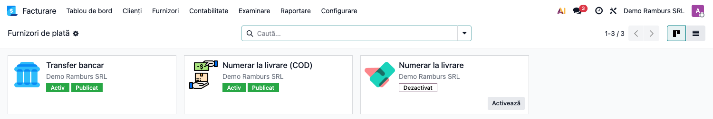

### Pasul 2 — Configurarea furnizorului de ramburs

Deschideți furnizorul **Numerar la livrare (COD)** și mergeți pe tabul **Configurare**. Aici se
setează ① **În așteptare** (bifat), ② **Valoare minimă** și ③ **Jurnal plată**. Valoarea minimă se
compară cu totalul comenzii convertit în moneda companiei. Câmpul **Valoare maximă** din dreapta este
cel standard Odoo; modulul adaugă pragul minim.

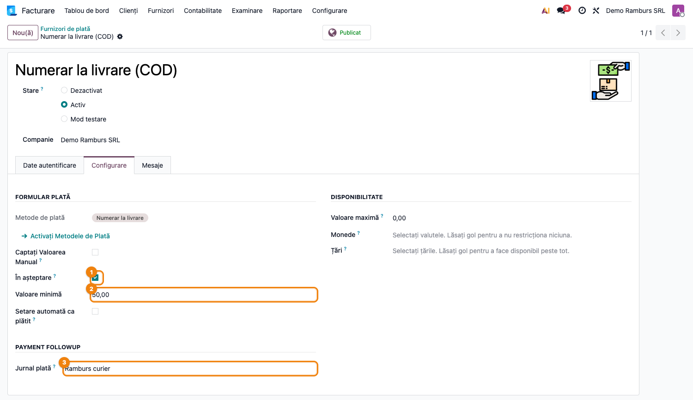

### Pasul 3 — Categorii fără ramburs

Accesați **Website → eCommerce → Produse → eCommerce Categorii → deschideți categoria** și bifați
① **Fără numerar la livrare**. O comandă care conține un produs din această categorie nu mai primește opțiunea
de ramburs la checkout.

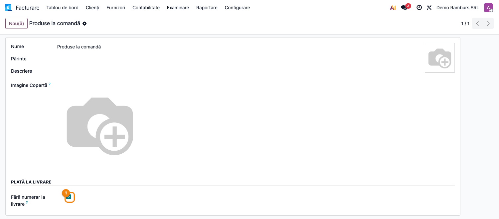

### Pasul 4 — Clientul alege rambursul la checkout

În magazin, după alegerea livrării, pe pagina de plată clientul vede opțiunea **Numerar la livrare**
(numele metodei de plată, fără „COD") alături de celelalte metode. Opțiunea nu apare dacă totalul e
sub valoarea minimă, dacă un produs e dintr-o categorie fără ramburs sau dacă pentru comandă s-a
generat deja un link de plată. După plasare, clientul ajunge pe pagina de confirmare; plata rămâne
în așteptare.

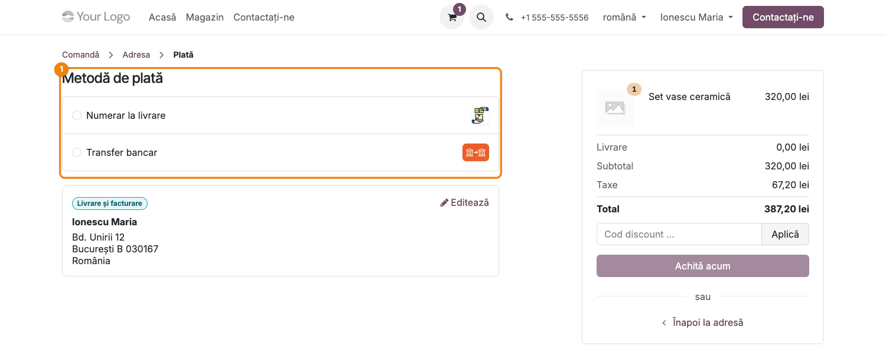

### Pasul 5 — Operatorul confirmă comanda

Accesați **Vânzări → Comenzi → Oferte**. Comanda plătită ramburs are starea ② **Ofertă trimisă**, nu
**Comandă de vânzare**: modulul nu o confirmă automat. Operatorul verifică clientul (telefon, adresă)
și apasă ① **Confirmă**. Din acest moment livrarea urmează fluxul normal: AWB, predare la curier.

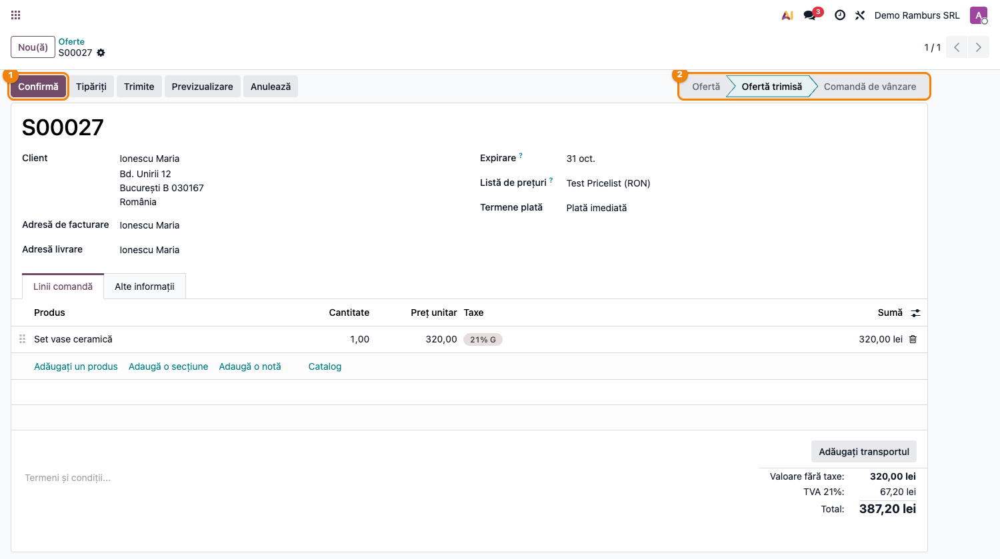

### Pasul 6 — Factura poartă AWB-ul ca referință de plată

După livrare, factura comenzii, la postare, primește ca ① **Referință plată** (tabul **Alte
informații**) numărul AWB-ului livrării, în locul numărului facturii. Curierii virează decontul cu
AWB-ul în detaliile plății, așa că extrasul bancar se potrivește direct cu factura. Factura e încă
neîncasată: plata vine din decont.

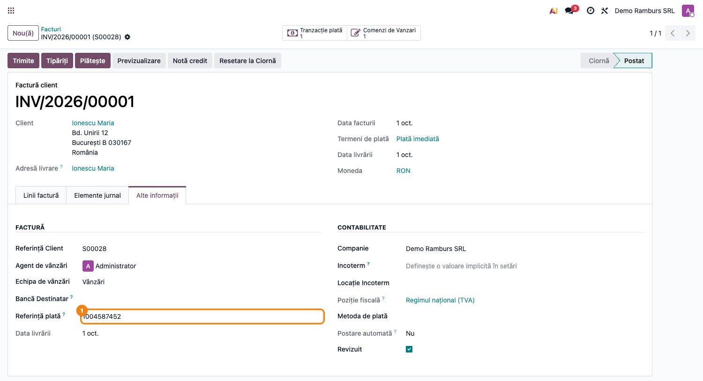

### Pasul 7 — Nota contabilă a facturii

Pe tabul **Elemente jurnal** al facturii se vede creanța pe care o va stinge decontul: **Dr 4111
Clienți / Cr 707 + Cr 4427**, pe totalul cu TVA.

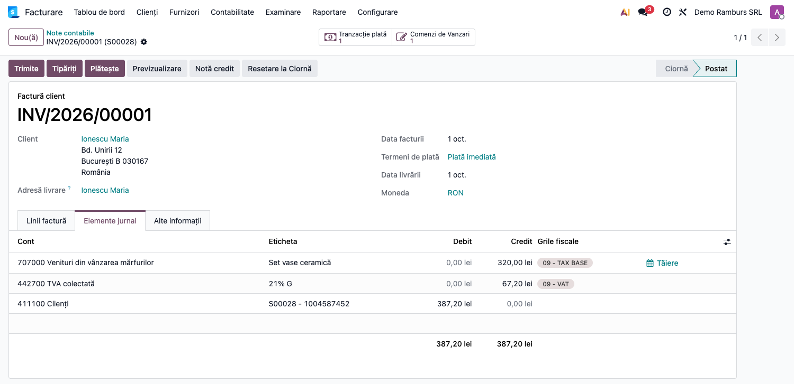

### Pasul 8 — Importul decontului curierului

Accesați **Facturare → Contabilitate → Importă tranzacție COD** (în Contabilitate Enterprise:
**Contabilitate → Contabilitate → Importă tranzacție COD**) și apăsați **Importă**. În fereastra
**Import fișier tranzacții de plată**, ① încărcați fișierul Excel primit de la curier și ② alegeți
**Transportatorul**. **Aplică** citește fișierul și **înlocuiește** rândurile existente din listă cu
cele din decont.

Rândurile listei sunt temporare: Odoo le șterge automat după un timp. Importați și validați decontul
în aceeași sesiune și păstrați fișierul curierului ca document justificativ.

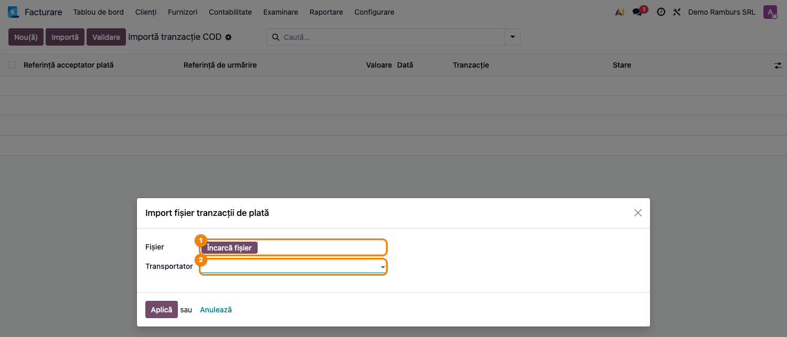

### Pasul 9 — Verificarea și validarea decontului

**Găsește pe ecran:** fiecare rând este un colet din decont: **Referință acceptator plată** (referința
tranzacției sau a comenzii), **Referință de urmărire** (AWB), **Valoare**, **Dată** și, după validare,
**Tranzacție** găsită și **Stare**.

**Verifică:** înainte de validare, totalul coloanei **Valoare** trebuie să fie egal cu suma din
decontul curierului, iar fiecare rând să aibă referință sau AWB.

**Treci mai departe:** selectați rândurile și apăsați ① **Validare**. Pentru fiecare rând, modulul
caută tranzacția după referință, apoi după AWB, apoi comanda după nume. Dacă **valoarea rândului este
egală cu suma tranzacției**, rândul devine ② **Efectuat**, iar tranzacția devine **Confirmată** și
creează plata. Altfel rândul devine **Eroare** (roșu) și tranzacția rămâne neschimbată — diferența se
lămurește cu curierul.

Două limite de știut:

- căutarea după AWB găsește tranzacția doar dacă AWB-ul a fost scris pe tranzacție la emiterea lui,
  ceea ce face modulul `deltatech_delivery`; fără el, rândul are nevoie de referința tranzacției;
- dacă rândul se potrivește doar după numele comenzii, iar comanda nu are tranzacție, modulul creează
  tranzacția **cu valoarea din rând**, deci rândul trece fără comparație cu totalul comenzii.
  Verificați manual aceste rânduri față de comandă.
- prima căutare, după referință, nu se limitează la furnizorul de ramburs; dacă o comandă a avut și
  o încercare de plată online, verificați în coloana **Tranzacție** că s-a găsit tranzacția de ramburs.

Dacă oferta nu fusese confirmată de operator, validarea rândului o confirmă automat, odată cu
încasarea.

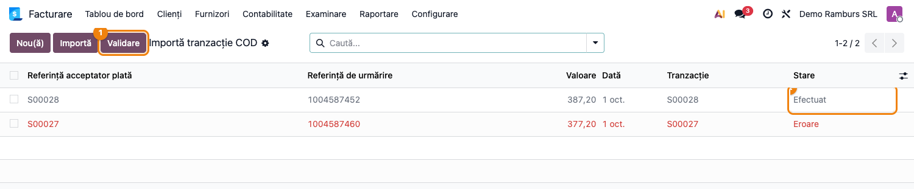

### Pasul 10 — Plata creată din decont

Accesați **Facturare → Clienți → Plăți**. Plata are jurnalul ① **Ramburs curier** și metoda de plată
a furnizorului de ramburs. Dacă factura comenzii era postată, plata este deja reconciliată cu ea:
în Facturare factura apare **Plătit**; în Contabilitate Enterprise apare **În plată**, iar plata
**În proces**, până la reconcilierea extrasului bancar.

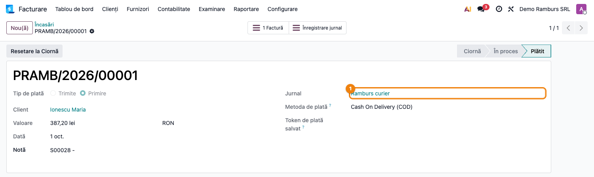

### Pasul 11 — Nota contabilă a plății

Din plată, deschideți nota contabilă. Liniile sunt **Dr 512501 Sume în curs de decontare - ramburs
curier / Cr 4111 Clienți**, pe suma rambursului.

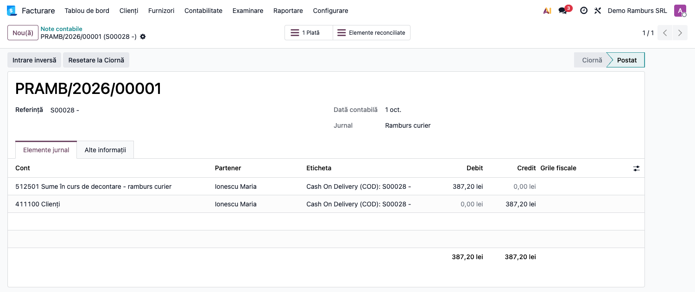

### Note de monografie și raportare

1. Factura de vânzare:
   `4111 Clienți = 707 Venituri din vânzarea mărfurilor + 4427 TVA colectată` — totalul cu TVA.
2. Validarea decontului (plata din tranzacție):
   `5125 Sume în curs de decontare (512501) = 4111 Clienți` — suma rambursului.
3. Virarea de către curier, pe extrasul bancar (reconciliere standard Odoo):
   `5121 Conturi la bănci în lei = 5125 Sume în curs de decontare (512501)` — suma virată.
4. Factura de servicii a curierului (în afara modulului):
   `624 Cheltuieli cu transportul de bunuri și personal` (transport) + `628 Alte cheltuieli cu
   serviciile executate de terți` (comision ramburs) + `4426 TVA deductibilă` (dacă factura e cu TVA)
   = `401 Furnizori`.
5. Virare netă (comisionul reținut din ramburs), pe extras:
   `5121` (suma netă) + `401 Furnizori` (comisionul) = `5125 (512501)` (suma brută a decontului).

Soldul contului 512501 arată sumele **decontate** de curieri și încă nevirate. Sumele încasate de
curier, dar nedecontate încă, rămân în 4111. Pentru solduri corecte la închiderea lunii, importați
înainte de închidere situația încasărilor până la ultima zi a lunii.

## 7. Legături cu alte module / declarații

| Modul / proces | Rol în flux | Tip legătură |
|---|---|---|
| `payment`, `payment_custom` | furnizorul și metoda de plată, procesarea tranzacției | dependență (manifest) |
| `sale`, `website_sale` | comanda și pagina de plată din magazin | dependență (manifest) |
| `delivery`, `stock_delivery` | metoda de livrare și AWB-ul livrării | dependență (manifest) |
| `account` (`account_payment`) | plata creată din tranzacție și reconcilierea cu factura | dependență (manifest) |
| `deltatech_delivery_gls` | citirea fișierului de decont GLS în lista de import | integrare |
| `deltatech_delivery` | scrie AWB-ul pe tranzacție, ca rândurile de decont să se găsească după AWB | integrare |
| `terrabit_partner_credit_limit`, `deltatech_sale_order_review`, conectorii marketplace | recunosc comenzile ramburs după furnizorul acestui modul | integrare |
| RO e-Factura | transmiterea facturii, inclusiv B2C | flux standard |

Ce este automat: filtrarea rambursului la checkout (valoare minimă, categorii, link de plată);
trecerea comenzii în **Ofertă trimisă**; AWB-ul ca referință de plată pe factură; potrivirea
rândurilor din decont cu tranzacțiile; plata și reconcilierea la validare.
Ce rămâne manual: confirmarea comenzii de către operator; importul decontului; lămurirea rândurilor
cu eroare; reconcilierea extrasului bancar cu suma virată de curier; factura de servicii a curierului.

## 8. Verificări pentru consultant

- [ ] Furnizorul standard **Numerar la livrare** este dezactivat; la checkout apare o singură opțiune de ramburs.
- [ ] **În așteptare** e bifat pe **Numerar la livrare (COD)**; o comandă din magazin plătită ramburs
      rămâne **Ofertă trimisă**, cu tranzacția **În așteptare**, și nu se confirmă singură.
- [ ] Un coș cu total sub **Valoare minimă** nu primește opțiunea de ramburs.
- [ ] Un coș cu un produs dintr-o categorie **Fără numerar la livrare** nu primește opțiunea de ramburs.
- [ ] După generarea unui link de plată pe comandă, rambursul nu mai apare pentru acea comandă.
- [ ] Pe o tranzacție ramburs **În așteptare** nu există nicio acțiune manuală de confirmare; ea
      devine **Confirmată** doar din **Importă tranzacție COD → Validare**.
- [ ] Factura postată a unei comenzi livrate cu AWB are AWB-ul în **Referință plată**.
- [ ] Un rând de decont cu valoarea egală cu tranzacția devine **Efectuat**; tranzacția devine
      **Confirmată**, iar plata apare în jurnalul „Ramburs curier", reconciliată cu factura.
- [ ] Un rând cu valoare diferită devine **Eroare**, iar tranzacția rămâne neschimbată.
- [ ] Nota plății este **Dr 512501 / Cr 4111**, cu data validării; contul 512501 are reconcilierea
      permisă, iar la reconcilierea extrasului se închide pe 5121.
- [ ] Soldul 512501 la sfârșitul lunii corespunde decontărilor primite și încă nevirate de curieri;
      coletele încasate, dar nedecontate, apar în 4111.
- [ ] După o actualizare a modulului, furnizorul **Numerar la livrare (COD)** are compania și starea
      corecte (vezi secțiunea 11).

## 9. Mesaje de eroare frecvente

| Mesaj / simptom | Cauză probabilă | Remediere |
|-----------------|-----------------|-----------|
| „It is not allowed to set a cash-on-delivery transaction to the ‘Done’ status" | S-a încercat confirmarea manuală a tranzacției ramburs | Tranzacția se închide doar din **Importă tranzacție COD → Validare** |
| La checkout apar două opțiuni de ramburs | Sunt active atât furnizorul standard **Numerar la livrare**, cât și **Numerar la livrare (COD)** al modulului | Dezactivați furnizorul standard |
| Comenzile ramburs din magazin se confirmă singure | **În așteptare** nu e bifat pe furnizor, sau e folosit furnizorul standard | Bifați **În așteptare**; dezactivați furnizorul standard |
| Rambursul nu apare la checkout | Total sub **Valoare minimă**, produs din categorie fără ramburs, link de plată generat, sau furnizor nepublicat / pe altă companie | Verificați pragul, categoriile produselor, starea și compania furnizorului |
| „The carrier does not support import for delivery type '…'" | Transportatorul ales nu are conector care citește decontul | Alegeți transportatorul corect (ex. GLS) sau introduceți rândurile manual |
| Rândul decontului rămâne **Eroare** | Valoarea din decont diferă de suma tranzacției sau referința/AWB-ul nu se găsește | Verificați suma cu curierul; corectați referința în rând și validați din nou |
| Plata nu are notă contabilă | Metoda de plată din jurnal nu are **Conturi de încasări restante** | Completați contul 512501 pe metoda de plată a furnizorului, tabul **Plăți de Primit** al jurnalului |
| Plata nu se poate potrivi cu extrasul bancar | Contul de încasări restante nu are **Permite reconciliere** | Bifați **Permite reconciliere** pe contul 512501 |

## 10. Capturi de ecran

Capturile (`readme/screenshots/`) sunt generate automat din `tests/test_screenshots.py` (mixinul
`ScreenshotCase` din `l10n_ro_doc_screenshots`, import defensiv), în limba română, pe compania RO cu
planul de conturi RO:

1. `01_furnizori_plata.png` — lista furnizorilor de plată: rambursul modulului activ, cel standard dezactivat.
2. `02_furnizor_ramburs.png` — furnizorul de ramburs, tabul Configurare.
3. `03_categorie_fara_ramburs.png` — categoria publică cu bifa „Fără numerar la livrare".
4. `04_checkout_ramburs.png` — pagina de plată din magazin, cu opțiunea de ramburs.
5. `05_oferta_ramburs.png` — oferta plătită ramburs, în starea „Ofertă trimisă".
6. `06_factura_awb.png` — factura cu AWB-ul în „Referință plată", înainte de decont.
7. `07_nota_factura.png` — nota contabilă a facturii, Dr 4111 / Cr 707 și 4427.
8. `08_import_fisier.png` — fereastra de import a decontului curierului.
9. `09_decont_validat.png` — rândurile decontului după validare, unul „Efectuat" și unul „Eroare".
10. `10_plata_ramburs.png` — plata creată din tranzacție.
11. `11_nota_plata.png` — nota contabilă a plății, Dr 512501 / Cr 4111.

Regenerare:

```bash
./odoo/odoo-bin -c odoo.conf -d <db> -i l10n_ro -u deltatech_payment_on_delivery,l10n_ro_doc_screenshots \
    --test-tags=fise_screenshots --stop-after-init
```

## 11. Observații pentru manual

Păstrați în manual diferența față de rambursul standard Odoo: **comanda nu se confirmă singură** (cu
**În așteptare** bifat), iar lista **Oferte** filtrată pe „Ofertă trimisă" este coada zilnică a
operatorului. Explicați că tranzacția ramburs se închide **numai** din decontul curierului — un clic
manual pe „Confirmată" e blocat intenționat, ca suma să nu fie înregistrată de două ori. Insistați
pe contul 512501: soldul lui este suma decontată de curieri și încă nevirată, și se urmărește lunar.
Menționați că furnizorul standard **Numerar la livrare** se instalează activ odată cu modulul
`delivery` și trebuie dezactivat.

Atenție la actualizări: la fiecare actualizare a modulului, furnizorul **Numerar la livrare (COD)**
își recapătă starea **Activ** și compania principală din datele modulului. Pe o bază cu mai multe
companii, sau dacă furnizorul a fost dezactivat intenționat, verificați-l după actualizare.
