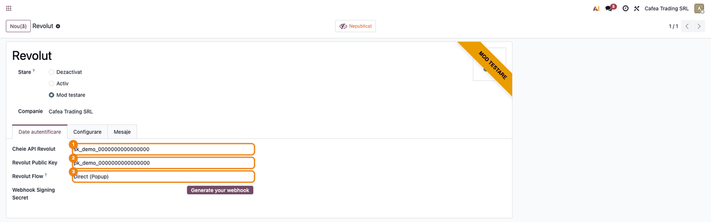
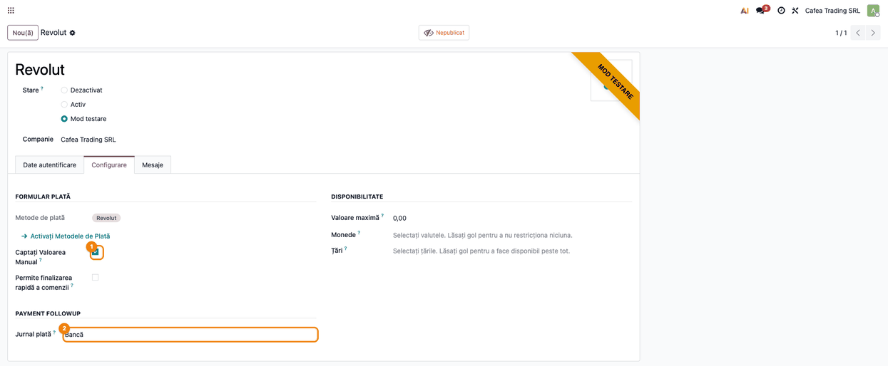
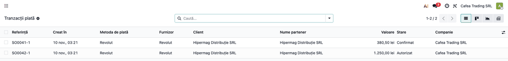
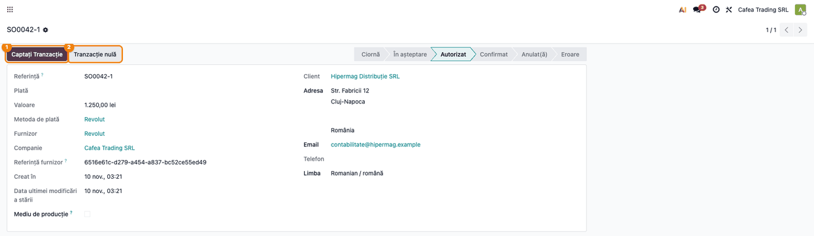
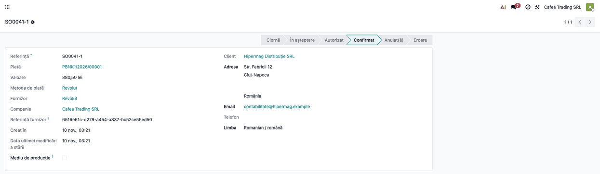
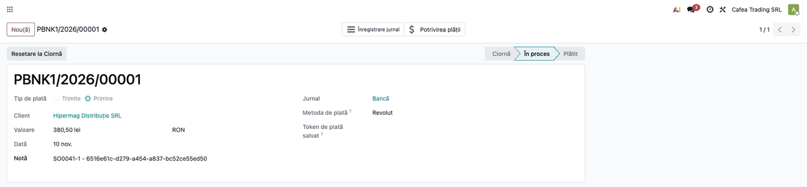
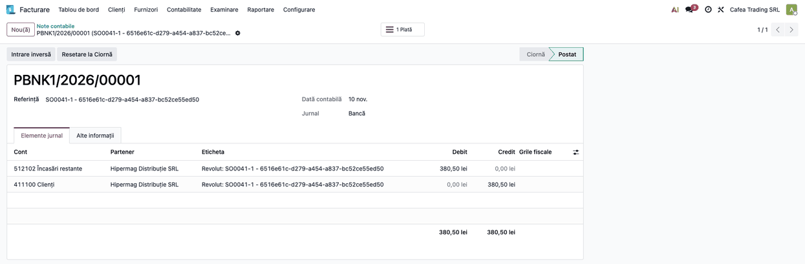

# Fișă Modul: Încasări online cu cardul prin Revolut

**Modul:** `deltatech_payment_revolut`
**Utilizator principal:** contabil / administratorul magazinului online (configurare, confirmarea încasărilor autorizate și urmărirea plăților)
**Prioritate:** 🟡 Medie (conector de plată opțional: se instalează doar la clienții care au cont Revolut Business cu comerciant activat)

## 1. Scop business

Magazinul online (și linkurile de plată trimise clienților) poate primi plata cu cardul sau cu contul Revolut prin
**Revolut Merchant**. Clientul plătește pe fereastra Revolut (flux **Direct**, popup în pagina magazinului) sau pe
pagina Revolut (flux **Redirect**), iar Odoo află rezultatul direct de la Revolut: comanda se confirmă și plata se
înregistrează fără ca cineva să verifice manual extrasul. Modulul vorbește cu Revolut direct, cu cheile proprii ale
firmei: nu există un server intermediar. Opțional, plata poate fi doar **autorizată** la finalizarea comenzii și
**încasată manual** de contabil (confirmarea comenzii, apoi încasarea efectivă; momentan indisponibil pe instalări noi, vezi limitarea cunoscută de la pasul 2).

Se adresează firmelor cu cont Revolut Business și magazin online (sau facturi plătite prin link de plată) în Odoo.

## 2. Bază legală și context

Nu există o bază legală proprie modulului: Revolut este cel care procesează plata și autentifică clientul (SCA/3D
Secure). Contextul operațional pe care trebuie să-l cunoască consultantul:

- Odoo creează comanda la Revolut cu suma în unități minore (bani) și moneda tranzacției; după întoarcerea clientului
  sau la notificarea webhook, Odoo **citește starea comenzii de la Revolut** și verifică id-ul comenzii, suma și moneda
  înainte să confirme plata. O nepotrivire duce tranzacția în **Eroare**;
- Revolut virează banii în contul Revolut Business al firmei după regulile lui; **comisionul Revolut nu este calculat
  de modul**, iar extrasul nu este adus de el: contabilul reconciliază încasările și înregistrează comisionul la
  decontare, pe baza raportului sau a facturii Revolut;
- notificările webhook sunt acceptate doar dacă poartă o semnătură validă (secretul de semnare configurat pe provider),
  cu timestamp de cel mult 5 minute; fără secret configurat, webhook-ul este ignorat;
- metodele de plată oferite clientului (card, Revolut Pay, Apple Pay) depind de contul Revolut al comerciantului.

## 3. Utilizatori și roluri

| Rol | Ce face |
|---|---|
| Administrator (grup Setări) | introduce cheile Revolut și generează webhook-ul; secretul de semnare este vizibil doar acestui grup |
| Contabil (cu drepturi de administrator al contabilității și modul developer pentru meniul Tranzacții) | urmărește tranzacțiile, încasează (sau anulează) plățile autorizate și reconciliază încasările cu extrasul |
| Client (vizitator al magazinului) | alege Revolut la finalizarea comenzii și plătește în fereastra sau pe pagina Revolut |

## 4. Conturi și date implicate

- **Jurnalul providerului** (de tip bancă): încasările online se înregistrează pe el, ca plăți în curs, până la
  reconcilierea cu extrasul. În planul RO din Odoo contul implicit este 512102 „Încasări restante” (vezi captura notei
  contabile); contabilul poate alege pe jurnal un alt cont de încasări în curs, de exemplu 5125 „Sume în curs de
  decontare”.
- **Cont de client (411100 în planul RO din Odoo)**: se stinge prin plata înregistrată.
- **Comision Revolut**: se contabilizează pe 627 „Cheltuieli cu serviciile bancare și asimilate” la decontare, pe baza
  raportului Revolut; modulul nu îl calculează. Tratamentul TVA al comisionului (prestator din UE: taxare inversă dacă serviciul este taxabil, fără TVA dacă este scutit) se verifică cu
  contabilul.
- **Date necesare din contul Revolut Business:** cheia API secretă (**Secret key**) și cheia publică (**Public key**),
  din secțiunea Merchant API; pentru testare, cheile din mediul **sandbox**.

## 5. Configurare inițială

1. În contul Revolut Business (sandbox pentru testare) generați cheile API din secțiunea **Merchant API**.
2. În Odoo deschideți **Contabilitate → Configurare → Plăți online → Furnizori de plată → Revolut** (în lipsa
   modulului Enterprise de contabilitate, sub **Facturare**).
3. Pe tabul **Date autentificare** completați **Cheie API Revolut** (cheia secretă) și **Revolut Public Key** și alegeți
   **Revolut Flow**: **Direct (Popup)** sau **Redirect** (vezi pasul 1 din fluxul de mai jos).
4. Cu cheia API completată și providerul accesibil public pe internet, apăsați **Generate your webhook**: Odoo creează la
   Revolut un webhook către `<adresa site>/payment/revolut/webhook` pentru evenimentele `ORDER_COMPLETED` și
   `ORDER_AUTHORISED` și salvează secretul de semnare în **Webhook Signing Secret**. Dacă Revolut nu returnează secretul,
   Odoo anunță că trebuie copiat manual din portalul Revolut în acest câmp.
5. Pe tabul **Configurare** alegeți **Jurnal plată** (de tip bancă) și, la nevoie, bifați **Captați Valoarea Manual** (vezi pasul 2).
6. Publicați providerul, ca să apară clienților la finalizarea comenzii. Treceți-l pe **Mod testare** pentru încercări
   cu cheile sandbox, apoi pe **Activ** pentru plăți reale. Starea determină și mediul folosit: sandbox (Mod testare) sau
   producție (Activ).
7. Opțional, pentru Apple Pay (plată expres): pe același tab, dacă este permisă plata expres, încărcați **Apple Pay
   Domain File** (fișierul de validare descărcat din documentația Revolut) și apăsați **Register domain for Apple Pay**.
   Fișierul este servit la `/.well-known/apple-developer-merchantid-domain-association`.

## 6. Flux de utilizare

### Pasul 1 — Datele providerului Revolut

**Meniu:** Contabilitate (sau Facturare) → Configurare → Plăți online → Furnizori de plată → Revolut

Pe tabul **Date autentificare** se completează cheile din contul Revolut: **Cheie API Revolut** și **Revolut Public Key**.
**Revolut Flow** alege felul plății: **Direct (Popup)** (clientul plătește într-o fereastră Revolut deschisă în pagina
magazinului) sau **Redirect** (clientul este trimis pe pagina de plată Revolut și revine în magazin). Câmpul **Webhook
Signing Secret** se afișează mascat; butonul **Generate your webhook** apare doar cât timp secretul lipsește și cheia API
este completată.



### Pasul 2 — Configurarea jurnalului și a capturării manuale

**Meniu:** același formular, tabul **Configurare**

Aici se alege **Jurnal plată** (de tip bancă), pe care se înregistrează încasările. Bifa **Captați Valoarea Manual** schimbă comportamentul: plata clientului este doar **autorizată** (suma este blocată pe card), iar contabilul o
încasează sau o anulează ulterior (pașii 4–5). Fără bifă, plata se încasează automat și tranzacția devine direct
**Confirmat**. Modulul acceptă doar încasarea integrală a sumei autorizate.

> **Limitare cunoscută:** metoda de plată Revolut livrată de modul nu declară suportul pentru captura manuală, iar
> Odoo refuză bifa cu mesajul „The following payment methods must be disabled in order to enable manual capture:
> Revolut”. Până la corectarea modulului, bifa nu poate fi activată pe o instalare nouă; capturile acestui pas și ale
> pasului 4 s-au făcut cu metoda declarată ca suportând captura manuală.



### Pasul 3 — Lista tranzacțiilor

**Meniu:** Contabilitate (sau Facturare) → Configurare → Plăți online → Tranzacții (meniul apare doar cu **modul developer** activ și cu drepturi de administrator al contabilității; alternativ, tranzacțiile se deschid din comanda de vânzare sau din factura plătită online)

Fiecare plată pornită din magazin creează o tranzacție cu **Furnizor** Revolut. Lista arată referința comenzii, suma,
starea și clientul. Tranzacțiile **Autorizat** așteaptă încasarea manuală; cele **Confirmat** au fost încasate.



### Pasul 4 — Încasarea sau anularea unei plăți autorizate

**Meniu:** deschideți tranzacția în starea **Autorizat**

Pe formularul tranzacției apar butoanele **Captați Tranzacție** (încasează suma autorizată de la Revolut) și **Tranzacție nulă** (anulează autorizarea, iar suma se deblochează pe cardul clientului). După încasare, Odoo reciteşte starea
comenzii de la Revolut și trece tranzacția în **Confirmat**. Butonul de anulare cere o confirmare și nu poate fi
revocat.



### Pasul 5 — Tranzacția confirmată

**Meniu:** deschideți tranzacția în starea **Confirmat**

Tranzacția confirmată păstrează în **Referința furnizor** id-ul comenzii create la Revolut: pe el se potrivește orice
notificare ulterioară și îl folosiți pentru a găsi plata în portalul Revolut. Confirmarea vine fie din întoarcerea
clientului în magazin, fie din webhook; în ambele cazuri Odoo verifică la Revolut id-ul, suma și moneda înainte.



### Pasul 6 — Plata contabilă

**Meniu:** Contabilitate (sau Facturare) → Clienți → Plăți

La confirmare, Odoo creează plata contabilă pe jurnalul providerului, legată de tranzacție (câmpul **Plată** de pe
tranzacție). Dacă tranzacția plătește o factură, plata se asociază cu ea. Plata apare pe formular cu tipul **Primire**,
metoda Revolut, jurnalul providerului și starea **În proces** până la reconcilierea cu extrasul bancar (butonul
**Potrivirea plății**).



### Pasul 7 — Nota contabilă a plății

**Meniu:** plata contabilă → butonul **Înregistrare jurnal**, tabul **Elemente jurnal**

Plata este înregistrată pe contul de încasări în curs al jurnalului, în așteptarea extrasului bancar.



#### Note de monografie și raportare

Încasarea online a unei facturi de 380,50 RON (exemplu din capturi):

| Moment | Debit | Credit | Sumă |
|---|---|---|---|
| Confirmarea plății (plata contabilă) | 512102 Încasări restante | 411100 Clienți | 380,50 |
| Decontarea de către Revolut (extras bancar, reconciliere) | 5121 Conturi la bănci în lei | 512102 Încasări restante | 380,50 |
| Comisionul Revolut, la decontare (manual) | 627 Cheltuieli cu serviciile bancare | 5121 Conturi la bănci în lei | după raportul Revolut |

La decontare în valută se folosește contul în valută (5124), cu diferențe de curs. Conturile pot diferi după jurnalul ales și după planul de conturi al clientului. Modulul creează doar prima notă.

## 7. Legături cu alte module / declarații

| Modul | Rol |
|---|---|
| `payment` | tranzacțiile, providerii și butoanele de capturare / anulare |
| `account` | plata contabilă și jurnalul providerului |
| `account_payment` | meniurile Plăți online din Contabilitate / Facturare |
| `website_sale` (dacă este instalat) | oferă clienților Revolut la finalizarea comenzii |

**Automat:** crearea comenzii la Revolut, trimiterea sumei, monedei și datelor clientului, verificarea plății (id comandă,
sumă, monedă), confirmarea prin webhook sau la întoarcerea clientului, crearea plății contabile, încasarea și anularea
la Revolut.

**Manual:** configurarea contului Revolut (cheile API), reconcilierea extrasului bancar, contabilizarea comisionului
Revolut, încărcarea fișierului Apple Pay și înregistrarea domeniului.

## 8. Verificări pentru consultant

- [ ] Providerul are completate **Cheie API Revolut** și **Revolut Public Key** și starea corectă (**Mod testare** = sandbox,
  **Activ** = producție).
- [ ] **Generate your webhook** a completat **Webhook Signing Secret** (sau secretul a fost copiat manual din portalul
  Revolut); fără secret, notificările webhook sunt ignorate.
- [ ] Providerul are **Jurnal plată** de tip bancă și moneda comenzii este acceptată de contul Revolut.
- [ ] O plată de test cu cardul de test Revolut ajunge în **Confirmat** și are **Referința furnizor** completată cu id-ul
  comenzii Revolut.
- [ ] Dacă **Captați Valoarea Manual** poate fi bifată (vezi limitarea cunoscută de la pasul 2), cu bifa activă, plata ajunge în **Autorizat**, iar **Captați Tranzacție** o trece în
  **Confirmat**; **Tranzacție nulă** o anulează.
- [ ] Închiderea ferestrei de plată înainte de final lasă tranzacția în **În așteptare**, iar webhook-ul o confirmă
  ulterior.
- [ ] Suma și moneda din Revolut coincid cu cele din Odoo; o nepotrivire duce tranzacția în **Eroare**.
- [ ] Plata contabilă apare în **Contabilitate → Clienți → Plăți**, pe jurnalul providerului.
- [ ] **Webhook Signing Secret** nu este vizibil utilizatorilor fără drepturi de Setări.

## 9. Mesaje de eroare frecvente

| Mesaj | Cauză | Remediere |
|---|---|---|
| Missing Revolut API Key | cheia API lipsește de pe provider | completați **Cheie API Revolut** |
| You cannot create a Revolut Webhook if your API Key is not set. | s-a cerut webhook-ul fără cheia API | completați cheia API, apoi apăsați **Generate your webhook** |
| Your Revolut Webhook is already set up. | secretul de semnare există deja | nu e nevoie de nicio acțiune; ștergeți secretul doar dacă recreați webhook-ul |
| The webhook endpoint was created on Revolut, but no signing secret was returned. … | Revolut nu a returnat secretul | copiați secretul din portalul Revolut în **Webhook Signing Secret** |
| Failed to create Revolut Webhook: … | adresa site-ului nu este publică sau cheia API este greșită / din alt mediu | verificați cheia, mediul (sandbox sau producție) și accesibilitatea site-ului |
| Revolut amount mismatch / Revolut currency mismatch / Revolut order id mismatch | suma, moneda sau id-ul comenzii din Revolut nu corespund tranzacției | tranzacția rămâne în **Eroare**; verificați plata în portalul Revolut |
| Upload the Apple Pay domain validation file first. … | s-a cerut înregistrarea domeniului fără fișier | încărcați **Apple Pay Domain File** din documentația Revolut |
| The following payment methods must be disabled in order to enable manual capture: Revolut | se bifează **Captați Valoarea Manual**, dar metoda de plată Revolut nu declară suportul pentru captura manuală (limitare cunoscută a modulului) | lăsați bifa nefolosită; plata se încasează automat |
| Erori HTTP de la Revolut (de pildă 401 sau 400) | cheie API greșită sau din alt mediu, cerere respinsă | verificați cheia și starea providerului; detaliul este în mesaj și în jurnalul serverului |

## 10. Capturi de ecran

Capturile sunt **generate automat** din `tests/test_screenshots.py` (mixinul `ScreenshotCase`), în RO, pe planul
RO, cu date fictive (firma „Cafea Trading SRL", clientul „Hipermag Distribuție SRL") și chei Revolut fictive, fără
cont Revolut real. Lista, în ordinea pașilor:

- `01_provider_revolut.png`: formularul providerului Revolut cu cheile, fluxul și secretul webhook;
- `02_configurare.png`: tabul Configurare cu capturarea manuală și jurnalul de plată;
- `03_lista_tranzactii.png`: lista tranzacțiilor (autorizată și confirmată);
- `04_tranzactie_autorizata.png`: tranzacția autorizată, cu butoanele Captați / Tranzacție nulă;
- `05_tranzactie_confirmata.png`: tranzacția confirmată, cu id-ul comenzii Revolut;
- `06_plata_contabila.png`: plata contabilă creată la confirmare;
- `07_nota_contabila.png`: nota contabilă a plății (512102 Încasări restante / 411100 Clienți).

Regenerare:

```
./odoo/odoo-bin -c odoo.conf -d <db> -i deltatech_payment_revolut,l10n_ro,l10n_ro_doc_screenshots \
    --without-demo=all --test-tags=/deltatech_payment_revolut:TestRevolutScreenshots --stop-after-init
```

Fereastra și pagina de plată Revolut sunt ale Revolut, nu pași ai operatorului, și nu se capturează.

## 11. Observații pentru manual

- Insistați pe faptul că plata se confirmă prin verificarea la Revolut (id, sumă, monedă), nu prin simpla revenire a
  clientului în magazin.
- Explicați diferența dintre **Mod testare** (sandbox Revolut, chei de test) și **Activ** (producție).
- Explicați diferența dintre încasarea automată și **Captați Valoarea Manual** (autorizare, apoi **Captați Tranzacție**
  sau **Tranzacție nulă**); încasarea parțială nu este disponibilă, iar bifa nu poate fi activată momentan (limitarea de la pasul 2).
- Precizați că modulul nu calculează comisionul Revolut și nu aduce extrasul: reconcilierea rămâne la contabil.
- Rambursările nu se trimit din Odoo prin acest modul: metoda de plată nu declară suport pentru rambursare.
