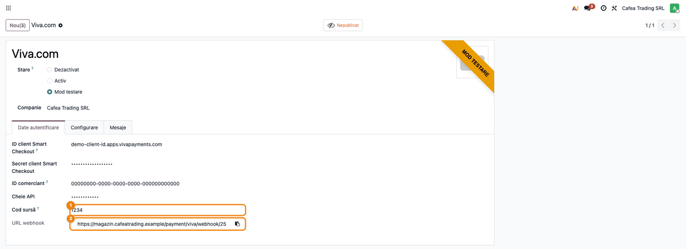
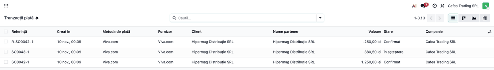
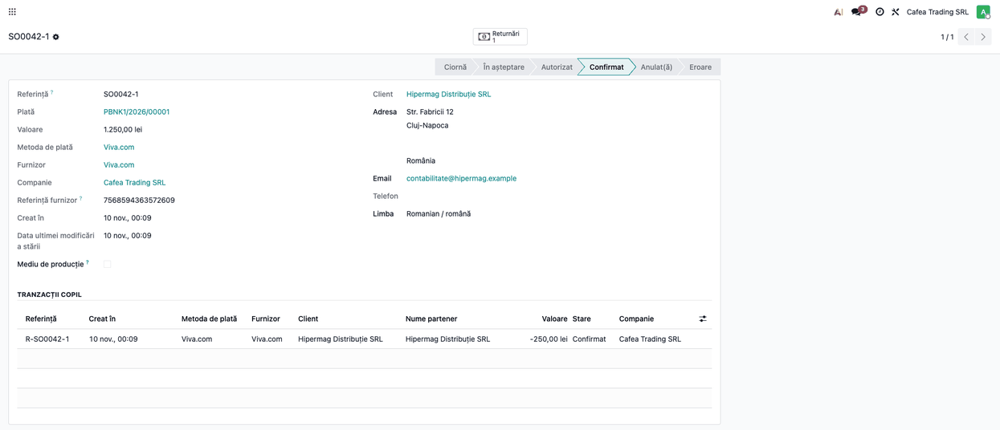
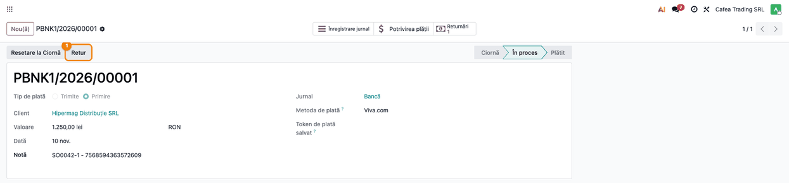
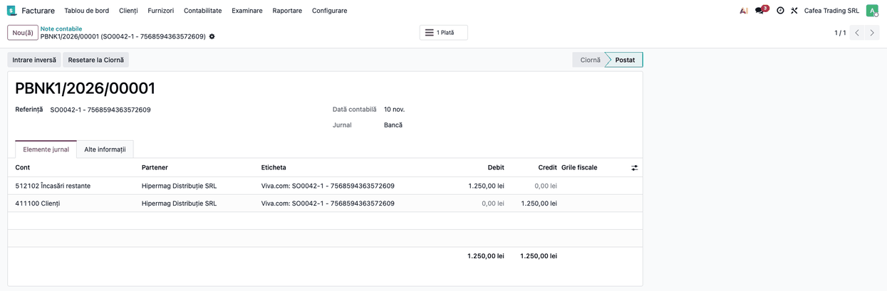
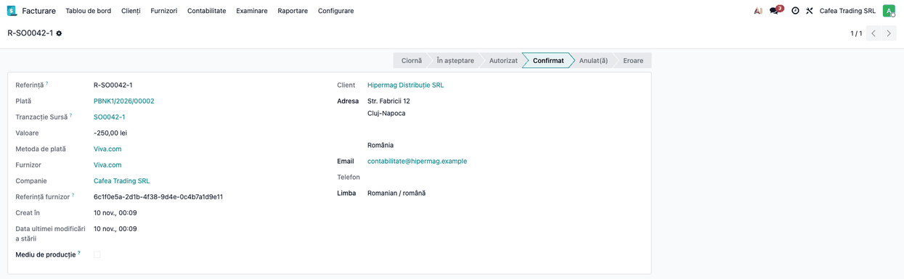

# Fișă Modul: Încasări online cu cardul prin Viva.com

**Modul:** `deltatech_payment_viva`
**Utilizator principal:** contabil / administratorul magazinului online (configurare, urmărirea încasărilor și rambursări)
**Prioritate:** 🟡 Medie (conector de plată opțional: se instalează doar la clienții care au cont Viva.com)

## 1. Scop business

Magazinul online (și linkurile de plată trimise clienților) poate primi plata cu cardul, Apple Pay sau Google Pay prin
**Viva.com Smart Checkout**, pagina de plată găzduită de Viva.com. Clientul plătește pe pagina Viva.com, iar Odoo află
rezultatul direct de la Viva.com: comanda se confirmă și plata se înregistrează fără ca cineva să verifice manual
extrasul. Modulul vorbește cu Viva.com direct, cu contul propriu al firmei: nu există un server intermediar și nici
un comision per tranzacție peste cel al Viva.com.

Se adresează firmelor cu cont Viva.com și magazin online (sau facturi plătite prin link de plată) în Odoo.

## 2. Bază legală și context

Nu există o bază legală proprie modulului: Viva.com este cel care procesează plata și autentifică clientul (SCA/3D
Secure) pe pagina lui. Contextul operațional pe care trebuie să-l cunoască consultantul:

- plata este autorizată de Viva.com; Odoo înregistrează încasarea doar după ce **verifică** tranzacția la Viva.com
  (comandă, sumă și monedă);
- Viva.com virează banii în contul bancar al firmei, după regulile lui de decontare, iar **comisionul Viva.com
  nu este calculat de modul**: Viva.com îl reține din sumele încasate și virează suma netă, comisionul apare în
  raportul sau factura Viva.com, iar contabilul îl înregistrează la decontare;
- se acceptă monedele CZK, DKK, EUR, GBP, HUF, PLN, RON și SEK; metodele de plată oferite clientului (carduri,
  Apple Pay, Google Pay, Klarna, plata la livrare etc.) depind de țara contului Viva.com și de ce a activat
  comerciantul în contul lui.

## 3. Utilizatori și roluri

| Rol | Ce face |
|---|---|
| Administrator (grup Setări) | introduce datele de autentificare Viva.com pe provider; ele sunt vizibile doar acestui grup |
| Contabil | urmărește tranzacțiile, reconciliază încasările cu extrasul și face rambursările |
| Client (vizitator al magazinului) | alege Viva.com la finalizarea comenzii și plătește pe pagina Viva.com |

## 4. Conturi și date implicate

- **Jurnalul providerului** (de tip bancă): încasările online se înregistrează pe el, ca plăți în curs, până la
  reconcilierea cu extrasul. În planul RO din Odoo contul implicit este 512102 „Încasări restante” (vezi captura notei contabile); contabilul
  poate alege pe jurnal un alt cont de încasări în curs, de exemplu 5125 „Sume în curs de decontare”, pe ambele
  sensuri (încasări și plăți).
- **Cont de client (4111)**: se stinge prin plata înregistrată.
- **Comision Viva.com**: se contabilizează pe 627 „Cheltuieli cu serviciile bancare și asimilate” la decontare, pe
  baza raportului Viva.com; modulul nu îl calculează. Tratamentul TVA al comisionului (factură de la un prestator
  din UE) se verifică cu contabilul.
- **Date necesare din contul Viva.com:** Client ID și Client Secret (Smart Checkout), Merchant ID, API Key și
  codul de 4 cifre al sursei de plată.

## 5. Configurare inițială

1. În aplicația bancară Viva.com (demo sau live) creați o **sursă de plată** pentru site. Setați **adresa de succes**
   și **adresa de eșec** la `https://<site>/payment/viva/return` și notați **codul sursei** (4 cifre).
2. În **Setări → Acces API** copiați datele **Smart Checkout** (Client ID, Client Secret), **Merchant ID** și
   **API Key**.
3. În Odoo deschideți **Contabilitate → Configurare → Plăți online → Furnizori de plată → Viva.com**.
4. Pe tabul **Date autentificare** completați ID client Smart Checkout, Secret client Smart Checkout, ID comerciant, Cheie API și
   Cod sursă (vezi pasul 1 din fluxul de mai jos, care arată formularul completat).
5. Pe tabul **Configurare** alegeți **Jurnalul** providerului (de tip bancă) și, la nevoie, țările și monedele
   pentru care se oferă plata.
6. În Viva.com, la **Setări → Acces API → Webhooks**, creați două webhook-uri cu **URL webhook** de pe formularul
   din Odoo, pentru evenimentele **Transaction Payment Created** și **Transaction Failed**, și apăsați **Verify**.
7. Publicați providerul, ca să apară clienților la finalizarea comenzii (butonul **Nepublicat/Publicat** din
   antetul formularului). Lăsați bifa **Live** debifată pentru încercări cu un cont Viva.com demo, apoi bifați-o pentru plăți
   reale. Bifa **Live** determină și mediul folosit: demo sau live.

## 6. Flux de utilizare

### Pasul 1 — Datele providerului Viva.com

**Meniu:** Contabilitate (sau Facturare, fără modulul Enterprise de contabilitate) → Configurare → Plăți online → Furnizori de plată → Viva.com

Pe tabul **Date autentificare** se completează datele din contul Viva.com. Secretele (Secret client Smart Checkout, Cheie API) se
afișează mascat. Câmpul **URL webhook** se copiază în Viva.com, cu butonul de copiere de lângă el.



### Ce se întâmplă între pași: clientul plătește pe pagina Viva.com

Această etapă se petrece în afara ecranelor Odoo și nu este un pas al operatorului. La finalizarea comenzii în magazin (sau din
linkul de plată de pe factură) clientul alege **Viva.com**, este trimis pe pagina Smart Checkout, plătește (limba
paginii și metodele de plată oferite țin de țara și limba clientului din fișa de partener) și revine în magazin.

Odoo nu consideră plata făcută pe baza revenirii clientului în magazin. Tranzacția este citită de la Viva.com, iar
plata se confirmă doar dacă **referința comenzii**, **suma** și **moneda** corespund. Confirmarea mai vine și prin
webhook, pentru cazurile în care clientul închide fereastra înainte de întoarcere.

### Pasul 2 — Urmărirea tranzacțiilor

**Meniu:** Contabilitate → Configurare → Plăți online → Tranzacții plată (vizibil în mod dezvoltator)

Lista arată fiecare încercare de plată prin Viva.com cu starea ei: **Confirmat** când Viva.com a confirmat plata,
**În așteptare** când plata nu s-a încheiat încă (de exemplu client care a plecat de pe pagina de plată), **Anulat(ă)** când comanda Viva.com a expirat sau a fost anulată de client ori când tranzacția Viva.com a fost anulată sau rambursată direct în contul Viva.com (statusurile *X* și *R*), **Eroare** când Viva.com a refuzat-o sau când
suma ori moneda nu corespund. O tranzacție rămâne în **Ciornă** cât timp clientul nu s-a întors din pagina de plată și
Viva.com nu a trimis încă confirmarea prin webhook.



### Pasul 3 — Tranzacția plătită

Deschideți tranzacția confirmată. **Referința furnizor** este codul comenzii Viva.com (16 cifre), cel pe care îl
căutați în aplicația bancară Viva.com la **Vânzări → Tranzacții**. Modulul păstrează intern și ID-ul tranzacției Viva.com (nu apare pe formular), necesar pentru rambursare.



### Pasul 4 — Plata contabilă și rambursarea

**Meniu:** Contabilitate → Clienți → Plăți

La confirmarea tranzacției Odoo creează o **plată contabilă** pe jurnalul providerului, cu metoda de plată Viva.com și
nota „referința comenzii - cod comandă Viva.com". Plata apare în starea **În proces**, adică încasată dar încă
nereconciliată cu extrasul bancar. Rambursarea se pornește din această plată, cu butonul **Retur**, pentru suma
totală sau o parte din ea.



Nota contabilă a plății se vede din butonul **Înregistrare jurnal**: suma brută încasată trece din 4111 în contul de
încasări în curs al jurnalului.



Rambursarea apare ca tranzacție copil, cu valoare negativă și legătură către **tranzacția sursă**; devine **Confirmat**
când Viva.com a acceptat-o. Dacă Viva.com o respinge (de exemplu fonduri insuficiente în cont, sumă peste plata
inițială sau rambursări neactivate), tranzacția rămâne în eroare cu mesajul primit.



### Note de monografie și raportare

Plata online confirmată creează în Odoo o plată pe jurnalul providerului, care stinge factura clientului. Liniile
exacte depind de conturile configurate pe jurnal; schema este:

| Eveniment | Debit | Credit |
|---|---|---|
| Plată confirmată de Viva.com | contul de încasări în curs al jurnalului (512102 Încasări restante în planul RO implicit) | 4111 Clienți (suma brută) |
| Rambursare confirmată | 4111 Clienți | contul de plăți în curs al metodei Viva.com de pe jurnal |
| Decontare: Viva.com virează suma netă, pe extras | 5121 Conturi la bănci în lei (suma netă) și 627 (comisionul) | contul de încasări în curs al jurnalului (suma brută) |

Pe extrasul bancar apare doar suma netă; diferența față de suma brută încasată online este comisionul reținut de
Viva.com. Dacă contul de încasări și cel de plăți în curs sunt același, rambursările și încasările se compensează pe el.
Contul exact depinde de configurația jurnalului.

Momentul decontării și valoarea comisionului se văd în raportul Viva.com și pe extrasul bancar, nu în modul.

## 7. Legături cu alte module / declarații

| Modul | Rol |
|---|---|
| `payment` și `account_payment` (Odoo) | tranzacțiile și plățile contabile create la confirmare |
| `website_sale` (Odoo) | oferă Viva.com la finalizarea comenzii, când este instalat |

**Automat:** crearea comenzii la Viva.com, trimiterea țării și a limbii clientului, verificarea plății (comandă,
sumă, monedă), confirmarea prin webhook, crearea plății contabile și trimiterea rambursării.

**Manual:** configurarea contului Viva.com (sursa de plată și webhook-urile), reconcilierea extrasului bancar,
contabilizarea comisionului Viva.com, activarea metodelor de plată (de pildă Klarna sau plata la livrare) în contul
Viva.com.

## 8. Verificări pentru consultant

- [ ] Sursa de plată din Viva.com are adresa de succes și adresa de eșec setate la `https://<site>/payment/viva/return`.
- [ ] Cele două webhook-uri (Transaction Payment Created, Transaction Failed) sunt create cu URL-ul de pe formular și
  verificate cu **Verify**.
- [ ] Providerul are jurnal de tip bancă și moneda comenzii este una dintre cele opt acceptate.
- [ ] O plată de test (cont demo, sumă de cel puțin 0,30) ajunge în **Confirmat** și are **Referința furnizor** completată.
- [ ] Închiderea ferestrei de plată înainte de întoarcere lasă tranzacția în **Ciornă**/**În așteptare**, iar webhook-ul o
  confirmă ulterior.
- [ ] Suma și moneda din Viva.com coincid cu cele din Odoo; o nepotrivire duce tranzacția în **Eroare**.
- [ ] Plata contabilă apare în **Contabilitate → Clienți → Plăți**, pe jurnalul providerului, și butonul **Retur** pornește rambursarea.
- [ ] Rambursarea parțială apare ca tranzacție copil **Confirmat** și în aplicația bancară Viva.com.
- [ ] Datele de autentificare nu sunt vizibile utilizatorilor fără drepturi de Setări.

## 9. Mesaje de eroare frecvente

| Mesaj | Cauză | Remediere |
|---|---|---|
| Autentificarea la Viva.com a eșuat | Client ID sau Client Secret greșit, sau mediu nepotrivit (demo față de live) | verificați datele și bifa **Live** a providerului (debifată = demo, bifată = live) |
| Viva.com nu a returnat un token de acces | Viva.com a răspuns la autentificare, dar fără token | verificați Client ID, Client Secret și mediul (demo față de live); reîncercați |
| Comunicarea cu Viva.com a eșuat | Viva.com sau rețeaua indisponibile; Merchant ID ori API Key greșite la rambursare | reîncercați; verificați Merchant ID și API Key |
| Plata a fost refuzată de Viva.com | cardul a fost refuzat sau plata a eșuat la Viva.com | clientul reîncearcă sau folosește alt card; verificați motivul în Viva.com |
| Datele de autentificare / ID-ul comerciantului și cheia API Viva.com nu sunt configurate | câmpuri necompletate pe provider | completați datele din pasul 1 |
| Suma este sub minimul acceptat de Viva.com | comandă sub 0,30 | comanda nu se poate plăti prin Viva.com |
| Viva.com nu a returnat un cod de comandă | răspuns incomplet de la Viva.com | verificați **Cod sursă** și contul Viva.com; dacă persistă, vedeți jurnalul serverului |
| Sumă Viva.com diferită / Monedă Viva.com diferită | suma sau moneda din Viva.com nu corespund tranzacției | tranzacția rămâne în eroare; verificați plata în Viva.com |
| Tranzacția Viva.com de rambursat nu este cunoscută | tranzacția nu a fost confirmată prin Viva.com | rambursarea nu se poate trimite; verificați plata în Viva.com |
| Rambursarea a fost respinsă de Viva.com | fonduri insuficiente, sumă peste plata inițială, rambursări neactivate în cont | vezi mesajul de pe tranzacție; activați rambursările în contul Viva.com |

## 10. Capturi de ecran

Capturile sunt **generate automat** din `tests/test_screenshots.py` (mixinul `ScreenshotCase`), în RO, pe planul
RO, cu date fictive (firma „Cafea Trading SRL", clientul „Hipermag Distribuție SRL"). Lista, în ordinea pașilor:

- `01_provider_viva.png`: formularul providerului Viva.com cu datele de autentificare, codul sursei și URL-ul webhook;
- `02_lista_tranzactii.png`: lista tranzacțiilor Viva.com (plătită, în așteptare, rambursare);
- `03_tranzactie_platita.png`: tranzacția plătită, cu referința furnizor și rambursarea copil;
- `04_plata_contabila.png`: plata contabilă creată la confirmare, cu butonul Retur evidențiat;
- `05_nota_contabila.png`: nota contabilă a plății (512102 Încasări restante / 411100 Clienți);
- `06_rambursare.png`: tranzacția de rambursare, cu legătura către tranzacția sursă și plata de retur.

Regenerare:

```
./odoo/odoo-bin -c odoo.conf -d <db> -i deltatech_payment_viva,l10n_ro,l10n_ro_doc_screenshots \
    --without-demo=all --test-tags=/deltatech_payment_viva:TestVivaScreenshots --stop-after-init
```

Pagina de plată Viva.com este a Viva.com, nu este un pas al operatorului și nu se capturează.

## 11. Observații pentru manual

- Insistați pe faptul că plata se confirmă prin verificarea la Viva.com, nu prin revenirea clientului în magazin.
- Explicați diferența dintre **Live** debifat (cont demo Viva.com) și **Live** bifat (cont live).
- Precizați că acest modul nu calculează comisionul Viva.com și nu aduce extrasul: reconcilierea rămâne la contabil.
- Preautorizările, plățile recurente și salvarea cardului nu sunt în această versiune.
