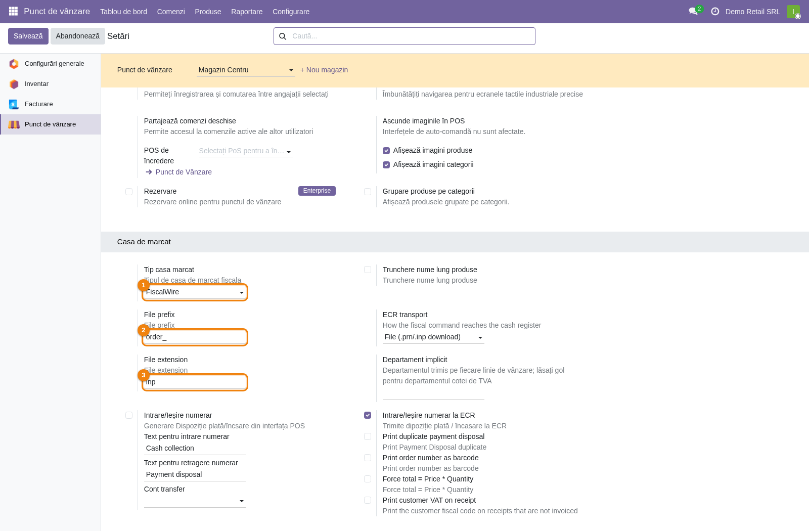
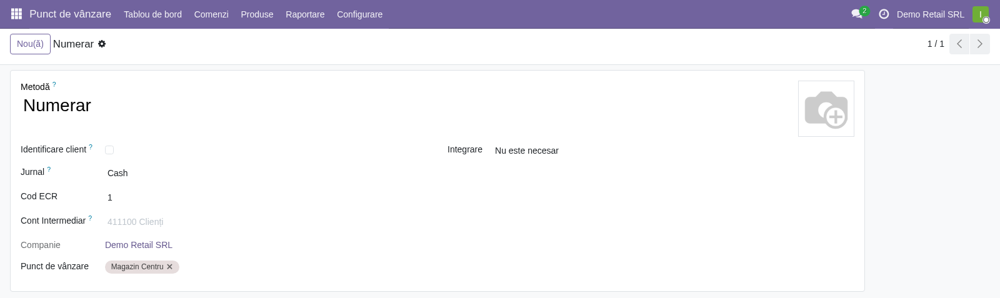
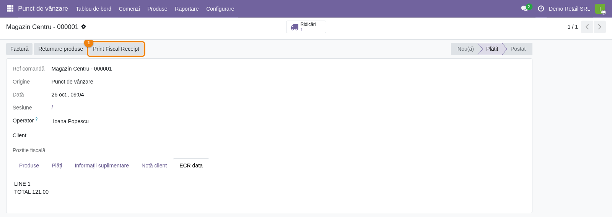
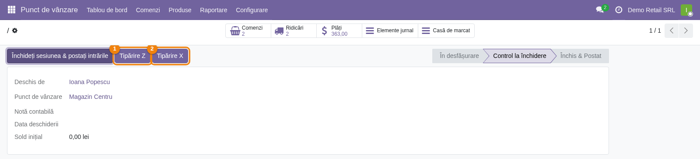
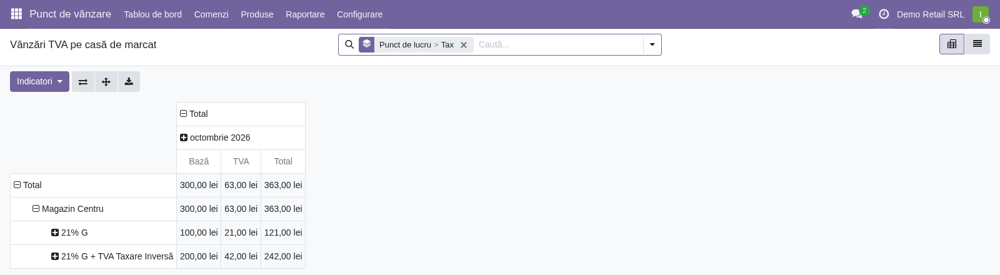
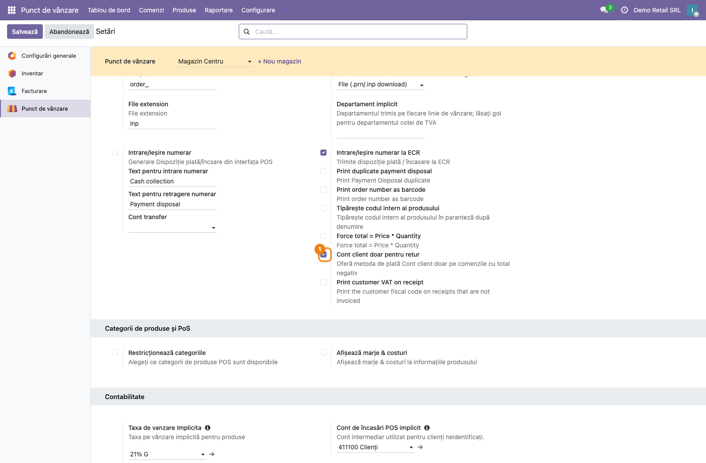
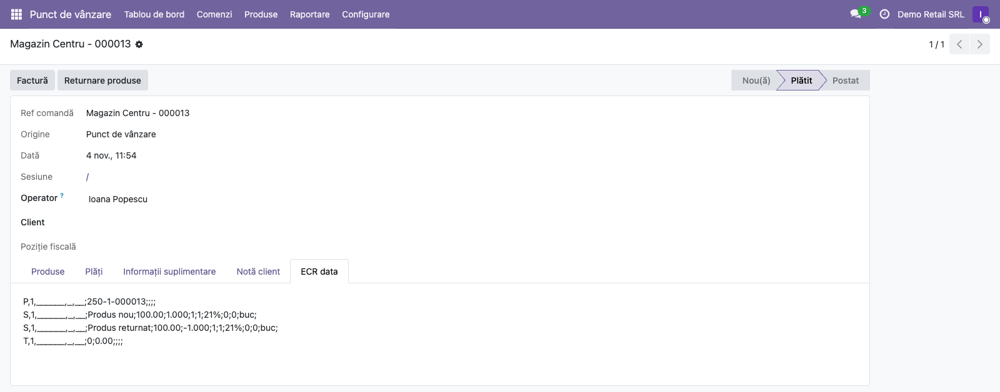
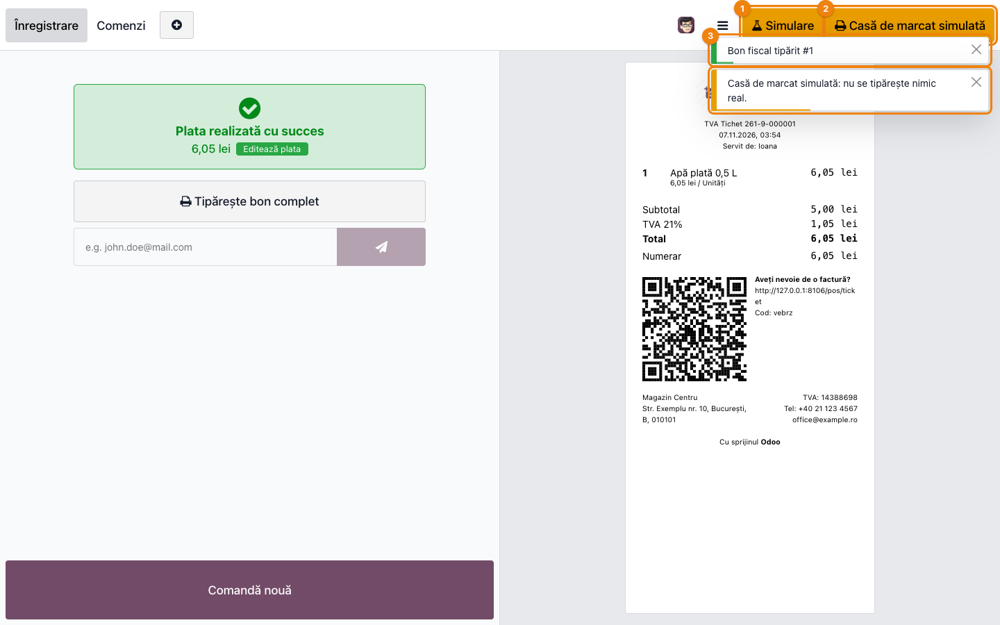
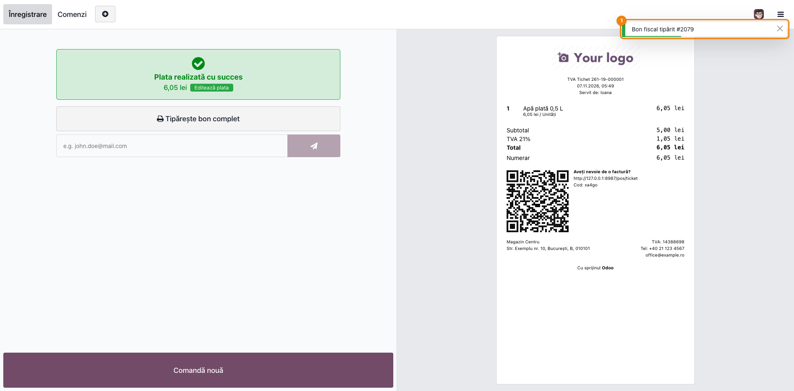

# Fișă Modul: Retail fiscal / AMEF — Print to ECR from POS

**Poziție plan:** C19  
**Modul:** `deltatech_pos`  
**FR:** FR-47  
**Capitol manual:** Cap 12.13  
**Utilizator principal:** Responsabil magazin/POS, Casier, Consultant implementare  
**Prioritate:** Ridicată

---

## 1. Scop business

Modulul conectează Odoo POS la casa de marcat fiscală prin fișiere ECR generate la validarea
bonului sau a operațiunilor de numerar. Consultantul trebuie să îl prezinte ca un strat de
integrare operațională pentru retail fiscal: Odoo pregătește fișierul în formatul așteptat de
driverul AMEF, iar aplicația/driverul local al casei de marcat îl preia și îl tipărește.

Modulul nu face comunicare hardware directă. Pe transportul prin fișier nu citește răspunsul fiscal înapoi în Odoo; prin Terrabit Connect, numărul bonului, documentul fiscal, raportul Z și starea tipăririi se salvează pe comandă, iar prin driverul DxPrint (casele Datecs și Daisy) se salvează numărul bonului, raportul Z și starea.

## 2. Bază legală și context

În România, vânzarea cu amănuntul cu numerar/card către populație se fiscalizează prin aparat de
marcat electronic fiscal (AMEF) — obligație stabilită prin OUG 28/1999. Un bon fiscal care conține
și CIF-ul clientului, sub plafonul legal, este considerat factură simplificată (Cod fiscal art. 319
alin. (12) lit. a)) — vezi Pasul 5 din Configurare inițială. În această implementare, `deltatech_pos`
acoperă partea de emitere a comenzii de tipărire fiscală din POS și operațiunile conexe:

- bon fiscal la validarea comenzii;
- cash in / cash out;
- raport X și raport Z;
- reimprimare manuală din backoffice a fișierului ECR deja generat.

Pentru raportarea D394 a bonurilor POS se folosește complementar
`l10n_ro_anaf_d394_pos`, nu acest modul.

## 3. Utilizatori și roluri

- Casier POS: emite bonul fiscal și operează cash in / cash out.
- Responsabil magazin: configurează POS-ul, metodele de plată și verifică sesiunile.
- Contabil / backoffice: poate reimprima fișierul fiscal al unei comenzi și verifică rapoartele X/Z.
- Consultant implementare: configurează tipul de ECR, extensia fișierului, prefixul și testează
  fiecare scenariu de fiscalizare.

## 4. Date implicate

- configurația POS (`pos.config`);
- metodele de plată POS și codul lor ECR (`pos.payment.method.cod_ecr`);
- comenzile POS (`pos.order`) și conținutul fișierului fiscal (`file`);
- sesiunile POS (`pos.session`);
- partenerul selectat pe comandă;
- fișierele descărcate pentru driverul AMEF: bon fiscal, cash opening, cash move, raport X/Z.

## 5. Configurare inițială

### Pasul 1 — Instalare și dependențe

1. Instalați `deltatech_pos_base`.
2. Instalați `deltatech_pos`.
3. Verificați că pe stația locală există driverul/utilitarul AMEF care preia fișierele generate de
   Odoo.

### Pasul 2 — Configurare ECR în POS

Mergeți la **Point of Sale → Configuration → Settings** și selectați POS-ul dorit.

Configurați:

- **Tip casa marcat**: `FiscalWire`, `Optima`, `Daisy`, `Succes`,
  `FiscalNet` sau `Incotex`;
- **Trim long product name** și lungimea maximă din **Trim to** (apare doar cu opțiunea activă), dacă modelul casei are limită strictă;
- **Transport ECR**: `Fișier (descărcare .prn/.inp)` (implicit), fișierul se descarcă și îl preia driverul local,
  sau `Terrabit Connect (agent local)`, comanda se trimite agentului local, care tipărește și întoarce
  rezultatul; dacă agentul nu răspunde, se descarcă fișierul; sau `DxPrint (driver local)`, bonul se
  trimite ca JSON driverului DxPrint (Datecs și Daisy, modul embedded), care tipărește și întoarce
  rezultatul; dacă driverul nu poate fi contactat, se descarcă fișierul. Cu DxPrint completați și
  **URL driver** (implicit `http://127.0.0.1:8080`) și, doar dacă driverul cere autentificare,
  **Utilizator** și **Parolă** (detalii în fișa `deltatech_ecr_connect`);
- **File prefix** și **File extension** pentru fișierul preluat de driver;
- **Cash In/Out** pentru operațiuni de numerar din POS;
- **Cash In/Out to ECR** pentru tipărirea dispozițiilor pe casa de marcat;
- **Print duplicate payment disposal** pentru al doilea exemplar la dispoziție;
- **Print order number as barcode** dacă driverul/modelul folosit suportă acest format — codul conține numărul bonului
  (**Receipt Number**, ex. `250-3-000012`);
  **Order barcode type** alege **Normal** sau **QR** (QR doar pe Datecs FiscalWire și Daisy,
  la celelalte rămâne codul normal). Selecția **Order barcode type** apare în Settings doar cât
  timp **Print order number as barcode** este bifată; implicit este **Normal**. Codul se poate
  scana în lista de comenzi din POS, fără a intra în câmpul de căutare, ca să găsești comanda după
  numărul bonului (vezi Pasul 3 din Flux de utilizare).
- **Tipărește codul intern al produsului** (în interfața în engleză **Print product internal
  reference**; eticheta românească vine din traducerea modulului; implicit dezactivată) dacă pe bon trebuie să apară și
  codul intern al produsului, în paranteză după denumire (ex. `Grinzi 10/10x4m (172006)`), ca
  marfa să poată fi eliberată din depozit după cod. Cu **Trim long product name** activ,
  denumirea se scurtează ca să încapă codul în lungimea din **Trim to**; codul nu se taie. Dacă codul
  (cu paranteze) ocupă toată lungimea din **Trim to**, nu se mai tipărește, iar linia rămâne doar cu
  denumirea, tăiată la limită — alegeți în **Trim to** o lungime care lasă loc și denumirii.
- **Customer Account only for refunds** (în interfața în română: **Cont client doar pentru retur**;
  implicit dezactivată) dacă metoda de plată **Customer Account** (**Cont client**) trebuie folosită
  doar pentru diferența unui retur lăsată ca sold pe client, nu pentru vânzări pe credit. Cu opțiunea
  activă, metoda apare pe ecranul de plată doar când totalul comenzii este negativ (vezi Pasul 6 din
  Flux de utilizare). Metoda **Customer Account** trebuie să existe în **Point of Sale → Configuration →
  Payment Methods** și să fie legată de punctul de vânzare. Opțiunea privește **orice** metodă de plată
  fără jurnal (tipul „Customer Account”), nu doar pe cea numită așa. Pe metodă, **Identify Customer**
  (**Identificare client**) trebuie să fie bifat: doar atunci creditul se înregistrează pe contul de
  creanțe al clientului; fără bifă, creditul ajunge pe contul de încasări POS implicit (sau pe **Cont
  Intermediar** al metodei, dacă e completat), fără client. Metoda creată automat de Odoo are bifa
  activă.

### Pasul 2b — Casa de marcat simulată (opțional, pentru teste și instruire)

Pe un punct de vânzare de test, cu **Transport ECR** = `Terrabit Connect (agent local)`, câmpul
**Simulare** (din `deltatech_pos_base`) pornește casa de marcat simulată:

- **Simulată în Odoo (fără agent)** — browserul joacă rolul casei; nu e nevoie de agent pe stație;
- **Simulată prin agent** — agentul Terrabit Connect de pe stație trebuie pornit cu variabila de mediu
  `TERRABIT_FISCAL_DRIVER=simulated`; un agent pe driverul real nu primește niciun bon;
- **Întârziere (ms)** — cât așteaptă casa simulată înainte să răspundă.

Simularea citește doar formatul FiscalWire, deci **Tip casa marcat** rămâne
`FiscalWire`. Nimic din ce se tipărește în simulare nu este bon fiscal: casele magazinelor în
funcțiune nu se lasă niciodată în simulare. Pașii de folosire sunt la Pașii 8–9 din Flux de utilizare.

### Pasul 3 — Configurare metode de plată

În **Point of Sale → Configuration → Payment Methods** completați **Cod ECR** pe fiecare metodă
de plată conform așteptărilor driverului local (de exemplu numerar, card etc.).

### Pasul 4 — Configurare jurnal pentru bonuri simplificate

În setările POS completați câmpul **Receipts** (jurnalul de facturi bonuri, `invoice_receipts_journal_id`)
dacă doriți generarea de documente contabile de tip `out_receipt` în jurnal separat pentru
bonuri/facturi simplificate.

### Pasul 5 — CIF-ul clientului pe bon (factură simplificată)

Dacă activați **Print customer VAT on receipt** în setările POS, bonul fiscal al unei vânzări
nefacturate poate tipări și CIF-ul clientului, atunci când acesta e completat pe partener — bonul
devine astfel **factură simplificată** (Cod fiscal art. 319 alin. (12) lit. a)). CIF-ul se tipărește
doar sub plafonul legal, configurat în **VAT print limit** (implicit 490 lei); peste acest plafon,
vânzarea trebuie facturată normal, nu pe bon cu CIF.

## 6. Flux de utilizare

### Pasul 1 — Configurarea ECR pe punctul de lucru

Mergeți la **Point of Sale → Configuration → Settings**, selectați POS-ul dorit și completați
secțiunea ECR: tipul aparatului, prefixul/extensia fișierului, opțiunile de cash in/out și ce se
tipărește pe bon (**Print order number as barcode**, **Tipărește codul intern al produsului**), detaliate
la secțiunea 5, Configurare inițială. Dacă bonul trebuie să poarte numărul comenzii ca cod de bare,
bifați **Print order number as barcode**; imediat dedesubt apare **Order barcode type** (**Normal**
sau **QR**), vizibil doar cât timp bifa este activă. Efectul opțiunilor pe bon e descris la Pasul 3.



### Pasul 2 — Codul ECR pe metodele de plată

În **Point of Sale → Configuration → Payment Methods**, fiecare metodă de plată are câmpul
**Cod ECR** — valoarea pe care driverul o trimite aparatului pentru acea metodă. Pe Datecs FiscalWire 2018,
0 înseamnă numerar și 1 card; pe celelalte modele de casă valorile se iau din documentația driverului.



### Pasul 3 — Emiterea și reimprimarea bonului fiscal

La validarea comenzii în POS, modulul pregătește fișierul ECR (bon fiscal), pe transportul prin fișier îl
descarcă local cu prefixul și extensia configurate, iar driverul AMEF îl preia și îl tipărește; prin
Terrabit Connect îl trimite agentului local și salvează pe comandă rezultatul; prin DxPrint îl trimite
ca JSON driverului local și salvează pe comandă numărul bonului și raportul Z (Pasul 10). Pe bon se trimit
numele clientului (dacă e selectat), referința comenzii, notele, liniile de produs cu TVA,
discounturile și totalurile pe tipuri de plată.

Cu **Tipărește codul intern al produsului** activ, fiecare linie de produs are pe bon codul intern în
paranteză după denumire, de exemplu `Grinzi 10/10x4m (172006)`; produsele fără cod intern se
tipăresc doar cu denumirea. Opțiunea schimbă doar bonul fiscal: în ecranul de vânzare din POS și
pe factură linia rămâne cu denumirea produsului.

Cu **Print order number as barcode** activ, la finalul bonului se tipărește un cod de bare cu
numărul bonului (**Receipt Number**, ex. `250-3-000012`), același cu referința din antet; scanat în
lista de comenzi din POS, găsește comanda (de exemplu pentru un retur).

Rezultatul se vede și din backoffice: în **Point of Sale → Orders**, comanda plătită are tabul
**ECR data** cu textul fișierului generat (referința comenzii apare separat, în tabul „Informații
suplimentare"). Cât timp comanda e `paid` și bonul **nu a fost încă tipărit**, butonul
**Print Fiscal Receipt** permite generarea locală a fișierului pentru driver, fără să refaceți
vânzarea — util, de exemplu, dacă tipărirea automată de la validare a eșuat. După prima apăsare,
butonul **dispare definitiv** de pe acea comandă (starea de „bon tipărit" nu se poate reseta din
UI); dacă tipărirea eșuează totuși la această a doua încercare, verificați driverul/utilitarul
local, nu reveniți pe aceeași comandă din Odoo.



**Căutarea bonurilor în POS (ecranul de comenzi).** Termenul tastat în căutare se trimite la server,
deci un bon mai vechi (peste una-două zile) se găsește chiar dacă nu face parte din cele 30 de
comenzi încărcate pe pagină — de exemplu pentru un retur. Se poate căuta după **Receipt Number**,
**Order Number**, **Date**, **Customer** și, când câmpul e afișat, **Cardholder Name**. Până la
versiunea 19.0.2.10.6 căutarea filtra doar comenzile deja încărcate.

**Scanarea bonului în ecranul de comenzi.** Dacă pe bon s-a tipărit numărul comenzii ca cod de bare
sau QR (**Print order number as barcode**), codul se poate scana direct în ecranul de comenzi din
POS, fără să faceți clic în câmpul de căutare. POS-ul trece pe comenzile sincronizate, caută după
**Receipt Number** valoarea scanată și selectează comanda găsită, de exemplu pentru un retur. Dacă
nicio comandă nu corespunde codului, apare avertismentul „No order found for <cod>". Scanerul trebuie
să citească tipul de cod tipărit; unele scanere au QR dezactivat din fabrică.

### Pasul 4 — Rapoarte X și Z, cash in / cash out

Din sesiunea POS din backoffice (**Point of Sale → Orders → Sessions**) se pot genera rapoartele
**Print X** și **Print Z** — sistemul descarcă fișierul specific modelului ECR, cu numele
`cash_box_<sesiune>_close.<ext>`. La deschiderea sesiunii, dacă e activ `Cash In/Out to ECR` și suma
de deschidere e pozitivă, se descarcă automat și `cash_open.<ext>`; pentru operațiuni ulterioare de
numerar (**Cash collection**/**Payment disposal**, din POS), sistemul cere partener pe comandă și
descarcă `cash_move.<ext>` pentru tipărire pe AMEF, dacă opțiunea e activă.

Pe transportul DxPrint, aceleași operațiuni pornite din POS nu mai descarcă fișiere, ci trimit cereri
proprii driverului (Pasul 10): rapoartele X și Z din fereastra de închidere a sesiunii, numerarul de la
deschidere, intrările/ieșirile de numerar și încasarea/plata cu chitanța pentru client. Butoanele
**Print X** și **Print Z** din sesiunea din backoffice descarcă în continuare fișierul.

> **Atenție**: „Print X" și „Print Z" generează fișierul **cu același nume** pe aceeași sesiune —
> a doua apăsare șterge atașamentul creat de prima. Descărcarea imediată (la momentul apăsării) nu
> e afectată, dar nu puteți reobține mai târziu, din atașamentele sesiunii, ambele fișiere deodată;
> doar ultimul generat rămâne disponibil pentru redescărcare.



### Pasul 5 — Raportul „Vânzări TVA pe casă de marcat"

Din **Point of Sale → Reporting → VAT Sales by Fiscal Device** se deschide un raport centralizat al
vânzărilor prin casa de marcat, pe orice interval de dată, grupat pe **punct de lucru** (casă de
marcat) și **taxă** (`tax_name`), cu bază, TVA și total. Vederea implicită e pivot. Filtrul „ECR
Receipt Text" (`receipt_print`) e disponibil, dar **nu e activ implicit** — pe bazele migrate sau în
perioadele în care integrarea ECR nu a rulat, câmpul poate fi fals deși bonul a fost tipărit fizic;
aplicat implicit ascundea luni întregi de vânzări reale.

Gruparea principală e pe **numele taxei**, nu pe cota numerică (`vat_rate`, păstrată doar pentru
compatibilitate) — mai multe taxe diferite (SGR, taxare inversă, scutiri) au toate cota 0% și s-ar
cumula fără distincție sub o singură cifră. Liniile cu **două taxe procentuale simultan pe aceeași
linie** (configurare de verificat — o linie ar trebui să aibă o singură taxă) sunt semnalate explicit
prin câmpul `multi_tax` și apar pe raport cu numele ambelor taxe concatenate (ex. „TVA colectat 21%
Bunuri + TVA Taxare Inversa"); pe acestea, valoarea din coloana TVA poate reflecta suma tuturor
taxelor liniei, nu doar a celei citite din `vat_rate`.

Sursa e strict `pos.order.line` — nu recalculează nimic, doar agregă live liniile comenzilor plătite
sau postate (`state in ('paid', 'done')`); o linie fără nicio taxă procentuală (scutită) apare cu
`tax_name = "Fără taxă TVA"`.

Pentru detaliere pe comandă individuală, treceți din pivot în vederea listă (fiecare rând arată
comanda sursă).



> **Notă de reconciliere cu jurnalul ANAF/AMEF.** Raportul citește direct din Odoo
> (`pos.order.line`), nu din jurnalul electronic al aparatului fiscal — acest modul nu importă și nu
> citește arhiva/XML-ul casei de marcat. Pentru un client la care valorile trebuie verificate exact
> față de ce a transmis aparatul la ANAF, raportul e un punct de plecare pentru reconciliere, nu o
> citire directă a arhivei oficiale. De asemenea, raportul acoperă doar vânzările din fluxul POS
> (`pos.order`) — dacă un client emite și bonuri fiscale prin fluxul separat de facturare la bon
> fiscal (`deltatech_sale_store`, neinstalat împreună cu acest modul la majoritatea clienților),
> acele vânzări nu apar aici.

### Pasul 6 — Retur lăsat ca sold pe client (Customer Account)

Când o comandă de retur are totalul negativ, diferența se poate: da clientului în numerar (se emite
dispoziție de plată), returna pe card (pe un punct de vânzare fără terminal de plată legat la POS,
rambursarea se face manual, pe terminalul bancar) sau lăsa ca sold pe contul clientului, cu metoda de
plată **Customer Account** (**Cont client**). Pentru **Customer Account** trebuie selectat clientul pe
comandă. Cu modulul enterprise **POS Settle Due** instalat, POS afișează la alegerea clientului și
soldul lui.

O plată negativă pe **Customer Account** nu scoate bani din sertar și nu trimite niciun document la casa
de marcat (ca la rambursarea pe card). Contabil, la închiderea sesiunii se înregistrează o linie de
credit pe contul de creanțe al clientului, nereconciliată, cu condiția ca **Identify Customer** să fie
bifat pe metodă (Pasul 2 din Configurare inițială).

**Documentul fiscal al returului pe card sau Customer Account.** Fiindcă nu iese nimic pe casă,
reducerea bazei de TVA a returului (art. 287 lit. b Cod fiscal, pct. 32 din Norme) se documentează cu o
**factură cu valori negative**, care face trimitere la bonul fiscal inițial; la persoanele juridice
factura de stornare e obligatorie, ca firma să-și poată ajusta deducerea. Pe lângă ea se păstrează
procesul-verbal de retur și dovada rambursării (slipul de refund de la terminal sau fișa contului
clientului). Dispoziția de plată rămâne documentul rambursării în numerar. `deltatech_pos` nu emite
factura: o emite modulul `l10n_ro_pos_returns` (suita `l10n_ro_ent`), dacă pe punctul de vânzare e
bifată opțiunea **Automatic Return Invoice** (implicit dezactivată); tot el cere clientul identificat
pe orice retur și scrie în notă trimiterea la bon. Fără modul sau fără opțiune, factura cu minus se
emite manual din comanda de retur.

**Atenție — produse noi pe o comandă cu total negativ.** Când returul e combinat cu produse noi și
totalul rămâne negativ, produsele noi nu se tipăresc pe niciun bon fiscal: pe numerar casa primește
doar dispoziția de plată pentru diferență, iar pe card sau **Customer Account** nu primește nimic.
Odoo acceptă produsele noi pe comanda de retur și calculează corect totalul, TVA-ul, factura și
nota de sesiune; limitarea ține de casa de marcat, nu de Odoo, pentru că o casă nu are document
fiscal pentru un total negativ. De aceea, la un schimb cu total negativ recomandați
două comenzi: returul separat, iar vânzarea nouă pe bon fiscal propriu (aceeași recomandare o dă
dialogul **Negative VAT total** (**Total TVA negativ**), când pe comandă sunt cote de TVA diferite). La
un schimb cu total pozitiv sau zero produsele noi și returul se tipăresc pe un singur bon fiscal
(Pasul 7). Un retur pur, fără produse noi, nu e blocat de dialogul „Negative VAT total”, nici dacă
are linii la două cote de TVA (vezi Pasul 7). Cum se tratează fiscal un schimb, cu contabilul.

Cu **Customer Account only for refunds** (**Cont client doar pentru retur**) activă:

- pe ecranul de plată, metoda **Customer Account** este oferită doar când totalul comenzii este negativ;
  la total zero sau pozitiv nu mai apare în lista metodelor de plată;
- dacă pe comandă rămâne o plată pe **Customer Account** și totalul devine zero sau pozitiv (de exemplu
  după ce adăugați produse, sau cu un buton de plată rapidă, care nu trece prin ecranul de plată),
  validarea este blocată cu dialogul **Customer Account not allowed** (**Cont client nu este
  permis**); ștergeți linia de plată sau modificați comanda;
- linia care a rămas pe comandă se șterge din ecranul de plată. Cu **Identify Customer** bifat, Odoo nu
  permite metoda la **One-click Payment** (**Plată cu un singur clic**); doar fără bifă ar putea fi
  adăugată de un buton de plată rapidă la un total pozitiv, iar validarea ar fi blocată;
- consecință: din POS nu se mai pot lăsa vânzări pe credit pe **Customer Account**;
- depunerea de bani și achitarea soldului clientului din **POS Settle Due** (enterprise) nu sunt
  afectate: comenzile formate numai din linii de depunere sau de achitare sunt exceptate de la regulă.
  Dacă pe o astfel de comandă se adaugă și produse, regula se aplică din nou.



### Pasul 7 — Retur schimbat pe produse noi: bon fiscal cu retur

**Cum se pornește schimbul.** Din ecranul **Orders** (**Comenzi**) căutați comanda inițială după
numărul bonului, selectați-o, apăsați **Refund** (**Rambursare**) și alegeți produsele și
cantitățile returnate. POS creează o comandă nouă, cu titlul „(Rambursare)”, în care liniile
returnate au cantitate negativă. Pe **aceeași comandă** atingeți produsele noi pe care le cumpără
clientul: produsul se adaugă normal, fără alertă. Fără modulul, Odoo refuza produsul cu mesajul
„Ensure you validate the refund before taking another order”, deci returul nu se putea plăti cu
alte produse pe aceeași comandă. Apoi selectați clientul și treceți la plată. Suma finală a comenzii
hotărăște ce primește casa de marcat: se aplică ce urmează pentru total pozitiv sau zero, iar
Pasul 6 pentru total negativ.

Când returul se combină cu produse noi, iar totalul comenzii rămâne **pozitiv sau zero**, comanda se
tipărește pe **un singur bon fiscal**. Pe Datecs FiscalWire și Incotex produsele noi apar ca
vânzare, iar produsele returnate ca linii cu cantitate negativă. Pe FiscalNet returul se
tipărește ca reducere pe subtotal, fără numele produsului returnat; pe Succes comanda de reducere
există, dar sensul ei nu e confirmat, deci se verifică pe casă. Pe Optima și Daisy un retur pe același
bon cu produse noi nu e suportat (lipsește șablonul de subtotal, iar în fișier ajunge text în loc de
comandă): returul se face pe o comandă separată. Cu totalul negativ se aplică Pasul 6.

**Ordinea liniilor pe bon.** Pe casele care tipăresc returul ca linie de vânzare cu cantitate
negativă (Datecs FiscalWire, Incotex), liniile cu total negativ se trimit **după** cele pozitive,
indiferent de ordinea din POS; ordinea relativă din fiecare grup se păstrează. Casa refuză un bon
care începe cu o linie negativă. Pe celelalte tipuri de casă ordinea rămâne cea din comandă, pentru
că acolo o linie negativă devine reducere, iar poziția ei contează: pe FiscalNet și Succes adăugați
întâi produsele noi și abia apoi returul, ca reducerea să se aplice pe un subtotal existent.

**Bonul cu total 0.** La un schimb de produse de aceeași valoare (retur de 100 lei, produse noi de
100 lei) comanda nu are nicio plată: POS-ul șterge liniile de plată cu suma 0 la validare, deci
operatorul nu trebuie să aleagă nicio metodă. Bonul se încheie automat cu o linie de total de **0.00
în numerar**, cu codul 0 trimis fix, nu cel din **Cod ECR** al metodei de numerar. Codul 0 înseamnă
numerar pe Datecs FiscalWire 2018; pe celelalte modele de casă trebuie verificat. Dacă pe comandă
există o plată reală, nu se mai adaugă nimic.



**Cote de TVA diferite.** Dacă o cotă iese negativă pe total (de exemplu retur la 21% și produse noi
la 11%), POS blochează validarea cu dialogul **Negative VAT total** (**Total TVA negativ**), indiferent de suma finală a
comenzii: și la total pozitiv, zero sau negativ. Un **retur pur**, fără nicio linie cu valoare
pozitivă, nu e verificat, oricâte cote ar avea (de exemplu un produs la 21% și unul la 11%, sau un
produs la 21% și garanția SGR la 0%): nu se tipărește bon fiscal, deci casa nu are ce refuza. Pe numerar
merge dispoziția de plată, iar pe card sau **Customer Account** nu se trimite niciun document. O linie
fără TVA sau cu cota 0% (inclusiv garanția SGR) contează ca o cotă separată în verificarea unui schimb.
Pentru schimb, returul se face pe o comandă separată sau se ajustează
liniile, ca fiecare cotă să rămână pozitivă. Verificarea se face după cota procentuală, nu după
**Cod ECR**: două taxe cu aceeași cotă (de exemplu 0% taxare inversă și 0% bunuri) se însumează în
aceeași grupă.

### Pasul 8 — Bara POS pe o casă de marcat simulată

Pe un punct de vânzare cu **Simulare** pornită (Pasul 2b din Configurare inițială), bara de sus a POS
arată, numerotate pe captură:

1. butonul galben **Simulare**, care deschide panoul **Dispozitive virtuale** (Pasul 9);
2. butonul casei de marcat: cu **Simulată în Odoo (fără agent)** e galben, cu textul **Casă de marcat
   simulată**; cu **Simulată prin agent** și agentul pornit e verde, cu textul **Casă de marcat
   (simulată)** — eticheta arată doar că agentul răspunde, nu că rulează în mod simulat: dovada este
   bonul de pe rola panoului sau dialogul de refuz (AMEF-31); pe o casă reală e verde, **Casă de marcat**, sau roșu, **Casa de marcat e offline**;
3. la clic pe butonul casei, în modul fără agent, apare avertismentul „Casă de marcat simulată: nu se
   tipărește nimic real.” — nu se mai interoghează niciun agent.

Casierul vinde ca de obicei. După **Validează**, mesajul „Bon fiscal tipărit #1” arată numărul dat de
casa simulată; pe comandă se salvează, ca la o casă reală prin Terrabit Connect, numărul bonului, al
documentului și al raportului Z. În plus, comanda primește bifa **Bon simulat** (`fiscal_simulated`,
câmp din `deltatech_ecr_fiscal`), tot din răspunsul casei simulate (cu **Simulată în Odoo (fără agent)**
sau cu agentul în mod simulat): bonul nu e un document fiscal. Modulele de conformitate fiscală
(`l10n_ro_pos_fiscal_compliance` și `l10n_ro_pos_fiscal_compliance_ecr`) dau unei astfel de comenzi
starea **Bon simulat** și o lasă în afara raportului Z și a potrivirii cu jurnalul AMEF.



### Pasul 9 — Panoul Dispozitive virtuale din POS

Apăsați **Simulare**. În dreapta se deschide panoul **Dispozitive virtuale** cu casa punctului de
vânzare deschis. Pe captură sunt evidențiate:

1. **rola** casei simulate: fiecare document cu antetul `*** SIMULARE ***`, liniile cu grupa de TVA
   (A = 21%, B = 11%, C/D/E = 0%), totalul, plățile și numerele **BF**, **NR**, **Z**; verificați aici
   că produsele și metodele de plată ajung pe grupa și tipul de plată așteptate;
2. **Următorul răspuns** — implicit **După sumă (automat)**; alegeți o eroare (de exemplu **Lipsă
   hârtie**) ca să exersați cu casierul dialogul **Eroare casă de marcat**; cu **Până la oprire**
   bifat răspunsul rămâne până îl schimbați.

Tot în panou: **Întârziere**, **Raport X**, **Raport Z** și **Resetează ziua** (detaliate în fișa
`deltatech_ecr_connect`). Rapoartele X și Z cerute la închiderea sesiunii ajung pe aceeași rolă. Același
panou se deschide și din backend, din butonul **Simulare** din bara de sus a Odoo.


**Mesaje pe casa simulată.**

| Mesaj | Cauză | Remediere |
|---|---|---|
| Casă de marcat simulată: nu se tipărește nimic real. (avertisment) | clic pe butonul casei, cu **Simulată în Odoo (fără agent)** | informativ; casa nu e reală |
| Agentul Terrabit Connect nu e în mod simulat (TERRABIT_FISCAL_DRIVER=simulated): bonul nu a fost trimis. | **Simulată prin agent**, iar agentul rulează cu driverul real | reporniți agentul cu `TERRABIT_FISCAL_DRIVER=simulated` și apăsați **Reîncercați**, sau treceți pe **Simulată în Odoo (fără agent)** |
| Lipsă hârtie / Casa de marcat e deconectată / Niciun răspuns de la casa de marcat | răspunsul ales în panou, sau totalul terminat în `,91`, `,92`, `,94` | scenariul cerut; **Reîncercați** după ce răspunsul „o singură dată” s-a consumat |
| Format nesuportat de simulator: … | **Tip casa marcat** nu este FiscalWire | alegeți `FiscalWire` pe punctul de vânzare de test |

Lista completă a mesajelor casei simulate este în fișa `deltatech_ecr_connect`.

### Pasul 10 — Tipărirea prin driverul DxPrint

Pe un punct de vânzare cu **Transport ECR** = `DxPrint (driver local)` (Pasul 2 din Configurare
inițială), casierul lucrează ca de obicei; diferența e doar în ce primește casa:

| Operațiune în POS | Ce se trimite driverului DxPrint |
|---|---|
| **Validează** pe o vânzare | bonul fiscal ca JSON: produsele cu cota TVA (sau **Cod ECR** al taxei), unitatea și discountul pe linie, plățile după **Cod ECR** al metodei, CIF-ul, notele și codul de bare; o linie cu total negativ (retur într-un schimb) devine discount valoric pe bon. Numărul bonului și raportul Z întoarse de driver se salvează pe comandă, ca la Terrabit Connect |
| **Validează** pe un retur plătit înapoi în numerar | în locul dispoziției de plată, fiecare plată a comenzii devine o mișcare de numerar: plata negativă în numerar o scoatere de numerar, o plată pozitivă o introducere |
| Raport X / raport Z din fereastra de închidere a sesiunii | raportul X, respectiv Z, cerut direct driverului |
| Deschiderea sesiunii cu sumă inițială pozitivă și **Cash In/Out to ECR** activ | o introducere de numerar cu suma de deschidere |
| Intrare / ieșire de numerar din POS (**Cash In/Out to ECR** activ) | introducerea, respectiv scoaterea de numerar |
| **Cash collection** / **Payment disposal** | introducerea, respectiv scoaterea de numerar, apoi un bon nefiscal cu chitanța pentru client (titlul, clientul, suma și rândurile de semnătură, ca în fișier) |

Rezultatul se vede ca la Terrabit Connect: mesajul „Bon fiscal tipărit #<număr>” sau dialogul **Eroare
casă de marcat**, cu mesajul casei. Dacă driverul nu poate fi contactat deloc (oprit, adresă greșită),
apare avertismentul „Driverul DxPrint nu răspunde — se descarcă fișierul .<ext>” și se descarcă
fișierul operațiunii, ca pe transportul prin fișier. Un răspuns care nu e JSON (de exemplu o pagină de
eroare) apare ca eroare obișnuită, „Eroare driver DxPrint (HTTP <cod>)”. Dacă driverul nu răspunde în 40
de secunde sau conexiunea se pierde după prima cerere, fișierul **nu** se descarcă: se deschide dialogul
de eroare, cu avertismentul că bonul poate fi deja tipărit. Casierul verifică întâi
casa; **Reîncercați** reia doar cererea care a eșuat (la încasarea cu chitanță, depunerea deja făcută nu
se repetă). **Download & handle manually** descarcă fișierul doar cât timp nimic n-a ajuns la casă: după
depunerea de numerar a unei încasări cu chitanță sau după un timeout nu mai descarcă nimic, iar casierul
termină operațiunea direct pe casă. Detaliile transportului și capturile erorilor sunt în fișa
`deltatech_ecr_connect` (Pasul 11).



## 7. Reguli funcționale

| Situație | Comportament |
|---|---|
| Comandă POS normală | se generează fișierul de bon fiscal la validare |
| Metodă de plată non-cash | totalul folosește `cod_ecr` al metodei de plată |
| Metodă de plată cash | totalul cash se trimite separat în fișierul ECR |
| Comandă cu note | nota generală și notele din structura bonului merg în fișierul ECR |
| Denumire produs prea lungă | se taie sau se continuă pe linii suplimentare, după setarea de trim; cu **Tipărește codul intern al produsului** activ se taie denumirea, nu codul din paranteză; fără trim, la bonul trimis prin fișier, codul care nu mai încape pe rând trece întreg pe rândul următor, nu se rupe |
| **Tipărește codul intern al produsului** activ | codul intern apare în paranteză după denumire pe bon; produsele fără cod intern rămân doar cu denumirea |
| Caractere cu diacritice | sunt transformate în ASCII pentru compatibilitate cu driverul |
| Comandă negativă / restituire | validarea cere client selectat înainte de finalizare |
| Cash in / cash out fără client | utilizatorul este obligat să selecteze clientul înainte de operațiune |
| Sesiune închisă cu pickinguri rămase | există acțiunea **Check Picking** pentru încercare de validare a livrărilor |
| Retur cu plată negativă pe metodă non-cash (card, **Customer Account**) | nu se trimite niciun document la casa de marcat; pe numerar se emite dispoziție de plată |
| **Customer Account only for refunds** activă, total negativ | metoda **Customer Account** apare în lista metodelor de plată |
| **Customer Account only for refunds** activă, total zero sau pozitiv | metoda **Customer Account** nu apare în lista metodelor de plată |
| **Customer Account only for refunds** activă, plată pe **Customer Account** rămasă pe o comandă cu total zero sau pozitiv | validarea este blocată cu dialogul **Customer Account not allowed**; nu se trimite nimic la casă |
| **Customer Account only for refunds** activă, comandă de depunere de bani sau de achitare a soldului (**POS Settle Due**) | nu este afectată: comanda se validează ca fără opțiune; dacă pe comandă se adaugă și produse, exceptarea nu se mai aplică |
| Comandă cu total negativ și produse noi | produsele noi nu se tipăresc pe niciun bon fiscal (pe numerar doar dispoziția de plată, pe card sau **Customer Account** nimic) |
| Produs nou atins pe o comandă de retur (după **Refund** din ecranul de comenzi) | se adaugă fără alertă; ce primește casa depinde de totalul comenzii (bon fiscal la total pozitiv sau zero, dispoziție de plată sau nimic la total negativ) |
| Bon fiscal cu linii cu total negativ (retur) pe o casă Datecs FiscalWire sau Incotex | liniile negative se trimit după cele pozitive, cu ordinea relativă păstrată; pe celelalte tipuri de casă ordinea rămâne cea din comandă |
| Comandă cu total 0 și fără plată (retur schimbat pe produse de aceeași valoare) | bonul se încheie cu o linie de total de 0.00 în numerar (cod 0); operatorul nu alege nicio metodă de plată |
| Retur și produse noi la cote de TVA diferite, o cotă iese negativă | validarea este blocată cu dialogul **Negative VAT total**, la orice total final (pozitiv, zero sau negativ) |
| Punct de vânzare cu **Simulare** = **Simulată în Odoo (fără agent)** | bonul, dispozițiile de plată și rapoartele X/Z merg la casa simulată din browser; butonul casei e galben, **Casă de marcat simulată**, și nu interoghează niciun agent |
| Punct de vânzare cu **Simulare** = **Simulată prin agent** | documentele merg la agent doar dacă acesta raportează modul simulat; altfel nu se trimit și apare dialogul de eroare |
| Retur pur cu linii la două cote de TVA (fără produse noi) | validarea reușește; nu se generează bon fiscal: pe numerar dispoziție de plată, pe card sau **Customer Account** niciun document |
| **Transport ECR** = `DxPrint (driver local)` | bonul, rapoartele X/Z din POS și mișcările de numerar merg la driverul DxPrint (Pasul 10); fișierul se descarcă doar dacă driverul nu poate fi contactat la prima cerere; la timeout sau conexiune pierdută apare dialogul de eroare |

## 8. Scenarii de test pentru consultant

| ID | Scenariu | Rezultat așteptat |
|---|---|---|
| AMEF-01 | Bon fiscal cu numerar | se descarcă fișierul ECR și bonul este preluat de driver |
| AMEF-02 | Bon fiscal cu card | totalul folosește `cod_ecr` al metodei card |
| AMEF-03 | Produs cu nume lung și diacritice | ieșirea este ASCII și respectă limita modelului ECR |
| AMEF-04 | Cash collection | se creează linie de numerar și fișier `cash_move.<ext>` |
| AMEF-05 | Payment disposal cu duplicat activ | se tipărește documentul și duplicatul |
| AMEF-06 | Deschidere sesiune cu sumă inițială pozitivă | se descarcă `cash_open.<ext>` |
| AMEF-07 | Raport X / raport Z | se descarcă fișierele dedicate din popup/sesiune |
| AMEF-08 | Restituire cu total negativ și fără client | validarea este blocată până la selectarea clientului |
| AMEF-09 | Reimprimare din backoffice | butonul **Print Fiscal Receipt** oferă fișierul comenzii |
| AMEF-10 | Căutare în ecranul de comenzi POS după numărul unui bon mai vechi, neîncărcat pe prima pagină | bonul este găsit (căutarea se face pe server) |
| AMEF-11 | Bon cu **Tipărește codul intern al produsului** activ, produs cu cod intern `172006` | linia de pe bon este `Grinzi 10/10x4m (172006)`; un produs fără cod intern apare doar cu denumirea |
| AMEF-12 | Ca AMEF-11, cu **Trim long product name** activ și **Trim to** = 20 | linia devine `Grinzi 10/1 (172006)` — se scurtează denumirea, codul rămâne întreg |
| AMEF-12b | Cod intern `GRINDA-BRAD-10X10`, **Trim long product name** activ, **Trim to** = 12 | codul nu încape: linia este `Grinzi 10/10`, fără cod, nu un cod tăiat |
| AMEF-13 | Bon cu **Print order number as barcode** activ | codul de bare conține numărul bonului (ex. `250-3-000012`); scanat în lista de comenzi din POS, găsește comanda |
| AMEF-14 | **Print order number as barcode** bifat, **Order barcode type** = Normal (apoi QR) pe un Datecs sau Daisy | selecția apare doar cu bifa activă; bonul tipărește codul normal, respectiv QR-ul, cu numărul comenzii |
| AMEF-15 | Scanarea bonului (cod normal, apoi QR) în ecranul de comenzi, fără clic în câmpul de căutare | comanda se găsește după numărul bonului și se selectează |
| AMEF-16 | Scanarea unui cod care nu aparține niciunei comenzi, în ecranul de comenzi | apare avertismentul „No order found for <cod>" |
| AMEF-17 | **Customer Account only for refunds** activă; retur pur de 40 lei (total −40, fără produse noi), client selectat, plată de −40 pe **Customer Account** cu **Identify Customer** bifat | metoda este oferită; validarea reușește; nu se trimite niciun document la casă; după închiderea sesiunii clientul are un credit de 40 lei pe contul de creanțe |
| AMEF-18 | Opțiunea activă; retur de 100 lei plus produse noi de 150 lei (total +50), apoi cu produse noi de 100 lei (total 0) | **Customer Account** nu apare în lista metodelor de plată |
| AMEF-19 | Opțiunea activă; plată de −40 pe **Customer Account**, apoi adăugați produse până când totalul devine pozitiv, fără să ștergeți linia de plată | validarea este blocată cu dialogul **Customer Account not allowed** |
| AMEF-20 | Opțiunea dezactivată (implicit); orice total | **Customer Account** apare în lista metodelor de plată, ca înainte |
| AMEF-21 | Opțiunea activă, **POS Settle Due** instalat; depunere de bani pentru un client | depunerea se validează, nu apare dialogul **Customer Account not allowed** |
| AMEF-22 | Retur de 100 lei și produse noi de 150 lei, plată de 50 lei în numerar, pe o casă Datecs FiscalWire | un singur bon fiscal: întâi produsul nou, apoi linia returnată cu cantitate negativă, apoi totalul de 50.00 în numerar; casa nu refuză bonul |
| AMEF-23 | Pe o casă Datecs FiscalWire: retur de 100 lei și produse noi de 100 lei (total 0), fără nicio metodă de plată aleasă | validarea reușește; bonul are produsul nou, apoi linia returnată, apoi `T` de 0.00 în numerar (cod 0); testat pe o casă reală Datecs FiscalWire: bonul se închide |
| AMEF-24 | Retur de 48 lei la 21% și produse noi de 60 lei la 11% (total +12) | validarea este blocată cu dialogul **Negative VAT total** (**Total TVA negativ**), cu mențiunea „21%: -48.00”; nu se generează bon |
| AMEF-25 | Retur pur: un produs la 21% (48 lei) și unul la 11% (3 lei), plată în numerar | validarea reușește, fără dialogul **Negative VAT total**; nu se generează bon fiscal, ci dispoziție de plată de 51 lei în numerar |
| AMEF-26 | Retur pur: un produs la 21% (48 lei) și garanția SGR la 0% (0,50 lei), plată în numerar | validarea reușește, fără dialogul **Negative VAT total**; nu se generează bon fiscal, ci dispoziție de plată de 48,50 lei în numerar |
| AMEF-27 | Din ecranul **Comenzi**: **Refund** pe o comandă de 100 lei, apoi atingeți un produs nou de 60 lei pe aceeași comandă (total −40), client selectat, plată de −40 în numerar | produsul se adaugă fără alerta „Ensure you validate the refund before taking another order”; validarea reușește; la casă ajunge dispoziția de plată de 40 lei, fără bon fiscal; dacă se facturează, factura este o notă de credit de 40 lei, cu returul pe +1 și produsul nou pe −1 |
| AMEF-28 | Punct de vânzare de test cu **Simulată în Odoo (fără agent)**: deschideți POS-ul și apăsați butonul casei; apoi validați un bon și exportați comanda din lista comenzilor POS, cu coloana **Bon simulat** | butoanele **Simulare** și **Casă de marcat simulată** sunt galbene; apare „Casă de marcat simulată: nu se tipărește nimic real.”; comanda are **Bon simulat** bifat (`fiscal_simulated`), iar cu `l10n_ro_pos_fiscal_compliance` instalat are starea fiscală **Bon simulat** și nu intră în raportul Z |
| AMEF-29 | Pe același punct de vânzare, bon de 6,05 lei în numerar, apoi **Simulare** | „Bon fiscal tipărit #1”; în panou, rola arată bonul cu `*** SIMULARE ***`, grupa A și NUMERAR 6.05 |
| AMEF-30 | **Următorul răspuns** = **Lipsă hârtie**, apoi un bon | dialogul **Eroare casă de marcat** cu „Lipsă hârtie”; **Reîncercați** tipărește bonul |
| AMEF-31 | **Simulată prin agent**, agent pornit pe driverul real | dialogul „Agentul Terrabit Connect nu e în mod simulat…”; butonul casei verde, **Casă de marcat (simulată)** |
| AMEF-32 | Transport `DxPrint (driver local)`, bon cu numerar, driverul pornit | „Bon fiscal tipărit #<număr>”; pe comandă se salvează numărul bonului și raportul Z |
| AMEF-33 | Transport DxPrint: raport X din fereastra de închidere, apoi **Cash collection** | raportul X se tipărește; încasarea face introducerea de numerar și tipărește chitanța nefiscală |
| AMEF-34 | Transport DxPrint, driverul oprit, bon cu numerar | avertisment „Driverul DxPrint nu răspunde — se descarcă fișierul .<ext>”, se descarcă fișierul bonului |

## 9. Legături cu alte module

| Modul | Rol |
|---|---|
| `deltatech_pos_base` | configurare bază ECR: tip casă, transport, URL-ul și autentificarea driverului DxPrint, prefix/extensie fișier, cod ECR pe metodele de plată |
| `deltatech_ecr_connect` | șabloanele de comenzi pe tip de casă; stabilește care case primesc returul ca linie de vânzare negativă (ordinea liniilor din Pasul 7) și transporturile Terrabit Connect și DxPrint; la DxPrint, dacă driverul nu poate fi contactat, se descarcă fișierul |
| `deltatech_ecr_fiscal` | câmpurile de audit ale tipăririi pe casa de marcat (număr bon, document fiscal, raport Z, stare, eroare), comune pentru POS, facturare și localizări |
| `point_of_sale` | fluxul de vânzare și sesiuni POS; core refuză produsele noi pe o comandă de retur, iar `deltatech_pos` permite schimbul (suprascrie `isSaleDisallowed`), pentru că totalul, TVA-ul, factura și nota de sesiune se calculează la fel |
| `l10n_ro_anaf_d394_pos` | duce bonurile POS în declarația D394 |
| `l10n_ro_pos_returns` (suita `l10n_ro_ent`) | factură cu valori negative pentru returul din POS (opțiunea **Automatic Return Invoice**), client identificat obligatoriu pe retur, trimitere la bonul inițial în notă; acoperă documentul fiscal al returului pe card și **Customer Account**, unde `deltatech_pos` nu trimite nimic la casă |
| `deltatech_sale_store` / `deltatech_sale_store_report` | fluxul separat de facturare la bon fiscal (nu POS) — raportul de la Pasul 5 nu îl acoperă |

## 10. Verificări pentru consultant

- [ ] Fiecare metodă de plată are `Cod ECR` corect pentru driverul casei.
- [ ] Tipul de ECR configurat în POS corespunde modelului real din magazin.
- [ ] Fișierele descărcate au prefixul și extensia cerute de utilitarul local.
- [ ] Dacă magazinul eliberează marfa după cod, **Tipărește codul intern al produsului** e activă și
      produsele vândute au **Internal Reference** completat.
- [ ] Bonul fiscal se tipărește după validarea comenzii, fără pași manuali suplimentari în Odoo.
- [ ] Cash in / cash out funcționează atât contabil în sesiune, cât și pe AMEF dacă opțiunea e activă.
- [ ] Căutarea în ecranul de comenzi POS găsește și bonurile mai vechi de una-două zile (necesar pentru retur).
- [ ] Dacă se folosește codul de bare pe bon: **Order barcode type** este ales corect (QR doar pe
      Datecs și Daisy), aparatul îl tipărește, iar scanerul îl citește în ecranul de comenzi.
- [ ] Dacă la client **Customer Account** trebuie folosită doar pentru retur, **Customer Account only for
      refunds** este bifată pe fiecare punct de vânzare vizat, iar metoda **Customer Account** este
      legată de punctul de vânzare; casierii știu că nu se mai pot lăsa vânzări pe credit din POS.
- [ ] Metoda **Customer Account** are **Identify Customer** bifat; la un retur lăsat ca sold pe client,
      clientul este selectat pe comandă, iar creditul apare pe contul lui de creanțe după închiderea
      sesiunii (fără bifă, ajunge pe contul de încasări POS, fără client).
- [ ] Schimbul de produse (retur plus produse noi) cu total negativ se face în două comenzi, ca vânzarea
      nouă să ajungă pe bon fiscal (limitarea ține de casa de marcat, nu de Odoo: produsul nou se poate adăuga pe
      comanda de retur); cu total pozitiv sau zero se poate face pe o singură comandă (Pasul 7).
- [ ] La un schimb cu total pozitiv sau zero, pe Datecs FiscalWire și Incotex bonul fiscal începe cu
      produsele noi și se încheie cu returul; casa nu îl refuză. Pentru bonul cu total 0, casa
      acceptă linia de total de 0.00.
- [ ] Rambursarea pe card și pe **Customer Account** nu trimite niciun document la casa de marcat:
      returul se documentează cu factură cu valori negative, legată de bonul inițial (emisă automat de
      `l10n_ro_pos_returns` cu **Automatic Return Invoice** activ, altfel manual), plus procesul-verbal de
      retur și dovada rambursării; procedura se confirmă cu contabilul clientului.
- [ ] Rapoartele X și Z pot fi generate de utilizatorii operaționali.
- [ ] Cu transportul DxPrint: **URL driver**, **Utilizator** și **Parolă** corespund driverului; bonul,
      raportul X și o încasare cu chitanță ies pe casă (AMEF-32, AMEF-33), iar cu driverul oprit se
      descarcă fișierul (AMEF-34); casierii știu că după un timeout verifică pe casă dacă bonul a ieșit
      înainte de **Reîncercați**.
- [ ] Pe punctul de vânzare de test cu **Simulare**, bara POS arată **Simulare** și **Casă de marcat
      simulată**, iar un bon de probă apare pe rola panoului **Dispozitive virtuale** și e salvat pe
      comandă cu **Bon simulat** bifat (AMEF-28, AMEF-29).
- [ ] Casierii au exersat pe casa simulată dialogul **Eroare casă de marcat** (AMEF-30).
- [ ] Înainte de punerea în funcțiune, niciun punct de vânzare al magazinelor nu are **Simulare**
      pornită: în bara POS nu mai apare butonul **Simulare**.
- [ ] Pentru retururi și dispoziții de plată există partener selectat.
- [ ] D394 POS este documentată separat când clientul cere și raportarea fiscală a bonurilor.
- [ ] Raportul **VAT Sales by Fiscal Device** grupează corect pe punct de lucru și taxă; totalul
      unei zile coincide cu suma liniilor plătite/postate din acea zi pentru punctul de lucru respectiv.
- [ ] Taxe diferite cu aceeași cotă (0%) — ex. SGR și taxare inversă — apar ca rânduri separate pe
      raport, nu cumulate.
- [ ] Liniile cu `multi_tax` (două taxe procentuale pe aceeași linie) sunt puține sau inexistente; dacă
      apar în volum, e o configurare de produs/poziție fiscală de verificat, nu un comportament normal.
- [ ] Cu filtrul „ECR Receipt Text" activ, doar comenzile cu textul ECR primit din front-end intră în
      sumă — implicit filtrul e dezactivat, ca să nu ascundă vânzări reale din perioadele fără integrare.
- [ ] Dacă la client există și fluxul `deltatech_sale_store` (bon fiscal pe factură, nu prin POS),
      semnalați explicit că acele vânzări nu apar în acest raport.

## 11. Limitări și gap-uri cunoscute

| Limitare | Impact |
|---|---|
| Modulul generează fișier pentru driver, nu comunică direct cu AMEF | depinde de stația locală și de utilitarul casei de marcat |
| Pe transportul prin fișier, Odoo nu importă răspunsul fiscal de la AMEF | seria/numărul bonului fiscal nu se întorc automat în comanda POS; prin Terrabit Connect se salvează pe comandă numărul bonului, documentul fiscal, raportul Z și starea, iar prin DxPrint numărul bonului, raportul Z și starea |
| Nu există import de jurnal electronic / XML de la casa de marcat | reconcilierea fiscală detaliată rămâne în afara acestui modul |
| Reconcilierea raportului Z și fiscalizarea e-commerce nu sunt acoperite aici | necesită extensii suplimentare |
| Retur cu plată negativă pe card sau pe **Customer Account** | nu se trimite niciun document la casa de marcat; evidența fiscală a returului este factura cu valori negative, legată de bon: automată doar cu `l10n_ro_pos_returns` și **Automatic Return Invoice** activ, altfel se emite manual |
| Comandă cu total negativ care include și produse noi | produsele noi nu se tipăresc pe niciun bon fiscal; Odoo le acceptă pe comanda de retur și le înregistrează corect în sesiune (total, TVA, factură), deci limitarea ține de casa de marcat, nu de Odoo; schimbul se face în două comenzi |
| Bon fiscal cu total 0 (linia de total 0.00 în numerar, adăugată automat) | codul 0 e fix, nu vine din **Cod ECR** al metodei de numerar; e confirmat ca numerar doar pe Datecs FiscalWire 2018, unde a fost testat pe o casă reală (bonul se închide); pe Incotex, Optima, Daisy, Succes și FiscalNet trebuie verificat |
| Retur pe același bon cu produse noi, pe Optima și Daisy | nu e suportat: șablonul de subtotal lipsește, deci în locul comenzii de subtotal ajunge în fișier textul „undefined”, iar pe Optima și reducerea se tipărește ca text (defect cunoscut în `deltatech_ecr_connect`); returul se face pe o comandă separată |
| Schimb de aceeași valoare (total 0) între cote diferite, de exemplu retur la 21% și produs nou la 11% | validarea e blocată cu dialogul **Negative VAT total**, pentru că cota returnată iese negativă; testat pe o casă reală Datecs FiscalWire: FiscalWire refuză bonul cu eroarea `valoare_negativa_per_cota_tva`, chiar dacă totalul e 0; schimbul se face în două comenzi |
| Rambursarea pe card pe un punct de vânzare fără terminal de plată legat la POS | POS doar înregistrează plata negativă: banii se returnează manual, pe terminalul bancar |
| Casa simulată citește doar formatul FiscalWire, iar ziua ei fiscală stă în browser | celelalte tipuri de casă nu se pot simula; alt browser are altă zi fiscală pentru aceeași casă |
| O vânzare pe casa simulată se înregistrează contabil ca orice vânzare POS, fără bon fiscal real | simularea se face doar pe o bază sau pe un punct de vânzare de test; comanda e marcată **Bon simulat** (`fiscal_simulated`), iar modulele de conformitate (`l10n_ro_pos_fiscal_compliance`, `_ecr`) o lasă în afara raportului Z și a potrivirii cu jurnalul AMEF, dar raportul „Vânzări TVA pe casă de marcat” din acest modul o citește ca pe orice `pos.order` |
| „Print X" și „Print Z" generează fișierul cu același nume pe sesiune | a doua apăsare șterge atașamentul creat de prima — vezi Pasul 4 |
| Raportul „Vânzări TVA pe casă de marcat" citește doar `pos.order`, nu jurnalul/arhiva ANAF a aparatului | nu e o citire directă a arhivei oficiale — folosiți-l ca punct de plecare pentru reconciliere |
| Raportul nu acoperă vânzările din fluxul separat `deltatech_sale_store` (facturare la bon fiscal, fără POS) | dacă acel modul e instalat la client, vânzările lui rămân neagregat aici |
| Gruparea pe taxă (`tax_name`) arată configurarea din Odoo, nu ce a tipărit fizic aparatul | maparea `cod_ecr` (poziția programată pe casă) poate diferi de taxa din Odoo — vezi tichetele #9389/#9451 Damira pentru un caz real |

## 12. Capturi de ecran

Capturile (`readme/screenshots/`) sunt generate din `tests/test_screenshots.py` (mixinul
`ScreenshotCase` din `l10n_ro_doc_screenshots`, import defensiv), în limba română, pe planul de
conturi RO:

1. `01_config_ecr.png` — setări POS, secțiunea ECR (tip aparat, prefix/extensie fișier).
2. `02_payment_cod_ecr.png` — metodă de plată, câmpul Cod ECR.
3. `03_comanda_ecr_data.png` — comanda POS, tabul „ECR data" și butonul Print Fiscal Receipt.
4. `04_session_print_xz.png` — sesiune POS, rapoartele Print X / Print Z.
5. `05_vat_report.png` — raportul Vânzări TVA pe casă de marcat, pivot pe punct de lucru și taxă.
6. `06_cont_client_doar_retur.png` — setări POS, opțiunea **Cont client doar pentru retur**.
7. `07_schimb_bon_total_0.png` — comandă de schimb cu total 0, tabul „ECR data": produsul nou, returul la final, totalul 0.00 în numerar.
8. `08_bara_pos_simulare.png` — bara POS pe o casă simulată: **Simulare**, **Casă de marcat simulată** și avertismentul ei.
9. `09_panou_dispozitive_virtuale.png` — panoul **Dispozitive virtuale** în POS: rola și **Următorul răspuns**.
10. `10_dxprint_bon.png` — bonul tipărit prin driverul DxPrint, mesajul cu numărul bonului.

Capturile 1–7 vin din `tests/test_screenshots.py` (clasa `TestDeltatechPosScreenshots`), care redă doar
ecrane din backoffice, deci ecranul de plată din POS (metoda ascunsă sau oferită după total) nu are
captură. Capturile 8–9 vin din `tests/test_screenshots_simulator.py` (clasa
`TestPosSimulatorScreenshots`), în POS, pe casa simulată, iar captura 10 din
`tests/test_screenshots_dxprint.py` (clasa `TestPosDxPrintScreenshots`), cu un driver DxPrint jucat de
test; versiunile lor în engleză sunt în `static/description/en/`, pentru `readme/USAGE.md`.

Regenerare:

```bash
./odoo/odoo-bin -c odoo.conf -d <db> -i deltatech_pos,l10n_ro_doc_screenshots \
    --test-tags=/deltatech_pos:TestDeltatechPosScreenshots --stop-after-init
./odoo/odoo-bin -c odoo.conf -d <db> -i deltatech_pos,deltatech_doc_screenshots,l10n_ro \
    --test-tags=/deltatech_pos:TestPosSimulatorScreenshots --stop-after-init
```
