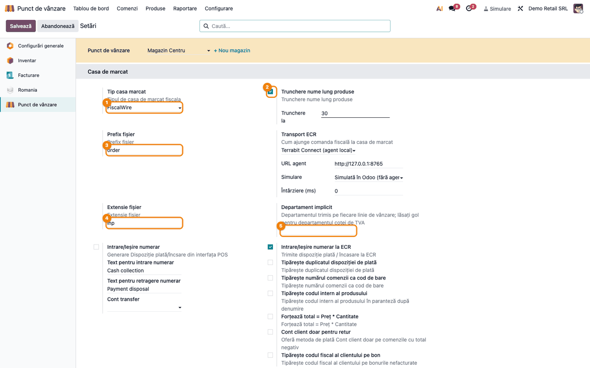
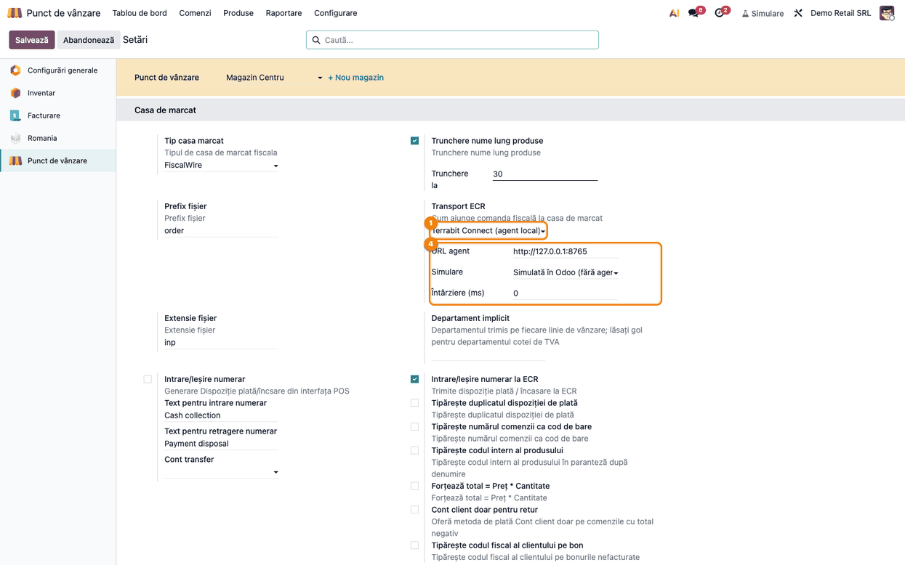
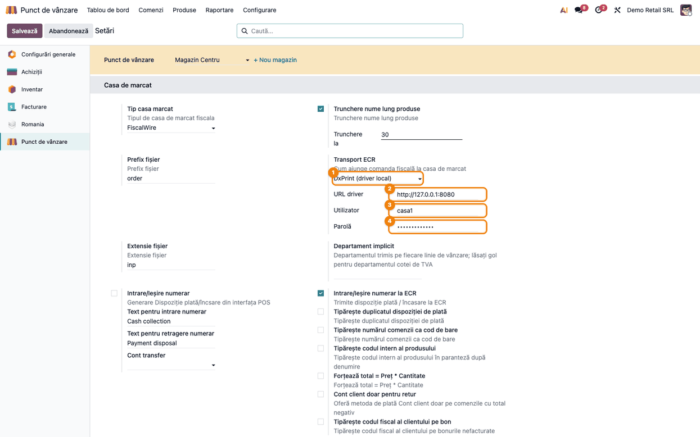
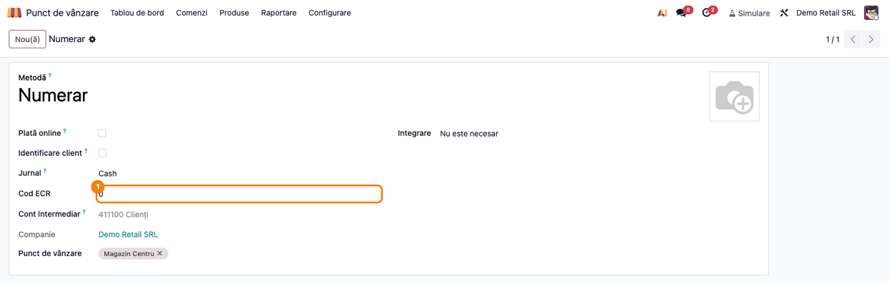
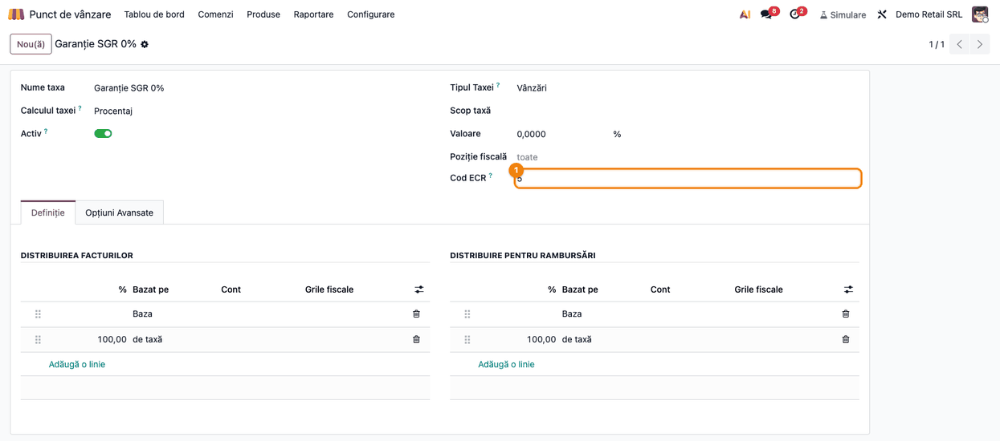

# Fișă Modul: Retail fiscal / AMEF — Setările casei de marcat în POS

**Modul:** `deltatech_pos_base`
**Utilizator principal:** Consultant implementare, Responsabil magazin/POS
**Prioritate:** 🔴 Ridicată (fără aceste setări nu se poate tipări bonul fiscal din POS)

---

## 1. Scop business

Modulul este stratul de bază al suitei Terrabit pentru casele de marcat fiscale (AMEF) din Punctul
de vânzare. El păstrează **setările casei de marcat** pe fiecare punct de vânzare (tipul casei,
modul în care ajunge comanda fiscală la aparat, numele fișierului, departamentul implicit) și
**codurile ECR** de pe metodele de plată și de pe taxe, apoi le încarcă în fiecare sesiune POS.
Bonul fiscal îl construiesc și îl trimit modulele de deasupra (`deltatech_pos`,
`deltatech_ecr_connect`); singur, modulul nu tipărește nimic.

Tot aici se pornește **casa de marcat simulată**: un punct de vânzare poate vinde fără aparat, cu o
casă jucată de browser sau de agentul Terrabit Connect, pentru teste, demonstrații, instruirea
casierilor și suport. Nimic din ce se tipărește în simulare nu este bon fiscal.

## 2. Bază legală și context

- Vânzarea cu amănuntul către populație se fiscalizează prin aparat de marcat electronic fiscal
  (AMEF), obligație stabilită prin OUG 28/1999. Modulul nu fiscalizează: doar transmite aparatului,
  prin modulele de deasupra, tipul de comenzi, categoria de TVA și tipul de plată potrivite.
- **Codul ECR al metodei de plată** este caracterul cu care aparatul recunoaște tipul de plată
  (numerar, card, tichete). **Codul ECR al taxei** este categoria (poziția) de TVA programată pe
  aparat; se completează doar când două taxe cu aceeași cotă trebuie să ajungă pe categorii diferite
  (de exemplu garanția SGR la 0% și o vânzare cu taxare inversă, tot la 0%).
- **Casa simulată nu emite bonuri fiscale.** Un punct de vânzare lăsat în simulare vinde fără bon
  fiscal real, deci simularea se folosește doar pe puncte de vânzare de test sau de instruire, niciodată
  pe casa unui magazin în funcțiune.

## 3. Utilizatori și roluri

| Rol | Ce face |
|---|---|
| Consultant implementare (cu drept de **Administrare / Setări**, grupul `base.group_system`) | alege tipul casei și transportul, completează codurile ECR, pornește și oprește simularea la testare și instruire |
| Responsabil magazin / Administrator POS (grupul **Punct de vânzare / Administrator**) | modifică setările punctului de vânzare și codurile de pe metodele de plată; nu vede câmpurile **Simulare** și **Întârziere (ms)** și nu poate porni sau opri simularea |
| Contabil (drept pe **Facturare / Configurare**) | completează **Cod ECR** pe taxe, împreună cu consultantul |
| Casier | nu configurează nimic; pe un punct de vânzare în simulare vede butonul **Simulare** și poate alege răspunsul următor al casei simulate |

Pentru testare: un administrator de sistem pentru simulare, un utilizator administrator POS pentru
celelalte setări și un casier pentru vânzare.

## 4. Conturi și date implicate

Modulul **nu generează note contabile** și nu atinge conturi: vânzarea se înregistrează contabil
de modulul standard Punct de vânzare, la fel cu sau fără casa de marcat.

Date folosite:

- **punctul de vânzare** (`pos.config`): tipul casei, trunchierea denumirii, transportul, URL-ul
  agentului, adresa, utilizatorul și parola driverului DxPrint (`ecr_dxprint_url`,
  `ecr_dxprint_user`, `ecr_dxprint_password`), prefixul și extensia fișierului, departamentul
  implicit, simularea și întârzierea ei. Parola driverului DxPrint se încarcă în sesiunea POS, pentru
  că browserul casierului o trimite driverului: ajunge deci în browserul casierului;
- **metodele de plată POS**: câmpul **Cod ECR** (un caracter, implicit `0`);
- **taxele de vânzare**: câmpul **Cod ECR** (opțional, un caracter).

Date minime pentru demonstrație: un punct de vânzare (ex. „Magazin Centru”), o metodă de plată
„Numerar” cu **Cod ECR** `0`, taxa de 21% a planului de conturi RO și, pentru exemplul de cod pe
taxă, o taxă „Garanție SGR 0%”.

## 5. Configurare inițială

1. Instalați `deltatech_pos` (aduce `deltatech_pos_base` și `deltatech_ecr_connect`). Singur,
   `deltatech_pos_base` nu adaugă niciun meniu: toate câmpurile apar în ecranele standard.
2. Aflați de la client modelul casei de marcat și driverul folosit (FiscalWire, FiscalNet sau
   programul producătorului) și dacă pe stația casei rulează agentul **Terrabit Connect** sau driverul
   **DxPrint** (www.dxprint.ro, pentru casele Datecs și Daisy) în modul embedded. La DxPrint, notați
   adresa serverului HTTP al driverului (implicit `http://127.0.0.1:8080`) și, dacă driverul are
   autentificare, utilizatorul și parola lui; folosiți pentru driver o parolă care nu mai servește
   altundeva și țineți serverul lui pe stație (`127.0.0.1`) sau în rețeaua magazinului.
3. Cereți tabelul cu **tipurile de plată** și **categoriile de TVA** programate pe aparat (din manualul
   casei sau de la service-ul ei); de aici vin codurile ECR.
4. Pentru teste fără aparat, folosiți un punct de vânzare separat de cele ale magazinelor, pe care
   porniți simularea (Pasul 2 din fluxul de mai jos), cu un utilizator administrator de sistem: doar el
   vede și schimbă câmpul **Simulare**. Simularea se poate porni în două feluri:
   - **Simulată în Odoo (fără agent)** — nu e nevoie de nimic pe stație: browserul joacă rolul casei;
   - **Simulată prin agent** — agentul Terrabit Connect de pe stație trebuie pornit în mod simulat,
     cu variabila de mediu `TERRABIT_FISCAL_DRIVER=simulated`. Un agent pornit cu driverul real nu
     primește niciun bon de la un punct de vânzare în simulare (vezi secțiunea 9).
5. Răspunsul pe care îl dă casa simulată la documentul următor (succes, lipsă hârtie, casă
   deconectată etc.) se alege din panoul **Dispozitive virtuale** (fișa `deltatech_ecr_connect`)
   sau, în testele automate, prin ORM: `config._simulator_set_next("no_paper")`.

## 6. Flux de utilizare

### Pasul 1 — Tipul casei și fișierul de comenzi

Mergeți la **Punct de vânzare → Configurare → Setări**, alegeți punctul de vânzare în banda de sus
(„Magazin Centru”) și coborâți la secțiunea **Casa de marcat**. Completați, în ordinea numerotată pe
captură:

1. **Tip casa marcat** — formatul comenzilor: **FiscalWire** (implicit), **FiscalNet**, **Optima**,
   **Daisy**, **Succes** sau **Incotex**, după aparatul și driverul clientului.
2. **Trunchere nume lung produse** — bifați dacă aparatul are o limită strictă de caractere; apare
   **Trunchere la** (implicit 30), lungimea maximă a denumirii pe bon.
3. **Prefix fișier** — începutul numelui fișierului de comenzi (implicit `order`).
4. **Extensie fișier** — extensia cerută de driver (implicit `inp`; de exemplu `prn` sau `txt`).
5. **Departament implicit** — lăsați gol ca fiecare linie să meargă pe departamentul cotei de TVA;
   completați doar pentru casele FiscalNet / Tremol programate cu departamente fixe.

Apăsați **Salvează** în stânga sus.



### Pasul 2 — Transportul, agentul și simularea

În același bloc, la **Transport ECR**, alegeți cum ajunge comanda fiscală la casă:

1. **Transport ECR** — **Fișier (descărcare .prn/.inp)** (implicit): fișierul se descarcă pe stație
   și îl preia driverul; sau **Terrabit Connect (agent local)**: comanda pleacă direct la agentul de
   pe stație, care tipărește și întoarce numărul bonului. Dacă agentul nu răspunde, se descarcă
   fișierul, ca la primul transport; sau **DxPrint (driver local)**: bonul pleacă, ca JSON, la
   driverul DxPrint pornit în modul embedded, care îl tipărește și întoarce pe loc numărul bonului și
   al raportului Z. Dacă driverul nu răspunde la prima cerere, se descarcă fișierul. Un răspuns care
   nu e JSON apare ca eroare obișnuită a driverului („HTTP <cod>”). Dacă driverul nu răspunde în 40 de
   secunde sau conexiunea se pierde după prima cerere, fișierul nu se mai descarcă: se deschide
   dialogul de eroare, cu avertismentul că bonul poate fi deja tipărit, deci verificați casa înainte
   de reluare.
2. **URL agent** — apare doar la Terrabit Connect; implicit `http://127.0.0.1:8765`, de schimbat
   doar dacă agentul rulează pe altă stație. La **DxPrint (driver local)** apar în locul lui
   **URL driver** (implicit `http://127.0.0.1:8080`, opțiunea `httpPort` din driver), **Utilizator**
   și **Parolă**; ultimele două se completează doar dacă serverul HTTP al driverului are
   autentificare (`httpUtilizator`, `httpParola`).
3. **Simulare** — apare doar la Terrabit Connect. Gol: casa reală. **Simulată în Odoo (fără agent)**
   sau **Simulată prin agent**: casa de marcat simulată (secțiunea 5, punctul 4). Doar administratorul
   de sistem (grupul `base.group_system`) pornește sau oprește simularea: o casă simulată nu tipărește
   nimic real și nu trebuie pornită din greșeală de un administrator POS pe o casă din magazin. Ceilalți
   utilizatori nu văd câmpurile **Simulare** și **Întârziere (ms)**; dacă schimbă totuși simularea (de
   exemplu prin import sau API), primesc eroarea de acces „Doar un administrator poate porni sau opri
   simularea casei de marcat.”. Restul setărilor punctului de vânzare rămân editabile pentru ei;
4. **Întârziere (ms)** — apare doar cu simularea pornită și doar pentru administratorul de sistem: cât
   „gândește” casa simulată înainte să răspundă (implicit 800 ms; 0 pentru teste rapide).

Apăsați **Salvează**. Cu simularea pornită, în bara de sus a Odoo apare butonul **Simulare**, care
deschide panoul **Dispozitive virtuale**, iar în POS, lângă butonul casei de marcat, apare același
buton; utilizarea lor e descrisă în fișele `deltatech_ecr_connect` și `deltatech_pos`. Câmpurile
**Următorul răspuns simulat** și **Păstrează răspunsul simulat** ale punctului de vânzare nu apar în
formular: le scrie panoul sau un test, și doar pe o casă aflată în simulare.



Captura arată transportul Terrabit Connect. La **DxPrint (driver local)**, în locul câmpurilor
**URL agent**, **Simulare** și **Întârziere (ms)** apar **URL driver**, **Utilizator** și **Parolă**:



### Pasul 3 — Codul ECR pe metodele de plată

Mergeți la **Punct de vânzare → Configurare → Metode de plată** și deschideți fiecare metodă. Sub
**Jurnal** completați **Cod ECR**: caracterul cu care casa recunoaște tipul de plată. Pe casa
simulată, `0` este numerar, `1` tichete și `2` card (doar numerarul dă rest); pe un aparat real
valorile se iau din tabelul tipurilor de plată programat pe el.



### Pasul 4 — Codul ECR pe taxe (doar pentru taxe cu aceeași cotă)

Mergeți la **Facturare → Configurare → Taxe** (cu Contabilitatea instalată, **Contabilitate → Configurare → Taxe**) și deschideți taxa. Lăsați **Cod ECR** gol pe taxele
obișnuite: categoria de TVA se deduce din cotă (21%, 11%, 0%). Completați-l doar când două taxe cu
aceeași cotă trebuie să ajungă pe categorii diferite ale casei — de exemplu „Garanție SGR 0%” pe
categoria `5`, separat de vânzarea cu taxare inversă. Pe FiscalWire valoarea este poziția de TVA
programată pe casă, o cifră de la 1 la 7, nu litera A–E din protocolul Datecs.



### Pasul 5 — Verificarea în sesiune

Codurile și setările se încarcă la **deschiderea sesiunii POS**. După orice modificare de cod ECR
sau de setare, închideți și redeschideți sesiunea, apoi faceți un bon de probă. Pe casa simulată
bonul apare pe rola din panoul **Dispozitive virtuale**: verificați acolo categoria de TVA (litera
după sumă) și tipul de plată, fără să consumați hârtie fiscală.


### Note de monografie și raportare

Modulul nu generează note contabile. Notele vânzării POS (Dr 5311 / 5125 / 411 — Cr 707 și 4427)
sunt cele ale modulului standard Punct de vânzare și nu se schimbă cu tipul casei, cu transportul
sau cu simularea. O vânzare făcută pe casa simulată se înregistrează contabil ca orice vânzare POS,
de aceea simularea se face doar pe o bază sau pe un punct de vânzare de test.

## 7. Legături cu alte module / declarații

| Modul | Rol |
|---|---|
| `point_of_sale` | punctul de vânzare, metodele de plată și sesiunea în care se încarcă setările |
| `deltatech_pos` | construiește bonul fiscal, dispozițiile de plată și rapoartele X/Z din setările de aici; butoanele **Simulare** și starea casei din bara POS |
| `deltatech_ecr_connect` | formatele caselor, trimiterea la Terrabit Connect și la driverul DxPrint, casa simulată și panoul **Dispozitive virtuale** |
| `deltatech_sale_store` | bonul fiscal pe factura din magazin; are setările lui, în parametrii de sistem, nu pe punctul de vânzare |
| `l10n_ro_pos_fiscal_compliance` / `_ecr` | urmărirea bonurilor AMEF și reconcilierea raportului Z |
| Terrabit Connect (aplicația de pe stație) | agentul care primește comenzile; în mod simulat, pornit cu `TERRABIT_FISCAL_DRIVER=simulated` |

**Ce e automat:** încărcarea setărilor și a codurilor în sesiunea POS; alegerea categoriei de TVA
după cotă când taxa nu are **Cod ECR**; ștergerea unui răspuns simulat „o singură dată” după folosire.

**Ce rămâne manual:** alegerea tipului de casă și a transportului, codurile ECR (după programarea
reală a aparatului), oprirea simulării înainte de punerea în funcțiune.

## 8. Verificări pentru consultant

- [ ] **Tip casa marcat** corespunde aparatului și driverului din magazin.
- [ ] Cu **Trunchere nume lung produse** bifată, **Trunchere la** nu depășește limita casei (18 pe
      Optima, 28 pe Incotex și Succes).
- [ ] **Extensie fișier** și **Prefix fișier** sunt cele cerute de driver (contează și la Terrabit
      Connect, pentru fișierul descărcat când agentul nu răspunde).
- [ ] Cu **Terrabit Connect (agent local)**, agentul rulează pe stație la adresa din **URL agent**.
- [ ] Cu **DxPrint (driver local)**, driverul DxPrint rulează în modul embedded la adresa din
      **URL driver**, iar **Utilizator** și **Parolă** sunt cele ale serverului HTTP al driverului
      (goale dacă driverul nu are autentificare). Parola ajunge în browserul casierului, deci e una
      folosită doar pentru driver, iar serverul driverului e pe stație sau în rețeaua magazinului.
- [ ] Cu **DxPrint (driver local)**, după redeschiderea sesiunii, un bon de probă se tipărește pe casă
      fără descărcarea fișierului de comenzi.
- [ ] Fiecare metodă de plată folosită în POS are **Cod ECR** după tabelul tipurilor de plată al
      aparatului.
- [ ] **Cod ECR** pe taxe e completat doar unde două taxe au aceeași cotă și trebuie separate, iar
      valoarea este o categorie programată pe aparat.
- [ ] După modificarea codurilor, sesiunea POS a fost închisă și redeschisă, iar un bon de probă iese
      pe categoria și tipul de plată așteptate.
- [ ] Pe punctul de vânzare de test, cu **Simulare** pornită, apare butonul **Simulare** în bara Odoo
      și în POS, iar un bon de probă apare pe rola panoului cu antetul `*** SIMULARE ***`.
- [ ] Pentru **Simulată prin agent**, agentul de pe stație raportează modul simulat (pornit cu
      `TERRABIT_FISCAL_DRIVER=simulated`); altfel POS-ul refuză trimiterea (secțiunea 9).
- [ ] **Înainte de punerea în funcțiune, câmpul Simulare este gol pe toate punctele de vânzare ale
      magazinelor**: în bara Odoo nu mai apare butonul **Simulare**.
- [ ] Cu un utilizator administrator POS care nu e administrator de sistem: în **Punct de vânzare →
      Configurare → Setări**, secțiunea **Casa de marcat**, câmpurile **Simulare** și **Întârziere (ms)**
      nu apar, iar celelalte setări se pot salva; cu administratorul de sistem, câmpurile apar și
      simularea se poate porni și opri.

## 9. Mesaje de eroare frecvente

| Mesaj | Cauză | Remediere |
|---|---|---|
| Casa de marcat a „Magazin Centru” nu e în simulare. | s-a cerut un răspuns simulat (din panou sau dintr-un test) pentru un punct de vânzare fără **Simulare** sau cu transportul **Fișier** | porniți **Simulare** cu transportul **Terrabit Connect**, sau nu mai folosiți răspunsul simulat pe acea casă |
| Doar un administrator poate porni sau opri simularea casei de marcat. | un utilizator care nu e administrator de sistem (`base.group_system`), de exemplu un administrator POS, a încercat să schimbe **Simulare** pe un punct de vânzare (prin import, API sau un formular care arată câmpul) | simularea o pornește sau o oprește administratorul de sistem; celelalte setări le poate salva oricine are drept pe punctul de vânzare |
| Răspuns simulat necunoscut: … | un test a cerut un răspuns care nu există | folosiți unul dintre `ok`, `no_paper`, `disconnected`, `late`, `unknown`, `canceled` |
| Agentul Terrabit Connect nu e în mod simulat (TERRABIT_FISCAL_DRIVER=simulated): bonul nu a fost trimis. | punctul de vânzare e pe **Simulată prin agent**, dar agentul de pe stație rulează cu driverul real | reporniți agentul cu `TERRABIT_FISCAL_DRIVER=simulated` sau treceți pe **Simulată în Odoo (fără agent)**; mesajul apare în dialogul **Eroare casă de marcat** din POS |
| Bonul iese pe altă categorie de TVA decât cea așteptată | taxa nu are **Cod ECR**, iar cota ei e programată pe altă poziție, sau **Cod ECR** nu corespunde programării aparatului | verificați programarea aparatului și completați sau corectați **Cod ECR** pe taxă; redeschideți sesiunea |
| Codul modificat nu se vede în POS | sesiunea POS a fost deschisă înainte de modificare | închideți și redeschideți sesiunea |

## 10. Capturi de ecran

Capturile din `static/description/` sunt generate automat din `tests/test_screenshots.py` (clasa
`TestPosBaseScreenshots`, mixinul `ScreenshotCase` din `deltatech_doc_screenshots`, import
defensiv), cu interfața în română, pe planul de conturi RO:

1. `01_setari_casa_marcat.png` — secțiunea **Casa de marcat**: tip casă, trunchiere, prefix, extensie, departament implicit.
2. `02_transport_simulare.png` — aceeași secțiune: **Transport ECR**, **URL agent**, **Simulare**, **Întârziere (ms)**.
3. `03_metoda_plata_cod_ecr.png` — metoda de plată Numerar, câmpul **Cod ECR**.
4. `04_taxa_cod_ecr.png` — taxa „Garanție SGR 0%”, câmpul **Cod ECR**.
5. `05_verificare_bon_rola.png` — panoul **Dispozitive virtuale** din POS după bonul de probă: rola cu
   grupa de TVA și tipul de plată.
6. `06_transport_dxprint.png` — aceeași secțiune cu **Transport ECR** pe **DxPrint (driver local)**:
   **URL driver**, **Utilizator**, **Parolă**.

Aceleași capturi, cu interfața în engleză, sunt în `static/description/en/`, pentru `readme/USAGE.md`.

Regenerare (doar această clasă):

```bash
./odoo/odoo-bin -c odoo.conf -d <db> -i deltatech_pos_base,deltatech_doc_screenshots,l10n_ro \
    --test-tags=/deltatech_pos_base:TestPosBaseScreenshots --stop-after-init
```

## 11. Observații pentru manual

- Prezentați modulul ca „setările casei de marcat”: nu are meniu propriu, câmpurile lui apar în
  setările Punctului de vânzare, pe metodele de plată și pe taxe.
- Păstrați regula: **Cod ECR** pe taxă doar pentru taxe cu aceeași cotă; altfel se lasă gol.
- Păstrați avertismentul despre simulare: nu se folosește pe casele magazinelor în funcțiune, iar
  butonul **Simulare** din bara Odoo arată că încă există o casă simulată.
- Pașii de folosire a casei simulate (rola, răspunsul următor, rapoartele X/Z) se descriu în fișa
  `deltatech_ecr_connect`; aici rămâne doar pornirea ei.
