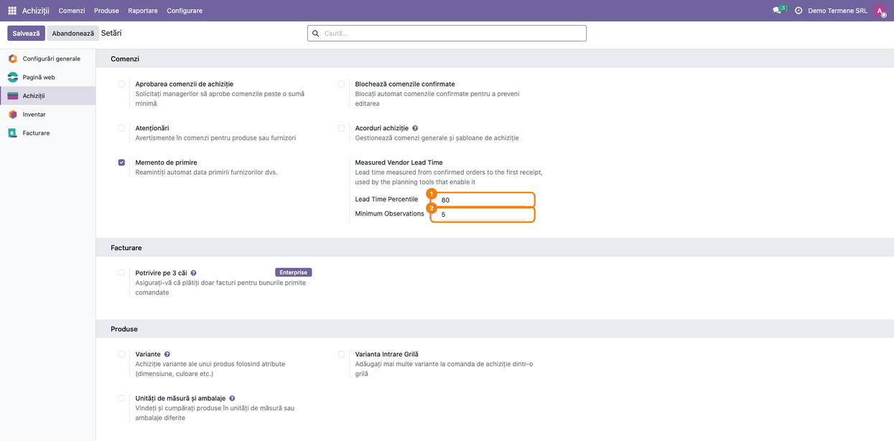
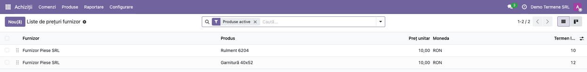
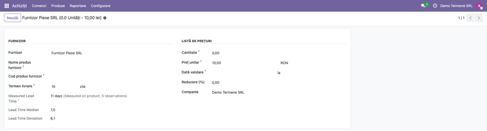
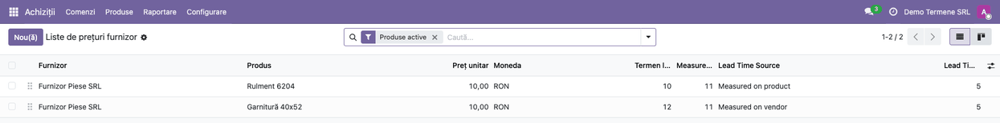

# Fișă Modul: Termen de livrare furnizor măsurat din istoricul achizițiilor

**Modul:** `deltatech_purchase_lead_time`
**Utilizator principal:** Responsabil achiziții, Planificator de aprovizionare
**Prioritate:** 🟡 Medie (informativ; devine important când planificarea folosește termenul măsurat)

---

## 1. Scop business

Termenul de livrare („Termen livrare”) scris pe lista de prețuri a furnizorului („Termen de livrare”) este o estimare
introdusă o dată și rareori corectată. Modulul calculează termenul real din istoricul achizițiilor:
zilele calendaristice de la confirmarea comenzii până la prima recepție a fiecărei linii de comandă.
Pentru fiecare linie de furnizor arată termenul măsurat, mediana, abaterea (σ) și numărul de
observații, ca responsabilul de achiziții să vadă cât de departe este termenul configurat de
realitate și să-l corecteze, iar planificarea (necesarul de achiziții, Advanced Planner) să poată
folosi un termen real și un stoc de siguranță care acoperă livrările întârziate.

Modulul nu schimbă singur nimic: valorile se afișează, iar instrumentele de planificare le folosesc
numai acolo unde opțiunea este activată.

## 2. Bază legală și context

Modulul nu are un temei legal: nu generează înregistrări contabile și nu intră în declarații.
Contextul este operațional:

- o observație este o linie de comandă de achiziție confirmată și recepționată de la furnizor;
- recepțiile ulterioare parțiale (restanțele) nu prelungesc termenul, se ia doar prima recepție;
- retururile nu se numără, iar comenzile se iau doar din companiile active (selectate în comutatorul de companii);
- fereastra de istoric este cea a ratei de livrare la timp a furnizorului: parametrul de sistem
  `purchase_stock.on_time_delivery_days` (implicit 365 de zile).

## 3. Utilizatori și roluri

- **Responsabil achiziții** — citește termenele măsurate și corectează termenul configurat.
- **Planificator de aprovizionare** — activează termenul măsurat în instrumentele de planificare.
- **Administrator** — stabilește percentila și numărul minim de observații în setări.

Rol necesar pentru pașii 1, 2 și 4 și recomandat pentru testare: utilizator cu drept de
**Achiziții / Administrator** (vede meniul **Achiziții → Configurare**).

## 4. Conturi și date implicate

Nu se folosesc conturi contabile. Datele din care se calculează termenul:

- comenzi de achiziție confirmate, cu data confirmării;
- recepții de la furnizor finalizate (locația sursă de tip furnizor), cu data lor;
- linia de furnizor a produsului (lista de prețuri a furnizorului), cu termenul configurat.

Date minime pentru demo:
- un furnizor și două produse, fiecare cu o linie de furnizor și termen de livrare configurat;
- cel puțin **5** linii de comandă recepționate de la același furnizor, cu termene diferite (de
  exemplu 5, 6, 7, 8 și 20 de zile), ca să se atingă numărul minim de observații.

## 5. Configurare inițială

1. Instalați modulul `deltatech_purchase_lead_time` (dependență: `purchase_stock`).
2. În **Achiziții → Configurare → Setări**, secțiunea **Measured Vendor Lead Time**, verificați:
   - **Lead Time Percentile** (implicit 80): ponderea recepțiilor din trecut sosite în termenul
     măsurat; 50 este mediana, o valoare mai mare dă un termen mai prudent (acceptat: 50–99);
   - **Minimum Observations** (implicit 5): numărul de linii recepționate necesar ca valoarea
     măsurată să înlocuiască termenul configurat (minimum 2, pentru că abaterea cere două valori).
3. Dacă doriți altă fereastră de istoric, modificați parametrul de sistem
   `purchase_stock.on_time_delivery_days`.

## 6. Flux de utilizare

### Pasul 1 — Stabilirea percentilei și a numărului minim de observații

Din **Achiziții → Configurare → Setări**, coborâți la secțiunea **Measured Vendor Lead Time**.
Introduceți percentila dorită și numărul minim de observații, apoi apăsați **Salvează**. Valorile se
aplică imediat la toate liniile de furnizor.

### Pasul 2 — Deschiderea liniei de furnizor

Din **Achiziții → Configurare → Liste de prețuri furnizor** (meniul cere dreptul de administrator
al Achizițiilor), căutați produsul sau furnizorul și
apăsați pe linia dorită: se deschide formularul liniei. (Pe fila **Achiziții** a produsului, lista
furnizorilor se editează direct pe rând și nu deschide formularul; acolo vedeți doar coloanele
opționale din pasul 4.)

### Pasul 3 — Citirea și verificarea termenului măsurat

În formularul liniei, sub **Termen livrare** apare **Measured Lead Time** (termen măsurat): valoarea în zile, sursa ei și
numărul de observații. Sursa poate fi:

| Sursă | Înseamnă |
|---|---|
| **Measured on product** | istoricul furnizorului pentru acest produs are destule observații |
| **Measured on vendor** | produsul are puține observații, deci se folosește istoricul furnizorului pe toate produsele |
| **Configured** | istoricul e insuficient, se afișează termenul configurat; mediana și abaterea nu se afișează |

Când sursa este una măsurată, formularul arată și **Lead Time Median** (mediana) și **Lead Time Deviation** (abaterea) termenului.

**Verificați pe ecran înainte de a corecta termenul configurat:**
1. găsiți numărul de observații: trebuie să fie cel puțin cel din setări, altfel sursa este
   **Configured**;
2. comparați **Measured Lead Time** cu **Termen livrare**: o diferență mare înseamnă că termenul
   configurat nu mai corespunde realității;
3. citiți **Lead Time Deviation**: o abatere mare arată un furnizor cu livrări neregulate; de aceea
   termenul măsurat folosește percentila (prudentă), nu media sau mediana.

Abia apoi corectați **Termen livrare** sau activați termenul măsurat în instrumentele de
planificare.

### Pasul 4 — Compararea mai multor furnizori în listă

În **Achiziții → Configurare → Liste de prețuri furnizor** (la fel pe fila **Achiziții** a produsului), din meniul coloanelor opționale adăugați **Measured Lead Time**,
**Lead Time Source** și **Lead Time Observations**. Astfel comparați dintr-o privire termenul configurat
cu cel măsurat pe mai multe produse.

### Note de monografie și raportare

Modulul nu generează note contabile și nu afectează declarațiile. Valorile sunt calculate la citire,
nu sunt stocate: se actualizează singure pe măsură ce se recepționează comenzi.

## 7. Legături cu alte module / declarații

| Modul | Rol |
|---|---|
| `purchase_stock` | comenzile de achiziție, recepțiile și rata de livrare la timp (fereastra de istoric) |
| Necesarul de achiziții (NAP) | folosește termenul măsurat și abaterea lui, pentru stocul de siguranță statistic, numai când sunt bifate opțiunea **use_measured_lead_time** a asistentului și stocul de siguranță statistic |
| Advanced Planner | folosește doar termenul măsurat (nu abaterea), numai când este activată opțiunea din setările lui pentru termenul de achiziție măsurat |

**Ce e automat:** calculul termenului, al medianei, al abaterii și al numărului de observații, cu
alegerea nivelului (produs, furnizor, configurat).
**Ce rămâne manual:** corectarea termenului configurat și activarea opțiunii în instrumentele de
planificare.

## 8. Verificări pentru consultant

- [ ] După **Salvează** în setări, valorile de percentilă și minim de observații rămân la reîncărcare.
- [ ] Un furnizor cu mai puține recepții decât minimul arată sursa **Configured**, cu termenul
      configurat, și fără mediană și abatere.
- [ ] La atingerea minimului pe produs, sursa devine **Measured on product**, iar termenul măsurat
      este percentila aleasă a termenelor observate, rotunjită în sus la zile întregi.
- [ ] Un produs fără istoric propriu, dar cu istoric al furnizorului, arată **Measured on vendor**.
- [ ] O recepție ulterioară parțială (restanță) nu schimbă termenul unei linii deja recepționate.
- [ ] Comenzile mai vechi decât fereastra de istoric nu se numără.
- [ ] Salvarea unui produs cu linie de furnizor și o imagine nouă se face fără eroare (corecția din
      versiunea 19.0.1.0.2).

## 9. Mesaje de eroare frecvente

| Mesaj | Cauză | Remediere |
|---|---|---|
| `Incorrect padding` la salvarea unui produs cu imagine nouă și linie de furnizor | versiuni anterioare 19.0.1.0.2: citirea termenului declanșa recalcularea imaginii în contextul formularului | actualizați modulul la 19.0.1.0.2 sau mai nou |
| Sursa rămâne **Configured** deși există recepții | mai puține observații decât minimul, recepții în afara ferestrei de istoric sau comenzi ale altei companii | scădeți minimul în setări sau verificați că recepțiile vin de la locația furnizorului și comenzile sunt confirmate |

## 10. Capturi de ecran

Capturile sunt **generate automat** din `tests/test_screenshots.py` (mixinul `ScreenshotCase` din
`deltatech_doc_screenshots`, import defensiv), în RO. Lista capturilor, în ordinea pașilor din
secțiunea 6; comanda de regenerare:

`odoo-bin -c odoo.conf -d <db> -i deltatech_purchase_lead_time,deltatech_doc_screenshots --test-tags=fise_screenshots --stop-after-init`

| Fișier | Conținut |
|---|---|
| `01_setari_termen_masurat.png` | Setări achiziții, secțiunea Measured Vendor Lead Time |
| `02_lista_preturi_furnizor.png` | Lista de prețuri furnizor, de unde se deschide linia |
| `03_linie_furnizor_termen_masurat.png` | Formularul liniei de furnizor cu termenul măsurat, sursa și observațiile |
| `04_lista_coloane_optionale.png` | Lista liniilor de furnizor cu coloanele opționale afișate |

Fișierele stau în `static/description/`.

## 11. Observații pentru manual

- Explicați diferența dintre mediană și percentilă: termenul măsurat este percentila (prudentă), nu
  media.
- Precizați că modulul doar arată valorile; utilizarea lor în planificare se activează separat.
- Etichetele câmpurilor modulului (`Measured Lead Time`, `Lead Time Source`, `Lead Time Observations`,
  `Lead Time Median`, `Lead Time Deviation`, secțiunea `Measured Vendor Lead Time`) apar în engleză,
  pentru că modulul nu are încă traducere în română (`i18n/ro.po`); eticheta **Termen livrare**
  vine din Odoo și este tradusă.
- Atrageți atenția că sursa „Configured” înseamnă „nu avem destule date”, nu „termen validat”.
