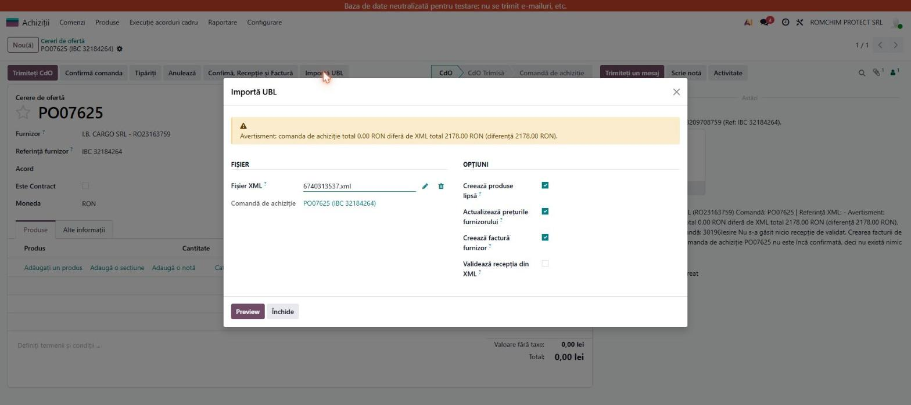
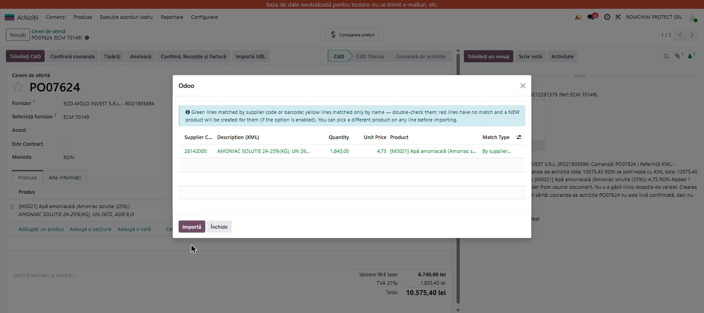
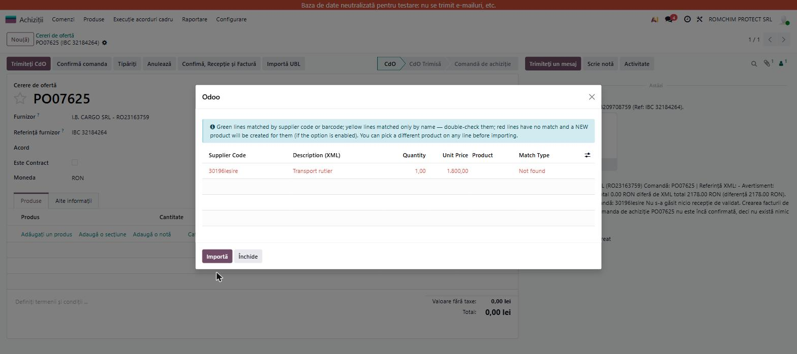
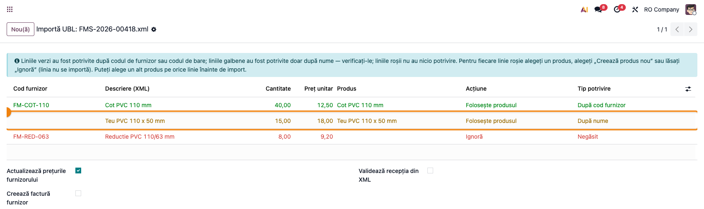
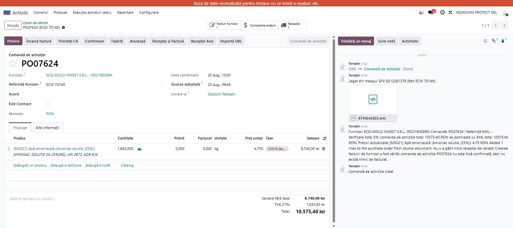
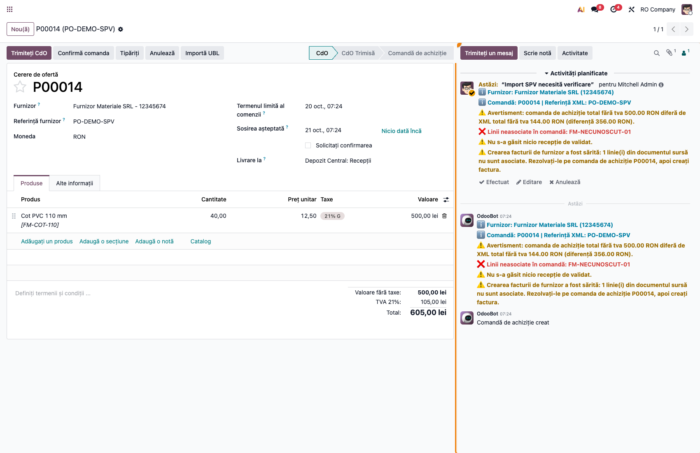

# Fișă Modul: Import factură furnizor din XML UBL pe comanda de achiziție

**Modul:** `deltatech_purchase_ubl`
**Utilizator principal:** Operator achiziții, contabil furnizori
**Versiune documentată:** 19.0.1.4.14
**Prioritate:** 🔴 Ridicată (parte din fluxul standard de facturare furnizori prin SPV/e-Factura pentru produse stocabile)

---

## 1. Scop business

Modulul importă o factură de furnizor primită ca XML UBL (formatul standard e-Factura/SPV) și
folosește conținutul ei pentru a actualiza comanda de achiziție: adaugă sau completează liniile,
actualizează prețurile de furnizor, validează recepția de stoc și poate crea direct factura de
furnizor (ciornă), asociată comenzii.

Modulul are trei puncte de intrare:

1. **Din mesajul SPV** — butoanele **Găsește Comanda** / **Creează Comanda** din
   `l10n_ro_message_spv_purchase`. Din 19.0.1.4.14 acestea nu mai rulează importul nesupravegheat:
   dacă factura e „curată" (toate liniile identificate sigur și totalul bate cu comanda), o
   importă direct și afișează doar o notificare; altfel deschid **previzualizarea**, unde
   utilizatorul decide pentru fiecare linie.
2. **Manual, din comandă** — butonul **Importă UBL** din bara de sus a comenzii de achiziție,
   tot prin previzualizare.
3. **Automat, la atașarea unui XML pe comandă** (de exemplu trimis prin e-mail în chatter) — import
   fără interfață (headless). Rezultatul ajunge în chatter și, la probleme, ca activitate pe comandă.

Principiul fluxului interactiv, din 19.0.1.4.14: **niciun produs nou nu se creează fără decizia
explicită a utilizatorului**, iar o linie neidentificată nu se pierde în tăcere — utilizatorul o
vede în previzualizare și alege ce face cu ea.

## 2. Bază legală și context

Modulul nu are temei legal propriu — este un instrument tehnic de import. Contextul legal vine din
obligația de facturare electronică prin **RO e-Factura/SPV**: furnizorul trimite factura la ANAF
în format UBL XML, iar acest XML este sursa de adevăr pe care modulul o folosește pentru a
actualiza comanda de achiziție și pentru a genera factura de furnizor în Odoo.

> Modulul **nu** decide regimul de TVA sau înregistrarea contabilă — el doar populează liniile
> comenzii/facturii cu datele din XML (cantitate, unitate, preț, procent TVA, discount). Cotele de
> TVA aplicate pe factura de furnizor sunt cele configurate pe produse/taxe în Odoo, ajustate — dacă
> e cazul — la procentul declarat în XML (secțiunea 4).

## 3. Utilizatori și roluri

Operator achiziții (rulează importul, decide în previzualizare ce face cu liniile neidentificate),
contabil furnizori (verifică factura ciornă creată din import), responsabil date de bază produse
(configurează codul de furnizor pe produse, ca potrivirea automată să fie sigură și importul să
treacă fără previzualizare).

Roluri recomandate pentru testare:
- Administrator funcțional: instalează modulul, verifică dependențele (`purchase_stock`, `account`)
- Utilizator operațional (Achiziții / Utilizator): rulează Importă UBL, decide în previzualizare
- Contabil/manager: verifică și confirmă factura de furnizor creată din import

## 4. Conturi și date implicate

Modulul nu impune conturi proprii. Liniile importate devin linii normale de comandă de achiziție,
deci la facturare se folosesc conturile standard din categoria de produs (`371`/`302` etc.) și
`4426` pentru TVA deductibilă, ca la orice factură de achiziție.

Elemente specifice pe care modulul le scrie/actualizează, relevante pentru verificare:
- **Preț furnizor** (`product.supplierinfo`) — actualizat din XML dacă opțiunea **Actualizează
  prețurile de furnizor** este bifată (implicit activă). Se actualizează doar rândul variantei
  importate, în compania comenzii (sau un rând comun companiilor); altfel se creează un rând nou.
  O linie din XML **fără cod de furnizor nu mai șterge** codul deja salvat pe rând (19.0.1.4.13).
- **Unitatea de măsură** — cantitatea și prețul se convertesc din unitatea din XML (`unitCode`) în
  unitatea liniei de comandă, a mișcării de stoc și a rândului de preț. O unitate necunoscută e
  tratată ca unitatea destinației; una incompatibilă rămâne neconvertită și apare ca avertisment
  în jurnal.
- **Discount pe linie** — extras din elementul XML `AllowanceCharge` (`ChargeIndicator=false`) și
  aplicat ca procent pe linia comenzii; prețul brut (`PriceAmount`) rămâne pe `price_unit`.
- **Cota de TVA pe factura de furnizor** — fiecare linie de factură primește procentul liniei din
  XML potrivite cu linia ei de comandă. Cota 0% se aplică doar cu o categorie explicită de scutire
  (Z, E, O, G); la taxare inversă (AE), livrare intracomunitară (K) sau fără categorie se păstrează
  taxele comenzii.
- **Verificare total** — totalul comenzii este comparat cu totalul din XML
  (`PayableAmount`/`TaxInclusiveAmount`, cu fallback pe valoarea fără TVA). Pe fluxul din mesajul
  SPV, din 19.0.1.4.14, verificarea decide dacă importul trece fără previzualizare (secțiunea 6,
  Pasul 1).
- **Indicator de atenție** (`has_warning`) — se setează când totalul nu se potrivește, au rămas
  linii neasociate pe comandă, comanda nu mai are nimic de facturat (posibil duplicat) sau
  documentul e o notă de creditare.

Date minime pentru demo (scenariul folosit și în capturi):
- companie românească cu localizarea contabilă instalată;
- un **furnizor** cu cod de furnizor completat pe cel puțin un produs (`product.supplierinfo.product_code`), pentru o potrivire verde;
- un produs stocabil fără cod de furnizor configurat, pentru cazul roșu (neidentificat);
- un fișier XML UBL valid (factură e-Factura reală sau de test).

## 5. Configurare inițială

1. Instalați modulul `deltatech_purchase_ubl` (dependențe: `purchase_stock`, `account`).
2. Nu există ecran de configurare dedicat. Parametrul de sistem `deltatech_purchase_ubl.auto_import`
   (implicit `True`) controlează importul automat la atașarea unui XML UBL pe o comandă (util
   pentru a-l dezactiva temporar, ex. la depanare). Butoanele din mesajul SPV nu depind de el: ele
   deschid singure previzualizarea.
3. Pentru ca potrivirea automată să fie sigură (linie verde) — și ca facturile curate să treacă
   fără previzualizare — completați **codul de furnizor** (fila Achiziții a produsului) sau
   **codul de bare** pe produsele cumpărate frecvent de la fiecare furnizor.
4. Drepturi: importul cere drept de scriere pe comenzi de achiziție (Achiziții / Utilizator);
   alegerea **Creează produs nou** pe o linie cere și drept de creare pe produse.
5. Activitatea de verificare generată de importul automat se atribuie **cumpărătorului de pe
   comandă** (`user_id`), cu revenire pe utilizatorul care rulează importul dacă acel câmp e gol.
6. Pentru `l10n_ro_message_spv_purchase` ≥ 19.0.0.0.10 este necesar `deltatech_purchase_ubl` ≥
   **19.0.1.4.14**. Cu o versiune mai veche, importul automat rulează la atașarea XML-ului, iar
   previzualizarea deschisă de buton ar importa a doua oară. La actualizarea proiectelor, modulul
   din deltatech trebuie să ajungă primul.

## 6. Flux de utilizare

### Pasul 1 — Factura curată din mesajul SPV: import fără previzualizare

Pe mesajul SPV, **Contabilitate → Diverse → SPV → Messages SPV**, apăsați **Găsește Comanda** sau
**Creează Comanda** (vezi [fișa `l10n_ro_message_spv_purchase`](../l10n_ro_message_spv_purchase/FISA_CONSULTANT.md)).
Modulul pregătește previzualizarea în fundal și verifică două condiții:

1. **toate** liniile din XML sunt identificate după **cod de furnizor** sau **cod de bare** (verzi);
2. după import, **totalul comenzii bate la ban** cu totalul din XML.

Dacă ambele sunt adevărate, importul rămâne, jurnalul se postează în chatter-ul comenzii, iar
utilizatorul primește doar notificarea **„Invoice imported"**, după care se deschide comanda.
Dacă oricare condiție cade, importul se anulează complet (nimic nu rămâne scris pe comandă) și se
deschide previzualizarea de la Pasul 3.

> Liniile găsite doar după nume (galbene) și cele propuse de AI (albastre, cu
> `deltatech_purchase_ubl_ai`) nu se consideră sigure: deschid previzualizarea.

### Pasul 2 — Import manual din comandă

Deschideți comanda de achiziție și apăsați **Importă UBL** din bara de sus. Dacă pe comandă e deja
atașat un XML UBL, fereastra îl preia automat. Apăsați **Preview**.



### Pasul 3 — Previzualizarea: decizia pe fiecare linie

Se deschide un tabel cu o linie per articol din XML: Cod furnizor, Descriere, Cantitate, Preț
unitar, **Produs**, **Acțiune**, Tip potrivire. Culorile arată cât de sigură e potrivirea:

- **Verde** — produs găsit după cod de furnizor sau cod de bare (sigur);
- **Galben** — produs găsit doar după numele din XML (de verificat);
- **Roșu** — niciun produs găsit.







Coloana **Acțiune** (din 19.0.1.4.14) spune ce face importul cu fiecare linie:

| Acțiune | Când e implicită | Ce face la import |
|---|---|---|
| **Folosește produsul** | linia are un produs (verde, galben sau ales manual) | scrie produsul pe comandă: actualizează linia existentă sau adaugă una nouă |
| **Ignoră** | linia **nu** are produs (roșie) | linia **nu** se importă; apare în jurnal ca neasociată |
| **Creează produs nou** | niciodată — se alege explicit | creează un produs nou din denumirea liniei din XML și îl adaugă pe comandă |

> Până la actualizarea traducerii `ro.po`, etichetele noi apar în engleză: *Use product*,
> *Create new product*, *Ignore*, butonul *Open Purchase Order* și notificarea *Invoice imported*.

Pe o linie roșie aveți deci trei variante: alegeți produsul existent din coloana **Produs**
(acțiunea trece singură pe *Folosește produsul*), alegeți **Creează produs nou**, sau lăsați
**Ignoră**. Alegerea manuală a unui produs schimbă tipul potrivirii în „Ales manual".

> Opțiunea globală **Creează produse lipsă** nu mai apare în fereastră: în fluxul interactiv
> decizia se ia pe fiecare linie. Ea se aplică doar importului automat la atașare.

> **Cazul galben apare DOAR pe o comandă fără linii.** Când comanda are deja linii, potrivirea se
> restrânge la produsele de pe comandă, unde potrivirea după nume nu se produce. Un produs care
> există în catalog, dar nu e pe comandă, apare roșu — alegeți-l manual din coloana **Produs**.

Sub tabel sunt opțiunile importului, vizibile tot în previzualizare: **Actualizează prețurile de
furnizor**, **Creează factură furnizor**, **Validează recepția**.

### Pasul 4 — Confirmarea importului

Apăsați **Importă**. Liniile cu *Folosește produsul* și *Creează produs nou* sunt scrise pe
comandă (cantitate, preț, discount, în unitatea liniei), liniile cu *Ignoră* nu. În funcție de
opțiuni:
- prețurile de furnizor sunt actualizate din XML;
- recepția asociată comenzii este validată cu cantitățile din XML (restul merge pe o recepție
  ulterioară — backorder);
- se creează factura de furnizor ciornă, legată de comandă (doar pe o comandă confirmată, care mai
  are ceva de facturat, și dacă nu există deja o factură cu același număr la acest furnizor).

Fereastra afișează jurnalul importului și butonul **Deschide comanda de achiziție** (din
19.0.1.4.14), util când importul a fost pornit din mesajul SPV.

### Pasul 5 — Factura de furnizor creată

Dacă la comandă apare smart-butonul **Facturi furnizor**, factura ciornă a fost creată — se
deschide, se verifică liniile și taxele preluate din XML, apoi se confirmă.



> **Factura se creează doar dacă comanda era deja confirmată** în momentul importului. Pe o comandă
> ciornă (cazul tipic: comandă nouă, creată din mesajul SPV), crearea se sare cu motivul scris în
> jurnal, iar confirmarea ulterioară **nu** o declanșează retroactiv. Folosiți factura din mesajul
> SPV (butonul de creare factură de pe mesaj), care se leagă de comanda confirmată, sau relansați
> **Importă UBL** cu **Creează factură furnizor** bifat.

### Pasul 6 — Importul automat la atașarea unui XML pe comandă

Când un XML UBL ajunge pe comandă fără să treacă prin butoane (de exemplu atașat în chatter),
importul rulează fără interfață. Rezultatul ajunge la operator pe două căi:

1. **Nota din chatter**, cu jurnalul colorat (verde pentru liniile potrivite, roșu/portocaliu
   pentru probleme);
2. **Activitatea „Import SPV necesită verificare"**, programată pe comandă când totalul nu se
   potrivește, au rămas linii neasociate, comanda nu mai are nimic de facturat sau documentul e o
   notă de creditare. Nota activității conține jurnalul complet; responsabil e cumpărătorul.



Pe acest flux:
- produsele neidentificate **nu** se creează când XML-ul vine din SPV (context
  `purchase_ubl_no_new_products`); altfel se aplică opțiunea **Creează produse lipsă**;
- din 19.0.1.4.13, **factura de furnizor nu se creează** cât timp există linii neasociate — ar fi
  ieșit fără ele, iar rezolvarea ulterioară a liniilor pe comandă nu o mai corecta. Jurnalul spune
  de ce a fost sărită; creați factura după ce toate liniile sunt rezolvate;
- activitatea este **deduplicată pe titlu** (cronul SPV poate reprocesa același mesaj de ~10 ori
  într-o dimineață) și **nu se închide singură** — operatorul o marchează finalizată după rezolvare.

> **Deduplicarea compară titlul TRADUS.** Pe bazele care au rulat cu traducerile nefuncționale
> (înainte de resincronizarea `.pot`) există activități cu titlul englez „SPV import needs review";
> acelea nu deduplică față de cele noi. De verificat la upgrade pe bazele existente.

### Note de monografie și raportare

Modulul nu generează note contabile proprii. Factura de furnizor creată din import (sau cea din
mesajul SPV, legată de comandă) se contabilizează prin fluxul standard Odoo:

| Operațiune | Debit | Credit |
|---|---|---|
| Recepție mărfuri (evaluare automată) | `371` Mărfuri | `408` Furnizori – facturi nesosite |
| Factură furnizor pe recepție | `408` Furnizori – facturi nesosite | `401` Furnizori |
| TVA deductibilă | `4426` TVA deductibilă | `401` Furnizori |

Conturile exacte depind de categoria produsului și de configurarea evaluării stocului.

## 7. Legături cu alte module / declarații

| Modul / proces | Rol în flux | Tip legătură |
|---|---|---|
| `purchase_stock` | comenzi de achiziție + recepții de stoc pe care modulul le actualizează | dependență (manifest) |
| `account` | facturi de furnizor create din import | dependență (manifest) |
| `l10n_ro_message_spv_purchase` (≥ 19.0.0.0.10) | butoanele Găsește/Creează Comanda din mesajul SPV: atașează XML-ul fără import automat și pornesc importul direct sau previzualizarea | modul separat, principalul punct de intrare |
| `deltatech_purchase_ubl_ai` | propune cu AI produsul pentru liniile neidentificate: în previzualizare (linii albastre) și, la importul automat, ca sugestii pe comandă | extensie opțională (bitshop_ent, Enterprise) |
| `mail` (activități) | activitatea „Import SPV necesită verificare" de la importul automat | dependență indirectă |
| `purchase.invoice.import.mixin` | logica de potrivire produse / actualizare prețuri / creare factură, partajată și cu alte wizard-uri de import (PDF Marso, Delta, Sigemo, Procar) | infrastructură internă (abstract model, definit în acest modul) |

Ce este automat: potrivirea produsului (cod de bare → cod de furnizor → referință internă → nume),
conversia unităților de măsură, actualizarea prețurilor de furnizor, aplicarea discountului și a
cotei de TVA din XML, verificarea totalului, importul direct al facturilor curate din mesajul SPV,
crearea facturii de furnizor (pe comandă confirmată, fără linii neasociate), semnalizarea
importurilor automate problematice printr-o activitate.

Ce rămâne manual: configurarea codului de furnizor pe produse, decizia pe fiecare linie
neidentificată în previzualizare (produs existent, produs nou sau ignorare), confirmarea comenzii
înainte de import dacă se dorește factură automată, verificarea și confirmarea facturii ciornă,
închiderea activității „Import SPV necesită verificare" după rezolvare, înregistrarea manuală a
notelor de creditare de la furnizor.

**Limitări cunoscute — de comunicat clientului:**

1. **Importul direct cere totalul exact.** Comparația se face pe totalul cu TVA, la ban. Dacă
   produsele nu au taxele de achiziție configurate, totalul nu bate și se deschide previzualizarea,
   chiar dacă toate liniile sunt verzi.
2. **Crearea facturii nu e retroactivă.** Confirmarea ulterioară a comenzii nu generează factura
   sărită la momentul importului.
3. **Notele de creditare nu se importă.** Sunt recunoscute (CreditNote sau Invoice cu tip 381), lăsate
   deoparte cu avertisment în jurnal și, pe importul automat, cu activitate; rambursarea se
   înregistrează manual.
4. **Verificarea totalului nu blochează previzualizarea.** În fluxul manual, o diferență de total
   doar afișează avertismentul; utilizatorul poate importa oricum.
5. **Activitatea de verificare nu se închide singură** și, cât e deschisă, un import automat
   ulterior cu alte probleme nu mai creează una nouă — doar nota din chatter.
6. **Al doilea click pe același mesaj SPV e blocat.** Dacă utilizatorul a închis previzualizarea
   fără să importe, reia importul din comandă, cu **Importă UBL**.

## 8. Verificări pentru consultant

- [ ] Modulul se instalează fără erori (dependențe `purchase_stock`, `account` prezente).
- [ ] Butonul **Importă UBL** este vizibil pe bara de sus a comenzii de achiziție.
- [ ] La **Preview**, liniile apar colorate corect (verde/galben/roșu) după tipul de potrivire.
- [ ] Coloana **Acțiune** e *Folosește produsul* pe liniile cu produs și *Ignoră* pe cele fără
      produs; *Creează produs nou* nu e niciodată implicită.
- [ ] O linie lăsată pe *Ignoră* nu apare pe comandă și nu creează produs.
- [ ] O linie trecută pe *Creează produs nou* creează produsul și linia de comandă.
- [ ] Alegerea manuală a unui produs pe o linie roșie trece acțiunea pe *Folosește produsul* și
      tipul potrivirii pe „Ales manual".
- [ ] Opțiunile **Actualizează prețurile**, **Creează factură furnizor**, **Validează recepția**
      sunt vizibile în previzualizare; **Creează produse lipsă** nu mai apare.
- [ ] După import, butonul **Deschide comanda de achiziție** deschide comanda.
- [ ] Din mesajul SPV, o factură cu toate liniile verzi și totalul egal cu comanda se importă fără
      fereastră, cu notificarea „Invoice imported", iar jurnalul apare în chatter-ul comenzii.
- [ ] Din mesajul SPV, o factură cu o linie galbenă/roșie sau cu total diferit deschide
      previzualizarea, iar comanda rămâne neschimbată până la **Importă**.
- [ ] Prețurile de furnizor se actualizează din XML; o linie fără cod de furnizor nu șterge codul
      existent pe rândul de preț.
- [ ] Cantitatea și prețul se convertesc corect când unitatea din XML diferă de cea a liniei
      (ex. GRM pe o linie în kg).
- [ ] Discountul din `AllowanceCharge` apare corect pe linia comenzii.
- [ ] Cota de TVA de pe factura de furnizor reflectă procentul liniei din XML; 0% doar cu categorie
      de scutire explicită.
- [ ] Factura de furnizor se creează doar pe comandă confirmată; pe comandă ciornă jurnalul explică
      de ce a fost sărită.
- [ ] La importul automat cu linii neasociate, factura **nu** se creează, iar jurnalul spune de ce.
- [ ] Un import automat cu linii neasociate sau total nepotrivit programează activitatea „Import
      SPV necesită verificare", atribuită cumpărătorului; reprocesarea nu o duplică.
- [ ] O notă de creditare de la furnizor nu modifică comanda și apare cu avertisment în jurnal.

## 9. Mesaje de eroare frecvente

| Simptom | Cauză probabilă | Remediere |
|---|---|---|
| „Please select an XML file." | Wizard-ul a fost deschis fără fișier atașat | Atașați fișierul XML UBL înainte de Preview/Importă |
| „Invalid XML: ..." | Fișierul atașat nu e XML valid sau e corupt | Verificați sursa fișierului; redescărcați din mesajul SPV/ANAF |
| „No vendor found for supplier VAT ... / name ..." | XML-ul nu identifică un furnizor existent și importul nu a fost lansat din comandă | Lansați importul din comandă (Importă UBL) sau creați furnizorul |
| Linie roșie în previzualizare, dar produsul există în Odoo | Produsul nu are codul de furnizor/codul de bare din XML sau nu e pe comandă (când comanda are linii) | Alegeți produsul din coloana **Produs**; completați codul de furnizor pentru data viitoare |
| Linie din factură lipsă de pe comandă după import | Linia a rămas pe **Ignoră** în previzualizare (implicit pentru liniile fără produs) | Relansați **Importă UBL** pe comandă și alegeți produsul sau **Creează produs nou** |
| Din mesajul SPV se deschide previzualizarea deși toate liniile sunt verzi | Totalul comenzii nu bate cu XML-ul (frecvent: produse fără taxe de achiziție) | Verificați taxele produselor și diferența afișată; importați din previzualizare |
| Factura nu s-a creat la importul automat, cu mesaj „... line(s) of the source document are unmatched" | Comportament din 19.0.1.4.13: factura se amână cât există linii neasociate | Rezolvați liniile pe comandă, apoi creați factura |
| Activitate „Import SPV necesită verificare" pe comandă | Importul automat a găsit total nepotrivit, linii neasociate, nimic de facturat sau o notă de creditare | Citiți jurnalul din activitate, rezolvați, apoi marcați activitatea finalizată |
| Activitățile ajung pe userul tehnic al cronului | Comanda nu are cumpărător (`user_id` gol) | Completați cumpărătorul pe comandă |
| Factura de furnizor nu apare deși importul a rulat | Comanda nu era confirmată în momentul importului | Confirmați comanda, apoi folosiți factura din mesajul SPV sau relansați Importă UBL cu „Creează factură furnizor" |
| „Vendor bill already exists for this invoice reference" | Există deja o factură neanulată cu același număr la acest furnizor | Verificați factura existentă |
| „Vendor bill creation skipped: nothing left to invoice ..." | Comanda e deja facturată integral sau nu are nimic recepționat (facturare pe recepție) | Verificați dacă e o factură duplicat sau o taxă suplimentară |
| „Warning: the document ... is a credit note ..." | XML-ul e o notă de creditare | Înregistrați manual rambursarea furnizorului |
| Avertisment „Warning: unit ... is not known / not compatible ..." | Unitatea din XML nu e recunoscută sau nu e compatibilă cu unitatea produsului | Verificați cantitatea și prețul liniei; corectați unitatea pe produs dacă e cazul |

## 10. Capturi de ecran

Capturile `01`–`05` (`.jpg`) au fost realizate **manual**, pe baza de test Romchim staging
(Odoo 19). Capturile `06`–`07` (`.png`) sunt generate **reproductibil** de
`tests/test_screenshots.py`, pe compania demo a localizării RO („RO Company", RON, plan de
conturi RO):

```bash
./odoo/odoo-bin -c odoo.conf -d <db> --load-language=ro_RO -i deltatech_purchase_ubl,l10n_ro_doc_screenshots --test-tags=fise_screenshots --stop-after-init
```

| # | Fișier | Conținut | Pas |
|---|--------|----------|-----|
| 1 | `screenshots/02_fereastra_importa_ubl.jpg` | Fereastra „Importă UBL", cu XML-ul atașat și butonul Preview | 2 |
| 2 | `screenshots/03_preview_linie_verde.jpg` | Previzualizare — linie VERDE, găsită după codul de furnizor | 3 |
| 3 | `screenshots/04_preview_linie_rosie.jpg` | Previzualizare — linie ROȘIE, niciun produs găsit | 3 |
| 4 | `screenshots/06_preview_linie_galbena.png` | Previzualizare — toate trei culorile, cu linia GALBENĂ evidențiată | 3 |
| 5 | `screenshots/05_comanda_confirmata_factura.jpg` | Comandă confirmată, cu smart-butonul „Facturi furnizor" | 5 |
| 6 | `screenshots/07_activitate_verificare.png` | Import automat: activitatea de verificare + jurnalul colorat în chatter | 6 |

Captura `screenshots/01_avertisment_linii_neasociate.jpg` (avertisment în chatter de la importul
automat dintr-un mesaj SPV, înainte de 19.0.1.4.14) nu mai corespunde fluxului din mesajul SPV și
nu mai e folosită în pași.

**De regenerat cu `fisa-screenshots`** — capturile previzualizării de mai sus sunt dinainte de
19.0.1.4.14 și nu arată coloana **Acțiune** și opțiunile de sub tabel. Shot-uri noi de adăugat în
`tests/test_screenshots.py`:

| # | Fișier planificat | Conținut vizat | Pas |
|---|---|---|---|
| 1 | `screenshots/08_notificare_import_direct.png` | Notificarea „Invoice imported" după Găsește/Creează Comanda pe o factură curată | 1 |
| 2 | `screenshots/09_preview_actiune_linie.png` | Previzualizarea cu coloana **Acțiune** (*Folosește produsul* / *Ignoră* / *Creează produs nou*) și opțiunile de sub tabel | 3 |
| 3 | `screenshots/10_rezultat_deschide_comanda.png` | Pasul de rezultat, cu jurnalul și butonul **Deschide comanda de achiziție** | 4 |

## 11. Observații pentru manual

Documentația orientată pe utilizator pentru fluxul din mesajul SPV este în manualul intern,
articolul „Gestionare facturi furnizori prin Mesaje SPV" (https://www.terrabit.ro/odoo/knowledge/686).
**Punctul 8 al articolului (liniile neasociate) trebuie actualizat** pentru 19.0.1.4.14: liniile
neidentificate nu se mai completează după import, ci se decid în previzualizarea deschisă de
Găsește/Creează Comanda, iar facturile curate trec direct, cu notificare.

Mesajele pentru redactor: utilizatorul nu mai trebuie să caute liniile lipsă în chatter — fie
importul e complet și confirmat de notificare, fie fereastra îi arată exact liniile pe care trebuie
să le decidă. Implicit nimic nu se creează: produsul nou e o alegere explicită pe linie.
