# Fișă Modul: Vânzarea din magazin cu bon fiscal, din modulul Vânzări

**Modul:** `deltatech_sale_store`
**Utilizator principal:** Vânzător / casier în magazin
**Prioritate:** 🔴 Ridicată (vânzarea la tejghea, cu bon fiscal pe casa de marcat, fără modulul POS)

---

## 1. Scop business

Magazinele care vând din modulul **Vânzări**, nu din POS, au nevoie ca vânzarea la tejghea să se facă
într-un singur gest: comanda, livrarea, factura, încasarea și bonul fiscal. Modulul adaugă pe oferta de
vânzare butonul **Vânzare din magazin**. Casierul alege jurnalul de încasare și apasă **Tipărire**, iar
Odoo confirmă comanda, verifică stocul, validează livrarea, emite factura, înregistrează plata și trimite
bonul la casa de marcat. Pentru clientul ocazional (persoană fizică), vânzarea se face pe partenerul
generic al companiei și se documentează doar cu bon fiscal, fără factură. Dacă acesta cere ulterior
factură, bonul se transformă în factură cu **Bon în factură**. O factură plătită separat (de exemplu cu
cardul, pe alt dispozitiv) poate primi bonul fiscal cu **Tipărire bon fiscal**.

## 2. Bază legală și context

- **OUG 28/1999, art. 1 alin. (1)**: vânzările către populație încasate în numerar sau cu cardul se
  înregistrează pe aparatul de marcat electronic fiscal (AMEF). Modulul trimite bonul fiscal la casa de
  marcat la fiecare vânzare din magazin.
- **OUG 28/1999** și normele de aplicare (**HG 479/2003**): la cererea clientului se emite și factură
  pentru bunurile vândute cu bon fiscal. Factura emisă din bon face mențiunea „Conform bon fiscal nr. … /
  data …”.
- **Codul fiscal, art. 319**: factura are un număr de ordine, pe una sau mai multe serii, care o
  identifică în mod unic. Modulul refuză postarea unui bon într-un jurnal de facturi; recomandarea din
  această fișă este ca bonurile și facturile din magazin să aibă și jurnale (serii) separate, ca bonurile
  să nu ia numere din seria facturilor.
- **OMFP 1802/2014**: conturile folosite sunt cele obișnuite ale vânzării de mărfuri (4111, 707, 4427,
  5311). Contul de numerar al casei se configurează pe metoda de plată a jurnalului de numerar.
- **Raportul Z** al casei de marcat nu se contabilizează a doua oară: venitul și TVA-ul sunt deja
  înregistrate din factura sau bonul din Odoo.

## 3. Utilizatori și roluri

- **Vânzător / casier**: face oferta, apasă **Vânzare din magazin** și încasează.
- **Contabil**: configurează jurnalele, tipurile de comandă și partenerul generic, transformă bonurile în
  facturi și verifică notele.

Roluri recomandate pentru testare:
- un utilizator **Vânzări → Utilizator: toate documentele**, cu **Facturare** și **Inventar → Utilizator**;
- un utilizator **Contabilitate → Administrator**, pentru configurare.
- opțional, grupul **Poate înregistra plăți doar cu data curentă**: casierul nu mai poate schimba data
  încasării (e mereu ziua curentă).

## 4. Conturi și date implicate

| Cont | Rol |
|---|---|
| 4111 „Clienți” | creanța din factura sau bonul vânzării, stinsă de încasare |
| 707 „Venituri din vânzarea mărfurilor” | venitul din factura sau din bon |
| 4427 „TVA colectată” | TVA-ul din factura sau din bon |
| 5311 „Casa în lei” (analitic 531101 „Numerar”) | încasarea în numerar, pe jurnalul de numerar al magazinului |
| 5125 „Sume în curs de decontare” (analitic 512501 „Încasări card în curs de decontare”) | încasarea cu cardul, până la decontarea băncii |
| 607 / 371 | descărcarea din gestiune la livrare, după configurarea stocului |

Date minime pentru demonstrație:
- jurnalele de vânzări **Bonuri fiscale** (BF) și **Facturi magazin** (FBF), cu bifa **Bon fiscal**;
- jurnalul de numerar **Casa magazin**, cu **Bon fiscal** și **Cod ECR** = 0, și un jurnal de card
  **Card POS**, cu **Cod ECR** = 2;
- partenerul generic al companiei (**Client ocazional**);
- două tipuri de comandă: **Magazin - factură** și **Magazin - bon fiscal**;
- produse stocabile, cu stoc în depozit, și un client cu date de facturare (**Alfa Construct SRL**).

## 5. Configurare inițială

1. **Facturare → Configurare → Jurnale → Nou**: jurnalul de vânzări **Bonuri fiscale**, cod **BF**. În
   tab-ul **Configurari Avansate**, secțiunea **Casa de marcat (ECR)**: bifați **Bon fiscal** și alegeți
   **Restricție tip document** = **Bon fiscal**, ca în acest jurnal să se posteze doar bonuri.

   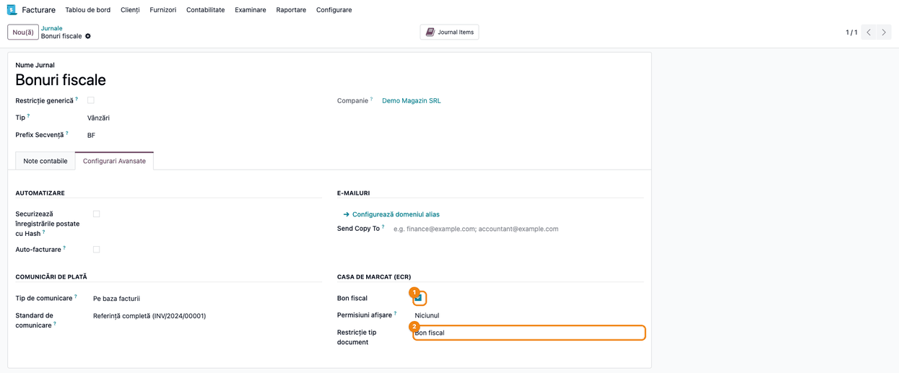

2. Tot din **Jurnale**, jurnalul de vânzări **Facturi magazin**, cod **FBF**, cu **Bon fiscal** bifat,
   fără restricție de tip. În el ajung facturile vânzărilor din magazin către clienții cu date de
   facturare și stornările lor. Nu bifați **Bon fiscal** pe jurnalul de facturi folosit pentru vânzările
   obișnuite (din depozit, online).

   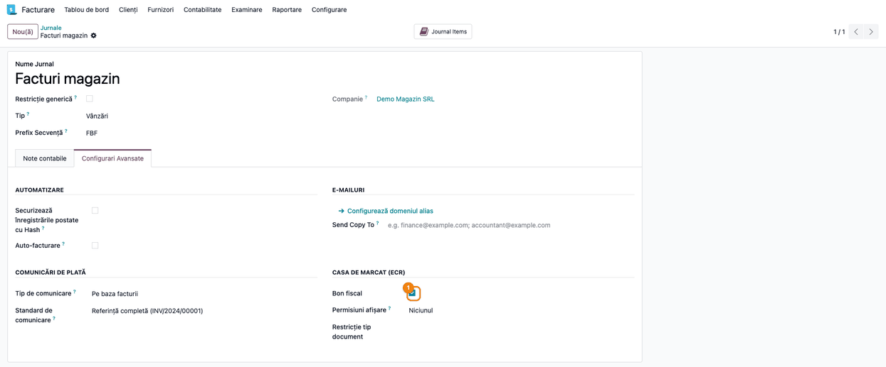

3. Jurnalul de numerar al magazinului (**Casa magazin**), tab-ul **Configurari Avansate**:
   - **Cod ECR** = 0 (numerar); pentru card se folosește 2, pentru tichete de masă 1;
   - bifați **Bon fiscal**: **Permisiuni afișare** devine **Doar bonuri fiscale**, adică jurnalul apare
     doar în fereastra de încasare a vânzării din magazin, nu și în plățile obișnuite;
   - un jurnal de bancă (ex. **Card POS**) are **Permisiuni afișare** = **Toate** și apare peste tot.

   Pe metoda de plată a jurnalului de numerar (tab-ul **Plăți de Primit**), contul de plată este contul
   de numerar (531101), ca încasarea să intre direct în casă. Pe jurnalul de card (**Card POS**, **Cod
   ECR** = 2), contul metodei de plată este 512501 „Încasări card în curs de decontare”.

   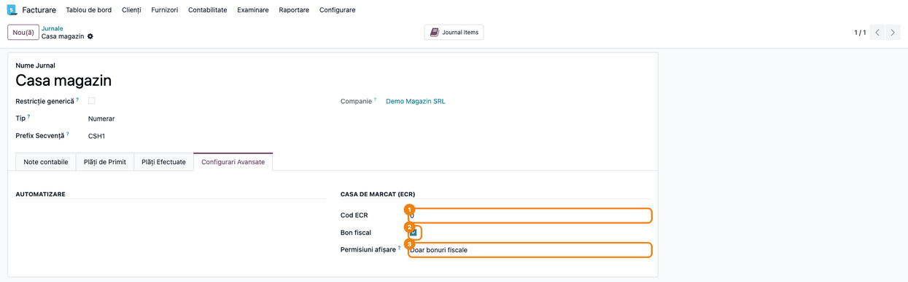

4. **Vânzări → Configurare → Tipuri comandă**: tipul **Magazin - factură**, cu valorile implicite
   **Jurnal facturare** = **Facturi magazin** și **Vânzare din magazin** = True. Al doilea tip,
   **Magazin - bon fiscal**, are **Jurnal facturare** = **Bonuri fiscale**, **Vânzare din magazin** = True
   și **Vânzare fără factură** = True. Când există mai multe jurnale cu **Bon fiscal**, tipul de comandă
   alege jurnalul; fără el, bifa **Vânzare din magazin** pusă manual pe ofertă cere un singur jurnal
   de vânzări cu **Bon fiscal**.

   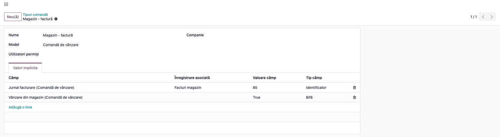

5. **Vânzări → Configurare → Setări**, secțiunea facturare:
   - **Partener generic**: partenerul folosit pentru clienții ocazionali (aici **Client ocazional**);
   - opțional, **Restricționare jurnale bon fiscal**: la **Tipărire bon fiscal** sunt acceptate doar
     plățile din jurnalele de bancă și din jurnalele de numerar cu **Bon fiscal**;
   - opțional, **Cod produs pe bon**: codul intern al produsului se tipărește înaintea denumirii.
6. Opțional, **Setări → Utilizatori → utilizatorul casierului → tab-ul Jurnale permise**: jurnalele de
   încasare pe care casierul le poate folosi. Fără jurnale permise, casierul vede toate jurnalele de bancă
   și de numerar.
7. Transportul bonului către casa de marcat (fișier de comandă, agentul Terrabit Connect, Fisco.ro sau
   driverul DxPrint) se setează din parametrii de sistem `account_invoice.ecr_*`, în modul dezvoltator
   (vezi `readme/CONFIGURE.md`). Pentru driverul DxPrint (www.dxprint.ro, casele Datecs și Daisy, în
   modul embedded), `account_invoice.ecr_transport` = `dxprint`, plus:
   - `account_invoice.ecr_dxprint_url`: adresa serverului HTTP al driverului (implicit
     `http://127.0.0.1:8080`);
   - `account_invoice.ecr_dxprint_user` și `account_invoice.ecr_dxprint_password`: utilizatorul și
     parola serverului HTTP al driverului, doar dacă acesta are autentificare.

   Driverul e apelat din browserul celui care tipărește bonul, deci utilizatorul și parola ajung în
   acel browser. Puneți serverului HTTP al driverului o parolă folosită doar acolo și țineți-l pe
   calculatorul local (`127.0.0.1`) sau în rețeaua magazinului.

## 6. Flux de utilizare

### Pasul 1 — Oferta pentru un client cu factură

**Vânzări → Comenzi → Oferte → Nou**: alegeți **Tip comandă** = **Magazin - factură**. Tipul bifează
**Vânzare din magazin** și alege jurnalul **Facturi magazin**; banda de sus arată „Vânzare din magazin cu
factură și bon fiscal”. Adăugați clientul și produsele, apoi apăsați **Vânzare din magazin**.

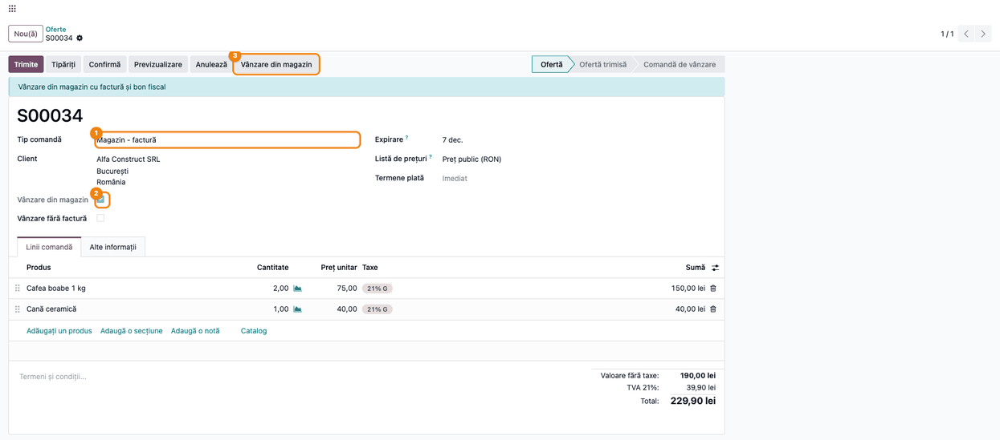

### Pasul 2 — Fereastra Confirmă vânzarea

Se deschide fereastra **Confirmă vânzarea**:
- **Jurnal încasare**: jurnalul de numerar sau de card al magazinului (aici **Casa magazin**);
- **Metoda de plată**: apare doar dacă jurnalul are mai multe metode de încasare;
- **Valoare**: totalul comenzii; verificați-l cu suma primită de la client;
- **Dată încasare**: data comenzii (sau ziua curentă, pentru grupul cu încasări doar la data curentă).

Apăsați **Tipărire**. Odoo confirmă comanda, verifică stocul, validează livrarea, postează factura în
jurnalul **Facturi magazin**, înregistrează plata pe **Casa magazin** și trimite bonul fiscal la casa de
marcat: descarcă fișierul de comandă (`ONLINE_<factură>.inp`) sau îl trimite agentului local ori
driverului DxPrint, după transportul configurat. Bonul tipărit pe casa de marcat nu apare în Odoo; în
istoricul facturii rămâne mesajul „Bonul fiscal … a fost generat” (la fișier) sau „Bonul fiscal … a
fost trimis agentului casei de marcat” (la agent sau la driver). Driverul DxPrint răspunde pe loc cu
numărul bonului și al raportului Z, care se salvează pe factură. Dacă driverul nu răspunde la prima
cerere, se descarcă fișierul de comandă. Un răspuns care nu e JSON apare ca eroare obișnuită a
driverului („HTTP <cod>”). Dacă nu răspunde în 40 de secunde sau conexiunea se pierde după prima
cerere, fișierul nu se mai descarcă: se deschide dialogul de eroare, cu avertismentul că bonul poate
fi deja tipărit, deci verificați casa înainte de reluare.

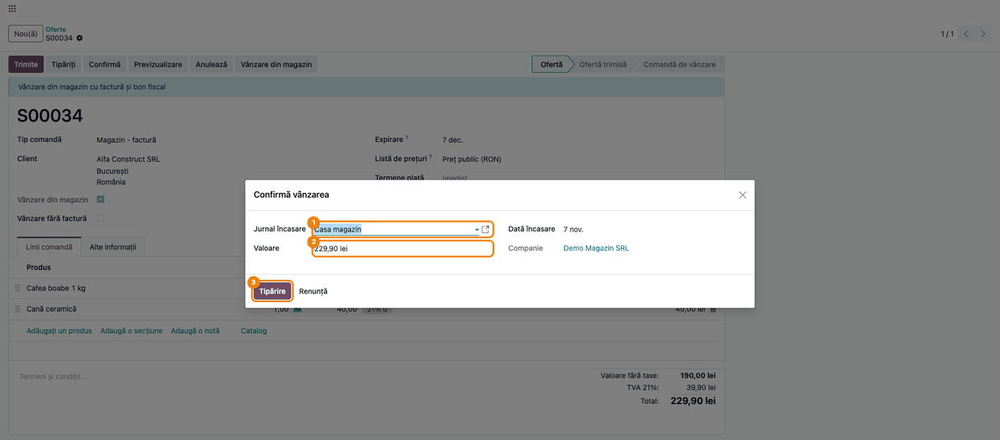

### Pasul 3 — Comanda livrată și facturată

Comanda e acum **Comandă de vânzare**, cu butoanele **Livrare 1** și **Facturi 1**. Butonul **Vânzare din
magazin** dispare.

**Verificați:** coloanele **Livrat** și **Facturat** sunt egale cu **Cantitate** pe fiecare linie.

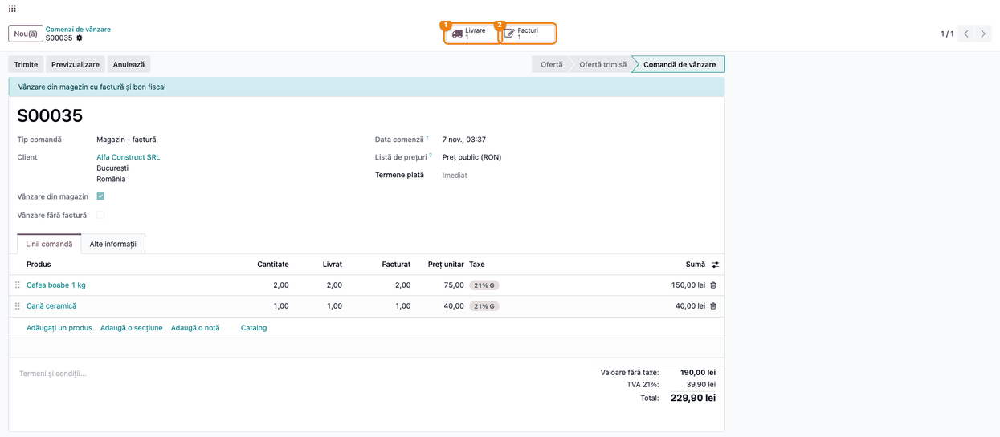

### Pasul 4 — Factura plătită

Din **Facturi**: factura **FBF/2026/00001** e postată, în jurnalul **Facturi magazin**, cu banderola
**Plătit**. În tab-ul **Alte informații**, **Tipărire bon** e bifat după ce bonul a plecat la casa de
marcat, iar **Vânzare din magazin** marchează factura emisă pe bon fiscal.

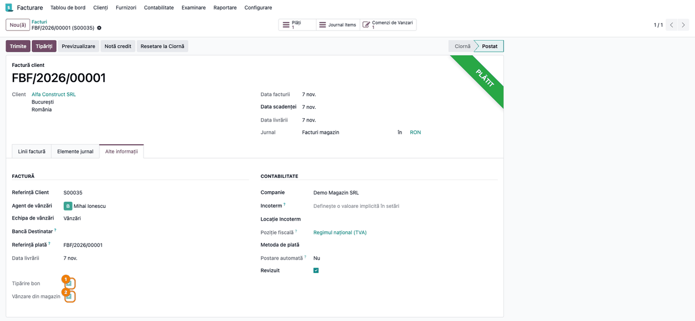

### Pasul 5 — Nota contabilă a facturii

Din factură → tab-ul **Elemente jurnal**: Dr 411100 „Clienți” 229,90 = Cr 707000 „Venituri din vânzarea
mărfurilor” 190,00 + Cr 442700 „TVA colectată” 39,90.

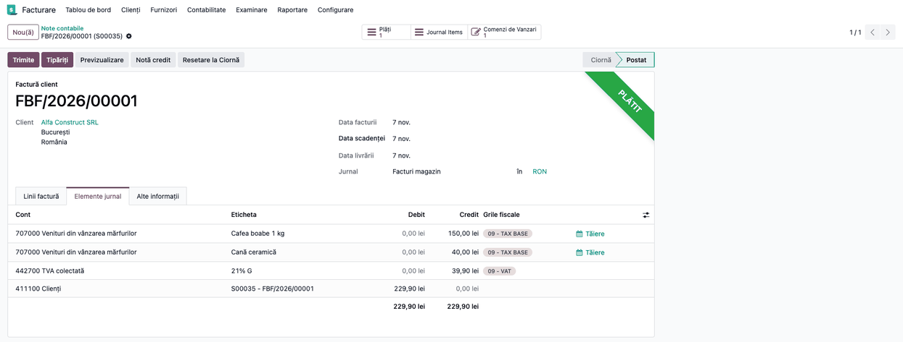

### Pasul 6 — Nota contabilă a încasării

Din factură → **Plăți** → **Înregistrare jurnal**: nota plății **PCSH1/2026/00001**, în jurnalul **Casa
magazin**: Dr 531101 „Numerar” = Cr 411100 „Clienți”, 229,90 lei.

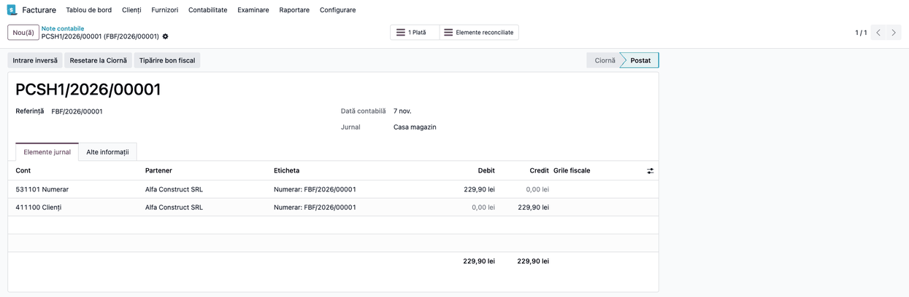

### Pasul 7 — Oferta pentru un client ocazional

Pentru o persoană fizică fără date de facturare: **Vânzări → Comenzi → Oferte → Nou**, **Tip comandă** =
**Magazin - bon fiscal**. Tipul bifează **Vânzare din magazin** și **Vânzare fără factură** și alege
jurnalul **Bonuri fiscale**. La **Client** alegeți partenerul generic (**Client ocazional**); dacă alegeți
partenerul generic pe o ofertă din magazin, **Vânzare fără factură** se bifează singur. Banda de sus
devine galbenă: „Vânzare din magazin doar cu bon fiscal”. Apăsați **Vânzare din magazin**, apoi, în
fereastra de la pasul 2, **Tipărire**.

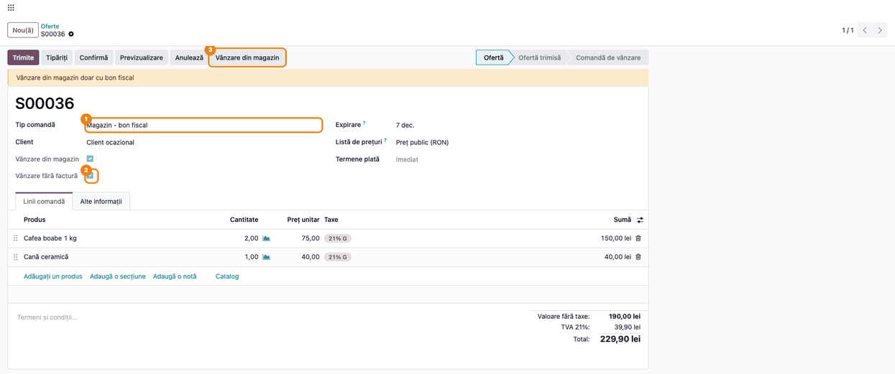

### Pasul 8 — Bonul fiscal

În locul facturii, Odoo emite un document de tip **Chitanță vânzări** (bon fiscal) în jurnalul **Bonuri
fiscale** (**BF/2026/00001**), plătit, cu aceleași note ca factura: Dr 4111 (Client ocazional) 229,90 =
Cr 707 190,00 + Cr 4427 39,90 și Dr 531101 = Cr 4111, 229,90 lei. O factură pentru partenerul generic
nu se poate posta.

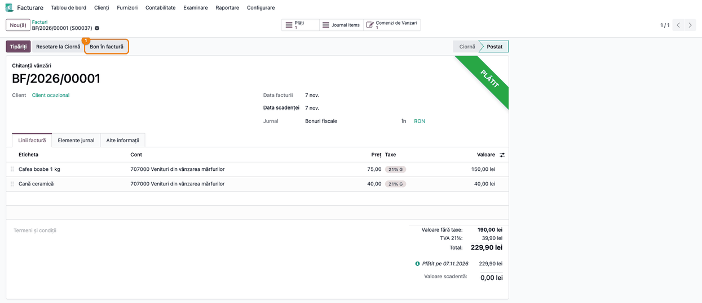

### Pasul 9 — Bonul transformat în factură

Dacă clientul ocazional cere factură: deschideți bonul (din comandă, butonul **Facturi**, sau din
**Facturare → Clienți → Facturi**) și apăsați **Bon în factură**, apoi confirmați întrebarea „Ești sigur că
dorești să transformi bonul în factură?”. În fereastra **Bon în factură** alegeți:
- **Jurnal**: jurnalul de facturi obișnuit (**Vânzări**), nu un jurnal cu **Bon fiscal**: factura nu se
  mai trimite la casa de marcat, bonul a fost deja tipărit;
- **Dată**: data facturii.

Apăsați **Transformă**.

**Atenție la lună:** transformați bonul în aceeași lună cu el, înainte de depunerea decontului de TVA.
Factura preia venitul și TVA-ul la data ei, iar bonul se anulează. Pentru un bon dintr-o lună anterioară,
nu folosiți **Bon în factură**: tratamentul se stabilește cu contabilul (vezi „Note de monografie”).

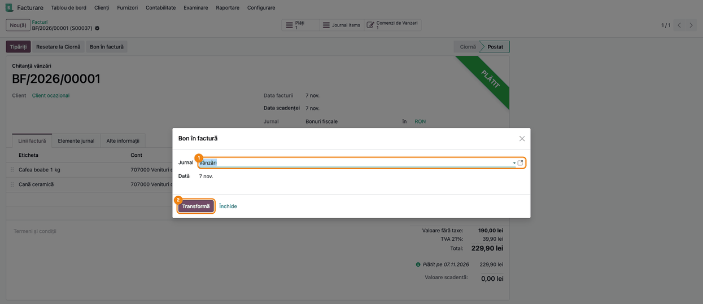

### Pasul 10 — Factura în ciornă

Se deschide factura nouă, în **Ciornă** (numărul INV/2026/00001 apare estompat până la confirmare), cu
liniile bonului și mențiunea „Conform bon fiscal nr.
BF/2026/00001 / 07.11.2026” la **Termeni și condiții** (sau în câmpul **Referință**, dacă bonul nu avea
referință). Dacă bonul e mai vechi decât factura, **Data livrării** de pe factură devine data bonului.
Bonul e anulat, iar plata lui rămâne disponibilă pentru factură.

Schimbați **Client** de pe **Client ocazional** pe clientul real (cu datele lui de facturare) și apăsați
**Confirmă**.

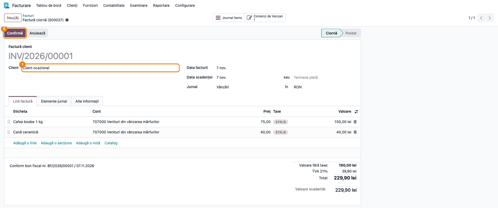

### Pasul 11 — Factura din bon, plătită

La confirmare, factura (**INV/2026/00001**) preia plata bonului și apare cu banderola **Plătit**. Nota
ei: Dr 4111 (Alfa Construct SRL) 229,90 = Cr 707 190,00 + Cr 4427 39,90.

**Verificați:** clientul e cel real, mențiunea bonului e pe factură, iar **Valoare scadentă** = 0,00.

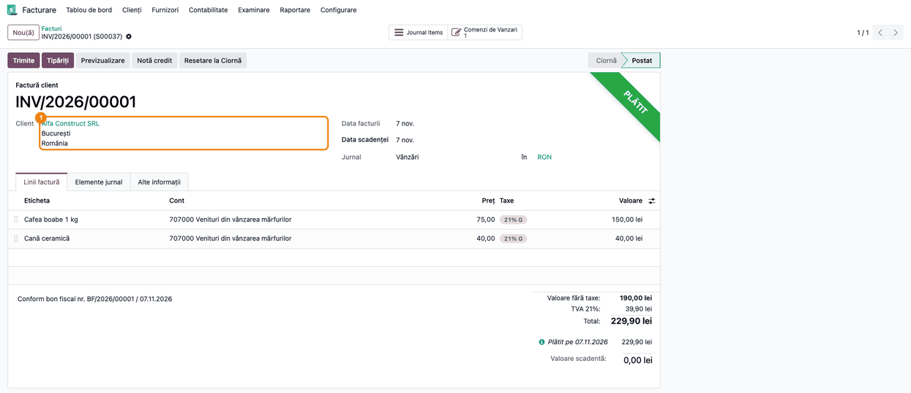

### Pasul 12 — Nota de transfer al plății

Plata bonului fusese înregistrată pe partenerul generic. La confirmarea facturii, Odoo face o notă în
primul jurnal de tip **Diverse** al companiei (aici **Diverse operații**), care mută suma pe clientul
facturii: Dr 411100 „Clienți” (Client
ocazional) = Cr 411100 „Clienți” (Alfa Construct SRL), cu eticheta „Plata bonului … transferată la
factura …”. Fără jurnal de tip **Diverse**, plata rămâne avans al partenerului generic și se alocă
manual (mesaj în istoricul facturii).

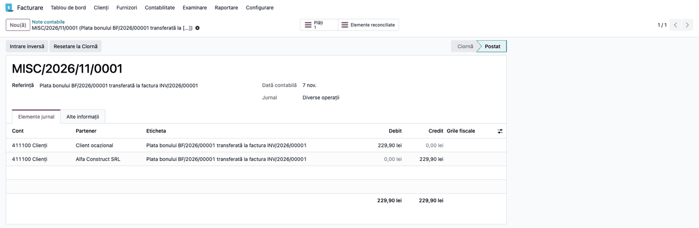

### Pasul 13 — Bonul fiscal pentru o factură plătită separat

O factură din jurnalul **Facturi magazin**, plătită altfel decât din fereastra **Confirmă vânzarea** (de
exemplu cu cardul, cu **Plătește** pe jurnalul **Card POS**), primește bonul cu butonul
**Tipărire bon fiscal**. Butonul apare doar pe facturile postate dintr-un jurnal cu **Bon fiscal**,
cât timp bonul nu a fost tipărit. Factura trebuie să fie plătită integral; altfel apare avertizarea
„Factura … nu este plătită integral”.

Pe o casă de marcat simulată (casa răspunde că bonul e simulat), **Tipărire bon fiscal** salvează pe
factură rezultatul casei (numărul bonului, al documentului și al raportului Z) și bifa **Bon simulat**
(`fiscal_simulated`, câmp din `deltatech_ecr_fiscal`), dar nu bifează **Tipărire bon**: un bon simulat nu
e un bon fiscal. Factura nu e deci marcată ca acoperită de bon fiscal și nu primește codul e-Factura 751
(îl pune `l10n_ro_edi_ubl_sale_store` doar pe facturile cu **Tipărire bon** bifat), iar butonul
**Tipărire bon fiscal** rămâne pe factură. **Bon simulat** nu apare pe formularul facturii; se vede la
exportul facturilor, cu coloana **Bon simulat**.

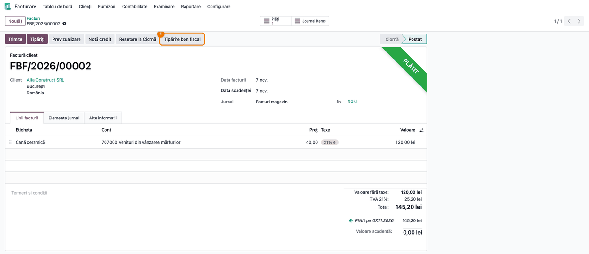

Nota plății cu cardul (**Plăți** → **Înregistrare jurnal**), în jurnalul **Card POS**: Dr 512501
„Încasări card în curs de decontare” = Cr 411100 „Clienți”, 145,20 lei. La decontare, din extrasul
băncii: Dr 5121 + Dr 627 (comisionul) = Cr 5125.

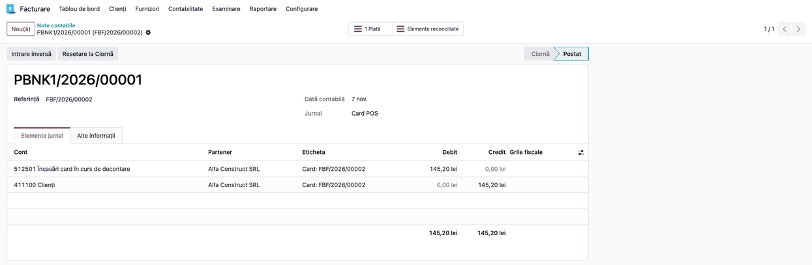

### Pasul 14 — Confirmarea tipăririi

Odoo cere confirmarea: „Ești sigur că dorești să tipărești bonul fiscal?”. La **Ok**, bonul pleacă la
casa de marcat, cu plata pe codul ECR al jurnalului (2 = card). După tipărire, **Tipărire bon** se
bifează și butonul dispare; o a doua tipărire e refuzată („Bonul a fost deja tipărit”).

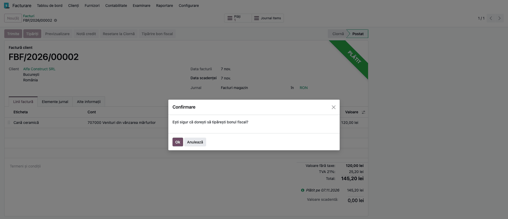

### Pasul 15 — Stoc insuficient

Dacă un produs nu e în stoc, **Tipărire** din fereastra **Confirmă vânzarea** se oprește cu mesajul „Nu
sunt toate produsele disponibile”. Nu se creează nicio livrare, factură sau plată, iar oferta rămâne
neconfirmată. Corectați stocul sau cantitatea și reluați.

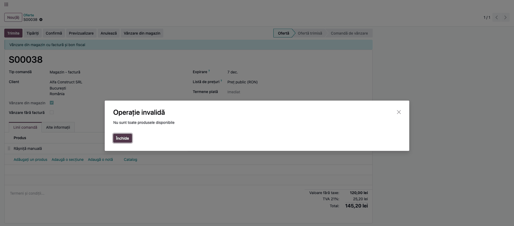

### Note de monografie și raportare

| Operațiune | Notă contabilă |
|---|---|
| Factura vânzării din magazin (pas 5) | Dr 4111 = Cr 707 + Cr 4427 (229,90 = 190,00 + 39,90) |
| Bonul clientului ocazional (pas 8) | Dr 4111 (Client ocazional) = Cr 707 + Cr 4427 |
| Descărcarea din gestiune, la livrare | după configurarea stocului (ex. Dr 607 = Cr 371) |
| Încasarea în numerar (pas 6) | Dr 5311 (analitic 531101) = Cr 4111 |
| Încasarea cu cardul (pas 13) | Dr 5125 (analitic 512501) = Cr 4111 (145,20) |
| Decontarea băncii, din extras | Dr 5121 + Dr 627 (comision) = Cr 5125 |
| Bonul transformat în factură (pas 10-11) | bonul se anulează (notele lui dispar); factura: Dr 4111 (client) = Cr 707 + Cr 4427 |
| Transferul plății bonului (pas 12) | Dr 4111 (Client ocazional) = Cr 4111 (client) |

**Bonul simulat:** pe o casă de marcat simulată, factura are **Bon simulat** bifat și **Tipărire bon**
nebifat, deci nu e raportată în e-Factura ca acoperită de bon fiscal (fără codul 751). Notele contabile
ale facturii și ale încasării sunt aceleași ca pe o casă reală; simularea se face doar pe o bază de test,
iar un bon simulat nu apare în niciun raport Z al aparatului real.

**Raportul Z:** venitul se înregistrează o singură dată, din factură sau din bon. Raportul Z al zilei
nu se mai contabilizează ca venit (nici prin 5311, nici prin 707); altfel venitul și TVA-ul apar de două
ori. Raportul Z se folosește pentru controlul încasărilor din casă.

**Bonul transformat în factură:** bonul anulat dispare din jurnalul de vânzări, iar vânzarea apare pe
factură, la data facturii. Dacă transformarea se face în aceeași lună cu bonul, totalul lunii nu se
schimbă. Într-o lună ulterioară, modulul ar muta venitul și TVA-ul în luna facturii, deși
exigibilitatea TVA e la data livrării (data bonului), iar jurnalul de vânzări al lunii bonului nu ar
mai corespunde cu raportul Z. De aceea **Bon în factură** se folosește doar pentru bonurile din luna
curentă, nedeclarată. Pentru un bon dintr-o lună anterioară, factura se emite cu tratamentul stabilit
de contabil, fără să anuleze bonul și fără să dubleze venitul: factura e doar documentul cerut de client, cu
mențiunea bonului, iar venitul și TVA-ul rămân pe bon (varianta A din `readme/ROADMAP.md`). Modulul nu
blochează încă **Bon în factură** pe un bon din altă lună. Limitarea e urmărită în
`readme/ROADMAP.md` (STORE-005).

## 7. Legături cu alte module / declarații

| Modul | Rol |
|---|---|
| `deltatech_ecr_connect` | formatul bonului și trimiterea la agentul Terrabit Connect sau la driverul DxPrint |
| `deltatech_ecr_fiscal` | răspunsul casei de marcat pe factură (număr bon, număr document, raport Z, stare) |
| `deltatech_partner_generic` | partenerul generic și blocarea facturilor pe el |
| `deltatech_record_type` | tipurile de comandă care aleg jurnalul și bifele de magazin |
| `deltatech_sale_store_payment_terminal` (opțional) | încasarea cu cardul pe terminalul de plată, din aceeași fereastră |
| `deltatech_saga` (opțional) | exportul în SAGA, cu tipul documentului dat de bifele de magazin |
| localizarea RO (e-Factura) | facturile emise se transmit în RO e-Factura, ca orice factură |

**Ce e automat:**
- confirmarea comenzii, verificarea stocului și validarea livrării;
- factura sau bonul, postate în jurnalul ales de tipul de comandă;
- plata pe jurnalul ales în fereastră și trimiterea bonului la casa de marcat;
- transferul plății bonului pe clientul facturii, la confirmarea facturii din bon.

**Ce rămâne manual:**
- alegerea tipului de comandă, a clientului și a jurnalului de încasare;
- schimbarea clientului și confirmarea facturii din bon;
- **Tipărire bon fiscal** pentru facturile plătite în afara ferestrei **Confirmă vânzarea**;
- reluarea bonului, dacă agentul sau driverul casei de marcat nu a răspuns (după verificarea casei).

## 8. Verificări pentru consultant

- [ ] Oferta cu **Tip comandă** = **Magazin - factură** are **Vânzare din magazin** bifat și butonul
      **Vânzare din magazin** în antet.
- [ ] Fereastra **Confirmă vânzarea** propune la **Valoare** totalul comenzii și arată la **Jurnal
      încasare** doar jurnalele cu **Permisiuni afișare** = **Doar bonuri fiscale** sau **Toate**.
- [ ] După **Tipărire**, comanda are **Livrat** = **Facturat** = **Cantitate**, iar factura e în
      **Facturi magazin**, **Plătit**, cu **Tipărire bon** bifat.
- [ ] Nota facturii: Dr 4111 = Cr 707 + Cr 4427; nota plății: Dr 531101 = Cr 4111.
- [ ] Oferta pe **Client ocazional** are **Vânzare fără factură** bifat și produce o **Chitanță vânzări**
      în jurnalul **Bonuri fiscale**, nu o factură.
- [ ] Seriile BF și FBF sunt separate: niciun bon nu ia un număr din seria facturilor.
- [ ] **Bon în factură** creează factura în ciornă, cu mențiunea „Conform bon fiscal nr. … / …”, iar bonul
      trece în **Anulat**.
- [ ] După schimbarea clientului și **Confirmă**, factura din bon e **Plătit**, iar în **Diverse operații**
      există nota Dr 4111 (Client ocazional) = Cr 4111 (client).
- [ ] Nota plății cu cardul: Dr 512501 = Cr 4111, cu suma facturii.
- [ ] Pe o factură din **Facturi magazin** plătită cu cardul, **Tipărire bon fiscal** apare; după
      tipărire dispare, iar o nouă încercare dă „Bonul a fost deja tipărit”.
- [ ] Pe o bază de test, cu o casă de marcat simulată: după **Tipărire bon fiscal**, exportul facturii are
      **Bon simulat** bifat și numărul bonului completat, iar **Tipărire bon** rămâne nebifat (butonul
      **Tipărire bon fiscal** nu dispare); factura nu primește codul e-Factura 751.
- [ ] Un produs fără stoc oprește **Tipărire** cu „Nu sunt toate produsele disponibile”, fără livrare,
      factură sau plată.
- [ ] Cu `account_invoice.ecr_transport` = `dxprint`, driverul DxPrint rulează în modul embedded la
      adresa din `account_invoice.ecr_dxprint_url`, iar un bon de probă se tipărește fără descărcarea
      fișierului de comandă, cu numărul bonului și al raportului Z pe factură.
- [ ] Utilizatorul și parola driverului DxPrint (`account_invoice.ecr_dxprint_user`,
      `account_invoice.ecr_dxprint_password`) ajung în browserul celui care tipărește bonul: parola e
      folosită doar pentru serverul HTTP al driverului, iar acesta e pe `127.0.0.1` sau în rețeaua
      magazinului.

## 9. Mesaje de eroare frecvente

| Mesaj | Cauză | Remediere |
|---|---|---|
| Nu sunt toate produsele disponibile | stoc insuficient pentru o linie a comenzii | corectați stocul sau cantitatea și reluați **Vânzare din magazin** |
| Vă rog să selectați jurnalul pentru bon fiscal | bifa **Vânzare din magazin** pusă manual, cu zero sau mai multe jurnale de vânzări cu **Bon fiscal** | folosiți un tip de comandă care alege jurnalul sau alegeți jurnalul pe ofertă |
| Factura … nu este plătită integral | **Tipărire bon fiscal** pe o factură neîncasată sau parțial încasată | înregistrați plata integrală, apoi tipăriți |
| Bonul a fost deja tipărit | bonul facturii a plecat deja la casa de marcat | nu se tipărește a doua oară; verificați raportul casei |
| Nu exista plati pentru factura … | factura e marcată plătită fără o plată înregistrată (ex. compensare) | înregistrați încasarea pe un jurnal de numerar sau de card |
| Nu se poate emite bon fiscal pe jurnalul de plata … | **Restricționare jurnale bon fiscal** activă și plata e pe un jurnal fără drept de bon | încasați pe un jurnal de bancă sau pe un jurnal de numerar cu **Bon fiscal** |
| Jurnalul selectat poate fi folosit doar pentru documente de tip … | documentul nu respectă **Restricție tip document** a jurnalului | alegeți jurnalul potrivit tipului de document (ex. facturile în **Facturi magazin**) |
| Bonul … nu poate fi înregistrat în jurnalul de facturi … | un bon postat într-un jurnal fără **Bon fiscal** | postați bonurile doar în jurnalul **Bonuri fiscale** |
| Driverul DxPrint nu răspunde — se descarcă fișierul .inp | transport `dxprint`: driverul DxPrint e oprit sau `account_invoice.ecr_dxprint_url` e greșit; nimic n-a ajuns la casă | porniți driverul în modul embedded sau corectați adresa, apoi procesați fișierul descărcat sau reluați **Tipărire bon fiscal** |
| Eroare casă de marcat: … Bonul poate fi deja tipărit: verificați casa de marcat înainte să reîncercați. | transport `dxprint`: driverul n-a răspuns în 40 de secunde sau conexiunea s-a pierdut după prima cerere | verificați pe casă dacă bonul a ieșit; dacă da, alegeți **Anulează**, altfel **Reîncercați** |
| Nu aveți drepturi pentru a confirma o comandă fără a specifica un tip de comandă | există tipuri de comandă, iar oferta nu are **Tip comandă** | alegeți **Tip comandă** pe ofertă |

## 10. Capturi de ecran

Capturile sunt generate automat de `tests/test_screenshots.py`, cu mixinul `ScreenshotCase` din
`l10n_ro_doc_screenshots` (import defensiv), în română, pe planul de conturi RO, pentru compania de
exemplu **Demo Magazin SRL** în RON. Capturile 14-16 se fac după ce testul transformă în factură bonul
din capturile 12-13. Bonul tipărit pe casa de marcat nu poate fi pozat: capturile arată
ce se vede în Odoo. Varianta în engleză, pentru `readme/USAGE.md`, e în `static/description/en/`.

| Fișier | Ce arată |
|---|---|
| `01_jurnal_bonuri.png` | jurnalul **Bonuri fiscale**, cu **Bon fiscal** și **Restricție tip document** |
| `02_jurnal_facturi_magazin.png` | jurnalul **Facturi magazin**, cu **Bon fiscal** |
| `03_jurnal_numerar.png` | jurnalul **Casa magazin**, cu **Cod ECR**, **Bon fiscal** și **Permisiuni afișare** |
| `04_tip_comanda.png` | tipul de comandă **Magazin - factură** și valorile lui implicite |
| `05_oferta.png` | oferta din magazin, cu butonul **Vânzare din magazin** |
| `06_confirma_vanzarea.png` | fereastra **Confirmă vânzarea** |
| `07_comanda_livrata.png` | comanda livrată și facturată |
| `08_factura_platita.png` | factura **Plătit**, cu **Tipărire bon** și **Vânzare din magazin** |
| `09_nota_factura.png` | nota facturii: Dr 4111 = Cr 707 + Cr 4427 |
| `10_nota_incasare.png` | nota plății: Dr 531101 = Cr 4111 |
| `11_oferta_client_ocazional.png` | oferta pentru clientul ocazional, cu **Vânzare fără factură** |
| `12_bon_fiscal.png` | bonul (**Chitanță vânzări**), cu **Bon în factură** |
| `13_bon_in_factura.png` | fereastra **Bon în factură** |
| `14_factura_din_bon_ciorna.png` | factura din bon, în ciornă, cu mențiunea bonului |
| `15_factura_din_bon.png` | factura din bon, **Plătit**, pe clientul real |
| `16_nota_transfer.png` | nota de transfer al plății de pe partenerul generic pe client |
| `17_factura_platita_card.png` | factura plătită cu cardul, cu **Tipărire bon fiscal** |
| `18_nota_incasare_card.png` | nota plății cu cardul: Dr 512501 = Cr 4111 |
| `19_confirmare_bon.png` | confirmarea tipăririi bonului |
| `20_stoc_insuficient.png` | mesajul „Nu sunt toate produsele disponibile” |

Regenerare:

```bash
./odoo/odoo-bin -c odoo.conf -d <db> \
    -i l10n_ro,deltatech_sale_store,l10n_ro_doc_screenshots \
    --test-tags=/deltatech_sale_store:TestSaleStoreScreenshots --stop-after-init
```

## 11. Observații pentru manual

- **Un singur gest, o singură plată:** fereastra **Confirmă vânzarea** are un singur jurnal de încasare.
  Plata mixtă (parte numerar, parte card) nu se face din ea: se facturează comanda, se înregistrează
  plățile pe factură și se tipărește bonul cu **Tipărire bon fiscal**.
- **Serii separate:** păstrați bonurile (BF) și facturile din magazin (FBF) în jurnale separate. Un singur
  jurnal cu **Bon fiscal** pentru ambele ar amesteca bonurile în seria facturilor.
- **Factura din bon** se emite într-un jurnal fără **Bon fiscal**, ca să nu apară butonul **Tipărire bon
  fiscal** pe ea: bonul a fost deja tipărit la vânzare.
- **Nota plății pe numerar** are și ea butonul **Tipărire bon fiscal**, pentru că jurnalul de numerar are
  **Bon fiscal**. Bonul se tipărește din factură sau din fereastra **Confirmă vânzarea**, nu din nota
  plății.
- Pașii 8-12 urmăresc același bon (BF/2026/00001): oferta de la pasul 7 e o ofertă separată, încă
  neconfirmată, pentru același tip de vânzare.
- Transportul bonului (fișier, Terrabit Connect, Fisco.ro, DxPrint) și parametrii lui sunt descriși în
  `readme/CONFIGURE.md`; la DxPrint, utilizatorul și parola driverului ajung în browserul celui care
  tipărește bonul. Când se folosește Terrabit Connect, un indicator din bara de sus arată dacă
  agentul casei de marcat răspunde.
