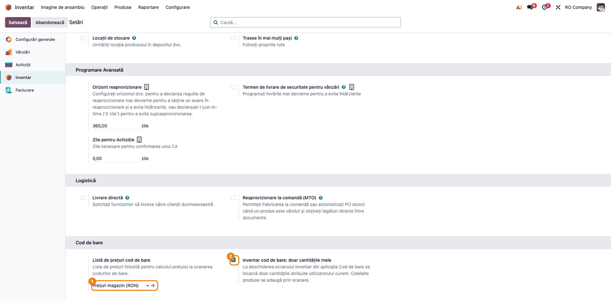
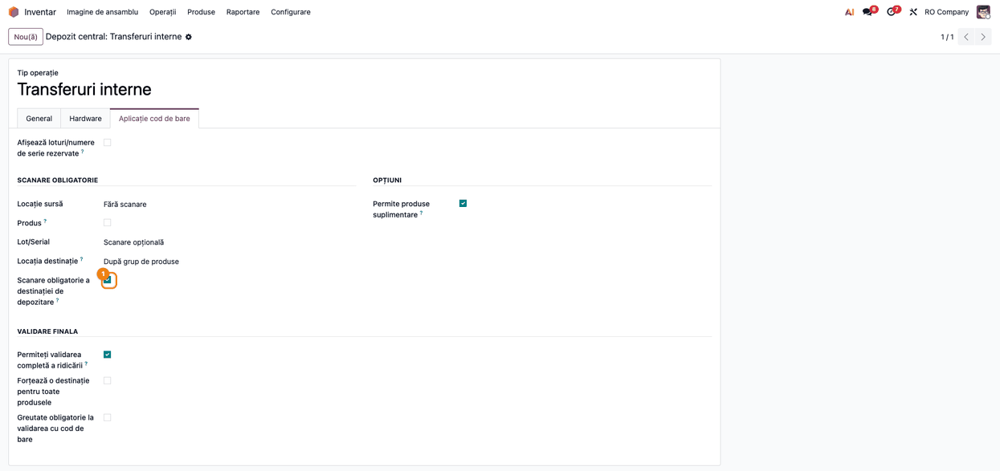
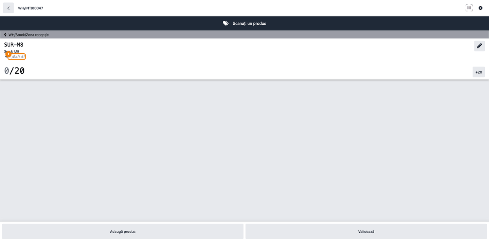
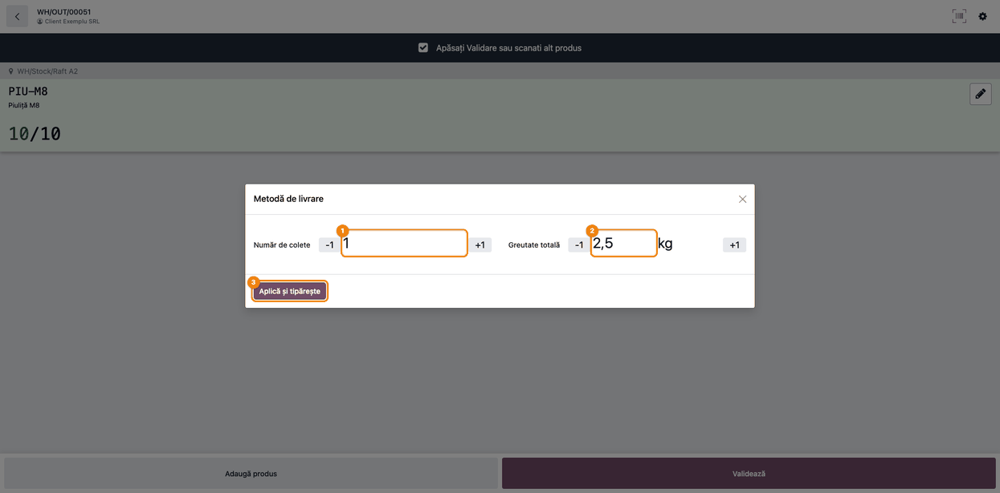
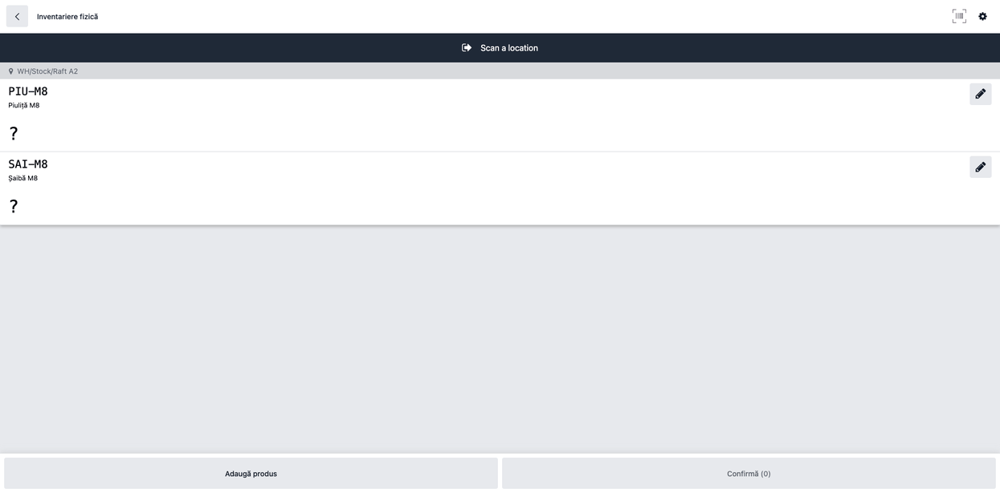

# Fișă Modul: Aplicația Cod de bare — destinația propusă la raft, greutatea coletelor și inventarul pe utilizator

**Modul:** `deltatech_stock_barcode`
**Utilizator principal:** Operator depozit (scanner) și responsabil de depozit (configurare)
**Prioritate:** 🟡 Medie (esențial în depozitele care lucrează cu scannerul pe rafturi și livrează prin curier)

---

## 1. Scop business

În depozitele cu multe rafturi, operatorul de la scanner trebuie să știe **unde pune marfa** fără să
caute în altă parte, să **cântărească și să numere coletele** unei livrări înainte să plece la curier
și să **numere doar ce i s-a dat lui** la inventar. Modulul completează aplicația standard
**Cod de bare** (Odoo Enterprise) cu:

- **destinația propusă la raft** pe transferurile interne: pentru un produs scanat care nu are încă
  linie, aplicația cere serverului raftul dat de regulile de depozitare (putaway) și capacitatea
  rafturilor (`deltatech_putaway_strategy`) și îl pune pe linia nouă; opțional, operatorul
  **trebuie** să scaneze exact raftul de pe linie;
- **verificarea capacității raftului**: pe o linie nouă cu raftul propus de aplicație, cantitatea care
  ar depăși capacitatea maximă a raftului e refuzată;
- **greutatea și numărul de colete la livrare**: la validare, o fereastră cu butoane mari
  (+1 / −1) cere numărul de colete și greutatea, apoi trimite datele la curier (AWB); eticheta se
  tipărește din butonul **Tipărește AWB**;
- **inventarul pe utilizator**: ecranul Inventar poate încărca doar cantitățile atribuite
  utilizatorului curent, ca să se deschidă repede pe baze cu zeci de mii de cantități;
- **scanarea referinței interne**: dacă codul scanat nu e un cod de bare cunoscut, produsul se
  caută și după referința internă;
- **lista de prețuri la scanare** (prețul apare pe cardul produsului scanat din ecranul principal) și
  **amplasarea manuală** (raft, rând, etajeră, cutie) pe liniile aplicației.

## 2. Bază legală și context

Modulul nu generează documente fiscale și nici note contabile. Contextul este operațional:

- **Inventarierea** se face după regulile generale ale firmei (Legea contabilității nr. 82/1991 și
  normele de inventariere aprobate prin OMFP nr. 2861/2009); modulul doar împarte numărarea pe utilizatori, prin cantitățile atribuite
  fiecăruia. Diferențele găsite se înregistrează prin validarea standard a inventarului din Odoo.
- **Livrarea prin curier**: greutatea și numărul de colete sunt datele pe care curierul le cere
  pentru AWB; trimiterea către curier o face integrarea curierului (`deltatech_delivery` și
  conectorul curierului).

## 3. Utilizatori și roluri

| Rol | Ce face | Grup Odoo recomandat la testare |
|---|---|---|
| Responsabil depozit | Configurează setările, tipurile de operație, rafturile și regulile de depozitare | Inventar / Administrator |
| Operator depozit | Lucrează din aplicația Cod de bare: transferuri, livrări, inventar | Inventar / Utilizator |
| Operator inventar | Numără cantitățile atribuite lui | Inventar / Utilizator |

Pentru câmpurile de amplasare manuală (raft, rând, etajeră, cutie) pe liniile aplicației, utilizatorul
trebuie să aibă grupul **Afișează câmpurile de amplasare manuală (Raft/Rând/Poliță/Cutie)** din `deltatech_stock_inventory`.

## 4. Conturi și date implicate

Modulul nu atinge contabilitatea: nu creează note contabile și nu modifică valorizarea stocului.
Mișcările de stoc rezultate (transfer intern, livrare, ajustare de inventar) urmează contabilizarea
standard a firmei.

Date minime pentru demo:

- depozitul **Depozit central**, cu zona **Zona recepție** și rafturile **Raft A1** (capacitate 50)
  și **Raft A2**, fiecare cu cod de bare;
- produsele **Șurub M8**, **Piuliță M8** și **Șaibă M8**, cu cod de bare și referință internă;
- o regulă de depozitare: **Șurub M8** din stocul depozitului merge pe **Raft A1**;
- un curier (metodă de livrare) cu tarif fix și un client cu adresă;
- lista de prețuri **Prețuri magazin**.

## 5. Configurare inițială

1. **Inventar → Configurare → Setări**, blocul **Cod de bare**: alegeți **Listă de prețuri cod de
   bare** (prețul afișat la scanare) și, pe bazele cu multe cantități, bifați **Inventar cod de bare:
   doar cantitățile mele**. Salvați.
2. **Inventar → Configurare → Locații**: creați rafturile sub stocul depozitului, fiecare cu **Cod de
   bare**; pe rafturile cu capacitate limitată completați **Produse maxime (finală)** (modulul
   `deltatech_putaway_strategy`).
3. **Inventar → Configurare → Reguli plasare**: legați produsele (sau categoriile) de rafturi.
4. **Inventar → Configurare → Tipuri operații → Transferuri interne**, tabul **Aplicație cod de
   bare**: bifați **Scanare obligatorie a destinației de depozitare** dacă operatorul trebuie să
   scaneze exact raftul propus.
5. Pe tipul de operație al livrărilor, același tab: bifați **Greutate obligatorie la validarea cu cod
   de bare** dacă livrările pleacă prin curier.
6. Pentru inventarul pe utilizator: în **Inventar → Operații → Ajustări → Inventariere fizică**,
   atribuiți cantitățile de numărat fiecărui operator (coloana **Atribuit către**) și setați data în
   coloana **Programat**.

## 6. Flux de utilizare

### Pasul 1 — Setările aplicației Cod de bare

**Inventar → Configurare → Setări**, blocul **Cod de bare**. **Listă de prețuri cod de bare** dă
prețul afișat pe cardul produsului, când acesta e scanat din ecranul principal al aplicației Cod de
bare (rândul **Preț:**); fără ea se folosește prima listă de prețuri a firmei.
**Inventar cod de bare: doar cantitățile mele** schimbă ecranul Inventar al aplicației: se încarcă
doar cantitățile atribuite utilizatorului curent, iar celelalte produse se adaugă prin scanare.
Opțiunea e recomandată pe bazele cu zeci de mii de cantități, unde ecranul standard nu se mai
deschide.



### Pasul 2 — Tipul de operație: scanarea obligatorie a raftului propus

**Inventar → Configurare → Tipuri operații → Transferuri interne**, tabul **Aplicație cod de
bare**. **Scanare obligatorie a destinației de depozitare** obligă operatorul să scaneze exact raftul
propus pe linie; un alt raft scanat e refuzat cu mesajul „Trebuie să scanați locația de destinație
exactă". În secțiunea **Validare finală** se află și **Greutate obligatorie la validarea cu cod de
bare**, care se bifează pe tipul de operație al livrărilor (pasul 4).



### Pasul 3 — Transferul intern: raftul propus pe linie

Din aplicația **Cod de bare → Operații**, tipul **Transferuri interne**, operatorul deschide
transferul. Pe un transfer rezervat, raftul de destinație e deja pe linie, pus de regulile de
depozitare la rezervare. Când operatorul scanează un produs care nu are încă linie, aplicația cere
serverului raftul după regulile de depozitare și capacitatea rafturilor și îl pune pe linia nouă.
Raftul de pe care pleacă marfa nu e propus niciodată ca destinație.

- **Găsiți pe ecran**: linia produsului (**SUR-M8 / Șurub M8**), cu sursa **WH/Stock/Zona recepție**
  în bara gri și destinația propusă **…/Raft A1** sub numele produsului.
- **Verificați**: raftul propus e cel din regula de depozitare sau, dacă raftul acela e plin, un raft
  cu loc liber; cantitatea **0/20** arată ce mai e de mutat.
- **Mai departe**: scanați raftul (cu scanarea obligatorie, doar **Raft A1** e acceptat), apoi
  cantitatea, și apăsați **Validează**.

Pe o linie nouă, cu raftul propus de aplicație, o cantitate care ar depăși capacitatea maximă a
raftului (stocul de pe raft, marfa planificată să ajungă acolo și cantitatea liniei) e refuzată cu
mesajul „Locația … a atins capacitatea maximă.", iar linia rămâne neschimbată. Validarea
transferului verifică încă o dată capacitatea tuturor rafturilor de destinație.



### Pasul 4 — Livrarea: numărul de colete și greutatea

Pe o livrare al cărei tip de operație cere greutatea, apăsarea pe **Validează** deschide fereastra
**Metodă de livrare** cu butoane mari, potrivite pentru scanner:

- **Număr de colete** — ajustat cu **−1 / +1**;
- **Greutate totală** — propusă din greutatea produselor de pe livrare (aici 10 × 0,25 kg =
  2,5 kg); fără greutate pe produse se propune 0,1 kg. Se ajustează cu **−1 / +1** sau se tastează.

**Aplică și tipărește** salvează datele pe livrare, trimite livrarea la curier (AWB), închide
fereastra și continuă validarea livrării. Închiderea ferestrei cu **X** renunță la validare; la o nouă
apăsare pe **Validează** fereastra apare din nou. Eticheta curierului se tipărește din meniul de tipărire
al aplicației, cu butonul **Tipărește AWB**.



### Pasul 5 — Inventarul: doar cantitățile atribuite operatorului

Din ecranul principal al aplicației **Cod de bare**, butonul **Inventariere** deschide ecranul
**Inventariere fizică**. Cu opțiunea de la pasul 1 bifată, ecranul arată doar cantitățile atribuite
utilizatorului curent, cu data programată ajunsă.

- **Găsiți pe ecran**: locația (**WH/Stock/Raft A2**) și produsele de numărat, fiecare cu **?** în
  locul cantității numărate.
- **Verificați**: apar doar produsele atribuite operatorului; butonul **Confirmă (0)** arată câte
  linii au fost numărate.
- **Mai departe**: scanați fiecare produs (codul de bare sau referința internă) și introduceți
  cantitatea, apoi **Confirmă**. Un produs care nu e în listă se adaugă prin scanare.



### Note de monografie și raportare

Modulul nu generează note contabile. Mișcările create din aplicație se contabilizează după regulile
standard ale firmei:

- **transferul intern** între rafturile aceluiași depozit nu are notă contabilă (stocul rămâne în
  aceeași gestiune);
- **livrarea** descarcă stocul la validare, după valorizarea firmei (de exemplu, Dr 607 = Cr 371 la
  mărfuri, în contabilitatea în timp real);
- **ajustarea de inventar** înregistrează plusurile și minusurile găsite, prin conturile de ajustare
  configurate pe locația de inventar.

## 7. Legături cu alte module / declarații

| Modul | Rol |
|---|---|
| `stock_barcode` (Enterprise) | Aplicația Cod de bare, extinsă de acest modul |
| `deltatech_putaway_strategy` | Regulile de depozitare cu capacitatea rafturilor și preferința pentru raftul cu stoc |
| `deltatech_delivery` | Fereastra de date pentru curier și trimiterea AWB |
| `deltatech_stock_inventory` | Câmpurile de amplasare manuală (raft, rând, etajeră, cutie) și grupul care le afișează |

**Ce e automat:** raftul propus pe fiecare linie nouă a unui transfer intern; refuzul cantității peste
capacitatea raftului; trimiterea la curier după fereastra de greutate; filtrarea cantităților la
inventar; căutarea după referința internă când codul scanat nu e găsit.

**Ce rămâne manual:** regulile de depozitare și capacitatea rafturilor; atribuirea cantităților de
numărat pe operatori; ajustarea greutății și a numărului de colete.

## 8. Verificări pentru consultant

- [ ] În **Setări → Cod de bare**, lista de prețuri aleasă dă prețul de pe cardul produsului scanat
      din ecranul principal al aplicației (rândul **Preț:**).
- [ ] Pe un transfer intern, la scanarea unui produs cu regulă de depozitare care nu are încă linie,
      linia nouă primește raftul din regulă.
- [ ] Cu stoc al produsului pe un raft și transfer chiar de pe acel raft, raftul sursă nu e propus ca
      destinație.
- [ ] Cu **Scanare obligatorie a destinației de depozitare** bifată, scanarea altui raft decât cel
      propus e refuzată cu mesaj.
- [ ] Pe o linie nouă, cu un raft cu **Produse maxime (finală)** propus de aplicație, o cantitate
      care depășește capacitatea e refuzată.
- [ ] Pe o livrare cu **Greutate obligatorie la validarea cu cod de bare**, **Validează** deschide
      fereastra **Metodă de livrare**; după **Aplică și tipărește** livrarea are AWB și se validează,
      fără o a doua apăsare pe **Validează**.
- [ ] Cu **Inventar cod de bare: doar cantitățile mele** bifată, ecranul Inventariere fizică arată
      doar cantitățile atribuite utilizatorului; înainte de a număra, numărul de pe butonul
      **Inventariere** din ecranul principal e egal cu numărul liniilor și scade pe măsură ce numărați.
- [ ] Scanarea referinței interne a unui produs fără cod de bare găsește produsul.

## 9. Mesaje de eroare frecvente

| Mesaj | Cauză | Remediere |
|---|---|---|
| Trebuie să scanați locația de destinație exactă: … | S-a scanat alt raft decât cel propus, cu scanarea obligatorie activă | Scanați raftul afișat pe linie sau schimbați destinația liniei din creion |
| Locația … a atins capacitatea maximă. | Cantitatea scanată depășește **Produse maxime (finală)** al raftului | Puneți restul pe alt raft (editați destinația liniei) sau măriți capacitatea raftului |
| Ecranul Inventar nu se deschide sau se deschide foarte greu | Standardul 19.0 încarcă toate cantitățile fără responsabil, pe o bază cu foarte multe cantități | Bifați **Inventar cod de bare: doar cantitățile mele** și atribuiți cantitățile pe operatori |
| Locația … depășește capacitatea (… > …) | La validarea transferului, un raft de destinație ar depăși **Produse maxime (finală)** | Mutați o parte din cantitate pe alt raft (editați destinația liniei) sau măriți capacitatea raftului |
| Fereastra de greutate nu apare la validare | Tipul de operație nu are bifat **Greutate obligatorie la validarea cu cod de bare** sau datele au fost deja trimise de pe mobil | Bifați opțiunea pe tipul de operație al livrărilor |

## 10. Capturi de ecran

Capturile din `static/description/` sunt **generate automat** din `tests/test_screenshots.py`
(mixinul `ScreenshotCase` din `l10n_ro_doc_screenshots`, import defensiv), în **limba română**, pe
compania de test „RO Company”; aceleași ecrane în engleză stau în `static/description/en/`, pentru
`readme/USAGE.md`:

1. `01_setari_cod_bare.png` — setările Inventar, blocul **Cod de bare**: lista de prețuri și
   inventarul doar pe cantitățile utilizatorului.
2. `02_tip_operatie_cod_bare.png` — tipul de operație **Transferuri interne**, tabul **Aplicație cod
   de bare**: scanarea obligatorie a destinației de depozitare.
3. `03_transfer_intern_destinatie.png` — transferul intern în aplicație, cu raftul propus pe linie.
4. `04_livrare_greutate_colete.png` — livrarea, fereastra **Metodă de livrare** cu numărul de colete
   și greutatea.
5. `05_inventar_cantitatile_mele.png` — ecranul **Inventariere fizică** cu cantitățile atribuite operatorului.

Regenerare:

```bash
./odoo/odoo-bin -c odoo.conf -d <db> \
    -i deltatech_stock_barcode,l10n_ro_doc_screenshots \
    --test-tags=fise_screenshots/deltatech_stock_barcode --stop-after-init
```

## 11. Observații pentru manual

- Raftul propus vine din regulile de depozitare și din capacitatea rafturilor
  (`deltatech_putaway_strategy`); manualul aplicației Cod de bare trebuie să trimită la acel capitol
  pentru configurarea regulilor.
- Când nu se găsește niciun raft potrivit, destinația rămâne locația transferului (de exemplu, stocul
  depozitului); operatorul alege atunci raftul prin scanare.
- Opțiunea **Inventar cod de bare: doar cantitățile mele** schimbă felul în care se împarte
  inventarul: fără atribuirea cantităților pe operatori, ecranul apare gol.
- Interfața aplicației Cod de bare are câteva texte standard Odoo netraduse în română
  (de exemplu „Scan a location”); nu țin de acest modul.
