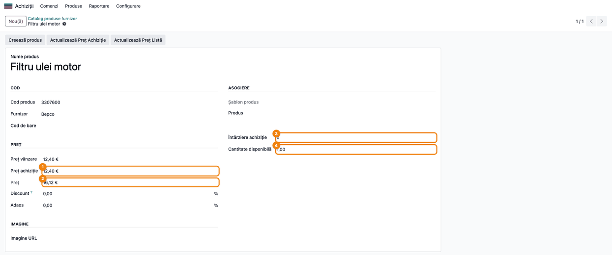
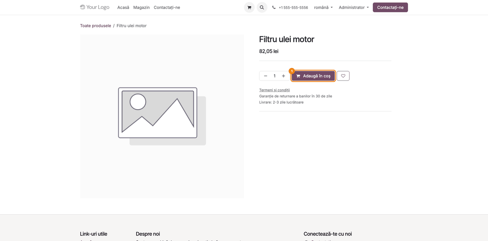
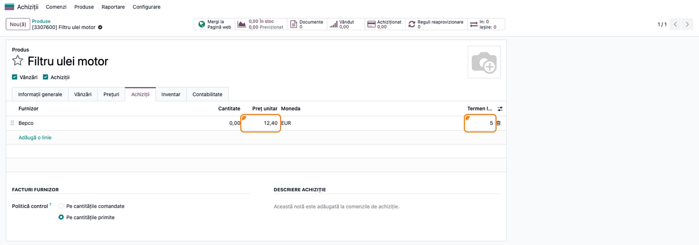

# Fișă Modul: Căutare Bepco prin API-ul TVH — prețul de achiziție al unui part number, la cerere

**Modul:** `deltatech_vendor_products_bepco`
**Utilizator principal:** Consultant (configurare), Responsabil eCommerce, Agent de achiziții / vânzări piese
**Prioritate:** 🟢 Scăzută (util doar clienților care cumpără piese de la Bepco cu un cont TVH; nu generează note contabile)

---

## 1. Scop business

Un dealer de piese pentru utilaje (agricole, de construcții, stivuitoare) cumpără o parte din piese
de la **Bepco**, care face parte din grupul **TVH**. Catalogul Bepco are zeci de mii de coduri, iar
dealerul nu vrea să îl importe în Odoo. Când un client cere o piesă după **part number** (codul
piesei), dealerul trebuie să afle prețul de achiziție de pe portalul TVH și să îl copieze manual.

Modulul leagă **catalogul produselor furnizor** (`deltatech_vendor_products`) de **API-ul TVH**:
pe un feed de tip **Bepco** cu **Căutare online** bifată, căutarea unui part number în magazinul
online (`/shop`) întreabă API-ul TVH ce articol are acel cod, apoi cere pentru el o **ofertă de
preț**, care întoarce **prețul de achiziție** Bepco. Articolul găsit se salvează în catalogul
furnizorului și apare în magazin, cu prețul de vânzare calculat din prețul de achiziție și din
regulile feed-ului. La click, Odoo creează produsul, cu linia de furnizor Bepco.

Modulul caută **câte un part number pe rând**. **Nu importă** catalogul Bepco, **nu creează
variante**, iar butonul **Încarcă preț** de pe feed nu face nimic pentru acest tip de conexiune.

## 2. Bază legală și context

Modulul nu are implicații fiscale sau contabile: nu emite documente și nu generează note contabile.
Comanda clientului, comanda de achiziție către Bepco și facturile urmează fluxurile standard.

Context operațional important:

- Căutarea pornește **doar din magazinul online** (`/shop`), prin modulul
  `deltatech_vendor_products_website` (instalat automat). Fișa acestuia descrie blocul
  **„Disponibile de la furnizorii noștri"**, limitele de căutări pe minut și crearea produsului la
  click. Din backend nu există o căutare online după part number.
- La fiecare căutare, conectorul face **două cereri** către TVH: căutarea articolului după part
  number și o **cerere de ofertă** (inquiry) pentru o bucată, din care ia prețul. Cererea de ofertă
  este înregistrată la TVH pe contul clientului, cu persoana de contact „Odoo".
- **TVH nu spune moneda prețului.** Prețul din ofertă este considerat în **Monedă** a feed-ului și
  abia apoi se convertește în lei, la cursul zilei. Setați pe feed moneda contractului cu TVH (de
  regulă EUR). Cu **Monedă** goală, prețul e luat drept lei.
- Bepco dă **doar prețul de achiziție** (prețul unitar din ofertă, fără suprataxe). Conectorul îl folosește și ca preț de vânzare al
  furnizorului, deci prețul din magazin = prețul de achiziție + regulile de preț ale feed-ului
  (**Adaos**, **Discount**, **Valoare suplimentară**). **Fără adaos, piesa se vinde la prețul de
  achiziție.**
- Descrierile articolelor se cer de la TVH **mereu în română**, indiferent de limba site-ului sau a
  utilizatorului.

## 3. Utilizatori și roluri

- **Consultantul / administratorul** configurează feed-ul Bepco: tipul conexiunii, **Număr client**,
  utilizatorul și parola contului TVH, moneda, adaosul și **Căutare online**. Credențialele se văd
  doar cu drept de **Administrare / Setări**.
- **Clientul magazinului** (sau agentul de vânzări, din magazin) caută un part number în `/shop` și
  deschide produsul găsit la Bepco.
- **Agentul de achiziții** găsește în **Catalog produse furnizor** rândurile salvate de căutări, cu
  prețul de achiziție, și pe produs linia de furnizor Bepco, folosită la comanda de achiziție.
- Rol recomandat la testare: utilizator cu **Achiziții / Administrator**, **Website /
  Administrator** și **Administrare / Setări** pentru configurare; pentru căutare, o fereastră
  privată a browserului (vizitator neautentificat) sau un agent de vânzări.

## 4. Conturi și date implicate

**Conturi contabile:** niciunul. Modulul nu generează note contabile.

**Date pe feed-ul Bepco** (*Feed Furnizor*, grupul **Conexiune**):

| Câmp | Rol |
|------|-----|
| **Tip conexiune** = Bepco | Feed-ul folosește conectorul TVH |
| **Număr client** | Codul de client TVH; intră în adresa cererii de ofertă și pe ofertă |
| **Nume utilizator**, **Parolă** | Contul API TVH (autentificare de bază) |
| **Căutare online** | Feed-ul e întrebat la căutările din magazin |
| **Monedă** | Moneda în care e considerat prețul TVH; din ea se convertește în moneda companiei și a site-ului, la cursul zilei. **Curs valutar** de pe feed nu se folosește la această conversie |
| **Adaos**, **Discount**, **Valoare suplimentară** (grupul **Preț**) | Transformă prețul de achiziție Bepco în prețul afișat în magazin și în prețul de vânzare al produsului creat |
| **Întârziere achiziție** (grupul **Valori implicite**) | Termenul de livrare pus pe linia de furnizor a produsului creat |

**Date create de o căutare:**

| Unde | Ce se completează |
|------|-------------------|
| **Catalog produse furnizor** | Un rând per articol găsit: **Cod produs** (part number), **Nume produs** (descrierea TVH), **Preț vânzare** și **Preț achiziție** (ambele = prețul din oferta TVH), **Imagine URL**, **Cantitate disponibilă** |
| **Produs** (după click în magazin) | Produs stocabil, publicat pe site, cu prețul de vânzare calculat, linia de furnizor Bepco și costul = prețul ofertei convertit în lei la cursul zilei (valoare inițială: la FIFO sau Cost mediu se recalculează la recepție, la Cost standard rămâne acesta până îl modificați; pentru piesele Bepco se recomandă o categorie cu FIFO sau Cost mediu) |

**Date minime pentru demo:** un partener „Bepco", moneda EUR activă cu un curs, un feed Bepco cu
credențiale TVH valide și **Căutare online** bifată, un site cu magazin și un part number Bepco
care nu e încă în catalog. Capturile din această fișă folosesc un articol fictiv (`3307600`,
„Filtru ulei motor", 12,40 EUR), cu răspunsurile TVH simulate.

## 5. Configurare inițială

1. Instalați modulul `deltatech_vendor_products_bepco`. Se instalează automat și
   `deltatech_vendor_products` (catalogul furnizorului) și `deltatech_vendor_products_website`
   (căutarea din magazin), cu **eCommerce**.
2. Creați partenerul **Bepco** (furnizor) și activați moneda contractului TVH, de regulă **EUR**, cu
   un curs valutar actualizat. Pe partener, în fila **Vânzări & Achiziții**, setați **Monedă furnizor**
   = EUR: la alegerea furnizorului pe feed, **Monedă** se completează din ea. Dacă Bepco
   facturează din UE, setați și poziția fiscală potrivită pentru achizițiile intracomunitare.
3. Deschideți **Achiziții → Produse → Feed Furnizor → Nou** și completați:
   - **Sursă furnizor** = Bepco și **Furnizor** = Bepco. Alegerea furnizorului suprascrie
     **Monedă** cu moneda furnizorului de pe partener (sau o golește), deci verificați **Monedă**
     după ce alegeți furnizorul;
   - în grupul **Codificare**: **Tip cod** = Cod, ca part number-ul să devină **Referință internă**
     a produsului creat; altfel o căutare ulterioară după cod în magazin nu mai găsește produsul
     (cardul nu mai apare, iar grila standard caută doar după denumire și referința internă);
   - în grupul **Conexiune**: **Tip conexiune** = Bepco, **Număr client**, **Nume utilizator** și
     **Parolă** din contul API TVH; bifați **Căutare online**;
   - în grupul **Preț**: **Monedă** = EUR și **Adaos** (de exemplu 30%), ca piesele să nu se vândă
     la prețul de achiziție;
   - în grupul **Valori implicite**: **Întârziere achiziție**, termenul obișnuit de livrare Bepco, în
     zile.
4. Verificați taxa implicită de vânzare și afișarea prețurilor în magazin (fișa
   `deltatech_vendor_products_website`, secțiunea 5).

Nu există alte setări. Butonul **Încarcă preț** din antetul feed-ului nu se folosește la Bepco.

## 6. Flux de utilizare

Exemplul caută part number-ul fictiv **3307600** („Filtru ulei motor"). Oferta TVH dă **12,40
EUR**; feed-ul are **Adaos** 30%, deci prețul de vânzare al furnizorului devine 16,12 EUR.

### Pasul 1 — Configurați feed-ul Bepco

**Meniu:** *Achiziții → Produse → Feed Furnizor → Bepco*

În grupul **Codificare**: **Tip cod** = Cod. În grupul **Conexiune**: **Tip conexiune** = Bepco,
**Număr client** și credențialele TVH, iar **Căutare online** bifată. În grupul **Preț**: **Monedă** EUR și **Adaos** 30%.

**Verificați:**
- **Căutare online** e bifată, altfel magazinul nu întreabă Bepco;
- **Adaos** nu e 0, altfel prețul de vânzare = prețul de achiziție;
- **Monedă** nu e goală și este moneda în care TVH vă facturează.

**Curs valutar** de pe feed (1,000000 în captură) nu influențează căutarea Bepco: conversia în lei
folosește cursul zilei al monedei. Îl puteți reîmprospăta cu **Actualizează cursul valutar**.


### Pasul 2 — Căutați part number-ul în magazin

**Meniu:** site-ul public → **Magazin**, câmpul de căutare (`/shop?search=3307600`)

Catalogul nu are încă piesa, deci grila magazinului e goală. După câteva secunde, Odoo întreabă
TVH, cere oferta de preț și afișează piesa în blocul **„Disponibile de la furnizorii noștri"**.

**Găsiți pe ecran:** cardul cu descrierea TVH, **codul** (part number-ul), **prețul** de vânzare
în moneda site-ului și eticheta de disponibilitate.

**Verificați:**
- prețul din card = prețul ofertei TVH × (1 + adaos), convertit în moneda site-ului, cu sau fără
  TVA după setarea magazinului;
- eticheta **„Disponibil la furnizor"** înseamnă că TVH a dat un preț și nu a marcat articolul
  indisponibil (altfel cardul arată **„La comandă"**); nu înseamnă că Bepco are stoc, pentru că
  conectorul nu citește stocul (secțiunea 9);
- o piesă pentru care TVH nu dă un preț nu apare în bloc.


### Pasul 3 — Verificați rândul salvat în catalogul furnizorului

**Meniu:** *Achiziții → Produse → Catalog produse furnizor*, căutați **3307600**

Fiecare căutare salvează articolele găsite în catalogul furnizorului, ca la un import.

**Găsiți pe ecran:** **Preț vânzare** și **Preț achiziție** egale cu prețul ofertei TVH (12,40),
**Preț** cu adaosul feed-ului (16,12), **Întârziere achiziție** și **Cantitate disponibilă**.
**Discount** și **Adaos** de pe rând rămân 0: se aplică cele ale feed-ului; o valoare completată
aici le înlocuiește doar pentru acest rând.

**Verificați:**
- **Preț achiziție** este prețul din oferta TVH, în moneda feed-ului;
- **Cantitate disponibilă** este **1**, cantitatea cerută în ofertă, nu stocul Bepco;
- **Întârziere achiziție** este 0: termenul de livrare nu se salvează pe rând; produsul creat ia
  termenul implicit al feed-ului (pasul 5).



### Pasul 4 — Deschideți piesa din magazin

**Meniu:** click pe cardul din blocul **„Disponibile de la furnizorii noștri"**

Odoo creează produsul din rândul de catalog, îl publică și deschide pagina lui din magazin, cu
prețul și butonul **Adaugă în coș**.

**Verificați:** prețul de pe pagina produsului este același cu cel din card.



### Pasul 5 — Verificați produsul creat și linia de furnizor Bepco

**Meniu:** *Achiziții → Produse → Produse → Filtru ulei motor*, fila **Achiziții**

**Găsiți pe ecran:** linia de furnizor **Bepco** cu **Preț unitar** 12,40, **Moneda** EUR și
**Termen livrare** = **Întârziere achiziție** a feed-ului (5 zile). Codul furnizorului (3307600) e
salvat pe linie, în coloana opțională **Cod produs furnizor** (activată din meniul ⇄ al listei).

**Verificați:**
- prețul liniei de furnizor este prețul din oferta TVH, în EUR;
- termenul liniei vine din feed, nu de la TVH;
- comanda de achiziție către Bepco se face din reaprovizionare sau cu rutele **Cumpără** +
  **Reaprovizionare la comandă (MTO)**, ca în fișa `deltatech_vendor_products_website`.



### Note de monografie și raportare

Modulul nu generează note contabile. Comanda clientului, recepția de la Bepco și facturile urmează
fluxurile standard de vânzări, achiziții și stoc. Cererea de ofertă trimisă la TVH la fiecare
căutare nu creează niciun document în Odoo.

## 7. Legături cu alte module / declarații

| Modul | Rol |
|-------|-----|
| `deltatech_vendor_products` | Feed-ul, catalogul produselor furnizor, regulile de preț și crearea produselor |
| `deltatech_vendor_products_website` | Căutarea din magazin, blocul „Disponibile de la furnizorii noștri" și crearea produsului la click |
| `website_sale` | Magazinul `/shop`, pagina produsului și coșul |
| `purchase` | Linia de furnizor Bepco, folosită la comanda de achiziție |

**Ce e automat:**
- la o căutare în magazin, căutarea part number-ului la TVH și cererea de ofertă pentru preț;
- salvarea articolelor găsite în catalogul furnizorului;
- la click, crearea produsului cu linia de furnizor Bepco.

**Ce rămâne manual:**
- configurarea feed-ului: credențialele, moneda, adaosul, termenul de livrare;
- verificarea stocului și a termenului real la Bepco înainte de a confirma termenul clientului;
- actualizarea prețului unei piese deja create: butonul **Încarcă preț** nu funcționează pentru
  Bepco. O nouă căutare a part number-ului în magazin (într-o sesiune nouă) actualizează prețul
  rândului de catalog, deși cardul nu mai apare; apoi butonul **Actualizează Preț Achiziție** de pe
  rând duce prețul pe linia de furnizor a produsului, iar **Actualizează Preț Listă** actualizează
  prețul de vânzare din magazin.

**Limitări cunoscute** (issue `terrabit-solutions/bitshop_vendor#126`):
- butonul **Încarcă preț** de pe feed și **Încarcă preț API** din catalog nu fac nimic pentru Bepco,
  fără mesaj;
- **Cantitate disponibilă** este cantitatea cerută în ofertă (1), nu stocul real Bepco; un articol
  marcat de TVH ca indisponibil are cantitatea 0;
- termenul de livrare nu se salvează pe rândul de catalog; linia de furnizor ia **Întârziere
  achiziție** a feed-ului;
- dacă TVH nu întoarce marca articolului sau răspunde la oferta de preț cu un răspuns gol ori
  invalid, căutarea cade și blocul nu apare (vezi secțiunea 9);
- prețul preluat este prețul unitar din ofertă (`price`); suprataxele TVH (de exemplu suprataxa
  pentru piesa la schimb la recondiționate, taxa de mediu) nu sunt incluse, deși apar în totalul
  ofertei. La aceste piese costul și prețul de vânzare ies mai mici decât factura Bepco: verificați
  totalul ofertei pe portalul TVH;
- același part number întors de TVH pentru mai multe mărci se salvează ca un singur rând de catalog
  (ultimul articol).

## 8. Verificări pentru consultant

- [ ] Feed-ul Bepco are **Tip conexiune** = Bepco, **Număr client**, utilizator, parolă, **Căutare
  online** bifată și **Monedă** = moneda contractului TVH (nu goală).
- [ ] **Adaos** pe feed nu e 0, iar **Tip cod** = Cod.
- [ ] Căutat din nou după part number, produsul creat apare în grila standard a magazinului.
- [ ] La căutarea unui part number Bepco care nu e în catalog, în `/shop` apare blocul
  **„Disponibile de la furnizorii noștri"** cu piesa.
- [ ] Prețul din card = prețul ofertei TVH cu adaosul, în moneda site-ului.
- [ ] În **Catalog produse furnizor**, rândul piesei are **Preț achiziție** = prețul ofertei și
  **Cantitate disponibilă** 1.
- [ ] Click pe card creează produsul, publicat, cu linia de furnizor Bepco la prețul ofertei și
  termenul din **Întârziere achiziție** a feed-ului.
- [ ] Cu credențiale greșite, blocul nu apare, iar în jurnalul serverului apare „Error parsing
  response…" sau „Online search … in Bepco failed", după cum răspunde TVH.
- [ ] După o corecție pe feed, căutarea se reia într-o fereastră privată nouă: în aceeași sesiune,
  aceeași căutare refolosește rezultatul anterior și nu mai întreabă TVH.

## 9. Mesaje de eroare frecvente

Erorile conectorului nu ajung la clientul magazinului: căutarea la Bepco cade, blocul nu apare, iar
cauza se vede în jurnalul serverului, la mesajul „Online search <cod> in <feed> failed" sau „Error
parsing response from …". **După orice corecție, reîncercați într-o fereastră privată nouă:** în
aceeași sesiune, aceeași căutare refolosește rezultatul anterior și nu mai întreabă TVH.

| Mesaj | Cauză | Remediere |
|-------|-------|-----------|
| Blocul nu apare deloc | Feed-ul nu are **Căutare online** bifată, căutarea are sub 3 caractere sau are mai multe pagini de rezultate în magazin | Bifați **Căutare online**; căutați part number-ul exact |
| Blocul nu apare; în jurnal „Online search … failed" cu `TypeError` pe `username` sau `password` | Feed-ul nu are utilizator sau parolă | Completați **Nume utilizator** și **Parolă** |
| Blocul nu apare; în jurnal „Error parsing response from https://api.tvh.com/items" sau „Online search … failed" cu `TypeError` | TVH a refuzat autentificarea sau a răspuns cu o eroare (răspuns care nu e JSON, respectiv un mesaj de eroare JSON) | Verificați contul API la TVH |
| Blocul nu apare într-o bază cu mai multe companii | Feed-ul Bepco aparține altei companii decât site-ul | Creați sau mutați feed-ul în compania site-ului |
| Blocul nu apare; în jurnal „Online search … skipped, too many searches" | Sesiunea sau adresa IP a depășit limita de căutări la furnizori pe minut | Vezi fișa `deltatech_vendor_products_website`, secțiunea 5 (parametrii de limită) |
| Blocul nu apare; în jurnal „Online search … failed" cu `KeyError: 'make'` | Răspunsul TVH la căutare nu conține marca articolului, cerută de oferta de preț | Limitare cunoscută (#126); reîncercați sau cereți prețul de pe portalul TVH |
| Blocul nu apare; în jurnal „Online search … failed" cu `IndexError`, `KeyError` sau `TypeError` | Oferta de preț a întors un răspuns gol, invalid sau un mesaj de eroare (de exemplu **Număr client** greșit) | Verificați **Număr client**; limitare cunoscută (#126) |
| Apăsați **Încarcă preț** și nu se întâmplă nimic | Butonul nu e implementat pentru Bepco | Limitare cunoscută; prețul se ia doar la căutarea din magazin |
| Cardul arată „Disponibil la furnizor", dar Bepco nu are piesa pe stoc | Cantitatea salvată este cantitatea cerută în ofertă (1), nu stocul | Limitare cunoscută; verificați stocul pe portalul TVH |
| Piesa deja creată nu mai apare în bloc la o nouă căutare | Blocul arată doar articolele fără produs Odoo | Normal; cu **Tip cod** = Cod produsul apare în grila standard a magazinului |
| Piesa deja creată nu mai apare deloc la căutarea după part number | Feed-ul are **Tip cod** = Niciunul, deci produsul nu are part number-ul ca **Referință internă** | Setați **Tip cod** = Cod pe feed; pe produsele deja create completați manual **Referință internă** |
| Piesele se vând de circa 5 ori mai ieftin decât ar trebui | **Monedă** pe feed e goală sau lei, deci prețul TVH în EUR e luat drept lei | Setați **Monedă** = EUR pe feed (după alegerea furnizorului) |

## 10. Capturi de ecran

Capturile din `static/description/` sunt **generate automat** din `tests/test_screenshots.py`
(mixinul `ScreenshotCase` din `l10n_ro_doc_screenshots`, import defensiv), în limba română, pe
planul de conturi RO, pe compania de test „Demo Piese Agricole SRL". API-ul TVH **nu se apelează**:
răspunsurile căutării și ale ofertei de preț sunt simulate în test, cu un articol fictiv, fără
imagine și fără credențiale reale. Prețurile din magazin apar fără TVA, ca în setarea implicită a
site-ului.

1. `01_feed_bepco.png` — formularul **Feed Furnizor** Bepco, cu conexiunea, **Căutare online** și
   adaosul.
2. `02_shop_cautare_bepco.png` — magazinul după căutarea `3307600`, cu piesa Bepco în blocul
   **„Disponibile de la furnizorii noștri"**.
3. `03_rand_catalog_bepco.png` — rândul salvat în **Catalog produse furnizor**, cu prețurile,
   termenul și cantitatea.
4. `04_pagina_produs.png` — pagina din magazin a produsului creat la click.
5. `05_produs_furnizor_bepco.png` — produsul creat, fila **Achiziții**, cu linia de furnizor Bepco.

Regenerare:

```bash
./odoo/odoo-bin -c odoo.conf -d <db> \
    -i l10n_ro,deltatech_vendor_products_bepco,l10n_ro_doc_screenshots \
    --test-tags=/deltatech_vendor_products_bepco:TestBepcoScreenshots --stop-after-init
```

## 11. Observații pentru manual

Prezentați modulul ca o **verificare de preț la cerere**: un part number căutat în magazin aduce
prețul de achiziție Bepco din oferta TVH, fără import de catalog. Insistați pe trei lucruri: adaosul
de pe feed (altfel piesa se vinde la prețul de achiziție), moneda feed-ului (prețul TVH nu se
convertește din răspuns) și faptul că disponibilitatea afișată nu este stocul Bepco. Nu prezentați
butonul **Încarcă preț** pentru Bepco: nu face nimic. Textul implicit al paginii de produs din
magazin („Livrare: 2-3 zile lucrătoare") trebuie adaptat pentru piesele aduse la comandă de la Bepco.
