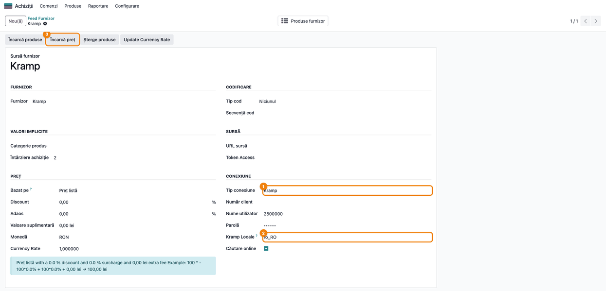
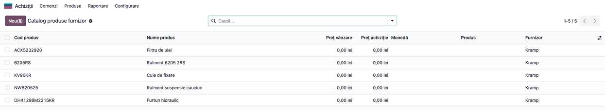
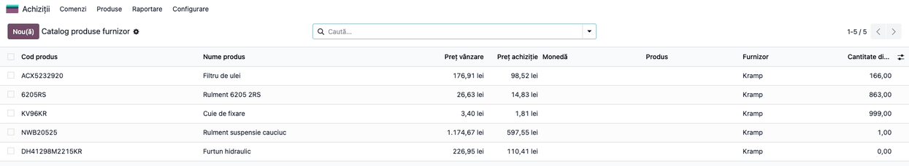
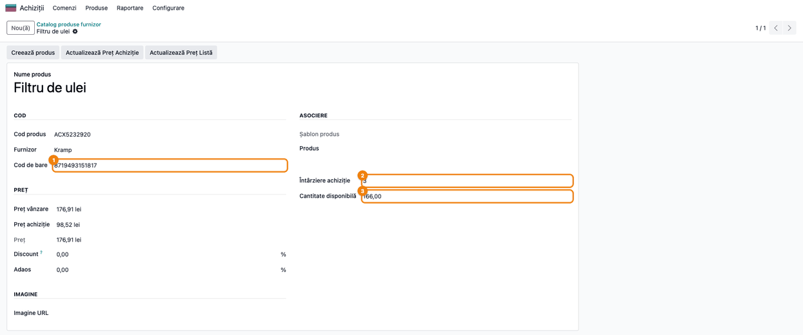
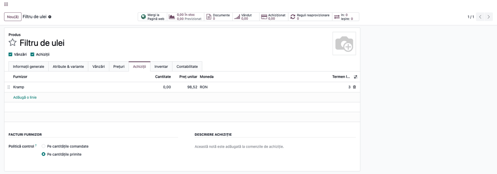

# Fișă Modul: Conector Kramp — prețuri, stoc și termen de livrare în catalogul furnizorului

**Modul:** `deltatech_vendor_products_kramp`
**Utilizator principal:** Responsabil achiziții, Operator catalog produse, Consultant (configurare)
**Prioritate:** 🟡 Medie (necesar doar clienților care cumpără de la Kramp; nu generează note contabile)

---

## 1. Scop business

Kramp este un distribuitor european de piese și accesorii pentru agricultură, cu magazin online și
prețuri negociate per client. Firmele care revând piese Kramp (de exemplu dealeri de utilaje
agricole) au nevoie ca, în Odoo, catalogul produselor furnizorului să aibă **prețul lor net de
achiziție**, **prețul de listă**, **stocul disponibil** și **termenul de livrare**, actualizate fără
copiere manuală din magazinul Kramp.

Modulul conectează **Catalogul produselor furnizor** (din modulul `deltatech_vendor_products`) la
contul de client Kramp. Cu un singur buton, pentru toate produsele Kramp din catalog:

- se citesc **prețul net** (preț de achiziție) și **prețul brut** (preț de listă), în moneda
  magazinului Kramp al clientului (RON pentru Kramp România);
- se calculează **cantitatea disponibilă** și **termenul de livrare** din planurile de livrare
  Kramp;
- se completează **codul de bare** din codul EAN al articolului.

Mai departe, fluxul standard al catalogului furnizorului transformă aceste date în produse Odoo și
în linii de preț de furnizor, folosite la cererile de ofertă și la comenzile de achiziție.

## 2. Bază legală și context

Modulul nu are implicații fiscale sau contabile: nu emite documente și nu generează note contabile.
Este un conector tehnic între Odoo și API-ul magazinului online Kramp.

Context operațional important:

- Conectorul folosește **API-ul magazinului online Kramp** (`www.kramp.com`), cu aceleași
  credențiale ca la autentificarea în magazin. Nu este API-ul oficial pentru dezvoltatori al Kramp
  (`developer.kramp.com`), așa că Kramp îl poate schimba fără anunț. Versiunea 19.0.1.1.0 a fost
  rescrisă pentru că vechiul endpoint nu mai răspundea.
- Kramp **nu publică stocul** direct. Când se cere o cantitate, Kramp o împarte pe livrări: ce are în
  stoc se livrează în 2–4 zile, iar restul după termenul furnizorului, de aproximativ 16 zile.
  Conectorul consideră stoc cantitatea livrată în **mai puțin de 10 zile**, același prag pe care îl
  folosește magazinul Kramp.
- Prețurile vin **doar în limba și țara magazinului clientului** (de exemplu `ro_RO`). Cu altă
  locală, Kramp refuză prețurile, iar **Încarcă preț** se oprește cu eroarea de la secțiunea 9.

## 3. Utilizatori și roluri

- **Consultantul / administratorul** configurează o singură dată feed-ul Kramp: furnizorul,
  moneda, utilizatorul și parola contului Kramp, locala magazinului.
- **Responsabilul de achiziții / operatorul de catalog** aduce produsele Kramp în catalog, apasă
  **Încarcă preț** când are nevoie de prețuri și stoc actuale, apoi generează produsele Odoo și
  actualizează prețurile de achiziție.
- Rol recomandat la testare: utilizator cu **Achiziții / Administrator** (acces la meniul
  *Achiziții → Produse*). Credențialele Kramp se citesc cu drepturi de sistem, deci operatorul nu
  trebuie să le cunoască.

## 4. Conturi și date implicate

**Conturi contabile:** niciunul. Modulul nu generează note contabile. Prețul de achiziție ajunge în
linia de furnizor a produsului și de acolo în comenzile de achiziție, contabilizate de fluxul
standard de achiziții.

**Date pe feed-ul Kramp** (*Feed Furnizor*):

| Câmp | Rol |
|------|-----|
| Tip conexiune = **Kramp** | Activează conectorul |
| Furnizor | Partenerul Kramp, pus pe produsele din catalog și pe liniile de furnizor |
| Monedă | Moneda prețurilor Kramp (RON pentru Kramp România) |
| Nume utilizator / Parolă | Contul magazinului www.kramp.com |
| **Kramp Locale** | Limba și țara magazinului, implicit `ro_RO` |
| Căutare online | Permite căutarea online după cod sau EAN (vezi secțiunea 7) |
| Reguli de preț (grupul **Preț**: Discount, Adaos, Valoare suplimentară) | Stabilesc prețul de vânzare al produsului Odoo generat, pornind de la prețul brut Kramp. **Bazat pe** contează doar la butonul **Actualizează Preț Listă** |

**Date completate pe fiecare produs din catalog** (*Catalog produse furnizor*):

| Câmp | Sursa Kramp |
|------|-------------|
| Preț achiziție | Prețul net al clientului (după discountul negociat cu Kramp) |
| Preț vânzare | Prețul brut (de listă Kramp) |
| Cantitate disponibilă | Cantitatea livrată în mai puțin de 10 zile (cel mult 999) |
| Întârziere achiziție | Zilele până la prima livrare (de regulă 3 dacă e pe stoc, 16 dacă nu) |
| Cod de bare | Primul cod EAN al articolului, dacă Kramp îl are |

Prețul net este prețul clientului după discountul negociat, iar cel brut este prețul de listă
Kramp. Verificați cu clientul, pe o factură Kramp, că ambele sunt fără TVA înainte de a le folosi la
comenzi: linia de furnizor din Odoo lucrează cu prețuri fără TVA.

**Date minime pentru demo:** un partener „Kramp", moneda RON activă, câteva coduri de articole
Kramp în catalog (de exemplu `ACX5232920`, `6205RS`, `DH41298M2215KR`) și un cont Kramp de test.

## 5. Configurare inițială

1. Instalați modulul `deltatech_vendor_products_kramp`. Se instalează automat și
   `deltatech_vendor_products`, `deltatech_vendor_products_website` și **`website_sale`
   (eCommerce)**. Pe server trebuie să existe biblioteca Python `psutil`. Pentru un client fără
   magazin online, instalarea eCommerce este o decizie de proiect: discutați-o înainte.
2. Creați (sau verificați) partenerul **Kramp** în *Contacte*.
3. Mergeți la **Achiziții → Produse → Feed Furnizor** și creați un feed nou, cu numele „Kramp".
4. În grupul **Furnizor**, alegeți **Furnizor** = Kramp. În grupul **Preț**, alegeți **Monedă** =
   moneda prețurilor Kramp (RON pentru Kramp România).
5. În grupul **Conexiune**, alegeți **Tip conexiune** = **Kramp**, completați **Nume utilizator**
   și **Parolă** cu datele contului din magazinul www.kramp.com și verificați **Kramp Locale**
   (implicit `ro_RO`).
6. Salvați. Prima apăsare pe **Încarcă preț** confirmă că legătura și credențialele sunt corecte.

## 6. Flux de utilizare

### Pasul 1 — Configurați feed-ul Kramp

**Meniu:** *Achiziții → Produse → Feed Furnizor → Kramp*

Formularul feed-ului are în antet, printre altele, butoanele **Încarcă produse** (import din fișier),
**Încarcă preț** (prețuri, stoc și termen de la Kramp) și **Șterge produse**. În grupul **Conexiune** se văd tipul
conexiunii **Kramp**, utilizatorul, parola (ascunsă) și **Kramp Locale**.

Butonul inteligent **Produse furnizor**, din bara de sus a formularului, deschide catalogul filtrat pe
furnizorul Kramp.



### Pasul 2 — Aduceți codurile Kramp în catalog

**Meniu:** *Achiziții → Produse → Feed Furnizor → Kramp → Încarcă produse*

Codurile articolelor Kramp ajung în **Catalog produse furnizor** prin importul unui fișier (xlsx,
xls, csv sau xml) cu butonul **Încarcă produse**. Pentru Kramp este suficient ca fișierul să conțină
codul și denumirea, pentru că prețul, stocul și termenul le aduce conectorul la pasul următor.

Pe ecran, în **Catalog produse furnizor**, identificați rândurile feed-ului Kramp: coloana **Cod
produs** cu codurile Kramp și coloana **Furnizor** = Kramp. Înainte de primul **Încarcă preț**, prețurile
sunt cele din fișier sau 0.



### Pasul 3 — Încărcați prețurile, stocul și termenul de la Kramp

**Meniu:** *Achiziții → Produse → Feed Furnizor → Kramp → **Încarcă preț***, pentru toate
produsele feed-ului, sau *Achiziții → Produse → Catalog produse furnizor*, selectați rândurile →
**Încarcă preț API**, doar pentru produsele selectate.

Conectorul se autentifică la Kramp și citește datele câte 25 de produse pe cerere, iar stocul câte
15 produse. Codurile se potrivesc indiferent de litere mari sau mici. Durata crește cu numărul de
produse din feed.

**Găsiți pe ecran:** în **Catalog produse furnizor**, coloanele **Preț vânzare** (prețul brut
Kramp) și **Preț achiziție** (prețul net al clientului). Coloana **Cantitate disponibilă** e
opțională: o afișați din meniul de coloane din dreapta antetului listei (în captură este afișată).

**Verificați:**
- **Preț achiziție** este mai mic sau egal cu **Preț vânzare** pentru fiecare cod;
- prețurile sunt în moneda feed-ului (RON pentru Kramp România);
- un cod pe care Kramp nu îl recunoaște își păstrează valorile anterioare, fără eroare;
- produsele fără stoc au **Cantitate disponibilă** = 0.



### Pasul 4 — Verificați detaliile unui produs Kramp

**Meniu:** *Achiziții → Produse → Catalog produse furnizor → (deschideți un rând)*

**Găsiți pe ecran:** în formularul produsului, **Cod de bare** (EAN-ul Kramp), **Preț achiziție**,
**Preț vânzare**, **Întârziere achiziție** (zilele până la prima livrare) și **Cantitate
disponibilă**.

**Verificați:**
- **Întârziere achiziție** este 3 (sau 2–4) pentru un produs pe stoc și 16 pentru unul fără stoc;
- **Cod de bare** are 13 cifre când Kramp are EAN-ul articolului. Dacă nu îl are, rămâne codul de
  bare introdus anterior.



### Pasul 5 — Generați produsul Odoo și prețul de furnizor

**Meniu:** *Achiziții → Produse → Catalog produse furnizor*, selectați rândurile → **Generează
produs** (pe formularul unui produs din catalog, butonul se numește **Creează produs**), iar mai
târziu **Actualizează Preț Achiziție**

**Generează produs** creează produsul Odoo pentru rândurile fără produs asociat, cu linia de
furnizor Kramp: prețul de achiziție și termenul de livrare (**Întârziere achiziție** devine
**Termen livrare** pe linia de furnizor). Produsul primește și **costul** = prețul net Kramp
(convertit la cursul zilei, dacă moneda feed-ului diferă de cea a companiei) și **prețul de
vânzare** = prețul brut Kramp ajustat cu Discount, Adaos și Valoare suplimentară din grupul **Preț**
al feed-ului (la generare se pornește mereu de la prețul brut, indiferent de **Bazat pe**).

**Actualizează Preț Achiziție** asociază întâi rândurile selectate cu produsele existente și
**creează produsele care lipsesc**, apoi actualizează prețul și cantitatea disponibilă pe liniile de
furnizor. Nu îl rulați pe tot catalogul doar ca să actualizați prețuri: creează câte un produs Odoo
pentru fiecare rând fără produs. **Termen livrare** se stabilește doar la crearea liniei de furnizor
și nu se actualizează ulterior.

**Găsiți pe ecran:** pe produsul generat, fila **Achiziții**, linia cu furnizorul Kramp: prețul și
**Termen livrare**.

**Verificați:** prețul din linia de furnizor este egal cu **Preț achiziție** din catalog, iar
**Termen livrare** este egal cu **Întârziere achiziție** din pasul 4.



### Note de monografie și raportare

Modulul **nu generează note contabile**. Prețul de achiziție adus de la Kramp ajunge în linia de
furnizor a produsului și de acolo în cererile de ofertă și comenzile de achiziție, contabilizate de
fluxul standard (recepție și factură de furnizor). La generarea produsului, prețul net devine și
**costul** produsului. La metodele Cost mediu și FIFO, costul se recalculează la prima recepție; la
Cost standard rămâne costul de evaluare până la o modificare manuală.

## 7. Legături cu alte module / declarații

| Modul | Rol |
|-------|-----|
| `deltatech_vendor_products` | Catalogul produselor furnizor, feed-ul, importul din fișier, generarea produselor și a liniilor de furnizor |
| `deltatech_vendor_products_website` | Câmpul **Căutare online** și ruta de căutare online după cod sau EAN |
| `purchase` | Linia de furnizor (preț, termen de livrare) folosită la comenzile de achiziție |
| `website_sale` | Magazinul online, cerut de `deltatech_vendor_products_website` |

**Ce e automat:**
- autentificarea la Kramp și reînnoirea sesiunii, fără ca parola să fie retrimisă la fiecare oră;
- prețurile net și brut, cantitatea disponibilă, termenul de livrare și codul de bare, la
  **Încarcă preț**;
- potrivirea codurilor indiferent de litere mari sau mici.

**Ce rămâne manual:**
- aducerea codurilor în catalog (import din fișier) și rularea **Încarcă preț** când e nevoie de
  date actuale (nu există un cron dedicat pentru prețurile Kramp);
- generarea produselor și actualizarea prețurilor de achiziție, cu butoanele din catalog;
- căutarea online după cod sau EAN: ruta există, dar căutarea din magazinul `/shop` nu are încă
  interfață în Odoo 19.

## 8. Verificări pentru consultant

- [ ] Feed-ul are **Tip conexiune** = Kramp, furnizorul Kramp, moneda RON și **Kramp Locale** =
  `ro_RO`.
- [ ] **Încarcă preț** se termină fără eroare și completează **Preț achiziție** și **Preț
  vânzare** pentru codurile cunoscute de Kramp.
- [ ] Pentru fiecare cod, **Preț achiziție** este mai mic sau egal cu **Preț vânzare**.
- [ ] Un cod inexistent la Kramp își păstrează valorile, fără eroare.
- [ ] Un produs pe stoc are **Cantitate disponibilă** > 0 și **Întârziere achiziție** 2–4 zile.
- [ ] Un produs fără stoc are **Cantitate disponibilă** = 0 și **Întârziere achiziție** în jur de
  16 zile.
- [ ] **Cod de bare** e completat cu EAN-ul Kramp, iar un cod de bare introdus manual rămâne la
  articolele fără EAN.
- [ ] După **Generează produs**, linia de furnizor are prețul și termenul de livrare din catalog,
  iar costul produsului este prețul net Kramp.
- [ ] Cu **Kramp Locale** schimbat pe altă țară (de exemplu `en_GB`), **Încarcă preț** se oprește
  cu eroarea de acces la prețuri.

## 9. Mesaje de eroare frecvente

| Mesaj | Cauză | Remediere |
|-------|-------|-----------|
| „Kramp: Kramp login failed: …" (urmat de mesajul Kramp) | Utilizator sau parolă greșite | Verificați datele în magazinul www.kramp.com, apoi corectați-le pe feed |
| „Kramp: the account has no access to the prices of locale …" | **Kramp Locale** nu e locala magazinului clientului | Setați locala magazinului (`ro_RO` pentru Kramp România) |
| „Kramp: Kramp request failed: …" | Kramp nu răspunde sau conexiunea a expirat | Reîncercați după câteva minute; o cerere fără răspuns expiră după aproximativ 20–25 de secunde |
| Prețurile rămân 0, fără eroare | Feed-ul nu are utilizator sau parolă | Completați credențialele; fără ele Kramp nu dă prețuri |
| **Cantitate disponibilă** și **Întârziere achiziție** nu se schimbă după **Încarcă preț**, deși prețurile se actualizează | Planurile de livrare Kramp nu au putut fi citite; prețurile se salvează oricum | Căutați în jurnalul serverului „Kramp availability … failed” și reîncercați. (Doar căutarea online pune 999 când stocul nu se poate citi.) |
| Avertisment în jurnal „Kramp price of … is in …, the feed uses …" | Moneda feed-ului diferă de moneda prețurilor Kramp | Setați pe feed moneda magazinului Kramp |

## 10. Capturi de ecran

Capturile sunt **generate automat** din `tests/test_screenshots.py` (mixinul `ScreenshotCase` din
`l10n_ro_doc_screenshots`, import defensiv), în limba română, pe o bază cu planul de conturi RO.
Răspunsurile Kramp sunt simulate în test, deci capturile nu depind de un cont Kramp real.

1. `01_feed_kramp.png` — formularul **Feed Furnizor** Kramp: tipul conexiunii, credențialele,
   **Kramp Locale** și butonul **Încarcă preț**.
2. `02_catalog_inainte.png` — **Catalog produse furnizor** cu codurile Kramp, înainte de
   încărcarea prețurilor.
3. `03_catalog_preturi.png` — catalogul după **Încarcă preț**: preț vânzare, preț achiziție și
   cantitate disponibilă pentru fiecare cod Kramp.
4. `04_produs_furnizor.png` — formularul unui produs Kramp din catalog: cod de bare, întârziere
   achiziție, cantitate disponibilă.
5. `05_produs_generat.png` — produsul Odoo generat, fila **Achiziții**, cu linia de furnizor
   Kramp.

Regenerare:

```bash
./odoo/odoo-bin -c odoo.conf -d test19 -i deltatech_vendor_products_kramp,l10n_ro_doc_screenshots --test-tags=/deltatech_vendor_products_kramp:TestKrampScreenshots --stop-after-init
```

## 11. Observații pentru manual

Prezentați modulul ca pe o **actualizare cu un buton**: odată configurat feed-ul (o singură dată),
operatorul apasă **Încarcă preț** și catalogul Kramp are prețurile clientului, stocul și termenul
de livrare la zi. Explicați clar cum se citește stocul: Kramp nu dă un număr de stoc, iar
**Cantitate disponibilă** este cantitatea pe care Kramp o poate livra în câteva zile, cel mult 999.
Pentru unele articole, conectorul vede doar „cel puțin 50" sau „cel puțin 1".

Atrageți atenția asupra **Kramp Locale**: este singura setare care, greșită, face ca prețurile să
lipsească. Menționați și că API-ul folosit este cel al magazinului online Kramp, care se poate
schimba. Dacă **Încarcă preț** începe să dea erori fără ca datele contului să se fi schimbat,
contactați echipa Terrabit.
