# Fișă Modul: Prețuri și stoc de pe site-ul furnizorului — catalogul furnizorului fără feed

**Modul:** `deltatech_vendor_products_site`
**Utilizator principal:** Consultant / administrator (configurare), Responsabil achiziții, Operator catalog produse
**Prioritate:** 🟡 Medie (util clienților ai căror furnizori nu trimit feed sau API; nu generează note contabile)

---

## 1. Scop business

Mulți furnizori nu trimit un fișier de prețuri (CSV, XML) și nu au API, dar își publică prețurile,
stocul, pozele și descrierile pe propriul site, adesea într-un magazin B2B cu cont de client.
Achizitorul ajunge să verifice de mână, pagină cu pagină, prețul de achiziție și disponibilitatea.

Modulul citește aceste pagini și le scrie în **Catalog produse furnizor**, la fel ca un feed:
**preț achiziție**, **disponibilitate și stoc**, **coduri** (cod furnizor, cod de bare, cod
producător, marcă), **poze** și **descriere**. Paginile se găsesc din import, din sitemap-ul
site-ului sau prin căutarea produselor noastre pe site. Înainte ca un preț să ajungă la produse,
modulul verifică dacă pagina arată **același produs** și dacă prețul **nu a sărit suspect**; pozele
și descrierile ajung pe produse doar când le alege o persoană.

## 2. Bază legală și context

Modulul nu are implicații fiscale sau contabile: nu emite documente și nu generează note contabile.
Prețurile citite ajung în catalogul furnizorului și, la cerere, pe liniile de furnizor ale
produselor; comenzile de achiziție și facturile urmează fluxurile standard.

Context operațional important:

- **Întâi feed sau API.** Citirea paginilor e ultima soluție: cereți întâi furnizorului un fișier de
  prețuri sau un acces API.
- **Termenii furnizorului.** Citirea automată a unui cont de client poate fi interzisă de termenii
  site-ului. Bifa **Citire automată permisă** confirmă că ați verificat termenii; fără ea, acțiunea
  programată sare peste feed. Odoo păstrează cine a confirmat și când. Bifa oprește doar citirea
  programată: butoanele manuale (citire, sitemap, căutare, test) citesc oricum, deci nu le folosiți
  înainte de verificarea termenilor.
- **Politețe față de site.** Modulul respectă `robots.txt` (se poate dezactiva doar după confirmarea
  termenilor) și păstrează o pauză între două pagini ale aceluiași site (implicit 3 secunde).
- **Fără ocolirea protecțiilor.** Un CAPTCHA, o verificare în doi pași sau o protecție anti-robot
  opresc citirea (starea **Blocată**). După două autentificări eșuate la rând, feed-ul nu se mai
  autentifică, ca furnizorul să nu blocheze contul.
- **Prețuri cu sau fără TVA.** Prețul de pe pagină se preia **așa cum este afișat**, ca preț de
  achiziție, fără nicio conversie de TVA, monedă, discount sau adaos. Linia de furnizor a produsului
  așteaptă prețul **fără TVA**. Verificați pe site (de regulă în contul de client B2B) că prețurile
  sunt afișate fără TVA; dacă site-ul arată prețuri cu TVA, nu bifați **Actualizează prețurile la
  furnizor** și nu folosiți **Actualizează Preț Achiziție** pentru acest feed, altfel comenzile de
  achiziție ar porni de la un preț supraevaluat.
- **Datele de pe pagină.** Majoritatea magazinelor își declară produsele pentru motoarele de căutare
  (date **schema.org**: JSON-LD, Microdata), iar modulul le citește întâi. Pentru celelalte site-uri
  se adaugă **selectori** (XPath, CSS, expresie regulată, cale JSON-LD).

## 3. Utilizatori și roluri

- **Consultantul / administratorul** creează feed-ul, completează utilizatorul și parola contului
  de client (câmpuri vizibile doar administratorilor Odoo), confirmă termenii și configurează
  selectorii (selectorii îi poate modifica doar un **Administrator Achiziții**).
- **Responsabilul achiziții** citește paginile, confirmă prețurile suspecte și urmărește istoricul
  prețurilor.
- **Operatorul de catalog** propune și aplică pozele și descrierile pe produse.
- Rol recomandat la testare: utilizator cu **Achiziții / Administrator** și **Administrare /
  Setări** (pentru credențialele feed-ului și pentru acțiunea programată, în modul dezvoltator).

## 4. Conturi și date implicate

**Conturi contabile:** niciunul. Modulul nu generează note contabile.

**Date pe feed-ul furnizorului** (*Feed Furnizor*, **Tip conexiune** = **Site furnizor**, fila
**Site web**):

| Grup | Câmpuri | Rol |
|------|---------|-----|
| **Site** | Site web, Citire automată permisă (Confirmat de, Confirmat la) | Adresa site-ului și confirmarea termenilor |
| **Autentificare** | Autentificare (Fără autentificare / Formular de autentificare / HTTP Basic / Token de acces), Pagina de autentificare, Câmp utilizator, Câmp parolă, Text după autentificare | Cum intră Odoo în contul de client; utilizatorul și parola sunt cele din grupul **Conexiune**. La **Token de acces**, tokenul se scrie în **Parolă** din grupul **Conexiune**, nu în câmpul **Token de acces** din grupul **Sursă** (acela ține de alte tipuri de conexiune) |
| **Găsirea paginilor** | Sitemap, Tipar adresă pagină produs, Adresa de căutare, Primul rezultat | De unde se adaugă paginile în catalog |
| **Citire** | Pauză între pagini, Pagini pe rulare, Citire la fiecare (ore), Respectă robots.txt, User Agent, Variație suspectă a prețului (%), Cantitate când e în stoc, Actualizează prețurile la furnizor | Ritmul citirii și regulile de verificare |
| **Selectori** | Valoare, Tip, Expresie, Atribut, Tabel de valori | Doar pentru paginile fără date schema.org |

**Date scrise pe rândul din catalog** (*Catalog produse furnizor*, grupul **Site web**): Adresa
paginii, Stare citire, Mesaj citire, Ultima citire, Citit din, Citiri eșuate, Preț de confirmat,
Disponibilitate, Cod de bare pe pagină, Cod producător, Marcă, Cod temporar, Descriere pe pagină;
plus **Preț achiziție**, **Cantitate disponibilă**, **Cod de bare** și **Imagine URL**.

**Istoric:** *Istoric prețuri furnizor*, câte un interval (De la, Văzut ultima dată) pentru fiecare
preț de achiziție și disponibilitate.

**Date minime pentru demo:** un furnizor, un produs al nostru cu linie de furnizor (cod furnizor și
cod de bare), un feed **Site furnizor** în RON cu adresa site-ului și, pentru un magazin B2B,
utilizatorul și parola contului de client.

## 5. Configurare inițială

1. Cereți furnizorului un feed sau un API. Continuați doar dacă nu există.
2. **Achiziții → Produse → Feed Furnizor → Nou**: completați **Furnizor**, **Monedă** și, în grupul
   **Conexiune**, **Tip conexiune** = **Site furnizor**. Pentru un magazin B2B completați
   **Nume utilizator** și **Parolă** (le vede doar un administrator). La autentificarea cu **Token
   de acces**, tokenul se pune în **Parolă**.
3. În fila **Site web**, completați **Site web** (de exemplu `https://b2b.furnizor.ro`) și, pentru
   un cont de client, grupul **Autentificare**: tipul, pagina de autentificare, numele câmpurilor
   de utilizator și parolă din formular și un **Text după autentificare** (un text pe care site-ul
   îl arată doar unui client autentificat, de exemplu „Deconectare"). Completați-l obligatoriu:
   fără el, Odoo nu poate deosebi o autentificare reușită de una cu parolă greșită.
4. Verificați termenii furnizorului; dacă permit citirea automată, bifați **Citire automată
   permisă**.
5. Ajustați grupul **Citire**: pauza între pagini, numărul de pagini pe rulare, la câte ore se
   recitește o pagină, pragul **Variație suspectă a prețului (%)** (implicit 30%) și, dacă vreți ca
   prețurile verificate să ajungă direct pe liniile de furnizor ale produselor, **Actualizează
   prețurile la furnizor**.
6. Abia după ce rezultatele sunt corecte (pașii 4–6 din secțiunea 6), activați acțiunea programată
   **Site furnizor: citire pagini** (pasul 11).

## 6. Flux de utilizare

### Pasul 1 — Configurați feed-ul pe site-ul furnizorului

**Meniu:** *Achiziții → Produse → Feed Furnizor → (feed-ul)*, fila **Site web**

Pe feed, **Tip conexiune** = **Site furnizor** afișează fila **Site web** și butonul **Citește
paginile acum**. În fila **Site web** se completează adresa site-ului, confirmarea termenilor,
autentificarea, sursele de pagini, regulile de citire și, la nevoie, selectorii.

**Găsiți pe ecran:** ① **Tip conexiune** = Site furnizor; ② **Site web**; ③ **Citire automată
permisă**, cu **Confirmat de** și **Confirmat la** completate automat la salvare; ④ **Autentificare**.

**Verificați:**
- **Confirmat de** arată utilizatorul care a verificat termenii; fără bifă, în partea de sus a filei apare
  avertismentul că citirea programată sare peste feed;
- **Respectă robots.txt** rămâne bifat; se poate debifa doar după confirmarea termenilor;
- selectorii se completează doar dacă paginile nu au date schema.org (pasul 3 arată sursa citită).
  Un selector de tip **CSS** cere biblioteca Python `cssselect` pe server; fără ea, folosiți
  **XPath**.

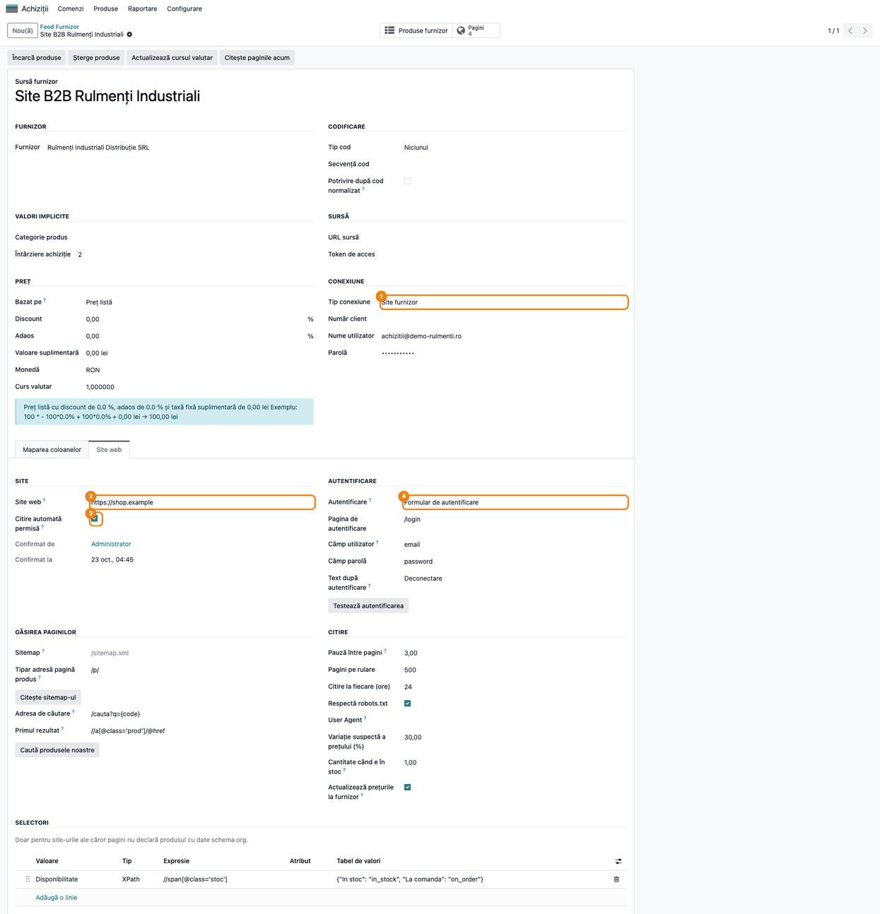

### Pasul 2 — Testați autentificarea

**Meniu:** fila **Site web** → butonul **Testează autentificarea** (vizibil când **Autentificare**
nu este **Fără autentificare**)

La **Formular de autentificare**, Odoo deschide pagina de autentificare, completează formularul
(inclusiv câmpurile ascunse, de exemplu tokenul CSRF) și verifică pe pagina principală textul din
**Text după autentificare**. La **HTTP Basic** și **Token de acces**, utilizatorul și parola (sau
tokenul) se trimit la fiecare cerere, iar verificarea se face tot prin **Text după autentificare**.
Fără acest text, testul arată „acceptată" chiar și cu o parolă greșită.

**Verificați:** apare notificarea „Site-ul a acceptat autentificarea.". La eșec, notificarea roșie
spune cauza (secțiunea 9), fără să afișeze parola. După două eșecuri la rând, autentificarea se
oprește; avertismentul roșu cu **Deblochează** apare în filă după reîncărcarea paginii.

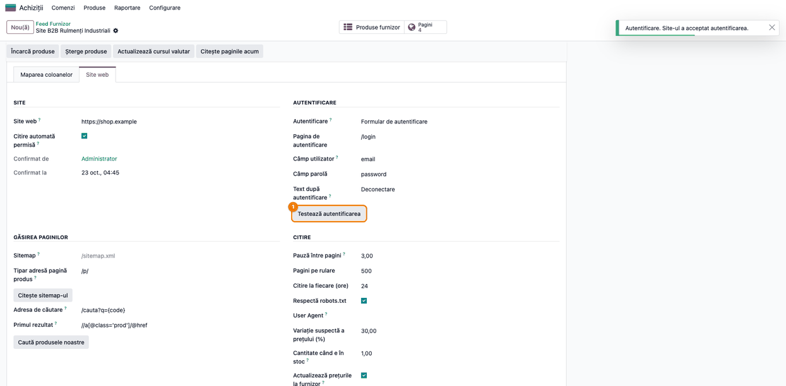

### Pasul 3 — Adăugați paginile în catalog

**Meniu:** fila **Site web** → grupul **Găsirea paginilor**

Paginile de produs ajung în **Catalog produse furnizor** pe trei căi:

- **Citește sitemap-ul**: citește `sitemap.xml` (sau adresa din **Sitemap**, inclusiv un index de
  sitemap-uri) și adaugă paginile a căror adresă respectă **Tipar adresă pagină produs** (de exemplu
  `/p/`). Completați întâi tiparul: dacă e gol, se adaugă **toate** paginile din sitemap, inclusiv
  „Despre noi" sau „Contact". Rândurile noi primesc un **Cod temporar**, făcut din adresă, până la
  prima citire.
- **Caută produsele noastre**: pentru produsele noastre care au furnizorul pe o linie de furnizor,
  caută pe site codul furnizorului (sau codul de bare) cu **Adresa de căutare** și ia primul
  rezultat cu **Primul rezultat**. Pagina găsită este și citită, deci rândul primește prețul și
  starea; se asociază produsului **doar dacă pagina arată același cod sau cod de bare**, altfel
  rămâne în catalog, neasociat.
- **Import**: butonul **Încarcă produse** de pe feed, cu un fișier CSV sau Excel care are codul și
  adresa paginii. Un fișier cu antetul `code,name,scan_url` se importă direct; orice alt antet trece
  prin pasul de mapare (pasul 3b). Importul scrie doar coloanele din fișier: un rând care există
  deja în catalog își păstrează prețurile, codul de bare și denumirea dacă fișierul nu le are, deci
  lista de pagini se poate reimporta fără grijă.

**Atenție:** **Caută produsele noastre** lucrează în aceeași cerere ca butonul (două cereri către
site pentru fiecare produs, cu pauza între pagini). Pentru multe produse, scădeți temporar **Pagini
pe rulare** (de exemplu 20), ca cererea să nu depășească timpul permis de server.

**Verificați:** notificarea arată câte pagini de produs a găsit sitemap-ul și câte au fost adăugate
(paginile deja existente în catalog nu se dublează); butonul **Pagini** din partea de sus a feed-ului
crește corespunzător.

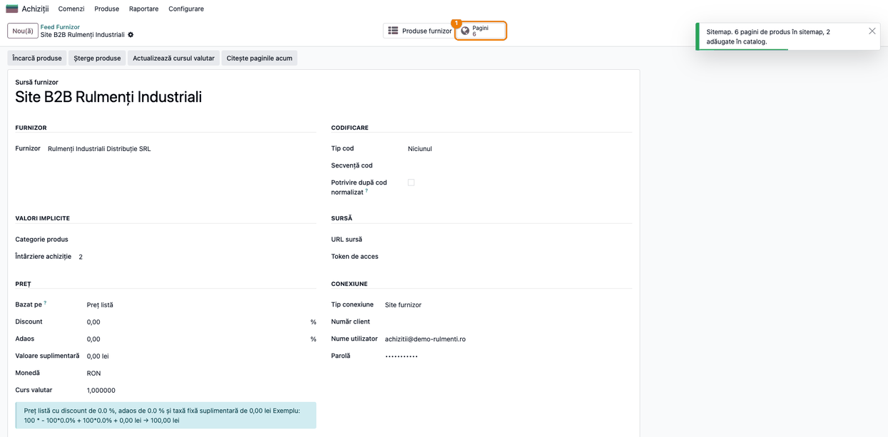

### Pasul 3b — Importați lista de pagini cu antetul furnizorului

**Meniu:** *Feed Furnizor → (feed-ul)* → butonul **Încarcă produse**, cu fișierul primit de la furnizor
(CSV, XLSX sau XLS)

Funcția vine din modulul de bază `deltatech_vendor_products`. Un fișier al cărui antet nu conține
numele tehnice ale câmpurilor (de exemplu „Cod articol", „Denumire produs", „Preț client") nu se
importă direct. Alegeți fișierul în **Fișier** și apăsați **Aplică**: Odoo deschide pasul **Mapare
coloane**, cu câte o linie pentru fiecare coloană din fișier. Antetul se caută în primele 20 de
rânduri, deci și sub sigla și adresa furnizorului, dacă cel puțin un antet e recunoscut (de exemplu
„Cod articol"); altfel se ia primul rând.

**Găsiți pe ecran:** ① lista coloanelor: **Coloana din fișier**, **Primele valori** și **Încarcă
în**, propus automat pentru antetele cunoscute (**Origine** = **Antet cunoscut**); ② bifa **Salvează
maparea pe feed**.

Pentru coloanele pe care modulul nu le recunoaște, alegeți **Încarcă în**:

- **Adresa paginii** pentru coloana cu adresa paginii de produs;
- **Atribut suplimentar**, cu **Nume atribut** (de exemplu `brand`), pentru o informație fără câmp
  propriu;
- **Ignoră** pentru o coloană de care nu aveți nevoie.

Coloanele cu prețuri au și **Format numere** (1.234,56 sau 1,234.56) și **Factor** (de exemplu 0,01
pentru prețuri în bani), vizibile din meniul coloanelor listei. Apăsați **Importă**.

**Verificați:**
- un rând care există deja în catalog primește doar coloanele mapate; fără coloană de denumire sau
  de preț de vânzare, își păstrează **Nume produs** și **Preț vânzare** (un rând nou primește codul
  ca nume și prețul 0). O coloană mapată pe **Preț achiziție** înlocuiește prețul citit de pe site:
  puneți-o pe **Ignoră** dacă vreți să păstrați prețurile de pe site;
- coloana cu codul produsului este mapată pe **Cod**; fără ea, importul se oprește cu „Alegeți
  coloana cu codul produsului.";
- niciun câmp nu apare de două ori în **Încarcă în**;
- după import, rândurile noi au **Adresa paginii** și apar la butonul **Pagini** al feed-ului;
- cu **Salvează maparea pe feed** bifată, fila **Maparea coloanelor** a feed-ului păstrează maparea,
  iar următorul fișier cu același antet se importă fără acest pas. Importul programat folosește doar
  maparea salvată; o coloană nouă în fișier este ignorată.

Un fișier cu numele tehnice în antet (`code`, `name`, `scan_url`...) se importă direct, ca înainte.

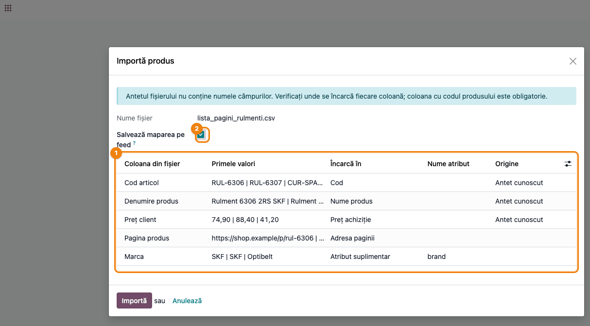

### Pasul 4 — Testați citirea pe 5 pagini

**Meniu:** fila **Site web** → butonul **Test pe 5 pagini** (sub selectori)

Odoo citește primele 5 pagini din catalog **fără să modifice rândurile din catalog** și afișează,
pentru fiecare, o linie: cod · stare · preț și monedă · disponibilitate · sursa datelor · codul de pe
pagină. Autentificarea se face ca la o citire reală. Rulați întâi **Testează autentificarea**
(pasul 2): cu o parolă greșită, un singur **Test pe 5 pagini** face două încercări și oprește
autentificarea, iar liniile apar `blocked`.

**Găsiți pe ecran:** în notificare, pentru fiecare cod, starea (`ok`, `suspect`, `mismatch` = alt
produs, `not_found` = negăsită, `blocked` = blocată, `error` = eroare), prețul citit și sursa (`structured` = date schema.org, `selector` = selectorii feed-ului,
`heuristic` = preț dedus din tiparele HTML ale paginii, fără date schema.org și fără selectori).
Valorile tehnice din notificare rămân în engleză.

**Verificați:**
- fiecare linie `ok` sau `suspect` are un preț. Liniile `mismatch`, `not_found` și `blocked` nu arată
  preț; un `not_found` fără preț pe pagină cere un selector pentru **Preț achiziție** (secțiunea 9);
- o linie cu sursa `heuristic` are un preț ghicit din pagină: comparați-l cu pagina și, dacă e nevoie,
  adăugați un selector pentru **Preț achiziție**;
- codul de pe pagină (ultima valoare) este codul furnizorului;
- moneda de pe fiecare linie este moneda feed-ului: testul nu marchează diferența de monedă, dar
  citirea reală o face **Suspect** (pasul 7). O linie fără monedă înseamnă că pagina nu o declară:
  citirea reală nu o va marca **Suspect**, deci verificați moneda pe site;
- un `mismatch` înseamnă că pagina arată alt cod sau alt cod de bare decât rândul din catalog.

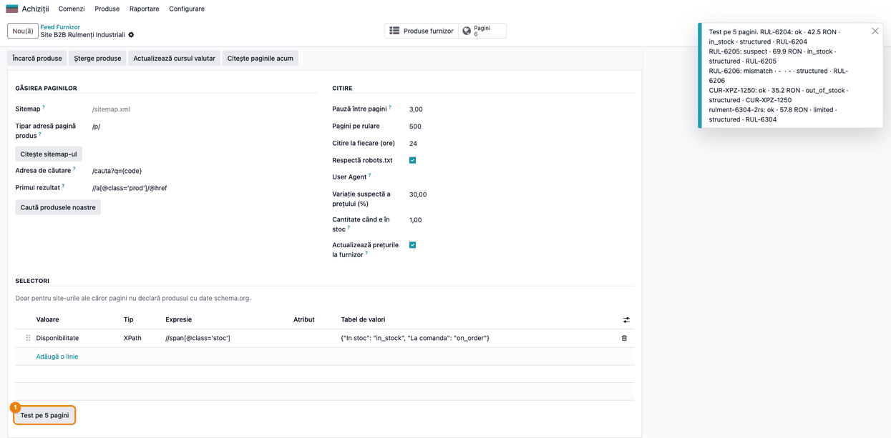

### Pasul 5 — Citiți paginile

**Meniu:** *Feed Furnizor → (feed-ul)* → butonul **Citește paginile acum** (sus, în bara de butoane)

Odoo citește paginile feed-ului, cel mult **Pagini pe rulare**, începând cu cele citite cel mai demult.
Butonul citește în aceeași cerere: cu 500 de pagini și 3 secunde pauză, cererea ar dura peste 25 de
minute și ar fi oprită de server, fără să salveze nimic. Pentru un catalog mare, scădeți temporar
**Pagini pe rulare** (de exemplu 20) sau folosiți acțiunea programată (pasul 11), care salvează
progresul după fiecare pagină.
Pe fiecare rând scrie prețul, disponibilitatea, codurile, pozele și descrierea; un rând cu **Cod
temporar** primește codul de pe pagină.

**Verificați:** notificarea rezumă stările: câte pagini **OK**, câte **Suspect**, câte **Alt produs**,
**Negăsită**, **Blocată** sau **Eroare**.

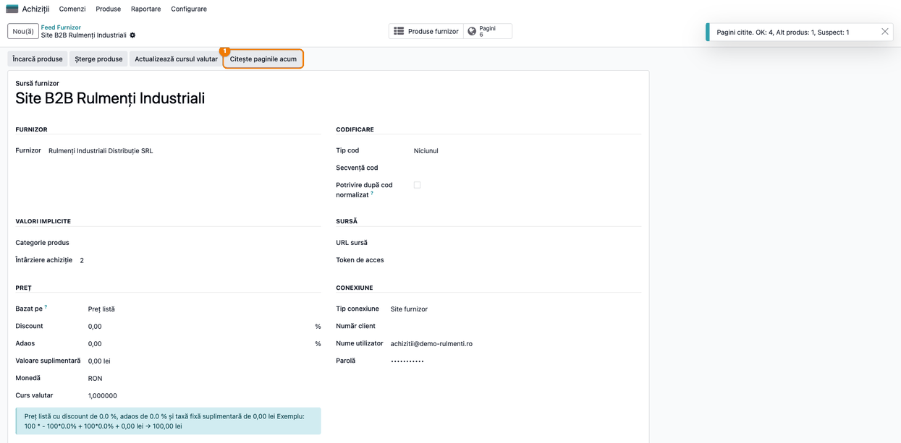

### Pasul 6 — Verificați catalogul furnizorului

**Meniu:** butonul **Pagini** de pe feed (sau *Achiziții → Produse → Catalog produse furnizor*, filtrul
**Cu pagină**)

**Găsiți pe ecran:** coloana **Stare citire** (OK verde, Suspect galben, Alt produs / Blocată /
Eroare roșu), **Preț achiziție** și **Disponibilitate** (În stoc, Stoc limitat, La comandă, Stoc
epuizat, Scos din fabricație, Necunoscută). Filtrele găsesc rândurile care cer atenție: **Preț de
confirmat** (stare Suspect), **Alt produs**, **Necitite** (citire eșuată: Negăsită, Blocată sau
Eroare) și **Încă necitite** (pagini care nu au fost citite niciodată).

**Verificați:**
- rândurile **OK** au prețul de pe site;
- un rând **Suspect** păstrează prețul vechi (în exemplu, 48,00 lei) până la confirmare (pasul 7);
- un rând **Alt produs** nu are date noi: pagina arată alt cod de bare (sau alt cod) decât rândul;
  verificați adresa paginii;
- rândurile venite din sitemap au acum codul de pe pagină (RUL-6304, RUL-6305), nu codul temporar;
- pe un rând cu **Citit din** = **Tipare HTML**, prețul a fost dedus din pagină: verificați-l pe site.

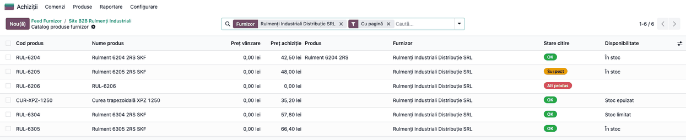

### Pasul 7 — Confirmați un preț suspect

**Meniu:** *Catalog produse furnizor → (rândul Suspect)*

Un preț este **Suspect** când s-a schimbat față de prețul de achiziție anterior cu mai mult decât
**Variație suspectă a prețului (%)** sau când pagina îl arată în altă monedă decât feed-ul. Prețul
nou stă în **Preț de confirmat**; **Preț achiziție** rămâne cel vechi.

**Găsiți pe ecran:** ① **Mesaj citire** cu prețul vechi, cel nou și variația; ② **Preț de
confirmat**; ③ butonul **Confirmă prețul**.

**Verificați:** citiți **Mesaj citire** și comparați prețul cu pagina furnizorului (**Adresa
paginii**):

- **salt de preț** (mesajul arată prețul vechi, cel nou și variația): dacă prețul nou e corect,
  apăsați **Confirmă prețul**; devine **Preț achiziție**, iar starea devine **OK**;
- **altă monedă** (mesajul „Pagina arată prețul în EUR, feed-ul este în RON."): **nu confirmați**.
  Moneda se verifică doar când pagina o declară (date schema.org sau un selector **Monedă**); la
  sursa **Tipare HTML** sau la selectori fără **Monedă**, verificați moneda manual pe site.
  Confirmarea ar scrie suma de pe pagină neconvertită, în moneda feed-ului. Corectați **Monedă** pe
  feed (sau, de preferat, cereți furnizorului prețurile în moneda feed-ului) și citiți din nou
  pagina. Înainte de **Actualizează Preț Achiziție**, verificați și **Moneda** pe liniile de furnizor
  existente ale produselor (fila **Achiziții**): prețul se scrie pe linie fără conversie. La
  recitire, rândul poate ieși din nou **Suspect**, de data aceasta pentru saltul de preț; dacă moneda
  e acum corectă, confirmați.

Cât timp rândul rămâne **Suspect**, butoanele **Actualizează Preț Achiziție** și **Actualizează Preț
Listă** și acțiunile programate ale feed-urilor îl sar. Confirmarea nu scrie prețul pe linia de
furnizor a produsului: apăsați apoi **Actualizează Preț Achiziție** sau așteptați citirea următoare
(cu **Actualizează prețurile la furnizor** bifat). Butonul **Confirmă prețul** există și în listă,
pentru mai multe rânduri selectate.

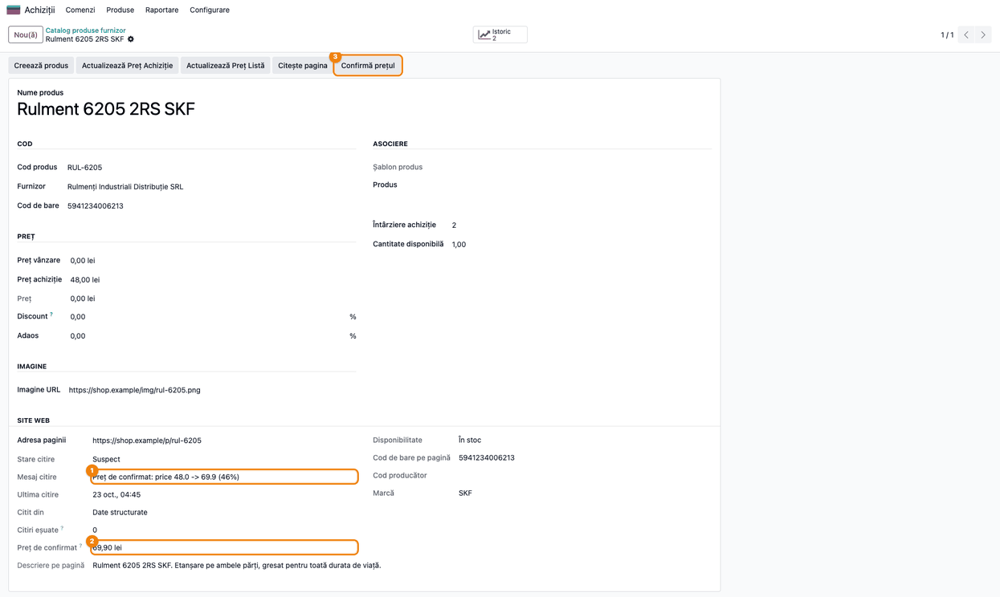

### Pasul 8 — Consultați istoricul prețurilor

**Meniu:** butonul **Istoric** de pe rândul din catalog (sau *Achiziții → Produse → Istoric prețuri
furnizor*)

Istoricul păstrează **intervale**: o linie nouă doar când se schimbă prețul de achiziție sau
disponibilitatea; altfel ultima linie se prelungește (**Văzut ultima dată**). Prețurile suspecte intră
și ele în istoric; la un rând suspect din cauza monedei, linia din istoric are suma de pe pagină,
neconvertită, deci graficul arată un salt fals. Vederea **Grafic** arată evoluția prețului.

**Verificați:** rândul RUL-6205 are două linii: 48,00 lei (prima citire) și 69,90 lei (prețul suspect).

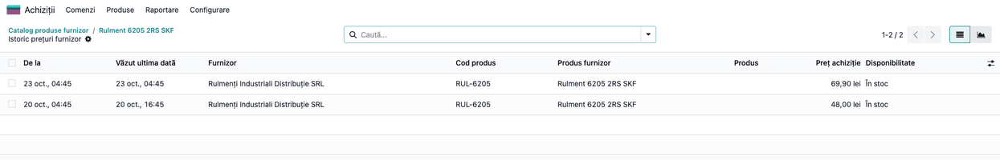

### Pasul 9 — Propuneți poza și descrierea pe produs

**Meniu:** *Catalog produse furnizor → (un rând asociat unui produs, cu starea OK sau Suspect)* →
butonul **Propune conținut** (sau, din listă, pentru mai multe rânduri selectate)

Asistentul pune alături, pentru un singur produs, **imaginea și descrierea actuale** ale produsului
și pe cele de pe **site-ul furnizorului**. Pentru mai multe rânduri arată doar câte produse primesc
conținutul.

**Găsiți pe ecran:** bifele **Imagine principală**, **Descriere vânzare** și ① **Doar unde lipsește**
(implicit bifată: imaginea și descrierea pe care produsul le are deja se păstrează); ② **Aplică**.

**Verificați:** poza de pe site este a produsului; după **Aplică**, notificarea spune câte imagini
și câte descrieri s-au aplicat. Citirea paginilor nu scrie niciodată singură pe produs.

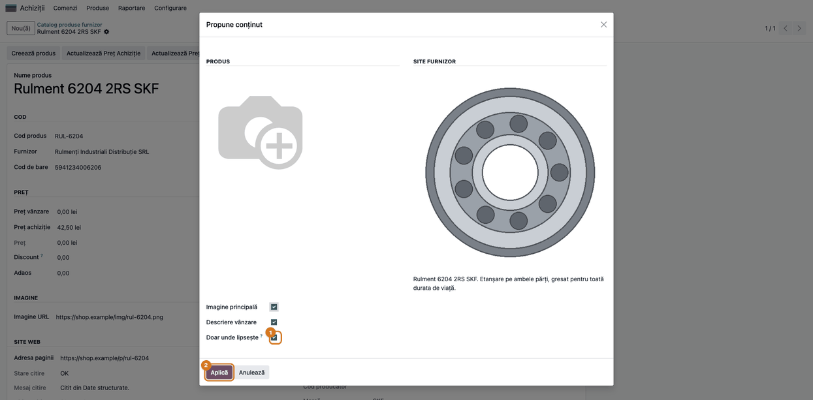

### Pasul 10 — Verificați produsul după aplicare

**Meniu:** *Achiziții → Produse → Produse → (produsul)*, fila **Achiziții**

**Găsiți pe ecran:** ① imaginea produsului, descărcată de pe site-ul furnizorului; prețul de pe
linia de furnizor (încadrat). Descrierea ajunge în câmpul **Descriere vânzare** (fila **Vânzări**, vizibilă
când aplicația Vânzări este instalată).

**Verificați:** cu **Actualizează prețurile la furnizor** bifat pe feed, linia de furnizor a
produsului are prețul citit de pe site (în exemplu, 42,50 lei în loc de 39,00).

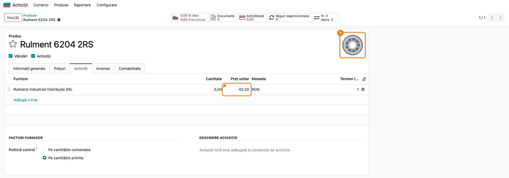

### Pasul 11 — Activați citirea programată

**Meniu:** *Setări → Tehnic → Automatizare → Acțiuni planificate → Site furnizor: citire pagini* (în
modul dezvoltator)

Acțiunea programată este **inactivă** la instalare. Activată, rulează la o oră și citește paginile
**scadente** (necitite sau citite acum mai mult de **Citire la fiecare (ore)**) ale feed-urilor
**Site furnizor** cu **Citire automată permisă** bifată și autentificarea neoprită, câte cel mult
**Pagini pe rulare** pe feed, feed după feed, cu pauza între pagini. O pagină cu 5 citiri eșuate la rând nu mai este
citită automat.

**Găsiți pe ecran:** ① **Executați fiecare** = 1 Ore; ② comutatorul **Activ**, oprit.

**Verificați:** activați-o doar după ce pașii 4–6 dau rezultate corecte; un feed fără **Citire
automată permisă** nu este citit.

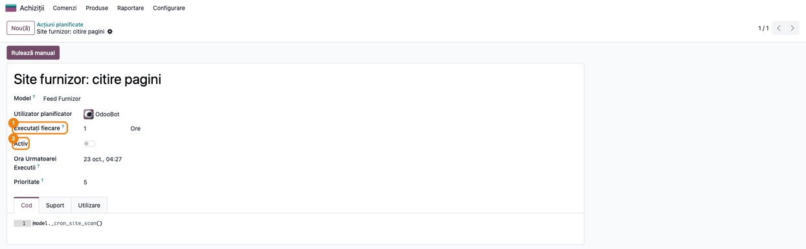

### Note de monografie și raportare

Modulul nu generează note contabile. Prețurile citite actualizează catalogul furnizorului și, la
cerere, liniile de furnizor ale produselor (prețul de achiziție propus pe comenzile de achiziție).
Comenzile de achiziție, recepțiile și facturile furnizorului urmează fluxurile standard.

## 7. Legături cu alte module / declarații

| Modul | Rol |
|-------|-----|
| `deltatech_vendor_products` | Feed-ul furnizorului, catalogul produselor furnizor, importul și butoanele **Actualizează Preț Achiziție** / **Actualizează Preț Listă** |
| `deltatech_web_scan` | Citirea paginilor: date schema.org, selectori, `robots.txt`, pauza între cereri, stările citirii |
| `purchase` | Liniile de furnizor ale produselor, folosite la comenzile de achiziție |
| `product` | Imaginea și descrierea de vânzare a produselor |

**Ce e automat:**
- citirea prețului, stocului, codurilor, pozelor și descrierii de pe pagini (la buton sau programat);
- autentificarea în magazinul B2B și oprirea ei după două eșecuri;
- marcarea **Alt produs** și **Suspect**, cu prețul suspect păstrat deoparte;
- istoricul prețurilor pe intervale;
- înlocuirea codului temporar cu codul de pe pagină;
- cu **Actualizează prețurile la furnizor**, scrierea prețului verificat pe liniile de furnizor.

**Ce rămâne manual:**
- verificarea termenilor furnizorului și bifa **Citire automată permisă**;
- selectorii pentru site-urile fără date schema.org;
- confirmarea prețurilor suspecte și verificarea rândurilor **Alt produs**;
- aplicarea pozelor și descrierilor (**Propune conținut**);
- activarea acțiunii programate și deblocarea autentificării după eșecuri.

## 8. Verificări pentru consultant

- [ ] Feed-ul are **Tip conexiune** = **Site furnizor**, iar fila **Site web** are adresa site-ului.
- [ ] Fără **Citire automată permisă**, în partea de sus a filei apare avertismentul, iar acțiunea programată
  nu citește feed-ul; după bifare și salvare, **Confirmat de** și **Confirmat la** sunt completate (și la un feed nou).
- [ ] **Respectă robots.txt** nu se poate debifa înainte de confirmarea termenilor.
- [ ] **Testează autentificarea** dă „Site-ul a acceptat autentificarea."; cu o parolă greșită, după
  două încercări și reîncărcarea paginii apare avertismentul roșu cu butonul **Deblochează**.
- [ ] **Citește sitemap-ul** adaugă doar paginile care respectă tiparul și nu dublează paginile
  existente.
- [ ] Un fișier cu antetul furnizorului deschide **Mapare coloane**; după import cu **Salvează
  maparea pe feed**, al doilea fișier cu același antet se importă direct.
- [ ] **Caută produsele noastre** asociază unui produs doar paginile cu același cod sau cod de bare.
- [ ] **Test pe 5 pagini** nu modifică niciun rând din catalog și arată câte o linie pe pagină.
- [ ] Prețurile de pe site sunt fără TVA, în moneda feed-ului.
- [ ] După **Citește paginile acum**, rândurile au **Stare citire**, preț și disponibilitate; codurile
  temporare sunt înlocuite cu codurile de pe pagină.
- [ ] Un preț schimbat peste prag rămâne în **Preț de confirmat**, iar **Preț achiziție** nu se
  schimbă până la **Confirmă prețul**.
- [ ] Un rând **Suspect** sau **Alt produs** nu modifică prețul de pe linia de furnizor a produsului.
- [ ] **Istoric** arată o linie nouă doar la schimbarea prețului sau a disponibilității.
- [ ] **Propune conținut** cu **Doar unde lipsește** bifat nu înlocuiește imaginea sau descrierea
  existente ale produsului.
- [ ] Acțiunea programată **Site furnizor: citire pagini** este inactivă după instalare.

## 9. Mesaje de eroare frecvente

| Mesaj | Cauză | Remediere |
|-------|-------|-----------|
| Avertismentul „Citirea programată sare peste acest feed până confirmați..." | **Citire automată permisă** nu este bifată | Verificați termenii furnizorului, apoi bifați |
| „robots.txt poate fi ignorat doar după confirmarea termenilor furnizorului." | S-a debifat **Respectă robots.txt** fără confirmarea termenilor | Bifați întâi **Citire automată permisă** |
| „lipsește utilizatorul sau parola feed-ului" | Autentificarea e activă, dar grupul **Conexiune** nu are utilizator sau parolă | Un administrator completează **Nume utilizator** și **Parolă** |
| „contul cere o verificare suplimentară; cereți furnizorului un feed sau un acces API" | Pagina de autentificare are CAPTCHA, verificare în doi pași sau protecție anti-robot | Modulul nu ocolește protecțiile: cereți feed sau API |
| „site-ul nu afișează ... după autentificare" | **Text după autentificare** nu apare pe pagina principală: parolă greșită sau text greșit | Verificați parola și textul (de exemplu „Deconectare") |
| „pe pagina de autentificare nu există un formular cu câmpul ..." | **Câmp parolă** nu corespunde numelui câmpului din formular | Puneți numele exact al câmpului (atributul `name`) |
| „autentificarea este oprită după încercări eșuate; deblocați-o pe feed" | Două autentificări eșuate la rând | Corectați utilizatorul și parola, apoi **Deblochează** pe fila **Site web** |
| „Pagina arată prețul în EUR, feed-ul este în RON." | Moneda de pe pagină diferă de moneda feed-ului; rândul este **Suspect** | **Nu confirmați prețul** (s-ar scrie suma neconvertită). Corectați **Monedă** pe feed sau cereți prețurile în moneda feed-ului, apoi citiți din nou pagina |
| Stare **Alt produs**, „Pagina arată alt produs: ..." | Codul sau codul de bare de pe pagină diferă de cel al rândului | Corectați adresa paginii sau codul de bare al rândului |
| Stare **Blocată** | `robots.txt` interzice pagina, site-ul are protecție anti-robot sau autentificarea a eșuat | Vedeți **Mesaj citire**; cereți feed sau API dacă site-ul refuză citirea automată |
| Stare **Negăsită**, „Niciun preț pe pagină (...)" | Pagina nu mai există (detaliul din paranteză arată 404) sau pagina nu are un preț care să poată fi citit | Pentru 404: actualizați adresa paginii sau ștergeți rândul. Fără preț: adăugați un selector pentru **Preț achiziție** și testați cu **Test pe 5 pagini** |
| **Citiri eșuate** = 5, pagina nu mai este citită programat | Cinci citiri eșuate la rând | Corectați adresa paginii sau selectorii, apoi apăsați **Citește pagina** pe rând; o citire reușită repune pagina în acțiunea programată |
| Un selector CSS nu citește nimic | Lipsește biblioteca Python `cssselect` pe server | Instalați `cssselect` sau folosiți un selector **XPath** |
| „Tabelul de valori trebuie scris în format JSON: ..." | **Tabel de valori** nu e JSON valid | Scrieți, de exemplu, `{"In stoc": "in_stock", "La comanda": "on_order"}` |
| „Alegeți coloana cu codul produsului." | La **Mapare coloane**, nicio coloană nu e încărcată în **Cod** | Alegeți **Încarcă în** = **Cod** pe coloana cu codul furnizorului |
| „Fiecare câmp se poate încărca dintr-o singură coloană: ..." | Două coloane au același **Încarcă în** | Lăsați câmpul pe o singură coloană, iar pe cealaltă puneți **Ignoră** sau **Atribut suplimentar** |
| „Coloanele din ... nu au putut fi mapate: ... nu a fost găsit." | Importul programat a primit un fișier fără mapare salvată pentru cod | Importați o dată fișierul manual, cu **Salvează maparea pe feed** bifată |
| „Catalogul feed-ului nu are încă nicio adresă de pagină." | **Test pe 5 pagini** pe un feed fără pagini | Adăugați întâi paginile (pasul 3) |
| „Codul ... de pe pagină există deja în catalog." | Un rând din sitemap are codul de pe pagină deja folosit de alt rând al furnizorului | Rândul păstrează codul temporar; ștergeți duplicatul |
| Butonul **Propune conținut** nu apare pe rând | Rândul nu are produs asociat sau starea nu este OK / Suspect | Asociați produsul și citiți pagina |

## 10. Capturi de ecran

Capturile sunt **generate automat** din `tests/test_screenshots.py` (mixinul `ScreenshotCase` din
`l10n_ro_doc_screenshots`, import defensiv), în limba română, pe o companie RO în RON. Site-ul
furnizorului este **simulat** în test: rețeaua și DNS-ul sunt înlocuite cu `fake_web` din testele
`deltatech_web_scan` (pagini cu date schema.org, sitemap, formular de autentificare), deci nicio
cerere nu iese în rețea. Furnizorul, produsele și prețurile sunt date de exemplu.

1. `01_feed_site_web.png` — feed-ul **Site furnizor**, fila **Site web** completă.
2. `02_test_autentificare.png` — **Testează autentificarea**: autentificarea acceptată.
3. `03_citire_sitemap.png` — **Citește sitemap-ul**: paginile găsite și adăugate în catalog.
   `03b_mapare_coloane.png` — **Încarcă produse** cu un fișier cu antetul furnizorului: pasul
   **Mapare coloane** (din `deltatech_vendor_products`).
4. `04_test_5_pagini.png` — **Test pe 5 pagini**: rezultatul citirii, fără scriere.
5. `05_citeste_paginile.png` — **Citește paginile acum**: rezumatul stărilor.
6. `06_catalog_pagini.png` — **Catalog produse furnizor**, filtrul **Cu pagină**, cu stările citirii.
7. `07_pret_suspect.png` — rândul **Suspect**, cu **Preț de confirmat** și **Confirmă prețul**.
8. `08_istoric_preturi.png` — **Istoric prețuri furnizor** pentru rândul suspect.
9. `09_propune_continut.png` — asistentul **Propune conținut**: produsul și site-ul furnizorului.
10. `10_produs_continut_aplicat.png` — produsul cu imaginea preluată de pe site, fila **Achiziții**
    cu prețul de pe linia de furnizor.
11. `11_actiune_programata.png` — acțiunea programată **Site furnizor: citire pagini**, inactivă.

Regenerare:

```bash
./odoo/odoo-bin -c odoo.conf -d test19 -i deltatech_vendor_products_site,l10n_ro_doc_screenshots --test-tags=/deltatech_vendor_products_site:TestVendorSiteScreenshots --stop-after-init
```

## 11. Observații pentru manual

Prezentați modulul ca **ultima soluție** pentru un furnizor fără feed: întâi se cere un fișier sau
un API, apoi se verifică termenii site-ului, abia apoi se citesc paginile. Insistați pe cele două
plase de siguranță: **Alt produs** (pagina arată alt cod sau cod de bare) și **Suspect** (prețul a
sărit peste prag sau e în altă monedă), care țin prețurile greșite departe de produse până le
confirmă o persoană.

Explicați că modulul nu ocolește protecțiile site-urilor (CAPTCHA, verificare în doi pași,
`robots.txt`) și că se oprește singur după două autentificări eșuate. Pozele și descrierile nu
ajung pe produse decât prin **Propune conținut**. Acțiunea programată se activează doar după un test
reușit.
