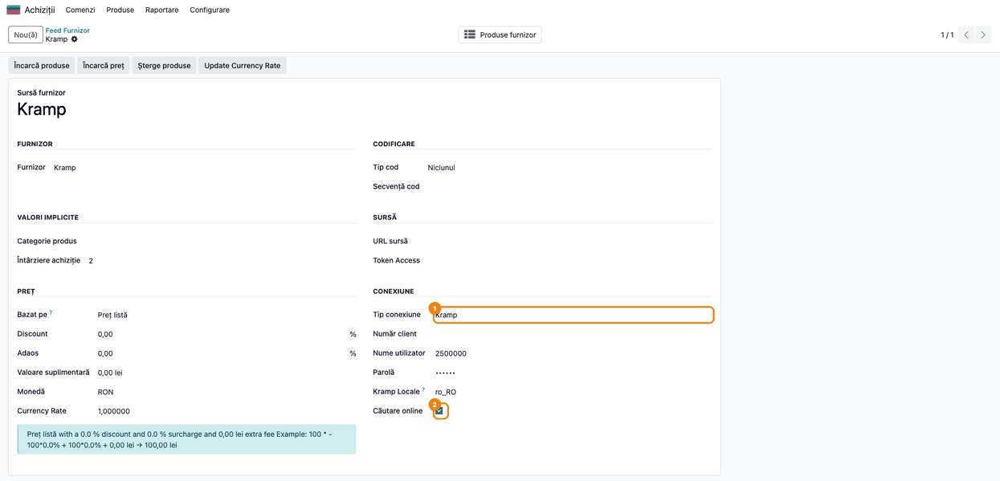
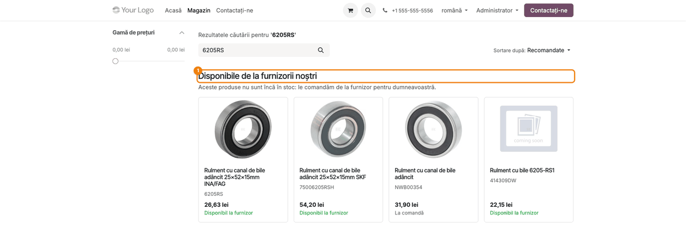
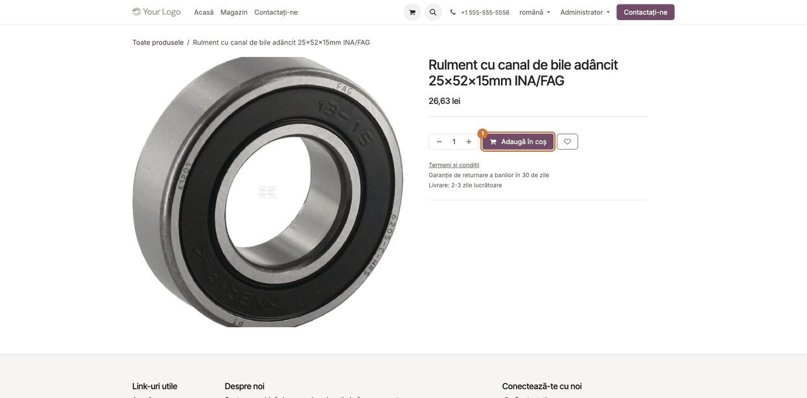
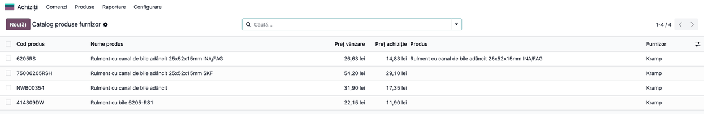
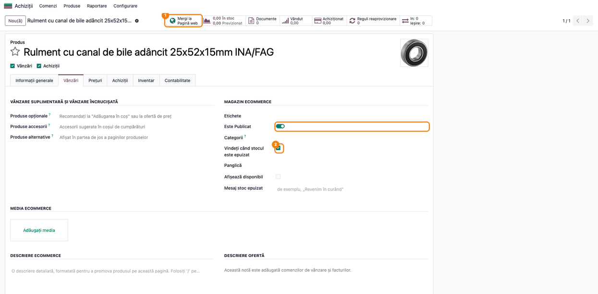

# Fișă Modul: Căutare online la furnizori în magazinul web — produsele Kramp vândute fără să fie în catalog

**Modul:** `deltatech_vendor_products_website`
**Utilizator principal:** Consultant (configurare), Responsabil eCommerce, Operator catalog produse
**Prioritate:** 🟡 Medie (util clienților care revând din catalogul unui furnizor cu API, cum e Kramp; nu generează note contabile)

---

## 1. Scop business

Un dealer de piese agricole are în Odoo doar o mică parte din cele zeci de mii de articole pe care
le poate comanda de la Kramp. Când un client caută în magazinul online un cod pe care dealerul nu
l-a adus încă în catalog, căutarea standard nu găsește nimic și clientul pleacă.

Modulul leagă **magazinul web** (`/shop`) de **catalogul produselor furnizor**: la o căutare fără
rezultate suficiente, întreabă live furnizorii care au **Căutare online** (de exemplu Kramp) și
afișează sub grila magazinului, în blocul **„Disponibile de la furnizorii noștri"**, produsele
găsite, cu imagine, cod, preț și disponibilitate la furnizor. La click pe un produs, Odoo îl creează
automat, publicat pe site, și îl deschide în magazin, unde clientul îl poate pune în coș.

Astfel magazinul vinde din tot catalogul furnizorului, fără ca dealerul să importe și să întrețină
manual fiecare articol.

## 2. Bază legală și context

Modulul nu are implicații fiscale sau contabile: nu emite documente și nu generează note contabile.
Comanda clientului și factura urmează fluxul standard de vânzări și eCommerce.

Context operațional important:

- Căutarea la furnizor o face **conectorul** furnizorului. Pentru Kramp, conectorul este
  `deltatech_vendor_products_kramp`, cu fișa lui proprie: autentificare, prețuri, stoc din
  planurile de livrare. Fără un conector care știe să caute online, bifa **Căutare online** nu
  aduce nimic.
- Prețul afișat pornește de la **prețul de vânzare al furnizorului** (pentru Kramp, prețul brut de
  listă), cu regulile de preț ale feed-ului (discount, adaos, valoare suplimentară). Câmpul
  **Bazat pe** nu se aplică aici: blocul și produsul nou pornesc mereu de la prețul de listă. Este convertit
  în moneda site-ului și afișat **cu sau fără TVA**, la fel cum afișează magazinul produsele, pe
  baza taxei implicite de vânzare a companiei.
- Un produs **fără preț** la furnizor (de exemplu un feed Kramp fără utilizator și parolă, la care
  Kramp nu dă prețuri) **nu se afișează**, ca să nu poată fi comandat la 0.
- Căutarea la furnizor rulează **după afișarea paginii**, deci un furnizor lent nu întârzie
  magazinul. Clientul vede câteva secunde mesajul „Căutăm în cataloagele furnizorilor...".

## 3. Utilizatori și roluri

- **Consultantul / administratorul** bifează **Căutare online** pe feed-ul furnizorului și verifică
  regulile de preț și parametrul de încărcare a serverului (secțiunea 5).
- **Clientul magazinului** (vizitator sau client autentificat) caută un cod în `/shop` și deschide
  produsul găsit la furnizor. Nu are nevoie de drepturi în Odoo.
- **Responsabilul eCommerce / operatorul de catalog** urmărește produsele create din magazin
  (catalogul furnizorului, produsele publicate) și completează ce lipsește (categorie de site,
  descriere).
- Rol recomandat la testare: utilizator cu **Achiziții / Administrator**, **Website /
  Administrator** și **Facturare / Administrator** pentru configurare (setările de site și taxele
  implicite cer drepturi de administrator); pentru căutare, o fereastră privată a browserului
  (vizitator neautentificat).

## 4. Conturi și date implicate

**Conturi contabile:** niciunul. Modulul nu generează note contabile.

**Date pe feed-ul furnizorului** (*Feed Furnizor*):

| Câmp | Rol |
|------|-----|
| **Căutare online** | Feed-ul este întrebat la căutările din magazin. Câmpul se vede doar dacă feed-ul are un **Tip conexiune** (pentru Kramp, **Kramp**) |
| Tip conexiune, credențiale | Le folosește conectorul; pentru Kramp vezi fișa `deltatech_vendor_products_kramp` |
| Monedă | Moneda prețurilor furnizorului; prețul afișat se convertește în moneda site-ului |
| Reguli de preț (grupul **Preț**: Discount, Adaos, Valoare suplimentară) | Transformă prețul de listă al furnizorului în prețul afișat în magazin și în prețul de vânzare al produsului creat. Recomandat: **Bazat pe** = Preț listă, ca **Actualizează Preț Listă** să nu schimbe ulterior prețul față de cel din card |

**Date create de o căutare și de un click:**

| Unde | Ce se completează |
|------|-------------------|
| **Catalog produse furnizor** | Câte un rând pentru fiecare produs găsit: cod, denumire, preț de vânzare, preț de achiziție, imagine, cantitate disponibilă, cod de bare (la Kramp, EAN-ul) |
| **Produs** (după click) | Produs stocabil, cu denumirea, prețul de vânzare calculat, costul, codul de bare, imaginea furnizorului și linia de furnizor; **publicat pe site** și **comandabil fără stoc** |

**Date minime pentru demo:** un partener „Kramp", moneda RON activă, un feed Kramp cu
credențiale valide și **Căutare online** bifată, un site cu magazin (`website_sale`) și un cod pe
care catalogul nu îl are încă, de exemplu `6205RS` (rulment).

## 5. Configurare inițială

1. Instalați modulul conectorului, de exemplu `deltatech_vendor_products_kramp`. Se instalează
   automat și `deltatech_vendor_products_website`, împreună cu **eCommerce** (`website_sale`) și
   **eCommerce Stoc** (`website_sale_stock`). Acesta din urmă aduce opțiunea **Vindeți când stocul
   este epuizat**, pe care o bifează modulul la produsele create din catalogul furnizorului.
2. Configurați feed-ul furnizorului după fișa conectorului: **Achiziții → Produse → Feed
   Furnizor → Kramp**, cu furnizorul, moneda, tipul conexiunii și credențialele.
3. În grupul **Conexiune**, bifați **Căutare online** și salvați. Într-o bază cu mai multe
   companii, sunt întrebate doar feed-urile companiei site-ului, iar blocul apare doar dacă acea
   companie are un feed cu **Căutare online**.
4. Verificați în grupul **Preț** regulile cu care prețul furnizorului devine preț de vânzare
   (Discount, Adaos, Valoare suplimentară, aplicate pe prețul de listă) și lăsați **Bazat pe** =
   Preț listă.
5. Verificați taxa implicită de vânzare a companiei (**Facturare → Configurare → Setări →
   Taxe implicite**) și modul de afișare a prețurilor în magazin (**Website → Configurare →
   Setări → Afișează prețurile produselor**: **Fără taxe** sau **Taxe incluse**). Cu ele se
   calculează prețul din bloc. Pentru un magazin care vinde către persoane fizice, alegeți de regulă
   **Taxe incluse**, ca prețul afișat să fie prețul final.
6. Opțional, limitele de căutare la furnizor, ca parametri de sistem (**Setări → Tehnic →
   Parametri sistem**, în modul dezvoltator): `vendor_product_online_search_session_limit`
   (implicit 10 căutări pe minut pentru o sesiune) și `vendor_product_online_search_ip_limit`
   (implicit 60 de căutări pe minut pentru o adresă IP); valoarea 0 dezactivează limita. O căutare
   repetată în aceeași sesiune refolosește rezultatul anterior și nu se numără. Peste limită,
   blocul nu apare (secțiunea 9).

## 6. Flux de utilizare

### Pasul 1 — Activați căutarea online pe feed-ul Kramp

**Meniu:** *Achiziții → Produse → Feed Furnizor → Kramp*

În grupul **Conexiune**, lângă **Tip conexiune** = Kramp și credențialele contului Kramp, bifați
**Căutare online**. De acum, căutările din magazin întreabă și acest feed.



### Pasul 2 — Clientul caută un cod în magazin

**Meniu:** site-ul public → **Magazin**, câmpul de căutare (`/shop?search=6205RS`)

Clientul caută `6205RS`. Catalogul nu are produsul, deci grila standard e goală. După câteva
secunde apare blocul **„Disponibile de la furnizorii noștri"** cu produsele găsite la Kramp, iar
mesajul standard „Fără rezultate" dispare.

**Găsiți pe ecran:** fiecare card are imaginea furnizorului, denumirea, **codul** furnizorului,
**prețul** și disponibilitatea: **„Disponibil la furnizor"** (verde) când furnizorul are stoc,
**„La comandă"** când nu are.

**Verificați:**
- blocul apare doar când rezultatele magazinului încap pe o pagină (căutarea e un cod, nu un
  cuvânt general);
- prețul unui card este prețul de listă Kramp cu regulile feed-ului, în moneda site-ului, cu TVA
  dacă magazinul afișează prețurile cu TVA;
- un produs pe care îl aveți deja în Odoo nu apare în bloc, ci în grilă, **dacă rândul lui din
  catalogul furnizorului e asociat produsului** (produsul a fost creat din catalog sau rândul a fost
  asociat cu butonul **Asociere** din *Catalog produse furnizor*); un produs creat manual și
  neasociat apare în ambele locuri;
- un articol fără stoc la Kramp are **„La comandă"**.



### Pasul 3 — Clientul deschide produsul găsit

**Meniu:** click pe un card din blocul **„Disponibile de la furnizorii noștri"**

Odoo creează produsul din rândul de catalog (dacă nu există deja), îl publică și deschide pagina
lui din magazin, cu imaginea Kramp, prețul și butonul **Adaugă în coș**. Comanda continuă pe fluxul
standard de eCommerce.

**Verificați:**
- prețul de pe pagina produsului este același cu cel din card;
- butonul **Adaugă în coș** este activ, chiar dacă produsul nu are stoc în depozit (produsul e
  comandabil fără stoc).



### Pasul 4 — Verificați rândurile salvate în catalogul furnizorului

**Meniu:** *Achiziții → Produse → Catalog produse furnizor*

Fiecare căutare online salvează produsele găsite în catalogul furnizorului, ca la un import.

**Găsiți pe ecran:** rândurile Kramp cu **Cod produs**, **Nume produs**, **Preț vânzare** și **Preț
achiziție**. **Preț vânzare** este prețul de listă al furnizorului, înainte de regulile feed-ului;
prețul din magazin se obține din el cu regulile feed-ului (în captură regulile sunt 0, deci cele
două coincid). Rândul deschis de client are coloana **Produs** completată; celelalte nu au încă
produs Odoo.

**Verificați:**
- codurile din magazin se regăsesc în catalog, cu furnizorul Kramp;
- doar produsul deschis de client are produs Odoo; restul rămân simple rânduri de catalog, fără să
  încarce lista de produse.



### Pasul 5 — Verificați produsul creat din magazin

**Meniu:** *Website → eCommerce → Produse → (produsul)* sau *Vânzări → Produse → Produse*

**Găsiți pe ecran:** butonul inteligent **Mergi la Pagină web** din bara de sus a formularului și,
în fila **Vânzări**, grupul **Magazin eCommerce** cu **Este Publicat** activ și **Vindeți când
stocul este epuizat** bifat. În fila **Informații generale** sunt **Preț vânzare**, **Cost** și
**Cod de bare**, iar în fila **Achiziții**, linia de furnizor Kramp cu prețul net și termenul de
livrare implicit al feed-ului (**Întârziere achiziție**).

**Verificați:**
- produsul are **Este Publicat** activ și imaginea furnizorului;
- **Vindeți când stocul este epuizat** e bifat, deci clientul poate comanda fără stoc în depozit;
- în fila **Achiziții**, linia de furnizor Kramp are prețul de achiziție din catalog; cu ea, comanda
  de achiziție către Kramp se face din **Inventar → Operații → Aprovizionare → Reaprovizionare** sau prin reguli
  de reaprovizionare. Ca să se genereze automat la confirmarea comenzii clientului, activați pe
  categoria produselor (sau pe produs) rutele **Cumpără** și **Reaprovizionare la comandă (MTO)**.
  În Odoo 19 ruta MTO e arhivată implicit: activați întâi **Inventar → Configurare → Setări →
  Trasee în mai mulți pași**, apoi dezarhivați ruta din **Inventar → Configurare → Rute** (filtrul
  **Arhivat**). Modulul nu face această configurare;
- completați categoria de site și descrierea, dacă vreți ca produsul să apară și la navigarea pe
  categorii, nu doar la căutare.



### Note de monografie și raportare

Modulul nu generează note contabile. Comanda clientului, livrarea și factura urmează fluxurile
standard de vânzări și stoc. Comanda de achiziție către Kramp folosește linia de furnizor creată la
pasul 3 (din reaprovizionare sau, cu rutele de la pasul 5, automat din comanda clientului).

## 7. Legături cu alte module / declarații

| Modul | Rol |
|-------|-----|
| `deltatech_vendor_products` | Catalogul produselor furnizor, feed-ul, regulile de preț și crearea produselor |
| `deltatech_vendor_products_kramp` | Conectorul Kramp: căutarea online, prețurile, stocul și EAN-ul |
| `website_sale` | Magazinul `/shop`, pagina produsului și coșul |
| `website_sale_stock` | Opțiunea **Vindeți când stocul este epuizat** a produsului, bifată la produsele create din catalogul furnizorului; fără el, pagina produsului din magazin nu se deschidea |
| `purchase` | Linia de furnizor folosită la comanda de achiziție către Kramp |

**Ce e automat:**
- căutarea la furnizor după afișarea paginii, la căutările care încap pe o pagină;
- salvarea produselor găsite în catalogul furnizorului;
- la click, crearea produsului, publicarea lui pe site și deschiderea paginii din magazin;
- calculul prețului afișat (reguli de preț, monedă, TVA ca în magazin);
- refolosirea rezultatului la reîncărcarea paginii, fără o nouă cerere către furnizor.

**Ce rămâne manual:**
- bifarea **Căutare online** pe fiecare feed care trebuie întrebat;
- categoria de site, descrierea și alte date de prezentare ale produselor create din magazin;
- curățarea rândurilor de catalog adunate din căutări, dacă nu se mai folosesc.

**Atenție la publicare:** în versiunea actuală, orice produs creat din catalogul furnizorului iese
**publicat pe site** și **comandabil fără stoc**, inclusiv cel creat din backend cu **Generează
produs**. Dacă clientul nu vrea asta pentru produsele create din backend, discutați-o înainte de a
instala modulul.

## 8. Verificări pentru consultant

- [ ] Feed-ul Kramp are **Căutare online** bifată, iar conectorul Kramp e configurat după fișa lui.
- [ ] La căutarea unui cod Kramp care nu e în catalog, în `/shop` apare blocul **„Disponibile de
  la furnizorii noștri"**, iar mesajul „Fără rezultate" dispare.
- [ ] Prețul din card este prețul de listă Kramp cu regulile feed-ului, în moneda site-ului, cu TVA
  dacă magazinul afișează prețurile cu TVA.
- [ ] Un articol fără stoc la Kramp apare cu **„La comandă"**.
- [ ] Un produs existent deja în Odoo, asociat rândului din catalog, nu apare în bloc, ci în grila
  standard.
- [ ] Cu feed-ul fără utilizator și parolă (Kramp nu dă prețuri), blocul nu afișează nimic.
- [ ] Click pe un card deschide pagina produsului, cu același preț și butonul **Adaugă în coș**.
- [ ] Produsul creat este publicat, are imaginea și linia de furnizor Kramp.
- [ ] În **Catalog produse furnizor** apar rândurile găsite; doar cel deschis are produs Odoo.
- [ ] La o căutare de 1–2 caractere apare scurt mesajul „Căutăm în cataloagele furnizorilor...",
  apoi dispare fără rezultate; furnizorul nu este întrebat.

## 9. Mesaje de eroare frecvente

| Mesaj | Cauză | Remediere |
|-------|-------|-----------|
| Blocul nu apare deloc | Niciun feed nu are **Căutare online**, sau căutarea are mai multe pagini de rezultate în magazin | Bifați **Căutare online**; căutați un cod, nu un cuvânt general |
| Blocul nu apare; în jurnalul serverului „Online search … skipped, too many searches" | Sesiunea sau adresa IP a depășit limita de căutări la furnizor pe minut (implicit 10 pe sesiune, 60 pe IP) | Normal pentru un robot sau un client care caută foarte des; dacă mulți clienți ies prin aceeași adresă IP (rețea de firmă), ridicați `vendor_product_online_search_ip_limit` |
| Blocul nu apare într-o bază cu mai multe companii | Feed-ul cu **Căutare online** aparține altei companii decât site-ul | Creați sau mutați feed-ul în compania site-ului |
| Blocul nu apare, deși Kramp are produsul | Feed-ul nu are credențiale, iar Kramp nu dă prețuri; produsele fără preț nu se afișează | Completați utilizatorul și parola pe feed |
| Blocul nu apare; în jurnal „Kramp search for … failed" | Kramp nu răspunde sau a refuzat cererea | Reîncercați; verificați credențialele cu **Încarcă preț** pe feed |
| Mesajul „Căutăm în cataloagele furnizorilor..." dispare fără rezultate | Furnizorul nu are produse pentru termenul căutat | Normal; verificați codul în magazinul furnizorului |
| Același produs apare și în grilă, și în blocul furnizorilor | Produsul a fost creat manual (sau importat) și nu e asociat rândului din catalogul furnizorului | **Asociere** din *Catalog produse furnizor* (și click-ul din magazin) potrivește produsul doar după codul de bare, după linia de furnizor Kramp sau, cu **Tip cod** = Cod pe feed, după codul intern. Completați produsului EAN-ul sau linia de furnizor Kramp (ori coloana **Produs** pe rândul de catalog), altfel click-ul creează un produs nou |
| „Disponibil la furnizor" la un articol Kramp fără stoc confirmat; în jurnal „Kramp availability for … failed" | Planurile de livrare Kramp nu au putut fi citite; disponibilitatea se ia din faptul că articolul se poate cumpăra | Reîncercați căutarea mai târziu; verificați stocul în magazinul Kramp înainte de a confirma termenul clientului |
| La reîncărcarea paginii, rezultatele nu se actualizează | În aceeași sesiune, aceeași căutare refolosește rezultatul anterior | Normal; o căutare nouă sau o sesiune nouă întreabă din nou furnizorul |
| Pagina „404" la deschiderea unui produs din bloc | Linkul a fost deschis din altă sesiune decât cea care a făcut căutarea, sau produsul a fost depublicat | Refaceți căutarea în magazin; produsele depublicate intenționat rămân depublicate |

## 10. Capturi de ecran

Capturile sunt **generate automat** din `tests/test_screenshots.py` (mixinul `ScreenshotCase` din
`l10n_ro_doc_screenshots`, import defensiv), în limba română, pe o bază cu planul de conturi RO.
Răspunsurile Kramp sunt simulate în test (`FakeKramp` din testele conectorului Kramp), cu date
reale ale articolelor (denumiri, imagini, EAN) și prețuri de exemplu, deci capturile nu depind de
un cont Kramp. Prețurile din magazin apar **fără TVA**, pentru că site-ul demo are **Afișează
prețurile produselor** = Fără taxe.

1. `01_feed_cautare_online.png` — formularul **Feed Furnizor** Kramp, cu **Căutare online** bifată.
2. `02_shop_rezultate_furnizor.png` — magazinul `/shop` după căutarea `6205RS`: blocul
   **„Disponibile de la furnizorii noștri"** cu produsele Kramp.
3. `03_pagina_produs.png` — pagina din magazin a produsului creat la click, cu **Adaugă în coș**.
4. `04_catalog_dupa_cautare.png` — **Catalog produse furnizor** cu rândurile salvate de căutare;
   rândul deschis are produs Odoo.
5. `05_produs_generat.png` — formularul produsului creat, fila **Vânzări**: **Este Publicat**
   activ, **Vindeți când stocul este epuizat** bifat și butonul **Mergi la Pagină web**.

Regenerare:

```bash
./odoo/odoo-bin -c odoo.conf -d test19 -i deltatech_vendor_products_kramp,l10n_ro_doc_screenshots --test-tags=/deltatech_vendor_products_website:TestVendorWebsiteScreenshots --stop-after-init
```

## 11. Observații pentru manual

Prezentați modulul din perspectiva clientului magazinului: **caută un cod, găsește produsul la
furnizor, îl pune în coș**, chiar dacă dealerul nu l-a avut niciodată în Odoo. Pentru dealer,
avantajul e că vinde din tot catalogul Kramp fără să-l importe.

Explicați clar trei limite: blocul apare doar la căutări care încap pe o pagină (coduri, nu cuvinte
generale); produsele fără preț la furnizor nu se afișează; peste limita de căutări pe minut
(parametrii din secțiunea 5) căutarea la furnizor se sare. Atrageți atenția că produsele create din magazin
sunt **publicate și comandabile fără stoc**, deci comanda clientului trebuie urmată de comanda de
achiziție către furnizor: din reaprovizionare sau, cu rutele Cumpără + Reaprovizionare la comandă (MTO)
configurate (ruta MTO trebuie dezarhivată, cu setarea Trasee în mai mulți pași activă), automat.
