# Fișă Modul: Efecte vizuale pentru blocurile website

**Modul:** `deltatech_website_effects`
**Utilizator principal:** Consultant website / designer al site-ului (rolul Website › Editor și Designer sau administrator)
**Prioritate:** 🟢 Scăzută (aspect vizual al site-ului; nu atinge date de business, contabilitate sau stocuri)

---

## 1. Scop business

Modulul adaugă în editorul website o colecție de efecte vizuale pe care consultantul le aplică
**bloc cu bloc**, fără cod: carduri care reacționează la mouse (se înclină, se ridică, strălucesc),
forme gata desenate (etichetă de preț, card cu accent colorat, panou de sticlă mată), animații de
atenție, efecte pe secțiuni, pe butoane și pe meniul din antet, plus cinci blocuri noi de conținut
(traseul livrării, caseta de ajutor, lista de informații, codurile de copiat și cardul care se
întoarce). Scopul este ca un magazin sau un site de prezentare să arate „viu" și modern fără
intervenția unui programator. Nimic nu se schimbă pe site până nu alegeți un efect pentru un bloc.

## 2. Bază legală și context

Nu există o bază legală: modulul ține strict de aspectul site-ului. Context operațional:

- efectele sunt clase CSS puse pe bloc din editor și se salvează odată cu pagina; dezinstalarea
  modulului le scoate efectul, dar nu strică conținutul. Excepție: cele cinci blocuri noi rămân în
  pagină fără formatare (fără stil, animație și copiere) și trebuie șterse manual;
- efectele cu mișcare respectă setarea de accesibilitate **„reducerea mișcării"** a sistemului
  vizitatorului (Windows/macOS/iOS/Android): pentru acești vizitatori animațiile sunt oprite;
- **Înclinare 3D** funcționează doar pe dispozitive cu mouse; pe telefon și tabletă cardul rămâne nemișcat.

## 3. Utilizatori și roluri

- **Consultant / designer website** — aplică efectele din editor (necesită drept de editare a
  site-ului: în **Setări › Utilizatori**, la *Website*, rolul **Editor și Designer**, sau **Editor
  restricționat** pe paginile permise).
- **Vizitatorul site-ului** — vede efectele; nu are nimic de configurat.

Roluri recomandate la testare: un utilizator cu rolul *Editor și Designer* pentru editare și o fereastră
privată (vizitator anonim) pentru verificarea rezultatului, inclusiv pe telefon.

## 4. Conturi și date implicate

Modulul nu are conturi contabile, modele sau câmpuri noi — lucrează doar pe conținutul paginilor
(HTML-ul salvat) și pe vederi opționale ale website-ului, activate per website: trei pentru antet
(**Sticlă**, **Meniu la trecerea mouse-ului › Subliniere**, **… › Umplere**) și trei pentru
**Culoarea barei browserului** (*Temă*, *Antet*, *Personalizat*).

Date minime pentru demo: un website cu o pagină editabilă care are o secțiune cu coloane sau
carduri (de exemplu blocul *Coloane* sau *Carduri*), o secțiune cu imagine de fundal (pentru
*Sticlă*, *Strat la trecerea mouse-ului*, *Panoramare fundal*) și un buton.

## 5. Configurare inițială

1. Instalați modulul `deltatech_website_effects` (depinde doar de `website`).
2. Nu există setări de modul: opțiunile apar direct în editorul website, în panoul **Stil** al
   blocului selectat.
3. Deschideți site-ul, apăsați **Editează** și selectați un bloc pentru a vedea opțiunile noi.

> Modulul are traducere în română (`i18n/ro.po`): în interfața RO etichetele opțiunilor, valorile
> lor, numele blocurilor noi și textele lor implicite apar în română. Fișa folosește etichetele
> din interfața RO; pe o interfață în engleză, eticheta originală este dată în tabele, între
> paranteze. Textele implicite ale blocurilor sunt exemple și se rescriu direct în pagină.

## 6. Flux de utilizare

### Pasul 1 — Efectele unui card, ale unei coloane sau ale unui bloc

În editor (**Site → Editează**), dați clic pe un card, pe o coloană dintr-o secțiune sau pe un
bloc interior desenat ca o casetă: *Alertă*, *Citat*, *Text evidențiat*, *Casetă de ajutor*,
*Listă de informații*, *Traseu de livrare* și *Coduri de copiat*. În panoul **Stil**, sub
*Animare*, modulul adaugă patru rânduri:

| Opțiune (eticheta din editor) | Valori | Ce face |
|---|---|---|
| **Efect la trecerea mouse-ului** (*Hover Effect*) | Înclinare 3D, Ridicare, Strălucire, Cadru, Holografic, Contur la apariție, Culoare fundal | reacția blocului când mouse-ul trece peste el |
| ↳ **Reflexie** (*Highlight*) | culoare | doar la *Înclinare 3D*: culoarea luminii care urmărește cursorul; goală = lumină albă neutră |
| ↳ **Culoare** (*Color*) | culoare | doar la *Contur la apariție* (culoarea benzii) și *Culoare fundal* (culoarea fundalului) |
| **Imagini** (*Images*) | Din gri în color, Zoom | imaginile din bloc trec din gri în color sau se măresc lent |
| **Formă** (*Shape*) | Etichetă de preț, Etichetă de preț (cu vârf), Card accentuat, Sticlă | forma vizuală a blocului |
| ↳ **Nuanță** / **Estompare** (*Tone* / *Blur*) | 8 nuanțe + Temă / Ușoară, Medie, Puternică | nuanța *Cardului accentuat*, intensitatea *Sticlei* |
| **Atenție** (*Attention*) | Puls, Iconițe animate | atrage privirea: un halou care „respiră" de trei ori la încărcare, respectiv iconițele care se mișcă la hover |

Când selectați un card sau un bloc dintr-o coloană, panoul arată două grupuri cu aceleași opțiuni:
unul pentru **Coloană** și unul pentru **Bloc** (cardul sau blocul). Alegeți efectul pe grupul
elementului care trebuie să se miște — de obicei cardul sau blocul.

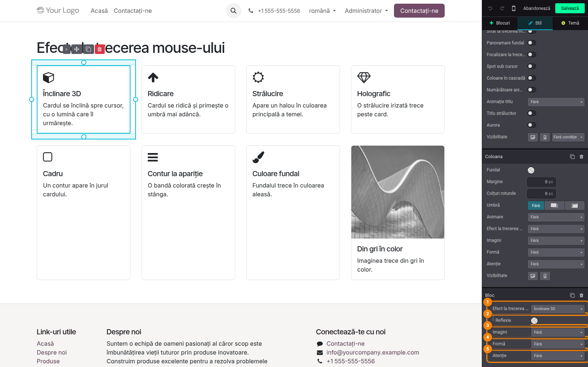

### Pasul 2 — Ce vede vizitatorul la hover

Salvați pagina și treceți cu mouse-ul peste carduri. *Înclinare 3D* înclină cardul spre cursor (până
la câteva grade) cu o lumină care îl urmărește, *Ridicare* îl ridică cu o umbră mai adâncă,
*Strălucire* aprinde un halou în culoarea principală a temei, *Holografic* trece o strălucire
irizată, *Cadru* desenează un contur la mică distanță, *Contur la apariție* crește o bandă colorată în
stânga și mută conținutul, *Culoare fundal* schimbă fundalul, iar *Imagini › Din gri în color*
colorează poza (în captură, cardul *Strălucire* este sub cursor).

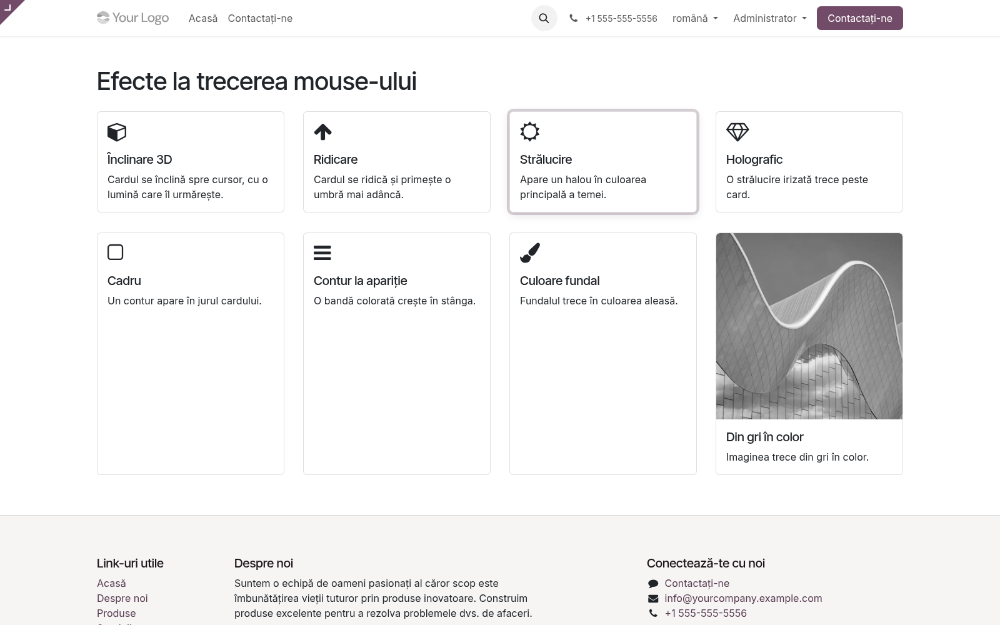

### Pasul 3 — Formele Card accentuat și Etichetă de preț

**Card accentuat** pune o bară colorată sus și un fundal ușor nuanțat; la hover iconița „sare", iar
săgețile de tip *→* se depărtează de text. Nuanța se alege din **Nuanță** (Temă sau Verde, Albastru,
Chihlimbar, Auriu, Roșu, Oliv, Ardezie, Mov). Combinat cu *Înclinare 3D* dă carduri de categorie (în
captură, cardul *Hidraulică* este sub cursor).
**Etichetă de preț** transformă un text scurt într-o etichetă de preț caldă, cu o gaură perforată,
care se balansează la hover; varianta *cu vârf* are gaura în vârful etichetei. Pusă într-un card cu efect
la hover, eticheta se înclină când este „atins" cardul.

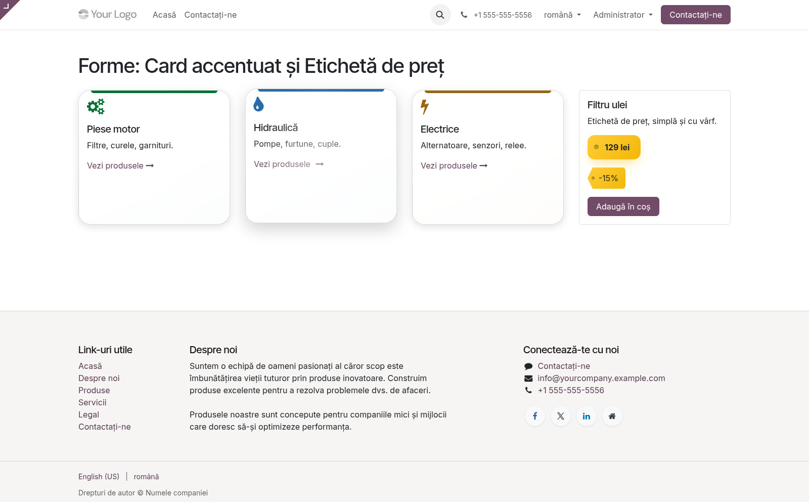

### Pasul 4 — Forma Sticlă (sticlă mată)

**Sticlă** face blocul translucid: ce se află în spatele lui se vede estompat și mai saturat, cu o
margine luminoasă. Are nevoie de **ceva colorat în spate** (imagine de fundal, degrade) — pe fundal
alb arată ca un card simplu. **Estompare** reglează intensitatea: *Ușoară*, *Medie* (implicit),
*Puternică*. În captură, cele trei carduri de sus au *Estompare* *Medie*, *Puternică* și *Ușoară*,
peste o imagine cu
multe detalii; secțiunea de dedesubt este cea folosită la pasul 5.

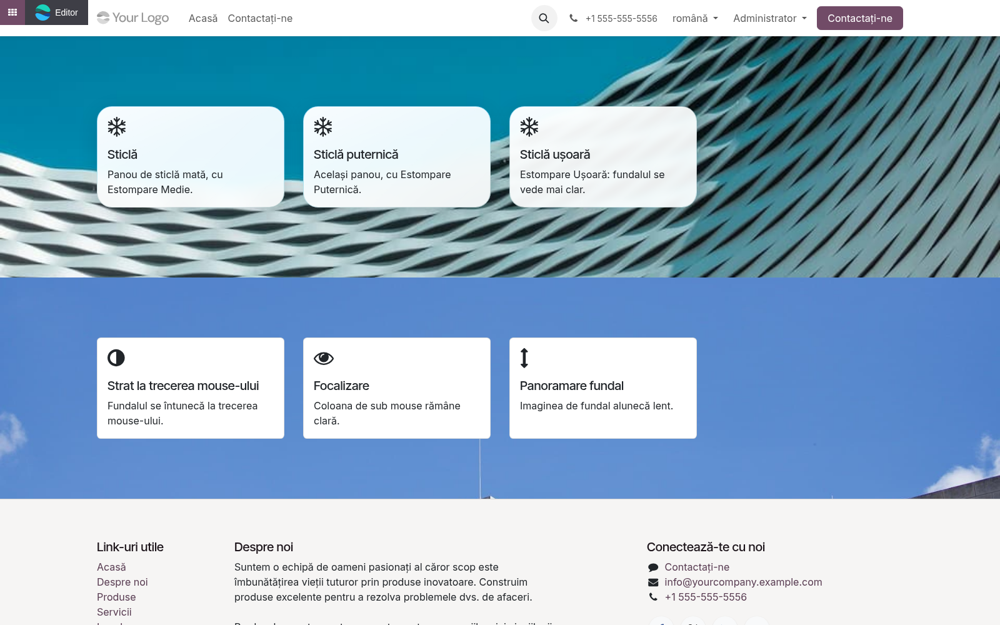

### Pasul 5 — Opțiunile de secțiune

Selectați **secțiunea** (clic pe fundalul ei, nu pe o coloană). În panoul **Stil** apar:

- **Strat la trecerea mouse-ului** + **Culoare** — un strat de culoare apare peste imaginea de
  fundal la hover (implicit negru transparent);
- **Panoramare fundal** — imaginea de fundal alunecă lent în jos la hover;
- **Focalizare la trecerea mouse-ului** — coloana de sub mouse rămâne clară, celelalte coloane ale
  rândului se estompează.

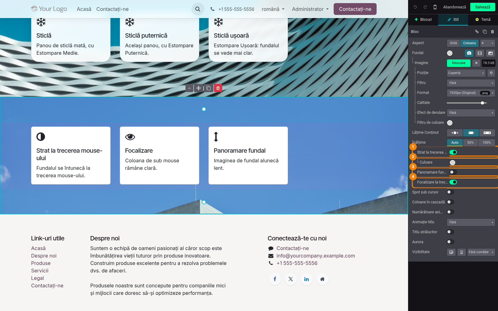

### Pasul 6 — Animație la trecerea mouse-ului pe butoane

Selectați un **buton**. În grupul *Buton* apare **Animație la trecerea mouse-ului**, cu zece
variante: *Mărire*, *Micșorare*, *Puls*, *Plutire*, *Legănare*, *Clătinare*, *Vibrație*, *Împingere*,
*Luciu* (o lumină trece peste buton), *Apăsare*. Opțiunea este pe butonul selectat, nu pe toate butoanele site-ului.

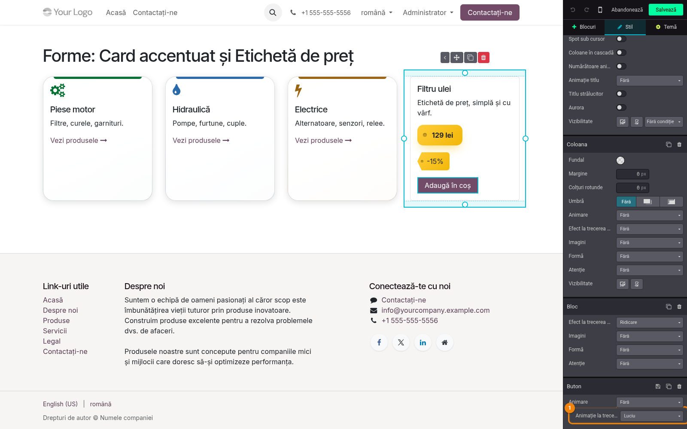

### Pasul 7 — Antetul: Sticlă și Meniu la trecerea mouse-ului

Dați clic pe **antet**. În panoul antetului apar:

- **Sticlă** — antetul devine din sticlă mată când pagina este derulată și antetul rămâne deasupra
  conținutului. Depinde de opțiunea nativă a antetului **Efect de derulare**: cu *Fix* antetul
  stă mereu sus și este din sticlă pe toată derularea; cu *Standard* antetul dispare la derularea
  în jos și reapare, din sticlă, la derularea în sus; cu *Derulați* antetul iese din ecran și
  efectul nu se vede;
- **Meniu la trecerea mouse-ului** — *Subliniere* (o linie crește sub elementul de meniu de sub
  mouse și sub pagina curentă) sau *Umplere* (un fundal ușor umple elementul de la stânga).

Ambele sunt setări ale **website-ului** (se aplică pe toate paginile), nu ale paginii curente.

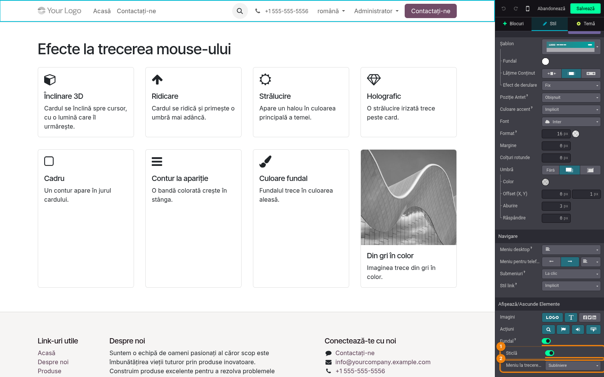

### Pasul 7 bis — Culoarea barei browserului (tab-ul Temă › Efecte)

Această opțiune nu e în panoul antetului. În editor, deschideți tab-ul **Temă** și, în blocul
**Efecte**, setați **Culoarea barei browserului** (*Browser Bar Color*) — culoarea barei
browserului din jurul adresei (Safari pe iPhone, iPad și Mac, Chrome pe Android). Valori:
*Implicit* (*Default*, browserul își păstrează alegerea), *Temă* (*Theme*, prima culoare a
temei), *Antet* (*Header*, culoarea antetului; urmărește antetul și când acesta se lipește de
marginea de sus a paginii) și *Personalizat* (*Custom*, o culoare aleasă în editor). Cu
*Personalizat* apare dedesubt rândul **Culoare**. Pe Mac, Safari o afișează doar dacă în setările
lui este activată opțiunea *Show color in tab bar*. Este o setare a **website-ului**, nu a paginii
curente.

### Pasul 8 — Antetul pe site

Salvați și derulați pagina. Cu *Efect de derulare* = *Fix*, antetul rămâne sus, iar conținutul
trece pe sub el estompat; elementul de meniu de sub mouse (în captură, *Acasă*) are linia de
dedesubt a lui *Meniu la trecerea mouse-ului › Subliniere*.

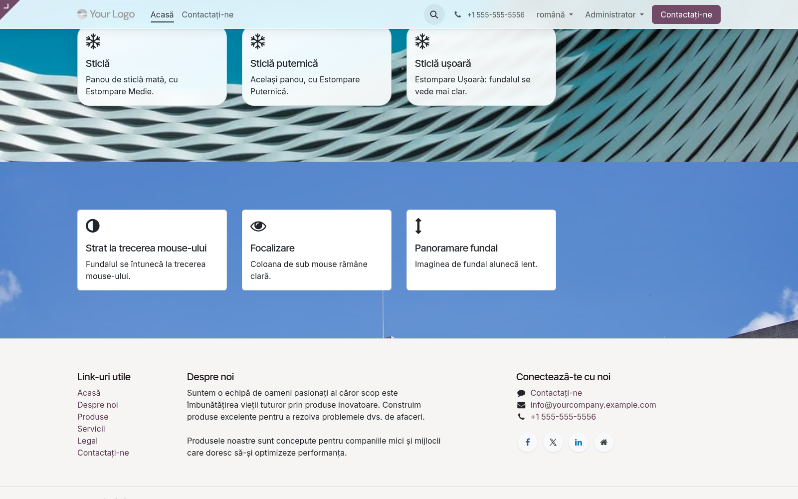

### Pasul 9 — Blocurile noi din Conținut intern

În panoul **Blocuri**, la *Conținut intern*, modulul adaugă **Traseu livrare**, **Casetă de
ajutor**, **Listă de informații**, **Coduri de copiat** și **Card reversibil**. Trageți miniatura în pagină, într-o coloană sau
lângă un text, buton sau imagine; blocul se poate apoi muta, duplica sau șterge ca orice bloc.
Textele, linkurile și iconițele se editează direct în pagină (dublu clic pe o iconiță pentru a o
înlocui). În panoul *Stil*, grupul blocului poartă numele lui (*Traseu livrare*, *Listă de
informații* etc.). Pașii 10–14 pornesc de la un bloc deja plasat.

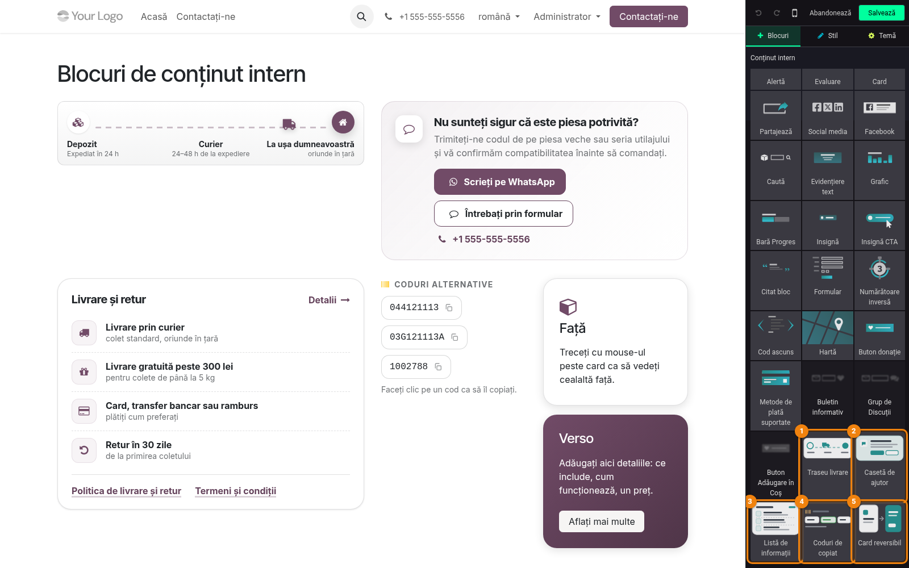

### Pasul 10 — Traseu livrare: vehicul, viteză, culoare, colțuri

**Traseu livrare** arată cum ajunge comanda la client: un vehicul merge pe un drum punctat de la
depozit la ușa clientului, apoi o ia de la capăt; cele trei etape (titlu + detaliu) și iconițele
se editează direct în pagină (dublu clic pe iconiță pentru a o înlocui). Selectați blocul; în
grupul **Traseu livrare** apar:

- **Vehicul** — Camion (implicit), Coș de cumpărături, Mașină, Motocicletă, Bicicletă, Avion, Navă,
  Rachetă;
- **Viteză** — Lentă, Normală, Rapidă;
- **Culoare** — culoarea drumului și a vehiculului (implicit culoarea principală a temei);
- **Colțuri rotunde** — raza colțurilor blocului, în pixeli; plăcuțele din interior o urmează.
  Aceeași opțiune o au *Casetă de ajutor*, *Listă de informații* și *Card reversibil*.

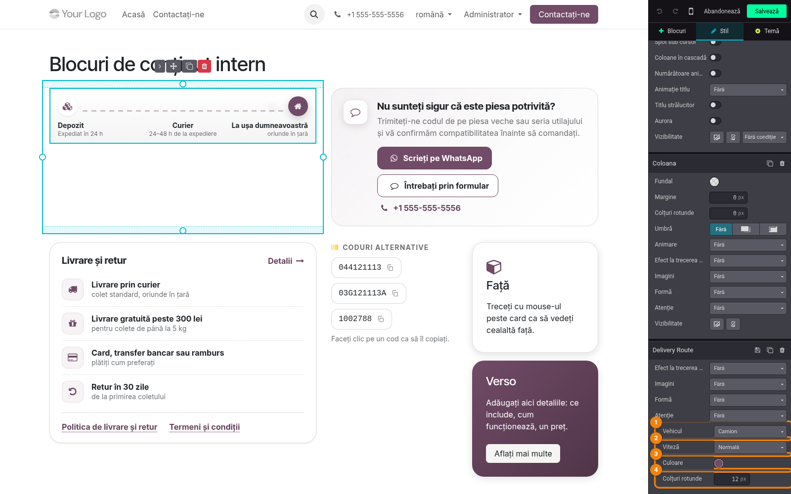

### Pasul 11 — Casetă de ajutor, Listă de informații și Coduri de copiat pe site

- **Casetă de ajutor** — card cu o iconiță, o întrebare (*Nu sunteți sigur că este piesa
  potrivită?*), un răspuns
  scurt și căile de contact: buton WhatsApp, buton spre formularul de contact și un telefon.
  Linkurile (`https://wa.me/...`, `tel:...`) se completează din editor.
- **Listă de informații** — card cu titlu și link *Detalii*, rânduri cu iconiță, titlu și detaliu separate
  prin linii punctate (livrare prin curier, livrare gratuită, plată, retur, ridicare din magazin)
  și linkuri de politici jos. În captură, valorile sunt schimbate din opțiuni (pasul 12): livrare
  gratuită peste *300 lei*, retur în *30* de zile, rândul de ridicare din magazin ascuns.
- **Coduri de copiat** — o listă de coduri (coduri alternative, referințe) afișate ca etichete; un clic
  (sau Enter) copiază codul, iar eticheta devine verde cu bifă (în captură, primul cod tocmai a fost
  atins).

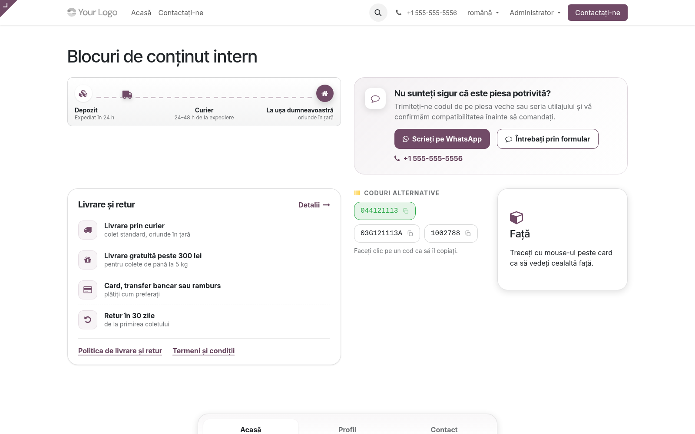

### Pasul 12 — Listă de informații: rânduri și valori

Selectați blocul **Listă de informații**. În grupul lui, pe lângă *Colțuri rotunde*, apar:

| Opțiune | Tip | Ce face |
|---|---|---|
| **Titlu** (*Title*) | bifă | afișează titlul și linkul *Detalii* |
| **Livrare prin curier** (*Courier Delivery*) | bifă | rândul de livrare prin curier |
| **Livrare gratuită** (*Free Delivery*) | bifă | rândul de livrare gratuită; cu el bifat apar **Peste** (suma de la care livrarea e gratuită, text liber, de ex. *300 lei*) și **Până la (kg)** (greutatea maximă) |
| **Plată** (*Payment*) | bifă | rândul cu metodele de plată |
| **Retururi** (*Returns*) | bifă | rândul de retur; cu el bifat apare **Zile** — numărul de zile de retur |
| **Ridicare din magazin** (*Pick Up*) | bifă | rândul de ridicare din magazin; cu el bifat apare **Program** — programul |
| **Link-uri** (*Links*) | bifă | linkurile de politici de jos |

Valorile scrise în panou se înlocuiesc direct în textul rândului; restul textului se editează în
pagină. Opțiunile există doar pe blocurile *Listă de informații* plasate din versiunea 19.0.1.2.0 încolo;
blocurile mai vechi se editează doar în pagină.

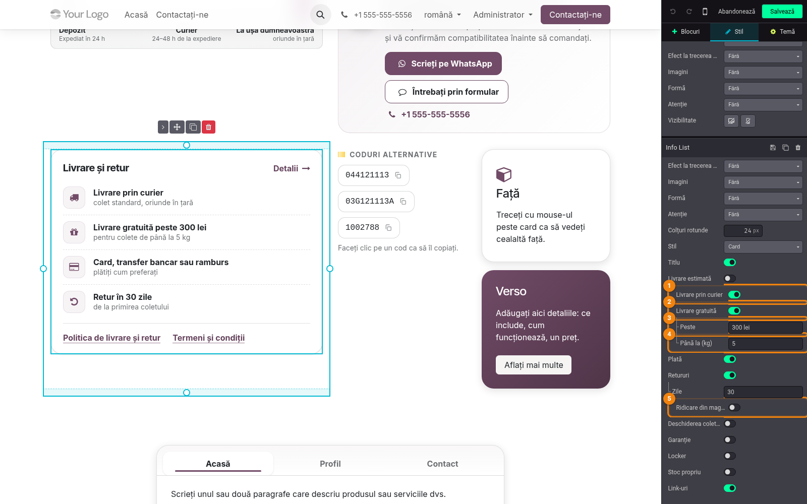

### Pasul 13 — Card reversibil: fața și spatele

**Card reversibil** se întoarce la hover sau la focus de la tastatură. În editor ambele fețe sunt afișate
una sub alta, ca să le puteți edita; pe site se vede doar fața. Pe lângă *Colțuri rotunde*, are
**Culoare verso** — culoarea feței din spate (culoare simplă sau degrade).

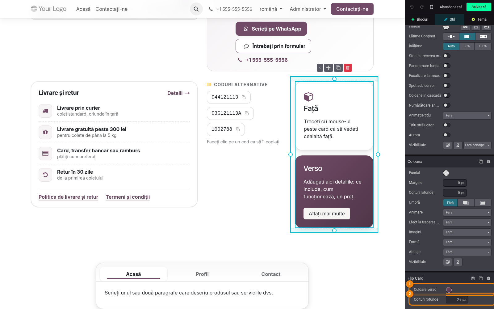

### Pasul 14 — Tab-uri: Stil card

Pe un bloc **Tab-uri**, selectați blocul și porniți **Stil card**: blocul intră într-un card,
bara de taburi stă pe un antet ușor colorat, iar tabul activ este ridicat pe o plăcuță albă cu o
linie de accent.

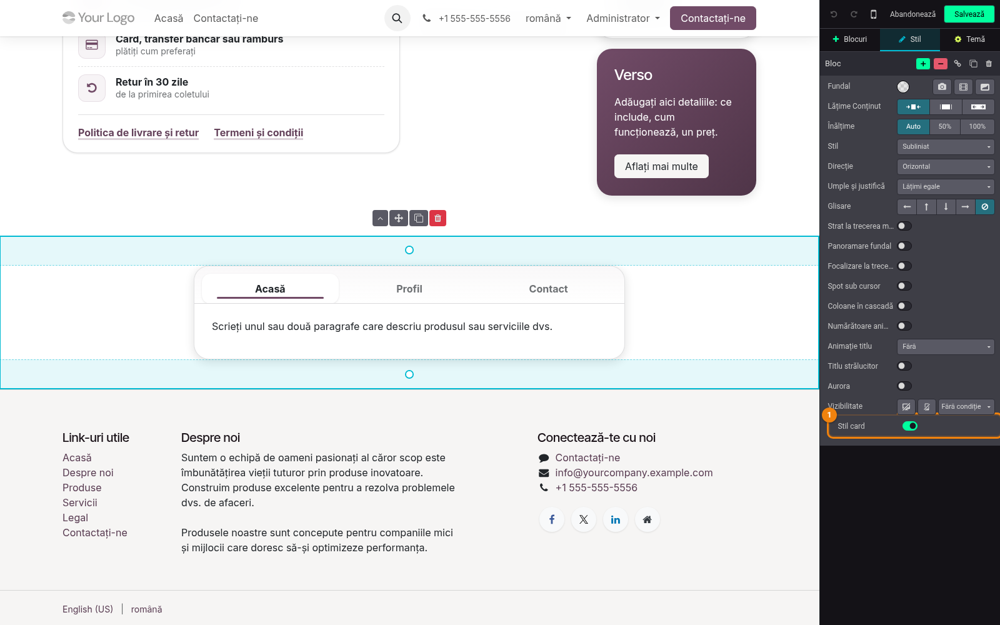

### Note de monografie și raportare

Modulul nu generează note contabile, documente sau rapoarte: efectele se salvează în conținutul
paginilor (clase CSS pe blocuri) și, pentru antet, ca vederi active ale website-ului.

### Cum se combină efectele

- Pe același bloc se poate alege **câte o valoare** din fiecare rând: un *Efect la trecerea
  mouse-ului*, un efect *Imagini*, o *Formă* și un efect *Atenție* (de exemplu *Card accentuat* +
  *Înclinare 3D* + *Iconițe animate*).
- Efectele de **secțiune** (*Strat la trecerea mouse-ului*, *Panoramare fundal*, *Focalizare la
  trecerea mouse-ului*) se cumulează cu cele ale coloanelor din ea.
- *Eticheta de preț* pusă într-un card cu *Înclinare 3D*, *Ridicare*, *Strălucire* sau *Card
  accentuat* se înclină când cardul este sub mouse.
- *Sticlă* arată bine doar peste o imagine sau un degrade (secțiune cu fundal).
- Efectele se pot pune și direct în șabloane QWeb, prin clasele din `readme/USAGE.md`
  (`tb_fx_tilt`, `tb_fx_lift`, `tb_fx_accent_card`, `tb_fx_copy` etc.) — util pentru programatori.

## 7. Legături cu alte module / declarații

| Modul / proces | Rol în flux | Tip legătură |
|---|---|---|
| `website` | editorul în care apar opțiunile și blocurile | dependență (manifest) |
| `deltatech_website_sale_effects` | aduce efectele pe magazin: /shop, Products Design, checkout, pagina de produs; folosește *Listă de informații* și *Traseu livrare* pe pagina de produs | modul care depinde de acesta |

Ce este automat: dezactivarea animațiilor pentru vizitatorii cu „reducerea mișcării" și a lui
*Înclinare 3D* pe ecranele tactile; copierea codurilor din *Coduri de copiat*; animația vehiculului
din *Traseu livrare*.
Ce rămâne manual: alegerea efectelor bloc cu bloc, textele blocurilor noi (exemple de rescris),
linkurile *Casetei de ajutor* (WhatsApp, telefon) și ale *Listei de informații*.

## 8. Verificări pentru consultant

- [ ] După instalare, o pagină existentă arată la fel ca înainte (efectele sunt opționale).
- [ ] Interfața în română: etichetele și valorile opțiunilor modulului sunt în română.
- [ ] Pe un card, *Efect la trecerea mouse-ului* = *Înclinare 3D*: pe site, cu mouse-ul, cardul se
      înclină spre cursor; cu *Reflexie* goală lumina este albă, cu o culoare aleasă lumina are
      acea culoare.
- [ ] Pe telefon (sau în modul responsive cu atingere), cardul cu *Înclinare 3D* nu se mai înclină.
- [ ] *Card accentuat* cu *Nuanță* = *Albastru* are bara de sus albastră; *Temă* folosește culoarea
      temei.
- [ ] *Sticlă* pe un card dintr-o secțiune cu imagine de fundal: imaginea se vede estompată prin
      card; *Estompare* = *Puternică* estompează vizibil mai mult decât *Ușoară*.
- [ ] Pe secțiune, *Focalizare la trecerea mouse-ului*: cu mouse-ul pe o coloană, celelalte se
      estompează.
- [ ] *Animație la trecerea mouse-ului* pe un buton se vede doar pe acel buton.
- [ ] *Meniu la trecerea mouse-ului* și *Sticlă* pe antet se aplică pe toate paginile website-ului; cu *Efect de
      derulare* = *Fix*, antetul este din sticlă cât timp pagina e derulată.
- [ ] *Culoarea barei browserului*: pe telefon (Chrome pe Android sau Safari pe iPhone), cu *Temă*
      bara are prima culoare a temei, cu *Antet* culoarea antetului (și după derulare, când antetul
      se lipește sus), cu *Personalizat* culoarea aleasă; cu *Implicit* site-ul nu o schimbă.
- [ ] *Traseu livrare*: schimbarea *Vehicul*, *Viteză*, *Culoare* se vede pe site după salvare.
- [ ] *Listă de informații*: *Peste* = *300 lei* schimbă textul rândului de livrare gratuită;
      debifarea lui *Ridicare din magazin* ascunde rândul pe site.
- [ ] *Coduri de copiat*: clic pe un cod îl copiază (lipiți într-un câmp text ca să verificați).
- [ ] *Card reversibil* se întoarce la hover; în editor ambele fețe sunt vizibile.
- [ ] În setările de accesibilitate ale sistemului, cu „reducerea mișcării" activă, animațiile
      (*Puls*, *Înclinare 3D*, *Animație la trecerea mouse-ului*) nu mai rulează.
- [ ] Blocurile din *Conținut intern* pot fi trase într-o coloană a paginii, iar grupul lor din
      panoul *Stil* le poartă numele.

## 9. Mesaje de eroare frecvente

| Mesaj / simptom | Cauză probabilă | Remediere |
|---|---|---|
| *„Acest bloc nu poate fi plasat nicăieri pe această pagină"* pe Traseu livrare, Casetă de ajutor, Listă de informații, Coduri de copiat, Card reversibil | versiune a modulului mai veche de 19.0.1.2.0 | actualizați modulul |
| *Listă de informații* nu are opțiunile de rânduri și valori | blocul a fost plasat cu o versiune mai veche de 19.0.1.2.0 | ștergeți blocul și plasați-l din nou, sau editați textele direct în pagină |
| *Sticlă* arată ca un card alb obișnuit | în spatele blocului nu este nimic colorat | puneți o imagine de fundal sau un degrade pe secțiune |
| *Înclinare 3D* nu se mișcă | ecran tactil, sau vizitatorul are „reducerea mișcării" activă | comportament voit; verificați cu mouse pe un calculator fără acea setare |
| Efectul nu apare pe card, ci pe toată coloana | efectul a fost ales pe grupul *Coloană*, nu pe *Bloc* | alegeți *Fără* la coloană și setați efectul pe grupul cardului |
| Antetul nu devine din sticlă | antetul are **Efect de derulare** = *Derulați*, deci nu rămâne sus | setați la antet **Efect de derulare** = *Fix* (sau *Standard*, unde antetul apare din sticlă la derularea în sus) |

## 10. Capturi de ecran

Capturile (`readme/screenshots/`) sunt generate automat din `tests/test_screenshots.py` (mixinul
`ScreenshotCase` din `l10n_ro_doc_screenshots`, import defensiv), cu interfața în română. Testul
creează patru pagini demo (`/efecte-hover`, `/efecte-forme`, `/efecte-glass`, `/efecte-blocuri`) și
fotografiază site-ul și editorul, cu rândurile modulului evidențiate:

1. `01_optiuni_bloc.png` — opțiunile modulului în panoul Stil al unui card (Înclinare 3D, Reflexie,
   Imagini, Formă, Atenție).
2. `02_efecte_hover.png` — cardurile cu efecte pe pagina salvată; cardul Strălucire sub cursor.
3. `03_forme_accent_price_tag.png` — Card accentuat în trei nuanțe și Etichetă de preț.
4. `04_glass.png` — carduri Sticlă (Medie, Puternică, Ușoară) peste o imagine de fundal.
5. `05_optiuni_sectiune.png` — opțiunile de secțiune: Strat la trecerea mouse-ului, Culoare,
   Panoramare fundal, Focalizare la trecerea mouse-ului.
6. `06_buton_hover_animation.png` — Animație la trecerea mouse-ului pe un buton.
7. `07_antet_glass_menu_hover.png` — Sticlă și Meniu la trecerea mouse-ului pe antet.
8. `08_antet_site.png` — pagina derulată, cu antetul din sticlă și Subliniere la meniu.
9. `09_blocuri_continut_intern.png` — cele cinci blocuri ale modulului în panoul Blocuri.
10. `10_delivery_route.png` — opțiunile blocului Traseu livrare.
11. `11_help_box_info_list.png` — Traseu livrare, Casetă de ajutor, Listă de informații și Coduri de
    copiat pe site.
12. `12_info_list_optiuni.png` — opțiunile blocului Listă de informații: rânduri și valori.
13. `13_flip_card.png` — Card reversibil în editor, cu Culoare verso.
14. `14_tabs_card_style.png` — blocul Tab-uri cu Stil card.

Regenerare:

```bash
./odoo/odoo-bin -c odoo.conf -d <db> -i deltatech_website_effects,l10n_ro_doc_screenshots \
    --test-tags=fise_screenshots --stop-after-init
```

## 11. Observații pentru manual

- Explicați diferența dintre grupul **Coloană** și grupul **Bloc** din panou: același set de efecte
  apare pe ambele, iar efectul se mișcă pe elementul pe care a fost ales.
- Subliniați că efectele sunt **opționale și reversibile** (alegeți *Fără* / debifați) și că
  vizitatorii cu „reducerea mișcării" sau pe telefon văd o variantă fără animații.
- *Sticlă*, *Meniu la trecerea mouse-ului* și *Stil card* sunt cele mai vizibile efecte „de identitate" — capturile
  07 și 08 arată setarea și rezultatul.
- Pentru *Listă de informații*, recomandați clientului să-și seteze o dată valorile reale (pragul de
  livrare gratuită, zilele de retur, programul) și să verifice linkurile *Detalii* și de politici
  (implicit `/terms`).
