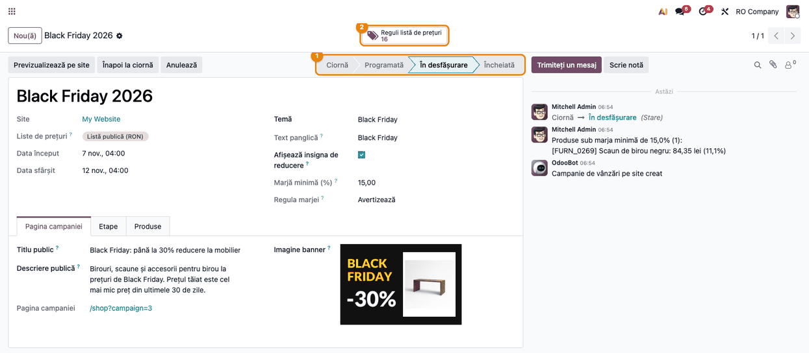
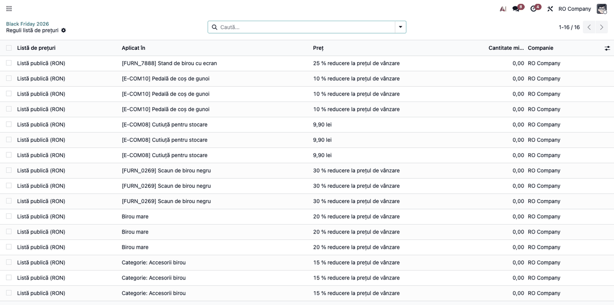
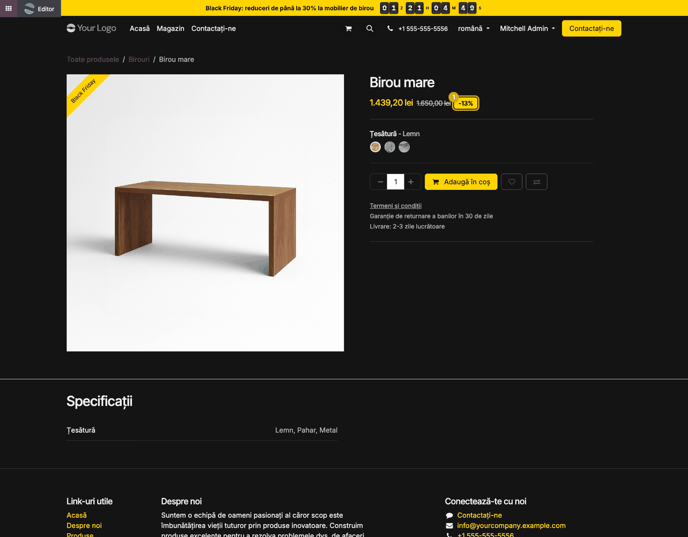
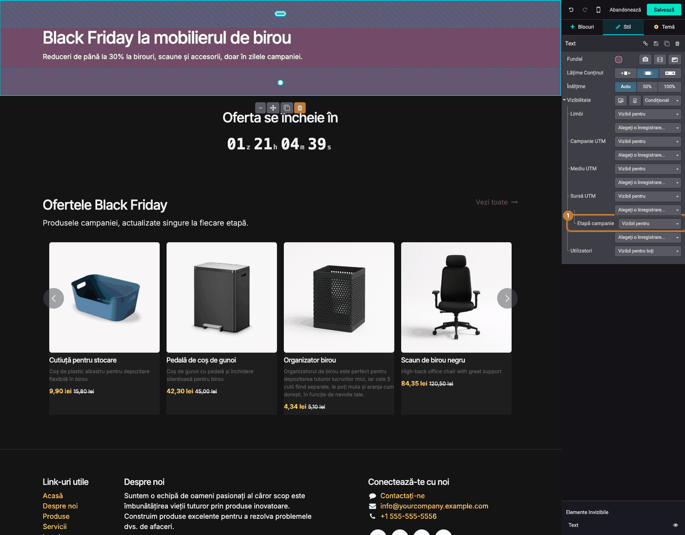
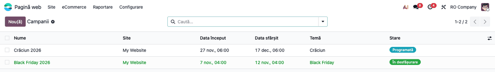

# Fișă Modul: Campanii de vânzări pe site (Black Friday, Crăciun)

**Modul:** `deltatech_website_sale_campaign`
**Utilizator principal:** Responsabil eCommerce / marketing (planifică campania) și designerul site-ului (temă, previzualizare, blocuri pe etapă)
**Prioritate:** 🟡 Medie (schimbă prețurile de pe site și prețul tăiat afișat clienților; prețul anterior al unei reduceri este reglementat)

---

## 1. Scop business

Modulul planifică pe site campanii de tip Black Friday: una sau mai multe **etape** (*Runda 1*,
*Bonus de weekend*, *Prelungire*), fiecare cu perioada, textul barei de sus și numărătoarea ei
inversă, și **produsele** campaniei (produs, variantă sau categorie), cu reducere procentuală sau
preț fix, pe toate etapele sau doar pe unele. La programare, modulul scrie singur regulile datate
în listele de prețuri ale site-ului: prețurile pornesc și se opresc fără intervenție. Prețul tăiat
afișat lângă prețul de campanie nu este prețul de vânzare, ci **cel mai mic preț din ultimele 30 de
zile dinaintea campaniei**, cum cere legislația privind anunțurile de reducere. Cât rulează
campania, site-ul poartă tema ei (culori, antet, carduri, butoane, subsol), o bară de sus cu
numărătoare inversă, panglica campaniei pe produse și o insignă **-X%** lângă preț. Responsabilul
vede înainte de programare prețul de referință, prețul de campanie, reducerea reală și marja
fiecărui produs, iar designerul poate previzualiza site-ul „ca în campanie" înainte de start.

Fiecare campanie are și o **pagină proprie**, `/shop?campaign=<id>`, adresa de pus în newsletter,
reclame și postări: magazinul filtrat pe produsele etapei curente, sub un antet cu titlul public,
descrierea, fotografia campaniei și numărătoarea până la sfârșitul etapei. Pentru prima pagină a
site-ului, blocul standard **Produse** primește filtrul **Produse din campanie** (se umple singur
cu produsele etapei care rulează), iar blocul **Numărătoare campanie** afișează mare timpul rămas
până la sfârșitul etapei; ambele dispar singure când nu rulează nicio campanie.

## 2. Bază legală și context

**Prețul anterior al unei reduceri (directiva Omnibus).** Hotărârea Guvernului nr. 947/2000
privind modalitatea de indicare a prețurilor produselor oferite consumatorilor spre vânzare,
**art. 4^1**, introdus prin HOTĂRÂRE nr. 686/2022
(https://legislatie.just.ro/Public/DetaliiDocument/255732), care transpune art. 2 din
Directiva (UE) 2019/2161:

- **alin. (1)–(2)**: orice anunț de reducere indică prețul anterior, adică **cel mai scăzut preț
  practicat în ultimele 30 de zile** înainte de aplicarea reducerii, în aceeași suprafață de
  vânzare. Modulul ia acest preț din istoricul de prețuri al listei de prețuri a site-ului (modulul
  *Product Price History*) și îl afișează tăiat; dovada (istoricul) rămâne în Odoo pentru un
  control ANPC;
- **alin. (3)**: la produsele care se deteriorează sau expiră rapid, perioada este de **10 zile**.
  Numărul de zile al istoricului este o setare unică pe bază (vezi secțiunea 5), nu pe produs;
- **alin. (4)**: la produsele prezente la vânzare de mai puțin de 30 de zile, prețul anterior este
  cel mai scăzut din perioada de prezență, iar comerciantul indică **perioada** în care s-a aplicat.
  Modulul calculează minimul din istoricul disponibil sau acceptă un **preț de referință manual**, cu
  motivul scris obligatoriu; perioada nu este afișată automat pe site;
- **alin. (5)**: dacă reducerea crește treptat în aceeași campanie, prețul anterior este cel de
  dinaintea **primei** reduceri. Modulul calculează prețul de referință față de **începutul
  campaniei** (prima etapă), pentru toate etapele;
- **art. 12 alin. (2)**: nerespectarea art. 4^1 se sancționează cu amendă de la **5.000 la
  30.000 lei**.

**Context operațional.**

- Regulile campaniei se scriu în listele de prețuri ale site-ului, cu data de început și de sfârșit
  a fiecărei etape; o regulă a campaniei are prioritate față de regulile deja existente în listă,
  inclusiv o regulă de categorie a campaniei față de o regulă de produs a listei.
- Fără opțiunea **Liste de prețuri** pornită în Vânzări, site-ul ignoră listele de prețuri, deci și
  campania; programarea este blocată până o porniți.
- Prețul de campanie și marja se calculează pe **prețul de vânzare din fișa produsului**, așa cum
  e introdus, și pe **costul** produsului. Dacă prețurile de vânzare sunt introduse cu TVA inclus,
  marja afișată este supraevaluată: verificați-o pe valoarea fără TVA.

## 3. Utilizatori și roluri

- **Responsabil eCommerce / marketing** — creează campania, etapele și produsele și o programează.
  Are nevoie de rolul *Pagină web › Editor și Designer* și de *Vânzări › Utilizator* (meniul
  *eCommerce* cere drepturi de vânzări). Cu *Editor restricționat*, campaniile se pot doar citi.
- **Designer website** (*Pagină web › Editor și Designer*) — previzualizează site-ul în campanie,
  setează blocurile vizibile pe etapă din editor și adaugă pe pagini blocurile *Produse* (cu filtrul
  *Produse din campanie*) și *Numărătoare campanie*. Vede și pagina unei campanii încă neîncepute
  (ciornă sau programată), ca s-o verifice înainte de start.
- **Administrator** (*Administrare: Setări*) — meniul *Teme campanii* stă în secțiunea
  *Configurare* a aplicației Pagină web, vizibilă doar administratorilor.
- **Cumpărătorul** — vede tema, bara de sus, panglica, prețul tăiat și insigna -X%, pagina
  campaniei (doar cât rulează sau după încheiere) și blocurile campaniei de pe prima pagină.

Roluri recomandate la testare: un utilizator *Editor și Designer* pentru configurare, un vizitator
anonim (fereastră privată) pentru verificarea site-ului și a coșului.

## 4. Conturi și date implicate

Modulul nu creează note contabile și nu folosește conturi proprii. Datele implicate:

- **listele de prețuri** ale site-ului (regulile campaniei, cu legătura către linia de campanie);
- **istoricul de prețuri** pe listă de prețuri (modulul *Product Price History*), sursa prețului de
  referință;
- **prețul de vânzare** și **costul** produselor (pentru prețul de campanie și marjă);
- **panglica** produselor (*Text panglică* din campanie), creată la programare cu culorile temei.

Date minime pentru demo: datele demo `website_sale` (produse publicate), o listă de prețuri a
site-ului în RON, istoric de preț mai vechi de 30 de zile pentru produsele campaniei (în capturi,
*Birou mare* a fost la 1.650 lei acum 20 de zile, deci prețul tăiat este 1.650, nu 1.799 lei), un
cost pe produse.

## 5. Configurare inițială

1. **Vânzări › Configurare › Setări**, secțiunea *Prețuri*: bifați **Liste de prețuri** și salvați.
2. Instalați modulul cu **cel puțin 30 de zile înainte de prima campanie**: la instalare, listele de
   prețuri ale site-ului primesc bifa *Urmărește istoricul prețurilor* și încep să-și înregistreze
   prețurile (la instalare și apoi periodic). Fără istoric complet, prețul tăiat este minimul din
   perioada înregistrată sau prețul de referință manual.
3. Pentru alt număr de zile decât 30 (de exemplu 10 zile, la produsele perisabile), parametrul de
   sistem `deltatech_product_price_history.days` (**Setări › Tehnic › Parametri › Parametri
   sistem**, în modul dezvoltator). Setarea se aplică pe toată baza.
4. **Pagină web › Configurare › Teme campanii** (ca administrator): adaptați temele livrate (*Black Friday*, *Crăciun*)
   sau creați una pe campanie.
5. Verificați costul produselor pe care le puneți în campanie: marja se calculează din el.

## 6. Flux de utilizare

### Pasul 1 — Tema campaniei

**Pagină web › Configurare › Teme campanii** (meniu vizibil administratorilor), deschideți tema
*Black Friday*. În grupul **Culori**
alegeți *Culoare principală* (bara de sus, insignele, butoanele), *Text pe culoarea principală*,
*Fundalul paginii*, *Textul paginii*, *Card produs* și *Preț campanie*. În **Restilizează** bifați
zonele site-ului care iau tema: *Antet*, *Pagina* (fundalul și textul paginii), *Carduri produse*,
*Butoane*, *Subsol* (tema *Crăciun* lasă antetul și subsolul neschimbate). În grupul
**Numărătoare**, **Stil numărătoare** alege aspectul ceasului din bara de sus, de pe pagina
campaniei și din blocul *Numărătoare campanie*: *Simplu* (cifre pe fundalul temei) sau *Palete*
(fiecare cifră pe o paletă închisă la culoare a cărei jumătate de sus se rabatează la fiecare
schimbare, ca la un ceas de gară; tema *Black Friday* vine cu *Palete*). Vizitatorii care au
cerut din sistem mișcare redusă văd cifrele schimbându-se fără animație. Bifa **Afișează
unitățile** arată sau ascunde literele *z*, *h*, *m*, *s* de după grupuri (pe site-ul în română;
în engleză *d*, *h*, *m*, *s*); fără ele, grupurile sunt
despărțite doar de un spațiu mai mare. În grupul **Panglică**,
*Culoare panglică* și *Culoare text panglică* dau culorile panglicii de pe produse, iar **CSS personalizat** adaugă reguli proprii, aplicate doar cât rulează campania.


### Pasul 2 — Campania și etapele

**Pagină web › eCommerce › Produse › Campanii › Nou**. Completați numele (*Black Friday 2026*), **Temă**,
**Text panglică** (gol: fără panglică), **Afișează insigna de reducere** și, dacă vreți controlul
marjei, **Marjă minimă (%)** cu **Regula marjei**: *Avertizează* (produsele sub marjă se scriu în
jurnalul campaniei) sau *Blochează* (programarea se oprește). **Site** și **Liste de prețuri** se
completează singure cu listele site-ului.

În tabul **Etape**, adăugați etapele, cu **Început**, **Sfârșit**, **Textul barei de sus** (gol:
fără bară) și **Numărătoare inversă până la**: *Sfârșitul etapei*, *Sfârșitul campaniei* sau *Fără
numărătoare inversă*. Etapele nu se pot suprapune. *Data început* și *Data sfârșit* ale campaniei
se calculează din etape.


### Pasul 3 — Produsele, prețul de referință și marja

În tabul **Produse**, pe fiecare linie alegeți **Aplică pe** (*Produs*, *Variantă* sau *Categorie*),
ținta în coloana **Produs**, **Variantă** sau **Categorie**, apoi **Tip preț**: *Reducere* cu
**Reducere (%)**, sau *Preț fix*. Coloanele **Preț fix** și **Etape** sunt ascunse implicit:
activați-le din meniul coloanelor (pictograma din dreapta antetului tabelului). Coloana *Etape*
limitează o linie la anumite etape; goală, linia se aplică pe toate.

Înainte de programare, citiți coloanele calculate pe fiecare linie:

1. **Găsiți pe ecran**: *Preț de referință* (cel mai mic preț din ultimele 30 de zile dinaintea
   campaniei, cel afișat tăiat pe site), *Preț campanie*, *Reducere reală (%)* (față de prețul de
   referință, nu față de prețul de vânzare) și *Marjă (%)*.
2. **Verificați**:
   - la *Birou mare*, reducerea de 20% din prețul de vânzare (1.799 lei) dă 1.439,20 lei, dar prețul
     de referință este 1.650 lei (prețul de acum 20 de zile), deci **reducerea reală anunțată este
     12,8%**, iar insigna de pe site va arăta -13%;
   - liniile sub marja minimă sunt **roșii** (*Scaun de birou negru*: 11,1% sub pragul de 15%);
   - la *Pedală de coș de gunoi*, produs listat de 12 zile, prețul de referință vine din coloana
     *Preț de referință manual* (45 lei), cu motivul scris în coloana *Motiv* (ambele ascunse
     implicit); fără motiv, linia nu se salvează;
   - *Birou mare* are trei variante: pe o linie de tip *Produs* cu variante, *Marjă (%)* este cea
     mai mică marjă dintre variante (costul este pe variantă), aici 30,5%;
   - linia pe *Categorie* arată 0,00 la preț de referință, preț campanie, reducere reală și marjă:
     nu este o eroare, aceste valori se calculează pe fiecare produs al categoriei (pe site); marja
     produselor ei se verifică la programare.
3. **Treceți mai departe** la programare abia după ce reducerile reale și marjele sunt cele dorite.


### Pasul 4 — Programarea

Apăsați **Programează**. Modulul verifică etapele, produsele, listele de prețuri, opțiunea *Liste
de prețuri* și marja, scrie regulile datate în listele de prețuri, creează panglica și pornește
înregistrarea istoricului pe aceste liste. Campania trece în **Programată** până începe prima
etapă, apoi **În desfășurare**, apoi **Încheiată** (o acțiune planificată verifică orar). O campanie
cu prima etapă deja începută trece direct în *În desfășurare*. Butonul **Reguli listă de prețuri**
arată câte reguli s-au scris. Cu *Regula marjei* = *Avertizează*, produsele sub marjă apar în
jurnalul campaniei.

Pentru o modificare, apăsați **Înapoi la ciornă** (regulile se scot din listele de prețuri), editați
și programați din nou. **Anulează** scoate regulile; o campanie anulată poate fi readusă în ciornă
cu **Înapoi la ciornă** și reprogramată.



### Pasul 5 — Regulile scrise în lista de prețuri

Apăsați **Reguli listă de prețuri**. Lista arată câte o regulă pe linie de campanie, etapă și listă
de prețuri: aici 5 linii × 3 etape, plus *Stand de birou cu ecran*, doar în etapa *Bonus de
weekend* = 16 reguli. Lista nu arată datele: deschideți o regulă ca să vedeți perioada etapei ei
(cele trei reguli identice ale unui produs diferă doar prin date). Regulile nu se editează de mână
(nu le editați de mână: se regenerează la o nouă programare).



### Pasul 6 — Magazinul în timpul campaniei

Deschideți **/shop**. Cât rulează etapa: site-ul are culorile temei, **bara de sus** cu textul etapei
și numărătoarea inversă până la sfârșitul etapei, **panglica** *Black Friday* pe produsele
campaniei, prețul de campanie, prețul de referință **tăiat** și insigna **-X%**, calculată față de
prețul tăiat. La sfârșitul campaniei site-ul revine singur la aspectul obișnuit.


### Pasul 7 — Pagina de produs

Pe pagina unui produs din campanie apar aceleași elemente: prețul de campanie, prețul de referință
tăiat, insigna -X% și panglica pe imagine. La schimbarea variantei, prețul și insigna urmează
varianta aleasă.



### Pasul 8 — Previzualizarea unei campanii programate

Pe campania *Crăciun 2026*, programată pentru peste 20 de zile, apăsați **Previzualizează pe site**
(rolul *Editor și Designer*). Site-ul se deschide în altă filă **doar pentru dumneavoastră**, cu tema,
bara de sus și prețurile primei etape, ca la începutul ei; vizitatorii văd în continuare site-ul
normal. Eticheta neagră din bara de sus amintește că sunteți în previzualizare; **Oprește** o
închide.

Prețurile apar în previzualizare doar după programare (regulile se scriu la programare); în ciornă,
previzualizarea arată tema și bara de sus. Observați în captură: *Birou mare* are 10% reducere la
Crăciun (1.619,10 lei), dar **nu are preț tăiat**, pentru că în cele 30 de zile dinaintea
Crăciunului a fost vândut la 1.439,20 lei, în Black Friday. Prețul de Crăciun nu este o reducere
față de cel mai mic preț recent, deci nu se anunță ca reducere. *Scaun conferință*, care nu a fost
în Black Friday, are 26,40 lei, cu 33,00 lei tăiat și insigna -20%.


### Pasul 9 — Blocuri vizibile doar în anumite etape

Pentru un banner afișat doar în campanie: pe pagină, **Editează**, dați clic pe bloc, apoi în
panoul **Stil**, la **Vizibilitate**, alegeți **Condițional**. Pe rândul **Etapă campanie** alegeți
*Vizibil pentru* sau *Ascuns pentru* și etapele dorite (sunt oferite etapele campaniilor neîncheiate
și neanulate). Salvați. În afara etapelor alese, blocul nu apare vizitatorilor; în editor rămâne
în lista *Elemente invizibile*, ca să-l puteți edita.



### Pasul 10 — Urmărirea campaniilor

**Pagină web › eCommerce › Produse › Campanii** listează campaniile cu perioada, tema și starea: *În
desfășurare* cu verde, *Programată* cu albastru; campaniile încheiate și anulate apar estompate.
Filtrul *Programate și în desfășurare* arată campaniile active.



### Pasul 11 — Pagina campaniei: titlul, descrierea și fotografia

Pe campanie, tabul **Pagina campaniei** (primul tab al formularului) pregătește pagina publică:
**Titlu public** (gol: numele campaniei), **Descriere publică** (textul de sub titlu) și **Imagine
banner** (fotografia din dreapta antetului, format 3:2, recomandat 1200 × 800 px). Câmpul **Pagina
campaniei** arată adresa paginii, `/shop?campaign=<id>`: dați clic pe ea ca s-o deschideți și
copiați-o în newsletter, reclame sau postări. Titlul și descrierea se traduc ca orice text al
site-ului. Câmpurile se pot completa și după programare, cât rulează campania.


### Pasul 12 — Pagina campaniei pe site

Deschideți adresa din câmpul **Pagina campaniei**. Pagina este magazinul obișnuit, filtrat pe
produsele **etapei curente** (aici *Runda 1*: *Stand de birou cu ecran*, rezervat etapei *Bonus de
weekend*, nu apare; produsele categoriei *Accesorii birou* apar), sub un antet cu panglica
campaniei, titlul public, descrierea, fotografia și **Se încheie în**, numărătoarea până la
sfârșitul etapei. Produsele au prețul de campanie, prețul tăiat și insigna -X%, ca în */shop*.
Filtrele, sortarea, căutarea și paginile păstrează campania în adresă.

Cine vede pagina:

- **cât rulează o etapă** — oricine;
- **după încheiere** — pagina nu mai dă eroare: deasupra întregului magazin (fără filtru) apare o
  notă că campania s-a încheiat, deci linkurile vechi din reclame duc tot la magazin;
- **campanie în ciornă, programată și neîncepută, anulată sau aflată într-o pauză între două
  etape** — doar designerii site-ului văd antetul și toate produsele campaniei (fără numărătoare;
  prețurile de campanie apar doar în previzualizare, pasul 8); un vizitator vede magazinul
  obișnuit, fără antet. Planificați etapele una după alta dacă pagina trebuie să rămână publică.


### Pasul 13 — Secțiunea de produse ale campaniei pe prima pagină

Pe prima pagină (sau pe orice pagină a site-ului), **Editează**, apoi din tabul **Blocuri**, grupul
*Catalog*, trageți blocul standard **Produse** pe pagină. Cu blocul selectat, în panoul **Stil**,
la **Filtru**, alegeți **Produse din campanie**; restul opțiunilor (design carduri, numărul de
**Elemente preluate**, titlul secțiunii) sunt cele obișnuite ale blocului. Scrieți un titlu
propriu al secțiunii și salvați.

Blocul arată singur produsele **etapei care rulează**, cu prețul de campanie și prețul tăiat, și
se schimbă la fiecare etapă, fără editare. Cât nu rulează nicio etapă (înainte de campanie, între
etape, după ea), blocul nu are produse și nu apare vizitatorilor. În previzualizarea unei campanii (pasul 8), designerul vede în bloc
produsele etapei previzualizate.


### Pasul 14 — Blocul Numărătoare campanie

În același editor, din tabul **Blocuri**, grupul *Conținut*, trageți blocul **Numărătoare
campanie** pe pagină (de exemplu deasupra secțiunii de produse). Titlul (*Oferta se încheie în*)
se poate rescrie; numărătoarea nu se editează: arată zilele, orele, minutele și secundele până la
**sfârșitul etapei** care rulează; în etapa următoare numără până la sfârșitul acesteia.

Cât nu rulează nicio etapă (înainte de campanie, între etape, după ea), blocul este **ascuns
vizitatorilor**; în editor rămâne vizibil, ca
să-l puteți muta sau modifica. Nu trebuie șters după campanie: reapare la următoarea.


### Note de monografie și raportare

Modulul nu generează note contabile. Prețul de campanie ajunge în comanda de pe site prin lista de
prețuri, iar factura emisă din comandă se înregistrează ca orice vânzare:

| Operațiune | Debit | Credit | Valoare |
|---|---|---|---|
| Factură de vânzare din comanda site-ului (mărfuri) | 4111 Clienți | 707 Venituri din vânzarea mărfurilor | valoarea după reducere, fără TVA |
| | 4111 Clienți | 4427 TVA colectată | TVA aferentă |

Reducerea de campanie nu are o înregistrare separată: este acordată pe factură și micșorează baza.

Prețul de referință (prețul tăiat) servește doar afișării pe site. Pe linia comenzii rămâne
calculul standard Odoo: cu opțiunea **Reduceri** pornită în Vânzări, o regulă procentuală apare ca
**preț de vânzare + procentul exact al campaniei** (*Birou mare*: 1.799 lei − 20,00% = 1.439,20
lei); fără ea, sau la o regulă cu *Preț fix*, linia are direct prețul de campanie. În ambele cazuri
valoarea netă a liniei este egală cu prețul afișat pe site, iar baza din 707 și TVA-ul din 4427
urmează această valoare.

## 7. Legături cu alte module / declarații

| Modul / proces | Rol în flux | Tip legătură |
|---|---|---|
| `website_sale` | magazinul, pagina de produs, panglicile, prețurile tăiate | dependență (manifest) |
| `deltatech_product_price_history` | istoricul de prețuri pe listă de prețuri și cel mai mic preț din ultimele N zile (prețul de referință) | dependență (manifest) |
| Liste de prețuri (`product`) | regulile datate ale campaniei | prin `website_sale` |
| Vânzări / Facturare | comanda și factura cu prețul de campanie | flux standard |

**Ce e automat:** completarea listelor de prețuri ale site-ului, scrierea și ștergerea regulilor
datate, prioritatea regulilor campaniei, pornirea istoricului de prețuri, prețul de referință,
reducerea reală și marja, trecerea prin stări (orar), tema, bara de sus, panglica, insigna și
revenirea site-ului la final; pe pagina campaniei, produsele etapei curente, numărătoarea și nota
de campanie încheiată; în blocul *Produse* cu filtrul *Produse din campanie*, produsele etapei;
ascunderea blocului *Numărătoare campanie* când nu rulează nicio campanie.
**Ce rămâne manual:** opțiunea *Liste de prețuri*, costul produselor, prețul de referință manual și
motivul lui, perioada de 10 zile la produsele perisabile, indicarea pe site a perioadei pentru
produsele listate de mai puțin de 30 de zile, blocurile vizibile pe etapă, titlul, descrierea și
fotografia paginii campaniei, distribuirea adresei ei, adăugarea blocurilor *Produse* (cu filtrul) și
*Numărătoare campanie* pe pagini.

## 8. Verificări pentru consultant

- [ ] *Vânzări › Setări › Liste de prețuri* pornit; cu el oprit, **Programează** dă eroarea despre
      listele de prețuri.
- [ ] Listele de prețuri ale site-ului au bifa *Urmărește istoricul prețurilor* și istoric mai vechi
      de 30 de zile înainte de prima campanie.
- [ ] Pe un produs al cărui preț a scăzut în ultimele 30 de zile, *Preț de referință* este prețul
      scăzut, nu prețul de vânzare, iar *Reducere reală (%)* este calculată față de el.
- [ ] Un preț de referință manual fără *Motiv* nu se salvează; pe o linie de categorie nu se poate
      seta.
- [ ] Cu *Marjă minimă* și *Avertizează*, produsele sub marjă apar în jurnal la programare; cu
      *Blochează*, programarea se oprește cu lista produselor.
- [ ] După **Programează**, *Reguli listă de prețuri* = linii × etape (× liste); o linie limitată
      la anumite etape numără doar etapele ei; fiecare regulă are datele etapei ei.
- [ ] Ca vizitator anonim, în timpul etapei: tema, bara de sus cu numărătoarea inversă, panglica,
      prețul tăiat egal cu prețul de referință din formular și insigna -X% egală cu reducerea reală
      rotunjită.
- [ ] O etapă limitată pe un produs (*Stand de birou cu ecran*, doar *Bonus de weekend*): în
      *Runda 1* produsul are prețul obișnuit.
- [ ] **Previzualizează pe site** pe o campanie programată arată tema și prețurile primei etape doar
      utilizatorului; o fereastră privată vede site-ul normal; **Oprește** închide previzualizarea.
- [ ] Un bloc cu *Vizibilitate › Etapă campanie* = *Vizibil pentru* o etapă apare doar în acea
      etapă.
- [ ] **Înapoi la ciornă** și **Anulează** scot regulile din listele de prețuri; după sfârșitul
      ultimei etape campania trece în *Încheiată* și site-ul revine la aspectul obișnuit.
- [ ] Pagina campaniei (`/shop?campaign=<id>`, din câmpul *Pagina campaniei*) arată, ca vizitator
      anonim, titlul public, descrierea, fotografia și numărătoarea, plus doar produsele etapei
      curente; un filtru de categorie, sortarea sau pagina 2 păstrează `campaign=` în adresă.
- [ ] Pagina unei campanii în ciornă sau programate și neîncepute: designerul vede antetul, un
      vizitator anonim vede magazinul obișnuit, fără antet.
- [ ] După încheierea campaniei, pagina ei arată nota de campanie încheiată deasupra întregului
      magazin, nu o eroare.
- [ ] Blocul *Produse* cu filtrul *Produse din campanie* arată produsele etapei curente; într-o
      etapă limitată (*Bonus de weekend*) apare și *Stand de birou cu ecran*; fără campanie,
      secțiunea nu are produse.
- [ ] Blocul *Numărătoare campanie* numără până la sfârșitul etapei (aceeași oră ca bara de sus)
      și dispare pentru vizitatori după încheierea campaniei, rămânând vizibil în editor.
- [ ] Cu **Stil numărătoare** *Palete* pe tema campaniei, ceasul din bara de sus, de pe pagina
      campaniei și din blocul *Numărătoare campanie* arată fiecare cifră pe o paletă închisă la
      culoare, iar jumătatea de sus se rabatează la fiecare secundă; cu *Simplu*, cifrele apar pe
      fundalul temei, fără palete.
- [ ] Cu **Afișează unitățile** debifat, literele *z*, *h*, *m*, *s* dispar din toate cele trei
      ceasuri, iar grupurile rămân despărțite de un spațiu; bifat, literele apar după fiecare grup.
- [ ] După schimbarea stilului sau a unităților pe temă, o pagină deschisă de un vizitator nelogat
      (de exemplu prima pagină) arată noul aspect la următoarea încărcare, fără să aștepte cache-ul.
- [ ] O comandă plasată pe site în campanie are valoarea netă a liniei egală cu prețul afișat pe
      site: fără opțiunea *Reduceri*, direct prețul de campanie; cu *Reduceri*, prețul de vânzare
      și procentul exact al campaniei (de exemplu 20,00%), nu prețul tăiat.

## 9. Mesaje de eroare frecvente

| Mesaj | Cauză | Remediere |
|---|---|---|
| *Site-ul ignoră listele de prețuri cât timp sunt dezactivate: activați Liste de prețuri în setările Vânzări, apoi programați campania.* | opțiunea *Liste de prețuri* este oprită | *Vânzări › Configurare › Setări › Liste de prețuri* |
| *Campania … nu are etape* / *nu are produse* / *nu are listă de prețuri.* | lipsesc etapele, liniile sau listele de prețuri | completați tabul respectiv sau câmpul *Liste de prețuri* |
| *Campania … s-a încheiat deja.* | sfârșitul ultimei etape a trecut | corectați datele etapelor |
| *Etapele … și … se suprapun.* / *Etapa …: sfârșitul trebuie să fie după început.* | perioade suprapuse sau inversate | corectați *Început* și *Sfârșit* |
| *Produse sub marja minimă de X% (N): …* | cu *Blochează*: produse sub marjă | schimbați reducerea, costul sau regula marjei |
| *Reducerea trebuie să fie între 0 și 100%.* | procent 0, negativ sau ≥ 100 | corectați *Reducere (%)* |
| *Scrieți de ce a fost stabilit manual prețul de referință.* / *Prețul de referință manual se stabilește pe produs, nu pe categorie.* | preț de referință manual fără motiv sau pe o categorie | completați *Motiv* sau mutați prețul pe produs |
| *Adăugați o etapă ca să previzualizați campania.* | campanie fără etape | adăugați o etapă |
| Prețul nu apare tăiat pe site | prețul de campanie nu este sub cel mai mic preț din ultimele 30 de zile (de exemplu, după o campanie anterioară) | comportament corect: nu există reducere față de prețul anterior |
| Pagina campaniei arată tot magazinul, fără antet | vizitatorul deschide pagina unei campanii în ciornă, programate și neîncepute, anulate sau aflate între două etape, ori a unei campanii de pe alt site | programați campania; verificați adresa din câmpul *Pagina campaniei* pe site-ul campaniei |
| Blocul *Numărătoare campanie* sau secțiunea *Produse din campanie* nu apare pe site | nu rulează nicio etapă acum (între etape, înainte de start sau după încheiere) | comportament corect: reapare la următoarea etapă |
| Linia arată *Preț de referință* = prețul de vânzare | lipsește istoricul pe lista de prețuri | verificați istoricul sau folosiți prețul de referință manual, cu motiv |

## 10. Capturi de ecran

Capturile (`static/description/`) sunt generate automat din `tests/test_screenshots.py` (mixinul
`ScreenshotCase` din `l10n_ro_doc_screenshots`, import defensiv), cu interfața în română, în RON,
pe produsele demo ale magazinului. Testul seedează lista de prețuri a site-ului cu istoric de 45 de
zile, campania *Black Friday 2026* în ciornă și campania *Crăciun 2026* programată; apasă
**Programează** în formular și fotografiază site-ul cu campania în desfășurare. Pentru pașii 11–14,
completează titlul, descrierea și fotografia publice ale campaniei *Black Friday 2026* și pune pe
prima pagină blocul *Numărătoare campanie* și blocul *Produse* cu filtrul *Produse din campanie*.
Aceleași shot-uri,
cu interfața în engleză, sunt în `static/description/en/` pentru `readme/USAGE.md`.

1. `01_tema_campanie.png` — tema *Black Friday*: culori, zone restilizate, panglică, CSS personalizat.
2. `02_campanie_etape.png` — campania în ciornă, cu tema, panglica, marja minimă și cele trei etape.
3. `03_campanie_produse.png` — tabul *Produse*: preț de referință, preț campanie, reducere reală,
   marjă, linia roșie sub marjă.
4. `04_campanie_programata.png` — campania *În desfășurare*, butonul *Reguli listă de prețuri* și
   avertizarea de marjă din jurnal.
5. `05_reguli_lista_preturi.png` — cele 16 reguli scrise în *Lista publică*.
6. `06_magazin_campanie.png` — /shop cu tema, bara de sus, panglica, prețul tăiat și insigna -X%.
7. `07_pagina_produs.png` — pagina produsului *Birou mare* în campanie.
8. `08_previzualizare_craciun.png` — previzualizarea campaniei *Crăciun 2026*.
9. `09_vizibilitate_etapa.png` — editorul: *Vizibilitate › Condițional › Etapă campanie*.
10. `10_lista_campanii.png` — lista campaniilor cu stările lor.
11. `11_tab_pagina_campanie.png` — tabul *Pagina campaniei*: titlu public, descriere publică,
    adresa paginii, imagine banner.
12. `12_pagina_campanie.png` — pagina `/shop?campaign=<id>`: antetul campaniei și produsele etapei.
13. `13_bloc_produse_campanie.png` — editorul: blocul *Produse* cu *Filtru* = *Produse din campanie*.
14. `14_bloc_numaratoare.png` — prima pagină: blocul *Numărătoare campanie* și secțiunea de produse
    ale campaniei.

Regenerare:

```bash
./odoo/odoo-bin -c odoo.conf -d <db> -i deltatech_website_sale_campaign,l10n_ro_doc_screenshots \
    --test-tags=fise_screenshots --stop-after-init
```

## 11. Observații pentru manual

- Insistați pe **instalarea din timp**: prețul tăiat corect cere 30 de zile de istoric pe listele
  de prețuri ale site-ului. O campanie programată imediat după instalare folosește istoricul scurt
  existent sau prețul de referință manual.
- Explicați diferența dintre *Reducere (%)* (din prețul de vânzare) și *Reducere reală (%)* (din
  prețul de referință): clientul vede și controlul ANPC verifică reducerea reală.
- Două campanii la rând (Black Friday, apoi Crăciun) pe aceleași produse: a doua nu mai are preț
  tăiat dacă prețul ei nu coboară sub cel din prima (captura 08). Planificați reducerile ținând cont
  de asta.
- Pentru produsele perisabile (10 zile) și pentru produsele listate de mai puțin de 30 de zile
  (perioada trebuie indicată), modulul nu face totul singur: vezi secțiunea 7, *Ce rămâne manual*.
- Pe o linie de tip *Produs* cu mai multe variante, coloana *Marjă (%)* arată cea mai mică marjă
  dintre variante; verificarea la programare se face tot pe fiecare variantă.
- Previzualizarea arată prețurile doar unei campanii programate; recomandați programarea din timp și
  verificarea prin previzualizare înainte de start.
- Recomandați **pagina campaniei** ca destinație a reclamelor și a newsletterului în locul paginii
  */shop*: după campanie, linkul rămâne valid și arată nota de campanie încheiată. Pregătiți
  titlul, descrierea și fotografia din timp și verificați pagina ca designer înainte de start.
- Blocurile *Produse* (filtrul *Produse din campanie*) și *Numărătoare campanie* se pun o singură
  dată pe prima pagină și servesc toate campaniile următoare; nu trebuie editate la fiecare etapă.
  Legătura *Vezi toate* a blocului *Produse* duce la */shop*, nu la pagina campaniei.
- Regulile campaniei au prioritate în listă: un produs dintr-o categorie aflată în campanie ia prețul
  campaniei, chiar dacă lista are o regulă proprie pe acel produs.
