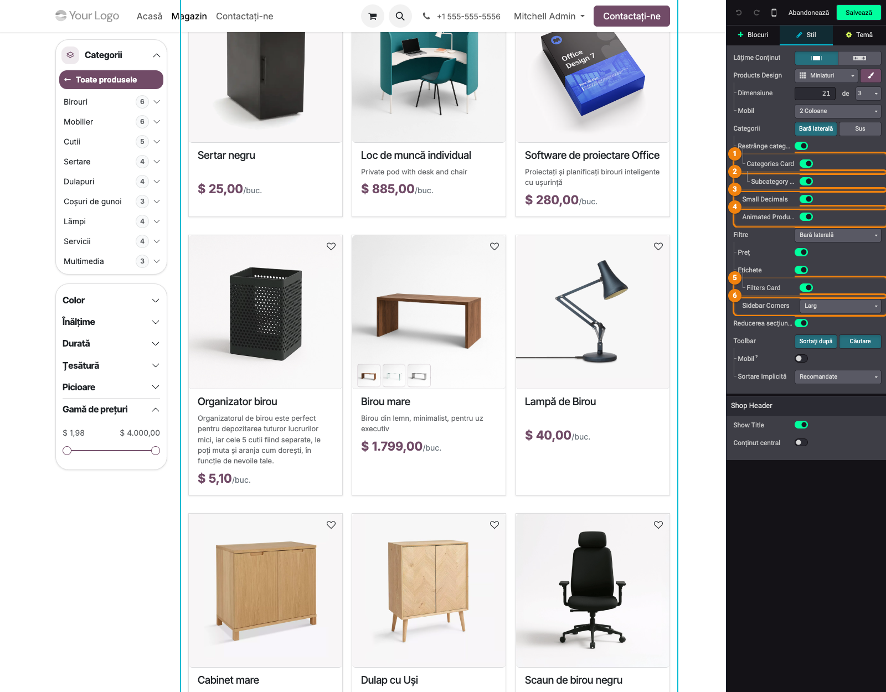
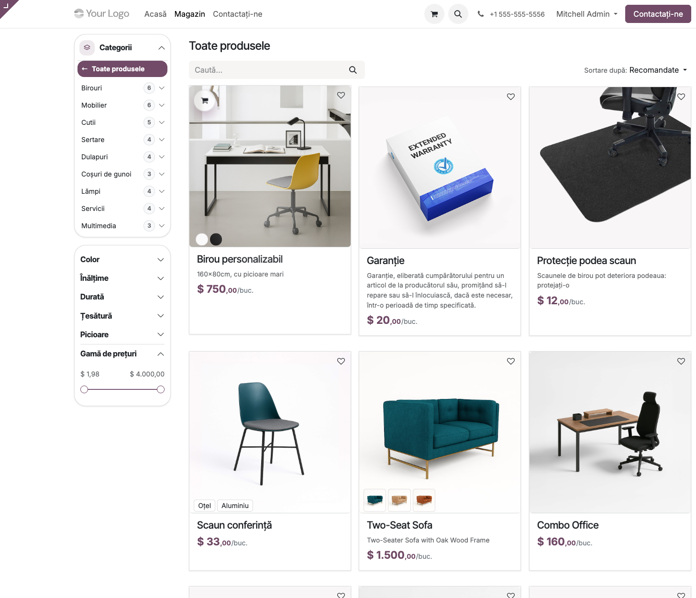
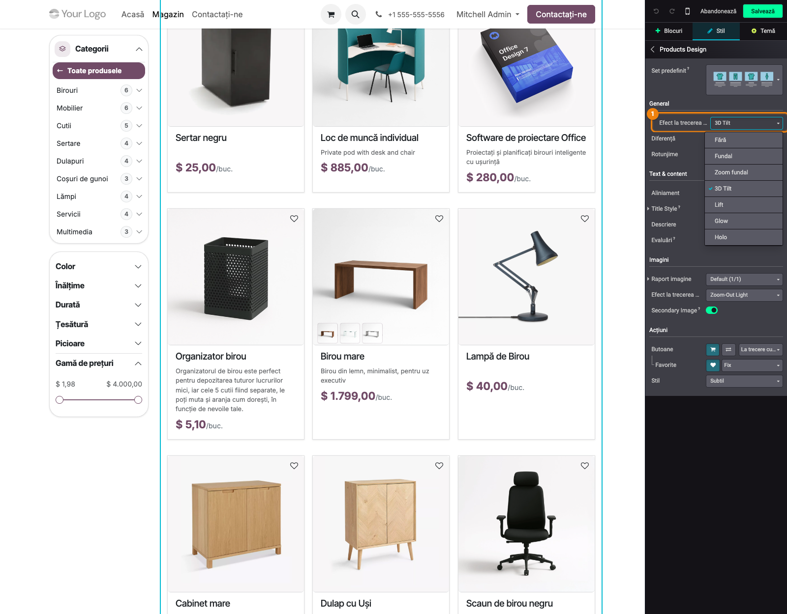
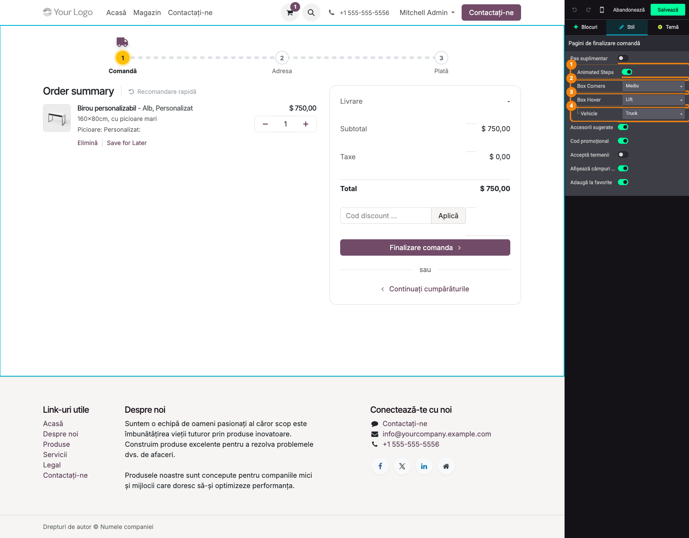
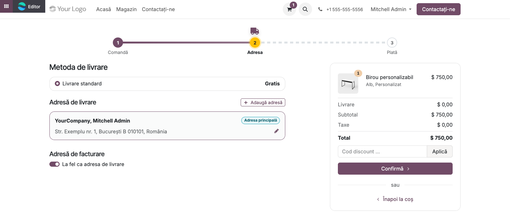
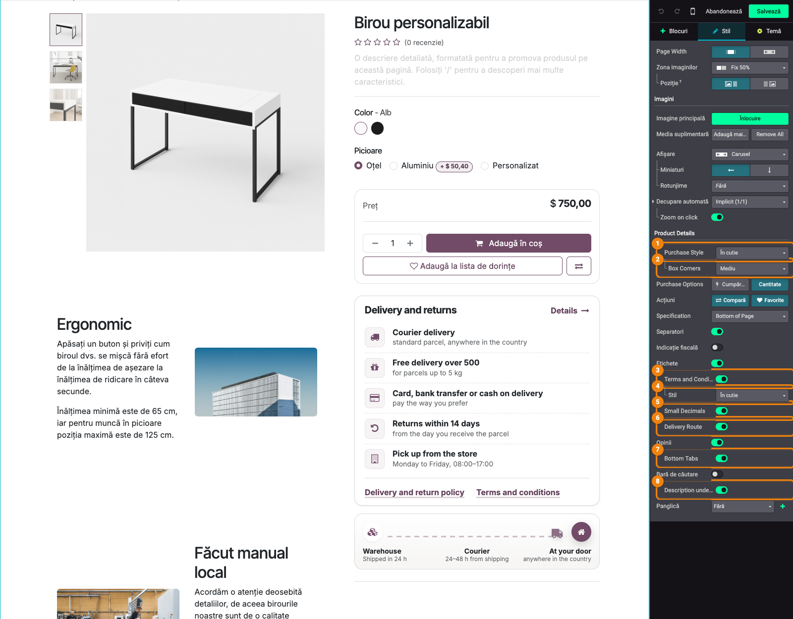
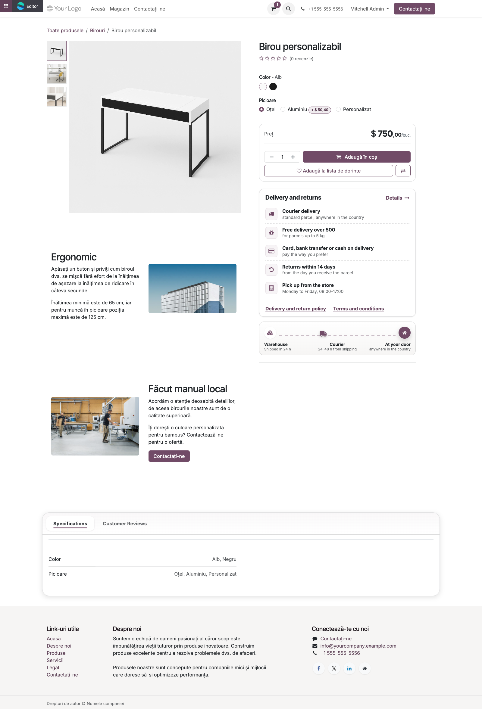

# Fișă Modul: Efecte vizuale pentru magazinul online

**Modul:** `deltatech_website_sale_effects`
**Utilizator principal:** Consultant eCommerce / designer al site-ului (rolul Website › Editor și Designer sau administrator)
**Prioritate:** 🟢 Scăzută (aspectul magazinului; nu atinge prețuri, comenzi, stocuri sau contabilitate)

---

## 1. Scop business

Modulul aduce efectele din *Website Effects* (`deltatech_website_effects`) pe paginile magazinului
online, ca opțiuni ale editorului website: bara laterală din /shop în carduri (categorii cu număr de
subcategorii, filtre), carduri de produs animate cu efecte noi la hover (3D Tilt, Lift, Glow, Holo),
o bară de pași animată pe checkout, cu un vehicul care merge din pas în pas, și casete cu colțuri
și efecte la hover pentru adrese și metode, plus o pagină de produs mai aerisită: termenii în
casetă (*Info List*), traseul livrării (*Delivery Route*), colțuri comune pentru casete, descrierea
mutată sub imagini și secțiunile de jos (descriere, specificații, opinii) grupate în taburi. Totul se pornește din editor, fără cod; până nu
porniți o opțiune, magazinul arată ca înainte.

## 2. Bază legală și context

Nu există o bază legală: modulul ține de aspectul magazinului. Context operațional:

- opțiunile se salvează **per website** (ca și celelalte opțiuni ale paginilor de magazin) și se
  aplică pe toate paginile de același tip: toate paginile /shop, toate paginile de checkout, toate
  paginile de produs;
- conținutul casetelor de pe pagina de produs (*Info List*, *Delivery Route*) este **comun tuturor
  produselor**: se editează o singură dată;
- animațiile respectă setarea „reducerea mișcării" a vizitatorului; *3D Tilt* este oprit pe
  ecranele tactile.

## 3. Utilizatori și roluri

- **Consultant / designer website** — pornește opțiunile din editor (în **Setări › Utilizatori**,
  la *Website*, rolul **Editor și Designer**).
- **Cumpărătorul** — vede magazinul, checkout-ul și pagina de produs cu efectele alese.

Roluri recomandate la testare: un utilizator cu rolul *Editor și Designer* pentru editare și o fereastră
privată (vizitator anonim) pentru verificarea magazinului și a checkout-ului, inclusiv pe telefon.

## 4. Conturi și date implicate

Modulul nu are conturi contabile, modele sau câmpuri noi. Opțiunile sunt vederi QWeb activate per
website, iar efectul de hover al cardurilor de produs se salvează în clasele de design ale
magazinului (*Products Design*), alături de celelalte opțiuni native.

Date minime pentru demo (datele demo `website_sale` sunt suficiente): categorii eCommerce cu
subcategorii și produse publicate, atribute de produs (pentru filtre), un produs cu descriere
lungă (pentru *Description under Image*), o metodă de livrare și o adresă pe clientul de test
(pentru paginile de checkout).

## 5. Configurare inițială

1. Instalați modulul `deltatech_website_sale_effects` (depinde de `website_sale` și de
   `deltatech_website_effects`, care se instalează automat).
2. Nu există setări de modul: opțiunile apar în editor, în panoul **Stil** al paginii de magazin,
   al paginii de checkout și al paginii de produs.
3. Pentru cardul de categorii, magazinul trebuie să afișeze **Categorii** în **Bară laterală**
   (nu *Sus*); pentru cardul de filtre, **Filtre** în **Bară laterală**.
4. Opțional, instalați *eCommerce Category Icons* (`deltatech_website_category_icon`): iconițele
   categoriilor apar atunci pe plăcuțe în cardul de categorii.

## 6. Flux de utilizare

### Pasul 1 — Opțiunile paginii /shop

Deschideți **Magazin** (/shop), apăsați **Editează** și dați clic pe grila de produse. În panoul
paginii de magazin, modulul adaugă:

| Opțiune | Unde apare | Ce face |
|---|---|---|
| **Categories Card** | sub *Categorii* (doar cu *Bară laterală*) | lista de categorii într-un card alb: titlu cu iconiță, *Toate produsele* ca rând „înapoi", categoria curentă ca pastilă plină în culoarea temei, rânduri evidențiate la hover, săgeți pentru lista restrânsă |
| ↳ **Subcategory Count** | sub *Categories Card* | afișează numărul de subcategorii lângă categoriile care au (implicit oprit) |
| **Small Decimals** | înainte de *Filtre* | zecimalele prețului mai mici, pe linia de bază, și unitatea de măsură lângă preț (*$ 750,00/buc.* în captura 02); în editor se vede doar unitatea, zecimalele mici apar pe pagina salvată; urmează prețul și la schimbarea variantei sau a cantității. Aceeași opțiune există și pe pagina de produs (pasul 6), cu setare separată |
| **Animated Product Cards** | înainte de *Filtre* | dalele de produs devin carduri cu chenar și umbră ușoară, cu raza din *Products Design › Rotunjime*; butonul de coș „sare" la hover |
| **Filters Card** | sub *Etichete* (doar cu *Filtre* în *Bară laterală*) | filtrele de atribute și de preț într-un card, în stilul cardului de categorii |
| **Sidebar Corners** | când unul din carduri e pornit | colțurile ambelor carduri: *Large* (implicit), *Medium*, *Small*, *Square*; rândurile din interior le urmează |



### Pasul 2 — Magazinul văzut de cumpărător

Salvați pagina. În bara laterală, categoriile și filtrele stau în două carduri cu aceleași colțuri;
*Toate produsele* este rândul de întoarcere, iar numărul din dreapta fiecărei categorii arată câte
subcategorii are. Produsele sunt carduri cu chenar și umbră; cu *3D Tilt* ales în *Products Design*
(pasul 3), cardul de sub mouse se înclină spre cursor (în captură, primul produs). Cu *Small
Decimals*, prețurile au zecimalele mai mici și unitatea de măsură alăturată (*/buc.*).

Numărul de subcategorii diferă după cine se uită: un utilizator intern vede **toate**
subcategoriile, un vizitator doar pe cele care au produse publicate.



### Pasul 3 — Products Design › Hover Effect

Efectul de hover al cardurilor de produs se alege din panoul nativ **Products Design** (butonul cu
pensulă de lângă *Products Design*), rândul **Hover Effect** (*Efect la trecerea mouse-ului*) din
grupul *General*. Pe lângă efectele native (*Fundal*, *Zoom fundal* etc.), modulul adaugă **3D Tilt**,
**Lift**, **Glow** și **Holo**, cu același comportament ca în *Website Effects*. Efectul se salvează
cu celelalte opțiuni de design ale magazinului și funcționează pe orice design de produs
(miniaturi, carduri, listă), cu sau fără *Animated Product Cards*.



### Pasul 4 — Checkout: pașii animați și casetele

Adăugați un produs în coș, deschideți coșul (/shop/cart), apăsați **Editează** și dați clic pe
bara de pași. În panoul *Pagini de finalizare comandă*, sub *Pas suplimentar*, apar:

- **Animated Steps** — înlocuiește bara de pași a checkout-ului cu un drum punctat între pași
  numerotați;
- **Box Corners** — colțurile casetelor de pe checkout (rezumatul comenzii, adresele, metodele de
  livrare și de plată): *Theme* (implicit), *Small*, *Medium*, *Large*;
- **Box Hover** — reacția adreselor și a metodelor la mouse: *None*, *Lift*, *Glow*, *Frame*;
- **Vehicle** — vehiculul de pe drum: Truck (implicit), Shopping Cart, Car, Motorcycle, Bicycle,
  Plane, Ship, Rocket. Rândul ține de *Animated Steps* (apare doar cu el pornit), deși în panou
  stă indentat sub *Box Hover*.

Cu *Box Corners* sau *Box Hover* pornite, metodele de livrare și de plată devin casete separate, în
locul listei lipite. Setările se aplică pe toate paginile de checkout ale website-ului (coș,
adresă, plată, confirmare).



### Pasul 5 — Checkout-ul văzut de cumpărător

Pe fiecare pagină de checkout, vehiculul pleacă de la pasul anterior și se oprește la pasul curent,
iar drumul din spatele lui se umple cu culoarea temei. Pașii parcurși sunt plini și **rămân
clicabili** (cumpărătorul se poate întoarce la coș), pasul curent este evidențiat. Pentru
vizitatorii cu „reducerea mișcării", bara rămâne nemișcată, în poziția finală. Metoda de livrare,
adresa și rezumatul comenzii sunt casete cu colțurile alese (*Medium* în captură).



### Pasul 6 — Opțiunile paginii de produs

Deschideți o pagină de produs, apăsați **Editează** și dați clic pe zona de detalii a produsului.
În panoul paginii de produs, modulul adaugă:

| Opțiune | Unde apare | Ce face |
|---|---|---|
| **Box Corners** | sub *Purchase Style* | o singură rază pentru casetele coloanei de cumpărare: caseta de preț (*Purchase Style* = *Boxed*/*În cutie*), termenii în casetă și traseul livrării — *Theme* (raza casetei de preț), *Small*, *Medium*, *Large*; cu termenii în casetă sau cu traseul sub ea, caseta de preț ia lățimea secțiunii, ca toate casetele să fie aliniate |
| **Terms and Conditions › Style** (*Stil*) | sub *Terms and Conditions*, doar dacă termenii sunt afișați | *Default* (cele trei rânduri mici native) sau *Boxed* (*În cutie*): blocul *Info List* — titlu cu link *Details*, rânduri cu iconițe, linkuri de politici |
| **Small Decimals** | înainte de *Delivery Route* | ca pe /shop: zecimalele prețului mai mici și unitatea de măsură lângă preț, pe pagina de produs; în editor prețul rămâne nescindat, efectul se vede pe pagina salvată |
| **Delivery Route** | înainte de *Opinii* | blocul *Delivery Route* sub termeni: vehiculul care merge de la depozit la client |
| **Bottom Tabs** | după *Opinii* | descrierea, specificațiile și opiniile clienților de la baza paginii devin taburi, într-un card; primesc tab doar secțiunile prezente, iar cu mai puțin de două secțiuni nu se schimbă nimic; în editor secțiunile rămân desfăcute, ca să le puteți edita |
| **Description under Image** | după *Bară de căutare* | descrierea lungă a produsului urcă în coloana imaginilor, sub poze, în timp ce coloana de cumpărare rămâne în vedere |

Casetele *Info List* și *Delivery Route* se editează direct în pagină (texte, iconițe, linkuri;
pentru *Delivery Route* și vehiculul, viteza, culoarea și colțurile) și sunt **aceleași pe toate
produsele**. Textele lor implicite sunt în engleză: rescrieți-le o dată, la prima configurare.
Caseta *Info List* are și opțiunile de rânduri și valori ale blocului (pragul de livrare gratuită,
zilele de retur, programul — vezi fișa `deltatech_website_effects`).



### Pasul 7 — Pagina de produs văzută de cumpărător

Salvați. În coloana din dreapta, caseta de preț, caseta *Delivery and returns* (*Info List*) și
traseul livrării au aceleași colțuri (*Box Corners* = *Medium*) și aceeași lățime, iar prețul
are zecimalele mici și unitatea alăturată (*Small Decimals*: *$ 750,00/buc.*). În coloana din
stânga, descrierea produsului (*Ergonomic*, *Făcut manual local*) stă sub imagini, așa că pagina
nu mai are un spațiu gol sub poze. Pe telefon coloanele se așază una sub alta, iar descrierea vine
după blocul de cumpărare, ca pe pagina standard. Jos, *Bottom Tabs* arată specificațiile și
opiniile clienților ca taburi; descrierea nu primește tab, pentru că este deja sub imagini.



### Note de monografie și raportare

Modulul nu generează note contabile, documente sau rapoarte: opțiunile sunt vederi QWeb activate
per website, iar conținutul casetelor de pe pagina de produs se salvează în zone editabile comune.

### Cum se combină opțiunile

- **Categories Card** și **Filters Card** sunt independente; **Sidebar Corners** apare când cel
  puțin unul e pornit și se aplică amândurora.
- **Animated Product Cards** dă forma cardului (chenar, umbră, buton care sare), iar
  **Products Design › Hover Effect** dă mișcarea; se pot folosi separat sau împreună. Raza
  colțurilor vine din **Products Design › Rotunjime**.
- Pe pagina de produs, **Box Corners** are efect vizibil doar cu *Purchase Style* = *Boxed* sau cu
  *Terms and Conditions › Style* = *Boxed* / *Delivery Route*; dacă *Delivery Route* are propriile
  *Round Corners* setate în editor, acestea au prioritate.
- *Terms and Conditions › Style* apare doar când opțiunea nativă *Terms and Conditions* este pornită.
- **Bottom Tabs** ia descrierea doar dacă nu e mutată sub imagini (*Description under Image*);
  opiniile apar ca tab doar cu opțiunea nativă *Opinii* pornită.
- Pe checkout, **Box Corners** și **Box Hover** sunt independente de **Animated Steps**.

## 7. Legături cu alte module / declarații

| Modul / proces | Rol în flux | Tip legătură |
|---|---|---|
| `website_sale` | paginile /shop, checkout și produs, panoul *Products Design* | dependență (manifest) |
| `deltatech_website_effects` | efectele 3D Tilt, Lift, Glow, Holo și blocurile *Info List*, *Delivery Route* folosite pe pagina de produs | dependență (manifest) |
| `deltatech_website_category_icon` | iconițele categoriilor, afișate pe plăcuțe în *Categories Card* | opțional (dacă e instalat) |

Ce este automat: poziția vehiculului pe checkout după pasul curent, numărul de subcategorii,
alinierea casetelor pe pagina de produs, alegerea secțiunilor care devin taburi (*Bottom Tabs*),
oprirea animațiilor pentru „reducerea mișcării".
Ce rămâne manual: pornirea opțiunilor în editor, textele casetelor *Info List* și *Delivery Route*
(implicit în engleză), alegerea vehiculului și a colțurilor.

## 8. Verificări pentru consultant

- [ ] Cu toate opțiunile oprite, /shop, checkout-ul și pagina de produs arată ca înainte de instalare.
- [ ] *Categories Card* apare în panou doar cu *Categorii* în *Bară laterală*; *Filters Card* doar
      cu *Filtre* în *Bară laterală*.
- [ ] Cu *Subcategory Count* pornit, numărul apare lângă categoriile care au subcategorii; ca
      vizitator anonim, se numără doar subcategoriile cu produse publicate.
- [ ] *Sidebar Corners* = *Square* face ambele carduri cu colțuri drepte.
- [ ] *Products Design › Hover Effect* = *3D Tilt*: cardul de produs se înclină la mouse pe
      calculator și rămâne nemișcat pe telefon.
- [ ] *Animated Steps*: pe /shop/checkout vehiculul ajunge la pasul 2; pe pagina de plată, la
      pasul 3; clic pe pasul 1 duce înapoi în coș.
- [ ] *Vehicle* schimbat în *Rocket* se vede pe toate paginile de checkout.
- [ ] *Box Corners* = *Large* pe checkout rotunjește rezumatul, adresele și metodele; cu *Box
      Hover* = *Lift*, adresa și metoda de livrare se ridică la mouse.
- [ ] *Terms and Conditions › Style* = *Boxed*: textul editat în caseta *Info List* pe un produs
      apare identic pe alt produs.
- [ ] *Box Corners* = *Large*: caseta de preț, *Info List* și *Delivery Route* au aceeași rază și
      aceeași lățime.
- [ ] *Small Decimals* pe /shop: zecimalele prețului sunt mai mici și apare unitatea de măsură;
      pe pagina de produs, setarea separată face același lucru și urmează prețul la schimbarea
      variantei.
- [ ] *Description under Image*: pe desktop descrierea stă sub imagini; pe telefon, după blocul de
      cumpărare.
- [ ] *Bottom Tabs* cu *Opinii* pornit: jos apar taburile *Specifications* și *Customer Reviews*;
      clic pe numărul de recenzii de sus deschide tabul de opinii.

## 9. Mesaje de eroare frecvente

| Mesaj / simptom | Cauză probabilă | Remediere |
|---|---|---|
| *Categories Card* nu apare în panou | categoriile sunt afișate *Sus*, nu în *Bară laterală* | setați *Categorii* = *Bară laterală* |
| Numărul de subcategorii apare pe un rând separat, ca o bară lată sub categorie | lista de categorii nu este restrânsă (*Collapse Category Recursive* — *Restrânge categoria recursiv* — oprit) | porniți opțiunea nativă *Restrânge categoria recursiv*; cu lista restrânsă numărul stă lângă nume |
| *Terms and Conditions › Style* nu apare | opțiunea nativă *Terms and Conditions* este oprită | porniți *Terms and Conditions* |
| *Box Corners* nu schimbă nimic | nu există casete în coloana de cumpărare | alegeți *Purchase Style* = *Boxed* sau porniți termenii în casetă / *Delivery Route* |
| *Bottom Tabs* pornit, dar jos nu apar taburi | pe pagină sunt mai puțin de două secțiuni (descrierea e sub imagini, *Opinii* e oprit sau produsul nu are specificații) | porniți *Opinii* sau opriți *Description under Image* |
| Taburile nu apar în editor | comportament voit: în modul de editare secțiunile rămân desfăcute | verificați pe pagina salvată |
| Textele casetelor de pe pagina de produs sunt în engleză | textele implicite ale blocurilor *Info List* și *Delivery Route* | editați-le o dată în pagină; se aplică pe toate produsele |
| Cardul de produs nu se înclină | ecran tactil sau „reducerea mișcării" activă la vizitator | comportament voit |

## 10. Capturi de ecran

Capturile (`readme/screenshots/`) sunt generate automat din `tests/test_screenshots.py` (mixinul
`ScreenshotCase` din `l10n_ro_doc_screenshots`, import defensiv), cu interfața în română, pe
produsele demo ale magazinului. Testul pornește opțiunile modulului, pune un produs în coș și
fotografiază site-ul și editorul, cu rândurile modulului evidențiate:

1. `01_shop_optiuni.png` — opțiunile paginii /shop: Categories Card, Subcategory Count, Small
   Decimals, Animated Product Cards, Filters Card, Sidebar Corners.
2. `02_shop_magazin.png` — magazinul salvat, cu cardurile din bara laterală și cardurile de produs.
3. `03_products_design_hover.png` — Products Design › Hover Effect cu 3D Tilt, Lift, Glow, Holo.
4. `04_checkout_optiuni.png` — coșul în editor: Animated Steps, Box Corners, Box Hover, Vehicle.
5. `05_checkout_pasi.png` — bara de pași animată și casetele pe pasul Adresă.
6. `06_produs_optiuni.png` — opțiunile paginii de produs: Box Corners, Terms and Conditions ›
   Stil, Small Decimals, Delivery Route, Bottom Tabs, Description under Image.
7. `07_produs_pagina.png` — pagina de produs salvată: casetele aliniate, descrierea sub imagini,
   taburile de jos.

Regenerare (produsele, categoriile și atributele vin din datele demo `website_sale`):

```bash
./odoo/odoo-bin -c odoo.conf -d <db> -i deltatech_website_sale_effects,l10n_ro_doc_screenshots \
    --test-tags=fise_screenshots --stop-after-init
```

## 11. Observații pentru manual

- Insistați pe faptul că opțiunile sunt **per website și per tip de pagină**: o setare făcută pe un
  produs se vede pe toate produsele, iar casetele *Info List* / *Delivery Route* sunt comune.
- Înainte de a porni *Small Decimals*, verificați denumirea unităților de măsură: ea apare lângă
  preț (*/buc.*), deci trebuie să fie scurtă și în limba clientului.
- Recomandați ca, la prima configurare, consultantul să rescrie textele casetelor de pe pagina de
  produs (implicit în engleză) și să verifice linkurile *Details* / politicile (implicit `/terms`).
- Pentru *Subcategory Count*, recomandați lista de categorii restrânsă (*Restrânge categoria recursiv*);
  fără ea numărul apare pe un rând separat (vezi secțiunea 9).
- *Bottom Tabs* și *Description under Image* se completează: cu descrierea sub imagini, taburile
  de jos conțin doar specificațiile și opiniile; fără *Description under Image*, descrierea devine
  primul tab.
