# Fișă Modul: Alegerea magazinului pe website

**Modul:** `deltatech_website_store_selector`
**Versiune:** 19.0.1.0.0
**Suită:** bitshop
**Dependențe:** `website_sale_stock`
**Utilizator principal:** administratorul magazinului online al unei rețele cu mai multe magazine fizice
**Prioritate:** 🟡 Medie (necesar retailerilor cu mai multe magazine care vând și online; fără magazine bifate, site-ul rămâne standard)

---

## 1. Scop business

Un retailer cu mai multe magazine (bricolaj, materiale de construcții, electrice) vrea ca site-ul să arate
stocul magazinului în care va merge clientul, nu stocul total al firmei. Odoo standard lucrează cu un singur
depozit pe website, același pentru toți vizitatorii, sau cu toate depozitele adunate: clientul vede „în stoc”
un produs aflat în alt oraș, iar comanda pleacă dintr-un depozit pe care nu l-a ales.

Modulul îl lasă pe vizitator să-și aleagă **magazinul**, ca pe site-urile marilor rețele de bricolaj, iar
site-ul lucrează apoi pentru acel magazin:

- butonul **Magazinul tău** din header, în toate variantele de header, pe calculator și pe telefon;
- lista magazinelor, cu adresă, telefon, căutare fără diacritice și, când se poate, distanța;
- **stocul afișat** pe pagina de produs (pe variantă), pe cardurile din magazinul online, în panglica
  „stoc epuizat”, la butonul de adăugare rapidă, în limita de cantitate la adăugarea în coș și în
  avertizările din coș vine din magazinul ales;
- **comanda** se creează pe magazinul ales, iar depozitul comenzii este magazinul, deci livrarea pleacă de acolo;
- schimbarea magazinului cu produse în coș mută coșul și avertizează clientul dacă noul magazin nu le are.

Ridicarea personală din magazin (Click & Collect) este acoperită de modulul de legătură
`deltatech_website_store_selector_collect`, care se instalează automat odată cu Click & Collect
(`website_sale_collect`) și are fișa lui.

## 2. Bază legală și context

Modulul nu emite documente fiscale și nu generează note contabile. Contextul este operațional:

- **Cookie-ul `website_store_id`** reține magazinul ales timp de un an, în browserul vizitatorului. Conține
  doar numărul magazinului, nu date personale, și se scrie numai când vizitatorul alege explicit un magazin.
  Modulul îl declară cookie necesar, deci bannerul de cookie-uri al Odoo nu îl blochează. Fiind o preferință
  setată la cererea explicită a vizitatorului, se încadrează în excepția cookie-urilor strict necesare
  (Directiva ePrivacy, transpusă prin Legea 506/2004), cu condiția informării: politica de cookie-uri a
  clientului **trebuie** să îl menționeze (nume `website_store_id`, scop, durată un an). Încadrarea se confirmă
  cu juristul clientului.
- **Distanța până la magazin** se calculează din baza GeoIP a serverului, dacă există. Modulul nu trimite
  poziția sau adresa vizitatorului către niciun serviciu extern.
- **Stocul afișat este informativ**: disponibilitatea finală se verifică la plată, de mecanismul standard Odoo.

## 3. Utilizatori și roluri

| Rol | Ce face |
|---|---|
| Administrator website | bifează magazinele selectabile în setările website-ului |
| Responsabil stocuri | creează depozitele-magazine și le completează adresa și telefonul |
| Responsabil produse | alege, pe fiecare produs, dacă se vinde fără stoc și pragul de stoc limitat |
| Vizitator / client | își alege magazinul, vede stocul lui, comandă |
| Agent de vânzări, depozit | vede magazinul pe comandă și pregătește livrarea din depozitul magazinului |

Pentru testare: un vizitator anonim (fereastră privată de browser) și un utilizator intern cu drept de
administrator pe website și pe inventar.

## 4. Conturi și date implicate

Modulul nu folosește conturi contabile. Datele implicate:

- **Depozitele** care sunt magazine, cu adresa (stradă, oraș, județ) și telefonul pe contactul din câmpul **Adresa**;
- setarea **Alegerea magazinului** de pe website (lista magazinelor selectabile);
- pe produs, opțiunile standard **Vindeți când stocul este epuizat**, **Afișează disponibil** și pragul de
  stoc limitat (implicit 5);
- pe comandă, câmpul nou **Magazin website**, alături de câmpul standard **Depozit**;
- **stocul liber** al fiecărui magazin: stocul din depozit minus ce e deja rezervat pentru alte transferuri
  (comenzi, transferuri interne).

Date minime pentru demo: trei depozite-magazine cu adrese în orașe diferite, câteva produse cu urmărire de
stoc, cu stoc diferit pe magazine (unul cu stoc mare, unul cu 2–3 bucăți, unul fără stoc), și un produs cu
variante.

## 5. Configurare inițială

### Pasul 1 — Magazinele

În **Inventar → Configurare → Depozite**, creați câte un depozit pentru fiecare magazin. Numele depozitului
este cel afișat pe site; adresa și telefonul se completează pe contactul din câmpul **Adresa**.

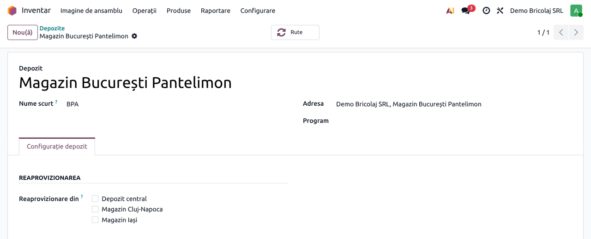

Distanța până la magazin cere modulul **Geolocalizare** (`base_geolocalize`, instalat odată cu Click &
Collect). Coordonatele se pun pe contactul magazinului, fila **Atribuire Partener**, grupul
**Geolocalizare**: manual (Lat / Long) sau cu **Calculați pe baza adresei**. Click & Collect le calculează și
singur, la prima afișare a hărții.

### Pasul 2 — Magazinele selectabile pe website

În **Pagină web → Configurare → Setări**, secțiunea eCommerce, la **Alegerea magazinului**, alegeți depozitele
pe care vizitatorul le poate alege. Un depozit care nu e în listă (de exemplu depozitul central) nu poate fi
ales. Setarea apare după ce compania are al doilea depozit: Odoo activează atunci automat gestiunea mai
multor depozite. Golirea listei readuce comportamentul standard. În lista de pe site, magazinele apar în
ordinea secvenței depozitelor, apoi alfabetic (sau după distanță, când e cunoscută).

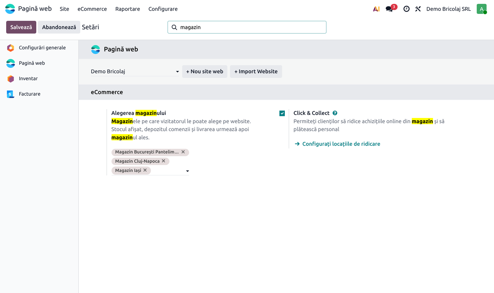

Dacă website-ul are un depozit fix în setările lui de inventar, acesta rămâne depozitul vizitatorilor care
nu au ales încă un magazin.

### Pasul 3 — Produsele

Pe fișa produsului, fila **Vânzări**, grupul **Magazin eCommerce**:

- **Vindeți când stocul este epuizat** debifat: un magazin fără stoc nu poate primi comanda, iar produsul
  apare „Indisponibil în acest magazin”;
- bifat: produsul apare „Disponibil la comandă” și se poate comanda și fără stoc;
- pragul de stoc limitat (implicit 5) se aplică mereu: la cel mult 5 bucăți apare „Stoc limitat”. Cu
  **Afișează disponibil** bifat, pragul se poate schimba (de exemplu „Mai jos 5”) și apare și numărul de bucăți.

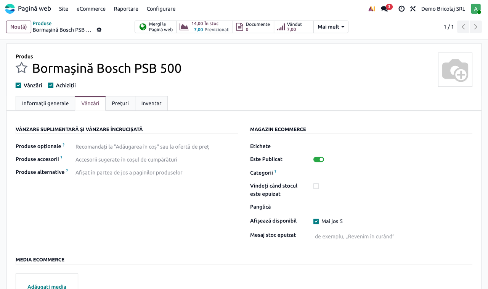

## 6. Flux de utilizare

### Pasul 1 — Butonul „Magazinul tău”

Vizitatorul deschide magazinul online. În header, lângă coș, apare butonul **Magazinul tău**; la prima vizită
scrie „Alege magazinul”. Până la alegere, site-ul arată stocul ca înainte (depozitul din setările
website-ului sau toate depozitele), iar pe pagina de produs, în locul blocului de magazin, apare butonul
**Alege magazinul ca să vezi disponibilitatea**. Butonul din header nu apare vizitatorilor anonimi dacă
magazinul online e rezervat utilizatorilor autentificați.

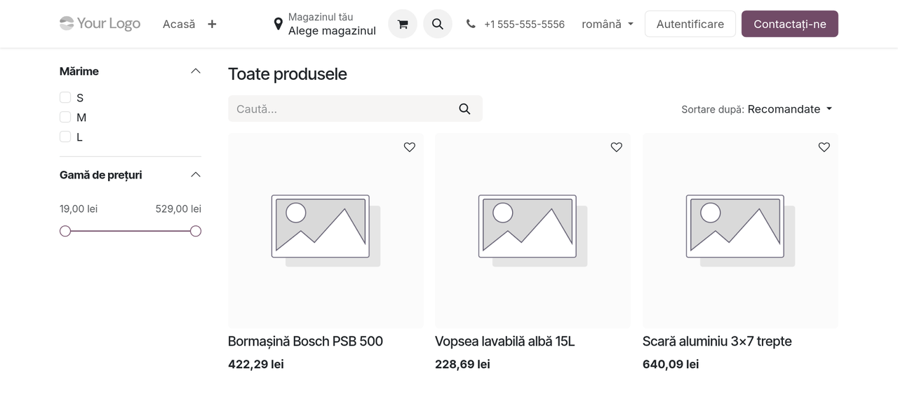

### Pasul 2 — Alegerea magazinului

Butonul deschide lista magazinelor, cu adresa și telefonul fiecăruia și butonul **Alege**. Căutarea merge după
nume, oraș, județ sau cod poștal și nu ține cont de diacritice: „iasi” găsește „Magazin Iași”. Când poziția
vizitatorului e cunoscută și magazinele au coordonate, lista arată distanța în km și începe cu cel mai
apropiat magazin. După alegere, pagina se reîncarcă pe noul magazin.

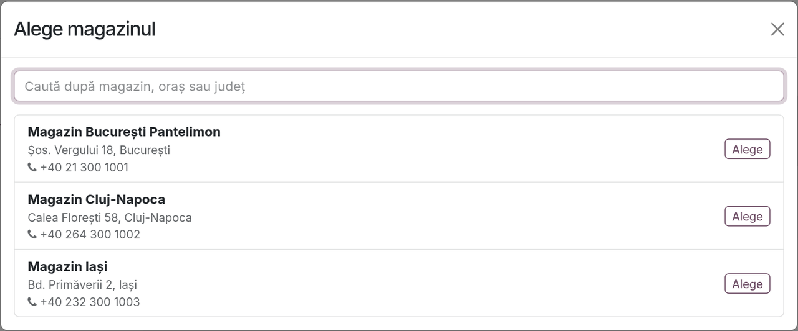

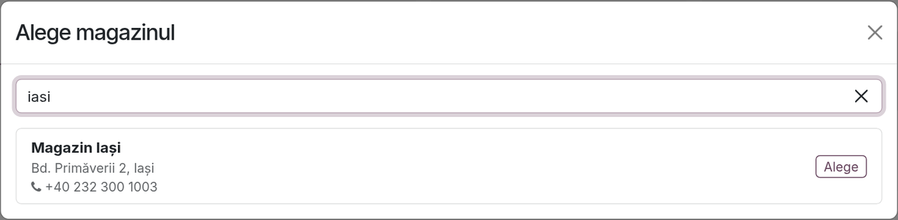

### Pasul 3 — Lista de produse

Header-ul arată acum magazinul ales (un nume lung se scurtează, de exemplu „Magazin București ...”), iar
fiecare card de produs arată disponibilitatea în acel magazin. Prețurile din exemplu sunt afișate cu TVA 21%
inclus, după setarea de afișare a prețurilor a website-ului.

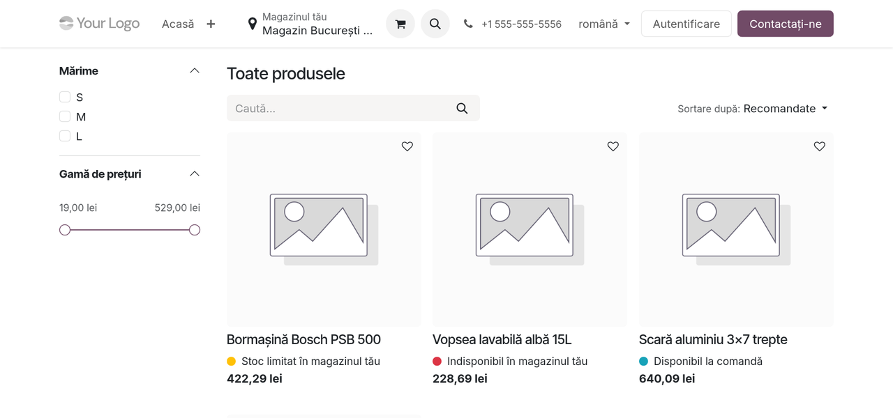

Mesajele, verificate pe stocul liber al magazinului:

| Mesaj pe card | Când apare |
|---|---|
| În stoc în magazinul tău | stocul liber e peste prag |
| Stoc limitat în magazinul tău | stocul liber e cel mult pragul (implicit 5) |
| Disponibil la comandă | nu e stoc, dar produsul se vinde și fără stoc |
| Indisponibil în magazinul tău | nu e stoc, iar produsul nu se vinde fără stoc |

La un produs cu variante, cardul arată starea celei mai bune variante.

### Pasul 4 — Pagina de produs

Blocul **Magazinul tău** arată magazinul, starea stocului și două legături: **Schimbă** și **Vezi
disponibilitatea în celelalte magazine**. Insigna standard de stoc a Odoo (aici „5 Unități în stoc”)
folosește și ea stocul magazinului.

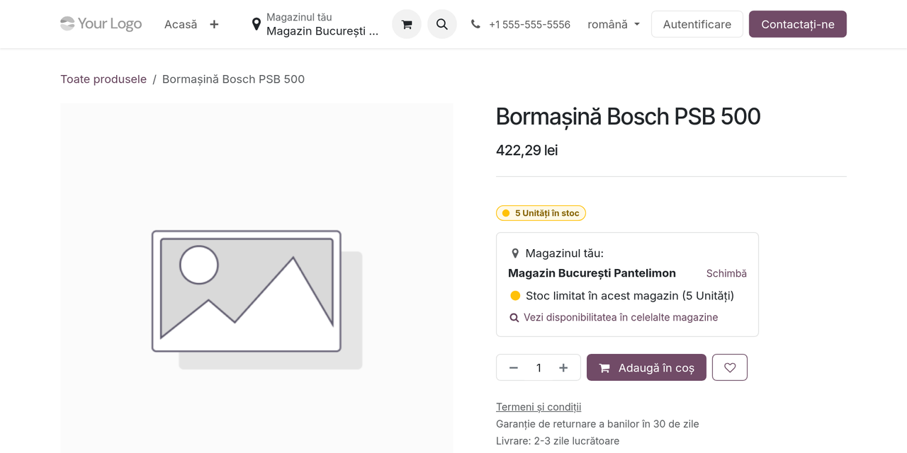

La produsele cu variante, blocul se actualizează la schimbarea variantei. Cu **Afișează disponibil** bifat,
stocul limitat apare cu numărul de bucăți:

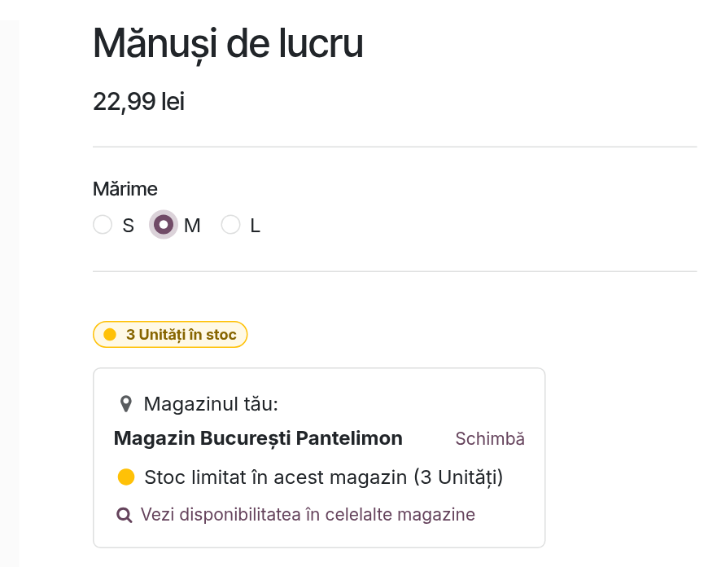

### Pasul 5 — Stocul în celelalte magazine

Legătura **Vezi disponibilitatea în celelalte magazine** deschide lista magazinelor cu stocul variantei alese
în fiecare. Magazinul curent are eticheta **Magazinul tău**; la celelalte, butonul **Alege** mută
vizitatorul pe acel magazin.

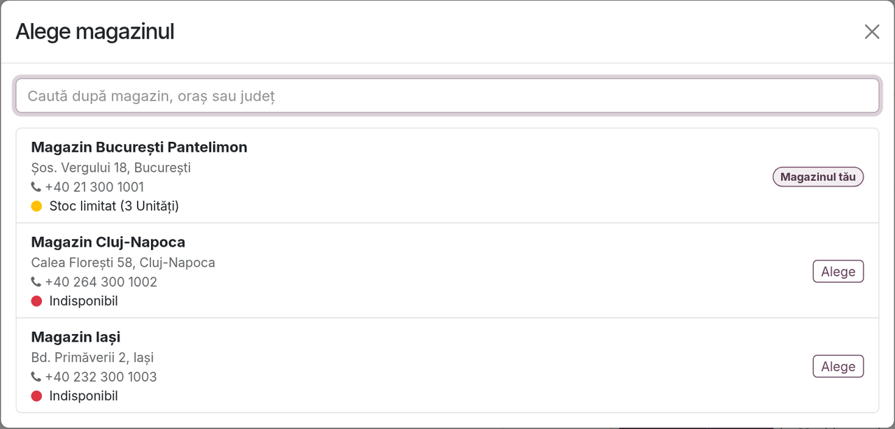

### Pasul 6 — Schimbarea magazinului cu produse în coș

Coșul se mută pe noul magazin. Dacă noul magazin nu are toate produsele în cantitatea dorită, dialogul afișează
imediat avertizarea, cu două butoane: **Continuă cumpărăturile** și **Verifică coșul**.

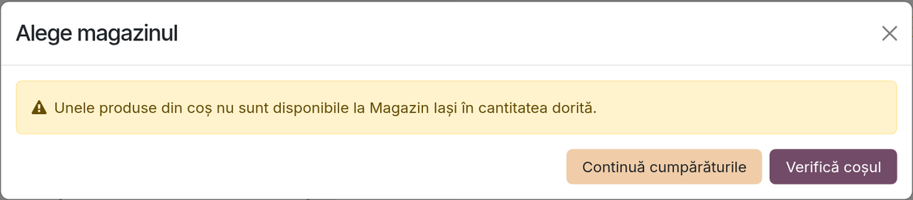

În coș, linia afectată are semnul de avertizare; la trecerea cu mouse-ul apare mesajul „Ați solicitat 5
Bormașină Bosch PSB 500, dar sunt disponibile doar 0”. Comanda nu poate fi plătită până când clientul nu
reduce cantitatea sau nu alege alt magazin.

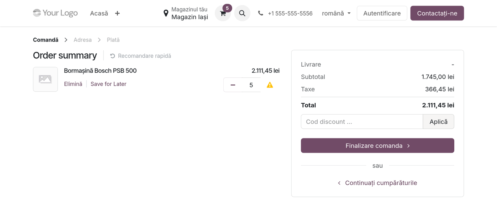

### Pasul 7 — Pe telefon

Pe telefon, butonul apare ca iconiță în header, iar cardurile și blocul de pe pagina de produs sunt aceleași.
Capturile de telefon sunt făcute după comanda de ridicare a ultimelor 5 bormașini din București, de aceea
produsul apare acum indisponibil în acel magazin.

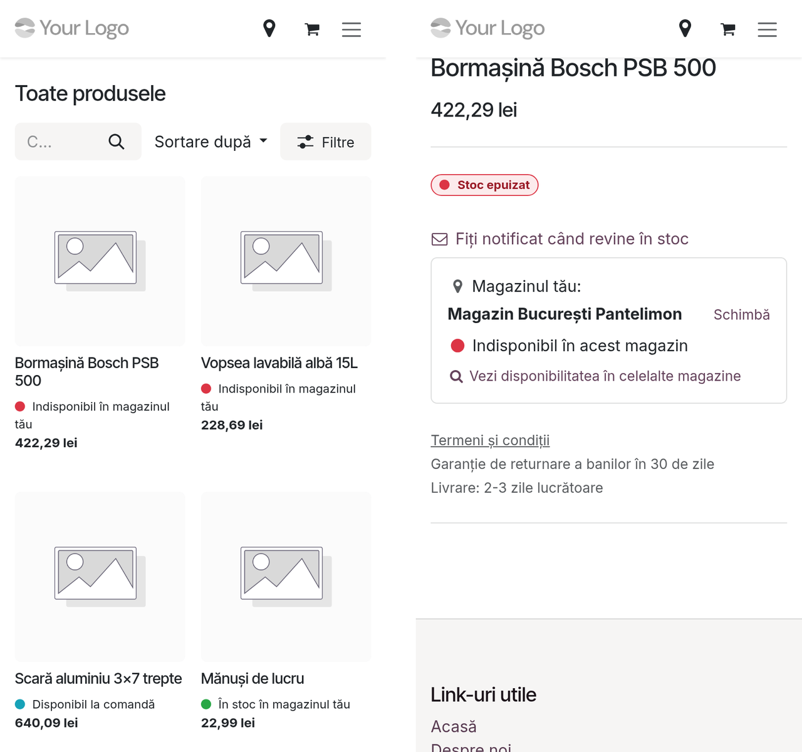

### Pasul 8 — Comanda în backend

Pe comandă (**Vânzări → Comenzi → Comenzi**, sau **Pagină web → eCommerce → Comenzi**), fila **Alte
informații**, grupul **Livrare**: **Depozit** este magazinul clientului, iar **Magazin website** arată
magazinul ales pe site. Cât timp comanda e ofertă, depozitul urmează magazinul; după confirmare nu se mai
schimbă. Exemplul de mai jos este o comandă cu livrare la domiciliu (curier), pregătită în baza de test cu
magazinul București ca magazin website.

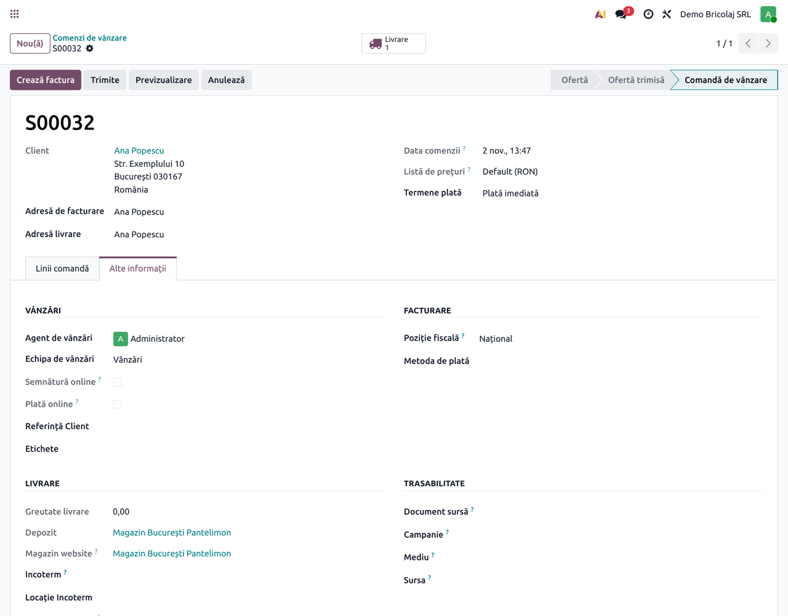

### Pasul 9 — Livrarea pleacă din magazin

La confirmarea comenzii, livrarea se creează în depozitul magazinului (aici `BPA/OUT/00002`), cu produsele
rezervate din stocul lui, gata de pregătit. La livrarea prin curier, adresa de livrare este a clientului;
la ridicarea din magazin, este punctul de ridicare (vezi fișa modulului de legătură).

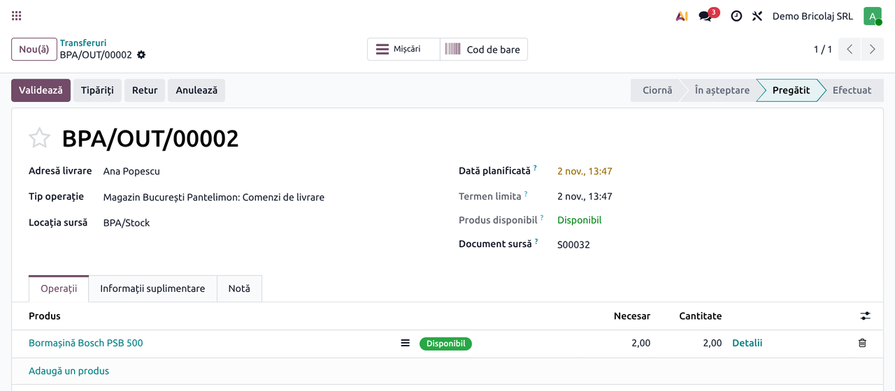

### Note de monografie și raportare

Modulul nu generează note contabile proprii. Livrarea din pasul 9 este o livrare standard Odoo, din depozitul
magazinului: notele de descărcare din gestiune, dacă evaluarea stocului e în timp real, sunt cele standard,
neschimbate de modul. Fiecare magazin este o gestiune separată, iar descărcarea se face pe gestiunea lui:
verificați la implementare tipul gestiunii fiecărui magazin (la preț de achiziție sau cu amănuntul) în
configurarea stocurilor RO. Pentru raportare, câmpul **Magazin website** permite gruparea comenzilor online
după magazinul ales (grupare personalizată în lista comenzilor).

## 7. Legături cu alte module / declarații

| Modul | Rol |
|---|---|
| `website_sale_stock` | baza: disponibilitatea pe website, limita din coș, avertizările; modulul schimbă doar depozitul pe care se calculează |
| `website_sale_collect` + `deltatech_website_store_selector_collect` | ridicarea din magazin: magazinul ales devine punctul de ridicare și invers; modulul de legătură se instalează automat |
| `deltatech_website_warehouse_stock` | afișează pe pagina de produs stocul depozitelor marcate pentru afișare pe site; se poate folosi împreună, dar nu ține cont de magazinul ales |
| `deltatech_website_stock_availability` | termene de livrare pe pagina de produs; nu a fost testat împreună cu acest modul, de verificat la implementare |

**Ce e automat:** stocul pe magazin în toate locurile din site, crearea coșului pe magazin, depozitul comenzii,
mutarea coșului la schimbarea magazinului, avertizările, realinierea coșului când clientul se loghează pe alt
dispozitiv sau când un magazin e scos din listă.

**Ce rămâne manual:** crearea depozitelor și a adreselor, bifarea magazinelor în setări, opțiunile de stoc pe
produse, programul magazinelor (dacă se folosește Click & Collect, pe depozit).

## 8. Verificări pentru consultant

- [ ] Fiecare magazin are depozit propriu, cu adresă și telefon pe contactul din **Adresa**.
- [ ] În **Alegerea magazinului** sunt bifate doar magazinele, nu depozitele centrale.
- [ ] Butonul **Magazinul tău** apare în header, pe calculator și pe telefon.
- [ ] Căutarea în listă găsește magazinele după oraș, fără diacritice.
- [ ] Pe un produs cu stoc doar într-un magazin, cardul și pagina de produs arată „În stoc” în acel magazin
      și „Indisponibil” în celelalte.
- [ ] Un produs cu stoc sub prag arată „Stoc limitat”, iar cu **Afișează disponibil** bifat și
      numărul de bucăți.
- [ ] La un produs cu variante, schimbarea variantei schimbă starea din bloc.
- [ ] Un coș creat pe magazinul A are **Magazin website** și **Depozit** = A.
- [ ] Schimbarea pe un magazin fără stoc afișează avertizarea, iar plata e blocată până la corectarea coșului.
- [ ] O comandă confirmată are livrarea în depozitul magazinului, cu produsele rezervate acolo.
- [ ] O pagină publică (de exemplu **Contactați-ne**), deschisă de doi vizitatori cu magazine diferite, arată
      fiecăruia magazinul lui în header.
- [ ] Testele automate trec:
      `./odoo/odoo-bin -c odoo.conf -d <db> -u deltatech_website_store_selector --test-enable --test-tags /deltatech_website_store_selector --stop-after-init`.

## 9. Mesaje de eroare frecvente

| Mesaj / simptom | Cauză | Remediere |
|---|---|---|
| „Magazinele selectabile trebuie să aparțină companiei website-ului.” | în setare e bifat un depozit din altă companie | alegeți doar depozitele companiei website-ului |
| „Acest magazin nu este disponibil pe acest website.” | o pagină veche încearcă să aleagă un magazin scos între timp din listă | reîncărcați pagina și alegeți din lista actuală |
| „Unele produse din coș nu sunt disponibile la <magazin> în cantitatea dorită.” | noul magazin nu are toate produsele din coș | **Verifică coșul**: reduceți cantitatea sau alegeți alt magazin |
| „Ați solicitat N <produs>, dar sunt disponibile doar M” | cantitatea din coș depășește stocul liber al magazinului | reduceți cantitatea sau schimbați magazinul |
| Butonul **Magazinul tău** nu apare | niciun magazin în setare, sau magazinul online e rezervat utilizatorilor autentificați și vizitatorul nu e logat | adăugați magazinele în **Alegerea magazinului**; verificați accesul la magazinul online din setările eCommerce |
| Setarea **Alegerea magazinului** nu apare | compania are un singur depozit | creați depozitele magazinelor |
| Produsul apare „Disponibil la comandă” deși magazinul e gol | produsul are **Vindeți când stocul este epuizat** bifat | debifați opțiunea pe produs |
| Distanța până la magazin nu apare | serverul nu are baza GeoIP; modulul **Geolocalizare** (`base_geolocalize`) nu e instalat; magazinele nu au coordonate; sau geolocalizarea automată a eșuat și a lăsat coordonatele 1000 / 1000, pe care modulul le ignoră | instalați baza GeoIP și modulul **Geolocalizare**; puneți coordonatele corecte în fila **Atribuire Partener** a contactului magazinului |

## 10. Capturi de ecran

Capturile sunt în `static/description/`, în limba română, făcute pe o bază de test locală cu trei magazine
demo (București, Cluj-Napoca, Iași), poziția fiscală națională, TVA 21%, prețuri afișate cu TVA și
traducerile RO la zi, cu un script Playwright care parcurge fluxul ca vizitator și ca administrator. Modulul nu are încă un test `tests/test_screenshots.py` (`ScreenshotCase`), deci capturile nu se
regenerează automat; la o modificare a ecranelor se refac cu skill-ul `fisa-screenshots`.

1. `01_depozit_magazin.png` — formularul depozitului unui magazin.
2. `02_setare_magazine_selectabile.png` — setarea Alegerea magazinului, cu trei magazine.
3. `03_produs_optiuni_stoc.png` — opțiunile de stoc ale produsului, fila Vânzări.
4. `04_buton_magazinul_tau.png` — header-ul cu butonul Magazinul tău, înainte de alegere.
5. `05_lista_magazine.png` — dialogul cu lista magazinelor.
6. `06_cautare_magazin.png` — căutarea fără diacritice în listă.
7. `07_lista_produse_stoc_magazin.png` — lista de produse cu stocul magazinului ales.
8. `08_pagina_produs_bloc_magazin.png` — pagina de produs cu blocul Magazinul tău.
9. `09_varianta_stoc_limitat.png` — blocul pentru o variantă cu stoc limitat.
10. `10_stoc_in_alte_magazine.png` — stocul variantei în fiecare magazin.
11. `11_avertizare_schimbare_magazin.png` — avertizarea la schimbarea magazinului cu coș.
12. `12_cos_cu_avertizare.png` — coșul cu linia fără stoc în noul magazin.
13. `13_telefon_lista_si_produs.png` — lista de produse și pagina de produs pe telefon.
14. `14_comanda_depozit_magazin.png` — depozitul și magazinul pe comandă.
15. `15_livrare_din_magazin.png` — livrarea creată și rezervată în depozitul magazinului.

## 11. Observații pentru manual

- Manualul pentru client poate urma pașii din secțiunea 6 în aceeași ordine; capturile sunt deja în română.
- Insistați pe diferența dintre **stocul magazinului** și stocul total: clientul care vede „Indisponibil în
  magazinul tău” poate găsi produsul în alt magazin, prin **Vezi disponibilitatea în celelalte magazine**.
- Prețurile nu diferă pe magazin: rămân cele ale website-ului.
- Paginile publice ale site-ului sunt păstrate în cache o singură dată pentru toți vizitatorii; modulul pune
  numele magazinului fiecăruia în header la afișare, deci nu e nevoie de nicio setare de cache.
- Modulul nu are filtrul „doar produsele în stoc în magazinul meu” și nu salvează magazinul pe contul
  clientului: alegerea ține de browser.
